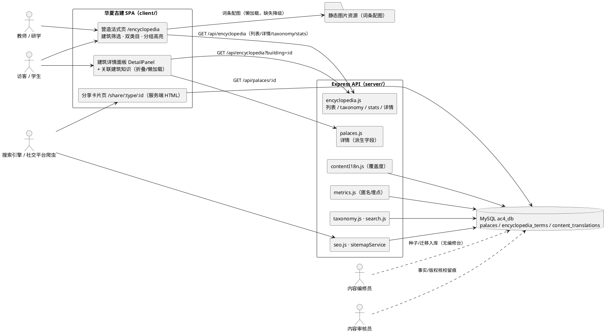
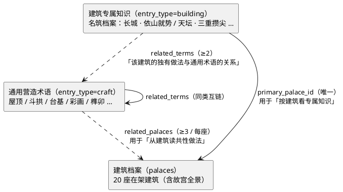
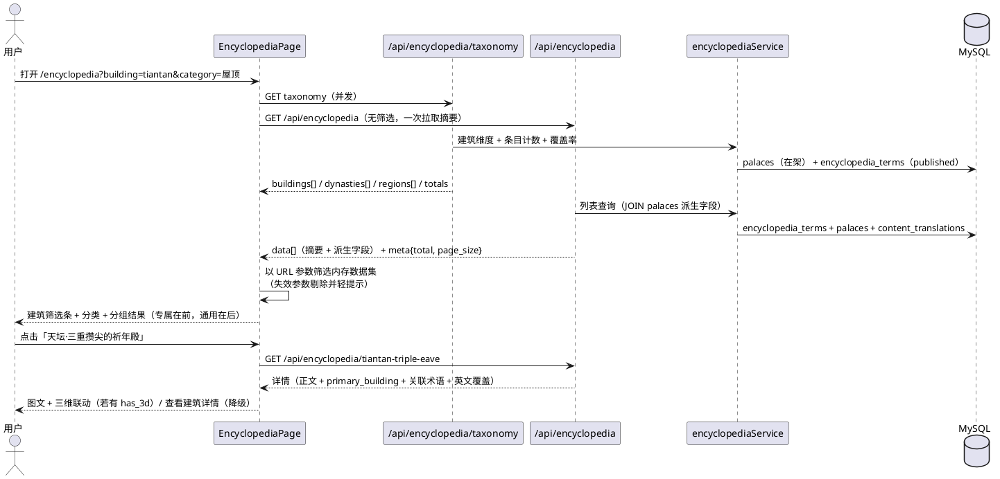
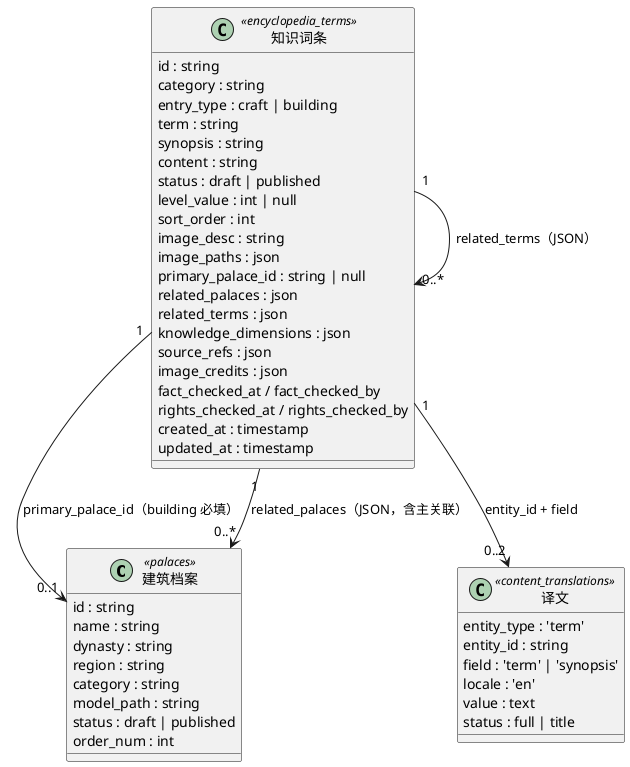
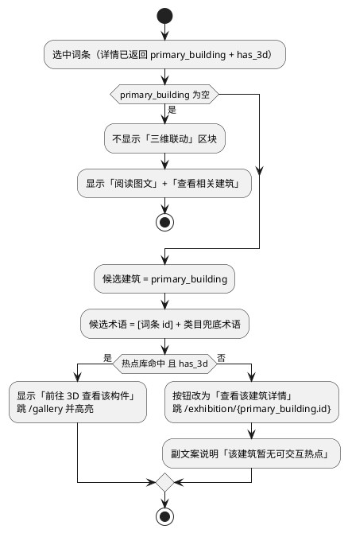
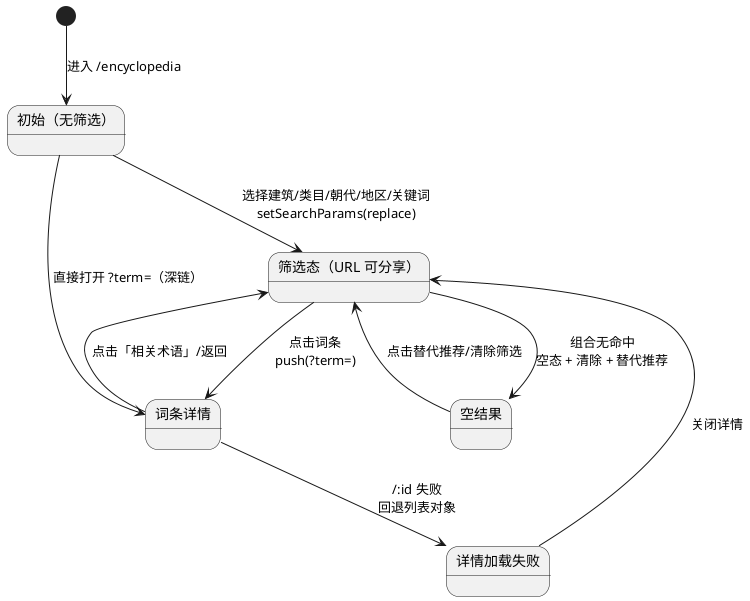

# 华夏古建可视化 · 建筑知识科普内容扩充 实现方案（技术设计）

| 项 | 内容 |
|---|---|
| 文档编号 | DESIGN-PUBLIC-BK-001 |
| 版本 | v1.0 |
| 状态 | 待评审（设计阶段，不授权编码） |
| 上游文档 | `docs/requirements/building-knowledge-enrichment-spec.md`（REQ-PUBLIC-BK-001，31 条 R-BK）<br/>`docs/requirements/s3-p2-requirements.md`（REQ-PUBLIC-S3P2-001，全局约束）<br/>`docs/design/s3-p2-design.md`（DESIGN-PUBLIC-S3P2-001，既有架构决策）<br/>`docs/tasks/s3-p2-tasks.md`（TASKS-PUBLIC-S3P2-001，迁移编号与红线）<br/>`docs/requirements/general-audience-enhancement-spec.md`、`docs/design/general-audience-enhancement-design.md`（参考） |
| 设计范围 | `/encyclopedia`（营造法式栏目）从「只有构件 + 只有故宫」扩展为「构件术语 ↔ 建筑知识」双主轴；含数据模型、迁移、接口扩展、前端筛选与反查、SEO/i18n、埋点、发布门槛 |
| 关联代码库 | `D:\Ancient-architecture\ac1.1\acvisual 4`（分支：建筑模型的功能修改，基线 55852d8） |
| 业务代码改动 | **无**（本阶段只输出实现方案，不修改前端/后端任何源文件） |
| 下游阶段 | 编码任务规划由 spec-task-agent 负责；本文档不产出 tasks.md |

> 本文档回答「How」。前端路径省略 `client/src/`，后端省略 `server/src/`，数据库脚本省略 `server/db/`。
> 文中行号基于当前仓库快照，仅用于定位，不构成契约。
> **口径声明**：覆盖率分母、总量下限、验收口径一律以数据库实时查询为准，**文档与代码中均不硬编码「20 座」「21 座」**（RQ §1.3-2）。
> **编号约定**：设计决策使用 `ADR-BK-xx`，验收映射使用 `R-BK-xx`，开放问题使用 `Q-BK-xx`，与既有 `ADR-S3-xx`、`R-S3-xx`、`Q-S3-xx` 互不覆盖。

---

## 目录

- [一、现状与问题复述](#一现状与问题复述)
- [二、总体方案与数据流](#二总体方案与数据流)
- [三、数据模型与迁移](#三数据模型与迁移)
- [四、内容清单（20 座建筑）](#四内容清单20-座建筑)
- [五、API 设计](#五api-设计)
- [六、前端设计](#六前端设计)
- [七、SEO 与 i18n](#七seo-与-i18n)
- [八、埋点与计量](#八埋点与计量)
- [九、发布门槛与数据校验](#九发布门槛与数据校验)
- [十、验收映射（R-BK-01~31）](#十验收映射r-bk-0131)
- [十一、风险与开放问题](#十一风险与开放问题)
- [十二、实施顺序与影响面清单](#十二实施顺序与影响面清单)
- [十三、附录：验收查询 SQL](#十三附录验收查询-sql)

---

# 一、现状与问题复述

## 1.1 需求要点与口径（先对齐，再设计）

本轮需求不是「再写几篇文章」，而是把栏目的**组织维度**从单轴扩为双轴，并让内容规模、关联关系、发布门槛、验收口径可测量。31 条需求的实现归属如下（详细映射见第十章）：

| 需求组 | 条目 | 设计归属 |
|---|---|---|
| 补齐范围与最低配置 | R-BK-01~05 | 三（数据模型与迁移）、四（内容清单）、八（计量） |
| 内容模型与数据迁移 | R-BK-06~12 | 三（数据模型与迁移） |
| 展示与交互 | R-BK-13~19 | 五（API）、六（前端） |
| 内容质量与版权 | R-BK-20~24 | 九（发布门槛与校验） |
| 多语言与 SEO | R-BK-25~27 | 七（SEO 与 i18n） |
| 计量与验收 | R-BK-28~31 | 八（埋点与计量）、十（验收映射） |

**已采用的默认口径**（需求阶段待确认项，本文档按此设计并登记开放问题）：

1. 覆盖分母 = 数据库 `palaces` 中 `status='published'` 的建筑，**排除需求指定的 10 座故宫单体白名单**；`gugong`（故宫全景）计入覆盖范围（RQ §1.3）。
2. 每座被覆盖建筑 ≥1 条「建筑专属知识」词条；≥3 条「通用营造术语」关联。
3. 双类目：`名筑档案`（建筑专属）与既有构件类目（通用营造术语）。
4. 不做：新路由、3D/视频、UGC、爬虫、全文翻译、独立编修台。

## 1.2 现状取证（GAP-BK）

> 以下为代码级事实，行号取自当前快照。需求文档的 GAP-BK-01~09 已全部复核成立，并补充 4 条本轮直接相关的实现级事实（GAP-BK-10~13）。

### 1.2.1 数据层

| 编号 | 事实 | 证据 |
|---|---|---|
| GAP-BK-01 | 26 条词条全部是通用营造术语，`category` 取值仅 `屋顶/斗拱/彩画/柱础/台基/门窗/脊兽/琉璃/纹饰/建筑规制/建筑装饰` | `server/db/init_full.sql:734-899`（种子段） |
| GAP-BK-02 | `related_palaces` 仅出现 10 座故宫单体 id，另有 1 条为空数组（`xuanshan-roof`） | 同上，如 `:739`、`:745`、`:751`、`:756` |
| GAP-BK-06 | `encyclopedia_terms` **无状态列**；`palaces.status` 有 `draft/published` 语义与索引 | `init_full.sql:180-195`；`migration_public_12_content_status.sql:6-33` |
| GAP-BK-07 | 百科英文覆盖被写死为 0 | `services/contentI18n.js:81-84`（`encyclopedia: { total, translated: 0 }`） |
| GAP-BK-10 | `encyclopedia_terms` **无 `updated_at`**，sitemap 目前只能用 `created_at` 兜底 | `init_full.sql:193`；`services/sitemapService.js:41-43,53-56` |
| GAP-BK-11 | 词条查询**不过滤发布状态**（sitemap、分享、搜索、列表均无 status 条件） | `sitemapService.js:41-43`；`shareCard.js:179-181,224-230`；`searchService.js:142-157`；`routes/encyclopedia.js:20-36` |
| GAP-BK-12 | `content_translations` 已有 `(entity_type, entity_id, field, locale)` 唯一键，但 `term` 类型无任何数据 | `migration_public_09_i18n.sql:7-18,34-41` |

### 1.2.2 前端层（硬编码取证）

| 编号 | 事实 | 证据 |
|---|---|---|
| GAP-BK-03 | 建筑名称映射硬编码 10 座故宫单体 | `pages/EncyclopediaPage.jsx:44-55`（`PALACE_NAMES`） |
| GAP-BK-03b | 建筑排序优先级硬编码 10 座故宫单体，非故宫一律 `99`（末位） | `pages/EncyclopediaPage.jsx:57-69,270-274`（`PALACE_PRIORITY`） |
| GAP-BK-03c | 三维联动兜底到太和殿：无匹配时 `ranked[0]` 或硬编码 `{id:'taihedian'}` | `pages/EncyclopediaPage.jsx:289-290` |
| GAP-BK-04 | 筛选仅「构件分类 + 关键词」，`filteredTerms` 只看 `category` 与关键词 | `pages/EncyclopediaPage.jsx:20-33,221-235` |
| GAP-BK-04b | 分类列表由数据反推，但只按硬编码 `CATEGORIES` 白名单过滤 → 新增类目（名筑档案）**不会出现在导航** | `pages/EncyclopediaPage.jsx:238-242` |
| GAP-BK-05 | 建筑详情面板只有「相关建筑」，无任何百科入口 | `components/DetailPanel.jsx:469-488` |
| GAP-BK-09 | 3D 热点仅覆盖部分故宫建筑；程序化建筑（应县木塔/佛光寺/岳阳楼）无热点 | `client/src/data/buildingHotspots.js:102-118` |
| GAP-BK-13 | 首屏导引看板文案硬编码故宫语境（「解读故宫彩画纹样寓意与等级」），且 4 张卡固定为构件类目 | `components/EncyclopediaGuide.jsx:7-32,51-70` |
| GAP-BK-14 | 词条正文按硬编码「故宫…」小节标题正则分块，非故宫词条会退化为普通段落 | `pages/EncyclopediaPage.jsx:324-334` |

> GAP-BK-13/14 不在需求 GAP 表中，但属于「栏目读起来只有故宫」的直接成因，本轮**必须随双主轴改造一并消除**，否则新增内容仍会被故宫语境的呈现框架「同化」。处理方式见 6.2、6.5。

### 1.2.3 接口层

| 接口 | 现状契约 | 与需求的冲突点 |
|---|---|---|
| `GET /api/encyclopedia`（`routes/encyclopedia.js:16-50`） | 支持 `category`、`search`；`SELECT *`（含全文 `content`）；无状态过滤；排序 `sort_order ASC, level_value ASC`；返回裸数组 `data` | 无建筑/朝代/地区维度；列表携带全文导致扩张后体积不可控；草稿会泄漏；无分页与 meta |
| `GET /api/encyclopedia/categories`（`:56-66`） | `SELECT DISTINCT category, category_icon` | 无计数、无 `entry_type`，前端无法区分两类 |
| `GET /api/encyclopedia/:id`（`:72-115`） | 返回 `related_palaces`/`related_terms` 原始 id 数组 + `_relatedTerms`/`_relatedPalaces`；无状态过滤；失败关联静默丢弃 | 主关联无法判定；草稿可被直接访问；无派生朝代/地区 |
| `GET /api/taxonomy`（`routes/taxonomy.js:8-30`） | 聚合 `palaces.category/region/dynasty` 与 `encyclopedia_terms.category`；10 分钟缓存 | 无「建筑维度」与「百科专属类目」，无覆盖率 |
| `GET /api/search`（`services/searchService.js:140-179`） | 词条搜索命中 `term/synopsis/content`，未过滤状态 | 草稿会出现在搜索建议与结果中 |
| `GET /sitemap.xml`（`sitemapService.js:41-43`） | 词条全量纳入，`lastmod=created_at` | 草稿会被收录；无更新时间 |
| `GET /share/:type/:id`（`shareCard.js:178-198`） | 词条查询无状态过滤，Article JSON-LD 直接输出 | 草稿可被分享与收录（违反 R-BK-09） |
| `GET /api/content/coverage`（`contentI18n.js:49-87`） | 百科翻译数恒为 0 | 无法反映真实英文覆盖（R-BK-25） |
| `GET /api/palaces/:id`（`routes/palaces.js:136-217`） | 已含 `images/timeline/funFacts/audio/video` | **无**关联知识字段；详情页无法反查（R-BK-16） |

## 1.3 需求功能与存量功能对比

### 1.3.1 已实现（直接复用，不改语义）

| 需求功能 | 存量功能 | 代码位置 | 匹配度 |
|---|---|---|---|
| 词条正文、摘要、图解、配图、关联字段的存储 | `encyclopedia_terms` 表（含 JSON 关联与 `image_paths`） | `init_full.sql:180-195` | 100% |
| 词条详情深链 `/encyclopedia?term=<id>` | 前端读取 `term` 查询参数并加载详情 | `pages/EncyclopediaPage.jsx:161-166,175-195` | 100% |
| 分类导航（构件类目） | 分类 chip + 数据反推 | `pages/EncyclopediaPage.jsx:397-411,238-242` | 75%（需支持新类目与计数） |
| 关键词搜索 | 列表接口 `search` 参数（`term/synopsis/content` LIKE） | `routes/encyclopedia.js:28-32` | 75%（需高亮与命中数） |
| 词条分享卡片与 Article 结构化数据 | `shareCard.buildJsonLd` 已对 `term` 输出 `Article` | `shareCard.js:102-114` | 75%（缺状态过滤） |
| 站点地图数据驱动 | `sitemapService.loadEntries` 含 term 分支、5 分钟缓存 | `sitemapService.js:37-62,68-96` | 75%（缺状态过滤与 lastmod） |
| 双语内容机制 | `content_translations` + `getTranslations` + 覆盖率接口 | `migration_public_09_i18n.sql`；`contentI18n.js:3-16,49-87` | 75%（term 分支与统计缺失） |
| 匿名埋点白名单 | `EVENT_NAMES` / `ALLOWED_PROP_KEYS` / `/api/metrics/events` | `lib/analytics.js:3-33,155-168`；`routes/metrics.js` | 75%（需扩 4 事件、3 属性） |
| 建筑派生元数据（名称/朝代/地区/类别/标签） | `palaces` 表 + `/api/taxonomy` 聚合 | `init_full.sql:46-79`；`routes/taxonomy.js:8-30` | 100% |
| 建筑详情面板折叠区块结构 | `DetailPanel` 的 accordion + `related-section` | `components/DetailPanel.jsx:248-488` | 100%（可直接挂新区块） |
| 发布门槛（建筑侧） | `palaces.status` + 编修台缺项自动转 draft | `migration_public_12_content_status.sql`；`routes/palaces.js:440-455` | 75%（需平移到词条） |
| 迁移幂等范式 | `information_schema` 判存 + `PREPARE/EXECUTE` | `migration_public_12_content_status.sql:6-33` | 100%（本轮回填沿用） |
| 契约快照 | `server/test/contract/encyclopedia.snapshot.json` 使用通配 `"*": "string"` | `server/test/contract.test.js:36-60` | 100%（新增字段不破坏快照） |

### 1.3.2 需要扩展（在既有基础上改造）

| 需求功能 | 存量功能 | 差异说明 | 扩展方向 |
|---|---|---|---|
| 双类目（R-BK-06） | 只有构件 `category` | ①无「建筑专属」判据；②前端 `CATEGORIES` 白名单会把新类目过滤掉 | 新增 `entry_type` 列（`craft`/`building`）+ 新类目 `名筑档案`；分类导航改为「由接口返回、前端不再白名单过滤」 |
| 主关联建筑唯一（R-BK-07） | `related_palaces` 数组无序、语义模糊 | ①数组无法表达「唯一主关联」；②无法索引 | 新增 `primary_palace_id` 单列 + 应用层唯一性校验；`related_palaces` 保留并强制包含主关联 |
| 词条发布门槛（R-BK-09） | 词条无状态 | 列表/搜索/反查/站点地图/分享 5 处均不过滤 | 新增 `encyclopedia_terms.status`，默认 `published`（保护既有 26 条），5 处查询统一加条件 |
| 建筑维度筛选（R-BK-13/14） | 仅 `category` + `search` | 无 building/dynasty/region；URL 无筛选状态 | 接口扩参 + 前端 URL 同步（`useSearchParams`）；筛选元数据由 taxonomy 派生 |
| 列表分组与高亮（R-BK-19） | 列表平铺 | 两类词条混排；无命中高亮 | 接口返回 `entry_type`；前端分组 + 角标；高亮复用 `searchService.findMatches` 的归一规则（前端轻量实现） |
| 建筑名称与排序派生（R-BK-17） | 前端 `PALACE_NAMES`/`PALACE_PRIORITY` | 硬编码 10 座、非故宫落末位 | **删除两份硬编码**，改用接口派生字段（`primary_palace_name`/`order_num`），3D 兜底改 `has_3d` 判定 |
| 三维联动降级（R-BK-18） | 兜底 `taihedian` | 程序化建筑无热点/模型 → 跳错建筑 | 接口返回 `has_3d`/`has_hotspot`；无则按钮改「查看建筑详情」 |
| 建筑详情反查（R-BK-16） | 详情面板无百科入口 | 无数据来源、无 UI | 复用 `GET /api/encyclopedia?building=`（懒加载），`DetailPanel` 新增折叠区块 |
| 英文分级覆盖（R-BK-25） | 覆盖率恒 0 | term 无翻译数据、无统计 | 写入 `content_translations(entity_type='term', field='term'/'synopsis')`；改 `getCoverage` 统计 |
| 站点地图更新时间（R-BK-26） | 只用 `created_at` | 迁移回填后 `created_at` 不变，`lastmod` 失真 | 新增 `updated_at` 列；sitemap 用 `COALESCE(updated_at, created_at)` |
| 筛选页 noindex（R-BK-27） | fallback 仅对 `/search`、`/profile`、`/curator` 加头 | `/encyclopedia?building=` 会被当作可索引页 | `app.js` fallback 增加「带筛选参数的 `/encyclopedia`」判断 → `X-Robots-Tag: noindex, follow` |

### 1.3.3 需要新增（存量完全没有）

| 模块 | 功能点 | 输入 | 输出 | 依赖 |
|---|---|---|---|---|
| 内容数据 | 10 座非故宫建筑的专属词条（≥1/座） | 内容清单（第四章） | `entry_type='building'` 的词条 | 来源与版权核校 |
| 内容数据 | 7 条通用营造术语（夯土版筑、烽燧关隘、条石砌筑、崖壁开窟、壁画彩塑、飞檐翼角、环形围合） | 术语定义 | `entry_type='craft'` 的词条 | 同上 |
| 内容数据 | 既有 26 条 `related_palaces` 追加非故宫建筑（只增不改） | 建筑 id 清单 | 追加后的 JSON 数组 | 幂等迁移 |
| 接口 | `GET /api/encyclopedia/taxonomy` | 无（或 `lang`） | 可筛选建筑/朝代/地区 + 条目计数 + 覆盖率 + 总量下限 | `palaces`、词条表 |
| 接口 | 列表接口扩展参数 `building/dynasty/region/entry_type/page/page_size/summary` | 查询串 | 精简词条摘要 + `meta` | 词条表 JOIN 建筑 |
| 接口 | 覆盖率与总量统计 | 无 | `{published, expected_min, coverage_rate, per_building[]}` | 词条表 JOIN 建筑 |
| 数据 | 词条审核留痕（事实核校、版权核校、来源、配图许可） | 内容侧填写 | 4+2 列 + 2 JSON 列 | 迁移 |
| 脚本 | `scripts/content-check-bk.mjs`（发布门槛可执行校验） | 数据库连接 | 违规清单 + 退出码 | 第九章规则 |
| 前端 | 建筑筛选器 + 朝代/地区筛选 + URL 状态 | taxonomy 数据 | 可分享 URL | 无 |
| 前端 | 列表分组/角标/高亮/空态替代推荐 | 列表数据 | 视觉分组 | 无 |
| 前端 | 详情面板「关联建筑知识」折叠区块 | `palace.id` | 专属 + 通用词条入口 | 列表接口 |
| 埋点 | 4 个事件 + 3 个属性键 | 用户行为 | 匿名事件 | `lib/analytics.js` |
| 迁移 | `migration_public_16_building_knowledge.sql` + 回滚脚本 | — | 列、索引、种子、回填 | 第十六编号 |

## 1.4 存量功能详细分析（只列本轮直接依赖项）

### 1.4.1 词条读取接口的契约与约束

**接口契约**
- `GET /api/encyclopedia`：无鉴权；`data` 为**裸数组**（`routes/encyclopedia.js:45`），字段来自 `SELECT *`，`related_palaces`/`related_terms` 经 `safeJSON` 归一为数组。
- `GET /api/encyclopedia/:id`：无鉴权；`data` 为单条 + 两个下划线私有字段 `_relatedTerms`、`_relatedPalaces`（`:97,107`）。
- 关联查询使用 `IN (?, ?, ...)` 动态占位符（`:92-96`、`:102-106`），空数组时跳过。

**约束（设计必须继承）**
1. **响应包装**沿用 `{ success, data, message?, error?, code? }`；新增字段只增不改，缺失值为 `null`/`[]`，不得出现 `undefined`（DFX-S3-C2）。
2. **`/:id` 必须晚于静态段路由**：现有 `/categories` 定义在 `/:id` 之前（`:56` vs `:72`），新增 `/taxonomy` / `/stats` 必须插在 `:id` 之前，否则会被当作词条 id（既有 `palaces.js:96-101` 已因同类问题写过注释）。
3. **不得破坏 `_relatedTerms` / `_relatedPalaces`**：前端 `EncyclopediaPage.jsx:255-261,302` 已消费；可保留并在其上新增派生字段。
4. **不得返回草稿**（新增约束）：需在列表、详情、搜索、分享、sitemap 五处统一加 `status='published'`。

### 1.4.2 前端百科页的数据流与约束

**现状数据流（一次全量拉取 + 内存筛选）**
1. 挂载 → `getEncyclopediaTerms()`（无参数，全量）→ `terms`（`EncyclopediaPage.jsx:152-172`）。
2. `filteredTerms = f(terms, activeCategory, searchQuery)`（`:221-235`）——纯内存。
3. 选中词条 → `getEncyclopediaTerm(id)`（`:183-195`），失败时从 `terms` 里兜底。
4. `modelTarget` 由 `selectedTerm._relatedPalaces` + 硬编码映射 + 热点库推导（`:252-297`）。

**约束**
1. **不新增路由**（OOS-BK-09）：筛选与反查都在 `/encyclopedia` 与 `/exhibition/:id` 现有页面内完成。
2. **`?term=` 深链必须保持可用**（DFX-BK-C1）：`loadTerms` 内直接读 `window.location.search`（`:161-166`），改造为 `useSearchParams` 后必须保留该行为。
3. **不整页刷新**（DFX-BK-P2）：筛选只能改组件状态与 URL（`replaceState` 语义），不得 `navigate(0)` 或刷新。
4. **样式新起选择器**（TR-09 延续）：`styles/encyclopedia.css` 已有 `.encyclopedia-cat-chip`、`.encyclopedia-term-item` 等类，新增筛选器与角标必须新增类名并追加到文件末尾，不改写既有选择器规则。

### 1.4.3 taxonomy / 搜索 / 站点地图 / 分享的横切约束

| 组件 | 现有行为 | 本轮必须对齐的点 |
|---|---|---|
| `routes/taxonomy.js` | 4 条 DISTINCT 查询 + 10 分钟内存缓存；异常时返回缓存或空结构 | 新增字段只能**追加**（`terms` 键保留）；新接口不复用该缓存的失效语义，避免「发布后 10 分钟才可见」与 R-BK-09 冲突（词条 taxonomy 用 60 秒短缓存或不缓存） |
| `services/searchService.js` | 词条组查询无状态过滤；`href=/encyclopedia?term=<id>` | 加 `status='published'`；命中数 `total` 需与筛选后一致（R-BK-31 回归「斗拱」命中不减少） |
| `services/sitemapService.js` | entries 全量拼接；`lastmod` 无效值自动省略 | 词条分支加状态过滤；`lastmod` 取 `COALESCE(updated_at, created_at)` |
| `services/shareCard.js` | term 查询无状态过滤；`buildCanonical` 固定 `/encyclopedia?term=` | 加状态过滤；草稿时 `getShareContent` 返回 `null` → 走「内容已调整」友好页（既有分支） |
| `services/contentI18n.js` | `getCoverage` 百科 translated 恒 0 | 改为真实统计；`ui` 分支保持不变（既有测试 `content-coverage.test.js` 期望结构） |

### 1.4.4 迁移与测试机制（决定文件名与写法）

**事实**
1. 现有 `migration_public_00~15`，下一个可用序号 **16**；`RED-01` 明确禁止 `migration_public_16_ugc_public.sql`（`docs/tasks/s3-p2-tasks.md:70`）。
2. `server/test/migration-idempotent.test.js:32-58` 会**先执行 `init_full.sql`，再把 `server/db` 下所有 `migration_public_*.sql` 连续执行两遍**——因此新迁移必须在「`init_full` 已含种子 + 列已存在」的前提下不重复插入、不报错。
3. 迁移脚本命名 `migration_public_*.sql` 会被自动纳入幂等测试；**回滚脚本不得使用该前缀**，否则会被当作迁移执行。
4. `server/test/contract.test.js` 依赖 `contract/*.snapshot.json`；百科快照为 `{"data":[{"*":"string"}],"success":"boolean"}`，**新增字段不会破坏快照**。
5. 后端测试文件在 `server/package.json` 的 `test` 脚本中**显式枚举**，新增测试必须登记，否则不执行（`docs/tasks/s3-p2-tasks.md:60`）。

**设计结论**：新迁移命名 `migration_public_16_building_knowledge.sql`；回滚命名 `rollback_public_16_building_knowledge.sql`（不匹配 `migration_public_*`，不被自动执行）；如需验收脚本，命名 `scripts/content-check-bk.mjs` 与 `scripts/verify-bk-coverage.mjs`。

### 1.4.5 无障碍与降级基线（沿用，不新造）

1. `--ink` / `--ink-light` 承载正文与摘要（DFX-A4 / DFX-BK-A4），不得用低对比灰。
2. `prefers-reduced-motion` 已在 `global.css` 统一归零（`styles/global.css:115-130`），新增筛选过渡必须继承。
3. 现有列表用 `AnimatedList` 提供键盘选项与 `selectedKey`（`EncyclopediaPage.jsx:419-452`）；新增分组时**不得**把 `AnimatedList` 拆成多个独立滚动容器（会破坏键盘连续导航）。

## 1.5 覆盖对象与基数口径（验收争议防线）

1. **覆盖对象**：`palaces.status='published'` 且 `id NOT IN (需求指定的 10 座故宫单体)`。该 10 座白名单是**需求定义**（RQ §1.3-1），不是实现侧的「只列部分建筑」硬编码；分母 `COUNT(*)` 始终来自查询。
2. **禁止硬编码总量**：`26 + 非故宫建筑数` 与「不低于 40」由查询计算（`/api/encyclopedia/stats` + 附录 SQL）；前端、文案、测试断言都不得出现 `20`、`21`、`40` 作为「固定事实」（`40` 只允许作为「下限兜底常量」出现一次，并命名为 `MIN_PUBLISHED_TERMS`）。
3. **`gugong` 计入覆盖**：其专属词条定位为「宫城整体」，与 10 座单体不重复。
4. **新建筑进入在架清单**：覆盖率分母自动变化，未补内容的建筑在 taxonomy 中标记 `covered=false`，前端显示「知识待补充」而非空白（RQ §5.1.4-2）。

---

# 二、总体方案与数据流

## 2.1 设计目标

| 编号 | 目标 | 可验证判据 |
|---|---|---|
| DG-BK-01 | 双主轴成立：构件术语与建筑知识是**并列一等**的浏览入口，且数据层面可区分、可筛选、可反查 | R-BK-06/13/16/29 |
| DG-BK-02 | 覆盖可测量：覆盖率、总量下限、每座建筑的专属/通用关联数全部由查询给出 | R-BK-01~03/29 |
| DG-BK-03 | 增量不回归：既有 26 条词条的 id/term/category/正文与 `/encyclopedia?term=` 深链完全不变 | R-BK-12/31 |
| DG-BK-04 | 去硬编码：建筑名称、顺序、朝代、地区、是否可 3D 联动一律由数据派生 | R-BK-17/18/08 |
| DG-BK-05 | 发布可控：草稿在列表/搜索/反查/站点地图/分享/首页推荐中**物理不可见** | R-BK-09/23/26 |
| DG-BK-06 | 内容敢对外：来源、事实核校、版权核校、字数与结构下限可逐条核对 | R-BK-20~24 |
| DG-BK-07 | 可分享可收录：筛选状态进 URL 且可还原；筛选页不单独索引；词条走规范地址 | R-BK-14/26/27 |
| DG-BK-08 | 增量可回滚：迁移幂等、回填只增不改、回滚脚本独立 | R-BK-10/11 |

## 2.2 设计约束（代码事实 → 设计约束）

| 编号 | 约束事实 | 证据 | 对设计的影响 |
|---|---|---|---|
| CS-BK-01 | 词条表无状态列，列表/搜索/分享/sitemap 均不过滤 | 见 GAP-BK-06/11 | 必须新增 `status` 并以「默认 published」保护既有 26 条；5 处查询统一收口 |
| CS-BK-02 | `related_palaces` 是无序 JSON 数组，无法表达主关联 | `init_full.sql:189` | 必须新增 `primary_palace_id` 单列，禁止用「数组第 0 个」隐式约定（数组顺序不可靠，既有数据即可为空数组） |
| CS-BK-03 | 前端两份故宫硬编码 + 太和殿兜底 | `EncyclopediaPage.jsx:44-69,289` | 必须删除并按接口派生；删除后 `modelTarget` 允许为 `null`，UI 需有「无联动」分支 |
| CS-BK-04 | 列表接口 `SELECT *` 返回全文 | `routes/encyclopedia.js:20-36` | 词条扩到 60+ 后 payload 需瘦身：列表默认不含 `content`，新增 `include=content` 显式开关 |
| CS-BK-05 | 前端一次全量拉取 + 内存筛选 | `EncyclopediaPage.jsx:152-235` | 保留「一次拉取」策略（规模可控），但必须加 `page_size` 上限保护与 `meta.total`，为未来服务端分页留口 |
| CS-BK-06 | `/:id` 与静态段路由共存，顺序敏感 | `routes/encyclopedia.js:56,72` | 新增 `/taxonomy`、`/stats` 必须插在 `/:id` 之前 |
| CS-BK-07 | 迁移幂等测试会把 `init_full` + 全部 `migration_public_*` 连跑两遍 | `test/migration-idempotent.test.js:32-58` | 新迁移必须「列判存 + 索引判存 + 种子 ON DUPLICATE 空更新 + 回填 NOT EXISTS/JSON_CONTAINS 判重」 |
| CS-BK-08 | 回滚脚本若用 `migration_public_` 前缀会被自动执行 | 同上 | 回滚用 `rollback_public_16_*` 前缀 |
| CS-BK-09 | `content_translations` 唯一键 `(entity_type, entity_id, field, locale)` | `migration_public_09_i18n.sql:16` | 英文标题/摘要直接复用，`status` 承载分级覆盖（`full`/`title`），不新增列 |
| CS-BK-10 | SPA fallback 只能加响应头，不能注 meta | `app.js:72-89` | 筛选页 noindex 用 `X-Robots-Tag`；canonical 由前端 `<link>` 承担（ADR-BK-09 记录其局限） |
| CS-BK-11 | 关联建筑查询当前 `IN (...)` 一次批量取 | `routes/encyclopedia.js:101-108` | 派生字段建议用「一次 JOIN + 一次批量补名」，禁止 N+1（DFX-BK-P3） |
| CS-BK-12 | 3D 热点库仅部分建筑有数据 | `client/src/data/buildingHotspots.js:102-118` | 「是否可联动」必须在服务端可判定（`has_3d`）或前端用「热点存在 + 模型存在」双条件，不允许兜底到其他建筑 |
| CS-BK-13 | 既有分类导航键值被前端 `CATEGORIES` 白名单约束 | `EncyclopediaPage.jsx:238-242` | 新类目「名筑档案」必须进入导航；前端改为以接口返回为准（白名单只负责图标与文案） |

## 2.3 关键设计决策（ADR-BK）

> 每条含「选择 / 否决 / 理由 / 代价」。后续章节落点以此为准。

**ADR-BK-01（双类目）用 `entry_type` 显式列，而非「看 category 文案」**
- 选择：新增 `encyclopedia_terms.entry_type VARCHAR(16) NOT NULL DEFAULT 'craft'`，取值 `craft`（通用营造术语）/ `building`（建筑专属知识）；`building` 必须同时满足 `category='名筑档案'`，由应用层校验（迁移期用回填 + 校验 SQL 保证）。
- 否决：①只用 `category='名筑档案'` 判类（类目名是展示文案，Q-BK-07 尚未定稿，改名即破坏筛选与统计，形成「第二套事实」）；②新建 `term_types` 字典表（3 个取值的字典表属于过度建模）。
- 理由：筛选、计数、覆盖率三个查询都需要**稳定判据**；`entry_type` 与展示类目解耦，符合 R-BK-06「必须独立类别」与 R-BK-08「单一事实来源」。
- 代价：一次列新增与回填；`entry_type` 与 `category` 的一致性需靠应用层 + 校验脚本双保险（RD 见九章）。

**ADR-BK-02（主关联）新增 `primary_palace_id` 单列，`related_palaces` 保留并强制包含它**
- 选择：`primary_palace_id VARCHAR(50) NULL`；`entry_type='building'` 时必须非空（应用层 + 校验脚本）；`related_palaces` 作为「展示用关联集合」继续存在，写入时保证包含主关联；`GET /:id` 返回 `primary_building` 与 `related_palace_details`（后者过滤下架建筑，见 R-BK-07）。
- 否决：①约定「`related_palaces[0]` 即主关联」（数组顺序在 JSON 中不可靠，既有数据已存在空数组）；②新增 `is_primary` 标记在数组元素内（JSON 结构更复杂、无法索引）。
- 理由：唯一性需要**单值列**才能加索引、才能做「一建筑一主关联」的校验与筛选；同时保留 JSON 以维持 `_relatedPalaces` 兼容（DFX-BK-C1）。
- 代价：两处数据需保持一致（写入路径单一：迁移 + 未来编修接口都走同一个 `normalizeTermRelations` 函数）。

**ADR-BK-03（related_palaces 规范化取舍）保留 JSON + 单列主关联，暂不建关联表**
- 选择：`related_palaces` 保持 JSON 数组；反查与筛选使用 `primary_palace_id`（索引）+ `JSON_CONTAINS(related_palaces, JSON_QUOTE(?))`（小表全扫可接受）；在 `/api/encyclopedia/taxonomy` 层做**一次性聚合缓存**（≤60 秒），把「每座建筑的专属数/通用数」算出来。
- 否决：新建 `encyclopedia_term_palaces(term_id, palace_id, is_primary)` 关联表。原因：①需要双向回填与双写一致性；②迁移风险显著高于收益（OOS-BK-07 明确「仅在 JSON 不足以支撑筛选时演进」）；③当前规模（词条 < 300、建筑 20）下 `JSON_CONTAINS` 全扫在毫秒级。
- 理由：需求真正需要索引的只有「主关联（用于筛选与反查的分组）」——单列已覆盖；「某建筑被哪些通用术语关联」是聚合用途，缓存后不进入热路径。
- 代价：`JSON_CONTAINS` 无索引，**演进触发条件**写入约束：当已发布词条 > 1000 条或反查接口 P95 > 100ms 时，按 ADR-BK-03 的预留方案新建关联表（届时迁移编号顺延，且必须幂等可回滚）。该阈值与「不演进」的现状登记为 Q-BK-11。

**ADR-BK-04（发布门槛）词条状态并入统一内容状态语义，不新建审批表**
- 选择：`encyclopedia_terms.status VARCHAR(16) NOT NULL DEFAULT 'published'`（`draft`/`published`），并沿用 `palaces.status` 的语义；审核留痕用 4 列（`fact_checked_at`/`fact_checked_by`/`rights_checked_at`/`rights_checked_by`）+ 2 个 JSON（`source_refs`/`image_credits`）。发布判定由**校验函数**统一执行（第九章），不新增 `term_reviews` 表。
- 否决：独立审批流水表（本轮无编修台、无审批 UI，建表即空转，且与 Q-BK-06「本轮沿用种子/迁移」冲突）。
- 理由：`palaces.status` 已在 5 处消费，语义复用成本最低；留痕字段足以支撑「谁、何时、依据」的书面核校（R-BK-23）。
- 代价：留痕为「最终状态」而非「审批历史」；若未来需要多轮审批，再引入流水表（登记 Q-BK-12）。

**ADR-BK-05（筛选位置）列表仍一次拉取 + 前端内存筛选，接口保留服务端筛选参数**
- 选择：`GET /api/encyclopedia` 新增 `building/category/entry_type/dynasty/region` 参数（服务端过滤，供深链、反查、未来分页使用），但**默认前端只调用一次不带筛选参数的请求**，在内存完成组合筛选；`page_size` 默认 200、上限 500。
- 否决：①改成「每次筛选一次请求」（DFX-BK-P2 的 200ms 在弱网下不稳，且会引入加载闪烁与竞态）；②纯前端不分页硬扛（词条 > 500 时首屏必然劣化）。
- 理由：当前规模（数十条摘要）一次拉取最稳、最快、最省请求；URL 只做状态镜像，不承担数据获取职责；服务端参数为「反查」与「未来扩展」保留能力。
- 代价：`meta.total` 与 `filters_applied` 必须由服务端在无筛选请求时也返回，前端才能正确显示「共 N 条」；> 500 条时前端需降级为按 URL 参数请求（写入六章 6.6）。

**ADR-BK-06（建筑派生）名称/朝代/地区/顺序/可联动性全部服务端派生**
- 选择：列表与详情响应新增派生字段：`primary_palace_name`、`primary_palace_dynasty`、`primary_palace_region`、`primary_palace_order`、`has_3d`（`model_path` 非空且非 `procedural:` 前缀或前端支持的程序化建筑清单）、`has_hotspot`（前端热点库判定，仅用于按钮文案，不参与筛选）；前端**删除** `PALACE_NAMES`/`PALACE_PRIORITY`。
- 否决：①保留前端映射并补齐 10 座（违反 R-BK-17，且新增建筑必然再漏）；②把朝代/地区冗余到词条列（违反 R-BK-08 单一事实）。
- 理由：`palaces` 是唯一事实源，一次 JOIN 即可派生；改建筑朝代时词条筛选自动跟随（R-BK-08 验收）。
- 代价：列表查询从单表变为 `LEFT JOIN palaces`；无主关联的通用术语派生字段为 `null`，前端需空值兜底（不得显示 `null`）。

**ADR-BK-07（覆盖率口径）由 `/api/encyclopedia/stats` 与附录 SQL 双实现，口径同源**
- 选择：覆盖率定义为「在架非故宫建筑中，`entry_cnt>=1` 且 `craft_cnt>=3` 的占比」；`expected_min = 26 + 非故宫建筑数`，下限兜底常量 `MIN_PUBLISHED_TERMS = 40`；接口与验收 SQL 使用**同一段 FROM/WHERE**（服务层导出 `COVERAGE_SQL_FRAGMENT`，脚本直接引用同义结构但独立书写，二者必须由单测比对结果一致）。
- 否决：只在前端算覆盖率（分母会随拉取失败而错，且无法被验收脚本复现）。
- 理由：R-BK-03/29 明确「必须由查询推算」「可由一条查询复现」。
- 代价：统计接口需缓存（60 秒）避免每次列表刷新都跑聚合；缓存失效于迁移后由脚本显式清理。

**ADR-BK-08（3D 联动降级）服务端给能力标志，前端做最终判定，绝不跨建筑兜底**
- 选择：详情响应给出 `primary_building.has_3d`；前端 `modelTarget` 解析顺序改为「主关联建筑 → `has_hotspot` 命中 → 无则 `null`」；`null` 时按钮文案改为「查看该建筑详情」→ `/exhibition/:id`；删除 `taihedian` 兜底与「其他关联建筑」跨建筑跳转中的无热点项（改为跳建筑详情）。
- 否决：保留兜底但加提示（R-BK-18 明确「禁止跳到不相关建筑」，提示不能消除错误跳转）。
- 理由：联动目标是「看这座建筑的构件」，主关联建筑是唯一正确目标；无热点时仍可看建筑本身。
- 代价：部分既有通用术语（如「须弥座」主关联为空）将没有主按钮，只显示「阅读图文」；这是正确降级，需在 UI 文案上解释清楚。

**ADR-BK-09（筛选页 SEO）响应头 noindex + 前端 canonical，接受 SPA 局限**
- 选择：`app.js` fallback 对 `/encyclopedia` 且 query 含 `building|category|entry_type|dynasty|region|q` 的请求设置 `X-Robots-Tag: noindex, follow`；前端在筛选态把 `<link rel="canonical">` 指向 `/encyclopedia`（无筛选参数），在 `?term=` 态指向 `/encyclopedia?term=<id>`。
- 否决：①服务端 302 到规范地址（会破坏「可分享筛选链接」的用户价值）；②依赖 SPA 动态 meta 让爬虫识别（多数爬虫首屏不执行 JS，不能作为唯一手段）。
- 理由：`X-Robots-Tag` 是 SPA 下唯一「每次请求都生效」的机制（沿用 ADR-S3-10 的既有结论）；canonical 作为协作补充。
- 代价：canonical 对不执行 JS 的爬虫不可见；已登记为 Q-BK-13（是否需要在 fallback 注入最小 HTML head 的后续方案）。

**ADR-BK-10（英文覆盖）复用 `content_translations`，`term` 实体 + `full/title` 分级**
- 选择：英文标题写入 `field='term'`、摘要写入 `field='synopsis'`，`status='full'`；只有标题无摘要时标题行 `status='title'`；`getCoverage` 统计 `entity_type='term'` 且 `field IN ('term','synopsis')` 且 `status='full'` 的去重 `entity_id` 数；未覆盖时前端回退中文并显示 `English coming soon`。
- 否决：新增 `term_en`/`synopsis_en` 列（与既有 i18n 机制重复，且覆盖率接口要写两套统计）。
- 理由：DFX-BK-I2 要求「英文覆盖度必须在既有覆盖度接口中可见」；复用唯一键即可幂等写入。
- 代价：`content_translations` 行数增长（每条词条 2 行英文）；`getCoverage` 需 1 次额外聚合（可合并到现有查询）。

**ADR-BK-11（迁移策略）列/索引判存 + 种子空更新 + 回填判重，回滚脚本独立命名**
- 选择：`migration_public_16_building_knowledge.sql`：①`ALTER TABLE ... ADD COLUMN` 前查 `information_schema.columns`；②索引前查 `information_schema.statistics`；③种子用 `INSERT ... ON DUPLICATE KEY UPDATE id=id`（命中即不改正文）；④回填用 `UPDATE ... WHERE ... AND NOT JSON_CONTAINS(...)`；⑤`init_full.sql` 同步：表定义加列、种子段追加、末尾追加「公开迁移 16」幂等段；⑥回滚脚本 `rollback_public_16_building_knowledge.sql`（不作为迁移被自动执行）。
- 否决：①`DROP + CREATE`（会毁掉既有 26 条）；②`INSERT IGNORE`（会吞掉非重复键错误，无法定位数据问题）；③把回滚写在迁移注释里（不可执行、无法验证）。
- 理由：满足 R-BK-10/11 与既有幂等测试（连跑两遍）；回滚可执行、可演练。
- 代价：脚本较长（列 + 索引 + 种子 + 回填 + 校验）；需在 `ac4_test` 上演练一次（见 3.7）。

**ADR-BK-12（埋点）新增 4 事件 + 3 属性，不改变既有 17 事件语义**
- 选择：新增 `encyclopedia_term_view`、`encyclopedia_term_open`、`encyclopedia_filter_building`、`encyclopedia_reverse_click`；`ALLOWED_PROP_KEYS` 追加 `entry_type`、`palace_id`、`result_count`；筛选类事件用 `category` 承载筛选键、`stage` 承载筛选值（复用既有白名单键，减少新增面）。
- 否决：新造 `filter_key`/`filter_value` 双键（白名单膨胀，且语义与既有 `category` 重叠）。
- 理由：R-BK-28 要求四类行为可统计且属性在白名单内；复用既有键可避免前后端白名单漂移。
- 代价：语义略抽象（`category` 在筛选事件中表示筛选维度），需在埋点字典注释中写明。

**ADR-BK-13（内容分批）首批 5 座高可考据建筑，二批补齐 + 每座第 2 条**
- 选择：批次 1 = 天坛、应县木塔、佛光寺东大殿、长城、福建土楼（权威资料最充分、与既有术语关联最强）；批次 2 = 莫高窟、布达拉宫、黄鹤楼、岳阳楼、故宫全景；每座第 2 条专属词条作为批次 2 的可选增量（Q-BK-02）。
- 否决：一次铺满 10 座（R-BK-01 风险项：资料与审核人力不可控）。
- 理由：R-BK-05 允许分批但要求「已交付批次 100% 覆盖」；首批 5 座可先验证体例与门槛。
- 代价：批次 1 交付后覆盖率看起来只有 ~50%，必须由统计接口真实展示进度（不得四舍五入成 100%）。

## 2.4 上下文视图



**通信协议与频率**

| 链路 | 协议 | 频率 | 备注 |
|---|---|---|---|
| SPA → `/api/encyclopedia`（列表） | HTTP JSON | 首次进入栏目 1 次 | 默认不含全文，`page_size<=500` |
| SPA → `/api/encyclopedia/taxonomy` | HTTP JSON | 首次进入栏目 1 次（与列表并发） | 服务端 60 秒缓存 |
| SPA → `/api/encyclopedia?building=` | HTTP JSON | 建筑详情面板展开时 1 次 | 懒加载，不进入首屏请求数（DFX-BK-P4） |
| SPA → `/api/encyclopedia/:id` | HTTP JSON | 每次选中词条 1 次 | 失败回退到列表内存对象（既有行为） |
| 爬虫 → `/sitemap.xml` | HTTP GET | 低频（日级） | 只含 `published` 词条；5 分钟缓存 |
| 爬虫/社交 → `/share/term/:id` | HTTP GET HTML | 低频 | 草稿返回「内容已调整」页 + noindex |
| SPA → `/api/metrics/events` | Beacon/JSON | 批量 5 条 | 事件名与属性受白名单约束 |

## 2.5 服务 / 组件总体架构

```plantuml
@startuml
skinparam componentStyle rectangle
skinparam shadowing false
top to bottom direction

package "client/src" {
  [pages/EncyclopediaPage.jsx\n- 删除 PALACE_NAMES/PRIORITY\n+ BuildingFilter / DynastyFilter / RegionFilter\n+ URL 状态同步\n+ 分组角标与命中高亮\n+ 空态替代推荐]
  [components/DetailPanel.jsx\n+ KnowledgeSection（折叠 + 懒加载 + 失败静默）]
  [components/EncyclopediaGuide.jsx\n故宫语境文案 → 数据驱动导引]
  [lib/encyclopediaFilters.js（新增）\n参数白名单 / URL 序列化 / 失效参数剔除]
  [lib/analytics.js（扩展 4 事件 + 3 属性）]
  [styles/encyclopedia.css（末尾追加新类）]
}

package "server/src" {
  [routes/encyclopedia.js\n+ /taxonomy /stats（置于 /:id 之前）\n+ 列表参数与字段瘦身\n+ 状态与关联有效性过滤]
  [services/encyclopediaService.js（新增）\n查询组装 / 派生字段 / 分类计数 / 覆盖率\n/ 关联有效性收敛 / 发布门槛校验入口]
  [services/contentI18n.js\n+ term 覆盖统计与词条译文读取]
  [services/sitemapService.js\n+ 状态过滤 + updated_at]
  [services/shareCard.js\n+ term 状态过滤]
  [services/searchService.js\n+ term 状态过滤]
  [routes/palaces.js\n+ knowledge_counts（可选，详情页首屏不新增请求）]
  [routes/taxonomy.js\n+ 建筑维度（复用，不破坏既有键）]
}

package "server/db" {
  [migration_public_16_building_knowledge.sql]
  [rollback_public_16_building_knowledge.sql]
  [init_full.sql（表定义 + 种子 + 幂等段同步）]
}

package "scripts" {
  [content-check-bk.mjs\n发布门槛可执行校验]
  [verify-bk-coverage.mjs\n覆盖率与总量验收查询]
}

database "MySQL" {
  [palaces]
  [encyclopedia_terms]
  [content_translations]
}

EncyclopediaPage --> encyclopediaService : 通过 routes
DetailPanel --> encyclopediaService
encyclopediaService --> encyclopedia_terms
encyclopediaService --> palaces
encyclopediaService --> content_translations
sitemapService --> encyclopedia_terms
shareCard --> encyclopedia_terms
searchService --> encyclopedia_terms
contentI18n --> content_translations
migration_public_16_building_knowledge.sql --> encyclopedia_terms
@enduml
```



**分层规则（新增代码必须遵守）**
1. `routes/encyclopedia.js` 只做「参数校验 + 服务调用 + 响应包装」；SQL 与派生逻辑全部收敛到 `services/encyclopediaService.js`（与既有 `searchService` 风格一致）。
2. 一切公开读取默认 `status='published'`；管理员预览通过既有 `optionalAuth + role==='admin'` 语义（不得新增放宽条件）。
3. 派生字段缺省必须为 `null`/`[]`/`false`，永不 `undefined`。

## 2.6 双主轴数据流

### 2.6.1 构件术语 ↔ 建筑知识 的关系模型



**读路径（两条主轴，同一接口）**
1. **构件轴**：`category=斗拱` → 通用术语列表 → 详情 → 关联建筑（含非故宫）→ 可跳到建筑维度。
2. **建筑轴**：`building=tiantan` → 「专属词条 + 该建筑被关联的通用术语」→ 详情 → 「与通用术语的关系」→ 回到构件轴。

**写路径（本轮唯一）**：迁移脚本（种子 + 追加关联）→ 校验脚本（发布门槛）→ 人工核校留痕 → `UPDATE status='published'`（由运维执行，不新增写接口）。

### 2.6.2 一次完整交互的分层时序



## 2.7 类型与契约一致性要求

1. 新增前端数据契约以 JSDoc `@typedef` 落在 `client/src/types.js`（若该文件不存在则新建，仅类型注释）：
   - `TermSummary`（列表项）、`TermDetail`（详情）、`BuildingFilterOption`、`EncyclopediaTaxonomy`、`CoverageStats`。
   - 动态外部数据取 `unknown` + 运行时守卫，禁止 `any`。
2. 后端服务层返回**固定形状**，路由层不二次变形；所有新增字段有默认值（`null`/`[]`/`false`）。
3. 数值字段统一 `Number()` 归一（既有 `leaderboardService` 已采用该做法），避免 mysql2 返回字符串。
4. 响应包装沿用 `{ success, data, message?, error?, code? }`；新增错误码：`VALIDATION_FAILED`（沿用）、`NOT_FOUND`（沿用文字消息）。
---

# 三、数据模型与迁移

## 3.1 领域模型



**领域约束（对应 RQ §9.1 / §9.2）**

| 编号 | 约束 | 落地方式 |
|---|---|---|
| DC-BK-01 | 词条 id 一经发布不得变更（深链稳定） | 主键不变；种子用 `ON DUPLICATE KEY UPDATE id=id`（不覆盖） |
| DC-BK-02 | `entry_type` ∈ {`craft`,`building`}；`building` ⇒ `category='名筑档案'` | 列默认值 + 应用层 `normalizeTermRelations` 校验 + 校验脚本 |
| DC-BK-03 | `building` ⇒ `primary_palace_id` 非空且建筑存在且在架；`craft` 可为空 | 校验函数；关联查询时对下架建筑做「忽略该关联」而不整条失败（DFX-BK-R4） |
| DC-BK-04 | `related_palaces` 必须包含 `primary_palace_id`，不得含不存在的 id | 写入函数统一拼装；读取时过滤失效 id |
| DC-BK-05 | `related_terms` 不得包含自身、不得含不存在 id | 写入校验；读取时 `_relatedTerms` 天然只返回存在的行 |
| DC-BK-06 | `knowledge_dimensions` 取值限于 5 个维度；`building` 至少 1 个（内容评审要求 ≥2） | 枚举校验；发布门槛校验 |
| DC-BK-07 | 摘要 40–120 字，正文 ≥300 字，≥3 小节；`building` 必含「独有做法」「与通用术语关系」两节 | 发布门槛校验（第九章） |
| DC-BK-08 | 新增词条 ≥1 来源；有配图则每图有许可记录 | `source_refs` / `image_credits` 非空校验 |
| DC-BK-09 | 朝代/地区/结构类型不得在词条上独立维护 | 不新增列，全部 JOIN `palaces` 派生 |
| DC-BK-10 | 排序权重稳定可复现（禁止随机） | `ORDER BY sort_order ASC, level_value ASC, id ASC`（不使用 `ORDER BY RAND()`） |

## 3.2 表结构演进（`encyclopedia_terms`）

**新增列（8 + 2 留痕，共 10 列；全部可空或有安全默认值）**

| 列名 | 类型 | 默认 | 语义 | 必填条件 |
|---|---|---|---|---|
| `entry_type` | `VARCHAR(16)` | `'craft'` | `craft` 通用营造术语 / `building` 建筑专属知识 | 全部 |
| `status` | `VARCHAR(16)` | `'published'` | `draft` / `published`（复用 `palaces.status` 语义） | 全部 |
| `primary_palace_id` | `VARCHAR(50)` | `NULL` | 主关联建筑 id（唯一） | `building` 必填 |
| `knowledge_dimensions` | `JSON` | `NULL` | 5 维度数组，如 `["结构-材料","保护-遗产"]` 的中文枚举 | `building` 必填 |
| `source_refs` | `JSON` | `NULL` | `[{name, url?, note?}]`，≥1 条 | 新增词条必填 |
| `image_credits` | `JSON` | `NULL` | `[{path, source, license, note?}]`，与 `image_paths` 对齐 | 有图则必填 |
| `fact_checked_at` | `TIMESTAMP` | `NULL` | 事实核校时间 | 发布前必填 |
| `fact_checked_by` | `VARCHAR(64)` | `NULL` | 事实核校人（公开接口不返回） | 发布前必填 |
| `rights_checked_at` | `TIMESTAMP` | `NULL` | 版权核校时间 | 发布前必填 |
| `rights_checked_by` | `VARCHAR(64)` | `NULL` | 版权核校人（公开接口不返回） | 发布前必填 |
| `updated_at` | `TIMESTAMP` | `CURRENT_TIMESTAMP ON UPDATE` | 供 sitemap `lastmod` 与缓存失效 | 全部 |

> **为什么 `status` 默认 `published`**：既有 26 条词条是线上已发布内容，若默认 `draft` 会在不执行任何数据回填的情况下让栏目瞬间清空（违反 R-BK-31）。迁移中以「默认 published」保护既有集合，新增词条在种子中**显式写 `draft`**，由审核后置为 `published`（R-BK-09/23）。

> **关于 `updated_at` 与既有设计的衔接**：`docs/design/s3-p2-design.md` 的 CS-11 记录「`encyclopedia_terms` 无 `updated_at`，sitemap 用 `created_at` 兜底，**本轮（P2-6）不加列**，后续如需精确新鲜度再补列」。本轮即该「后续」：新增 `updated_at` 属于**只增列**，不改变既有列与语义；sitemap 采用 `COALESCE(updated_at, created_at)` 兼容既有数据（迁移步骤 5 会把 NULL 回填为 `created_at`）。

**维度枚举（固定 5 值，禁止自由文本）**

| 代码 | 中文标签 |
|---|---|
| `site-layout` | 选址与布局 |
| `structure-material` | 结构与材料 |
| `roof-decoration` | 屋顶与装饰 |
| `ritual-function` | 礼制与功能 |
| `conservation-heritage` | 保护与遗产 |

**类目新增**：`category='名筑档案'`（取值以 Q-BK-07 结论为准，默认「名筑档案」）+ `category_icon='fa-landmark'`。既有 11 个构件类目取值不变（DFX-BK-C2）。

**`content_translations` 无需改表**：复用既有唯一键 `(entity_type, entity_id, field, locale)`；本轮写入 `entity_type='term'`、`field ∈ {'term','synopsis'}`、`locale='en'`、`status ∈ {'full','title'}`。

## 3.3 关联模型：`related_palaces` 规范化取舍（ADR-BK-02 / ADR-BK-03 落地）

| 能力 | 实现方式 | 是否可索引 | 说明 |
|---|---|---|---|
| 主关联唯一性判定 | `primary_palace_id` 单列 | 是（普通索引） | 筛选、反查分组、覆盖率统计的主路径 |
| 「按建筑看全部关联词条」 | `primary_palace_id = ? OR JSON_CONTAINS(related_palaces, JSON_QUOTE(?))` | 主关联部分可索引 | 通用术语关联走 JSON 判定，规模 <300 时全扫可接受 |
| 「某建筑被 ≥3 条通用术语关联」 | `entry_type='craft' AND status='published' AND JSON_CONTAINS(...)` 聚合计数 | 否 | 由 `/taxonomy` 与 `/stats` 缓存承载（≤60s），不进热路径 |
| 展示「关联建筑名称」 | 一次批量 `SELECT id,name,dynasty,region FROM palaces WHERE id IN (...)` | 是（主键） | 禁止 N+1（CS-BK-11） |

**演进预留**：若未来词条 > 1000 条或反查 P95 > 100ms，按 `encyclopedia_term_palaces(term_id, palace_id, is_primary)` 关联表演进（ADR-BK-03 已写入触发条件，登记 Q-BK-11）。

## 3.4 索引与查询计划

| 索引 | 列 | 服务的查询 |
|---|---|---|
| `idx_terms_status` | `status` | 列表/搜索/站点地图/分享的默认过滤 |
| `idx_terms_entry_type` | `entry_type` | 双类目筛选、分类计数、覆盖率 |
| `idx_terms_primary_palace` | `primary_palace_id` | 建筑维度筛选、详情反查、覆盖率明细 |
| `idx_category`（既有） | `category` | 构件类目筛选（保留） |

**关键查询的预期访问路径**
1. 列表：`WHERE status='published' [AND entry_type=?] [AND category=?] [AND primary_palace_id=?] ORDER BY sort_order, level_value, id` → `idx_terms_status`（或 `idx_terms_primary_palace`）后小结果集排序，排序在内存完成（结果集 < 500）。
2. 派生字段：`LEFT JOIN palaces p ON p.id = t.primary_palace_id` → 主键等值连接。
3. 覆盖率：`palaces`（status 过滤，约 20 行）× 词条聚合（一次 `GROUP BY primary_palace_id`）+ `JSON_CONTAINS` 计数 → 结果进 60 秒缓存。
4. **不使用 `ORDER BY RAND()`**（沿用既有契约）；「热门/替代推荐」用 `sort_order ASC, level_value ASC, id ASC` 的确定性排序。

## 3.5 迁移脚本设计

### 3.5.1 文件与编号

| 文件 | 内容 | 是否被 `migration-idempotent.test.js` 自动执行 |
|---|---|---|
| `migration_public_16_building_knowledge.sql` | 列 + 索引 + 种子 + 关联回填 + 自检 SELECT | ✅（需幂等，连跑两遍不报错） |
| `rollback_public_16_building_knowledge.sql` | 回滚：删除追加关联 → 删除新增词条 → 删除列/索引（按依赖倒序） | ❌（前缀不是 `migration_public_`） |
| `init_full.sql`（修改） | ①`CREATE TABLE encyclopedia_terms` 增加 11 列；②百科种子段追加新词条与回填；③文件末尾追加「公开迁移 16」幂等段 | —（空库初始化 + 既有幂等测试的输入） |

> 命名必须避开 `migration_public_16_ugc_public.sql`（RED-01）。本文件命名为 `migration_public_16_building_knowledge.sql`。

### 3.5.2 执行步骤（顺序不可交换）

| 步 | 动作 | 幂等实现要点 |
|---|---|---|
| 1 | 新增 11 列（3.2 表） | 逐列 `information_schema.columns` 判存 → `PREPARE/EXECUTE`（沿用 `migration_public_12` 范式） |
| 2 | 新增 3 个索引 | `information_schema.statistics` 判存 → `ADD INDEX` |
| 3 | 既有 26 条 `status` 归一 | `UPDATE ... SET status='published' WHERE status IS NULL OR status=''`（无副作用，可重复） |
| 4 | 既有 26 条 `entry_type` 归一 | `UPDATE ... SET entry_type='craft' WHERE entry_type IS NULL OR entry_type=''` |
| 5 | 既有 26 条 `updated_at` 兜底 | `UPDATE ... SET updated_at=created_at WHERE updated_at IS NULL`（保证 sitemap 有 lastmod） |
| 6 | 插入 7 条通用术语 + 10 条建筑专属词条（`status='draft'`） | `INSERT ... ON DUPLICATE KEY UPDATE id=id`（存在即不动正文，保护人工后改） |
| 7 | 回填既有 26 条的 `related_palaces`（追加非故宫建筑） | 逐条 `UPDATE ... WHERE id=? AND NOT JSON_CONTAINS(COALESCE(related_palaces, JSON_ARRAY()), JSON_QUOTE('?'))`；同时把 NULL 归一为 `JSON_ARRAY()` |
| 8 | 新词条的英文标题/摘要写入 `content_translations` | `INSERT ... ON DUPLICATE KEY UPDATE value=value`（存在即不覆盖译稿） |
| 9 | 自检 SELECT（输出词条总数、按 `entry_type` 计数、失效主关联数） | 只读，可重复 |

**写法约束（三条硬规则）**
1. 禁止 `DROP TABLE` / `DELETE` / `TRUNCATE` 任何既有数据（R-BK-10/11）。
2. 禁止 `INSERT IGNORE`：用 `ON DUPLICATE KEY UPDATE <主键列>=<主键列>`，避免吞掉非重复键错误。
3. `related_palaces` 回填**只追加**：不得出现 `SET related_palaces = '[新数组]'` 这类整值覆盖写法（会丢失既有取值）。

### 3.5.3 `init_full.sql` 同步策略

| 位置 | 改动 | 目的 |
|---|---|---|
| `CREATE TABLE encyclopedia_terms`（`:180-195`） | 在 `image_paths` 后追加 11 列定义与 3 个索引 | 空库一次性到位，免依赖迁移顺序 |
| 百科种子段末尾（`:899` 之后） | 追加 7 条通用术语 + 10 条建筑专属词条（`draft`）+ 既有 26 条的回填 `UPDATE` | 空库与升级库内容一致 |
| 文件末尾（既有「公开迁移 15」段之后） | 追加「公开迁移 16」幂等段（列判存 / 索引判存 / 回填判重） | 满足幂等测试「`init_full` 后再跑全部迁移两遍」 |

> 一致性校验：迁移自检 SELECT 与 `scripts/verify-bk-coverage.mjs` 使用同一口径；空库（`init_full`）与升级库（`init_full` + 迁移）的词条 id 集合必须相同（R-BK-10 验收）。种子主体正文按内容清单在编码阶段填充，本文档只规定结构与最小示例，不写长篇正文。

### 3.5.4 回填策略：只增不改（R-BK-11）

**对既有 26 条词条的追加清单（示例口径，最终以内容清单为准）**

| 既有词条 id | 追加关联建筑（只追加） | 追加理由 |
|---|---|---|
| `roof-ranking` | `gugong`、`tiantan`、`foguangsi`、`yueyanglou` | 屋顶等级在宫城整体、坛庙、唐代殿堂、楼阁上的体现 |
| `wudian-roof` | `foguangsi`、`gugong` | 单檐庑殿顶的唐代实例与宫城整体 |
| `dougong` / `dougong-levels` | `yingxian_muta`、`foguangsi` | 斗拱博物馆与七铺作斗拱 |
| `goudang`（榫卯） | `yingxian_muta`、`tiantan`、`tulou` | 纯木榫卯、无钉穹顶、土楼木构内环 |
| `sumeru`（须弥座） | `gugong`、`mogao` | 宫城台基体系与石窟佛坛基座对照 |
| `gongmen` / `menshi` | `gugong`、`potala` | 宫城门制与宫堡门户 |
| `screen-wall` / `liulizhaobi` | `gugong` | 宫城影壁与琉璃照壁 |
| `caihua-hexi` / `caihua-xuanzi` | `gugong`、`mogao` | 官式彩画与石窟彩绘的对照阅读 |
| `sanchaodian` / `qianchaohouqin` / `gongdian-buju` | `gugong`、`potala`、`tulou` | 礼制布局在宫城、宫堡、聚落中的变体 |
| `huangliuwa` / `jishou-xianren` / `chiwen` | `gugong`、`tiantan` | 黄瓦体系与坛庙屋顶 |
| `longwen` / `fengwen` / `xiangyunwen` | `gugong`、`mogao`、`yueyanglou` | 纹样跨建筑对照 |
| `chuchu`（柱础） | `foguangsi`、`tulou` | 唐代柱础与土楼木构柱础 |
| `caisson`（藻井） | `gugong`、`mogao` | 殿内藻井与石窟窟顶 |
| `yubaoshi`（御路石雕） | `gugong` | 宫城石雕体系 |

> 每条追加都必须通过「`JSON_CONTAINS` 不存在才追加」的判重；回滚脚本按「同一清单反向移除」实现，且只移除本迁移追加的 id（不得移除既有取值）。

## 3.6 回滚与对账

**回滚顺序（依赖倒序，保证外键无关但语义一致）**
1. 删除 `content_translations` 中本轮新增的 `term` 译稿（按本轮词条 id 白名单）。
2. 删除本轮新增的 17 条词条（按 id 白名单 `DELETE ... WHERE id IN (...)`）。
3. 从既有 26 条 `related_palaces` 中移除本轮追加的建筑 id（逐条 `JSON_REMOVE` + `JSON_SEARCH` 定位；实现时可先用 `JSON_TABLE` 展开再重组，或在上线前记录「回填前快照」到 `rollback_public_16_*` 脚本头部的临时表）。
4. 删除 3 个索引 → 删除 11 列（同样 `information_schema` 判存）。
5. 回滚**不触碰** `status='published'` 与既有正文（本轮未改）。

**对账（迁移前后各执行一次，结果留档）**

| 对账项 | 期望 |
|---|---|
| 词条总数 | 迁移前 26 → 迁移后 26 + 本轮新增数（17） |
| 既有 26 条 id 集合 | 完全一致（无新增、无丢失） |
| 既有 26 条 `content` 哈希 | 完全一致（`SHA2(content,256)` 汇总比对） |
| 既有 26 条 `related_palaces` | 每条为「原值 ∪ 追加项」，无缺失项 |
| 失效主关联数 | 0（`building` 词条的主关联建筑均存在且在架） |
| 覆盖率 | 批次 1 交付后按批次口径；全部交付后 100% |

## 3.7 迁移演练与验证（编码阶段执行，设计阶段只定义口径）

1. 在 `ac4_test` 上执行：`init_full.sql` → 全部迁移两遍（复用既有 `migration-idempotent.test.js` 机制）。
2. 新增测试 `server/test/encyclopedia-migration.test.js`（必须登记到 `server/package.json`）：断言列/索引存在、既有 26 条 id 与正文哈希不变、`related_palaces` 只增、二次执行总数不变。
3. 新增测试 `server/test/encyclopedia-service.test.js`：派生字段、状态过滤、失效关联忽略、空态与分页上限。
4. 新增测试 `server/test/encyclopedia-taxonomy.test.js`：建筑维度覆盖全部在架建筑、覆盖率与总量下限由查询得出（断言「不等于硬编码常量」：用 INSERT 一座临时建筑后分母 +1）。

---

# 四、内容清单（20 座建筑）

> **本章只给清单结构，不写长篇正文。** 每座建筑给「专属词条标题（1~2 个）+ 3 个关联通用术语 + 建议维度/分类」。
> 故宫 10 座单体：既有 26 条词条已覆盖其构件解释体系，**MVP 不新增专属词条**（R-BK-01 只要求非故宫建筑），但必须在 `related_palaces` 中保持/补齐 ≥3 条通用术语关联。
> 非故宫 10 座（含 `gugong`）：MVP 每座 1 条专属词条；第 2 条列入批次 2（Q-BK-02）。

## 4.1 建筑专属词条清单

| # | 建筑 id | 名称 | 建议分类 | 专属词条标题（MVP） | 可选第 2 条（批次 2） | 知识维度（≥2） | 关联通用术语（3 个） |
|---|---|---|---|---|---|---|---|
| 1 | `wumen` | 午门 | 名筑档案（非必做） | —（既有 `gongmen`/`menshi` 已覆盖） | 午门·五阙门洞与凹形城楼 | 礼制-功能、屋顶-装饰 | `gongmen`、`menshi`、`xieshan-roof` |
| 2 | `taihemen` | 太和门 | 名筑档案（非必做） | — | 太和门·御门听政与彩扎假门 | 礼制-功能、结构与材料 | `gongmen`、`dougong-levels`、`xieshan-roof` |
| 3 | `taihedian` | 太和殿 | 名筑档案（非必做） | — | 太和殿·十一间与重檐庑殿顶 | 屋顶-装饰、礼制-功能 | `roof-ranking`、`dougong-levels`、`caihua-hexi` |
| 4 | `zhonghedian` | 中和殿 | 名筑档案（非必做） | — | 中和殿·四角攒尖的过渡礼仪 | 屋顶-装饰、礼制-功能 | `roof-ranking`、`dougong-levels`、`caihua-hexi` |
| 5 | `baohedian` | 保和殿 | 名筑档案（非必做） | — | 保和殿·殿试与重檐歇山 | 屋顶-装饰、礼制-功能 | `xieshan-roof`、`caihua-hexi`、`sumeru` |
| 6 | `qianqingmen` | 乾清门 | 名筑档案（非必做） | — | 乾清门·外朝与内廷的分界 | 选址-布局、礼制-功能 | `gongmen`、`qianchaohouqin`、`xieshan-roof` |
| 7 | `qianqinggong` | 乾清宫 | 名筑档案（非必做） | — | 乾清宫·单檐庑殿的帝居 | 屋顶-装饰、礼制-功能 | `wudian-roof`、`caihua-hexi`、`jishou-xianren` |
| 8 | `jiaotaidian` | 交泰殿 | 名筑档案（非必做） | — | 交泰殿·龙凤和玺与宝玺存放 | 屋顶-装饰、礼制-功能 | `roof-ranking`、`fengwen`、`caihua-xuanzi` |
| 9 | `kunninggong` | 坤宁宫 | 名筑档案（非必做） | — | 坤宁宫·萨满祭祀与皇后寝宫 | 礼制-功能、屋顶-装饰 | `wudian-roof`、`fengwen`、`caihua-xuanzi` |
| 10 | `shenwumen` | 神武门 | 名筑档案（非必做） | — | 神武门·宫城北出与报时 | 选址-布局、屋顶-装饰 | `wudian-roof`、`gongmen`、`gongdian-buju` |
| 11 | `changcheng` | 长城 | 名筑档案 | 长城·依山就势的墙体与烽燧体系 | 长城·关隘与墙体材料演进 | 选址-布局、结构与材料、保护-遗产 | `hangtu`🆕、`fengsui`🆕、`shiqiang`🆕 |
| 12 | `gugong` | 故宫全景 | 名筑档案 | 故宫全景·中轴秩序与「三朝五门」 | 故宫全景·九千间与黄瓦朱墙 | 选址-布局、礼制-功能 | `sanchaodian`、`gongdian-buju`、`qianchaohouqin` |
| 13 | `huanghelou` | 黄鹤楼 | 名筑档案 | 黄鹤楼·五层飞檐与屡毁屡建 | 黄鹤楼·诗文名胜与江南楼阁 | 屋顶-装饰、保护-遗产 | `roof-ranking`、`feiyan`🆕、`xiangyunwen` |
| 14 | `mogao` | 莫高窟 | 名筑档案 | 莫高窟·崖壁开窟与千年壁画彩塑 | 莫高窟·窟檐与木构窟廊 | 结构与材料、保护-遗产 | `yabi-kaizao`🆕、`bihua-caisu`🆕、`goudang` |
| 15 | `potala` | 布达拉宫 | 名筑档案 | 布达拉宫·依山而建的宫堡体系 | 布达拉宫·白宫红宫与高原材料 | 选址-布局、结构与材料 | `hangtu`🆕、`gongdian-buju`、`gongmen` |
| 16 | `tiantan` | 天坛 | 名筑档案 | 天坛·三重攒尖与二十八柱的祈年殿 | 天坛·无梁无钉的榫卯穹顶 | 屋顶-装饰、结构与材料、礼制-功能 | `roof-ranking`、`dougong`、`goudang` |
| 17 | `tulou` | 福建土楼 | 名筑档案 | 福建土楼·生土夯筑的环形围合 | 福建土楼·一楼即一村的宗族秩序 | 结构与材料、选址-布局、保护-遗产 | `hangtu`🆕、`yuanxing-weiyuan`🆕、`goudang` |
| 18 | `yingxian_muta` | 应县木塔 | 名筑档案 | 应县木塔·明五暗四与斗拱博物馆 | 应县木塔·近千年地震下的榫卯耗能 | 结构与材料、保护-遗产 | `dougong`、`dougong-levels`、`goudang` |
| 19 | `foguangsi` | 佛光寺东大殿 | 名筑档案 | 佛光寺东大殿·七铺作斗拱与深远出檐 | 佛光寺东大殿·唐代彩塑与题记 | 结构与材料、屋顶-装饰 | `dougong`、`dougong-levels`、`wudian-roof` |
| 20 | `yueyanglou` | 岳阳楼 | 名筑档案 | 岳阳楼·三层三檐与四角盔顶 | 岳阳楼·《岳阳楼记》与楼阁形制 | 屋顶-装饰、保护-遗产 | `roof-ranking`、`feiyan`🆕、`xiangyunwen` |

> 🆕 = 本轮新增通用术语（见 4.2）。**统计**：MVP 新增专属词条 10 条（#11~#20），新增通用术语 7 条，总量 `26 + 17 = 43`，满足「≥ 26 + 非故宫建筑数（10）= 36」且「≥ 40」（R-BK-03）。批次 2 全部补第 2 条后总量 `43 + 10 = 53`。
>
> **「关联通用术语」列的执行语义**：表示「该建筑应至少出现在这 3 条通用术语的 `related_palaces` 中」。对既有数据未包含的组合，迁移按 ADR-BK-11「只增不改」追加；对故宫 10 座单体，这是「补齐到 ≥3」的下限保障（比 R-BK-02 只约束非故宫更严，但更利于「从任一建筑都能读共性做法」）。若某座建筑的 3 条关联全部依赖 🆕 术语，则 🆕 术语必须与本批建筑同批发布，否则该建筑在该批次内 `craft_count < 3`，覆盖率按真实值显示（不得虚报）。
>
> **第 21 座建筑的处理**：若验收查询发现第 21 座非故宫建筑（Q-BK-01），它自动进入分母并标 `covered=false`；本章清单需在批次 2 追加对应行，**不得**通过修改分母口径让它「消失」（RQ §1.3-2）。

## 4.2 新增通用营造术语（`entry_type='craft'`）

| id 建议 | 术语 | 摘要要点（≤120 字，正文在编码阶段撰写） | 主要关联建筑 | 建议类目 |
|---|---|---|---|---|
| `hangtu` | 夯土版筑 | 以生土分层夯筑成墙，靠版筑模板控制厚度与垂直度；长城、土楼、宫堡的共性与差异 | 长城、福建土楼、布达拉宫 | 结构与材料（新类目「营造工艺」可选） |
| `fengsui` | 烽燧与关隘 | 长城防御体系中的预警与通道节点，烽燧间距、关城选址与山势的关系 | 长城 | 建筑规制 |
| `shiqiang` | 条石与砖石砌筑 | 城墙包砖、条石下碱、干砌与浆砌的差异及其对耐久性的影响 | 长城、布达拉宫 | 结构与材料 |
| `yabi-kaizao` | 崖壁开窟 | 在砂砾岩崖体上凿窟的工序、窟形与崖体稳定性的关系 | 莫高窟 | 结构与材料 |
| `bihua-caisu` | 壁画与彩塑 | 窟内壁画地仗、彩塑骨架与建筑空间（中心塔柱/覆斗顶）的关系 | 莫高窟 | 建筑装饰 |
| `feiyan` | 飞檐与翼角 | 檐口起翘与角梁构造，飞檐如何在多雨气候中排雨并形成轻盈轮廓 | 黄鹤楼、岳阳楼 | 屋顶 |
| `yuanxing-weiyuan` | 环形围合 | 以环形体量围合内院，兼具防御与聚族功能的布局原型 | 福建土楼 | 建筑规制 |

> 7 条术语中 `hangtu`/`shiqiang`/`yabi-kaizao`/`bihua-caisu` 可归入**新增类目「营造工艺」**（若采用，需在 `CATEGORIES` 白名单与分类导航中登记）；`fengsui`/`yuanxing-weiyuan` 归入既有「建筑规制」；`feiyan` 归入既有「屋顶」。新增类目不影响既有键值（DFX-BK-C2）。

## 4.3 内容体例要求（与第九章校验一一对应）

1. 摘要 40–120 字；正文 ≥300 字；≥3 个结构小节（统一用 `▲ 小节名` 起行，便于渲染分块，见 6.5）。
2. 建筑专属词条必须含两节：「该建筑的独有做法」「与通用术语的关系」。
3. 数据口径以 `palaces` 为准（年代、通高、占地、遗产年份），冲突时以档案为准并在词条内标注（R-BK-24）。
4. 配图：自有拍摄 / 公共领域 / 明确许可（CC）；`image_credits` 必须逐图记录；缺失图片时隐藏轮播（R-BK-22）。
---

# 五、API 设计

## 5.1 总体设计

| 分类 | 接口 | 变更类型 | 稳定性 |
|---|---|---|---|
| 词条列表 | `GET /api/encyclopedia` | 扩展参数 + 字段瘦身 + 状态过滤 + `meta` | 稳定（只增字段；`data` 仍为数组，既有消费方不变） |
| 筛选元数据 | `GET /api/encyclopedia/taxonomy` | 新增 | 稳定 |
| 覆盖统计 | `GET /api/encyclopedia/stats` | 新增 | 稳定 |
| 分类导航 | `GET /api/encyclopedia/categories` | 扩展（新增 `entry_type`、`count`） | 稳定（只增字段） |
| 词条详情 | `GET /api/encyclopedia/:id` | 扩展（派生建筑、译文、关联有效性） | 稳定（保留 `_relatedTerms`/`_relatedPalaces`） |
| 建筑反查 | `GET /api/encyclopedia?building=:id` | 复用列表参数 | 稳定 |
| 分类导航（全局） | `GET /api/taxonomy` | 扩展 `terms` 计数（可选） | 稳定 |
| 建筑详情 | `GET /api/palaces/:id` | 不改（反查走懒加载，避免首屏请求数增加） | 稳定 |

**设计原则落地**
1. **参数类型安全**：所有枚举参数白名单校验（`entry_type ∈ {craft,building}`、`page/page_size` 为整数）；非法值返回 `400 VALIDATION_FAILED`，不做「静默忽略」（与 `search.js:38-45` 的既有风格一致）。
2. **粒度适中**：不拆「构件列表 / 建筑列表」两个接口；建筑维度只是 `building` 参数。反查也不新增 `/api/palaces/:id/knowledge`（ADR-BK-05）。
3. **版本策略**：不引入 `/v2`；通过「只增字段 + 语义公告」演进（DFX-BK-C1/C2）。唯一语义变更是「列表默认不含 `content`」——以 `include=content` 显式开关 + `has_content` 标志兜底，并在发布说明中公告。
4. **路由顺序**：`/taxonomy`、`/stats`、`/categories` 必须定义在 `/:id` 之前。

## 5.2 `GET /api/encyclopedia`（列表，扩展）

**签名**：`GET /api/encyclopedia?entry_type&category&building&dynasty&region&search&include&page&page_size`

| 参数 | 类型 | 取值 / 上限 | 语义 | 缺省 |
|---|---|---|---|---|
| `entry_type` | string | `craft` \| `building` \| `all` | 双主轴之一 | `all` |
| `category` | string | 既有 11 类 +「名筑档案」 | 构件/档案类目 | 全部 |
| `building` | string | 建筑 id（≤50） | 该建筑的主关联词条 + 被其关联的通用术语 | 全部 |
| `dynasty` | string | ≤50（模糊匹配，派生自 `palaces.dynasty`） | 朝代维度 | 全部 |
| `region` | string | ≤50（精确匹配，派生自 `palaces.region`） | 地区维度 | 全部 |
| `search` | string | ≤50 | 关键词（`term/synopsis/content` LIKE） | 无 |
| `include` | string | `content` \| 空 | 显式要求返回全文 | 空（列表瘦身） |
| `page` | int | ≥1，≤100 | 页码 | 1 |
| `page_size` | int | 1–500 | 每页条数 | 200 |

**业务说明**：返回已发布词条摘要；`building` 参数同时服务「按建筑筛选」与「建筑详情反查」。

**前置条件**：无鉴权。**后置条件**：无写入。

**响应 `data[]`（`TermSummary`）**

| 字段 | 类型 | 说明 |
|---|---|---|
| `id` | string | 词条 id（深链主键） |
| `term` | string | 标题（英文有覆盖时为英文标题） |
| `synopsis` | string | 摘要（同上） |
| `category` / `category_icon` | string | 类目与图标 |
| `entry_type` | string | `craft` / `building`（**新增**） |
| `level_value` | number \| null | 等级序号 |
| `sort_order` | number | 排序权重 |
| `primary_palace_id` | string \| null | 主关联建筑（**新增**） |
| `primary_palace_name` | string \| null | 派生名称（**新增**，非故宫显示真实名称） |
| `primary_palace_dynasty` / `primary_palace_region` | string \| null | 派生朝代/地区（**新增**） |
| `primary_palace_order` | number \| null | 派生 `order_num`（**新增**，替代硬编码优先级） |
| `has_3d` | boolean | 主关联建筑是否存在可交互模型（**新增**，3D 降级依据） |
| `knowledge_dimensions` | string[] | 维度代码数组（**新增**，无则 `[]`） |
| `related_palaces` | string[] | 关联建筑 id（**保留**） |
| `related_palace_names` | `{id,name}[]` | 关联建筑名称（**新增**，一次批量补名，禁用 N+1） |
| `image_paths` | string[] | 配图路径 |
| `image_desc` | string \| null | 图解说明 |
| `has_content` | boolean | 是否有正文（**新增**，前端决定是否提示「阅读全文」） |
| `updated_at` | string \| null | ISO 时间（**新增**，sitemap/缓存参考） |
| `content` | string \| 仅 `include=content` | 全文（**默认不返回**） |

**响应 `meta`（新增）**

| 字段 | 类型 | 说明 |
|---|---|---|
| `total` | number | 满足筛选条件的已发布词条数 |
| `page` / `page_size` | number | 回显分页 |
| `filters_applied` | object | 实际生效的筛选键值（用于前端提示「部分条件已失效」） |
| `buildings_total` | number | 在架建筑总数（分母，**由查询得出**） |
| `non_forbidden_total` | number | 在架非故宫建筑数（分母口径） |

**排序**：`sort_order ASC, level_value ASC, id ASC`（确定性，**不使用 RAND**）。

**异常映射**

| 场景 | HTTP | code | 说明 |
|---|---|---|---|
| `entry_type` 非法 | 400 | `VALIDATION_FAILED` | `entry_type 仅支持 craft/building/all` |
| `page_size` 越界 | 400 | `VALIDATION_FAILED` | `page_size 需在 1~500 之间` |
| 数据库异常 | 500 | — | `服务器错误` |

**空态**：返回 `{ success:true, data:[], meta:{ total:0, ... } }`（**不返回 404**），前端据 `meta.filters_applied` 展示空态与替代推荐。

**调用示例**

```
GET /api/encyclopedia?building=tiantan&include=content
→ { success:true, data:[ 天坛专属词条, 屋顶等级制度(被天坛关联), 榫卯 … ], meta:{ total:5, … } }
```

**向后兼容**：不传任何新参数时，返回「全部已发布词条（摘要）」；既有前端字段（`id/term/synopsis/category/level_value/related_palaces/image_paths`）全部保留，仅 `content` 由「默认返回」改为「默认不返回」——这是本轮唯一的兼容性收窄，需在发布说明公告，并在前端选中词条时改走 `/:id`（既有行为已如此，`:183-195`）。

## 5.3 `GET /api/encyclopedia/taxonomy`（新增）

**签名**：`GET /api/encyclopedia/taxonomy?lang=zh-CN|en`

**业务说明**：一次返回「可筛选建筑 + 朝代 + 地区 + 双类目计数 + 覆盖率」，供前端筛选器与进度展示；避免前端为每个维度各发一次请求。

**响应 `data`**

| 字段 | 类型 | 说明 |
|---|---|---|
| `buildings[]` | `{ id, name, dynasty, region, order_num, entry_count, craft_count, has_3d, covered }` | `covered = entry_count>=1 && craft_count>=3`；`name` 为在架名称（英文态取 `name_en` 兜底中文） |
| `dynasties[]` | `{ value, count }` | 派生自 `palaces.dynasty`（在架、非空） |
| `regions[]` | `{ value, count }` | 派生自 `palaces.region` |
| `entry_types[]` | `{ value, count }` | `craft` / `building` |
| `categories[]` | `{ value, icon, entry_type, count }` | 含「名筑档案」 |
| `totals` | `{ published_terms, expected_min, min_floor, coverage_rate, buildings_total, non_forbidden_total, covered_buildings }` | `expected_min = 26 + non_forbidden_total`；`min_floor = max(expected_min, MIN_PUBLISHED_TERMS)`；`coverage_rate` 保留 1 位小数 |

**缓存**：服务端 60 秒内存缓存（发布后 ≤1 分钟可见，满足 R-BK-09「改为已发布 → 列表/搜索/反查/站点地图同步可见」的可接受延迟；缓存键含 `lang`）。

**错误与空态**：数据库异常 → 若存在旧缓存返回旧值，否则返回空结构 + `totals` 全 0（沿用 `taxonomy.js:47-54` 的降级风格）。

## 5.4 `GET /api/encyclopedia/stats`（新增）

**签名**：`GET /api/encyclopedia/stats`

**业务说明**：验收专用口径接口（R-BK-03/29）。返回与 `scripts/verify-bk-coverage.mjs` 完全一致的结果，便于「接口 vs 脚本」交叉验证。

**响应 `data`**

| 字段 | 类型 | 说明 |
|---|---|---|
| `published_terms` | number | 已发布词条总数 |
| `draft_terms` | number | 草稿数（仅用于运维可见性，公开无鉴权时也仅返回数量，不返回内容） |
| `expected_min` | number | `26 + non_forbidden_total` |
| `min_floor` | number | `max(expected_min, 40)` |
| `meets_minimum` | boolean | `published_terms >= min_floor` |
| `coverage_rate` | number | 覆盖百分比（1 位小数） |
| `per_building[]` | `{ id, name, entry_count, craft_count, covered }` | 明细，可按 `covered ASC` 排序定位缺口 |
| `invalid_primary_refs` | number | 主关联指向不存在/下架建筑的数量（应为 0） |

## 5.5 `GET /api/encyclopedia/categories`（扩展）

| 变更 | 内容 |
|---|---|
| 新增字段 | `entry_type`、`count`（已发布计数）、`sort`（用于「名筑档案」置顶） |
| 保留字段 | `category`、`category_icon`（既有消费方不变） |
| 查询 | `WHERE status='published' GROUP BY category, category_icon, entry_type` |

## 5.6 `GET /api/encyclopedia/:id`（详情，扩展）

**响应 `data`（新增字段标注）**

| 字段 | 类型 | 说明 |
|---|---|---|
| `id/term/synopsis/content/category/category_icon/level_value/sort_order` | 原样 | 既有字段 |
| `entry_type` | string | **新增** |
| `status` | string | **新增**（公开接口仅在 `published` 时返回，草稿 404） |
| `primary_building` | `{ id, name, dynasty, region, order_num, has_3d } \| null` | **新增**（主关联，下架则为 `null` 并保留正文） |
| `related_palaces` | string[] | **保留**（仅保留有效建筑 id） |
| `_relatedPalaces` | `{id,name,dynasty}[]` | **保留**，且过滤 `status='published'`（R-BK-07/DFX-BK-R4） |
| `related_terms` / `_relatedTerms` | 原样 | **保留** |
| `knowledge_dimensions` | string[] | **新增** |
| `translations` | `{ title:{value,status}\|null, synopsis:{...}\|null }` | **新增**（英文态由服务端按 `lang` 选择，含 `status`） |
| `fact_checked` / `rights_checked` | boolean | **新增**（只返回布尔，不返回审核人：DFX-BK-S1） |
| `updated_at` | string \| null | **新增** |

**草稿隔离**：`status !== 'published'` 且非 `admin` → `404 { success:false, error:'术语不存在' }`（沿用既有 404 文案，不暴露「存在但未发布」）。

**单条异常收敛（DFX-BK-R3）**：`related_terms` 中出现不存在 id 时，忽略该 id 并保留其余；不得整条 500。

## 5.7 建筑反查：复用 `GET /api/encyclopedia?building=:id`

**决策**：不新增 `/api/palaces/:id/knowledge`（ADR-BK-05）。理由：
1. 反查数据天然属于「词条资源」，返回结构与列表一致，前端可直接渲染；
2. 少一个接口就少一处状态过滤与字段契约要维护；
3. 详情页可在展开时调用一次，不增加首屏请求数（DFX-BK-P4）。

**详情页调用契约**

```
GET /api/encyclopedia?building=changcheng&page_size=50
→ data[]: entry_type='building' 的专属词条（通常 1 条）+ entry_type='craft' 的通用术语（≥3 条）
```

**前端使用规则**
1. 结果按 `entry_type` 分组：`building` → 「该建筑的专属知识」；`craft` → 「相关营造术语」。
2. 两组均为空 → 整个区块隐藏（不留空容器，R-BK-16）。
3. 请求失败 → 静默隐藏区块，不影响详情页其余内容（RQ §5.3.4-1）。

## 5.8 错误码与空态总表

| 场景 | 接口 | HTTP | code | 前端表现 |
|---|---|---|---|---|
| 参数类型/枚举非法 | 列表、详情 | 400 | `VALIDATION_FAILED` | 忽略该参数 + 轻提示「部分筛选条件已失效」 |
| 词条不存在/未发布 | 详情 | 404 | —（沿用文字） | 词条区显示「该词条暂不可用」（既有 `enc-article-loading` 分支） |
| 筛选无结果 | 列表 | 200 | — | 空态 + 清除筛选 + ≥2 条替代推荐（R-BK-15） |
| 反查无关联 | 列表（`building`） | 200 | — | 详情页面板隐藏区块 |
| 统计不可用 | taxonomy/stats | 200（降级空结构） | — | 筛选器只显示「全部」，覆盖率不展示 |
| 数据库异常 | 全部 | 500 | — | 列表保留旧数据或显示重试（不得空白） |
---

# 六、前端设计

> **不新增路由**（OOS-BK-09）。所有改动落在 `pages/EncyclopediaPage.jsx`、`components/DetailPanel.jsx`、`components/EncyclopediaGuide.jsx`、`lib/encyclopediaFilters.js`（新增）、`lib/analytics.js`、`styles/encyclopedia.css` 末尾。

## 6.1 页面结构改造（不换路由）

```
/encyclopedia（既有路由）
├─ 顶部栏：营造法式 · 共 N 条词条（N 由 meta.total）
├─ 左栏（sidebar）
│  ├─ 搜索框（既有，保持）
│  ├─ 【新增】建筑筛选条：建筑下拉/横向 chip（覆盖全部在架建筑，非故宫显示真实名称）
│  ├─ 【新增】朝代表 / 地区表（折叠，避免首屏过长）
│  ├─ 类目 chip（既有，改为「接口返回的 categories」驱动，含「名筑档案」）
│  └─ 词条列表：分组（名筑档案在前）+ 角标 + 命中高亮 + 结果数
└─ 右栏（main）
   ├─ 未选中：导引看板（改为数据驱动，见 6.5）
   └─ 选中：标题区 / 配图轮播 / 图解 / 正文 / 三维联动（降级）/ 相关术语
```

**关键改动点对照**

| 现有代码 | 改动 |
|---|---|
| `CATEGORIES`（`:20-33`） | 保留为「图标与文案字典」，但不再用作「存在性白名单」：分类 chip 改为 `taxonomy.categories` 与数据并集（新类目自动出现） |
| `PALACE_NAMES`（`:44-55`） | **删除**，改用 `primary_palace_name` / `related_palace_names` |
| `PALACE_PRIORITY`（`:57-69`） | **删除**，改用 `primary_palace_order` + `entry_type` 排序 |
| `filteredTerms`（`:221-235`） | 扩展为 `building + entry_type + category + dynasty + region + q` 组合筛选，并返回「命中数」与「分组结构」 |
| `modelTarget`（`:252-297`） | 重写为「主关联优先 + `has_3d`/热点判定 + 无则 `null`」，删除 `taihedian` 兜底 |
| `loadTerms`（`:156-172`） | 改为「并发拉列表 + taxonomy」，并用 `useSearchParams` 读取/回写筛选状态 |
| `renderContent`（`:311-337`） | 小节识别由「故宫标题正则」改为「`▲` 起行 + 长度阈值」，兼容非故宫词条（见 6.5） |

## 6.2 筛选器与可分享 URL（R-BK-13/14）

**URL 参数契约（前端白名单，非法值剔除）**

| 参数 | 取值 | 说明 |
|---|---|---|
| `term` | 词条 id | 深链（既有，保持可分享） |
| `building` | 建筑 id | 建筑维度 |
| `entry_type` | `building` \| `craft` | 双主轴 |
| `category` | 类目名 | 构件/档案类目 |
| `dynasty` | 朝代串 | 派生维度 |
| `region` | 地区串 | 派生维度 |
| `q` | ≤50 字符 | 关键词 |

**同步规则**
1. 读取：挂载时 `useSearchParams` 解析 → 白名单校验 → 与 taxonomy 比对（建筑/朝代/地区是否仍有效）。
2. 失效参数：剔除并 `replace` 回写，同时展示一次轻提示「部分筛选条件已失效」（RQ §5.3.4-2）；**不得**进入空结果页。
3. 写入：用户主动筛选 → `setSearchParams(next, { replace: true })`（不污染浏览器历史）；点击词条 → `push`（支持「返回」回到列表态）。
4. 深链还原：新标签打开同一 URL → 筛选状态与结果一致（R-BK-14 验收）。
5. **不整页刷新**：全程只改 state + URL（DFX-BK-P2，切换 ≤200ms）。

**筛选器交互**

| 控件 | 形态 | 行为 |
|---|---|---|
| 建筑 | 横向 chip（首屏 8 个 + 「更多」下拉，选中态 `aria-pressed="true"`） | 单选（全部 / 某建筑）；选中后「类目」仍可叠加 |
| 类目 | 既有 chip 列表 + 新增「名筑档案」置顶 | 单选（全部 / 某类目） |
| 朝代 / 地区 | 折叠区内的 chip 组 | 单选；与建筑筛选取交集 |
| 重置 | 「清除筛选」按钮（空态与筛选条各一处） | 清空 `building/entry_type/category/dynasty/region/q`，保留 `term` 之外的 URL 干净 |

## 6.3 列表分组、角标与命中高亮（R-BK-19）

1. **分组**：`entry_type==='building'` 的条目置顶为一个分组（标题「名筑档案 · 建筑专属知识」），其余为「营造术语」分组；分组标题为 `<h3>`，保证标题层级（DFX-BK-A3）。
2. **角标**：建筑专属条目显示 `名筑档案` 角标（复用 `.enc-tag--cat` 视觉，新增类 `.enc-badge--building`）。
3. **命中高亮**：关键词命中 `term`/`synopsis` 的片段用 `<mark>` 包裹（React 片段数组，非 `dangerouslySetInnerHTML`，满足 DFX-BK-S2）；归一规则与后端 `searchService.normalizeText` 保持一致（繁简/异体字映射）。
4. **命中数**：列表顶部显示「命中 N 条（建筑 M 条 / 术语 K 条）」，变化时通过 `aria-live="polite"` 播报（DFX-BK-A1）。
5. **不得拆分滚动容器**：分组只改变渲染顺序与分组标题，仍由同一个 `AnimatedList` 渲染（保留 `enableArrowNavigation` 键盘连续导航）。

## 6.4 三维联动降级（R-BK-18）



**硬规则**
1. 删除 `pages/EncyclopediaPage.jsx:289-290` 的 `{ id: 'taihedian' }` 兜底；`modelTarget` 允许为 `null`。
2. 「其他关联建筑」chip 点击统一跳 `/exhibition/:id`（不再传 `highlightTermId`，因为目标建筑可能没有该热点）；仅当目标建筑有热点时才保留 `highlightTermId`。
3. 无模型（`has_3d=false`）时**不渲染** 3D 按钮（不渲染 = 不留位，沿用 ADR-S3-08）。

## 6.5 去故宫化：导引看板与正文小节解析（GAP-BK-13/14）

**导引看板**
1. 4 张卡由「硬编码构件类目」改为 `taxonomy.categories` 中计数最高的 4 项（含「名筑档案」优先）；文案由通用描述生成（如「名筑档案 · 读懂每座建筑的独有做法」），不再出现「故宫彩画纹样」这类限定语。
2. 卡片点击 → 设置 `category` 筛选 + `replace` URL（既有 `handleGuidePick` 行为保留）。
3. `availableKeys` 仍用于禁用态，但数据源改为 `taxonomy.categories`（不再依赖硬编码 `CATEGORIES`）。

**正文小节解析**
1. 现有规则「标题必须以故宫相关词开头」（`:324-334`）会漏掉「该建筑的独有做法」「与通用术语的关系」等小节。
2. 新规则：**「▲ 」开头的段落**一律视为小节标题（与既有种子正文风格一致），单个段落长度 > 80 字且不以标点开头时按普通段落处理。
3. 兜底：若正文无任何 `▲` 小节，则按 `\n\n` 分块为普通段落（不回退到故宫正则）。
4. 该改动只影响渲染，不改任何正文数据（DFX-BK-C1）。

## 6.6 加载 / 空态 / 降级 / 规模降级

| 状态 | 触发 | 表现 |
|---|---|---|
| 首屏加载 | 列表 + taxonomy 未返回 | 既有 `profile-loading` 骨架；两请求并行，任一失败不阻塞另一个 |
| 列表失败 | 网络/500 | 保留上次数据（若有）；否则显示「词条加载失败，请重试」+ 重试按钮（不得空白） |
| 空结果 | 组合筛选无命中 | 空态图标 + 「未找到匹配的词条」+「清除筛选」+ ≥2 条替代推荐（相邻建筑 / 热门术语 / 同类目词条），R-BK-15 |
| 图片缺失 | `image_paths` 为空 | **隐藏轮播整块**，保留「图解示意」与正文（R-BK-22） |
| 详情失败 | `/:id` 500 | 回退到列表内存对象（既有 `:189-191`），并提示「部分内容可能未加载」 |
| taxonomy 失败 | 500/超时 | 建筑/朝代/地区筛选器只显示「全部」；不阻塞列表（覆盖率不展示） |
| 规模降级 | `meta.total > 500` | 前端切换为「按 URL 参数请求 + 服务端分页」（`page_size=200`，翻页按钮），不再全量内存筛选（ADR-BK-05 代价项） |
| 平板/移动 | 宽度 < 900px | 左栏筛选折叠为「筛选」抽屉按钮；已选条件以 chip 回显；不改变 URL 契约 |

## 6.7 建筑详情面板「关联建筑知识」（R-BK-16 / DFX-BK-P4）

**挂载位置**：`components/DetailPanel.jsx` 的 `.detail-accordion` 之后、`.related-section` 之前，新增 `.detail-accordion-section` 区块。

| 项 | 设计 |
|---|---|
| 标题 | 「关联建筑知识」（`<h4>`，副标题「来自营造法式」） |
| 默认状态 | 折叠（与「沿革/典故」一致），**首屏不请求** |
| 展开时 | 首次展开才 `getEncyclopediaTerms({ building: palace.id, page_size: 50 })`；已加载则复用（组件内 `useRef` 去重） |
| 渲染 | 两组：`entry_type='building'` → 「本建筑的专属知识」（列表项）；`entry_type='craft'` → 「相关营造术语」（chip 列表，≥3 条时显示） |
| 点击 | `navigate('/encyclopedia?term=' + id + '&from=detail')`；`from=detail` 仅用于埋点归因，不参与筛选 |
| 空/失败 | 两组都空 → **整个区块不渲染**；失败 → 静默隐藏（`catch(() => {})`，与既有 `Dialog` 降级风格一致） |
| 埋点 | 展开成功且有结果 → `encyclopedia_term_view`（`entity_type='palace'`, `entity_id=palace.id`, `reason='detail_panel'`）；点击 → `encyclopedia_reverse_click` |
| i18n | 区块标题与「English coming soon」走 `t('encyclopedia.knowledge.title')` 等新 key |

> **不改** `GET /api/palaces/:id`：既有详情响应不新增字段，从而**不增加首屏接口请求数**，也避免 `shareCard`/`sitemap`/契约快照的连锁改动。

## 6.8 无障碍（DFX-BK-A1~A4）

1. 筛选项：`button` + `aria-pressed`；组合筛选容器加 `role="group"` + `aria-label="按建筑筛选"`。
2. 结果数变化：`<p role="status" aria-live="polite">命中 N 条</p>`（仅文本变化时播报，避免每次输入都播报——搜索框用 300ms 防抖后更新）。
3. 图片：轮播 `alt="${term} 图 N"`；纯装饰底纹（`enc-guide-watermark`）保持 `aria-hidden="true"`。
4. 键盘：`AnimatedList` 的方向键导航保留；筛选 chip 用 `Tab` 可达、`Enter/Space` 触发；灯箱 `Esc` 关闭（既有）。
5. 对比度：摘要使用 `--ink-light`，不使用低于 4.5:1 的灰色；角标文字与底色对比 ≥ 4.5:1（新增 `.enc-badge--building` 需在 B-04 色板中取样验证）。
6. 减少动效：筛选切换的过渡沿用既有 `prefers-reduced-motion` 归零规则，不新增自播放动画。

## 6.9 组件复用与样式约定

| 复用 | 说明 |
|---|---|
| `AnimatedList` | 列表渲染、键盘导航、选中态（不替换、不拆分） |
| `ShareButton` | 词条分享（`type="term"`）保持不变 |
| `AudioGuidePlayer` | 词条朗读保持不变 |
| `EncyclopediaDiagramPanel` | 图解区保持不变 |
| `glass-panel`（P2-1 契约） | 新增筛选浮层/抽屉如需玻璃质感，只使用既有 `.glass-panel` 类，不新增模糊声明 |
| 样式 | 新类统一追加到 `styles/encyclopedia.css` 末尾：`.enc-filter-bar`、`.enc-filter-chip`、`.enc-badge--building`、`.enc-group-head`、`.enc-empty-actions`、`.enc-result-count`、`.enc-coverage`；不改写既有选择器（TR-09） |

## 6.10 前端数据流状态图



---

# 七、SEO 与 i18n

## 7.1 站点地图（R-BK-26）

| 项 | 设计 |
|---|---|
| 收录范围 | `central: encyclopedia_terms WHERE status='published'`（草稿不进入） |
| 规范地址 | `/encyclopedia?term=<id>`（不变，DFX-BK-C1） |
| `lastmod` | `COALESCE(updated_at, created_at)`（新增列后不再伪造） |
| 排序 | `sort_order ASC, id ASC`（确定性；分片稳定，避免 URL 在分片间漂移） |
| 缓存 | 既有 5 分钟内存缓存不变；迁移后由运维调用 `clearSitemapCache()`（或等 5 分钟自然失效） |
| 分片 | 沿用 `MAX_URLS_PER_SITEMAP=45000`，本轮规模不影响 |
| 不收录 | `/encyclopedia?building=` 等筛选地址；`/share/*` 别名（既有 ADR-S3-11 口径） |

**代码落点**：`services/sitemapService.js:41-43` 的 term 查询加 `WHERE status='published'`，选择列改为 `id, COALESCE(updated_at, created_at) AS lastmod`。

## 7.2 Article 结构化数据与分享卡片（R-BK-26）

| 项 | 设计 |
|---|---|
| 类型 | `Article`（既有 `shareCard.buildJsonLd` 已实现） |
| 字段白名单 | `headline`（term）、`description`（synopsis）、`image`（首图或兜底图）、`url`（canonical）、`author/publisher`（站点 Organization）；**不输出**评分、评论、作者个人信息（DFX-BK-S1/S3） |
| 草稿 | `getShareContent('term', id)` 加 `AND status='published'`；未命中返回 `null` → 既有「内容已调整」友好页 + `noindex,follow` + 推荐位 |
| canonical | `/encyclopedia?term=<id>`（剥离 `from=share&ch=*` 等参数，沿用 `buildCanonical`） |
| 图片兜底 | 既有 `resolveOgFallback()`（`images/brand/og-default.webp` 不存在时回退 `posters/gugong.webp`，RED-10 已遵守） |

**代码落点**：`services/shareCard.js:178-181`（查询加状态过滤）、`:224-230`（`shareEntityExists` 同步加状态过滤，避免「草稿被判定存在」而生成跳转页）。

## 7.3 筛选页 noindex（R-BK-27）

| 项 | 设计 |
|---|---|
| 判定 | `req.path === '/encyclopedia'` 且 query 含 `building|entry_type|category|dynasty|region|q` |
| 手段 | `app.js` fallback 中设置 `X-Robots-Tag: noindex, follow`（与 `/search`、`/profile`、`/curator` 同一处理分支） |
| canonical | 前端在筛选态输出 `<link rel="canonical" href="${origin}/encyclopedia">`；词条态输出 `?term=<id>` |
| 局限 | 不执行 JS 的爬虫看不到前端 canonical → 由 `X-Robots-Tag` 保证「不单独索引」这一硬要求；canonical 合并为协作手段（Q-BK-13） |
| robots.txt | 无需新增 `Disallow`（筛选页仍可抓取以发现词条链接，只是不索引） |

**代码落点**：`server/src/app.js:82-84` 的 `noindex` 条件扩展为「路径 + query 判定」，并抽成 `shouldNoindex(path, query)` 纯函数以便单测。

## 7.4 i18n 分级覆盖（R-BK-25）

**数据写入**（随迁移/种子）

| `entity_type` | `entity_id` | `field` | `locale` | `status` | 说明 |
|---|---|---|---|---|---|
| `term` | 词条 id | `term` | `en` | `full` | 英文标题（必填） |
| `term` | 词条 id | `synopsis` | `en` | `full` | 英文摘要（必填） |
| `term` | 词条 id | `term` | `en` | `title` | 仅有标题时的过渡态（摘要未覆盖） |

**覆盖度统计**（改 `services/contentI18n.js:49-87`）

| 字段 | 新口径 |
|---|---|
| `encyclopedia.total` | 已发布词条数（`status='published'`，与 sitemap 一致） |
| `encyclopedia.translated` | `COUNT(DISTINCT entity_id) WHERE entity_type='term' AND field IN ('term','synopsis') AND status='full'` |
| `encyclopedia.title_only` | 只有 `field='term'` 的词条数（新增字段，便于观察） |
| 保留 | `palaces.*` 与 `ui.*` 结构不变（`content-coverage.test.js` 兼容） |

**前端呈现**

1. 语言为 `en` 时，列表与详情优先使用 `translations`；未覆盖 → 回退中文 + 显示 `English coming soon`（既有 `.i18n-missing` 样式），**不得空白**（DFX-BK-I1）。
2. 只有标题覆盖、摘要未覆盖 → 标题用英文、摘要回退中文，并显示「Summary in Chinese」提示（避免以中文冒充英文，DFX-BK-I2）。
3. hreflang：仅当 `term` 与 `synopsis` 均 `full` 时输出 `zh-CN`/`en`/`x-default` 互指（沿用 `buildAlternates` 与 AC-S3-42）；否则只输出 `x-default`（DFX-BK-I3）。
4. UI 文案 key：`client/src/i18n/{zh-CN,en}.json` 新增 `encyclopedia.*` 命名空间（筛选、分组、空态、覆盖率、English coming soon）。
---

# 八、埋点与计量

## 8.1 事件设计（R-BK-28）

| 事件名 | 触发时机 | 属性（白名单内） | 说明 |
|---|---|---|---|
| `encyclopedia_term_view` | 列表首次渲染出某词条（可视区域内）或详情面板展开出关联知识 | `entity_type`（`term`/`palace`）、`entity_id`、`entry_type`、`reason`（`list`/`detail_panel`） | 曝光 |
| `encyclopedia_term_open` | 点击列表项 / 关联术语 / 相关术语 | `entity_type='term'`、`entity_id`、`entry_type`、`stage`（`list`/`related`/`detail`） | 打开 |
| `encyclopedia_filter_building` | 选择建筑筛选（含「全部」） | `category`（固定 `building`）、`stage`（建筑 id 或 `all`）、`result_count` | 建筑筛选使用 |
| `encyclopedia_reverse_click` | 详情面板「关联建筑知识」条目点击 | `entity_type='term'`、`entity_id`、`palace_id` | 建筑反查点击 |

**白名单扩展（`lib/analytics.js`）**

| 变更 | 内容 |
|---|---|
| `EVENT_NAMES` 追加 | 上述 4 个事件名 |
| `ALLOWED_PROP_KEYS` 追加 | `entry_type`、`palace_id`、`result_count` |
| 复用既有键承载语义 | `category` = 筛选维度（ADR-BK-12）；`stage` = 维度取值或打开来源；`reason` = 曝光来源 |
| 禁止 | 任何 `q`、`email`、`username`、`token`、`ip`、`user_id`（既有 `sanitizeProps` 正则已拦截，禁止放宽） |

**上报与聚合**：沿用既有 `/api/metrics/events` 批量（5 条）与 `sendBeacon`；`metrics_events` 表已存在（`init_full.sql:1289-1316`），无需新表。

## 8.2 计量口径

| 指标 | 计算方式 | 用途 |
|---|---|---|
| 词条曝光量 | `count(event='encyclopedia_term_view')` 按 `entity_id` 聚合 | 判断哪些新增词条被读到 |
| 词条打开率 | `open / view`（同 `entity_id`） | 内容吸引力 |
| 建筑筛选使用率 | `count(event='encyclopedia_filter_building') / count(page_view path='/encyclopedia')` | R-BK-13 是否真的被用 |
| 反查点击量 | `count(event='encyclopedia_reverse_click')` 按 `palace_id` | R-BK-16 入口价值 |
| 零结果率 | `count(event='encyclopedia_filter_building' AND result_count=0)` | 筛选器设计与内容缺口 |

## 8.3 覆盖率查询（可执行，R-BK-29）

> 完整 SQL 见第十三章。设计侧共三份同源实现：`GET /api/encyclopedia/stats`、`scripts/verify-bk-coverage.mjs`、`server/test/encyclopedia-service.test.js`；三者结果必须一致（单测比对）。

**覆盖率公式**

```
covered  = 建筑在架 且 非故宫10单体 且 entry_count >= 1 且 craft_count >= 3
coverage = covered / 非故宫在架建筑数 × 100（保留 1 位）
```

**总量下限公式**

```
expected_min = 26 + 非故宫在架建筑数
min_floor    = max(expected_min, 40)      // 40 为唯一允许的常量，命名 MIN_PUBLISHED_TERMS
meets_minimum = 已发布词条数 >= min_floor
```

> 前端文案必须写「当前 43 条 / 下限 40 条（按在架建筑自动推算）」，**不得写死「20 座」「21 座」**（RQ §1.3-2，R-BK-03）。

## 8.4 可发现性（R-BK-30）

| 路径 | 点击次数 | 改动 |
|---|---|---|
| 首页 → 导航「建筑知识科普」→ 栏目 | 1 | 既有导航已存在（`i18n` 中 `nav.encyclopedia`） |
| 首页 → 建筑详情 → 展开「关联建筑知识」→ 点击词条 | 3 步但含 1 次展开 | 需把区块标题放在可折叠区顶部（无需滚动），并让「展开」不算一次导航点击（同一页面内交互）；若验收按「点击」严格计，则需在详情页头部增加「查看该建筑的知识」直链（备选，登记 Q-BK-14） |
| 建筑列表 → 详情 → 词条 | 2 次点击 + 1 次展开 | 同上 |
| 全局搜索 → 词条结果 → 词条 | 2 | 既有 `searchService` 已返回 term 结果 |

---

# 九、发布门槛与数据校验

## 9.1 门槛清单（R-BK-09/20~24）

| 编号 | 检查项 | 判定 | 实现位置 |
|---|---|---|---|
| PG-BK-01 | 状态 | `status ∈ {draft,published}`；公开查询只取 `published` | 迁移列 + 服务层统一过滤 |
| PG-BK-02 | 主关联有效 | `building` ⇒ `primary_palace_id` 非空且建筑 `published` | `validateTerm()` |
| PG-BK-03 | 类目一致 | `building` ⇒ `category='名筑档案'`；构件类目下不得有 `building` | `validateTerm()` + SQL 断言 |
| PG-BK-04 | 摘要长度 | 40 ≤ `synopsis` 字符数 ≤ 120（按 UTF-16 码点计，中文按 1 字） | `validateTerm()` |
| PG-BK-05 | 正文长度 | `content` ≥ 300 字 | `validateTerm()` |
| PG-BK-06 | 小节数 | `content` 中以 `▲` 起行的小节 ≥ 3 | `validateTerm()` |
| PG-BK-07 | 专属必含两节 | `building` ⇒ 含「独有做法」与「与通用术语的关系」两个小节标题 | `validateTerm()` |
| PG-BK-08 | 维度 | `knowledge_dimensions` ⊆ 五枚举；`building` 至少 1 个（评审要求 ≥2） | `validateTerm()` + 内容评审清单 |
| PG-BK-09 | 来源 | `source_refs` ≥ 1 条，每条含 `name`（URL 可选） | `validateTerm()` |
| PG-BK-10 | 图片许可 | `image_paths` 非空 ⇒ `image_credits` 覆盖每一张图且含 `license` | `validateTerm()` |
| PG-BK-11 | 事实核校 | `fact_checked_at/by` 非空 | 发布前人工置位 |
| PG-BK-12 | 版权核校 | `rights_checked_at/by` 非空 | 发布前人工置位 |
| PG-BK-13 | 数据一致 | 词条内年代/通高/占地等与 `palaces` 取值一致（人工 + 抽查脚本提示差异） | 内容评审 + 抽查 |
| PG-BK-14 | 引用完整 | `related_terms` 不含自身与不存在 id | `validateTerm()` 查询校验 |

**「双核」发布规则（R-BK-23）**：`status` 置为 `published` 仅在 PG-BK-11 与 PG-BK-12 **同时满足**时成立；任一缺失则保持 `draft`。由于本轮无写接口，该规则由 `scripts/content-check-bk.mjs --publish-ready` 输出「可发布/缺项」清单，由运维执行 `UPDATE`；未来编修台接入同一 `validateTerm()` 函数（不重复实现规则）。

## 9.2 校验脚本设计（`scripts/content-check-bk.mjs`）

| 项 | 设计 |
|---|---|
| 入参 | `--db=ac4_db`、`--mode=all|publish-ready|coverage`、`--json` |
| 输出 | 每条违规：`{term_id, rule, detail}`；`--json` 便于 CI；退出码 `0`（无违规）/`1`（有违规） |
| 检查范围 | 全部 `status='draft'`（发布就绪性）+ 全部 `building` 词条（类目/维度/两节） |
| 只读 | 严格只读，不修改任何数据 |
| 依赖 | 复用 `mysql2`（`server` 已安装），不引入新依赖 |

## 9.3 数据校验断言（供单测与验收复用）

1. `SELECT COUNT(*) FROM encyclopedia_terms WHERE entry_type='building' AND (primary_palace_id IS NULL OR primary_palace_id='')` = 0。
2. `SELECT COUNT(*) FROM encyclopedia_terms t LEFT JOIN palaces p ON p.id=t.primary_palace_id WHERE t.entry_type='building' AND t.status='published' AND (p.id IS NULL OR p.status<>'published')` = 0。
3. `SELECT COUNT(*) FROM encyclopedia_terms WHERE entry_type='building' AND category<>'名筑档案'` = 0。
4. `SELECT COUNT(*) FROM encyclopedia_terms WHERE entry_type='building' AND JSON_LENGTH(COALESCE(knowledge_dimensions, JSON_ARRAY())) = 0` = 0。
5. 既有 26 条：`SHA2(content,256)` 汇总值与迁移前快照一致；`id` 集合完全一致。
6. `related_palaces` 只增：对每条既有词条，`JSON_CONTAINS(迁移后, JSON_QUOTE(id))` 为真 ⇒ 迁移前也为真，或该 id 属于本轮追加白名单。

---

# 十、验收映射（R-BK-01~31）

> 「设计落点」= 本文档章节；「实现落点」= 编码阶段文件；「验证」= `E2E`/`单测`/`查询`/`人工`，与需求 AC-BK 对齐。

| 需求 | 要求摘要 | 设计落点 | 实现落点 | 验证 |
|---|---|---|---|---|
| R-BK-01 | 每座非故宫建筑 ≥1 条专属词条 | 3.1、四、8.3 | `migration_public_16_*`、`encyclopediaService.stats` | 查询 + E2E |
| R-BK-02 | 每座非故宫建筑被 ≥3 条通用术语关联 | 3.3、3.5.4、8.3 | 迁移回填 + `taxonomy.craft_count` | 查询 + E2E |
| R-BK-03 | 总量下限自动推算、不硬编码 | 1.5、2.3(ADR-BK-07)、8.3 | `stats.expected_min/min_floor` | 查询 |
| R-BK-04 | 每座建筑维度 ≥2 且标注 | 3.2、4.1、9.1(PG-BK-08) | `knowledge_dimensions` + 校验脚本 | 人工 |
| R-BK-05 | 分批交付、已交付批次 100% | 2.3(ADR-BK-13)、一(1.5-4) | 种子分两批 + `stats.coverage_rate` | 查询 + E2E |
| R-BK-06 | 区分两类词条、独立类目 | 2.3(ADR-BK-01)、3.2 | `entry_type` +「名筑档案」 | E2E |
| R-BK-07 | 主关联唯一有效、失效关联忽略 | 2.3(ADR-BK-02)、3.1(DC-BK-03/04)、5.6 | `primary_palace_id` + 查询过滤 | 单测 |
| R-BK-08 | 朝代/地区/结构类型由建筑派生 | 2.3(ADR-BK-06)、5.2、5.3 | `LEFT JOIN palaces` 派生字段 | 单测 + E2E |
| R-BK-09 | 草稿全站不可见 | 2.3(ADR-BK-04)、5.1、7.1、7.2 | 5 处查询加 `status='published'` | 单测 + 查询 |
| R-BK-10 | 迁移幂等、不改变既有 | 2.3(ADR-BK-11)、3.5、3.7 | `migration_public_16_*` + `encyclopedia-migration.test.js` | 查询 |
| R-BK-11 | 回填只增不减、可对账可回滚 | 3.5.4、3.6 | 回填 `NOT JSON_CONTAINS` + 回滚脚本 | 查询 |
| R-BK-12 | 既有 26 条与深链兼容 | 1.3.1、3.5.2、6.1 | 种子 `ON DUPLICATE` 空更新 + 保留 `?term=` | E2E |
| R-BK-13 | 建筑维度筛选并列可见 | 6.1、6.2 | `taxonomy.buildings` + 筛选条 | E2E |
| R-BK-14 | 组合筛选 + URL 可分享可回退 | 6.2 | `useSearchParams` + 白名单 | E2E |
| R-BK-15 | 空态 + 清除 + ≥2 替代推荐 | 6.6、5.8 | `.enc-empty-actions` | E2E |
| R-BK-16 | 详情页反查关联知识 | 6.7、5.7 | `DetailPanel` 折叠懒加载 | E2E |
| R-BK-17 | 名称/顺序不硬编码 | 2.3(ADR-BK-06)、6.1 | 删除 `PALACE_NAMES/PRIORITY` | E2E + 代码审查 |
| R-BK-18 | 无热点/无模型降级不跳错 | 2.3(ADR-BK-08)、6.4 | `modelTarget` 重写 + `has_3d` | E2E |
| R-BK-19 | 两类分组可辨 + 搜索高亮 | 6.3 | 分组 + `<mark>` + 命中数 | E2E |
| R-BK-20 | 每条新增可追溯来源 | 3.2(`source_refs`)、9.1(PG-BK-09) | 校验脚本 | 人工 |
| R-BK-21 | 字数与结构下限 | 4.3、9.1(PG-BK-04~07) | `validateTerm()` | 单测 + 人工 |
| R-BK-22 | 图片可授权 + 缺失降级 | 4.3、6.6、9.1(PG-BK-10) | `image_credits` + 轮播条件渲染 | 人工 + E2E |
| R-BK-23 | 事实 + 版权双核通过才可发布 | 2.3(ADR-BK-04)、9.1 | 4 留痕列 + `--publish-ready` | 单测 + 人工 |
| R-BK-24 | 关键数据与建筑档案一致 | 4.3-3、9.1(PG-BK-13) | 内容评审 + 抽查提示 | 人工 |
| R-BK-25 | 英文标题+摘要分级覆盖 | 2.3(ADR-BK-10)、7.4 | `content_translations` + `getCoverage` | E2E + 查询 |
| R-BK-26 | 已发布词条可收录、草稿不收录 | 7.1、7.2 | `sitemapService`/`shareCard` 状态过滤 | 自检 + 单测 |
| R-BK-27 | 筛选页不单独索引 | 2.3(ADR-BK-09)、7.3 | `app.js` `X-Robots-Tag` | 自检 |
| R-BK-28 | 四类行为可匿名统计 | 8.1、8.2 | `lib/analytics.js` 扩展 | 单测 + 代码审查 |
| R-BK-29 | 覆盖率由可执行查询定义 | 8.3、十三 | `scripts/verify-bk-coverage.mjs` | 查询 |
| R-BK-30 | ≤2 次点击到达建筑知识 | 8.4 | 详情面板入口 + 导航 | 人工 + E2E |
| R-BK-31 | 无回归（搜索/深链/3D/地图/分类） | 1.3.1、5.1(兼容)、6.1、3.7 | 回归测试 + 契约快照 | 回归 + 自检 |

**覆盖结论**：31 条需求 100% 映射到设计章节与实现落点；其中 5 条（R-BK-20~24）为人工签核项，须在上线前完成书面记录。
---

# 十一、风险与开放问题

## 11.1 风险与缓解（承接 RQ §7.1，补充设计侧新增风险）

| 编号 | 风险 | 影响 | 概率 | 缓解（设计内已落实/需编排放） |
|---|---|---|---|---|
| R-BK-01 | 权威资料获取成本高，内容进度延误 | 高 | 高 | ADR-BK-13 分批：首批 5 座高可考据建筑先交付并验证体例 |
| R-BK-02 | 事实错误（年代/尺寸）损害公信力 | 高 | 中 | PG-BK-11/13 双核 + 与 `palaces` 口径对齐 + 抽查脚本提示差异 |
| R-BK-03 | 图片版权不明 | 高 | 中 | PG-BK-10 逐图许可；无许可即无图；轮播整体隐藏 |
| R-BK-04 | 审核人力不足导致积压 | 中 | 高 | `--publish-ready` 清单化；人力不足时降为「少而精」，不降低门槛 |
| R-BK-05 | 建筑数量口径争议（20 vs 21） | 中 | 高 | 分母与下限全部由查询得出（8.3），文档不写死数字；Q-BK-01 已登记 |
| R-BK-06 | 迁移污染既有内容 | 高 | 中 | 列/索引判存 + 种子空更新 + 回填判重 + 回滚脚本 + `ac4_test` 演练 |
| R-BK-07 | 清理前端硬编码引发回归 | 中 | 中 | 保留 `?term=`；删除范围只限 `PALACE_NAMES/PRIORITY` 与兜底；R-BK-31 回归 |
| R-BK-08 | 筛选页重复 URL 影响收录 | 中 | 中 | `X-Robots-Tag: noindex` + canonical（ADR-BK-09） |
| R-BK-09 | 新类目与既有导航冲突 | 中 | 中 | 只追加「名筑档案」与可选「营造工艺」；既有键值不变 |
| R-BK-10 | 双语覆盖不足 | 低 | 高 | 只要求标题+摘要；未覆盖显式标注 |
| **R-BK-11** | **列表默认不返回 `content` 导致旧前端白屏** | 中 | 中 | 既有前端选中词条即走 `/:id`（`:183-195`）；`has_content` 标志 + 发布说明公告；`include=content` 保留退路 |
| **R-BK-12** | **`related_palaces` 历史数据不是合法 JSON 数组**（NULL/字符串） | 中 | 中 | 迁移中先 `UPDATE ... SET related_palaces=JSON_ARRAY() WHERE ... IS NULL`；读取时 `safeJSON` 兜底；`JSON_CONTAINS` 前用 `JSON_VALID` 判定 |
| **R-BK-13** | **taxonomy 60 秒缓存导致「发布后立刻不可见」争议** | 低 | 中 | 前台列表不缓存（直查 DB）；仅筛选元数据缓存 60s；R-BK-09 验收口径写明「列表/搜索/反查/站点地图」不依赖 taxonomy 缓存 |
| **R-BK-14** | **`JSON_CONTAINS` 无索引，规模增长后反查变慢** | 低 | 中 | ADR-BK-03 触发阈值（>1000 条或 P95>100ms）+ 预留关联表方案；当前规模可接受 |

## 11.2 开放问题（需产品/内容/合规确认）

| 编号 | 问题 | 影响 | 本文档默认 |
|---|---|---|---|
| Q-BK-01（承接） | 在架建筑究竟 20 座还是 21 座？是否包含 `gugong` | 分母、总量下限 | 以查询为准；`gugong` 计入覆盖（无法硬编码） |
| Q-BK-02（承接） | 每座建筑专属词条 1 条还是 2 条 | 工作量 | MVP 1 条，第二批补第 2 条（4.1 已列可选标题） |
| Q-BK-03（承接） | 词条状态是否并入统一内容状态 | 迁移范围 | 已按「并入」设计（ADR-BK-04） |
| Q-BK-04（承接） | 英文覆盖范围 | 翻译成本 | 仅标题+摘要（ADR-BK-10） |
| Q-BK-06（承接） | 是否纳入编修台 | 维护成本 | 本轮不纳入；`validateTerm()` 预留复用 |
| Q-BK-07（承接） | 建筑专属类目名 | 导航文案 | 「名筑档案」（可配置常量 `BUILDING_CATEGORY`） |
| Q-BK-08（承接） | 封面缺失时的统一图 | 降级一致性 | 优先建筑海报，缺失用 `posters/gugong.webp` 兜底（复用既有 `resolveOgFallback`） |
| Q-BK-09（承接） | 建筑下架时专属词条如何处理 | 内容资产 | 词条保留可访问、退出建筑筛选、标记「关联待修复」 |
| **Q-BK-11（新）** | `related_palaces` 何时演进为关联表（是否需要现在就做） | 性能与迁移风险 | 暂不演进（ADR-BK-03），阈值触发后再立项 |
| **Q-BK-12（新）** | 是否需要多轮审批历史（而非只保留最终核校留痕） | 审核合规 | 本轮只保留最终留痕（4 列）；需要历史时再加 `term_reviews` 表 |
| **Q-BK-13（新）** | 筛选页 canonical 是否需要服务端注入最小 HTML head（超越 `X-Robots-Tag`） | 收录质量 | 暂不注入（SPA 边界），仅 `X-Robots-Tag` + 前端 canonical |
| **Q-BK-14（新）** | 「≤2 次点击」是否把「展开折叠区块」计为一次点击 | R-BK-30 验收 | 默认不计；若计，则在详情头部增加直链（备选方案） |
| **Q-BK-15（新）** | 是否新增「营造工艺」类目（承载夯土/砌筑/开窟/壁画） | 导航结构 | 建议新增（4.2 已给 4 条术语归属），需内容侧确认 |
| **Q-BK-16（新）** | 新增通用术语 7 条是否计入「26 条基线」的对照口径 | 总量与对账 | 计入总量；R-BK-03 只设下限，不设上限 |
| **Q-BK-17（新）** | 词条配图是否复用 `images/` 现有目录，还是新增 `images/encyclopedia/` | 资源组织与版权台账 | 建议新增 `images/encyclopedia/<term-id>/`，不移动既有文件 |

---

# 十二、实施顺序与影响面清单

## 12.1 依赖顺序（每条均可在 `ac4_test` 验证）

| 阶段 | 任务 | 前置 | 主要文件 |
|---|---|---|---|
| S1 | 数据模型与迁移 | — | `server/db/migration_public_16_building_knowledge.sql`（新增）、`rollback_public_16_building_knowledge.sql`（新增）、`server/db/init_full.sql`（末尾追加 + 表定义 + 种子） |
| S2 | 迁移测试与对账 | S1 | `server/test/encyclopedia-migration.test.js`（新增，需登记 `server/package.json`）、`scripts/verify-bk-coverage.mjs`（新增） |
| S3 | 服务层 | S1 | `services/encyclopediaService.js`（新增：查询/派生/计数/覆盖率/校验）、`services/contentI18n.js`（改覆盖统计）、`services/sitemapService.js`（状态与 lastmod）、`services/shareCard.js`（term 状态）、`services/searchService.js`（term 状态） |
| S4 | 路由层 | S3 | `routes/encyclopedia.js`（列表参数/瘦身/`/taxonomy`/`/stats`/详情扩展，注意插在 `/:id` 前）、`routes/taxonomy.js`（可选扩展） |
| S5 | 状态与 SEO 头 | S4 | `server/src/app.js`（fallback 的 `shouldNoindex` + 扩展条件） |
| S6 | 前端数据层 | S4 | `lib/encyclopediaFilters.js`（新增：参数白名单/URL 序列化/失效剔除）、`api.js`（新增 `getEncyclopediaTaxonomy`/`getEncyclopediaStats`，保持 `getEncyclopediaTerms` 签名兼容） |
| S7 | 前端页面 | S6 | `pages/EncyclopediaPage.jsx`（删硬编码、筛选条、分组、高亮、空态、3D 降级、正文分块）、`components/EncyclopediaGuide.jsx`（数据驱动）、`styles/encyclopedia.css`（末尾追加新类） |
| S8 | 详情反查 | S6 | `components/DetailPanel.jsx`（新增折叠区块 + 懒加载 + 埋点） |
| S9 | 埋点 | S7、S8 | `lib/analytics.js`（4 事件 + 3 属性） |
| S10 | i18n | S4 | `client/src/i18n/{zh-CN,en}.json`（`encyclopedia.*` 新 key）、`services/contentI18n.js`（term 译文读取）、`components` 中的英文回退 |
| S11 | 测试与验收 | S1~S10 | `server/test/encyclopedia-service.test.js`、`server/test/encyclopedia-taxonomy.test.js`、`client/src/**/__tests__`（前端）→ 全部需登记 |
| S12 | 内容填充 | S1、S9 | 迁移种子正文（按第四章清单），配图入 `images/encyclopedia/`，`image_credits` 台账 |


## 12.2 影响面清单（只读盘点，不含代码）

| 文件 | 改动类型 | 说明 |
|---|---|---|
| `server/db/init_full.sql` | 修改 | 表定义加 11 列 + 3 索引；种子追加；末尾追加「公开迁移 16」幂等段 |
| `server/db/migration_public_16_building_knowledge.sql` | 新增 | 列/索引/种子/回填/自检 |
| `server/db/rollback_public_16_building_knowledge.sql` | 新增 | 回滚（前缀非 `migration_public_`） |
| `server/src/services/encyclopediaService.js` | 新增 | 查询组装、派生、计数、覆盖率、`validateTerm()` |
| `server/src/routes/encyclopedia.js` | 修改 | 参数、瘦身、`/taxonomy`、`/stats`、详情扩展、状态过滤 |
| `server/src/services/contentI18n.js` | 修改 | term 译文读取与覆盖统计 |
| `server/src/services/sitemapService.js` | 修改 | term 状态过滤 + `updated_at` |
| `server/src/services/shareCard.js` | 修改 | term 状态过滤（分享页与 `shareEntityExists`） |
| `server/src/services/searchService.js` | 修改 | term 搜索状态过滤 |
| `server/src/app.js` | 修改 | `shouldNoindex(path, query)` + fallback 条件 |
| `server/src/routes/taxonomy.js` | 修改（可选） | `terms` 计数扩展（不破坏既有键） |
| `client/src/lib/encyclopediaFilters.js` | 新增 | 参数白名单、URL 序列化、失效剔除、分组/高亮纯函数 |
| `client/src/pages/EncyclopediaPage.jsx` | 修改 | 删除硬编码、筛选、分组、高亮、空态、3D 降级、正文分块 |
| `client/src/components/DetailPanel.jsx` | 修改 | 关联建筑知识区块 |
| `client/src/components/EncyclopediaGuide.jsx` | 修改 | 数据驱动导引 + 文案去故宫化 |
| `client/src/lib/analytics.js` | 修改 | 4 事件 + 3 属性 |
| `client/src/api.js` | 修改 | 新增 2 个封装（不改既有签名） |
| `client/src/i18n/zh-CN.json`、`en.json` | 修改 | `encyclopedia.*` 文案 |
| `client/src/styles/encyclopedia.css` | 修改（末尾追加） | 新类，不改既有选择器 |
| `scripts/content-check-bk.mjs`、`scripts/verify-bk-coverage.mjs` | 新增 | 发布门槛校验、覆盖率验收 |
| `server/test/*.test.js`（3 个新增） | 新增 | 必须登记 `server/package.json` 的 `test` 脚本 |
| `server/test/contract/encyclopedia.snapshot.json` | 无需改 | 通配形状，新增字段不破坏（已核对） |

## 12.3 明确不做（防顺手重构）

| 编号 | 不做项 | 原因 |
|---|---|---|
| NB-BK-01 | 新增 `/encyclopedia/building/:id` 等新路由 | OOS-BK-09 |
| NB-BK-02 | 建 `encyclopedia_term_palaces` 关联表 | ADR-BK-03（阈值触发后再议） |
| NB-BK-03 | 新增词条写接口 / 编修台 UI | OOS-BK-06、Q-BK-06 |
| NB-BK-04 | 改 `GET /api/palaces/:id` 增加 knowledge 字段 | 会增加首屏请求/响应面并牵连契约快照；改走懒加载 |
| NB-BK-05 | 全站 i18n 文案迁移 | DFX-BK-I1 只要求词条标题+摘要 |
| NB-BK-06 | 使用 `ORDER BY RAND()` 做「热门/替代推荐」 | 既有契约 + 确定性排序要求 |
| NB-BK-07 | 修改 `static-version/` 或既有 URL 形态 | DFX-BK-C1 |
| NB-BK-08 | 引入新运行时依赖 | 既有约定（P2 通用 DoD-1） |

---

# 十三、附录：验收查询 SQL

> 以下 SQL 可直接在 `ac4_db`（或 `ac4_test` 的同构库）执行；与 `/api/encyclopedia/stats`、`scripts/verify-bk-coverage.mjs` 结果必须一致。
> 故宫 10 座单体白名单来自需求定义（RQ §1.3-1），仅用于「排除」，**不作为分母**。

## 13.1 覆盖率与每座建筑明细（R-BK-01/02/29）

```sql
-- 分母：在架非故宫建筑（数量由查询得出，不写死）
WITH target AS (
  SELECT p.id, p.name, p.dynasty, p.region
  FROM palaces p
  WHERE p.status = 'published'
    AND p.id NOT IN (
      'wumen','taihemen','taihedian','zhonghedian','baohedian',
      'qianqingmen','qianqinggong','jiaotaidian','kunninggong','shenwumen'
    )
),
building_entries AS (
  SELECT t.primary_palace_id AS palace_id, COUNT(*) AS entry_count
  FROM encyclopedia_terms t
  WHERE t.status = 'published' AND t.entry_type = 'building'
  GROUP BY t.primary_palace_id
),
craft_links AS (
  SELECT p.id AS palace_id, COUNT(DISTINCT t.id) AS craft_count
  FROM target p
  JOIN encyclopedia_terms t
    ON t.status = 'published'
   AND t.entry_type = 'craft'
   AND JSON_VALID(t.related_palaces)
   AND JSON_CONTAINS(t.related_palaces, JSON_QUOTE(p.id))
  GROUP BY p.id
)
SELECT
  tg.id, tg.name, tg.dynasty, tg.region,
  COALESCE(be.entry_count, 0)  AS entry_count,
  COALESCE(cl.craft_count, 0)  AS craft_count,
  (COALESCE(be.entry_count,0) >= 1 AND COALESCE(cl.craft_count,0) >= 3) AS covered
FROM target tg
LEFT JOIN building_entries be ON be.palace_id = tg.id
LEFT JOIN craft_links cl ON cl.palace_id = tg.id
ORDER BY covered ASC, tg.id ASC;
```

```sql
-- 覆盖率（1 位小数）与分母（完整可执行版本，不依赖上一条语句的 CTE）
WITH target AS (
  SELECT p.id
  FROM palaces p
  WHERE p.status = 'published'
    AND p.id NOT IN (
      'wumen','taihemen','taihedian','zhonghedian','baohedian',
      'qianqingmen','qianqinggong','jiaotaidian','kunninggong','shenwumen'
    )
),
building_entries AS (
  SELECT t.primary_palace_id AS palace_id, COUNT(*) AS entry_count
  FROM encyclopedia_terms t
  WHERE t.status='published' AND t.entry_type='building'
  GROUP BY t.primary_palace_id
),
craft_links AS (
  SELECT p.id AS palace_id, COUNT(DISTINCT t.id) AS craft_count
  FROM target p
  JOIN encyclopedia_terms t
    ON t.status='published'
   AND t.entry_type='craft'
   AND JSON_VALID(t.related_palaces)
   AND JSON_CONTAINS(t.related_palaces, JSON_QUOTE(p.id))
  GROUP BY p.id
),
detail AS (
  SELECT tg.id,
         COALESCE(be.entry_count,0) AS entry_count,
         COALESCE(cl.craft_count,0) AS craft_count
  FROM target tg
  LEFT JOIN building_entries be ON be.palace_id = tg.id
  LEFT JOIN craft_links cl ON cl.palace_id = tg.id
)
SELECT
  (SELECT COUNT(*) FROM palaces WHERE status='published') AS buildings_total,
  COUNT(*) AS non_forbidden_total,
  SUM(CASE WHEN entry_count>=1 AND craft_count>=3 THEN 1 ELSE 0 END) AS covered_buildings,
  ROUND(SUM(CASE WHEN entry_count>=1 AND craft_count>=3 THEN 1 ELSE 0 END) * 100.0
        / NULLIF(COUNT(*), 0), 1) AS coverage_rate
FROM detail;
```

## 13.2 总量下限（R-BK-03）

```sql
SELECT
  (SELECT COUNT(*) FROM encyclopedia_terms WHERE status='published') AS published_terms,
  (SELECT COUNT(*) FROM palaces
     WHERE status='published'
       AND id NOT IN ('wumen','taihemen','taihedian','zhonghedian','baohedian',
                      'qianqingmen','qianqinggong','jiaotaidian','kunninggong','shenwumen')
  ) AS non_forbidden_total,
  26 + (SELECT COUNT(*) FROM palaces
          WHERE status='published'
            AND id NOT IN ('wumen','taihemen','taihedian','zhonghedian','baohedian',
                           'qianqingmen','qianqinggong','jiaotaidian','kunninggong','shenwumen')
       ) AS expected_min,
  GREATEST(
    26 + (SELECT COUNT(*) FROM palaces
            WHERE status='published'
              AND id NOT IN ('wumen','taihemen','taihedian','zhonghedian','baohedian',
                             'qianqingmen','qianqinggong','jiaotaidian','kunninggong','shenwumen')
         ),
    40
  ) AS min_floor;
```

## 13.3 主关联与关联有效性（R-BK-07）

```sql
-- 建筑专属词条缺主关联
SELECT t.id, t.term FROM encyclopedia_terms t
WHERE t.entry_type='building'
  AND (t.primary_palace_id IS NULL OR t.primary_palace_id='');

-- 主关联指向不存在/已下架建筑
SELECT t.id, t.term, t.primary_palace_id, p.status
FROM encyclopedia_terms t
LEFT JOIN palaces p ON p.id = t.primary_palace_id
WHERE t.entry_type='building' AND t.status='published'
  AND (p.id IS NULL OR p.status <> 'published');

-- 类目与 entry_type 不一致
SELECT t.id, t.category, t.entry_type FROM encyclopedia_terms t
WHERE (t.entry_type='building' AND t.category <> '名筑档案')
   OR (t.entry_type='craft'    AND t.category  = '名筑档案');
```

## 13.4 回填对账（R-BK-11）

```sql
-- 每条既有词条的关联数量（迁移前后分别执行并比对）
SELECT id, JSON_LENGTH(COALESCE(related_palaces, JSON_ARRAY())) AS palace_refs
FROM encyclopedia_terms
WHERE id IN (
  'roof-ranking','wudian-roof','xieshan-roof','xuanshan-roof','dougong','dougong-levels',
  'caihua-hexi','caihua-xuanzi','chuchu','sumeru','gongmen','menshi','jishou-xianren',
  'chiwen','huangliuwa','liulizhaobi','longwen','fengwen','xiangyunwen','sanchaodian',
  'qianchaohouqin','caisson','screen-wall','gongdian-buju','goudang','yubaoshi'
)
ORDER BY id;
```

## 13.5 英文覆盖（R-BK-25）

```sql
SELECT
  (SELECT COUNT(*) FROM encyclopedia_terms WHERE status='published') AS published_terms,
  (SELECT COUNT(DISTINCT ct.entity_id)
     FROM content_translations ct
     JOIN encyclopedia_terms t ON t.id = ct.entity_id
    WHERE ct.entity_type='term' AND ct.locale='en'
      AND ct.field='term' AND ct.status='full'
      AND t.status='published') AS title_covered,
  (SELECT COUNT(DISTINCT ct.entity_id)
     FROM content_translations ct
     JOIN encyclopedia_terms t ON t.id = ct.entity_id
    WHERE ct.entity_type='term' AND ct.locale='en'
      AND ct.field='synopsis' AND ct.status='full'
      AND t.status='published') AS summary_covered;
```

## 13.6 草稿隔离自检（R-BK-09）

```sql
-- 草稿数量（应仅存在于后台视角）
SELECT status, COUNT(*) FROM encyclopedia_terms GROUP BY status;

-- 草稿 id 清单：用于单测断言「公开数据源不返回这些 id」
-- （sitemapService.loadEntries / shareCard.getShareContent / searchService.search）
SELECT id, term FROM encyclopedia_terms WHERE status <> 'published' ORDER BY id;
```

> 说明：13.6 的第二条输出**应被公开数据源全部排除**；该断言落在单测中（直接调用
> `sitemapService.loadEntries`、`shareCard.getShareContent`、`searchService.search`
> 并断言结果集与草稿 id 清单无交集），因为「公开数据源」是代码路径而非常驻表。
> 已在 12.1 S11 的任务中登记该单测。

## 13.7 全部在架建筑关联数自检（含故宫单体，强于 R-BK-02）

```sql
-- 列出每座在架建筑的「专属词条数 / 被通用术语关联数」，用于验证 4.1 的「≥3 条关联」承诺
WITH target AS (
  SELECT id, name FROM palaces WHERE status='published'
),
be AS (
  SELECT primary_palace_id AS palace_id, COUNT(*) AS entry_count
  FROM encyclopedia_terms
  WHERE status='published' AND entry_type='building'
  GROUP BY primary_palace_id
),
cl AS (
  SELECT p.id AS palace_id, COUNT(DISTINCT t.id) AS craft_count
  FROM target p
  JOIN encyclopedia_terms t
    ON t.status='published' AND t.entry_type='craft'
   AND JSON_VALID(t.related_palaces)
   AND JSON_CONTAINS(t.related_palaces, JSON_QUOTE(p.id))
  GROUP BY p.id
)
SELECT tg.id, tg.name,
       COALESCE(be.entry_count,0) AS entry_count,
       COALESCE(cl.craft_count,0) AS craft_count
FROM target tg
LEFT JOIN be ON be.palace_id = tg.id
LEFT JOIN cl ON cl.palace_id = tg.id
ORDER BY craft_count ASC, tg.id ASC;
```

> 判定：`craft_count >= 3` 为合格。故宫单体不要求 `entry_count >= 1`（既有 26 条已覆盖），非故宫建筑要求 `entry_count >= 1`（即 13.1 的 `covered`）。

---

**文档结束。**

> 后续说明：本文档只覆盖实现方案（数据模型、迁移、接口、前端、SEO/i18n、埋点、门槛），**不包含编码实现与任务拆解**。
> 编码任务（含任务卡、人日、并行性）由 spec-task-agent 负责；本文档中的「实现落点」仅用于任务拆分时的定位，不构成开工授权。