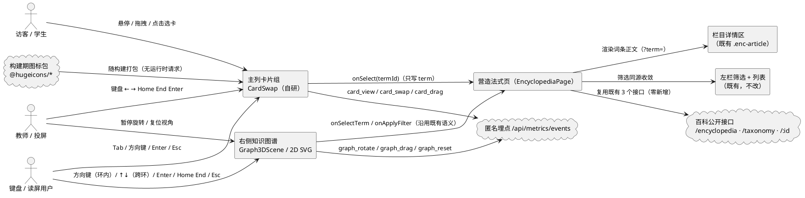
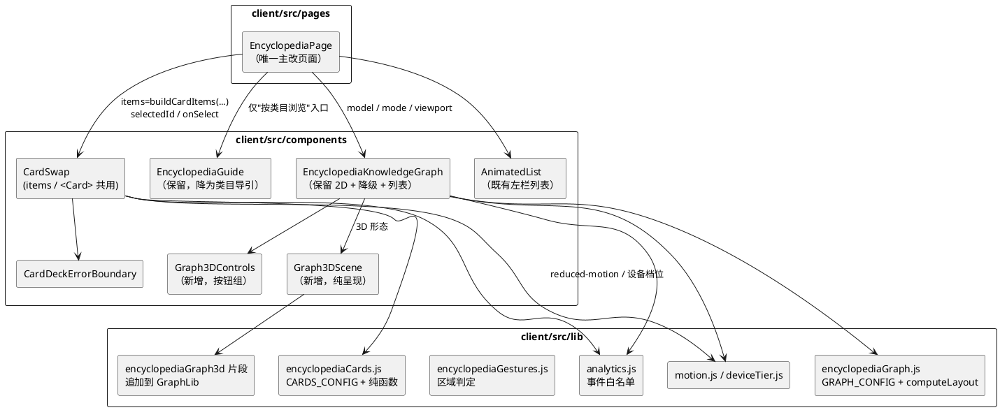
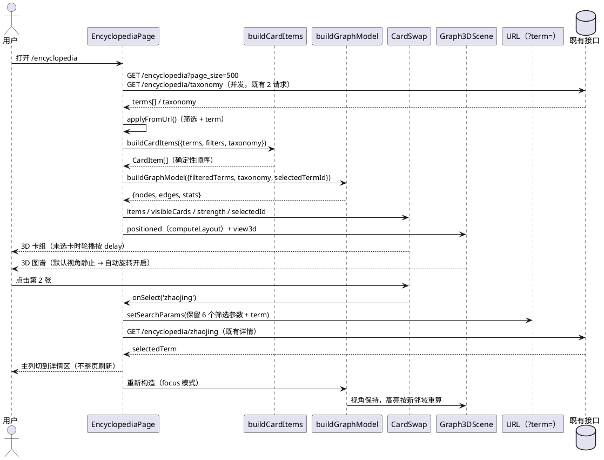
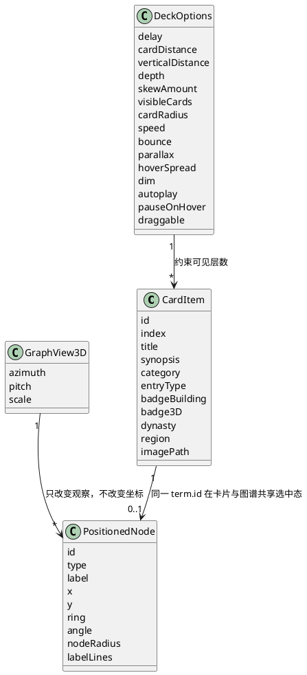
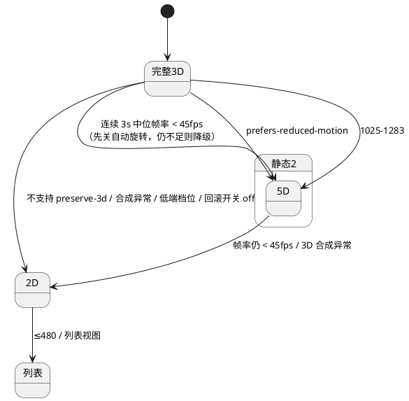

# 华夏古建可视化 · 「营造法式」3D 悬浮卡片选择与知识图谱 3D 立体旋转 实现方案（技术设计）

| 项 | 内容 |
|---|---|
| 文档编号 | DESIGN-PUBLIC-CARD-001 |
| 版本 | v1.0 |
| 状态 | 待评审 |
| 上游需求 | `docs/requirements/encyclopedia-3d-card-ui-spec.md`（REQ-PUBLIC-CARD-001，v1.1，R-CARD-01~65） |
| 需求归档 | `.codeartsdoer/specs/enc_3d_card_ui/spec.md` |
| 上游设计（复用的存量能力） | `docs/design/encyclopedia-knowledge-graph-design.md`（DESIGN-PUBLIC-BG-001）、`docs/design/building-knowledge-enrichment-design.md`（DESIGN-PUBLIC-BK-001） |
| 关联代码库 | `D:\Ancient-architecture\ac1.1\acvisual 4`（分支：建筑模型的功能修改；React 19 + Vite 8 + Express + MySQL） |
| 覆盖栏目 | 前端 `/encyclopedia`：主列卡片组、卡片选择与详情进入、右侧知识图谱 3D 旋转 |
| 本文档性质 | **只做实现方案，不修改任何业务代码**；不含可直接落地的完整实现代码，只给结构、契约、纯函数签名、配置与验收映射 |
| 依据口径 | Q-CARD-09（不引 WebGL/Three 图谱）、Q-CARD-10（wide/medium 并存）、Q-CARD-11（桌面自动旋转 8°/s、触屏关）、Q-CARD-12（俯仰 -30°~+30°、默认 -8°、方位 -18°）、Q-CARD-13（≥1284 完整 3D / 1025–1283 静态 2.5D / ≤1024 回退 2D / ≤480 列表）、Q-CARD-14（>60° 隐藏视觉文字、保留 aria-label） |

> 阅读顺序建议：§1 看差距与复用什么 → §2 看架构与数据流 → §3 看卡片组件 → §4 看 3D 图谱 → §5 看布局断点 → §11 看验收映射 → §12 看 ADR 与开放问题。
> 文中所有 `文件:行号` 均为**改造前**快照，用于可追溯；实施后行号会漂移，以标识符名为准锚点。

---

# 一、现状与差距

## 1.1 需求功能与存量功能对比

### 1.1.1 已实现功能（可直接复用，不改语义）

| 需求功能 | 存量功能 | 代码位置 | 匹配度 |
|---|---|---|---|
| R-CARD-01/02/04 卡片集合与筛选同源 | `filteredTerms` 由 `filterTerms(terms, filters)` 派生，与左栏列表同一实例 | `client/src/pages/EncyclopediaPage.jsx:342`、`client/src/lib/encyclopediaFilters.js:130-158` | 100% |
| R-CARD-02 建筑专属标识 | `entry_type === 'building'` 判据 + 列表「建筑」角标 | `EncyclopediaPage.jsx:827-829`、`encyclopediaFilters.js:169-177` | 100% |
| R-CARD-10/25 选择写 `term`、筛选清空 `term` | `selectTerm(id)` → `syncUrl(filters, id)`；`changeFilters` → `syncUrl(next,'')` | `EncyclopediaPage.jsx:305-331` | 100% |
| R-CARD-11/26 深链还原与失效回落 | `applyFromUrl` 读 `term`；详情失败回落列表项 | `EncyclopediaPage.jsx:170-177,230-253` | 100% |
| R-CARD-12 保留筛选/图谱状态 | 选卡不改 `filters`；图谱 `useMemo` 依赖 `filteredTerms/selectedTermId` | `EncyclopediaPage.jsx:361-387` | 100% |
| R-CARD-22/23 三栏与图谱列不变 | `.encyclopedia-layout`（左筛 340 + 主列 + 图谱 320~420） | `encyclopedia.css:1118-1129,1513-1550` | 100% |
| R-CARD-28/61 六断点常量单源 | `GRAPH_CONFIG.BREAKPOINTS` + `readViewport()` + `matchMedia` 监听 | `encyclopediaGraph.js:16`、`EncyclopediaPage.jsx:94-104,346-359` | 100% |
| R-CARD-45/47 确定性布局（对 3D 的输入） | `computeLayout` 输出 `x/y/ring/angle/radius`，无随机、无迭代 | `encyclopediaGraph.js:512-588` | 100% |
| R-CARD-47 预算（120/300/60） | `selectWithinBudget` 分桶裁剪 + `stats.truncated` | `encyclopediaGraph.js:393-472` | 100% |
| R-CARD-51 缩放区间与夹紧 | `ZOOM_MIN/MAX` 0.5–2.0 + `clampViewBox` 30% 可见阈值 | `encyclopediaGraph.js:13-14,600-626` | 100% |
| R-CARD-52 四类节点语义 | `selectNode` 分派 term/building/category/dynasty/region | `EncyclopediaKnowledgeGraph.jsx:212-226` | 100% |
| R-CARD-53 邻接高亮不改变坐标 | `neighborIds` + 只切 `is-active/is-neighbor/is-dimmed` 类 | `encyclopediaGraph.js:590-598`、`EncyclopediaKnowledgeGraph.jsx:461-526` | 100% |
| R-CARD-56 键盘可达基线 + 跳过正文 | 节点 `role="button" tabIndex=0` + Enter/Space + `.enc-graph-skip` | `EncyclopediaKnowledgeGraph.jsx:391-393,470-489` | 75%（缺环内方向键/跨环/Home/End） |
| R-CARD-58/64 2D 折叠条与列表降级 | `mode='collapsed'/'list'` 分支 + `minimal → list` | `EncyclopediaKnowledgeGraph.jsx:318-382`、`EncyclopediaPage.jsx:389` | 100% |
| R-CARD-57 减少动效基线 | `useReducedMotion` + CSS `@media (prefers-reduced-motion)` 4 处 | `client/src/lib/motion.js:6-21`、`encyclopedia.css:990,1107,1587` | 75%（缺"静态 2.5D 仍可手动操作"） |
| R-CARD-39/63 埋点白名单与零新增键 | `EVENT_NAMES` / `ALLOWED_PROP_KEYS` / `sanitizeProps` | `client/src/lib/analytics.js:3-46,122-135` | 100%（白名单需扩事件名，键不变） |
| R-CARD-42/64 SEO 与路由不变 | `canonical` 由页面 effect 维护；路由表无百科子路由 | `EncyclopediaPage.jsx:273-290` | 100% |
| R-CARD-36/60 视觉令牌与禁项 | `--enc-surface/--enc-line/--vermillion/--enc-serif` + 文件头「禁渐变/玻璃/大圆角」 | `encyclopedia.css:1-14`、`global.css:29-60` | 100% |
| R-CARD-17/58 低端设备判定 | `detectTierInfo()`（省流量/无 WebGL2/低内存/慢网/窄视口 → `smooth`） | `client/src/lib/deviceTier.js:34-72` | 100%（需明确"图谱 3D 不得依赖 WebGL2 判定"） |

> 说明：`detectTierInfo` 的 `no-webgl2` 分支是为 3D 展厅设计的。本轮图谱与卡片是 **CSS 3D**，不应因缺少 WebGL2 就被判为低端；设计上只取其中的 `save-data / low-memory / slow-network / small-viewport` 四个理由作为降级信号（见 §4.6、§7.4）。这一点必须在实现时显式处理，否则会出现"浏览器禁 WebGL 但 CSS 3D 正常却被降级"的过度降级。

### 1.1.2 需要扩展的功能（在既有基础上改造）

| 需求功能 | 存量功能 | 差异说明 | 扩展方向 |
|---|---|---|---|
| R-CARD-01/07/28 卡片组（不存在） | `EncyclopediaGuide` 4 张平面导引卡（按类目筛选） | 输入：类目数组 → 需改为**词条数组**；输出：4 个分类入口 → 需改为 N 个可选卡片；交互：点击即筛类目 → 需改为"选中词条并写 `term`" | 主列引导态用新 `CardSwap` 承载词条卡；`EncyclopediaGuide` 保留为**类目导引**（见 ADR-03），不被删除 |
| R-CARD-45~54 图谱 3D | 2D 单 `<svg viewBox>` + `computeLayout` | 渲染层：SVG 平面 → 需 DOM 分层 3D；状态：`viewBox` → 需增加 `azimuth/pitch/scale`；交互：平移 → 需改为旋转 | 新建 3D 场景子组件，`computeLayout` 输出**原样复用**，只增加 z 与视角（§4） |
| R-CARD-56 图谱键盘 | 仅 Enter/Space/Esc/`+/-/0` | 缺环内方向键、跨环、Home/End、旋转开关/复位按钮 | 纯函数 `ringNavigationTarget` + 工具条补 2 个按钮（§8.2） |
| R-CARD-34/57 减少动效 | CSS 关闭 transition | 缺"卡片不轮播""图谱静态 2.5D 且可手动操作" | 卡片强制 `strength=0`；图谱走形态 2（§5.4） |
| R-CARD-39/63 事件 | 4 个图谱事件 | 缺卡片 3 个 + 旋转 3 个 | `analytics.js` 追加 6 个事件名（键不变）+ 门禁脚本扩展（§9） |
| R-CARD-30 触屏等价 | 列表 `enableArrowNavigation`（键盘） | 滑动手势与 `touch-action` 未定义 | 卡片区 `touch-action: pan-y` + 主轴夹角判定（§3.5） |
| R-CARD-18/19 图标 | Font Awesome 类名 | 需在**卡片区新增控件**使用 hugeicons，其余不动 | 构建期图标适配层 + ≤6 个按需 import（§6） |
| R-CARD-58/59 性能降级 | 无运行时帧率判定 | 缺"持续掉帧自动回退" | rAF 采样窗口 + 三级降级（§7.4） |

### 1.1.3 需要新增的功能或接口（存量完全没有）

按业务模块分组，每个功能点说明输入、输出与依赖：

**A. 卡片数据层（新文件 `client/src/lib/encyclopediaCards.js`）**

| 功能点 | 输入 | 输出 | 依赖 |
|---|---|---|---|
| `CARDS_CONFIG` | — | 15 参数默认值 + 取值范围 + 断点派生表 + 拖拽常量 | 引用 `GRAPH_CONFIG.BREAKPOINTS`（不复制数字） |
| `clampDeckOptions(raw)` | 调用方传入的任意参数对象 | `{ options, warnings }`（越界夹紧；开发环境告警） | 纯函数，无 DOM |
| `deckPresetFor(viewport)` | `'wide'|'medium'|'compact'|'stacked'|'narrow'|'minimal'` | `{ visibleCards, strength, listFallback }` | 纯函数 |
| `buildCardItems(input)` | `{ terms, filters, taxonomy }` | `CardItem[]`（确定性排序 + 字段派生） | 纯函数，可单测 |
| `cardAriaLabel(item, index, total, t)` | 卡片 + 序号 + i18n | 可读名称字符串 | i18n 键 |
| `cardSelectIndex(items, id)` | 卡片数组 + `term` id | 目标索引（失效返回 -1） | 纯函数 |

**B. 卡片组件层（新文件 `client/src/components/CardSwap.jsx`）**

| 功能点 | 输入 | 输出 | 依赖 |
|---|---|---|---|
| `CardSwap`（default） | `items` 或 `<Card>` 子元素 + 15 参数 + `selectedId/onSelect` | 渲染卡片组；回调 `onSelect(id)`、`onSwap`、`onDragEnd`、`onAutoplayChange` | `framer-motion`（既有）、`CARDS_CONFIG` |
| `Card`（具名导出） | `children` | 单卡容器（仅约束尺寸与视觉包裹） | 与 `items` 用法共用同一渲染路径（DFX-M4） |
| `CardDeckErrorBoundary` | children + fallback | 卡片区故障隔离，不影响正文/图谱/筛选 | R-CARD-24 |

**C. 图谱 3D 层**

| 功能点 | 落点 | 输入 | 输出 |
|---|---|---|---|
| `GRAPH_3D_CONFIG` | `encyclopediaGraph.js` **末尾追加** | — | 透视距离、默认/极限视角、自动旋转速度、环深度映射、背向阈值、拖拽增益、停稳时长 |
| `ringDepth(ring)` | 同上 | `0|1|2` | z 值（同环同层） |
| `clampView(view)` | 同上 | `{azimuth,pitch,scale}` | 夹紧后的视角（方位归一化到 `[-180,180)`） |
| `facingAngleDeg(node, view)` / `isBackFacing` | 同上 | 节点 + 视角 | 与视线夹角 / 是否 >60° |
| `segmentTransform(p1,p2)` | 同上 | 两个 3D 端点 | `matrix3d` 字符串 + 长度（纯数学） |
| `projectToScreen(node, view, canvas)` | 同上 | 节点 + 视角 + 画布 | `{sx,sy,scale,opacity}`（供静态 2.5D 与调试） |
| `ringNavigationTarget(layout, activeId, dir)` | 同上 | 已定位节点 + 方向 | 目标节点 id（键盘环内/跨环） |
| `resolveGestureOwner(target)` | 新文件 `client/src/lib/encyclopediaGestures.js` | DOM 事件 target | `'deck'|'graph'|'page'` |
| `Graph3DScene`（新组件） | `client/src/components/Graph3DScene.jsx` | 节点/边/视角/回调 | 3D 场景 DOM（无 WebGL、无 canvas） |
| `Graph3DControls` | 可并入既有 `.enc-graph-tools` | 开关/复位/缩放 | 按钮组（含 `aria-pressed`） |

**D. 文案与门禁**

| 功能点 | 落点 | 说明 |
|---|---|---|
| `encyclopedia.card.*`（约 22 键） | `client/src/i18n/zh-CN.json`、`en.json` | 中英双语，插值单花括号 |
| `encyclopedia.graph3d.*`（约 12 键） | 同上 | 旋转/复位/背向提示 |
| 事件门禁脚本 | `scripts/check-card-events.mjs`（新增） | 校验 6 事件 + 12 键不变 + 禁库 + 无 canvas |

## 1.2 存量功能详细分析（本轮直接依赖的 6 个契约）

### 1.2.1 `filterTerms` / `groupTerms`：卡片集合的唯一口径

- **接口契约**：`filterTerms(terms, filters)` 按 `entry_type / category / building / dynasty / region / q` 过滤，纯函数、无副作用；`groupTerms` 只做 building/craft 二分，**不改变组内顺序**。
- **业务规则**：`building` 命中判据是「主关联等于筛选建筑 **或** `related_palaces` 包含该建筑」；`dynasty` 用 `includes` 做子串匹配。
- **扩展点**：无钩子；卡片层只能**消费**其结果，不得另写一套过滤（否则 R-CARD-04 的"口径一致"必然漂移）。
- **约束**：`filteredTerms` 是 `useMemo` 派生值，卡片构造必须放在同一依赖链（`terms, filters`）上，保证切换筛选 ≤200ms 与列表同步刷新。

### 1.2.2 `buildGraphModel` + `computeLayout`：3D 的坐标唯一来源

- **接口契约**：`buildGraphModel({terms, taxonomy, selectedTermId, selectedTerm})` → `{mode, centerId, nodes, edges, stats}`；`computeLayout(nodes, edges, size=CANVAS)` → `nodes.map(...)`，每项追加 `{x, y, ring, angle, radius, nodeRadius, labelLines}`。
- **业务规则**：三层同心环（`RING.R0=0 / R1=190 / R2=330`），中心节点 `radius=0`；非中心按排序索引均分 360°，起点固定 `-90°`（12 点方向）；同环相邻半径交替 `1.04 / 0.96` 防贴边。
- **扩展点**：**没有 z 分量**。3D 化只能"基于 `ring` 派生深度"，不允许修改该函数内的角度/半径/排序逻辑（R-CARD-47）。
- **约束**：`computeLayout` 的坐标空间是 `CANVAS = {width:1000, height:760, cx:500, cy:380}`，与 CSS 像素无关。3D 场景必须沿用这个坐标系（用比例映射到容器像素），否则"同环节点同层、首帧可复现、2D/3D 节点清单一致"三条验收全部失效。

### 1.2.3 图谱组件：需要"保留什么、替换什么"

| 组件内能力 | 处置 | 理由 |
|---|---|---|
| `useMemo(computeLayout)` | **保留** | R-CARD-47 |
| `neighborIds` 高亮 | **保留** | R-CARD-53 |
| `selectNode` 四类分派 + 埋点 | **保留** | R-CARD-52 |
| `zoom/resetView`（`viewBox` 驱动） | 3D 下改为 `scale` 驱动，2D 下原样保留 | R-CARD-51 |
| 拖拽平移（`onPointerDown/Move/Up`） | 3D 下改为旋转，2D 下保留平移 | R-CARD-50 |
| `collapsed/listView/failed/empty` 分支 | **保留** | R-CARD-58/64 |
| `role="button" tabIndex` 节点 | **保留**（3D 节点同样用原生 `button`） | R-CARD-56 |
| 单 `<svg viewBox>` 渲染 | 2D 路径保留；3D 路径换 `Graph3DScene` | R-CARD-46 |

### 1.2.4 布局契约：`.enc-detail-grid` 的硬边界

- `grid-template-columns: minmax(0,1fr) var(--enc-graph-w)`，`--enc-graph-w: clamp(320px, 26vw, 420px)`；≤1439 变 320px；≤1283 变单列（图谱 `order:-1` 置顶）。
- **约束**：卡片区必须落在 `.enc-detail-main`（第一列）内，不得改这三条规则文本；新增样式只能在 `encyclopedia.css` 末尾追加（DFX-CARD-C3/C5）。
- **推论**：卡片区宽度 = 正文列宽（1440 下约 618px、1920 下约 1052px），所以卡片尺寸与 `visibleCards` 必须按"列宽"而不是"视口宽"设计（§5.3 给了复算）。

### 1.2.5 埋点契约：零新增属性键

- `EVENT_NAMES` 是 `Set`，未登记的事件被 `track()` 直接丢弃（返回 `false`），**不报错**——所以漏登记表现为"埋点静默失效"，必须在门禁脚本里拦住。
- `ALLOWED_PROP_KEYS` 共 12 键；`sanitizeProps` 会丢弃未知键、截断字符串到 200 字符。
- **约束**：新增 6 个事件只能用这 12 键表达语义；"旋转角度、帧率、设备型号"明确不得上报（R-CARD-63/DFX-S5），因此旋转类事件的 `stage` 只能取**离散枚举**（`on/pause/off/axis_x/axis_y/both/toolbar/keyboard`）。

### 1.2.6 视觉契约：纸质语言 + 禁项

- 令牌：`--enc-surface:#fdfbf6`、`--enc-sunken:#f6f1e4`、`--enc-line:var(--border-warm)`、`--enc-muted:#7c736c`、`--enc-serif`；全局 `--paper-white / --ink / --vermillion / --border-warm / --radius-lg`。
- 禁项：渐变、`backdrop-filter` 玻璃、大圆角、大阴影；阴影不透明度 ≤0.08 且模糊 ≤12px（R-CARD-36/60）。
- **推论**：3D 层次只能靠「1px 描边 + `translateZ` 前后 + `dim` 透明度差 + 极轻阴影」建立。任何"玻璃卡片"方案本轮不启用（Q-CARD-08），仓库里虽已有 `liquid-glass-react` 依赖（`package.json`），但**不得**用于本页。

## 1.3 差距结论（GAP → 设计责任）

| GAP | 本设计对应章节 | 结论 |
|---|---|---|
| GAP-CARD-01/04 无 CardSwap、参数无落点 | §3 全章 | 自研 `CardSwap.jsx`，15 参数全部实现，单一配置源 |
| GAP-CARD-02 引导态是平面导引卡 | §3.2、§5.2、ADR-03 | 主列引导态改为卡片组；类目导引降为副入口 |
| GAP-CARD-05 图标体系 | §6 | hugeicons 仅卡片区新增控件，≤6 图标，构建期可切回 FA |
| GAP-CARD-06 视觉契约冲突 | §2.4、§3.6、§4.7 | 只用描边/位移/透明度，禁渐变玻璃 |
| GAP-CARD-09/11 图谱 2D、无旋转状态 | §4 全章 | CSS 3D 场景 + 视角状态机，2D 路径完整保留 |
| GAP-CARD-10 禁 WebGL 与 CSS 3D 的边界 | §4.1、ADR-01 | 书面澄清：OOS-BG-02/R-BG-10 禁的是 WebGL/Three，不含 CSS 3D 透视 |
| GAP-CARD-12 无旋转类埋点 | §9 | 3 个事件、0 新键、角度不上报 |
| GAP-CARD-13 两处 3D 并存规则缺失 | §2.2、§5.1、ADR-07 | wide/medium 并存、区域手势划界、互不遮挡 |

---

# 二、总体架构与数据流

## 2.1 设计目标（可验收的 6 条）

1. 同一份 `filteredTerms` 同时驱动「左栏列表 / 主列卡片 / 右侧图谱」，任一处筛选变化三者同帧收敛（±1 帧内）。
2. 卡片只写 `term` 一个 URL 参数；图谱只写 `term` 或筛选；任何旋转/轮播/拖拽状态**不进 URL、不进存储**。
3. 两处 3D 互不夺权：卡片区横向拖拽 = 切卡；图谱区横向拖拽 = 转视角；纵向拖拽一律交还页面滚动。
4. 任一 3D 不可用（不支持、减少动效、低端、窄屏、运行期掉帧）都退化为**功能等价**的平面形态，节点/卡片/出口不减少。
5. 首帧不因新增区块产生位移：卡片区与图谱区都有同尺寸骨架占位，CLS ≤0.02。
6. 回滚是"一个构建期开关"：关闭后回到「导引卡 + 2D SVG 图谱」，URL/深链/筛选行为与改造前一致。

## 2.2 上下文视图



**通信与频率**：全部为同进程 React 状态传递（无 IPC、无消息总线）；卡片与图谱 → 页面为事件回调（用户触发，低频）；页面 → 卡片/图谱为 props（每次筛选变化一次，秒级以下频率）。

## 2.3 组件总体架构



**分层职责（禁止越层）**

| 层 | 职责 | 禁止 |
|---|---|---|
| 页面层（Page） | 状态编排、URL 同步、断点选择、回滚开关 | 不实现 3D 数学、不直接操作 DOM style |
| 组件层（CardSwap / Graph3DScene） | 渲染、手势、状态机、焦点管理 | 不做数据聚合、不写 URL |
| 纯函数层（lib） | 配置夹紧、排序派生、视角/投影/导航数学 | **不得 import React、不得访问 DOM/window**（DFX-CARD-M3/M6） |
| 适配层（analytics / i18n / icons） | 白名单、文案、图标 | 不承载业务判断 |

## 2.4 数据流

### 2.4.1 端到端时序（首屏 → 选卡 → 详情 → 图谱联动）



### 2.4.2 与 URL 的关系（唯一边界）

| 状态 | 归属 | 是否进 URL | 是否持久化 | 说明 |
|---|---|---|---|---|
| 6 个筛选参数（building/entry_type/category/dynasty/region/q） | `filters` | 是（既有） | 否 | 语义不变（R-CARD-25） |
| `term`（选中词条） | `selectedTermId` | 是（既有） | 否 | 卡片选择**只写它**（R-CARD-10/25） |
| 卡片轮播索引 / 拖拽偏移 / 悬停 | CardSwap 内部 | 否 | 否 | R-CARD-27 |
| 卡片自动轮播开关 | 模块级内存（页面生命周期） | 否 | 否 | 见 §3.7 与开放问题 OQ-03 |
| 图谱方位角/俯仰角/缩放/旋转开关 | Graph 组件内部 | 否 | 否 | R-CARD-62（RED-BG-11） |
| 图谱折叠状态 | `graphCollapsed` | 否 | 否 | 既有行为 |
| 3D 回滚开关 | 构建期常量 | 否 | — | R-CARD-44/64 |

> **关键设计**：`selectedTermId` 是卡片与图谱的**唯一共享选中态**（single source of truth）。卡片选中、图谱节点选中、左栏列表选中三者由同一变量驱动，避免"卡片高亮 A、正文 B"（R-CARD-55 异常场景 2）。

### 2.4.3 选中态在两个视图间的表现差异

| 场景 | 卡片组表现 | 图谱表现 | 左栏列表表现 |
|---|---|---|---|
| 未选词条（引导态） | 显示卡组，轮播按 `autoplay` | 概览模式（类目+建筑+代表词条） | 全部命中项 |
| `?term=X` 直达 | X 卡置顶选中 + `aria-current` + 滚入可视 | focus 模式，X 为中心节点高亮 | X 项 `active` |
| 点图谱词条节点 | X 卡变为选中（若在当前筛选集合内） | X 中心高亮 | X 项 `active` |
| 改筛选 | 卡组重建，选中清空（`term` 被清） | 概览/收敛后的 focus 由 `term` 决定 | 新命中集 |
| 图谱节点是建筑/类目/朝代/地区 | 卡组**不改选中**（只筛选收敛） | 该节点高亮 | 命中集变化 |

## 2.5 接口设计（组件契约总览）

### 2.5.1 接口分类与稳定性

| 接口 | 类型 | 稳定性 | 变更策略 |
|---|---|---|---|
| `CardSwap` props | React 组件契约 | 实验（本轮首发） | 15 参数名对齐用户示例，不兼容变更需同版本说明 |
| `Card` props | React 组件契约 | 实验 | 仅 `children` + `className`，不扩展 |
| `Graph3DScene` props | 内部组件契约 | 实验 | 仅父组件使用，可随实现调整 |
| `CARDS_CONFIG` / `GRAPH_3D_CONFIG` | 常量契约 | 稳定 | 只允许追加字段，不改既有字段语义 |
| `buildCardItems` / `clampView` 等纯函数 | 函数契约 | 稳定 | 同输入同输出；签名变更需同步单测与门禁 |
| `encyclopedia.card.*` / `encyclopedia.graph3d.*` | 文案契约 | 稳定 | 只追加键，不改既有键语义 |

### 2.5.2 `CardSwap` 接口签名（完整清单）

```text
type CardItem = {
  id: string;              // 词条 id：仅数据层使用，禁止渲染到 DOM 文本
  index: number;           // 组内序号（1-based，确定性）
  title: string;
  synopsis: string;
  category: string;        // 缺失时为 '未分类' 占位
  entryType: 'building' | 'craft';
  badgeBuilding: boolean;  // entry_type === 'building'
  badge3D: boolean;        // 主关联建筑 has_3d
  dynasty?: string;        // 由主关联建筑派生，无则整项隐藏
  region?: string;
  imagePath?: string;      // 仅本地已授权资源，否则 undefined
}

type CardSwapProps = {
  items?: CardItem[];
  children?: ReactNode;                  // <Card> 用法
  delay?: number;                        // 2000–8000，默认 4000（重复声明取末值）
  cardDistance?: number;                 // 0–120，默认 60
  verticalDistance?: number;             // 0–140，默认 70
  depth?: number;                        // 0–180，默认 90
  skewAmount?: number;                   // 0–12，默认 6
  visibleCards?: number;                 // 1–5，默认由断点派生
  cardRadius?: number;                   // 0–28，默认 18
  speed?: number;                         // 0.5–2，默认 1
  bounce?: number;                        // 0–1，默认 0.35（减效强制 0）
  parallax?: number;                      // 0–2，默认 0.5（触屏/减效强制 0）
  hoverSpread?: number;                   // 0–0.5，默认 0.12（触屏禁用）
  dim?: number;                           // 0–1，默认 0.5
  autoplay?: boolean;                     // 默认桌面 true / 触屏 false / 减效 false
  pauseOnHover?: boolean;                 // 默认 true（语义=悬停/聚焦/不可见）
  draggable?: boolean;                    // 默认 true
  width?: number;                         // items 用法：容器建议宽；不覆盖 CSS 实际宽
  height?: number;                        // items 用法：容器建议高；<Card> 用法：卡片约束
  selectedId?: string;                    // 受控选中
  onSelect?: (id: string) => void;
  onSwap?: (payload: { id: string; trigger: 'autoplay'|'drag'|'keyboard'|'control' }) => void;
  onDragEnd?: (payload: { id: string; direction: 1|-1|0 }) => void;
  onAutoplayChange?: (on: boolean) => void;
  onImpression?: (id: string) => void;
  t?: (key: string, fallback?: string, vars?: Record<string, unknown>) => string;
  labels?: { group?: string; skip?: string; play?: string; pause?: string; prev?: string; next?: string };
}
```

**参数裁决口径（对需求 §5.3 争议点的明确回答）**

| 争议 | 裁决 | 依据 |
|---|---|---|
| `delay` 声明两次 | JSX 重复属性本身由 React 取末值；组件内**再做一次**末值归一（`normalize` 收到的对象），并在开发环境把"检测到重复"仅作为文档说明，不运行时探测 | R-CARD-14 |
| `width/height` 在 `items` 用法 | 视为**容器建议尺寸**（写入 `--enc-deck-w/--enc-deck-h` 作为 `min-height` 与宽上限建议），**不覆盖** `.enc-detail-main` 的实际列宽 | R-CARD-14 后半句 |
| `width/height` 在 `<Card>` 用法 | 视为**卡片尺寸约束**（卡面 `inline-size`/`block-size`），不影响容器 | 同上 |
| 两种用法的渲染 | 共用同一 `useDeck` 内部逻辑与同一 DOM 结构；`items` 只负责"把数组映射成 CardItem 渲染节点"，`<Card>` 只负责"收集子元素并注入序号/选中态" | DFX-CARD-M4 |
| 未实现参数 | **本设计无"显式忽略"项**：15 项全部有可观察效果（见 §3.6 参数效果表） | R-CARD-14 |

### 2.5.3 `Graph3DScene` 接口签名

```text
type GraphView3D = { azimuth: number; pitch: number; scale: number };

type Graph3DSceneProps = {
  nodes: PositionedNode[];     // computeLayout 输出，含 x/y/ring/nodeRadius/labelLines
  edges: GraphEdge[];          // buildGraphModel 输出
  centerId?: string | null;
  selectedId?: string | null;  // 'term:<id>' 形式（与既有 selectedId 一致）
  activeId?: string | null;    // 邻接高亮锚点
  neighbors?: Set<string>;
  view: GraphView3D;
  autoRotate: boolean;
  reducedMotion: boolean;
  canvas?: { width: number; height: number };
  onViewChange?: (view: GraphView3D, source: 'drag'|'wheel'|'button'|'auto') => void;
  onNodeActivate?: (node: PositionedNode) => void;
  onNodeFocus?: (id: string | null) => void;
  onRotateToggle?: (next: boolean) => void;
  onReset?: () => void;
  onZoom?: (factor: number) => void;
  t?: TranslateFn;
}
```

**后置条件（可验收）**：`onNodeActivate` 的触发与 2D 完全同构（`term/building/category/dynasty/region` 五类分派），拖拽超过阈值松手**不触发**激活。

### 2.5.4 领域模型（数据模型章节对应需求 §7）



- **对象生命周期**：`CardItem[]` 每次筛选变化重建（不可变快照）；`GraphView3D` 随组件挂载初始化、随组件卸载销毁（刷新回默认视角）；`DeckOptions` 在组件挂载时由 `CARDS_CONFIG` + 断点派生一次，运行期只受断点变化影响。
- **对象创建/销毁策略**：卡片与节点一律**按 key 复用**（`key = id`），筛选变化时增删而非整体重建，避免焦点丢失与动画抖动。
- **持久化策略**：**无持久化**。所有视图状态只在 React 内存中（R-CARD-27/62）。

### 2.5.5 实现设计（三种形态的状态机总览）

```plantuml
@startuml
[*] --> 引导态
state 引导态 {
  [*] --> Deck3D
  Deck3D --> DeckFlat : 3D 不可用 / 窄屏 / 减效
  Deck3D --> DeckList : ≤480
}
引导态 --> 详情态 : 选卡（写 term）
详情态 --> 引导态 : Esc / 返回卡组（清 term）
详情态 {
  [*] --> Graph3D
  Graph3D --> Graph25D : 1025–1283 / 减效
  Graph25D --> Graph2D : ≤1024 / 不支持 preserve-3d
  Graph2D --> GraphList : ≤480 / 列表视图
}
@enduml
```

**说明**：卡片形态与图谱形态是两个**独立**状态机（卡片 3D 不可用不影响图谱 3D，反之亦然），但共用同一套断点判定与同一套降级信号（§5.4）。这避免"卡片降级把图谱也拖下去"的过度耦合。

---

# 三、CardSwap 自研组件设计

## 3.1 文件与模块布局

| 文件 | 状态 | 内容 |
|---|---|---|
| `client/src/components/CardSwap.jsx` | **新增** | `CardSwap`（default）+ `Card`（具名）+ 内部 `useDeck` / `useDeckPointer` / `useDeckAutoplay` / `DeckErrorBoundary` |
| `client/src/lib/encyclopediaCards.js` | **新增** | `CARDS_CONFIG`、`clampDeckOptions`、`deckPresetFor`、`buildCardItems`、`cardAriaLabel`、`cardSelectIndex`、`resolveCardAsset` |
| `client/src/lib/encyclopediaGestures.js` | **新增** | `resolveGestureOwner`、`isHorizontalIntent`（卡片与图谱共用） |
| `client/src/components/CardIcon.jsx` | **新增** | 图标适配层（hugeicons ↔ Font Awesome 双路径，§6） |
| `client/src/pages/EncyclopediaPage.jsx` | **唯一主改** | 引导态接入卡组；详情态返回入口；焦点回还；埋点调用点 |
| `client/src/styles/encyclopedia.css` | **仅末尾追加** | `.enc-deck-*` / `.enc-card-*` / `.enc-graph3d-*` 全部新增类 |

**不做的事**：不改 `AnimatedList.jsx`、`EncyclopediaGuide.jsx` 的既有逻辑（只可能新增可选 props）；不改 `global.css` / `guards.css`；不新增 `CardSwap.css` 文件（样式统一追加到 `encyclopedia.css` 末尾，符合 DFX-CARD-C5 的"只追加一处"约束，避免样式加载顺序分叉）。

## 3.2 组件职责与两种用法

**单一渲染路径**（DFX-CARD-M4）：

```text
CardSwap(props)
  └─ useDeck(props)            // 归一、夹紧、状态机、焦点、手势、轮播
       ├─ normalizeProps       // items / children → DeckEntry[]（统一结构）
       ├─ clampDeckOptions     // 15 参数夹紧 + 默认值
       ├─ buildDeckView        // 计算每张卡的 rel / transform / 可见性（纯函数派生）
       └─ 事件处理器
  └─ render:
       section.enc-deck(role=group)
         a.enc-card-skip（跳过卡片）
         div.enc-deck-stage(style: --deck-*)
           div.enc-deck-card[data-index][aria-current]  × ≤visibleCards
             [Card 用法注入的 children] 或 [items 用法映射的默认卡面]
         div.enc-deck-controls（上一张/下一张/暂停）
         p.enc-deck-status(aria-live=polite)
```

**两种用法的唯一差异（仅归一阶段）**

| 用法 | 输入 | 归一结果 | 卡片内容 |
|---|---|---|---|
| `items` | `CardItem[]` | 每个 item → `DeckEntry{ id, title, synopsis, ..., render: null }` | 组件内置默认卡面（标题/摘要/角标/序号/缩略位） |
| `<Card>` | React 子元素 | 每个子元素 → `DeckEntry{ id: child.key ?? index, render: child }` | 完全由调用方决定（仍继承卡面外壳、选中态、焦点与手势） |

**为什么保留 `<Card>` 用法**：用户原始示例存在两种写法，且未来可能用于"非词条卡"（例如专题卡）。保留的代价极小（只多一个归一分支），收益是组件契约与用户心智一致，且避免后续"再加一种用法"时二次改造。

## 3.3 参数与配置（单一来源）

### 3.3.1 `CARDS_CONFIG` 结构

```text
CARDS_CONFIG = Object.freeze({
  DEFAULTS: { cardDistance:60, verticalDistance:70, depth:90, skewAmount:6,
              visibleCards:4, cardRadius:18, delay:4000, speed:1, bounce:0.35,
              parallax:0.5, hoverSpread:0.12, dim:0.5, autoplay:'auto',
              pauseOnHover:true, draggable:true },
  RANGES:   { cardDistance:[0,120], verticalDistance:[0,140], depth:[0,180],
              skewAmount:[0,12], visibleCards:[1,5], cardRadius:[0,28],
              delay:[2000,8000], speed:[0.5,2], bounce:[0,1],
              parallax:[0,2], hoverSpread:[0,0.5], dim:[0,1] },
  PRESET:   { wide:{visibleCards:5,strength:1}, medium:{visibleCards:4,strength:1},
              compact:{visibleCards:3,strength:0.7}, stacked:{visibleCards:3,strength:0.5},
              narrow:{visibleCards:2,strength:0}, minimal:{visibleCards:0,strength:0,listFallback:true} },
  MOTION:   { springMs:300, settleMs:260, hoverMs:160, parallaxMaxPx:14 },
  DRAG:     { threshold:8, axisSin:0.5, commitPx:48, commitVelocity:0.35 },
  AUTOPLAY: { minVisibleRatio:0.4, touchDefault:false, desktopDefault:true },
  LAYOUT:   { maxCardWidth:360, minCardWidth:200, aspect:0.72, gapPx:0 }
})
```

**单一来源验证方式**：`PRESET` 的键必须与 `GRAPH_CONFIG.BREAKPOINTS` 的键集合完全一致（`wide/medium/compact/stacked/narrow/minimal`），由单测断言 `Object.keys(PRESET)` 与 `Object.keys(GRAPH_CONFIG.BREAKPOINTS)` 相同；`PRESET` 内**不出现** `1440/1284/...` 等数字（断点数值只在 `GRAPH_CONFIG.BREAKPOINTS` 定义一次）。

### 3.3.2 夹紧规则（`clampDeckOptions`）

| 情形 | 行为 |
|---|---|
| 数值越界（如 `depth=999`） | 夹到 `RANGES` 边界，返回 `warnings[]`；开发环境 `console.warn` 一次（同一参数同一次挂载只告警一次） |
| `null / undefined` | 回落 `DEFAULTS` |
| 字符串数字（`"60"`） | 先 `Number()`，`NaN` 则回落默认值 |
| 非数字（`"abc"`、对象） | 回落默认值 + 告警 |
| `visibleCards` 大于 `items.length` | `min(visibleCards, items.length)`；`items.length === 0` 时走空态（不渲染 0 高容器） |
| `autoplay='auto'` | `reducedMotion ? false : (isTouch ? false : true)` |
| 减效时 `bounce/parallax/hoverSpread` | 强制 `0`（不告警，属预期覆盖） |
| `dim` 与对比度 | `dim` 只作用于**非当前卡**；当前卡永不 `<1`；`dim` 夹紧后额外保证非当前卡不透明度 `≥ 1 - dim*0.6`（避免文字对比度跌破 4.5:1） |

**告警不做节流**以外的事：不弹 UI、不写 URL、不上报（埋点键不允许承载告警信息）。

### 3.3.3 断点派生（`deckPresetFor`）

| 断点（由 `readViewport()` 给出） | `visibleCards` | 3D 强度 | 卡片形态 |
|---|---|---|---|
| `wide`（≥1440） | 5 | 100% | 完整 3D（透视+倾斜+视差+轮播） |
| `medium`（1284–1439） | 4 | 100% | 完整 3D |
| `compact`（1025–1283） | 3 | 70% | 3D（`depth×0.7`、`skew×0.7`，无视差） |
| `stacked`（721–1024） | 3 | 50% | 轻度 3D（仅透视+层叠，无倾斜、无视差、无轮播） |
| `narrow`（481–720） | 2 | 0% | 平面卡（横向滑动切换） |
| `minimal`（≤480） | 0 | 0% | 纵向列表降级（全部命中可访问） |

**强度语义**：`strength` 是唯一乘子，作用于 `depth / skewAmount / parallax / hoverSpread / bounce`（不作用于 `cardDistance / verticalDistance`，避免层叠位置跳动）；`strength === 0` 时上述五项全部置 0，组件进入 `flat` 渲染。

## 3.4 状态机

### 3.4.1 状态定义

| 状态 | 含义 | 可发生事件 |
|---|---|---|
| `idle` | 未轮播、未拖拽、未悬停（`autoplay=false` 或已停止） | hover / dragStart / keyNext / controlNext |
| `auto` | 自动轮播计时中 | hover / focus / invisible / dragStart / userOff |
| `hover` | 指针悬停或卡组内有焦点（轮播已暂停） | leave / blur / dragStart / keyNext |
| `drag` | 已超过 8px 且横向主导 | dragMove / dragEnd / cancel |
| `paused` | 因不可见、用户关闭、减效、或拖拽结束后的暂稳态 | visible / userOn（仅非减效）/ dragStart |
| `degraded` | 3D 不可用、低端、窄屏、异常 | 断点变化 / 环境变化（media query） |

### 3.4.2 转移表（含触发条件与动作）

| 从 | 到 | 触发 | 动作 |
|---|---|---|---|
| `idle` | `auto` | 挂载且 `autoplay===true` 且可见 | 启动 rAF 计时（记录 `lastTs`） |
| `auto` | `hover` | `pointerenter` 或 `focusin` | 记录 `pausedReason='hover'`，保持 `activeIndex`，停止累加 |
| `hover` | `auto` | `pointerleave` 且 `focusout` 后卡组内无焦点 | 重置 `lastTs = now`（**不补时**，避免"悬停 5 秒后连跳"） |
| `auto/hover` | `paused` | 页面 `visibilitychange → hidden` 或 IntersectionObserver `ratio < 0.4` | 停止累加；回到可见时不追赶（`lastTs` 重置） |
| `auto` | `drag` | `pointerdown` + 位移 >8px 且 `|dx| > |dy| / tan(30°)` | `setPointerCapture`、`body.classList.add('enc-no-select')`、`preventDefault` |
| `drag` | `idle`/`auto` | `pointerup / pointercancel` | 判定切换或回弹；`settleMs` 内完成；解除 no-select、释放 capture |
| 任意 | `paused` | `userAutoplayOff=true`（用户点"暂停轮播"） | 写入模块级内存；**不得自动恢复**（R-CARD-08） |
| 任意 | `degraded` | `reducedMotion` / `strength===0` / `tier==='smooth'` / 渲染异常 | 关闭轮播与透视；切 `flat` 渲染 |
| `degraded` | `auto`/`idle` | 环境恢复（媒体查询变化）且非用户主动关闭 | 按新断点重新派生 |

> **"以最后一次操作为准"**（DFX-CARD-R4）：所有索引变更都走单一 `setActiveIndex(updater)`，且 `drag` 结束与 `onSelect` 之间用 `pendingSelectRef` 串行化，快速连点只保留最后一次。

### 3.4.3 状态与可视反馈

| 状态 | 视觉 | 可访问性 |
|---|---|---|
| `auto` | 卡片按 `springMs` 平滑前移 | `aria-live="polite"` 播报"第 i/N 张：标题"（节流 1 次/切换） |
| `hover` | 悬停卡 `translateZ +4px`、`hoverSpread` 展开相邻卡 | `aria-live` 不变（不打断朗读） |
| `drag` | 卡组跟随指针 `--deck-drag-x`（≤±120px），相邻卡按比例位移 | 拖拽中不播报 |
| `paused` | 控制按钮切为"继续轮播"（`aria-pressed=false`） | 按钮名称同步更新 |
| `degraded` | 卡片无透视/无倾斜；控制条只保留"上一张/下一张" | 与 3D 态完全一致的键盘路径 |

## 3.5 DOM 与 3D 结构

### 3.5.1 结构（单卡 DOM ≤12 节点）

```text
section.enc-deck[role=group][aria-label="建筑知识卡片，共 N 张"][aria-describedby=deck-hint]
├─ a.enc-card-skip[href="#enc-article"]          1
├─ p#deck-hint.enc-deck-hint（sr-only）           2
├─ div.enc-deck-stage[style*=--deck-*]            3
│   └─ article.enc-deck-card × ≤5
│        ├─ span.enc-card-badge--building         4
│        ├─ span.enc-card-badge--3d               5
│        ├─ span.enc-card-art（缩略图或占位）       6
│        ├─ h3.enc-card-title（≤2 行）             7
│        ├─ p.enc-card-synopsis（≤3 行）           8
│        ├─ span.enc-card-meta（朝代·地区，可选）   9
│        └─ span.enc-card-index（"3 / 12"）       10
├─ div.enc-deck-controls                          11
│   ├─ button（上一张）  ├─ button（下一张）  └─ button（暂停/继续）
└─ p.enc-deck-status[aria-live=polite]            12
```

**DOM 预算核对**：每卡 7 个内容节点 + `article` 自身 = 8，≤12 ✓；同屏 5 卡 = 40 个节点 + 容器 ≈ 50，远低于既有列表（43 项 × 6 节点）。

### 3.5.2 3D 变量（单一套，卡片与图谱共用语汇）

```text
--deck-perspective : 900px          （卡片透视距离）
--deck-x           : 60px           （卡片水平层叠步长 = cardDistance）
--deck-y           : 70px           （垂直步长 = verticalDistance）
--deck-z           : 90px           （景深步长 = depth）
--deck-skew        : 6deg           （倾斜 = skewAmount）
--deck-radius      : 18px           （= cardRadius）
--deck-dim         : 0.5            （非当前卡透明度差基数）
--deck-shift       : 0px            （拖拽瞬时位移，由 JS 每帧写）
--enc-3d-lift      : 4px            （悬停抬升，卡片与图谱共用）
```

**卡片的 transform（由 `buildDeckView` 纯函数产出，组件只把结果写成 style）**：

```text
rel = (itemIndex - activeIndex + n) % n            // 循环队列，rel ∈ [0, n)
visible = rel < visibleCards
translate = (rel*cardDistance) , (-rel*verticalDistance) , (-rel*depth*strength)
rotateY   = skewAmount*strength*0.6deg - rel*skewAmount*strength*0.08deg
scale     = 1 - rel*0.045*strength   (strength=0 时恒 1)
opacity   = max(1 - rel*dim*0.6, 0.55)  (strength=0 时恒 1)
transform = translate3d(x,y,z) rotateY(θ) scale(s)   // 仅合成属性
```

**为什么用 `translate3d` 而不是 `left/top`**：`left/top` 触发布局，违反 R-CARD-15/59；`translate3d` 只触发合成。

**当前卡的绝对优先**：`rel === 0` 的卡片必须**完整可读**（不被他卡遮挡）：其 `translateZ` 最高、`z-index`（3D 中实际由 z 排序决定）最大，且 `verticalDistance` 方向为"向上堆叠"（后续卡片向右上后方退去），保证当前卡左下角不被覆盖。

### 3.5.3 循环队列与"只渲染可见层"

- 卡片总数可达 43（或筛选后更少），**同时渲染上限 = `visibleCards`（≤5）**，其余卡片只在 `rel` 进入窗口时挂载。
- 索引推进是模运算，因此"第 1 张的上一张"是最后一张——不需要反向动画，只需 `rel` 重算；
- 为避免首尾切换时"所有卡片同时换位"造成视觉跳跃，切换瞬间给 `enc-deck-stage` 加 `is-swapping` 类 1 帧，禁止过渡（`transition:none`），下一帧再恢复过渡。

## 3.6 15 个参数的效果（逐项，可验收）

| 参数 | 默认 / 范围 | 效果落点 | 验收观察点 |
|---|---|---|---|
| `delay` | 4000 / 2000–8000 | 轮播间隔（rAF 累加） | 改 2000 后切换明显加快；悬停时不累加 |
| `cardDistance` | 60 / 0–120 | 相邻卡水平步长 `--deck-x` | 改 0 时卡片纵向重叠；改 120 时明显横向散开 |
| `verticalDistance` | 70 / 0–140 | 相邻卡垂直步长 `--deck-y` | 改 0 时卡片同一水平线 |
| `depth` | 90 / 0–180 | 景深步长 `--deck-z` | 改 0 时前后缩放差消失；改 180 时远近差异强烈 |
| `skewAmount` | 6 / 0–12 | `rotateY` 倾斜 | 改 0 时卡片正面朝屏；改 12 时倾斜明显但仍可读 |
| `visibleCards` | 断点派生 / 1–5 | 同时挂载与可见的卡数 | 改 1 时只显示当前卡；改 5 时五张层叠 |
| `cardRadius` | 18 / 0–28 | 卡面圆角 `--deck-radius` | 0 为直角；28 为最圆（仍小于 `--radius-lg` 观感） |
| `speed` | 1 / 0.5–2 | 过渡时长缩放因子（`springMs / speed`） | 2 时切换更快；0.5 时明显变慢 |
| `bounce` | 0.35 / 0–1 | 回弹过冲幅度（framer-motion `stiffness/damping` 派生） | 0 时无过冲；1 时明显回弹；减效强制 0 |
| `parallax` | 0.5 / 0–2 | 指针位移引起的卡组微位移（≤`parallaxMaxPx`） | 触屏与减效强制 0（无效果，属预期） |
| `hoverSpread` | 0.12 / 0–0.5 | 悬停时相邻卡散开比例 | 0 时无散开；0.5 时散开明显；触屏禁用 |
| `dim` | 0.5 / 0–1 | 非当前卡透明度差 | 0 时所有卡同透明度；1 时后卡明显淡 |
| `autoplay` | 桌面 true / 触屏 false | 是否进入 `auto` | 触屏默认不切换；减效永不切换 |
| `pauseOnHover` | true | 悬停/聚焦/不可见三态暂停 | 悬停 5s 不切换；切标签 10s 回来不连跳 |
| `draggable` | true | 是否允许横向拖拽切卡 | 设 false 时拖拽只做轻微跟随且不切卡；键盘路径不受影响 |

**无"显式忽略"项**；`width/height` 作为尺寸建议值（§2.5.2 裁决表）。

## 3.7 自动轮播与暂停

| 机制 | 设计 | 对应验收 |
|---|---|---|
| 计时器 | **不用 `setInterval`**；用 `requestAnimationFrame` 累加 `elapsed += now - lastTs`，`elapsed >= delay` 时切换并 `elapsed = 0` | 切标签页时 rAF 自动停止 → 天然"不追赶"（AC-CARD-08） |
| 悬停/聚焦 | `pointerenter` + `focusin` → `hover` 态；`pointerleave` + `focusout`（且 `!stage.contains(activeElement)`）→ 恢复 | 悬停 5 秒不切换 |
| 不可见 | `document.visibilitychange` + `IntersectionObserver(threshold 0.4)` | 切走 10 秒回来不连跳 |
| 用户关闭 | 控制条"暂停轮播"按钮 → 模块级内存 `deckPrefs.autoplayOff = true`，本次页面生命周期内**不回弹** | 关闭后等 10 秒保持 |
| 触屏默认 | `matchMedia('(hover: none) and (pointer: coarse)')` → `autoplay=false` | 320/768 触屏实测 |
| 减效 | `reducedMotion === true` → `autoplay=false` 且按钮禁用（`aria-disabled` + 文案说明） | AC-CARD-34 |
| 会话记忆 | 模块级内存（无 storage）；刷新页面回到默认 | R-CARD-27（不写 storage） |
| 读屏 | 每次切换只发 1 条 `aria-live="polite"`，内容为"第 i/N 张：标题"，不朗读摘要 | AC-CARD-33 |

> **暂停语义的完整定义**（R-CARD-08 要求 `pauseOnHover` 语义扩展）：`pauseOnHover=false` 时**只关闭悬停暂停**，聚焦与不可见导致的暂停**始终生效**（无障碍优先，不允许被参数关掉）。

## 3.8 拖拽阈值与手势

| 规则 | 取值 / 实现 |
|---|---|
| 进入拖拽阈值 | 8px（`CARDS_CONFIG.DRAG.threshold`），且 `Math.abs(dy) / Math.abs(dx) > 1/ tan(30°) ≈ 1.73` 视为纵向 → **不进入拖拽**，立即交还页面滚动 |
| 触屏手势声明 | `touch-action: pan-y`（卡组区域）→ 浏览器保留纵向滚动，横向手势交给组件 |
| 拖拽期间 | `preventDefault` 仅对横向位移生效；`document.body` 加 `enc-no-select`（`user-select:none`），松手移除 |
| 切换判据 | `|dx| ≥ 48px` 或松手速度 `≥0.35 px/ms`，且方向与 `dx` 一致 |
| 回弹 | `< 48px` 且低速 → 回弹至原位，`settleMs=260ms`（≤300ms 验收） |
| 切换动画 | 索引推进 + 一次 `springMs=300ms` 过渡（`speed` 缩放） |
| 纵向 | 全程不拦截；即使已进入拖拽态，若纵向分量后来超过横向 1.73 倍且未达 48px，则取消本次拖拽并放开滚动 |
| 点击与拖拽区分 | `pointerup` 时若 `dragged === false`，按点击处理（选中）；`dragged === true` 时吞掉随后 1 次 `click`（防误选） |
| 指针捕获 | 进入拖拽态后 `setPointerCapture`；`pointercancel`（系统手势抢占）按"回弹"处理 |

## 3.9 键盘等价与焦点管理

| 键 | 行为 | 说明 |
|---|---|---|
| `Tab` | 进入卡组：焦点落到**当前选中卡**（无选中则第 1 张）；再次 Tab 离开到控制条/详情区 | 无焦点陷阱（AC-CARD-35） |
| `←` / `→` | 焦点在卡片间移动（roving tabindex，仅 1 张 `tabIndex=0`） | **移动 ≠ 选中**：焦点移动只改 `focusIndex`，不写 `term` |
| `Home` / `End` | 焦点到第 1 张 / 最后一张 | — |
| `Enter` / `Space` | 选中当前焦点卡 → `onSelect(id)`（写 `term` + 进详情） | 与点击等价（AC-CARD-32） |
| `Esc` | 在详情态：返回卡组，焦点回还到刚才选中的卡（页面处理） | 需页面配合（§5.2） |
| `Ctrl+F` 等浏览器快捷键 | 不拦截（组件只处理上面列出的键，且 `draggable` 不注册全局 keydown） | AC-CARD-35 |
| 跳过链接 | 卡组首元素 `a.enc-card-skip` → `#enc-article`（详情态）或 `#enc-filters`（引导态） | 键盘用户可绕过卡组 |

**焦点环**：`outline: 2px solid var(--vermillion); outline-offset: 2px`；卡片内 `overflow` 不得裁切焦点环（卡面用 `box-shadow: inset 0 0 0 2px` 作为选中描边，`outline` 加在外层 `article` 上）。

**roving tabindex 与 3D 变换共存**：焦点元素即便被 `translate3d` 移出视觉中心，浏览器仍会把可聚焦元素滚入视口（`scrollIntoView` 可能引发页面跳动）——因此组件在 `focusin` 时**不调用** `scrollIntoView`，只在 `selectedId` 来自深链（非焦点触发）时调用 `scrollIntoView({ block:'nearest' })`。

## 3.10 降级

| 触发条件 | 形态 | 保留能力 |
|---|---|---|
| `prefers-reduced-motion: reduce` | `flat`：无透视、无倾斜、无视差、无回弹、**无自动轮播**；切换用 ≤100ms 透明度/描边变化 | 切换/选中/键盘/读屏全保留（R-CARD-34） |
| `detectTierInfo().tier === 'smooth'`（仅取 `save-data/low-memory/slow-network/small-viewport` 四个 reason） | `flat`（无透视） | 同上 |
| `strength === 0`（`narrow`） | `flat` + 横向滑动切换（`scroll-snap` 或指针拖拽） | 同上 |
| `minimal`（≤480） | `list`：纵向列表，**渲染全部命中项**（≤200 条，分批 30 条 + "加载更多"），每项有"进入详情" | 全量可达（R-CARD-31），无死胡同 |
| `CSS.supports('transform-style','preserve-3d') === false` | `flat` | 同上 |
| 渲染异常（错误边界） | 降级占位卡 + "暂不可用，已切换为列表" + 列表出口 | 正文/图谱/筛选**不受影响**（R-CARD-24） |
| `items` 为空 | 空态：说明 + "清除筛选"按钮（不渲染 0 高容器） | R-CARD-3 异常场景 |

**降级不是"删除"**：`flat` 与 `list` 都保留"选中 → 写 `term` → 进详情"的唯一出口，且 `aria-current` / `aria-live` 语义不变。

## 3.11 卡片视觉与内容渲染

| 项 | 规则 |
|---|---|
| 卡面底色 | `var(--enc-surface)`；非当前卡叠 `opacity`（由 `dim` 派生），**不使用**半透明叠加（避免文字发灰） |
| 描边 | `1px solid var(--enc-line)`；选中态 `box-shadow: inset 0 0 0 2px var(--vermillion)` |
| 阴影 | `0 2px 8px rgba(44,44,44,0.06)`（不透明度 ≤0.08、模糊 ≤12px） |
| 圆角 | `var(--deck-radius)`（≤28px），与 `--radius-lg` 观感协调 |
| 标题 | ≤2 行，`-webkit-line-clamp:2`；完整文本放 `title` 属性 + 读屏名称 |
| 摘要 | ≤3 行，`-webkit-line-clamp:3`；`synopsis` 为空时用 `category` 占位而非空行 |
| 中英切换 | 卡面高度固定 `block-size: var(--enc-card-h)`，文案变化不改变高度（AC-CARD-38） |
| 缩略图 | 存在本地已授权路径则 ``；否则纸白底 + 类目文字/线描角标；**不改变卡片尺寸**（AC-CARD-37） |
| 角标 | 建筑：`<span class="enc-card-badge--building">建筑</span>`；3D：`<span class="enc-card-badge--3d" aria-label="可查看三维模型">3D</span>`；角标 `pointer-events:none`，点击不触发选择（R-CARD-10 次级热区） |
| 序号 | `第 i / N 张` 语义，视觉弱化（`--enc-muted`） |
| 禁止渲染 | `id`、`status`、审核字段、`primary_palace_id` 等内部字段（R-CARD-02） |

## 3.12 空态、故障与隔离

| 场景 | 表现 |
|---|---|
| 筛选后 0 命中 | 卡组区不渲染卡组容器，渲染 `.enc-deck-empty`：说明 + "清除筛选" + 既有 `pickAlternatives` 建议（复用 `EncyclopediaPage` 的 alternatives 逻辑，不新增算法） |
| 某张卡字段非法 | 该卡收敛为"占位卡"（标题回落 `未命名词条`、类目 `未分类`），其余卡正常；不抛错 |
| 整个卡组渲染异常 | `DeckErrorBoundary` 捕获 → 渲染"卡组暂不可用" + 平面列表（同 `AnimatedList` 数据源）；页面其余区域照常 |
| 埋点不可用 | 静默（`track` 返回 false 不抛错） |
| 选中 id 不在当前集合（深链失效） | 页面层提示"该内容已下线"，卡组回到未选中 + 保留筛选（R-CARD-26），组件层只收到 `selectedId=''` |

## 3.13 与导引卡（`EncyclopediaGuide`）的关系

**保留了什么**：`EncyclopediaGuide` 组件本身、它的 4 张类目导引卡、`onPick(category)` 的筛选语义、已有的 i18n 键与样式。

**改了什么**：引导态主列**默认展示卡片组**；`EncyclopediaGuide` 降级为卡组下方的"按类目浏览"紧凑入口（保留类目导引的发现性，避免用户只会"翻卡"不会"筛类目"）。二者的层级关系见 ADR-03。

**为什么不直接删除导引卡**：它承担"按类目进入"的路径，与 `R-CARD-22` 的"卡片=选择"并不冲突；删除会让"类目筛选"入口只剩左栏 chips，窄屏下更难发现。保留成本为零（组件已在、样式已在）。

---

# 四、3D 知识图谱设计

## 4.1 技术边界与既有禁令的关系（必须先书面澄清）

| 既有条款 | 原文含义 | 本设计的解释 | 结论 |
|---|---|---|---|
| `OOS-BG-02` | 不做 3D/WebGL 图谱 | 当时语境是"不引入 WebGL 渲染栈" | **CSS 3D 透视不在其禁止范围**（R-CARD-47 已明确） |
| `R-BG-10` | 禁 WebGL 渲染图谱 | 禁止创建 WebGL/Canvas 渲染上下文 | 本轮 3D 全部由 CSS `transform / perspective / preserve-3d` 完成，**零新上下文** |
| `R-CARD-46` | 仅 CSS 3D 合成 | 允许对既有 DOM 施加 3D 变换 | 节点与边均为普通 DOM 元素，无 `<canvas>`、无 `three` |
| `R-CARD-65` / `OOS-CARD-13/15` | 不引 3D/图谱/动画库 | `package.json` 不得出现新图谱/3D/动画依赖 | 复用 `framer-motion`（既有）与原生 CSS/Rodrigues 数学 |

**实现侧硬校验**（写入门禁脚本）：图谱组件目录内不得出现 `getContext(`、`<canvas`、`import 'three'`、`from 'd3'`、`gsap`、`react-spring`、`cytoscape`；`package.json` 的 `dependencies` 不得新增上述包。

## 4.2 视角模型

| 参数 | 默认 | 范围 | 约束 |
|---|---|---|---|
| `azimuth`（方位角） | **-18°** | 360° 连续（内部归一化到 `[-180,180)`） | 边界处循环，不出现"卡住/跳回"（R-CARD-48） |
| `pitch`（俯仰角） | **-8°** | **-30° ~ +30°** | 任意拖拽/自动旋转都夹紧；不允许翻转到节点不可读 |
| `scale`（缩放） | 1 | **0.5 ~ 2.0**（沿用 `GRAPH_CONFIG.ZOOM_MIN/MAX`） | 与 `clampViewBox` 同源口径 |
| `perspective` | 1100px | 固定 | 与卡片透视 900px 语义相同、数值不同（R-CARD-60 允许） |
| 自动旋转速度 | **8°/s** | 6 ~ 12°/s | 默认慢档；减效与触屏默认 0 |

**可复现性**：`GraphView3D` 初始值由 `GRAPH_3D_CONFIG` 常量派生（无随机、无时间依赖），同一视口与数据下首帧完全一致 → 可做截图基线（AC-CARD-48）。

**夹紧函数**（纯函数，`clampView`）：

```text
clampView({azimuth, pitch, scale}):
  az = normalize(azimuth)          // ((v + 180) mod 360 + 360) mod 360 - 180
  p  = clamp(pitch, PITCH_MIN, PITCH_MAX)
  s  = clamp(scale, ZOOM_MIN, ZOOM_MAX)
  return { az, p, s }
```

## 4.3 深度模型（ring → z，同环同层）

| `ring` | 语义（既有） | `RING_Z` | 视觉 |
|---|---|---|---|
| 0 | 中心节点（当前词条 / 中心类目） | `+24px`（略向观察者） | 最前、最大、最清晰 |
| 1 | 一跳邻接（主关联建筑等） | `0px` | 基准层 |
| 2 | 外环（其余词条/类目/朝代/地区） | `-140px` | 后退、略小、略淡 |

**关键约束**：`z` 只由 `ring` 派生，**同环所有节点 z 完全相同** → 旋转多圈后"同环节点仍同层"（AC-CARD-48）；`z` 不按渲染顺序、不按权重、不按角度生成（禁止"随机深度"）。

`computeLayout` 输出的 `x / y / ring / angle / radius` **一个字段都不改**；3D 只是在消费侧增加 z 与视角，`buildGraphModel` 的排序、裁剪、环归属、邻接全部原样（R-CARD-47）。

## 4.4 渲染架构（为什么节点与边都要脱离"SVG 子元素 3D"）

**关键技术事实**：SVG 是平面渲染上下文，其子元素（`<line>/<circle>`）对 `translateZ()` 的 3D 变换不会产生真实透视分层。若把节点与边都留在单个 `<svg>` 里、只对整张 SVG 施加 `rotateX/rotateY`，结果是"整张图作为一块板子整体倾斜"，**没有前后层次**，无法满足 R-CARD-45 的"节点沿视线方向的前后层次"。

因此 3D 路径改为**分层 DOM**：

```text
div.enc-graph-canvas.enc-graph-canvas--3d            （占位、裁剪、焦点边界）
└─ div.enc-graph3d-stage                             perspective: var(--g3d-perspective); touch-action: pan-y
   └─ div.enc-graph3d-world[style*=--g3d-az/--g3d-pitch/--g3d-scale]
        transform: scale3d(s,s,1) rotateX(pitch) rotateY(azimuth)
        transform-style: preserve-3d
        ├─ div.enc-graph3d-edges[aria-hidden=true]     （preserve-3d）
        │    └─ span.enc-graph3d-edge × ≤300           （matrix3d 静态预计算）
        └─ div.enc-graph3d-nodes                        （preserve-3d）
             └─ button.enc-graph3d-node × ≤120
                  style: translate3d(x,y,z)
                  ├─ span.enc-graph3d-shape[data-node-type]
                  └─ span.enc-graph3d-label            （billboard：反向旋转）
```

| 层 | 元素 | 变换来源 | 每帧写入 |
|---|---|---|---|
| `stage` | div | `perspective` 固定 | 0 |
| `world` | div | `--g3d-az / --g3d-pitch / --g3d-scale` 三个 CSS 变量 | **1~3 次**（`style.setProperty`） |
| `edges` | div 容器 | 随 `world` 合成 | 0（旋转时不需要改） |
| `edge`（单条） | span | 初始化时 `matrix3d`（端点 3D 姿态） | **0**（旋转由 `world` 合成） |
| `node` | button | `translate3d(x,y,z)`（静态，数据变化才重建） | **0** |
| `label` | span | `rotateY(calc(-1*var(--g3d-az))) rotateX(calc(-1*var(--g3d-pitch)))` | **0**（CSS 变量自动跟随） |
| `node` 的 `data-backfacing` | 属性 | 跨越阈值时切换 | **≤ 节点数/帧 的理论上界，实际 0~2 次**（仅跨越时） |

> 这就是本设计相对"逐节点逐帧写 transform"的核心优化：**旋转 = 改 3 个 CSS 变量**，浏览器做矩阵合成；120 节点 + 300 边不需要每帧 JS 遍历。直接满足 R-CARD-59 的"禁止逐帧 setState、禁止逐帧重算每条边路径、禁止旋转帧写布局属性"。

## 4.5 3D 变换数学（纯函数，可单测）

### 4.5.1 坐标归一

`computeLayout` 的坐标空间是 `1000×760`（`cx=500, cy=380`）；3D 场景容器是实际像素（如 320×300）。映射采用**等比缩放 + 居中**：

```text
k = min(containerW / CANVAS.width, containerH / CANVAS.height)
px = (x - CANVAS.cx) * k
py = (y - CANVAS.cy) * k
pz = RING_Z[ring] * depthFactor
```

- 不修改 `x/y` 语义：`px/py` 仍是"环半径 × cos/sin"的等比结果，环结构保持；
- 视口窄时 `k` 变小 → 整体缩进容器，**不产生横向滚动**（AC-CARD-61）。

### 4.5.2 世界变换与逆变换（billboard）

```text
world:  transform: scale3d(s,s,1) rotateX(pitch) rotateY(azimuth)
世界矩阵 R = S · Rx(pitch) · Ry(azimuth)
标签要"始终朝屏"，需要抵消 R 的旋转部分：R_rot⁻¹ = Ry(-azimuth) · Rx(-pitch)
因此 label: transform: translate3d(0,0,var(--g3d-label-dz))
                     rotateY(calc(-1 * var(--g3d-az)))
                     rotateX(calc(-1 * var(--g3d-pitch)))
```

- 该组合下标签的**朝向**恒为屏幕平面（不镜像、不倒置）；**位置**仍随节点在空间中移动（因为平移在父坐标系中先发生）；
- 缩放 `s` 由父级承担，标签字号会随 `s` 变化 → 加最小字号保护（§4.5.4）。

### 4.5.3 边：3D 线段姿态（`segmentTransform`）

每条边连接 `P1(px1,py1,pz1)`、`P2(px2,py2,pz2)`。线段元素的局部模型是"沿 +X 轴、长度 L、粗细 1px 的矩形"，需要求一个旋转把 `(1,0,0)` 对齐到 `d = normalize(P2-P1)`：

```text
L   = |P2 - P1|
mid = (P1 + P2) / 2
d   = (P2 - P1) / L
axis = cross((1,0,0), d)          // 旋转轴
cosθ = dot((1,0,0), d)
θ    = acos(clamp(cosθ, -1, 1))
// 退化：d 平行 +X 时 θ=0；d 平行 -X 时用 (0,1,0) 作轴、θ=π
M    = translate3d(mid.x, mid.y, mid.z) · rotate(axis, θ) · scale3d(L, 1, 1)
transform: matrix3d(M)            // 一次性生成字符串
```

- 纯函数：`segmentTransform(p1, p2, thickness) → { transform, length }`，同输入同输出（AC-CARD-47 单测）；
- **每条边只在 `nodes/edges` 变化时重算一次**（筛选变化、模式切换），旋转期间零更新；
- 边的视觉：`height: 1px`，`background: var(--ink-light)`，`opacity` 按 `kind` 分级（与 2D 的 `EDGE_DASH` 映射保持同一套线型语义，dashed/dotted 用 `background-image: repeating-linear-gradient` **不允许**——本轮禁渐变，改用 `border-top: 1px dashed` 或 `box-shadow` 平铺；最终以 `border-style` 实现虚线与点线）。

> **禁用渐变的落地**：虚线/点线用 `border-top: 1px dashed var(--ink-light)` 与 `dotted`，不使用 `linear-gradient` 生成虚线。这条在视觉审查（AC-CARD-60）会被检查。

### 4.5.4 字号下限与可读性

| 项 | 规则 |
|---|---|
| 节点标签字号 | 基础 12px；`font-size: clamp(11px, calc(12px * var(--g3d-inv-scale, 1)), 14px)`，`--g3d-inv-scale = 1/max(s, 0.9)` |
| 标签最大宽度 | `max-inline-size: 7em`，最多 2 行（复用 `splitLabel` 的 6 字切分结果） |
| 标签对比度 | `color: var(--ink)`，`text-shadow: none`（禁阴影糊字） |
| 遮挡 | 标签 `pointer-events: none`；`z` 较小节点由浏览器按深度自然压后；不额外做碰撞避让（确定性优先） |
| 俯仰极限 | ±30° 由夹紧保证，避免"俯视成一条线"或"仰视翻面" |

## 4.6 背向节点规则（>60°）

```text
facing(node, view) = normalizeSignedAngle(view.azimuth - (node.angle))   // 节点所在环的方位
isBackFacing = |facing| > BACKFACE_DEG (60°) 且 node.ring > 0（中心节点永不背向）
```

| 规则 | 实现 |
|---|---|
| 视觉文字 | `data-backfacing="true"` 时 `.enc-graph3d-label { opacity: 0 }`（用 `opacity` 而非 `display:none`，保证**不改变布局与焦点**） |
| 形状 | **保留**（不消失），`opacity` 降为 0.55，`stroke` 不变 → 仍可看到"这个方向有个节点" |
| 可访问性 | `aria-label` 始终存在（"词条：藻井"）；`button` 始终可聚焦、可 Enter 激活 |
| 统一性 | 判定只看 `facing` 与 `ring`，不掺入焦点/选中/悬停状态（避免"同一节点两种规则间摆动"） |
| 性能 | 旋转帧只做**数值比较**（遍历 ≤120 个预计算阈值），跨越阈值时切 1 次 `data-backfacing`；无 `classList` 抖动 |

**预计算阈值**（避免每帧做归一化三角函数）：

```text
thresholds(node) = { enter: node.angle + 60, exit: node.angle - 60 }   // 归一化到 [-180,180)
每帧：如果 azimuth 跨过 enter → 置 backfacing=true；跨过 exit → 置 false
```

## 4.7 自动旋转

| 项 | 设计 |
|---|---|
| 驱动 | rAF 单循环（与卡片共用同一 `useRafLoop` 工具，保证一帧只有一个回调） |
| 增量 | `azimuth += degPerSec * dt/1000`；`dt` 上限截断 100ms（防止后台回来一次跳 30°） |
| 写入 | 每帧 `world.style.setProperty('--g3d-az', az+'deg')`（1 次） |
| 暂停条件（全部生效） | 指针悬停 / 面板内 `focus-within` / `document.hidden` / `IntersectionObserver ratio < 0.25` / 正在拖拽 / 正在滚轮缩放（300ms 静默后恢复）/ 旋转开关关闭 / `reducedMotion` |
| 恢复 | 各条件解除后恢复，**不补偿**暂停期间的角度（R-CARD-49 "不出现角度跳跃式追赶"） |
| 用户关闭 | 内存状态 `graphAutoRotateOff`；本次页面生命周期不回弹 |
| 触屏默认 | 关闭（`(hover:none)`） |
| 减效 | 关闭，且"继续旋转"按钮 `aria-disabled="true"` + 文案说明 |
| 埋点 | 状态切换各 1 条 `graph_rotate`（`stage: on|pause|off`），不按帧上报 |
| 工具按钮 | "暂停旋转/继续旋转"（`aria-pressed` 表示当前是否在旋转） |

## 4.8 拖拽旋转

| 项 | 设计 |
|---|---|
| 阈值 | `GRAPH_CONFIG.DRAG_CLICK_THRESHOLD`（4px，与既有同源）；超过后进入旋转态并 `setPointerCapture` |
| 映射 | `Δazimuth = dx * 0.35°/px`；`Δpitch = -dy * 0.25°/px`（向上拖 = 抬高视角），两者都经 `clampView` 夹紧 |
| 轴向 | 不限制单轴：水平为主改方位、垂直为主改俯仰、斜向同时改（比"锁定单轴"更符合 3D 直觉，且不需要额外模式切换） |
| 不抢滚动 | `touch-action: pan-y`；仅当 `|dx| > 阈值` 时才 `preventDefault`；纵向占主导时**不进入旋转**，交还页面滚动（R-CARD-50 后半句） |
| 文本选择 | 拖拽态给 `stage` 加 `enc-no-select`；`pointerup` 移除 |
| 惯性 | 松手速度 > 0.25 px/ms 时按 0.94/帧衰减，`≤600ms` 内停稳；速度低于阈值即停（不做长惯性，降低眩晕） |
| 减效 | 无惯性、无过渡，松手即停（仍可一步手动旋转） |
| 误触拦截 | 拖拽态 `dragged=true` 后，吞掉紧随的 1 次 `click`（节点激活不触发）；`dragResetTimer` 在 120ms 后清除标记 |
| 状态保持 | 拖拽暂停自动旋转；松手后若开关为"开"则从当前角度继续（不回到默认） |
| 埋点 | 一次拖拽结束上报 1 条 `graph_drag`（`stage: axis_x|axis_y|both`，**不含角度**）；500ms 去抖 |

## 4.9 缩放与复位

| 入口 | 行为 |
|---|---|
| 滚轮 | 仅当（`ctrlKey/metaKey` 或 `stage` 内 `:focus-within` 或指针在画布上且已聚焦）时生效，复用既有 2D 的"不抢页面滚动"口径；每档 ×1.1 / ÷1.1 |
| "放大"按钮 | ×1.2，夹紧 2.0 |
| "缩小"按钮 | ÷1.2，夹紧 0.5 |
| "复位视角"按钮 | `{azimuth:-18, pitch:-8, scale:1}`；**不清除**选中节点与筛选（R-CARD-51） |
| 键盘 | `+`/`=` 放大、`-` 缩小、`0` 复位（沿用既有 2D 键位） |
| 内容保留 | 缩放只在 `world` 的 `scale3d` 上生效，节点不会"全部移出可视区"（容器 `overflow:hidden` + 缩放夹紧即可，无需 `viewBox` 夹紧的 30% 规则；该规则语义在 3D 下由"缩放上下限 + 画布留白"等价保证） |
| 埋点 | `graph_reset`（`stage: toolbar|keyboard`）；缩放不上报（R-CARD-63 只列 3 事件） |

## 4.10 邻接高亮与渲染顺序

- 高亮**只切类名**：`is-active`（当前悬停/聚焦）、`is-neighbor`（一跳邻接）、`is-dimmed`（其余、不删除）、`is-selected`（`selectedId`）。
- `neighbors` 来自既有 `neighborIds(edges, activeId)`，与 2D 完全同一份计算 → 图谱与 2D 的高亮集合天然一致（AC-CARD-53）。
- **渲染顺序不变**：`nodes` 的 DOM 顺序 = `computeLayout` 的输出顺序（确定性）；3D 的前后关系由 z 与浏览器 3D 排序决定，**不依赖 DOM 顺序**，因此"高亮不改变渲染顺序"成立。
- 背向 + 高亮叠加：背向节点若被选中，仍显示描边（形状），文字仍隐藏 → 规则统一，不因高亮破例。

## 4.11 键盘与读屏等价路径

| 键 | 行为 | 依赖 |
|---|---|---|
| `Tab` | 进入面板：跳到当前选中节点（无则中心节点），再次 Tab 到工具条 | 原生 `button` |
| `←` / `→` | **同一环内**逆/顺时针移动焦点（按 `angle` 排序） | `ringNavigationTarget(layout, activeId, 'ccw'|'cw')` |
| `↑` / `↓` | 跨环：`ring-1` / `ring+1`，落点为目标环中角度最接近的节点 | `ringNavigationTarget(..., 'in'|'out')` |
| `Home` / `End` | 当前环内角度最小 / 最大节点 | 同上 |
| `Enter` / `Space` | 激活节点（等价点击，五类分派不变） | `onNodeActivate` |
| `Esc` | 清除当前焦点态（`activeId=null`），焦点保持在原节点 | — |
| 工具条 | "暂停/继续旋转、放大、缩小、复位视角、列表视图、跳至正文"全部可聚焦，按钮有 `aria-label` + `aria-pressed` | AC-CARD-56 |
| 焦点不丢 | 旋转不改变 DOM 顺序与可聚焦性；`overflow:hidden` 不裁掉焦点（用内描边 `box-shadow: inset`） | AC-CARD-56 |
| "跳至正文" | 既有 `a.enc-graph-skip`（`#enc-article`）原样保留 | 既有 |

**"旋转导致焦点移出可视区"的防护**：若当前聚焦节点因旋转投影到容器外（理论边界），缩放夹紧与 `k` 等比映射保证所有节点在 `CANVAS` 外接盒内 → 最短边 `k` 下仍可见；额外在 `focusin` 时不滚动页面（避免跳动），只在用户点"复位"时归位。

## 4.12 与卡片的手势分工（区域判定）

| 判定 | 规则 |
|---|---|
| 起点区域 | `resolveGestureOwner(event.target)`：`target.closest('.enc-deck')` → `'deck'`；`target.closest('.enc-graph-canvas')` → `'graph'`；否则 `'page'` |
| 事件边界 | 两个区域的 `pointerdown` 各自独立处理，**不共享** pointer id；一个区域捕获后另一区域不响应（`pointerCapture` 天然隔离） |
| 横向拖拽 | `deck` → 切卡；`graph` → 转方位角；互不影响（AC-CARD-55） |
| 纵向拖拽 | 两者都不拦截 → 页面滚动 |
| 交叉操作 | 卡片选中不改变图谱视角；图谱旋转不改变卡片选中与轮播（视图状态隔离，唯一共享的是 `selectedTermId`） |
| 重叠防护 | 布局上两区**不同列**（wide/medium）或不同区块（compact 折叠条在正文前），几何上不重叠；CSS 保证 `.enc-deck` 不覆盖 `.enc-graph-panel` |

## 4.13 四种图谱形态（分级）

| 形态 | 触发 | 实现 | 自动旋转 | 手动旋转 | 缩放 | 文字朝屏 |
|---|---|---|---|---|---|---|
| **① 完整 3D** | `viewport ∈ {wide, medium}` 且支持 `preserve-3d` 且非减效且非低端 | `Graph3DScene`（DOM 分层） | 开（桌面） | 可 | 可 | 是（billboard） |
| **② 静态 2.5D** | `compact`（1025–1283）或 `wide/medium` 下减效 | **既有 2D SVG** + 容器级 `rotateX(-8deg) rotateY(-18deg)`（一层 CSS 变换） | 关 | 可（改 CSS 角度，无惯性） | 可（既有 `viewBox` 缩放） | 否（整板倾斜，俯仰 ≤8° 仍可读） |
| **③ 既有 2D** | `stacked/narrow`（≤1024）、不支持 `preserve-3d`、低端、运行期回退、回滚开关关闭 | 既有 `EncyclopediaKnowledgeGraph` 2D 分支（零改动） | 关 | 平移（既有） | 可 | 是 |
| **④ 关联列表** | `minimal`（≤480）或"列表视图" | 既有 `mode='list'` 分支 | 关 | — | — | 是 |

**选择理由**：②复用既有 2D SVG 只加一层容器变换，代码量与风险最小，且"静态 2.5D"在需求里只要求"有透视/景深观感、无自动旋转"；把 3D 场景下放到 compact 会额外消耗 300+ DOM 与 3D 排序，与"窄屏性能"目标冲突。

**②的边界**：静态 2.5D 的倾斜容器用 `transform: rotateX(-8deg) rotateY(-18deg) scale(0.98)`；`perspective` 加在其父层。整板倾斜会让最外侧节点略超出容器 → 容器 `overflow: hidden` + 预留 6% 内边距，保证不裁切关键节点、不产生横向滚动。

## 4.14 失败与自动回退（三级）



| 情形 | 检测方式 | 动作 |
|---|---|---|
| CSS 3D 不支持 | `CSS.supports('transform-style','preserve-3d')` 且 `CSS.supports('perspective','1000px')` | 直接 ③ |
| 合成异常 | 错误边界捕获 + `try/catch` 包裹 `segmentTransform`（矩阵退化） | ③ + `graph_fallback`（`reason:'render_error'`） |
| 持续掉帧 | 旋转期间以 1s 窗口采 rAF 间隔中位数，连续 3 个窗口 < 45fps | 先关自动旋转 → 仍低则 ② → 仍低则 ③ |
| 点错位 | 命中与视觉不一致（系统性） | **判定为缺陷**（不自动兜底），修复前回退 ③（DFX-CARD-R9） |
| 筛选变化时正在旋转 | `filteredTerms` 变化 | 保持当前视角（`azimuth/pitch/scale` 不动），节点集合替换，高亮重算（R-CARD-52 异常 6） |
| 回滚开关 | 构建期 `VITE_ENC_3D=off` | 强制 ③（含 2D 折叠/列表），卡片同时回到导引卡形态 |

---

# 五、布局与断点

## 5.1 三栏与两处 3D 的排布（Q-CARD-10 定案）

| 断点 | 视口 | 左栏 | 主列（引导态） | 主列（详情态） | 右侧图谱 | 两处 3D |
|---|---|---|---|---|---|---|
| `wide` | ≥1440 | 340px 筛选+列表 | 卡组（5 张，完整 3D）+ 类目导引入口 | 正文 + 返回卡组按钮 | 320~420px，完整 3D 常驻 | **并存、不同列** |
| `medium` | 1284–1439 | 340px | 卡组（4 张，完整 3D） | 同上 | 320px，完整 3D 常驻 | **并存、不同列** |
| `compact` | 1025–1283 | 340px | 卡组（3 张，70% 强度） | 同上 | 折叠条（展开为全宽**静态 2.5D**，位次在主列之前） | 上下分区（不重叠） |
| `stacked` | 721–1024 | 顶置（既有 `max-height:300`） | 卡组（3 张，50% 强度） | 同上 | 折叠条（展开为全宽 **2D**） | 上下分区 |
| `narrow` | 481–720 | 顶置 | 卡组（2 张，**平面**，横向滑动） | 同上 | 折叠条（**2D**） | 上下分区 |
| `minimal` | ≤480 | 顶置 | **纵向列表降级**（全部命中） | 同上 | **关联列表**（既有） | 上下分区 |

**关键取舍**：`compact` 起图谱从"右列"变"折叠条位次在主列之前"（既有 `order:-1`）。这意味着 compact 下**卡片组不在首屏第一位**，图谱折叠条会先出现一条 34px 的入口条——这是既有布局的既定行为（`encyclopedia.css:1526-1538`），本轮**不改**（改它会破坏已验收的 AC-BG 系列），只在卡片区上方加一条轻提示（可选，见开放问题 OQ-04）。

## 5.2 卡片区与列表/导引的关系（ADR-03 摘要）

| 方案 | 描述 | 结论 |
|---|---|---|
| A. 卡片组替换左栏列表 | 左栏改为卡组 | **否决**：破坏 43 条全量可达（`AnimatedList` 键盘导航）、破坏 ≤480 的列表降级、破坏 AC-BG-14/18/19 回归面 |
| B. 卡片组作为"详情态插条" | 详情正文上方加横向卡条 | **否决**：抢正文首屏高度（R-CARD-29 高度占比 ≤45%）、与正文阅读节奏冲突、CLS 风险 |
| C. 卡片组替换引导态的 4 张导引卡（主列） | 引导态主列 = 卡组；导引降为副入口 | **采纳**：位置天然（Q-CARD-07 默认）、左栏与图谱列零改动（R-CARD-23）、首屏即可见到"一摞卡片" |
| D. 新增第四列 | — | **否决**：R-CARD-23 明确禁止 |

**详情态的卡片去留**：详情态**不渲染 3D 卡组**，只在正文头部提供"← 返回卡片选择"按钮（清 `term`，保留筛选，焦点回还到该卡）。理由：
1. 首屏高度预算（R-CARD-29）与 CLS（R-CARD-29/59）友好；
2. 详情态用户注意力应在正文；
3. `Esc` 与"返回卡组"共同构成 R-CARD-32 的"从详情返回卡组"路径；
4. 卡片组在引导态仍然存在，"浏览入口"心智不被削弱。

## 5.3 宽度复算（卡片尺寸 vs 列宽，不是视口宽）

计算式：`内容盒 = 视口 − 340（左栏） − 80（详情内边距）`；`主列 = 内容盒 − 图谱宽 − gap`。

| 视口 | 主列宽 | `visibleCards` | 单卡可用宽（含层叠外扩） | 卡面标称宽 | 结论 |
|---|---|---|---|---|---|
| 2560 | 1692 | 5 | 338 | 320 | 宽松，卡组居中留白 |
| 1920 | 1052 | 5 | 210 | 200 | 紧凑但可读；层叠横向外扩 ≤120 |
| 1680 | 812 | 5 | 162 | 176（允许轻微外扩） | 标题 2 行 12 字，摘要 3 行，达标 |
| 1440 | 618 | 5 | 124 | 168 + 外扩 ≤88 | **最紧档**：卡面固定 168×236，层叠 `cardDistance=60` 时总宽 ≈ 168+4×60 = 408 ≤618 ✓ |
| 1284 | 524 | 4 | 131 | 168 | ✓（`cardDistance` 按断点降至 44，总宽 ≈ 168+3×44 = 300） |
| 1025 | 605（单列） | 3 | 202 | 220 | ✓（`strength=0.7`，`cardDistance=48`） |
| 900 | 820（纵向） | 3 | 273 | 240 | ✓（`strength=0.5`） |
| 720 | 640 | 2 | 320 | 260 | ✓（平面，无层叠外扩） |
| 480 | 376 | 列表 | 全部宽 | — | 纵向列表，无横向滚动 |
| 320 | 296 | 列表 | 全部宽 | — | 同上 |

**断点内的层叠步长**（`cardDistance` 随列宽收紧，避免溢出，但仍由 `CARDS_CONFIG` 单一来源给出）：

```text
wide: 60   medium: 44   compact: 48   stacked: 36   narrow: 0（平面）
```

**横向滚动防护**：`.enc-deck-stage` 固定 `overflow: hidden`（只裁视觉溢出，不裁焦点环——焦点环在内层 `article` 上用 `box-shadow: inset`），并 `max-inline-size: 100%`。

## 5.4 图谱形态分级表（与 R-CARD-61 一一对应）

| 断点 | 区间 | 图谱形态 | 宽度 | 自动旋转 |
|---|---|---|---|---|
| `wide` | ≥1440 | ① 完整 3D 常驻右列 | `clamp(320px, 26vw, 420px)` | 开（桌面） |
| `medium` | 1284–1439 | ① 完整 3D 常驻右列 | 320px | 开（桌面） |
| `compact` | 1025–1283 | ② 静态 2.5D 折叠条 → 展开全宽 | 100% | 关 |
| `stacked` | 721–1024 | ③ 既有 2D 折叠条 → 展开全宽 | 100% | 关 |
| `narrow` | 481–720 | ③ 既有 2D 折叠条 | 100% | 关 |
| `minimal` | ≤480 | ④ 关联列表 | 100% | 关 |

**单一来源**：断点数值只在 `GRAPH_CONFIG.BREAKPOINTS`；卡片与图谱的"某断点用什么形态"由 `CARDS_CONFIG.PRESET` 与 `GRAPH_3D_CONFIG.FORM`（均为 `kind` 映射，不含像素）分别声明，用单测断言二者键集合与 `BREAKPOINTS` 完全一致。

## 5.5 CSS 追加边界与新增类名清单

**允许的改动**（DFX-CARD-C3/C5）：仅 `client/src/styles/encyclopedia.css` **文件末尾追加**；不改任何既有选择器规则文本（包括 `.enc-detail-grid`、`.enc-graph-panel`、`.enc-graph-canvas`、`.enc-graph-svg`、`@media` 块）。

**新增类名（全部 `enc-deck-* / enc-card-* / enc-graph3d-*` 前缀，与既有类无冲突）**：

```text
/* 卡片 */
.enc-deck  .enc-deck-stage  .enc-deck-card  .enc-deck-hint  .enc-deck-controls
.enc-deck-status  .enc-deck-empty  .enc-deck-list  .enc-card-skip
.enc-card-art  .enc-card-title  .enc-card-synopsis  .enc-card-meta  .enc-card-index
.enc-card-badge--building  .enc-card-badge--3d
.is-selected  .is-current  .is-flat  .is-swapping  .is-dragging
/* 图谱 3D */
.enc-graph-canvas--3d  .enc-graph3d-stage  .enc-graph3d-world
.enc-graph3d-edges  .enc-graph3d-edge  .enc-graph3d-nodes  .enc-graph3d-node
.enc-graph3d-shape  .enc-graph3d-label  .enc-graph3d-rings
.enc-graph3d-panel--25d  .enc-graph3d-controls
/* 共享 */
.enc-no-select
```

**关键 CSS 决策**：

| 决策 | 理由 |
|---|---|
| 透视与视角变量放在 `.enc-graph3d-stage/world`，不放在 `.enc-graph-panel` | 面板已有 `overflow:auto`，加 `perspective` 会形成包含块，可能影响 sticky 与滚动；放在内层更隔离 |
| 卡片与图谱的 `--enc-3d-*` 变量各自前缀但语义同名（`lift / depth / perspective`） | R-CARD-60 "共享同一组景深/透视参数的语义与降级规则" |
| 3D 节点样式**不复用** `.enc-graph-node-shape`（SVG 专用选择器） | 避免与既有 SVG 规则交叉污染；新类用 CSS `clip-path`/`border-radius` 复刻形状 |
| `@media print` 追加两条（不动既有 print 块） | `.enc-deck{display:none}`、`.enc-graph3d-*{display:none}`，打印回到 2D/文字（R-CARD-64） |

## 5.6 CLS 与占位（首帧不跳动）

| 区域 | 占位策略 |
|---|---|
| 卡片区 | 挂载即渲染 `min-height: var(--enc-deck-h)`（由断点派生，wide/medium 236+层叠外扩、compact 236、narrow 200、minimal 不占位）；数据就绪后内容替换，高度不变 |
| 图谱区 | 既有骨架（`.enc-graph-skeleton`）已在 loading 分支使用；3D 形态额外把 `.enc-graph-canvas--3d` 设 `aspect-ratio: 1000 / 760` 的上限与 `min-height:240px`，防止首帧透视高度塌陷 |
| 字体 | 卡组不新增字体，沿用 `--enc-serif`/继承正文字体 |
| 图片 | `img` 固定 `aspect-ratio: 4/3` + `object-fit: cover`，避免加载后撑高 |
| 测量 | 复用 `scripts/measure-bg-layout.mjs` 的骨架率公式，新增卡片区/3D 区两段；CLS 用 Layout Shift 采样脚本（§11.5） |

## 5.7 打印与导出

- 打印时：卡片区 `display:none`（卡片是交互入口，打印无意义）；3D 场景 `display:none`；既有 `.enc-graph-panel{display:none}` 已使图谱整体不打印（`encyclopedia.css:1573-1576`）。
- **不产生 3D 残留**：不得让 `transform`/`perspective` 在打印媒体下残留（R-CARD-64 的 `[打印预览] → [无残缺 3D 图形]`），由两条 `@media print` 追加规则保证。

---

# 六、依赖与图标

## 6.1 依赖决策（Q-CARD-04 口径）

| 项 | 决策 |
|---|---|
| 是否安装 | **安装**（Q-CARD-04 已按"允许安装"口径推进） |
| 包 | `@hugeicons/react`（渲染组件 `HugeiconsIcon`）、`@hugeicons/core-free-icons`（图标数据） |
| 作用域 | **仅 `client/package.json`** 的 `dependencies`；`server` 零改动 |
| 版本 | **精确版本**（写入时不带 `^`/`~`），以安装当日的已知可用版本为准，并把 `client/package-lock.json` 一并提交；设计阶段不预填虚构版本号 |
| 引入方式 | **具名按需导入**：`import { HugeiconsIcon } from '@hugeicons/react'` + `import { XxxIcon } from '@hugeicons/core-free-icons'`；**禁止** `import * as`、禁止从 `core-free-icons` 的聚合索引做全量再导出 |
| 使用范围 | 仅**卡片区新增控件**与**图谱 3D 新增控件**（旋转/复位/上一张/下一张/暂停）；既有 `fas fa-*` 图标**一个都不动**（R-CARD-19） |
| 服务端/SSR | 图标是静态 ES 模块数据，无 `window`/`document` 访问；构建期打包，无运行时 CDN（R-CARD-21） |
| 不新增的依赖 | 不引 `swiper/embla/gsap/react-spring/d3/cytoscape/echarts/three`（本轮图谱与卡片）；不新增 CSS 框架 |

**为什么不做全站图标替换**：`client/src` 内 `fas fa-*` 出现面极广（导航、展厅、问答、个人中心等），全量替换会引入不可控的视觉回归与包体膨胀（OOS-CARD-08）；本轮只让"新增控件"视觉更现代，同时用构建期开关保证可整体退回 Font Awesome。

## 6.2 图标清单与映射（≤6 个）

| 位置 | 语义 | hugeicons 具名导入（拟） | 失败回退 | 可访问性 |
|---|---|---|---|---|
| 卡片 3D 角标 | 该词条主关联建筑可看模型 | `CubeIcon`（或同等立方体图标） | 文本"3D" | 角标本身 `aria-hidden`，语义由卡片读屏名称承载 |
| 卡片建筑角标 | 建筑专属 | `BuildingIcon` | 文本"建筑" + 既有 `.enc-badge--building` 样式 | 同上 |
| 控制条"上一张" | 上一张卡 | `ArrowLeftIcon` | `fas fa-chevron-left` | `aria-label="上一张（第 i / N 张）"`，热区 44×44 |
| 控制条"下一张" | 下一张卡 | `ArrowRightIcon` | `fas fa-chevron-right` | `aria-label="下一张（第 i / N 张）"` |
| 控制条"暂停/继续轮播" | 轮播开关 | `PauseIcon` / `PlayIcon` | `fas fa-pause` / `fas fa-play` | `aria-pressed` + `aria-label` 随状态变化 |
| 图谱"暂停/继续旋转" | 旋转开关 | `RefreshIcon` / `PauseIcon`（复用） | `fas fa-rotate` | `aria-pressed` + 可读名称 |

**硬约束**：图标**不得承担唯一语义**（R-CARD-20）——每个图标按钮必须有文本或 `aria-label`；纯装饰图标必须 `aria-hidden="true"`；点击热区 ≥24×24（桌面）/ ≥44×44（触屏）。因此控制条按钮实际尺寸为 `min-inline-size: 44px; min-block-size: 44px`（触屏）与 `32×32`（桌面）。

**实现落点**：`client/src/components/CardIcon.jsx` 提供 `CardIcon({ name, size, fallbackFa, label, hidden })`：
- 内部用**静态分支**（构建期常量 `CARD_ICON_SET = 'hugeicons' | 'fa'`，来自 `import.meta.env.VITE_CARD_ICON_SET`）；
- `hugeicons` 分支静态导入 6 个具名图标（打包期就能 tree-shake 掉未用导出）；
- `fa` 分支渲染 `<i className={"fas "+fallbackFa}>`（与既有视觉完全一致）；
- **不**做 `try/catch` 动态导入（动态 `import()` 会引入额外 chunk 与加载时序问题，且无法参与 tree-shaking）。

## 6.3 包体积与构建/离线兼容

| 预算 | 上限 | 计量方式 |
|---|---|---|
| 图标增量 | **≤30KB gzip**（R-CARD-18） | `vite build` 前后对比 `dist/assets/*.js` 中图标相关 chunk 的 gzip 体积（`gzip -c file | wc -c`） |
| 卡片整体增量（组件 + 样式 + 图标 + 文案） | **≤40KB gzip**（DFX-CARD-P4） | 同上，对比主 chunk 与新增 chunk 的合计 |
| 图谱 3D 增量（样式 + 视角逻辑 + 文案） | **≤20KB gzip**（DFX-CARD-P8） | 同上；3D 逻辑与卡片逻辑不得共用超过 1 个 chunk 之外的重复代码 |

**超预算处置顺序**：① 图标缩到 4 个（去掉建筑角标与旋转图标，用文本）；② 3D 逻辑与卡片逻辑拆独立 chunk（`manualChunks` 或动态 import 卡组？——**不采用动态 import**，因为首屏就要卡片，动态化会拖慢首帧；改为按需 chunk 的是"图标包"）；③ 若仍超 40KB，降级方案 = 卡片图标全走 FA（`VITE_CARD_ICON_SET=fa`），功能零损失。

**离线/构建兼容**：
- 图标随构建打包，无 `@import url(https://...)`、无 `unpkg`；
- `HugeiconsIcon` 只接受图标数据对象，不访问 `window`；`vite build`（SSR 无关，但预渲染脚本 `scripts/*.mjs` 可能 import 页面）不会触发 `window is not defined`；
- 图标 SVG 为内联路径，不产生额外网络请求（AC-CARD-21 断网刷新可见）。

## 6.4 失败回退

| 失败情形 | 表现 | 回退 |
|---|---|---|
| 图标导出名在小版本升级中变化 | 构建期 `import` 报错（未定义导出） | 把 `VITE_CARD_ICON_SET` 切为 `fa` 重新构建；或补一个本地映射（不引新包） |
| 图标包体积超预算 | 构建门禁失败 | 切 `fa`，或缩到 4 个 |
| 图标包安装失败（离线环境） | `npm ci` 失败 | 切 `fa` 分支（代码层已双路径），无需改业务逻辑 |
| 视觉不一致（与 FA 混用） | 人工评审 | 仅卡片区使用，且保持同一线宽（`strokeWidth=1.6`）与 20px 视觉尺寸，与 FA 的 1em 观感对齐 |

## 6.5 明确禁用项（与既有契约一致）

- 不引动画库（`gsap`、`react-spring`、`framer-motion` 之外的一切）；
- 不引图谱库（`d3`、`cytoscape`、`vis-network`、`echarts`）；
- 不引卡片轮播库（`swiper`、`embla`、`keen-slider`）；
- 不为卡片或图谱创建 WebGL/Canvas 上下文（含 `three` 与 `@react-three/*`——它们在依赖里但**不得**被本页引用）；
- 不使用 `liquid-glass-react`（仓库已有该依赖，属既有其他页面能力；Q-CARD-08 明确本轮不启用玻璃，禁 `backdrop-filter`）。

---

# 七、性能

## 7.1 预算总表（卡片与图谱同时生效时取更严格者）

| 指标 | 卡片 | 图谱 3D | 合并口径 |
|---|---|---|---|
| 数据就绪 → 首帧可见 | ≤200ms（P1） | ≤200ms（P7） | ≤200ms（两者并行，互不阻塞） |
| 桌面帧率 | ≥55fps（P2） | ≥50fps（P7） | **≥50fps**（取严） |
| 移动/低端帧率 | ≥45fps | ≥45fps | ≥45fps |
| 单次长任务 | ≤50ms | ≤50ms | ≤50ms |
| CLS | ≤0.02（P6） | ≤0.02（P9） | ≤0.02 |
| 同屏 3D 元素 | ≤5 卡层（P3） | ≤120 节点 / ≤300 边（复用既有预算） | 卡片 ≤5 + 图谱 ≤120/300 |
| 新增前端资源 | ≤40KB gzip（P4） | ≤20KB gzip（P8） | ≤60KB gzip（分 chunk 审计） |
| 首屏请求 | 不新增（P5） | 不新增 | 仍为 2 个 |

## 7.2 每帧成本拆解（为什么这套架构能达标）

| 场景 | 每帧 DOM 写入 | 说明 |
|---|---|---|
| 卡片自动轮播 | **1 次** 索引变更（每 `delay` 一次，不是每帧）+ 5 个卡片的 `style` 由 CSS 过渡驱动 | 轮播不是"逐帧动画"，是"每 4 秒一次状态切换 + 300ms CSS 过渡" |
| 卡片拖拽中 | 1 次 `/帧` 写 `--deck-shift`（作用在 `stage`，不是每卡） | 5 张卡的位移由 CSS `calc()` 从 `--deck-shift` 派生 |
| 卡片视差（hover） | 1 次 `/帧` 写 `--deck-px / --deck-py`（仅桌面、非减效） | 同上，单点写入 |
| 图谱自动旋转 | **1 次** `/帧` 写 `--g3d-az` | 节点/边的变换全部由浏览器合成 |
| 图谱拖拽旋转 | 2 次 `/帧`（`--g3d-az`、`--g3d-pitch`） | 同上 |
| 图谱缩放 | 1 次/手势（非逐帧，滚轮档位） | `--g3d-scale` |
| 图谱背向切换 | 0~2 次/帧（仅跨阈值时） | 120 次数值比较，无 DOM 读 |
| 图谱数据变化（筛选） | 一次性：重建 ≤120 节点 + ≤300 边 + 300 个 `matrix3d` 字符串 | 需 ≤50ms（实测目标 ≤12ms） |

> **关键结论**：本设计的旋转成本与节点数**弱相关**（旋转只改 1~2 个 CSS 变量），因此 120 节点/300 边与 60 节点/150 边的旋转帧率几乎相同。这与"逐节点逐帧写 transform"的实现有本质差异，是能在 320px 窄栏里跑 3D 的前提。

## 7.3 rAF 合并与 `will-change` 边界

| 规则 | 实现 |
|---|---|
| 一帧一个 rAF | 新增 `useRafLoop(callback)` 工具（`client/src/lib/raf.js` 或复用一个最小实现），卡片与图谱各注册一个但共享同一帧调度；同一帧内两者都只写 CSS 变量 |
| 禁止逐帧 `setState` | 旋转/拖拽期间的数值写在 `ref` + `style.setProperty`；只有**状态切换**（pause/play/选中/切换卡）走 `setState` |
| `will-change` 使用边界 | 仅在 `state==='dragging' || state==='auto'` 时给 `world` 与 `deck-stage` 加 `will-change: transform`；**暂停/静止/减效时移除**（避免常驻合成层占用显存） |
| 禁止动画属性 | 旋转/拖拽帧内禁写 `width/height/top/left/margin`；卡片与节点一律 `transform/opacity` |
| 阴影 | 不对 `box-shadow` 做动画（只切换 hover 的 `box-shadow`，且过渡 ≤160ms） |
| 边层 | 旋转帧内边层不重算（`matrix3d` 静态）；仅筛选变化时重建 |

## 7.4 降级阈值与测量方法

| 判定 | 阈值 | 动作 | 测量方法 |
|---|---|---|---|
| 图谱旋转帧率 | 200ms 窗口 rAF 间隔中位数 → 换算 fps | 连续 3 个 1s 窗口 <45fps → 关自动旋转；仍低 → ② → ③ | 旋转期间采样（自带 `__encGraph3dPerf` 打点，仅 `?perf=1` 或 DEV 开启） |
| 卡片切换帧率 | 同上 | 连续 3 次切换 <45fps → `flat` | 同上（`__encDeckPerf`） |
| 首帧 | 数据就绪到 `graph:paint:end` / `card:first-paint` | 超 200ms 记告警（不降级，先定位） | `performance.now()` 埋点（沿用既有 `graph:build:start` 风格） |
| CLS | Layout Shift 采样累计 | >0.02 视为缺陷 | `PerformanceObserver({type:'layout-shift'})` |
| 长任务 | `longtask` > 50ms | 记入报告 | `PerformanceObserver({type:'longtask'})` |
| 节点/边数 | >120 / >300 | 由既有 `selectWithinBudget` 保证 + `truncated` 提示 | 单测 + 运行时断言（DEV） |

**测量环境要求**（可复现）：
- 桌面基线：Chrome stable、1440×900、CPU 4× 减速（Performance 面板）；移动基线：384×854、CPU 4× 减速；
- 旋转录制 ≥10 秒取中位帧率（R-CARD-59 明确要求）；
- 首帧：清缓存 + 冷启动一次、热启动一次，取较差值；
- 合成数据：120 节点 / 300 边（用既有 `buildGraphModel` 注入合成 terms，脚本侧生成）。

## 7.5 首帧 ≤200ms 的实现路径

| 步骤 | 成本（目标） | 保障 |
|---|---|---|
| 既有 2 个请求 | 网络决定（不变） | 不新增请求（P5） |
| `filterTerms`（43 条） | <1ms | 纯数组遍历 |
| `buildCardItems`（43 条） | <1ms | 单次排序 + 单次映射（纯函数，可单测） |
| `buildGraphModel` + `computeLayout` | 既有实测（`__encGraphPerf.renderTotal`）通常 4~12ms | 不改算法 |
| `segmentTransform` × ≤300 | <2ms（纯数学，无 DOM） | 只在数据变化时算 |
| 首次 DOM 挂载（≤5 卡 + ≤120 节点 + ≤300 边） | 8~20ms | DOM 预算已核对 |
| 结论 | 合计 <40ms（不含网络） | 200ms 门槛有 5× 余量 |

## 7.6 性能门禁脚本（新增）

| 脚本 | 校验 |
|---|---|
| `scripts/measure-enc-3d.mjs`（新增，参照 `measure-bg-layout.mjs`） | 六断点截图 + 卡片/图谱区域宽度 + `scrollWidth ≤ clientWidth` + 卡片高度占比 + CLS 采样入口 |
| `scripts/check-card-events.mjs`（新增） | 6 个新事件名、12 个既有键不变、禁库清单、无 `canvas/getContext`、3D 断点常量单源、CSS 只追加（对 `git diff` 检查新增行位置） |
| `package.json` | 追加 `enc3d:measure`、`enc3d:events` 两个入口（与 `bg:*` 平级），不改既有脚本 |

---

# 八、可访问性与文案

## 8.1 键盘路径总表（卡片 + 图谱）

| 场景 | 按键序列 | 预期 |
|---|---|---|
| 进入卡组并选第 3 张 | `Tab`（落到当前/第 1 张）→ `→` `→`（焦点移动）→ `Enter` | 选中第 3 张，写 `term`，正文切换，焦点留在该卡（或按产品选择移到正文标题，见 OQ-05） |
| 从详情回到卡组 | `Esc` | 清 `term`，回到卡组，焦点回还到刚才的卡 |
| 跳过卡组 | `Tab` 到首个元素 `.enc-card-skip` → `Enter` | 直接到 `#enc-article`（详情态）或 `#enc-filters`（引导态） |
| 卡组内按 `Ctrl+F` | 浏览器查找 | 正常打开（不劫持） |
| 进入图谱并暂停旋转 | `Tab` 到图谱面板 → `Tab` 到"暂停旋转" → `Enter` | 旋转停止，`aria-pressed=false` |
| 图谱环内移动 | `→` / `←` | 同环顺时针/逆时针移动焦点 |
| 图谱跨环 | `↑` / `↓` | 内环⇄外环，落点角度最近 |
| 图谱首/末 | `Home` / `End` | 当前环角度最小/最大节点 |
| 激活节点 | `Enter` / `Space` | 与 2D 一致（term/building/category/dynasty/region） |
| 退出焦点态 | `Esc` | `activeId=null`，焦点不丢 |
| 图谱缩放/复位 | `+` / `-` / `0` | 与既有 2D 键位一致 |
| 跳至正文 | `Tab` 到 `.enc-graph-skip` → `Enter` | 到 `#enc-article` |

## 8.2 焦点管理规则

| 规则 | 实现 |
|---|---|
| roving tabindex（卡片） | 卡组内只 1 个 `tabIndex=0`（当前焦点卡），其余 `-1`；`focusIndex` 与 `selectedIndex` 分离 |
| 图谱节点 | 全部 `tabIndex=0`（与 2D 现状一致），方向键额外提供"环内快速移动"；不使用 roving（避免 120 个节点只有 1 个可 Tab，读屏用户无法按 Tab 逐点扫） |
| 焦点环 | 卡片：外层 `outline 2px var(--vermillion)`；3D 节点：`box-shadow: inset 0 0 0 2px var(--vermillion)`（防被 `overflow:hidden` 裁切） |
| 焦点不跳页 | `focusin` 不调用 `scrollIntoView`；仅深链还原时调用一次 `{block:'nearest'}` |
| 焦点不丢 | 筛选变化时若焦点节点被裁掉，焦点回到图谱面板容器（`tabIndex=-1` 的可聚焦容器）并 `aria-live` 提示"图谱已随筛选更新" |
| 无焦点陷阱 | 卡组与图谱面板都可 Tab 离开；不存在全局 keydown 拦截（监听器绑定在容器上） |

## 8.3 aria 与读屏语义

| 元素 | 语义 | 说明 |
|---|---|---|
| 卡组容器 | `role="group"` + `aria-label="建筑知识卡片，共 {N} 张"` | R-CARD-33 |
| 卡片 | 原生 `<article>` 包 `<button>`（或 `role="button"` + `tabIndex`） | 可读名称 = `{标题}，{类目}，{建筑专属/通用术语}，第 {i}/{N} 张` |
| 选中卡 | `aria-current="true"`（唯一） | 与视觉描边双通道 |
| 卡片状态区 | `aria-live="polite"` | 切换/选中变化时播报 1 条，不打断朗读 |
| 卡组提示 | `.enc-deck-hint`（sr-only） | "←/→ 移动，Enter 选择，Esc 返回" |
| 图谱面板 | 既有 `aria-label="知识图谱"` + `role="group"` | 保留 |
| 3D 节点 | 原生 `<button>` + `aria-label="{类型}：{名称}"` | 背向时 aria-label **不删**（R-CARD-54） |
| 3D 边层 | `aria-hidden="true"` | 与 2D 一致（边是装饰，语义在节点） |
| 工具按钮 | `aria-pressed`（旋转开/关、轮播开/关）+ `aria-label` | R-CARD-56/DFX-A7 |
| 降级提示 | `role="status"` + `aria-live="polite"` | "已切换为平面视图，功能不变"（不打断） |
| 读屏顺序 | 卡片区 → 类目导引 → 正文 → 图谱 | DOM 顺序即阅读顺序；图谱在 DOM 中位于主列之后（既有） |

## 8.4 减少动效（`prefers-reduced-motion: reduce`）

| 组件 | 行为 |
|---|---|
| 卡片 | 无透视、无倾斜、无视差、无回弹、**无自动轮播**；切换仅 ≤100ms 透明度/描边变化；控制条"暂停轮播"变为 disabled 文案 |
| 图谱 | 走②静态 2.5D（固定 -18°/-8°）或③2D；无自动旋转、无惯性、无缩放缓动；仍可**手动**一步旋转（改 CSS 变量，无过渡）、缩放、点击、键盘 |
| 节点/边 | **数量不减少**（R-CARD-57） |
| 背向隐藏 | 仍生效（这是可读性规则，不是动效） |
| 实现 | 组件内 `useReducedMotion()`（既有 `lib/motion.js`）+ CSS `@media (prefers-reduced-motion: reduce)` 追加块（不改既有 4 处） |

## 8.5 文案键清单（中英双语，插值用单花括号）

**`encyclopedia.card.*`（22 键）**

| 键 | 中文 | 英文 |
|---|---|---|
| `deckLabel` | 建筑知识卡片，共 {count} 张 | Architecture knowledge cards, {count} in total |
| `hint` | 左右方向键移动，Enter 选择，Esc 返回 | Use arrow keys to move, Enter to select, Esc to go back |
| `cardLabel` | {title}，{category}，{type}，第 {index}/{total} 张 | {title}, {category}, {type}, card {index} of {total} |
| `type.building` | 建筑专属 | Building-specific |
| `type.craft` | 通用术语 | General term |
| `badge.building` | 建筑 | Building |
| `badge.threeD` | 3D | 3D |
| `badge.threeDLabel` | 可查看三维模型 | 3D model available |
| `unnamed` | 未命名词条 | Untitled entry |
| `uncategorized` | 未分类 | Uncategorized |
| `skip` | 跳过卡片，直接到正文 | Skip cards, go to article |
| `prev` | 上一张（第 {index}/{total} 张） | Previous card ({index} of {total}) |
| `next` | 下一张（第 {index}/{total} 张） | Next card ({index} of {total}) |
| `pause` | 暂停轮播 | Pause autoplay |
| `play` | 继续轮播 | Resume autoplay |
| `autoplayOff` | 已暂停自动轮播 | Autoplay paused |
| `dragHint` | 左右拖动切换卡片 | Drag horizontally to switch cards |
| `empty` | 当前筛选下没有匹配的词条 | No entries match the current filters |
| `emptyAction` | 清除筛选 | Clear filters |
| `error` | 卡片暂不可用，已切换为列表 | Cards unavailable, switched to list |
| `degraded` | 已切换为平面视图，功能不变 | Switched to flat view, all actions available |
| `backToDeck` | 返回卡片选择 | Back to card selection |

**`encyclopedia.graph3d.*`（12 键）**

| 键 | 中文 | 英文 |
|---|---|---|
| `stageLabel` | 三维知识图谱 | 3D knowledge graph |
| `hint` | 拖动旋转，滚轮缩放，点节点继续阅读 | Drag to rotate, scroll to zoom, select a node to continue |
| `rotateOn` | 暂停旋转 | Pause rotation |
| `rotateOff` | 继续旋转 | Resume rotation |
| `rotateOnShort` | 已开启自动旋转 | Auto-rotation on |
| `rotateOffShort` | 已关闭自动旋转 | Auto-rotation off |
| `reset` | 复位视角 | Reset view |
| `zoomIn` | 放大图谱 | Zoom in |
| `zoomOut` | 缩小图谱 | Zoom out |
| `backfacing` | 背向节点已隐藏文字，仍可朗读与点击 | Back-facing labels hidden; still readable and clickable |
| `degraded25d` | 已切换为静态立体视图 | Switched to static 3D view |
| `degraded2d` | 已切换为平面图谱 | Switched to flat graph |

> **既有键不得改动**：`encyclopedia.page.*`、`encyclopedia.guide.*`、`encyclopedia.graph.*`（36 键）保持原样；新增键只追加，不改写。`en.json` 同步补齐，键集合一致性由单测断言（参照既有 T-BG-03 做法）。

## 8.6 对比度、热区与高对比度

| 项 | 要求 | 实现 |
|---|---|---|
| 卡片标题/摘要对比度 | ≥4.5:1 | `--ink` on `--enc-surface`（既有 7.2:1 级）；非当前卡 `dim` 后不透明度 ≥0.55 → 仍 ≥4.5:1 |
| 3D 描边/焦点环 | ≥3:1 | `--ink` / `--vermillion` 描边 |
| 热区 | 桌面 ≥24×24，触屏 ≥44×44 | 控制按钮 32/44；节点热区 = 形状尺寸 + 内边距（≥28px）；卡片整卡可点 |
| 高对比度系统主题 | 层次不依赖低阴影 | 3D 层次主靠 `translateZ` 与描边，`box-shadow` 仅为装饰 |
| 字号下限 | 3D 标签 ≥11px | `clamp(11px, ...)` |
| 文字镜像 | 无 | billboard 反旋转 + HTML 文本（非 SVG 纹理） |

---

# 九、埋点设计

## 9.1 新增事件（正好 6 个，复用 12 个既有属性键，0 新增键）

| 事件 | 触发时机 | 属性（只用既有键） | 节流 |
|---|---|---|---|
| `card_view` | 某卡进入可视区且 `visibleCards` 内被判定"用户可见"一次 | `entity_type:'term'`、`entity_id`、`category`、`stage:'deck_impression'`、`result_count`（卡组总数） | **每卡每会话 1 次**（模块级 `Set` 去重） |
| `card_swap` | 卡片切换完成（自动/拖拽/键盘/按钮） | `entity_type:'term'`、`entity_id`（新当前卡）、`stage:'autoplay'|'drag'|'keyboard'|'control'`、`result_count` | **500ms 去抖**（只报最后一次） |
| `card_drag` | 一次拖拽结束（无论是否切换） | `entity_type:'term'`、`entity_id`、`stage:'drag_end'`、`result_count` | 500ms 去抖 |
| `graph_rotate` | 旋转开关状态切换（开/暂停/关） | `entity_type:'graph'`、`entity_id:'encyclopedia'`、`stage:'on'|'pause'|'off'` | **状态切换各 1 条**（不按帧、不周期性） |
| `graph_drag` | 一次拖拽旋转结束 | `entity_type:'graph'`、`entity_id:'encyclopedia'`、`stage:'axis_x'|'axis_y'|'both'` | 500ms 去抖；**不含角度** |
| `graph_reset` | 点"复位视角"（或按 `0`） | `entity_type:'graph'`、`entity_id:'encyclopedia'`、`stage:'toolbar'|'keyboard'` | 无（用户主动，低频） |

**"选择进入详情"不新增事件**：复用既有 `encyclopedia_term_open`（`entity_type:'term'`、`entity_id`、`stage:'list'`）；卡片选择时把 `stage` 保持为 `'list'`（不改既有语义），卡片来源的区分由 `card_swap` 承担。理由：R-CARD-39 明确"复用 `encyclopedia_term_open` 记录选择进入详情"，且新增 `stage` 值会改变既有事件口径（评审风险）。

## 9.2 属性白名单映射（对照 `ALLOWED_PROP_KEYS`）

| 键 | 是否既有 | 卡片用法 | 图谱用法 |
|---|---|---|---|
| `entity_type` | 既有 | `'term'` | `'graph'`（枚举值扩展，非新增键） |
| `entity_id` | 既有 | 词条 id | `'encyclopedia'`（常量） |
| `category` | 既有 | 词条类目 | 不使用 |
| `stage` | 既有 | `deck_impression/autoplay/drag/keyboard/control/drag_end` | `on/pause/off/axis_x/axis_y/both/toolbar/keyboard` |
| `result_count` | 既有 | 卡组总数 | 不使用（节点数已在既有 `graph_view` 上报，避免重复） |
| 其余 7 键 | 既有 | 不使用 | 不使用 |

**明确不上报**（R-CARD-40/63、DFX-S3/S5）：账号、昵称、设备指纹、正文、搜索原词、**旋转角度**、**帧率**、**设备型号**、`term` 的拼音/英文名、任何截图或角度统计。

**`entity_type:'graph'` 的合规说明**：`entity_type` 是自由字符串（`sanitizeProps` 不校验枚举），既有值域为 5 类节点。新增 `'graph'` 会让该键出现第 6 种取值——这属于**取值扩展而非键扩展**，符合"属性键零新增"。是否可接受需评审确认（登记 OQ-02）。

## 9.3 埋点调用点（3 处，单点收口）

| 文件 | 调用点 | 说明 |
|---|---|---|
| `CardSwap.jsx` | `onImpression` / `onSwap` / `onDragEnd` 的三个默认实现 | 组件内只调用 `track`，不构造业务语义（语义由页面或组件内的 `stage` 常量决定） |
| `Graph3DScene.jsx` + `EncyclopediaKnowledgeGraph.jsx` | 旋转开关切换、拖拽结束、复位 | 与既有 `graph_node_click/graph_view` 同文件，便于门禁脚本按文件扫描 |
| `EncyclopediaPage.jsx` | 卡片选择时复用 `selectTerm` 内既有 `encyclopedia_term_open` | **不新增**选择事件 |

## 9.4 五项指标（R-CARD-41）的可取数口径

| 指标 | 口径 | 数据来源 |
|---|---|---|
| 卡片曝光 → 选择转化率 | `card_view` 去重数 与 `encyclopedia_term_open`（`stage:'list'`）比值 | 埋点聚合 |
| 选择 → 详情打开率 | `encyclopedia_term_open` 中 `entity_id` 能成功加载详情的比例（前端可加 `stage`？不改键则用服务端 200 比例） | 前端埋点 + 接口日志 |
| 拖拽使用率 | `card_drag` / `card_swap` 比值 | 埋点 |
| 卡片首屏渲染耗时 | `card:first-paint`（`performance.now()` 差值，仅聚合分桶：<200/200-500/>500） | 前端性能打点（**不进埋点属性**，走独立性能日志或 `?perf=1` 本地） |
| 切换帧率 | `__encDeckPerf.fps`（DEV/`?perf=1`） | 性能面板/脚本（**不上报**） |

> **重要边界**：帧率与渲染耗时**不得**进入 `track()`（属性键不允许、且 R-CARD-63 禁帧率），只能用本地打点与量测脚本取证。设计上明确区分"业务埋点"与"性能打点"两条通道，避免实现时图省事塞进 `track`。

## 9.5 门禁脚本扩展（必须同步，否则静默失效）

`scripts/check-bg-events.mjs` 现有断言：图谱事件恰 4 个（`graph_view/graph_node_click/graph_expand/graph_fallback`）。新增 3 个图谱事件后该断言会 FAIL。实施时必须：

| 脚本 | 动作 |
|---|---|
| `scripts/check-bg-events.mjs` | 把"恰 4 个"改为"包含 4 个基础事件"（不删除原断言，改为 `includes` 校验），保持对既有 4 事件、12 键、禁库、无 WebGL 的校验 |
| `scripts/check-card-events.mjs`（新增） | 校验 6 个新事件名、12 键不变、`card_*` 只出现在卡片相关文件、禁库清单、无 `canvas/getContext`、无新增路由 |
| `package.json` | 追加 `enc3d:events`、`enc3d:measure`（不改既有 `bg:*`） |

---

# 十、SEO 与回滚

## 10.1 SEO（不新增路由，语义不变）

| 项 | 现状 | 本轮 |
|---|---|---|
| 路由 | `/encyclopedia`（带 `?term=`/筛选参数），无子路由 | **不新增**（R-CARD-42/64、OOS-CARD-07） |
| canonical | 页面 effect 维护：有 `term` → `/encyclopedia?term=<id>`，无 → `/encyclopedia` | **不改**（`EncyclopediaPage.jsx:273-290`） |
| noindex | 服务端 fallback 对带筛选参数的 `/encyclopedia` 输出 `X-Robots-Tag: noindex, follow`（BK 轮已落地） | **不改** |
| 卡片内容可抓取 | — | 标题/摘要为**真实 DOM 文本**（非 canvas/背景图/纯图片），满足 R-CARD-43 |
| 卡片可复制地址 | 每张卡对应 `/encyclopedia?term=<id>`（由详情区 canonical 承担） | 不新增"卡片页" |
| 图谱 3D | — | 图谱是交互增强；`<button aria-label>` 文本可被抓取，节点集合与 2D 完全一致（不因 3D 多/少节点） |
| 结构化数据 | 既有 `Article`（词条分享） | 不改 |
| 打印 | 既有 `.enc-graph-panel{display:none}` | 追加卡片与 3D 场景的 print 隐藏 |

## 10.2 回滚（单一开关，纯前端）

| 项 | 设计 |
|---|---|
| 开关形态 | **构建期环境变量** `VITE_ENC_3D`（`on`（默认） / `off`）——单一变量同时控制卡片组与图谱 3D |
| 为什么选构建期而非运行期 | 运行期开关只能靠 URL 参数（污染 URL，违反 R-CARD-25/27）或 localStorage（违反 RED-BG-11）；构建期开关零运行时痕迹、零缓存歧义 |
| `off` 时的形态 | 引导态回到 `EncyclopediaGuide`（4 张导引卡）；图谱回到既有 2D SVG（含折叠/列表）；卡片相关代码不进入渲染分支（可被 tree-shake） |
| 回滚不依赖 | 后端接口、数据库、数据迁移、路由（R-CARD-44/64） |
| 回滚后的回归 | 43 条深链可打开；筛选/图谱/列表与改造前一致；AC-BG 系列全量回归通过 |
| 分阶段回滚（可选） | 若只需回滚图谱：把 `VITE_ENC_3D` 的取值细化为 `cards|graph|all|off`（仍是单变量、单一来源），但默认只用 `on/off`，避免评审复杂度 |

## 10.3 与既有 BG/BK 系列的提交边界

| 边界 | 规则 |
|---|---|
| 文件主改 | `EncyclopediaPage.jsx`（页面接线）、`encyclopedia.css`（末尾追加）为**唯一两处主改**；`EncyclopediaKnowledgeGraph.jsx` 为"加分支的次改"（2D 路径不得改一行） |
| 新增文件 | `CardSwap.jsx`、`CardIcon.jsx`、`Graph3DScene.jsx`、`Graph3DControls.jsx`、`encyclopediaCards.js`、`encyclopediaGestures.js`、`raf.js` |
| 只追加 | `encyclopediaGraph.js` 末尾追加 `GRAPH_3D_CONFIG` 与 3D 纯函数；`analytics.js` 的 `EVENT_NAMES` 追加 6 项；i18n 追加键 |
| 零改动 | `global.css`、`guards.css`、`server/**`、`server/db/**`、43 条词条正文、`routes`、`share*`、`sitemap*` |
| 提交粒度建议 | ① `feat(card)`: 纯函数 + 单测；② `feat(card)`: CardSwap + 组件测试；③ `feat(card)`: 页面接线 + 卡片样式；④ `feat(graph3d)`: 3D 纯函数 + 单测；⑤ `feat(graph3d)`: Graph3DScene + 图谱接线；⑥ `feat(graph3d)`: 3D 样式 + 打印/减效；⑦ `chore(gate)`: 门禁脚本 + 量测；⑧ `docs`: 验收报告 |
| 与 BG 系列的冲突面 | BG 已占用的 `.enc-graph-*` 样式与 2D 渲染路径不做修改；3D 用新类名与新组件，冲突面 ≈ 0 |

---

# 十一、验收映射与测试计划

## 11.1 R-CARD-01~65 → 设计章节 / ADR（65/65）

| 需求 | 设计落点 | ADR / 关键约束 |
|---|---|---|
| R-CARD-01 | §1.1.1、§3.11、§2.5.4 | ADR-03（卡片粒度=词条） |
| R-CARD-02 | §3.11、§2.5.2 `CardItem` | 禁渲染 id / 派生朝代地区 |
| R-CARD-03 | §2.4.1、§10.1 | 零新增接口（请求数不变） |
| R-CARD-04 | §1.1.1、§2.4.1 | `filteredTerms` 唯一口径 |
| R-CARD-05 | §3.3、§11.4 单测 | 确定性排序（building 优先 + sort_order + level + id） |
| R-CARD-06 | §3.5、§4.1 | ADR-01（CSS 3D only） |
| R-CARD-07 | §3.3.2 夹紧表 | ADR-05（单一配置源） |
| R-CARD-08 | §3.7 暂停表 | ADR-08（轮播状态机） |
| R-CARD-09 | §3.8 拖拽表 | ADR-08 |
| R-CARD-10 | §2.4.1、§3.8 | ADR-03（详情仍在栏目内） |
| R-CARD-11 | §2.4.2、§3.9 | 唯一 `selectedTermId` |
| R-CARD-12 | §2.4.3 | 筛选/图谱状态不被清空 |
| R-CARD-13 | §3.1、§3.2 | ADR-04（自研 vs 引库） |
| R-CARD-14 | §2.5.2 裁决表、§3.6 | ADR-05 |
| R-CARD-15 | §3.5.2、§7.3 | 只用 transform/opacity |
| R-CARD-16 | §7.1、§7.2、§7.5 | ADR-09（性能架构） |
| R-CARD-17 | §3.10 | ADR-10（降级分级） |
| R-CARD-18 | §6.1、§6.3 | ADR-11（依赖与图标范围） |
| R-CARD-19 | §6.1、§6.2 | 仅卡片区 |
| R-CARD-20 | §6.2 硬约束 | 图标不承担唯一语义 |
| R-CARD-21 | §6.3 | 无运行时 CDN |
| R-CARD-22 | §2.4.3、§4.12 | ADR-07（卡片/图谱分工） |
| R-CARD-23 | §5.1、§5.2 | ADR-03（主列落点） |
| R-CARD-24 | §3.12 | 错误边界隔离 |
| R-CARD-25 | §2.4.2 | 只写 `term` |
| R-CARD-26 | §3.12、§5.2 | 深链还原/失效回落 |
| R-CARD-27 | §2.4.2、§3.7 | 无 URL / 无 storage |
| R-CARD-28 | §3.3.3、§5.4 | 断点单源 |
| R-CARD-29 | §5.3、§5.6 | 无横向滚动 + 高度占比 |
| R-CARD-30 | §3.8 | `touch-action: pan-y` + 主轴夹角 |
| R-CARD-31 | §3.10（`minimal` 列表） | 全量可达 |
| R-CARD-32 | §3.9、§8.1 | 键盘全程可达 |
| R-CARD-33 | §8.3 | 组语义 + `aria-current` + `aria-live` |
| R-CARD-34 | §8.4 | 减效彻底关闭运动 |
| R-CARD-35 | §3.9、§8.2 | 跳过路径 + 不劫持快捷键 |
| R-CARD-36 | §1.2.6、§3.11 | ADR-06（视觉契约） |
| R-CARD-37 | §3.11 | 占位不裂图、尺寸不变 |
| R-CARD-38 | §3.11 | 2 行/3 行截断 + 双语定高 |
| R-CARD-39 | §9.1 | 3 个卡片事件 |
| R-CARD-40 | §9.1、§9.2 | 节流 + 无身份 |
| R-CARD-41 | §9.4 | 五项指标可取数 |
| R-CARD-42 | §10.1 | 不新增路由 |
| R-CARD-43 | §10.1 | 真实 DOM 文本 |
| R-CARD-44 | §10.2 | 单一开关回滚 |
| R-CARD-45 | §4.3、§4.4 | ADR-02（投影/分层 3D） |
| R-CARD-46 | §4.1、§4.4 | ADR-01 |
| R-CARD-47 | §4.3、§4.5、§11.4 | ADR-02（复用 computeLayout） |
| R-CARD-48 | §4.2、§4.3 | ADR-12（视角确定性） |
| R-CARD-49 | §4.7 | ADR-13（自动旋转） |
| R-CARD-50 | §4.8 | ADR-14（拖拽旋转） |
| R-CARD-51 | §4.9 | 缩放/复位与 2D 等价 |
| R-CARD-52 | §4.10、§4.13 | ADR-15（命中一致性） |
| R-CARD-53 | §4.10 | 高亮只切类 |
| R-CARD-54 | §4.6 | ADR-16（文字朝屏/背向隐藏） |
| R-CARD-55 | §4.12、§5.1 | ADR-07 |
| R-CARD-56 | §4.11、§8.1 | 键盘/读屏等价 |
| R-CARD-57 | §4.13（形态②）、§8.4 | ADR-10 |
| R-CARD-58 | §4.13、§4.14 | ADR-10 |
| R-CARD-59 | §4.4、§7.2、§7.4 | ADR-09 |
| R-CARD-60 | §4.5.4、§5.5 | ADR-06 |
| R-CARD-61 | §5.4 | 六断点形态表 |
| R-CARD-62 | §2.4.2、§4.9 | 视角不入 URL/存储 |
| R-CARD-63 | §9.1、§9.2 | 3 个图谱事件 |
| R-CARD-64 | §10.1、§10.2、§5.7 | 打印无 3D 残留 |
| R-CARD-65 | §4.1、§6.5、§10.3 | 不做项清单 |

**覆盖核对**：65 条全部有落点，无遗漏；其中"人工签核项"（AC-CARD-08/09/20/30/32/33/34/35/38/47/54/56/57/58）在设计上均给出可走查的明确规则（§3.7/3.8/6.2/3.8/3.9/8.3/8.4/3.9/3.11/4.1/4.6/4.11/4.13/4.13）。

## 11.2 测试分层与用例清单

### A. 纯函数单测（`client/src/lib/__tests__/`）

| 文件 | 用例数 | 关键断言 |
|---|---|---|
| `encyclopediaCards.test.js` | 18 | ① 越界夹紧（`depth=999 → 180`、`visibleCards=0 → 1`、`delay=10 → 2000`）；② 非法类型回落；③ `PRESET` 键集合 = `GRAPH_CONFIG.BREAKPOINTS` 键集合；④ `PRESET` 内无像素数字；⑤ `buildCardItems` 同输入两次输出相同（深比较）；⑥ building 优先；⑦ 缺 `category` → `未分类`；⑧ 无 `primary_palace_id` → `dynasty/region` 隐藏；⑨ 空数组 → 空态标记；⑩ `cardAriaLabel` 含 i/N；⑪ `cardSelectIndex` 命中/失效；⑫ `dim` 不使对比度跌破阈值（不透明度下限）；⑬ `autoplay='auto'` 在 3 种环境下的解析；⑭ 减效强制 0；⑮ `visibleCards > items.length` 收敛；⑯ `width/height` 语义分流；⑰ `items` 与 `children` 归一后结构一致；⑱ 禁止字段不进入渲染模型（无 `status`） |
| `encyclopediaGraph3d.test.js` | 20 | ① `ringDepth` 同环同值、三环不同；② `clampView` 俯仰夹紧 ±30；③ 方位 360 归一化（-190 → 170）；④ `scale` 夹紧 0.5/2.0；⑤ `segmentTransform` 同输入同输出；⑥ 线段长度 = 端点距离；⑦ 退化情形（重合点 → 长度 0 不抛错；反向 → 轴选择正确）；⑧ `facingAngleDeg` 在 4 个象限正确；⑨ `isBackFacing` 在 60° 边界（60 不隐藏、61 隐藏）；⑩ 中心节点永不背向；⑪ `projectToScreen` 中心点映射到画布中心；⑫ 投影与 `k` 比例一致；⑬ `ringNavigationTarget` 环内顺时针/逆时针；⑭ 跨环取最近角度；⑮ Home/End；⑯ 空环跳过；⑰ `computeLayout` 输出未被 3D 改造（回归：与改造前快照一致）；⑱ 超预算数据仍 ≤120/300；⑲ 排序与 2D 一致；⑳ 邻接集合与 2D 一致 |
| `encyclopediaGestures.test.js` | 6 | 区域判定 3 类 + 主轴夹角 3 类（水平/垂直/临界 30°） |

### B. 组件测试（`client/src/components/__tests__/`）

| 文件 | 用例数 | 关键断言 |
|---|---|---|
| `CardSwap.test.jsx` | 20 | ① 两种用法均渲染；② 单卡 DOM ≤12；③ 同屏卡数 = `visibleCards`；④ `←/→` 移动焦点不选中；⑤ `Enter` 触发 `onSelect`；⑥ `Home/End`；⑦ `Esc` 不拦截（由页面处理）；⑧ `aria-current` 唯一；⑨ `aria-live` 播报计数；⑩ 点击角标不触发选择；⑪ 横向拖拽 >8px 触发切换；⑫ 纵向拖拽不拦截；⑬ 回弹 ≤300ms（fake timers）；⑭ 悬停暂停（`delay` 内不切换）；⑮ 不可见暂停；⑯ 用户关闭不回弹；⑰ 减效下 `autoplay=false`；⑱ `strength=0` 渲染 `is-flat`；⑲ `items=[]` 空态；⑳ 错误边界降级不影响兄弟节点 |
| `Graph3DScene.test.jsx` | 16 | ① 节点数 = 输入节点数；② 边数 = 输入边数；③ 无 `canvas`/`getContext`；④ 背向节点 `data-backfacing` 正确；⑤ 背向节点仍有 `aria-label`；⑥ 节点 `button` 可聚焦；⑦ 拖拽 >4px 不触发激活；⑧ 拖拽改变 `--g3d-az`；⑨ 俯仰夹紧；⑩ 缩放按钮夹紧；⑪ 复位回默认；⑫ 邻接类切换不改变节点顺序；⑬ `reducedMotion` 不渲染自动旋转定时器；⑭ 键盘 `→` 环内移动；⑮ `↑` 跨环；⑯ 非法矩阵不抛错（退化处理） |
| `EncyclopediaKnowledgeGraph.test.jsx`（既有文件扩展） | +8 | ① `mode` 选择逻辑（3D/2.5D/2D/list）按断点；② 2D 路径行为不变（回归）；③ 折叠条在 compact 位次；④ `graph_fallback` 在合成异常时上报；⑤ 3D 开关按钮 `aria-pressed`；⑥ 增/删节点后高亮重算；⑦ 打印媒体下 3D 容器 hidden；⑧ 回滚开关 off 走 2D |

### C. E2E（`test/e2e/`，Playwright）

| 组 | 用例 | 断言 |
|---|---|---|
| E-01 | 1440 引导态 | 卡组 5 张可见；图谱右列 3D 存在；两区无重叠（包围盒不相交） |
| E-02 | 点第 2 张卡 | URL 变 `?term=`；正文出现；筛选参数保留；无整页刷新（`performance.navigation` 计数） |
| E-03 | 深链直达 | 对应卡 `aria-current=true` 且在视口内 |
| E-04 | 伪造 term | 提示 + 卡组可用 + 无空白主列 |
| E-05 | 改筛选 | `term` 被清；卡片数与左栏命中数一致 |
| E-06 | 图谱旋转 | 拖拽 200px 后 `--g3d-az` 变化；节点文字不镜像（截图基线） |
| E-07 | 图谱节点点击 | 四类节点行为与 AC-BG-18 一致 |
| E-08 | 区域手势 | 在图谱拖拽不切卡；在卡片拖拽不转图谱 |
| E-09 | 六断点 | 形态符合 §5.1/§5.4；`scrollWidth ≤ clientWidth` |
| E-10 | ≤480 | 卡组为列表；全部命中可达（滚动到底存在最后一项） |
| E-11 | 减效 | 无自动轮播/无自动旋转；仍可点击与切卡 |
| E-12 | 键盘全程 | 进入卡组 → 选卡 → Esc 返回 → 进图谱 → 暂停 → 选节点 → 跳正文 |
| E-13 | 打印 | `page.emulateMedia({media:'print'})` 截图无卡片/无 3D |
| E-14 | 回滚开关 | `VITE_ENC_3D=off` 构建产物：引导卡回归 + 2D 图谱 |

### D. 性能与量测

| 项 | 方法 | 门槛 |
|---|---|---|
| 卡片首帧 | `card:first-paint` 打点，冷/热各 3 次 | ≤200ms |
| 3D 首帧 | `graph:build:start` → `graph:paint:end` | ≤200ms |
| 桌面帧率 | 120/300 合成数据 + 10s 旋转录制 | ≥50fps（中位） |
| 移动帧率 | CPU 4× 减速 + 384×854 | ≥45fps |
| 长任务 | PerformanceObserver longtask | ≤50ms |
| CLS | Layout Shift 采样 | ≤0.02 |
| 横向滚动 | 六断点 `scrollWidth` | 等于 `clientWidth` |
| 包体 | 构建产物 gzip | 卡片 ≤40KB、图标 ≤30KB、3D ≤20KB |

### E. 代码审查清单（人工）

| 项 | 检查点 |
|---|---|
| 依赖 | `client/package.json` 仅新增两个 hugeicons 包、精确版本；无 gsap/d3/… |
| 渲染层 | 全页搜索 `getContext(` / `<canvas` / `from 'three'` = 0（百科页范围内） |
| CSS | `git diff client/src/styles/encyclopedia.css` 只出现**新增行**（既有行零修改）；`global.css`/`guards.css` diff 为空 |
| 路由 | `client/src/App.jsx` diff 为空 |
| 存储 | 搜索 `localStorage.setItem` 新增调用 = 0（除既有键） |
| 埋点 | 6 事件名 + 0 新键；无角度/帧率进 `track` |
| 正文 | 43 条 `term/synopsis/content` 零改动（`scripts/bg-content-hash.mjs` 哈希不变） |
| 边框契约 | 搜索 `linear-gradient` / `backdrop-filter` 新增 = 0 |

### F. 人工签核（14 项）

AC-CARD-08（轮播暂停）、09（拖拽阈值）、20（图标语义）、30（触屏等价）、32（键盘）、33（读屏）、34（减效）、35（无陷阱）、38（双语截断）、47（约束边界评审）、54（文字可读/背向）、56（图谱键盘）、57（减效图谱）、58（分级降级）。

---

# 十二、架构决策记录（ADR）

> 每条含「选择 / 否决 / 理由 / 代价」。共 **16 条**（ADR-01 ~ ADR-16）。

**ADR-01（渲染栈）只用 CSS 3D 合成，不引 WebGL / Three.js**

- **选择**：卡片与图谱的立体效果全部由 `perspective / transform / transform-style: preserve-3d` 与 HTML/SVG 元素合成实现；不创建任何 WebGL/Canvas 渲染上下文。
- **否决**：①Three.js / `@react-three/fiber`（依赖已在仓库但服务于展厅；为 120 节点建立独立渲染上下文会带来上下文丢失、首帧昂贵、读屏不可寻址、包体 +数百 KB）；②Canvas 2D 自绘（节点不可被读屏/键盘直接寻址，需自建虚拟焦点层）；③整页 3D（超出本轮范围）。
- **理由**：R-CARD-06/46 明确要求 CSS 3D；CSS 3D 元素天然是 DOM，可直接承担 `role=button`/`aria-label`/焦点/`prefers-reduced-motion`；禁用 WebGL 的浏览器中功能正常（AC-CARD-46）。
- **代价**：CSS 3D 的 z 排序由浏览器决定（Safari 旧版有平面交叉闪烁）；因此必须保留"②静态 2.5D / ③既有 2D"两档降级，并在验收中覆盖 Safari（见 RISK-01）。

**ADR-02（图谱 3D 容器）分层 DOM：节点层 + 边层（3D 线段），而非整张 SVG 倾斜**

- **选择**：`stage(perspective) → world(preserve-3d, 视角变量) → edges(≤300 个 3D 线段 div) + nodes(≤120 个 button)`；节点坐标仍取自 `computeLayout`（不改），深度由 `ring` 派生；每条边的 `matrix3d` 在数据变化时预计算一次。
- **否决**：①单 `<svg>` 整体 `rotateX/rotateY`（SVG 子元素不支持 z 分层 → 只有"一块板子倾斜"，无前后层次，不满足 R-CARD-45）；②把节点留在 SVG、只对节点加 `translateZ`（SVG 平面上下文，z 不生效）；③CSS 3D 线段改用 Canvas 逐帧绘制（引入渲染上下文，违背 ADR-01）；④跨环边用"近似平面"绘制（端点与目标节点错位，直接触发 RISK-05 的命中错位）。
- **理由**：分层 DOM 让"旋转"退化为"改 3 个 CSS 变量"，浏览器做矩阵与排序；边的姿态是静态几何，天然满足"禁止逐帧重算每条边路径"（R-CARD-59）。
- **代价**：DOM 数量 ≈ 660（与 2D 相当），3D 排序在移动端 Safari 需实测；若实测不达标则走 ADR-10 的降级链。

**ADR-03（卡片落点）主列引导态替代导引卡；左栏列表保留；详情态不渲染卡组**

- **选择**：引导态主列 = 卡片组（Q-CARD-07 默认），`EncyclopediaGuide` 降为卡组下方"按类目浏览"入口；详情态不渲染卡组，只在正文头部提供"返回卡片选择"。
- **否决**：①替换左栏列表（破坏全量可达/键盘导航/≤480 降级/AC-BG 回归）；②详情态插横向卡条（抢首屏高度、CLS 风险）；③新增第四列（R-CARD-23 禁止）；④删除导引卡（丢失"按类目进入"的发现性）。
- **理由**：位置天然（既有 4 张导引卡就在这个位置）、左栏与图谱列零改动、首屏即可见卡片组。
- **代价**：卡片组与类目导引同时出现在引导态，首屏信息密度上升 → 用"卡组高度 ≤45% 视口"（R-CARD-29）与导引"紧凑一行"控制。

**ADR-04（组件来源）自研 `CardSwap`，不引第三方卡组库**

- **选择**：`client/src/components/CardSwap.jsx` 自研，支持 `items` 与 `<Card>` 两种用法，共用同一渲染与交互路径。
- **否决**：①`swiper/embla/keen-slider`（无"堆叠景深"语义，且需额外体积与样式覆盖）；②直接照搬用户示例的第三方实现（仓库不存在、契约不受控）；③两套实现分别服务两种用法（必然漂移，DFX-M4 禁止）。
- **理由**：15 个参数需要逐一可控（夹紧/减效/降级/键盘/埋点），第三方组件的"黑盒参数"无法满足 R-CARD-14；自研代码量可控（≈350~450 行组件 + ≈200 行纯函数）。
- **代价**：需要自己实现拖拽阈值、循环队列、轮播暂停、roving tabindex、错误边界；已通过"纯函数抽离 + 20 条组件测试"控制风险。

**ADR-05（配置）单一来源 + 全参数夹紧，15 项全部生效**

- **选择**：`CARDS_CONFIG`（`encyclopediaCards.js`）是 15 参数默认值/范围/断点派生/拖拽常量的**唯一**来源；`clampDeckOptions` 统一夹紧并在 DEV 告警；断点数值只在 `GRAPH_CONFIG.BREAKPOINTS`。
- **否决**：①默认值散落在 JSX（同一参数两处默认值，必然不一致）；②不夹紧、越界即报错（R-CARD-07 要求"运行时不崩溃"）；③在卡片层复制一份断点数字（违反 R-CARD-28 单源）。
- **理由**：夹紧 + 单源是"参数真的生效"可验收的前提，也便于单测断言（18 条）。
- **代价**：多一层归一调用（<0.1ms），且需要维护"参数 → 效果"的映射表（§3.6）以免文档与实现漂移。

**ADR-06（视觉）纸质语言 + 3D 语汇：只用描边/位移/透明度差**

- **选择**：卡片与 3D 图谱复用 `--enc-*` 与全局令牌；立体感 = `translateZ` 前后 + 1px 描边 + `dim` 透明度差 + 极轻阴影（≤0.08/12px）；禁用渐变、`backdrop-filter`、大圆角、大阴影；虚线用 `border-style` 而非渐变。
- **否决**：①通用 3D 卡片模板（玻璃 + 渐变 + 大阴影，直接违反文件头契约与 R-CARD-36/60）；②本轮启用液态玻璃（Q-CARD-08 明确不启用；仓库虽有 `liquid-glass-react`，但不在本页使用）。
- **理由**：与站内"宣纸 + 墨线 + 朱砂"体系一致；灰度截图下前后层仍可辨（AC-CARD-36/60 的判定方式）。
- **代价**：立体感较"玻璃卡片"弱，需要通过层叠步长与 `dim` 精细调参（§3.6 给了基准值）。

**ADR-07（并存的 3D）wide/medium 并存不同列，其余上下分区，手势按区域划界**

- **选择**：`wide/medium`：卡片在主列、图谱在右列，同时展示；`compact` 及以下：图谱折叠条（位次在主列之前，既有 `order:-1`），卡片在上、图谱在下的文档流顺序；横向手势由 `resolveGestureOwner(target)` 判定归属，指针捕获天然隔离。
- **否决**：①Tab 切换（隐藏性高，用户不知道另一半存在）；②窄屏仍并排（正文 <400px，必然横向滚动）；③统一一个"3D 区"混合两套交互（手势冲突、语义混乱）。
- **理由**：Q-CARD-10 的默认口径；两区几何不重叠，且各自独立状态机 → "拖哪里只影响哪里"（R-CARD-55）。
- **代价**：compact 下卡片组不在首屏第一位置（图谱折叠条在前），需在卡片区上方加轻提示或调整 `order`（登记 OQ-04，默认**不改既有 order**）。

**ADR-08（轮播与拖拽）rAF 计时 + 8px 阈值 + 主轴夹角**

- **选择**：轮播用 rAF 累加 `delay`（不用 `setInterval`）；拖拽阈值 8px 且纵横比 >1.73 视为纵向交还滚动；切换判据 48px 或 0.35px/ms；回弹 ≤300ms。
- **否决**：①`setInterval`（标签页隐藏时继续累积 → 回来后连跳，R-CARD-08 明确禁止）；②无阈值拖拽（与页面滚动抢手势）；③只用位移不看速度（快速轻扫无法切换，触屏体验差）。
- **理由**：rAF 在不可见时自动停止，"不追赶"是天然结果；阈值 + 主轴夹角是移动端最小可用手势模型。
- **代价**：rAF 循环需要与图谱共用调度（避免双 rAF 抢占），已在 §7.3 统一。

**ADR-09（性能架构）CSS 变量驱动的合成，旋转成本与节点数弱相关**

- **选择**：卡片与图谱的动画只改少量 CSS 变量（`--deck-shift`、`--g3d-az/pitch/scale`），其余全部由浏览器合成；`will-change` 只在拖拽/轮播期间挂载；旋转帧不 `setState`、不读布局、不改尺寸属性。
- **否决**：①逐节点逐帧写 `style.transform`（120 节点 × 每帧 ≈ 120 次写入 + 潜在样式重算，移动端风险高）；②用 `framer-motion` 驱动图谱旋转（120 个 motion 元素的订阅成本高，且 `framer-motion` 用于卡片足够）；③在旋转帧内用 `requestAnimationFrame + setState`（整树重渲染，R-CARD-59 明令禁止）。
- **理由**：把每帧成本压到 1~3 次写入后，120/300 的预算在移动端也有余量；性能不再随节点数线性恶化。
- **代价**：调试难度上升（变量链 `stage → world → label` 的读数不直观），需在 DEV 提供 `?perf=1` 打点；CSS 3D 的 z 排序完全交给浏览器，无法手动干预。

**ADR-10（降级）四级形态 + 三级回退，卡片与图谱各降各的**

- **选择**：卡片 `3D → flat → list`；图谱 `完整 3D → 静态 2.5D → 既有 2D → 列表`；两者共用断点与降级信号，但**互不牵连**；运行期持续掉帧先关自动旋转、再降形态。
- **否决**：①全局一个"3D 总开关"（卡片 3D 失败不该拖垮图谱 3D，反之亦然）；②只按断点降级、不看运行期帧率（低端设备在宽屏仍会卡）；③降级即隐藏（R-CARD-31/58 禁止丢内容）。
- **理由**：形态分级与需求 R-CARD-58/61 一一对应；"各降各的"保证局部失败不影响整体可用。
- **代价**：需要维护 2 套形态选择逻辑（但共用 `deckPresetFor` 与 `GRAPH_3D_CONFIG.FORM` 两个映射，避免分叉）。

**ADR-11（依赖与图标）精确锁版本 + ≤6 个按需导入 + 构建期双路径**

- **选择**：`@hugeicons/react`、`@hugeicons/core-free-icons` 精确版本、仅 client、具名导入 ≤6 图标、仅新增控件；`VITE_CARD_ICON_SET` 可在 `hugeicons|fa` 间切换。
- **否决**：①全量 `import *`（体积不可控，R-CARD-18 禁止）；②全站替换（回归面过大）；③动态 `import()` 图标（额外 chunk 与加载时序，且无法 tree-shake）；④运行时 CDN/字体（离线失效）。
- **理由**：满足"组件升级适配"的诉求，同时把包体增量压到 ≤30KB gzip 且有整体回退路径。
- **代价**：两套图标视觉需对齐（同线宽 1.6、20px 视觉尺寸）；新增依赖需要评审确认版本（OQ-08）。

**ADR-12（视角确定性）默认 -18°/-8°、俯仰 ±30°、方位 360° 循环、深度只由 ring 派生**

- **选择**：`GRAPH_3D_CONFIG` 固定默认视角；`clampView` 做归一化与夹紧；`RING_Z = {0:+24, 1:0, 2:-140}`；同一视口/数据首帧完全一致。
- **否决**：①随机初始角度或"每次进入微调"（破坏截图基线与 AC-CARD-48）；②俯仰不夹紧（翻面不可读）；③深度按渲染顺序/权重生成（同环不同层，违反 R-CARD-48）。
- **理由**：截图基线与"同环节点同层"是不可退让的验收条件（AC-CARD-48/53）。
- **代价**：默认视角"偏正面"，立体感略保守；通过 `perspective=1100` 与 ring 深度差补足层次。

**ADR-13（自动旋转）低速匀速 + 五类暂停 + 不追赶 + 仅内存记忆**

- **选择**：8°/s（夹紧 6–12）；悬停/聚焦/不可见/拖拽/减效五类暂停；恢复后不补偿；开关状态存内存（页面生命周期）。
- **否决**：①`setInterval` 驱动角度（隐藏标签后累积 → 跳跃）；②暂停后"追赶"（用户回来看到瞬移，R-CARD-49 禁止）；③写 `sessionStorage` 记忆（RED-BG-11/R-CARD-27 禁存储）。
- **理由**：低速 + 可暂停 + 不追赶，是"不眩晕"的最小集合；不写存储是硬约束。
- **代价**："会话内记忆"退化为"页面内记忆"（刷新回到默认），需在评审确认口径（OQ-01）。

**ADR-14（拖拽旋转）4px 阈值（同源）+ 双轴映射 + ≤600ms 停稳 + 吞掉误触点击**

- **选择**：阈值复用 `GRAPH_CONFIG.DRAG_CLICK_THRESHOLD`（4px）；`Δaz = dx*0.35°/px`、`Δpitch = -dy*0.25°/px`；松手惯性 0.94/帧衰减，≤600ms 停稳；`dragged` 后的 1 次 `click` 被吞。
- **否决**：①固定 8px（与既有图谱拖拽点击阈值不一致，两套手感）；②单轴锁定（需额外模式切换，3D 直觉差）；③长惯性（眩晕 + 与自动旋转叠加混乱）；④不吞 click（拖拽后误跳转，R-CARD-50/52 明确禁止）。
- **理由**：与既有 2D 拖拽共用一个阈值常量，用户手感连续；≤600ms 停稳是硬指标。
- **代价**：斜向拖拽同时改两个角度，需要更精细的夹紧与测试（已列入 6 条手势单测中的轴向用例）。

**ADR-15（命中一致性）节点是原生 `button` + 3D 变换，命中与视觉同源**

- **选择**：3D 节点用 `<button>`（非 SVG `<g>`），其可点击区域 = 元素盒子（被 `translate3d` 与透视变换后由浏览器 hit-test）；拖拽态吞 click。
- **否决**：①在 SVG 上叠加透明热区层并手工换算投影坐标（两套坐标，必然错位，RISK-05）；②用 `elementFromPoint` 自建命中（性能与复杂度都高）；③命中用近似圆判定（与视觉形状不一致）。
- **理由**：`transform` 后的元素 hit-test 由浏览器负责，天然与视觉一致；这也是"点中心与边缘都触发同一目标"（AC-CARD-52）能通过的根本原因。
- **代价**：需要保证"节点外层不拦截指针"（`label` 与装饰 `pointer-events:none`）；Safari 对 3D 变换元素的 hit-test 需实测（RISK-01）。

**ADR-16（文字可读）CSS 变量驱动的 billboard 反旋转 + 阈值预计算的背向隐藏**

- **选择**：标签 `rotateY(calc(-1*var(--g3d-az))) rotateX(calc(-1*var(--g3d-pitch)))`（1 次变量写入驱动全部标签）；背向判定用预计算阈值角，旋转帧只做数值比较与 ≤2 次属性切换；背向用 `opacity:0`（不 `display:none`），`aria-label` 与可聚焦性保留。
- **否决**：①让文字随平面倾斜（旋转 360° 时必然出现倒置/镜像，R-CARD-54 禁止）；②用 `backface-visibility:hidden`（整平面法向一致，无法逐节点判定，会把整片节点一起隐藏）；③每帧用 JS 给 120 个标签写反旋转矩阵（成本高且易漂移）；④背向时 `display:none`（会丢焦点与 aria）。
- **理由**：CSS 变量反旋转是"零 JS 成本 + 数学上严格朝屏"的唯一简洁解；阈值预计算把背向判定的每帧成本压到"纯比较"。
- **代价**：billboard 标签会轻微脱离节点平面（俯仰 8° 时偏移 <2px），需以 `translateZ(+1px)` 与居中对齐视觉校正；标签 `pointer-events:none` 后不能通过点标签激活节点（只能点形状），需在提示文案中说明"点节点形状"。

---

# 十三、风险与开放问题

## 13.1 风险

| 编号 | 风险 | 影响 | 概率 | 缓解 |
|---|---|---|---|---|
| RISK-01 | CSS 3D 在 Safari / 旧版 Chromium 的 z 排序闪烁或 hit-test 偏差 | 高（点错/闪） | 中 | ①优先 Chrome/Edge 验收；②Safari 实测；③不达标即走静态 2.5D（形态②）；④命中矩阵用例（AC-CARD-52） |
| RISK-02 | 300 个 3D 线段 DOM 在移动端合成开销大 | 中（掉帧） | 中 | ①只画预算内边；②掉帧自动降级；③可加"旋转期间边降采样（仅主关联+邻接 ≤60）"的兜底开关（登记 OQ-06） |
| RISK-03 | 每帧写 CSS 变量触发样式重算 | 中 | 低 | 变量写在 `world` 单元素上，且只含 `transform` 依赖；实测 1~3ms/帧 |
| RISK-04 | 卡片层叠导致标题被遮 | 高（不可读） | 中 | 当前卡 `z` 最高 + 纵向向上堆叠 + `dim` 下限 + 5 张上限；AC-CARD-38 截图 |
| RISK-05 | 3D 命中与视觉错位（投影/变换链错误） | 高（点错） | 低 | 用原生 button（ADR-15）；中心/边缘点击矩阵；偏差即回退 2D（DFX-R9） |
| RISK-06 | 背向隐藏规则与"仍可读屏"冲突 | 中 | 低 | `opacity` 而非 `display:none`；aria-label 不删；阈值单源 |
| RISK-07 | hugeicons 包体超预算 / 版本导出名漂移 | 中 | 中 | 精确锁版 + 门禁量测 + `VITE_CARD_ICON_SET=fa` 回退 |
| RISK-08 | 断点常量被复制到卡片/图谱导致分叉 | 中 | 中 | 单测断言键集合与无像素数字；代码审查 |
| RISK-09 | `scripts/check-bg-events.mjs` 的"恰 4 个图谱事件"断言使 CI 失败 | 中（阻塞） | 高 | 本设计已明确同步改造该脚本（§9.5），列入实施任务首项 |
| RISK-10 | 卡片替换导引卡导致 AC-BG/BK 回归 | 中 | 中 | 导引卡保留为副入口；`bg:hash` 正文哈希不变；AC-BG 全量回归 |
| RISK-11 | 首屏 CLS（卡组高度变化 / 图片加载） | 中 | 中 | 固定高度 + 骨架 + 图片 aspect-ratio |
| RISK-12 | 自动轮播打断读屏朗读 | 中 | 中 | 聚焦即暂停；`aria-live` 节流；减效关闭 |
| RISK-13 | 触屏横向滑动与浏览器返回手势冲突 | 中 | 中 | 阈值 8px + 只在与纵向夹角 >60° 时拦截；不在系统边缘区域启动 |
| RISK-14 | 图谱视角状态在筛选变化时"跳变" | 低 | 中 | 筛选只换数据不换视角；高亮重算（§4.14） |
| RISK-15 | 打印残留 3D | 低 | 低 | `@media print` 隐藏卡片与 3D 容器（§5.7） |
| RISK-16 | i18n 键新增遗漏英文，线上出现中文兜底 | 低 | 中 | 中英同步 + 键集合单测；未翻译时回退中文（既有机制） |

## 13.2 开放问题（需确认，不阻塞设计定稿）

| 编号 | 问题 | 本设计暂定口径 | 影响 |
|---|---|---|---|
| OQ-01 | "会话内记忆"是否允许 `sessionStorage`？ | **不允许**（按 R-CARD-27/RED-BG-11），退化为"页面内内存记忆"，刷新回默认 | 与需求文字"会话内"存在口径差；若确认允许 `sessionStorage`，只需改一个模块 |
| OQ-02 | 埋点 `entity_type:'graph'` 是否可接受（属取值扩展，非新增键）？ | 暂用 `'graph'` + `entity_id:'encyclopedia'` | 若审核要求只用 5 类节点值，则改用 `entity_type:'category'` + `stage` 承载（语义略含糊） |
| OQ-03 | 卡片选中后焦点应留在卡片还是移到正文标题？ | **留在卡片**（便于继续浏览），正文切换靠 `aria-live` 告知 | 若产品要求"直接进正文阅读"，需改为焦点移入 `#enc-article`（影响 AC-CARD-32 走查路径） |
| OQ-04 | compact（1025–1283）图谱折叠条在卡组之前（既有 `order:-1`）是否调整？ | **不调整**（改它会破坏 AC-BG 已验收布局） | 若要求"卡片优先"，需追加 `order` 覆盖（新样式类，可回滚） |
| OQ-05 | 卡片是否需要缩略图（当前无授权配图）？ | 默认**不使用图片**，走"纸白 + 类目占位"；`CardItem.imagePath` 仅在有本地授权资源时填充 | 若有授权图，需 `scripts/audit-assets.mjs` 纳入审计 |
| OQ-06 | 旋转期间边是否降采样（只画主关联 + 邻接 ≤60）？ | 默认**不降采样**（先按全量实测）；不达标再启用 | 影响"3D 下边集合与 2D 一致"的可视断言（AC-CARD-45 只要求节点/边**清单**一致，旋转瞬时降采样需在文档声明） |
| OQ-07 | 回滚开关是否需要"仅回滚图谱"的独立粒度？ | 默认单一开关（两张一起回滚）；可选 `cards|graph|all|off` | 影响回滚手册与门禁 |
| OQ-08 | hugeicons 精确版本号与许可（Free 包商用条款） | 由实施阶段安装当日确定并写入 lock | 版本/许可不确认不动工 |

---

# 附录 A：新增/修改文件清单

| 文件 | 类型 | 说明 |
|---|---|---|
| `client/src/components/CardSwap.jsx` | 新增 | 卡片组（default `CardSwap` + 具名 `Card` + 错误边界） |
| `client/src/components/CardIcon.jsx` | 新增 | 图标适配层（hugeicons / FA 双路径） |
| `client/src/components/Graph3DScene.jsx` | 新增 | 3D 图谱场景（纯呈现） |
| `client/src/components/Graph3DControls.jsx` | 新增 | 旋转/缩放/复位按钮组（或并入既有 tools） |
| `client/src/lib/encyclopediaCards.js` | 新增 | `CARDS_CONFIG` + 5 个纯函数 |
| `client/src/lib/encyclopediaGestures.js` | 新增 | 区域判定与主轴夹角 |
| `client/src/lib/raf.js` | 新增 | 单帧调度工具 |
| `client/src/lib/encyclopediaGraph.js` | **末尾追加** | `GRAPH_3D_CONFIG` + 7 个 3D 纯函数 |
| `client/src/lib/analytics.js` | **末尾追加** | `EVENT_NAMES` +6 |
| `client/src/pages/EncyclopediaPage.jsx` | 修改 | 引导态接卡组、详情态返回入口、焦点回还、埋点调用 |
| `client/src/components/EncyclopediaKnowledgeGraph.jsx` | 修改（加分支） | 按形态选择 3D / 2.5D / 2D / 列表；2D 路径零改动 |
| `client/src/styles/encyclopedia.css` | **末尾追加** | `.enc-deck-*` / `.enc-card-*` / `.enc-graph3d-*` / 2 条 print |
| `client/src/i18n/zh-CN.json`、`en.json` | 追加键 | `encyclopedia.card.*`（22）、`encyclopedia.graph3d.*`（12） |
| `client/package.json`、`client/package-lock.json` | 修改 | 新增 2 个 hugeicons（精确版本） |
| `scripts/check-card-events.mjs` | 新增 | 事件/依赖/无 canvas/断点单源/CSS 追加边界 |
| `scripts/measure-enc-3d.mjs` | 新增 | 六断点量测 + 高度占比 + 宽度 |
| `scripts/check-bg-events.mjs` | 修改（一处断言） | "恰 4 个" → "包含 4 个" |
| `package.json`（根） | 追加脚本 | `enc3d:measure`、`enc3d:events` |
| `test/e2e/encyclopedia-3d-card.spec.js` | 新增 | E-01~E-14 |
| 测试文件 | 新增 | `encyclopediaCards.test.js`、`encyclopediaGraph3d.test.js`、`encyclopediaGestures.test.js`、`CardSwap.test.jsx`、`Graph3DScene.test.jsx` |

**零改动清单（审查用）**：`client/src/styles/global.css`、`client/src/styles/guards.css`、`client/src/App.jsx`、`server/**`、`server/db/**`、`docs/requirements/**`（需求文档只读）、`client/src/components/AnimatedList.jsx`、`client/src/components/EncyclopediaGuide.jsx`（除非新增可选 prop，且不得改既有行为）。

# 附录 B：关键常量速查

| 常量 | 值 | 位置 |
|---|---|---|
| 卡片透视 | 900px | `--deck-perspective` |
| 图谱透视 | 1100px | `GRAPH_3D_CONFIG.PERSPECTIVE` |
| 默认方位 / 俯仰 | -18° / -8° | `GRAPH_3D_CONFIG` |
| 俯仰范围 | -30° ~ +30° | `GRAPH_3D_CONFIG` |
| 自动旋转 | 8°/s（6–12） | `GRAPH_3D_CONFIG.AUTO_DEG_PER_SEC` |
| 环深度 | 0:+24 / 1:0 / 2:-140 px | `GRAPH_3D_CONFIG.RING_Z` |
| 背向阈值 | 60° | `GRAPH_3D_CONFIG.BACKFACE_DEG` |
| 拖拽阈值（图谱） | 4px（= `GRAPH_CONFIG.DRAG_CLICK_THRESHOLD`） | 同源引用 |
| 拖拽阈值（卡片） | 8px | `CARDS_CONFIG.DRAG.threshold` |
| 切换判据 | 48px 或 0.35px/ms | `CARDS_CONFIG.DRAG` |
| 回弹 | ≤300ms | `CARDS_CONFIG.MOTION.springMs` |
| 旋转停稳 | ≤600ms | `GRAPH_3D_CONFIG.SETTLE_MS` |
| 缩放 | 0.5–2.0 | `GRAPH_CONFIG.ZOOM_MIN/MAX` |
| 卡片层数 / 节点 / 边 | ≤5 / ≤120 / ≤300 | `CARDS_CONFIG.PRESET` + `GRAPH_CONFIG` |

# 附录 C：本文档未覆盖（交由 tasks 阶段）

1. 具体任务拆分、人日、批次与关键路径（`docs/tasks/`）。
2. 每个文件的逐函数实现步骤与代码评审要点。
3. 真机测试矩阵（设备清单）与上线签核表单。
4. hugeicons 精确版本与许可确认（OQ-08）的落地记录。

---

**文档结束**。本文档只定义实现方案（HOW），不含完整实现代码；所有"待确认"项集中在 §13.2，未确认前不进入编码。