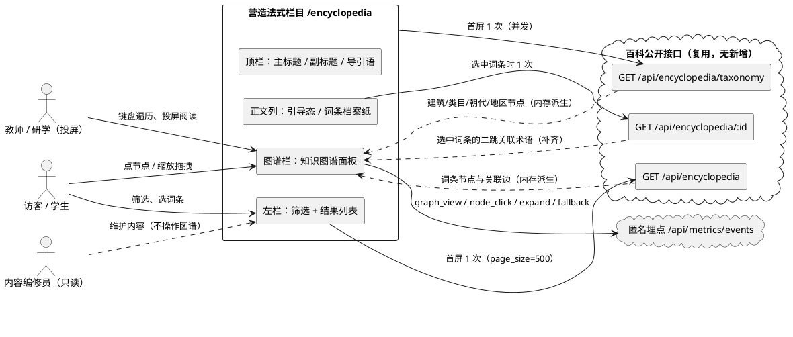
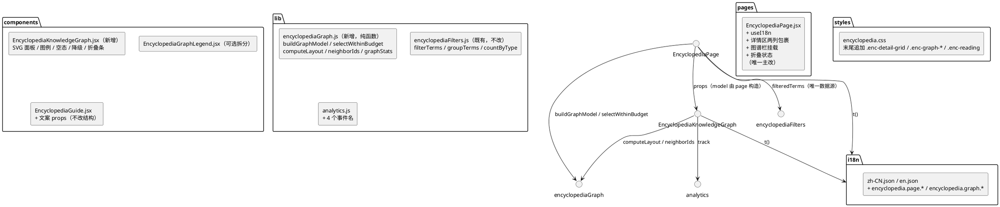
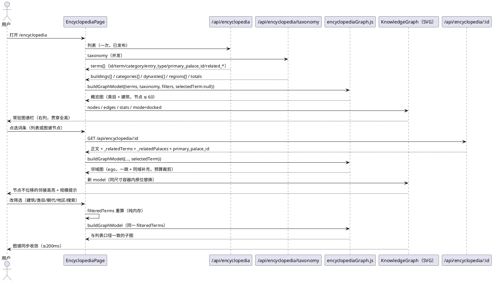
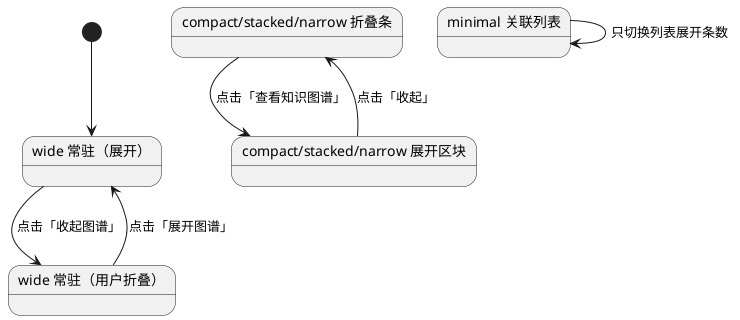

# 华夏古建可视化 · 营造法式知识图谱与详情区空白治理 实现方案（技术设计）

| 项 | 内容 |
|---|---|
| 文档编号 | DESIGN-PUBLIC-BG-001 |
| 版本 | v1.0 |
| 状态 | 待评审（设计阶段，不授权编码） |
| 上游文档 | `docs/requirements/encyclopedia-knowledge-graph-spec.md`（REQ-PUBLIC-BG-001，R-BG-01~39 / AC-BG-01~39）<br/>`docs/design/building-knowledge-enrichment-design.md`（DESIGN-PUBLIC-BK-001，ADR-BK-01~13）<br/>`docs/tasks/building-knowledge-enrichment-tasks.md`（TASKS-PUBLIC-BK-001，文件边界与红线）<br/>`docs/design/s3-p2-design.md`（DESIGN-PUBLIC-S3P2-001，ADR-S3-01~12、TR-09）<br/>`docs/requirements/s3-p2-requirements.md`（REQ-PUBLIC-S3P2-001，DFX-S3 全局约束） |
| 设计范围 | 前端 `/encyclopedia`（营造法式栏目）：详情区右侧空白治理、常驻知识图谱栏、图谱数据模型与组件、呈现层文案调整、埋点扩展、响应式与无障碍 |
| 关联代码库 | `D:\Ancient-architecture\ac1.1\acvisual 4`（分支：建筑模型的功能修改，基线 `55852d8`） |
| 技术栈 | React 19 + Vite + Three.js（图谱不使用 Three.js/WebGL）；Express + MySQL（`ac4_db` / `ac4_test`） |
| 业务代码改动 | **无**（本阶段只输出实现方案，不修改前端/后端任何源文件） |
| 下游阶段 | 编码任务规划由 spec-task-agent 负责；本文档不产出 tasks.md，也不授权编码 |
| 编号约定 | 设计决策 `ADR-BG-01~14`；设计目标 `DG-BG-xx`；设计约束 `CS-BG-xx`；组件契约 `CT-BG-xx`；开放问题 `Q-BG-xx`（沿用需求侧编号，新增项顺延为 `Q-BG-07` 起），与既有 `ADR-BK`、`ADR-S3`、`R-BK`、`R-S3`、`Q-BK`、`Q-S3` 互不覆盖 |

> 本文档回答「How」。前端路径省略前缀 `client/src/`，后端省略前缀 `server/src/`。
> 文中行号取自当前仓库快照，仅用于定位，不构成契约。
> **口径声明（全篇生效）**：词条数量、建筑数量、覆盖率一律以数据库实时查询与接口返回为准，**文档与代码中均不把「43 条」「20 座」写成实现常量**；文中出现的数字仅为当前快照的基线说明。
> **边界声明**：不改写 43 条已发布词条的 `term` / `synopsis` / `content` / `category`；不新增路由；不新增图谱数据库表；不引入任何第三方图谱库；图谱只消费 `status='published'` 的公开数据。

---

## 目录

- [一、现状与空白根因](#一现状与空白根因)
- [二、总体方案与数据流](#二总体方案与数据流)
- [三、布局设计](#三布局设计)
- [四、图谱数据模型](#四图谱数据模型)
- [五、图谱组件设计](#五图谱组件设计)
- [六、文字调整清单](#六文字调整清单)
- [七、埋点设计](#七埋点设计)
- [八、响应式与视觉一致性](#八响应式与视觉一致性)
- [九、测试与验收映射](#九测试与验收映射)
- [十、风险与开放问题](#十风险与开放问题)

---

# 一、现状与空白根因

## 1.1 需求要点与本轮采用口径

本轮需求不是「重新做一次百科」，而是三件事：**把呈现层文字改到能自解释、把右侧贯穿全高的裸空白消掉、把知识图谱落到栏目内并常驻可见**。39 条需求按能力域归属如下（逐条映射见第九章）：

| 能力域 | 需求条目 | 设计归属 |
|---|---|---|
| 布局与空白治理 | R-BG-01~05 | 第一章（测算）、第三章（布局设计） |
| 知识图谱数据模型 | R-BG-06~12 | 第四章（数据模型）、第五章 5.2（布局算法） |
| 展示位置与「全局样式」 | R-BG-13~17 | 第二章 ADR-BG-01、第三章（三栏/折叠） |
| 交互 | R-BG-18~24 | 第五章（5.3~5.7） |
| 文字调整 | R-BG-25~28 | 第六章（i18n 清单） |
| 响应式与视觉一致性 | R-BG-29~32 | 第五章 5.8、第八章 |
| 数据与隐私 | R-BG-33~35 | 第四章 4.2、第七章（埋点） |
| 验收与度量 | R-BG-36~39 | 第九章 |

**已采用的默认口径**（需求侧 Q-BG-01~06 的建议值，本文档按此设计，未定项在 10.2 登记）：

| 编号 | 采用口径 | 设计后果 |
|---|---|---|
| Q-BG-01 | 文字只改**呈现层**：主标题、副标题、导引语、图谱区标题/说明、图例、空态/降级、按钮标签；43 条词条正文与摘要不动 | 第六章只列 i18n 键与落点，不含任何正文改写 |
| Q-BG-02 | 「全局样式」取 **G1 栏目内全局**：右侧常驻图谱栏，贯穿 `/encyclopedia` 整页布局；不做全站浮层/背景水印 | 布局改造限定在 `.encyclopedia-layout` 内部，不改壳层；其他页面零改动 |
| Q-BG-03 | 图谱**只读 + 轻量缩放/拖拽 + 邻接高亮**；节点 ≤ 120、边 ≤ 300；渲染 ≤ 200ms | 交互与预算写入第四章预算常量、第五章边界策略 |
| Q-BG-04 | **先纯前端聚合**，复用 `/api/encyclopedia`、`/api/encyclopedia/taxonomy`、`/api/encyclopedia/:id`；不新增聚合接口 | 首屏请求数不增加；服务端零改动（ADR-BG-05） |
| Q-BG-05 | 移动端：< 900px 折叠入口，< 480px 降级为关联列表（不渲染 SVG） | 折叠状态机写入第三章 3.1、第八章 8.1 |
| Q-BG-06 | 引导态（未选词条）也常驻图谱栏，展示「类目 + 建筑」概览（≤ 60 节点） | 概览态与详情态共用同一组件，数据入参不同（ADR-BG-06） |

## 1.2 现状取证（代码级事实）

### 1.2.1 布局与空白

| 编号 | 事实 | 证据 |
|---|---|---|
| GAP-BG-01a | 栏目整体为「左栏固定 340px + 右侧 `flex:1`」的横向 flex，高度锁死为一屏 | `client/src/styles/global.css:4217-4220`（`.encyclopedia-layout { display:flex; height: calc(100vh - 73px) }`） |
| GAP-BG-01b | 左栏宽度固定、不参与弹性分配 | `global.css:4223-4231`（`.encyclopedia-sidebar { width:340px; flex-shrink:0 }`） |
| GAP-BG-01c | 右侧详情区只有单列滚动容器，内边距 32/40，**没有内部网格** | `global.css:4319-4323`（`.encyclopedia-detail { flex:1; overflow-y:auto; padding:32px 40px }`） |
| GAP-BG-01d | 词条档案纸硬上限 1040px，且**无 `margin:0 auto`、无 `width:100%`**，在块级格式化下左对齐 | `client/src/styles/encyclopedia.css:248-256`（`.enc-article { max-width:1040px; ... }`） |
| GAP-BG-01e | 引导态容器 `.enc-guide` 无宽度上限、无居中，靠 `min-height:100%` 撑满 | `encyclopedia.css:43-53` |
| GAP-BG-01f | 详情区插槽只有「引导态 / 加载态 / 档案纸」三种，没有第三列 | `client/src/pages/EncyclopediaPage.jsx:788-968` |
| GAP-BG-01g | ≤1024px 时既有断点把栏目改为**纵向**（左栏降到顶部、最大高度 300） | `global.css:5013-5028` |
| GAP-BG-01h | ≤480px 时 `guards.css` 给 `.encyclopedia-page` 追加左右 12px 外边距 | `client/src/styles/guards.css:1745-1770` |

### 1.2.2 图谱与文案

| 编号 | 事实 | 证据 |
|---|---|---|
| GAP-BG-02a | 全仓库无任何图谱组件、图谱样式、图谱路由；详情区仅有序列表 + 文章 | 目录 `client/src/components/`、`client/src/lib/` 无 graph 相关文件；`App.jsx:62` 仅注册 `/encyclopedia` |
| GAP-BG-02b | 列表接口**已返回** `related_palaces`、`related_terms`、`entry_type`、`primary_palace_id`、`primary_palace_name`、`dynasty`、`region`，前端一次拉取 500 条 | `server/src/services/encyclopediaService.js:162-170`；`EncyclopediaPage.jsx:159` |
| GAP-BG-02c | taxonomy 已返回建筑派生字段：`id/name/dynasty/region/order_num/has_3d/entry_count/craft_count/covered` | `encyclopediaService.js:238-248` |
| GAP-BG-02d | 详情接口已返回 `_relatedTerms` / `_relatedPalaces`（仅 published） | `server/src/services/encyclopediaService.js:414-433` |
| GAP-BG-03a | 顶栏主标题/副标题为 JSX 中文字面量，数量虽取自 `taxonomy.totals`，但无导引语、无图谱说明 | `EncyclopediaPage.jsx:505-516` |
| GAP-BG-03b | 「营造导引」看板全部文案为组件内硬编码（标题/hint/四段流程/脚注），未走 i18n | `client/src/components/EncyclopediaGuide.jsx:16-29,82-83,107-117` |
| GAP-BG-03c | 图谱可复用的筛选联动已具备纯函数层（`filterTerms/groupTerms/countByType/pickAlternatives`） | `client/src/lib/encyclopediaFilters.js:130-239` |
| GAP-BG-03d | 埋点白名单当前 21 个事件、12 个属性键，均不含图谱事件 | `client/src/lib/analytics.js:3-26,28-41` |
| GAP-BG-03e | i18n 上下文已存在，`t(key, fallback, vars)` 的插值正则为 `\{(\w+)\}`（**单**花括号） | `client/src/context/I18nContext.jsx:80-95` |
| GAP-BG-03f | 既有 `encyclopedia.*` 命名空间只有 filter/group/empty/coverage/knowledge 五组，页面尚未消费 | `client/src/i18n/zh-CN.json:49-80` |

> 说明：GAP-BG-02b/02c/02d 是本轮最重要的有利事实——**图谱所需数据在既有响应中已经齐备**，无需新增接口或表，纯前端聚合可行（与 Q-BG-04 默认口径一致）。

## 1.3 空白根因：布局测算

### 1.3.1 成因链

1. 详情区是 `flex:1` 的**唯一**子元素，宽度被拉满（1920 视口下为 1580px）；
2. 详情区内部只有一个普通块级流容器，档案纸 `.enc-article` 被 `max-width:1040px` 卡住，且**没有水平外边距**；
3. 块级元素默认左对齐 → 多出来的宽度**全部堆到右侧**，形成从页面顶部贯穿到底部的裸色背景带（栏目底色 `#faf5ef` 在截图观感上接近纯白）；
4. 引导态 `.enc-guide` 反而没有上限，因此**引导态看起来是满的、详情态看起来是空的**，两态切换产生宽度跳变（需求 H3 的成因）。

因此根因不是「内容不够」，而是**「容器拉满 + 内容卡死 + 不居中 + 没有第二列」**三件事叠加。

### 1.3.2 定量测算（改造前，当前快照）

计算口径：
- `详情区外框 = 视口宽度 − 左栏 340px`（仅 ≥1025px 成立；≤1024px 已转纵向，不适用）
- `内容盒宽度 = 详情区外框 − 左右内边距 40×2 = 详情区外框 − 80`
- `档案纸实际宽度 = min(1040, 内容盒宽度)`
- `右侧裸空白 = 内容盒宽度 − 档案纸实际宽度`
- **结构空白率 = 右侧裸空白 ÷ 内容盒宽度**（不含常规内边距；响应 Q-BG-02 的用户观感）

| 视口宽度 | 详情区外框 | 内容盒 | 档案纸实际宽 | 右侧裸空白 | 结构空白率 | 占整屏比例 |
|---|---|---|---|---|---|---|
| 1920 | 1580 | 1500 | 1040 | **460** | **30.7%** | 24.0% |
| 1680 | 1340 | 1260 | 1040 | 220 | 17.5% | 13.1% |
| 1600 | 1260 | 1180 | 1040 | 140 | 11.9% | 8.8% |
| 1460 | 1120 | 1040 | 1040 | 0 | 0.0% | 0.0% |
| 1440 | 1100 | 1020 | 1020 | 0 | 0.0% | 0.0% |
| 1180 | 840 | 760 | 760 | 0 | 0.0% | 0.0% |

**三个可复算的结论**：

1. **空白只在 ≥1460px 出现**，出现阈值 = `340 + 80 + 1040 = 1460`。这解释了「为什么开发本地 1366/1440 看不到问题、用户 1920 截图一眼看出问题」。
2. 1920 下空白率 **30.7%**（详情区口径），与需求 GAP-BG-01 记载的「≈ 30%」、截图观感「右侧 1/3~1/4」完全吻合：**1/3 是详情区口径，1/4 是整屏口径**。验收时必须声明用哪个口径，否则同一张截图会得出两个数字（口径写死见 3.6）。
3. 引导态在 1920 下**没有空白**（`.enc-guide` 无上限），所以「同一页面，点了词条反而右边空了一块」。这是本次最需要消除的**状态间不一致**，不是纯宽度问题。

### 1.3.3 其他被叠加的留白来源

| 来源 | 现状 | 是否本轮处理 | 处理方式 |
|---|---|---|---|
| 详情区上下内边距 32px | `global.css:4322` | 保留 | 属于常规内边距，不计入空白率 |
| 引导态 `padding: 28px 28px 22px` | `encyclopedia.css:48` | 保留但统一 | 与详情态共用外层网格，改为 `--enc-detail-pad` 单一来源（ADR-BG-03） |
| ≤480px 的 12px 页面外边距 | `guards.css:1766-1770` | 保留 | 窄屏唯一需要外边距的断点（需求 H4） |
| 档案纸内文本 `max-width:68ch`（仅摘要） | `encyclopedia.css:311-322` | 保留 | 摘要仍限宽；正文段落新增 `--enc-reading-measure` 统一约束 |
| 浏览器滚动条占宽 | `overflow-y:auto` | 保留 | 测量时按 `clientWidth` 取值，避免把滚动条算成空白 |

## 1.4 需求功能与存量功能对比

### 1.4.1 已实现功能（可直接复用，不改语义）

| 需求功能 | 存量功能 | 代码位置 | 匹配度 |
|---|---|---|---|
| 按建筑/类目/朝代/地区/关键词筛选 | 四类筛选 chip + URL 状态同步 + 失效参数剔除 | `pages/EncyclopediaPage.jsx:287-298,557-671`；`lib/encyclopediaFilters.js:60-158` | 100% |
| 列表分组与命中高亮 | `groupTerms` + `highlightSegments` + `AnimatedList` 键盘导航 | `lib/encyclopediaFilters.js:160-202`；`EncyclopediaPage.jsx:711-760` | 100% |
| 词条深链 `?term=<id>` | 读取 `term` 参数 → 详情接口 → 失败回退列表对象 | `EncyclopediaPage.jsx:206-229,300-307` | 100% |
| 建筑派生元数据（名称/朝代/地区/3D 能力/词条数） | taxonomy `buildings[]` 全字段 | `services/encyclopediaService.js:238-248` | 100% |
| 词条关联数据（主关联/关联建筑/关联术语） | 列表与详情均返回，且已过滤 published | `encyclopediaService.js:162-170,414-433` | 100% |
| 引导态导引卡（按类目计数生成） | `EncyclopediaGuide` 4 张卡 | `components/EncyclopediaGuide.jsx:49-70` | 100%（文案需 i18n） |
| 匿名埋点白名单与批量上报 | `track()` + `EVENT_NAMES` + `ALLOWED_PROP_KEYS` | `lib/analytics.js:3-41,163-176` | 100% |
| 双语上下文与插值 | `useI18n().t(key, fallback, vars)` | `context/I18nContext.jsx:80-95` | 100% |
| 减少动效归零 | 全局 `prefers-reduced-motion` 变量归零 | `styles/global.css:115-130` | 100% |
| 视觉令牌（纸白/朱红/圆角/墨线） | `--enc-surface/--enc-sunken/--enc-line/--vermilion/--radius-*` | `styles/encyclopedia.css:7-13`；`global.css:33-81` | 100% |

### 1.4.2 需要扩展的功能（在既有基础上改造）

| 需求功能 | 存量功能 | 差异说明 | 扩展方向 |
|---|---|---|---|
| 详情区占满并居中（R-BG-01/02） | `.encyclopedia-detail` 单列滚动 + `.enc-article` 1040 上限 | ①无第二列；②档案纸不填满；③两态宽度规则不一致 | 详情区内部新增 `.enc-detail-grid` 两列网格；档案纸追加修饰类 `.enc-article--fluid`（新类，不改原规则）；文本块限宽居中（ADR-BG-03） |
| 常驻图谱栏（R-BG-14） | 无 | 无容器、无数据装配、无渲染层 | 新增组件 + 新增纯函数模块 + 新增样式段落（第五章） |
| 图谱与筛选联动（R-BG-11/19） | `filterTerms` 已产出当前结果集 | 图谱需消费同一结果集，且点击节点要**反写**筛选 | 组件只接收 `filteredTerms/filters/onFilterChange/onSelectTerm`；点击回调用既有 `changeFilters/selectTerm`（ADR-BG-06） |
| 顶栏与导引文案（R-BG-25/26） | JSX 硬编码中文，未走 i18n | 页面未接入 `useI18n`；`EncyclopediaGuide` 文案在组件内 | 页面接入 `t()`；新增 `encyclopedia.page.*` / `encyclopedia.graph.*`，`EncyclopediaGuide` 增加可选 `t` 或文案 props（第六章） |
| 埋点（R-BG-34/35） | 21 事件 / 12 属性，无图谱事件 | 需新增 4 个事件名 | `EVENT_NAMES` 追加 4 个；属性键**全部复用**既有键，不新增键（ADR-BG-11） |
| 窄屏折叠（R-BG-31） | ≤1024 已纵向、≤480 有 12px 外边距 | 无「折叠图谱」入口与状态 | 折叠按钮 + `aria-expanded` + 会话内状态保持（第八章 8.1） |

### 1.4.3 需要新增的功能（存量完全没有）

| 模块 | 功能点 | 输入 | 输出 | 依赖 |
|---|---|---|---|---|
| 图谱数据装配（新增 `lib/encyclopediaGraph.js`） | 节点/边构造、失效边收敛、预算裁剪、确定性排序、邻接计算 | `terms[]`、`taxonomy`、`filters`、`selectedTerm` | `GraphModel{nodes,edges,stats,truncated}` | 既有列表 + taxonomy + 详情响应 |
| 图谱布局（同上模块） | 分层环形坐标计算（纯函数，不依赖 DOM） | `GraphModel`、画布尺寸 | `PositionedNode[]` | 无 |
| 图谱组件（新增 `components/EncyclopediaKnowledgeGraph.jsx`） | SVG 渲染、缩放拖拽、邻接高亮、键盘与读屏、空态/降级/骨架 | `GraphModel` + 回调 | 可交互图谱面板 | 上述纯函数模块 |
| 图谱样式（新增段落，追加到 `styles/encyclopedia.css` 末尾） | 面板/图例/节点/边/折叠条/降级列表 | 类名契约 | 视觉一致的面板 | 既有 `--enc-*` 令牌 |
| 折叠状态与断点配置 | 单一来源的断点与预算常量 | 视口宽度 | `mode: 'docked' \| 'collapsed' \| 'list'` | 无 |
| 文案键 | 图谱区 12~16 个键 + 页面 3 个键（中英） | — | i18n 资源 | `I18nContext` |

## 1.5 存量功能详细分析（本轮直接依赖项）

### 1.5.1 列表接口的契约与约束

**契约（实测形状）**
- `GET /api/encyclopedia?page_size=500` → `{ success, data: { data: TermSummary[], meta } }`；前端已在 `EncyclopediaPage.jsx:159` 以 500 条一次拉取。
- `TermSummary` 与本轮图谱相关的字段：`id`、`term`、`category`、`entry_type`（`craft`/`building`）、`level_value`、`sort_order`、`primary_palace_id`、`primary_palace_name`、`related_palaces`（数组，已归一）、`related_terms`（数组，已归一）、`dynasty`、`region`。
- `GET /api/encyclopedia/taxonomy` → `{ success, data: { buildings[], categories[], dynasties[], regions[], entry_types[], totals } }`；`buildings[]` 含 `id/name/dynasty/region/order_num/has_3d/entry_count/craft_count/covered`。

**约束（设计必须继承）**
1. **只消费 published**：列表与 taxonomy 已在服务层过滤 `status='published'`（`encyclopediaService.js:123-170,218-251`），前端**不得**再拼任何草稿/后台数据，也不得用 `localStorage` 缓存跨会话内容。
2. **不新增请求**：图谱数据必须来自首屏已有的两个请求 + 选中词条时的详情请求（DFX-BG-P5）。因此「关联术语边」在引导态只能由 `related_terms` ∪ 同 `category` 派生。
3. **响应字段不可假设**：`related_palaces` / `related_terms` 可能为 `[]` 或缺失，边界必须归一为数组（沿用 `safeJSON` 语义）。
4. **不改变筛选口径**：图谱节点集合必须由 `filterTerms(terms, filters)` 的**同一份结果**派生，否则会出现「列表 3 条、图谱 7 个词条」的口径矛盾（R-BG-11/19）。

### 1.5.2 前端页面的数据流与状态约束

**现有数据流**
1. 挂载 → `Promise.allSettled([getEncyclopediaTerms({page_size:500}), getEncyclopediaTaxonomy()])`（`:155-194`）；
2. URL → `normalizeFilters` → `filters` 状态（`:146-153,196-204`）；
3. `filteredTerms = filterTerms(terms, filters)`（`:318`）→ `groups` / `counts` / `alternatives`；
4. 选中词条 → `getEncyclopediaTerm(id)` → `selectedTerm`（含 `_relatedTerms`/`_relatedPalaces`），失败回退列表对象（`:206-229`）；
5. 任何筛选变化 → `syncUrl(next, '', true)` 写 URL（`:281-298`）。

**约束**
1. **筛选即权威**：图谱是 `filteredTerms` 的**视图**，不是独立数据源。图谱点击类目/朝代/地区 → 调用 `changeFilters`；点击词条 → 调用 `selectTerm`；点击建筑 → `navigate('/exhibition/:id')`（沿用既有建筑详情入口）。这样「图谱 ↔ 筛选」天然双向一致（R-BG-19）。
2. **不新增路由**（OOS-BG-05、R-BG-17）。
3. **深链不变**：`?term=<id>` 与筛选参数形态不改；图谱不引入自己的 query 参数（折叠状态仅存内存，避免污染可分享 URL 与 SEO 口径）。
4. **不改 `AnimatedList` 结构**：左栏列表的键盘连续导航不能被图谱改造破坏（沿用 ADR-BK 的既有结论）。
5. **详情区滚动归属不变**：`.encyclopedia-detail` 仍是唯一滚动容器；图谱栏粘性定位必须相对该容器（3.5）。

### 1.5.3 视觉与无障碍基线（沿用，不新造）

| 基线 | 现状 | 图谱必须遵守 |
|---|---|---|
| 纸白底 | `--enc-surface: #fdfbf6` | 面板底色一致，不使用纯白 `#fff` 大面积铺底 |
| 下沉底 | `--enc-sunken: #f6f1e4` | 图例条/规模提示条使用该底 |
| 墨线 | `--enc-line: var(--border-warm)` = `#D4C9B8` | 面板 1px 描边，圆角 `--radius-lg` |
| 朱红强调 | `--vermillion: #B83A2A` | 主关联边与选中态；正文对比度 ≥ 4.5:1（该色白底 7.2:1） |
| 字体 | `--enc-serif`（标题）+ 继承正文 | 节点标签用 `--enc-serif`，图例用系统字体 |
| 动效 | `prefers-reduced-motion` 全局归零 | 图谱不得再自造动画 |
| 键盘 | 既有列表与筛选均为原生 `<button>` | 图谱节点必须具备等价键盘路径或提供列表跳板 |

## 1.6 设计约束清单（CS-BG）

| 编号 | 约束事实 | 证据 | 对设计的影响 |
|---|---|---|---|
| CS-BG-01 | 详情区是 `flex:1` 单列滚动容器，内部无网格 | `global.css:4319-4323` | 新布局只能作为详情区的**内层**网格，不能改外层 flex 语义 |
| CS-BG-02 | 档案纸上限 1040px 写在既有选择器里 | `encyclopedia.css:248-256` | 采用**追加修饰类**覆盖，不改原规则文本（TR-09） |
| CS-BG-03 | 引导态与详情态是两个独立根节点，宽度规则不同 | `encyclopedia.css:43-53,248-256` | 两态必须包进同一网格列，否则切换必跳（R-BG-05） |
| CS-BG-04 | ≤1024px 既有断点强制栏目纵向 | `global.css:5013-5028` | 900~1024 无法做成并排双列；登记 Q-BG-07 |
| CS-BG-05 | 列表一次拉取 500 条，已含 `related_terms` | `EncyclopediaPage.jsx:159`；`encyclopediaService.js:162-170` | 纯前端聚合即可，不新增接口（ADR-BG-05） |
| CS-BG-06 | taxonomy 缓存 60s 级别、列表无缓存 | `encyclopediaService.js:210-213` | 图谱不做独立缓存，随渲染重算（≤120 节点，成本可忽略） |
| CS-BG-07 | 埋点 `t()` 插值用单花括号 | `I18nContext.jsx:80-95` | 新增键位一律用 `{shown}` / `{total}` 形式；既有 `{{count}}` 不动（6.4） |
| CS-BG-08 | 埋点队列批量 5 条、白名单外事件静默丢弃 | `analytics.js:44,117-130,163-176` | 新增事件必须先入 `EVENT_NAMES`，否则 `track()` 返回 false 且无日志 |
| CS-BG-09 | 图谱不得使用 WebGL | R-BG-10、OOS-BG-02 | 选 SVG（ADR-BG-02） |
| CS-BG-10 | 无第三方图谱库 | R-BG-30 | 布局算法自研为纯函数，便于单测（ADR-BG-04） |
| CS-BG-11 | `?term=` 深链与筛选参数不得变更 | DFX-BG-C1 | 折叠/缩放状态不入 URL |
| CS-BG-12 | 页面当前未接入 `useI18n` | `EncyclopediaPage.jsx` 全文无 `useI18n` | 接入时只需新增调用，不改数据流 |
---

# 二、总体方案与数据流

## 2.1 设计目标

| 编号 | 目标 | 可验证判据 |
|---|---|---|
| DG-BG-01 | 空白可量化消除：≥1440 视口、任一词条详情打开时，详情区结构空白率 ≤ 8% | 四组合测量（3.6）+ AC-BG-01/02/36 |
| DG-BG-02 | 图谱常驻可读：栏目内「左栏筛选—正文—图谱」三栏并存，引导态与详情态均可见 | AC-BG-14 + 断点截图 |
| DG-BG-03 | 图谱是真导航而非装饰：节点点击能切换词条/进入建筑/收敛筛选，且与筛选同源 | AC-BG-11/18/19 |
| DG-BG-04 | 图谱数据可测：节点/边构造为纯函数，同输入同输出，不依赖 DOM | 单测（4.5）+ AC-BG-06/07/09/12/33 |
| DG-BG-05 | 预算内性能达标：≤120 节点 / ≤300 边时首次渲染 ≤ 200ms，筛选重绘 ≤ 200ms | 9.3 测量方法 + AC-BG-38 |
| DG-BG-06 | 失败不扩面：图谱任何异常只影响图谱自身，正文与筛选完全可用 | 5.5 降级 + AC-BG-23 |
| DG-BG-07 | 文案可维护：所有新增呈现文案进 `encyclopedia.*`，中英双语，正文零改动 | 第六章 + AC-BG-25/26/28 |
| DG-BG-08 | 零新增面：不新增路由、不新增接口、不新增依赖、不新增数据表 | `package.json` 与路由表审计 + AC-BG-17/30 |

## 2.2 方案总览

### 2.2.1 三种展示形态的取舍（对应需求 §5.3.2）

| 方案 | 形态 | 空白治理 | 「全局」满足度 | 风险 | 结论 |
|---|---|---|---|---|---|
| A 右侧常驻图谱侧栏 | 详情区内部改两列：正文列 + 图谱栏（320~420px），图谱栏在滚动容器内粘性常驻 | 直接吃掉右侧空白，结构空白率 → 0 | 满足 G1「栏目内全局」（贯穿整页高度、常驻可见） | 正文列变窄，需控制阅读测量；窄屏需折叠 | **采用（ADR-BG-01）** |
| B 栏目内可折叠面板 | 图谱作为正文上/下的可折叠区块 | 宽屏仍留白 | 仅局部呈现，不满足「全局」 | 折叠后易被忽略 | **只作为 A 的窄屏降级形态**（1025~1283 与 ≤1024） |
| C 全站背景/浮层 | 固定浮层或背景水印，跨页面可见 | 不解决详情区空白 | 字面满足 G2 | 遮挡正文、性能、无障碍、埋点污染四项风险 | **否决**（Q-BG-02 默认） |

**结论**：G1 栏目内全局 + A 形态；C 方案在本轮全仓库**不得出现**（验收方式：检索新增文件是否存在 `position:fixed` 的全站图谱浮层、是否被 `/encyclopedia` 之外的页面引用）。

### 2.2.2 上下文视图



**通信协议与频率**：全部 HTTP JSON；首屏 2 个请求（与现状完全一致，DFX-BG-P5 零增量）；选中词条 1 个详情请求（与现状一致）；埋点走既有 Beacon 批量（5 条/批）。**不新增任何请求**。

### 2.2.3 组件总体架构



**分层规则（新增代码必须遵守）**

1. **纯函数与渲染分离**：节点/边构造、裁剪、布局全部在 `lib/encyclopediaGraph.js`，不得写在组件里；组件只做「拿到 model → 画」。
2. **单一数据源**：页面把 `filteredTerms` 传给 `buildGraphModel`，组件不再自行过滤词条；组件拿到的 `filters` 只用于显示当前口径与生成「清除筛选」回调。
3. **单一配置源**：断点、图谱宽度、节点/边预算、概览节点上限、缩放区间全部集中在一处常量对象（`GRAPH_CONFIG`），组件与 CSS 通过 CSS 自定义属性对齐同一组数值（DFX-BG-M1）。
4. **回调单向**：组件不直接调用 `setSearchParams`，只调用页面传入的 `onSelectTerm(id)` / `onApplyFilter(patch)` / `onOpenBuilding(id)`。

## 2.3 数据流

### 2.3.1 端到端时序（引导态 → 详情态）



### 2.3.2 五个关键数据步骤

| 步骤 | 输入 | 处理 | 输出 | 失败行为 |
|---|---|---|---|---|
| S1 词条池 | `filteredTerms` | 仅 `entry_type ∈ {craft, building}`；剔除无 `id`/`term` 项 | 词条节点候选 | 空池 → 空态（非错误） |
| S2 建筑池 | `taxonomy.buildings[]` | 筛选口径下：仅保留「与词条池有边相连」的建筑；引导态保留全部（概览裁剪） | 建筑节点候选 | taxonomy 缺失 → 仅词条 + 主关联建筑的最小图 |
| S3 分类池 | `taxonomy.categories/dynasties/regions`（或由词条派生） | 只保留被实际引用（有边）的分类/朝代/地区 | 分类节点候选 | 缺失 → 不生成该类节点（不报错） |
| S4 边构造 | S1~S3 + `related_*` | 四类边 + 失效过滤 + 自环过滤 + 无向去重 | 边候选（带优先级） | 单条边异常 → 丢弃该边，保留其余（DFX-BG-R2） |
| S5 预算裁剪 + 布局 | 节点/边候选 | 优先级分桶 → 截断到 120/300 → 过滤悬空边 → 确定性布局 | `GraphModel` + 坐标 | 裁剪后为空 → 空态 + 清除筛选出口 |

### 2.3.3 引导态与详情态的差异（同一组件、不同入参）

| 维度 | 引导态（`selectedTerm == null`） | 详情态（`selectedTerm != null`） |
|---|---|---|
| 图中心 | 「名筑档案」类目节点（若无该类目则以建筑数为最的类目为心） | 选中词条节点 |
| 节点集合 | 类目 + 建筑 + 少量代表词条（每个类目取排序前 1~2 条），上限 60 | 选中词条的一跳邻域 + 同域补充词条，上限 120 |
| 边 | 类目—词条、建筑—词条（主关联优先展示） | 四类边全量（受预算） |
| 主要用途 | 「这个栏目有什么、从哪进」 | 「这条词条连到哪、下一步读什么」 |
| 点击行为 | 同详情态（节点语义一致，不做两套） | 同左 |

## 2.4 关键设计决策（ADR-BG）

> 每条含「选择 / 否决 / 理由 / 代价」。各章节的落点以此为准。

**ADR-BG-01（呈现位置）右侧常驻图谱栏，拒绝全站浮层**

- **选择**：在 `.encyclopedia-detail` 内部新增两列网格，第二列为 320~420px 的图谱栏；≥1440px 常驻（可用户折叠），≤1283px 退化为可折叠区块，≤480px 退化为关联列表。
- **否决**：①全站固定浮层/背景水印（遮挡正文、跨页性能与无障碍代价高、违反 R-BG-16，且不解决详情区空白）；②在正文中部插一段图谱（不满足「全局」，也吃不掉右侧空白）；③独立 `/encyclopedia/graph` 页面（违反 OOS-BG-05 与 R-BG-17，新增收录风险）。
- **理由**：空白来自「详情区有第二列可用但没人用」，图谱栏正好填进去；常驻保证引导态与详情态视觉一致；不改壳层意味着其他页面零回归风险。
- **代价**：正文列变窄（1440 下约 620px），必须用「阅读测量 + 文本居中」保证可读；窄屏必须提供折叠与降级两档。

**ADR-BG-02（渲染层）SVG，不用 Canvas 2D，更不用 WebGL**

- **选择**：单个 `<svg viewBox>` + `<g>`/`<line>`/`<circle>`/`<text>` 渲染；交互靠 React 事件与 CSS 类切换。
- **否决**：①WebGL/Three.js（OOS-BG-02、R-BG-10 明令禁止，且 120 节点不值得为此引入渲染上下文与上下文丢失问题）；②Canvas 2D（可访问性差：节点无法被读屏与键盘直接寻址，需要自建虚拟焦点层，成本高于 SVG）；③HTML 绝对定位 + CSS 连线（连线需大量 DOM 节点，120 节点 × 边数会显著增加 DOM）。
- **理由**：SVG 天然矢量、可被 `querySelector` 与焦点模型寻址、支持 `prefers-reduced-motion` 的 CSS 控制、零额外依赖；120 节点规模下 DOM 数量 < 500，性能余量充足。
- **代价**：节点文字需手动做「超出省略 + `<title>` 完整名」，且要防重叠（布局算法保证最小环距）。

**ADR-BG-03（内容列）档案纸填满 + 文本块限宽居中，用修饰类覆盖而不改写既有规则**

- **选择**：详情区内部新增 `.enc-detail-grid{display:grid; grid-template-columns:minmax(0,1fr) var(--enc-graph-w); gap:var(--enc-detail-gap)}`；档案纸追加 `.enc-article--fluid{width:100%;max-width:none}`；卡片内文本容器新增 `.enc-reading{max-width:var(--enc-reading-measure);margin-inline:auto}`（正文段落、摘要、小节标题统一限宽居中），图片/图解/3D/术语保持列宽满铺。
- **否决**：①直接改 `.enc-article{max-width:1040px}` 为 `max-width:100%`（违反 TR-09「不改写既有选择器」，且会影响其他复用该类的场景）；②仅给档案纸加 `margin:0 auto`（只做到「居中」，右侧空白仍在，空白率不达标）；③把正文列固定成 700px 并把剩余全给图谱（违反 R-BG-14 的 320~420 宽度上限）。
- **理由**：「裸背景空白」由**卡片覆盖**消除；「文字行过长」由**阅读测量**约束；两者用不同层级解决，互不牵制。修饰类只在 `/encyclopedia` 的详情态出现，其他页面与引导态不受影响。
- **代价**：1920 下档案纸内文本两侧各留约 250px 对称留白——这是「档案纸的页边距」而非「页面空白」，需在验收口径（3.6）与视觉评审（AC-BG-29）中确认；卡片内空白不计入结构空白率。

**ADR-BG-04（布局算法）确定性分层环形，拒绝力导向**

- **选择**：按「中心 → 内环（一跳邻接）→ 外环（分类/其余词条/建筑）」三层同心环摆放；角度按确定性排序后的索引均分，主关联建筑固定落在 12 点方向起点；同一环内相邻节点半径交替 ±4% 防贴边；全部由纯函数计算（无随机、无迭代求解）。
- **否决**：①力导向（模拟退火/弹簧）：每次渲染结果不固定，无法做截图基线与「节点不位移」验收（R-BG-20 明确要求高亮不改变位置），且迭代成本不可控；②第三方布局库（dagre/elk）：违反 R-BG-30；③完全网格排列：看不清「谁和谁近」，图谱失去意义。
- **理由**：数据规模小（≤120），环形已足够表达「中心—邻域—外围」；确定性使单测可断言坐标，使 R-BG-20 的「高亮不位移」天然成立。
- **代价**：节点较多时外环会拥挤，需靠「预算裁剪 + 每环上限 + 标签省略」控制；不做自动避让（重叠由环半径与均分角保证）。

**ADR-BG-05（数据来源）纯前端聚合复用既有三接口，不新增聚合接口**

- **选择**：`buildGraphModel` 只吃 `terms`（首屏列表）、`taxonomy`（首屏）、`selectedTerm`（详情），三者全部为既有响应；服务端零改动。
- **否决**：新增 `GET /api/encyclopedia/graph`（Q-BG-04 的 S2）：多一个接口就要多一套参数校验、缓存、契约快照与权限测试；且首屏请求 +1 违反 DFX-BG-P5；当前数据量（数十词条）在客户端聚合是毫秒级。
- **理由**：列表接口已经返回 `related_terms` / `related_palaces` / `primary_palace_id`（GAP-BG-02b），图谱所需边全部可得；「选中态补二跳」用既有详情接口即可。
- **代价**：若未来词条规模上千、或列表接口为瘦身去掉 `related_terms`，客户端聚合会退化——**演进触发条件**：已发布词条 > 800 条，或列表响应体 > 512KB 时，重新评估 S2 并登记为 Q-BG-09。

**ADR-BG-06（数据装配策略）两段式：引导态概览图 + 选中态邻域图，同一组件**

- **选择**：`buildGraphModel` 通过 `selectedTerm` 是否存在切换「概览模式 / 邻域模式」；两种模式的节点/边语义、ID 规则、渲染与交互完全相同，仅集合与预算不同。
- **否决**：①引导态不显示图谱（违反 Q-BG-06 默认与 R-BG-14「两态均可见」）；②引导态显示全量图（≈90 节点会在窄栏内不可读，且首屏成本更高）；③为概览单独写一套组件（重复渲染逻辑，必然漂移）。
- **理由**：单组件降低维护成本；概览限于「类目 + 建筑 + 代表词条」恰好回答「这个栏目由什么构成」。
- **代价**：组件需要处理两种「中心节点」与两种裁剪上限，单测需覆盖两模式（4.5）。

**ADR-BG-07（预算裁剪）优先级分桶 + 确定性排序 + 显式规模提示**

- **选择**：边按 `primary(0) > palace(1) ≈ term(2) > peer(3)` 分桶；节点按「被高优先级边引用次数、再按类型权重、再按 label/id」排序；先取节点至上限，再按桶顺序取边至上限，最后丢弃悬空边；发生裁剪时模型返回 `truncated=true` 与 `{shownNodes,totalNodes,shownEdges,totalEdges}`。
- **否决**：①先到先得（依赖数组顺序，结果不可复现）；②只截边不截节点（会出现孤立节点，违反 §9.2-1）；③静默截断（违反 R-BG-09 的「必须显式提示」）。
- **理由**：满足 §9.3「当前选中词条邻接 → 主关联 → 关联建筑/关联术语 → 同域」的裁剪顺序，且完全可复现。
- **代价**：同域边可能在预算紧张时全部被裁掉，图谱看起来「很稀疏」——这是预算的预期行为，需靠规模提示让用户知道「已展示 N / 共 M」。

**ADR-BG-08（标识与去重）节点 `type:ref`、无向边字典序、同语义唯一**

- **选择**：节点 id = `${type}:${ref}`（`b:` 建筑、`t:` 词条、`c:` 类目、`d:` 朝代、`r:` 地区）；边 id = 有向边 `${from}>${to}#${kind}`、无向边取两端字典序小者在前；同一对节点同一 `kind` 只保留一条；禁止自环。
- **否决**：只用实体 id（建筑 `tiantan` 与词条 `tiantan` 会撞）；只用名称（同名建筑/词条冲突，违反 §9.1-1）；用数组下标（顺序变化即断边）。
- **理由**：类型前缀消除跨类型碰撞；字典序保证「A↔B」与「B↔A」只画一条线（§9.2-2、§9.2-4）。
- **代价**：所有对 id 的解析都要 `split(':')`，需提供 `parseNodeId` 并单测；对外埋点只上报 `entity_type` + `entity_id`（去掉前缀），避免把内部编码带进埋点。

**ADR-BG-09（缩放拖拽）viewBox 驱动 + 硬边界 + 一键复位**

- **选择**：缩放通过修改 `viewBox` 的 `x/y/width/height`（保持中心点不变），缩放系数 clamp 在 0.5×~2.0×；拖拽同样只改 `viewBox.x/y`；边界规则为「内容外接盒至少保留 30% 面积在视口内」，越界即回弹到夹紧值；提供「复位」按钮恢复初始 `viewBox`；指针事件用 Pointer Events + `requestAnimationFrame` 合并。
- **否决**：①对 `<g>` 用 `transform="scale()"`（与指针坐标换算需额外逆矩阵，且文字会随缩放变大导致溢出）；②滚轮直接改 `transform` 而不夹紧（用户会把图拖丢）；③不做拖拽只做静态图（Q-BG-03 已确认允许轻量缩放拖拽）。
- **理由**：`viewBox` 是矢量图最自然的视口模型，缩放时文字按视口比例变化、不会溢出面板；夹紧规则可用纯函数单测。
- **代价**：拖拽与点击需区分（位移阈值 4px 内视为点击），需在 5.4 明确实现与测试。

**ADR-BG-10（窄屏）折叠入口 + 列表降级，不做浮层抽屉**

- **选择**：1025~1283px 与 ≤1024px 默认把图谱折叠为一条「查看知识图谱（N 个节点）」入口条；展开后作为**文档流内的全宽区块**放在正文之前；<480px 不再渲染 SVG，直接渲染「关联列表」降级视图（带「清除筛选」与「查看建筑」出口）。
- **否决**：①窄屏抽屉浮层（遮挡正文，违反 R-BG-16/31）；②窄屏直接隐藏（用户失去图谱入口，违反 R-BG-23 的可行动出口）；③窄屏仍强行并排（正文被压到 <400px，且必然横向滚动）。
- **理由**：折叠条保留发现性，展开后不遮挡；<480px 下 SVG 节点标签已无法可读，列表是最诚实的降级。
- **代价**：窄屏存在两种图谱呈现（SVG 折叠 / 列表），需保证两者的点击语义一致（同样支持词条切换、建筑跳转、筛选收敛）。

**ADR-BG-11（埋点）只加 4 个事件名，属性全部复用既有键**

- **选择**：`EVENT_NAMES` 追加 `graph_view`、`graph_node_click`、`graph_expand`、`graph_fallback`；属性只用既有白名单键：`entity_type`（`term`/`building`/`category`/`dynasty`/`region`）、`entity_id`（去前缀的实体 id）、`stage`（`overview`/`detail`/`expand`/`collapse`/`fallback`）、`result_count`（渲染节点数）、`category`（筛选维度）。
- **否决**：新增 `graph_node_type` / `graph_edge_count` 等专用键（白名单膨胀、前后端漂移风险；现有键语义已可承载）。
- **理由**：R-BG-35 要求「仅新增列明的四类事件」，R-BG-34 要求属性只含非身份信息；复用既有键可零成本通过既有 `sanitizeProps` 校验。
- **代价**：`stage` 承载的语义变多，需在 `analytics.js` 白名单旁写一行注释说明取值域；`graph_view` 的「曝光」判定需明确为「面板进入可视区且节点已渲染」（7.1 定义），避免滚动经过就重复计数。

**ADR-BG-12（i18n）新增键挂在 `encyclopedia.*`，插值用单花括号**

- **选择**：页面级键 `encyclopedia.page.title/subtitle/lead`；图谱级键统一 `encyclopedia.graph.*`（title/hint/legend/edge/scale/collapse/expand/empty/fallback/skip/reset/zoomIn/zoomOut/listTitle）；中英同步；插值写 `{shown}` / `{total}` / `{count}`。
- **否决**：①新开顶层命名空间 `knowledgeGraph.*`（违反 R-BG-26 的 `encyclopedia.*` 约定）；②沿用 `{{count}}` 双花括号（与 `I18nContext` 的正则不匹配，会渲染出多余花括号）。
- **理由**：既有 `encyclopedia.*` 已有 filter/group/empty/coverage/knowledge 五组，图谱是其自然延伸；单花括号是当前实现唯一支持的形态。
- **代价**：既有 `encyclopedia.group.count` 使用 `{{count}}` 的写法与实现不一致（会渲染为 `{N}`），本轮**不改**（R-BG-28 要求既有键语义不变），登记为 Q-BG-08。

**ADR-BG-13（常驻与 CLS）图谱栏 sticky 于详情区滚动容器，骨架先占位**

- **选择**：图谱栏 `position:sticky; top:0; align-self:start; height: calc(100vh - 73px - var(--enc-detail-pad)*2)`；首帧即按最终尺寸渲染「骨架面板」（同宽同高、同描边），数据就绪后在原位替换内容；折叠/展开只切换内容区高度，不改变列宽。
- **否决**：①`position:fixed`（脱离详情区，滚动时遮挡左栏或正文，且与「栏目内」语义冲突）；②数据未就绪先不渲染（列宽从 0 变 420，必然 CLS 超标）；③图谱栏与正文同高随正文滚动（失去「常驻」含义）。
- **理由**：sticky 在既有滚动容器内生效，天然「贯穿可视高度」；骨架占位把 CLS 压到接近 0（R-BG-05、DFX-BG-P2）。
- **代价**：折叠时若直接 `display:none` 会改变网格列数导致正文跳宽——必须改为「列宽保留、内容区收起」（8.1 状态机）。

**ADR-BG-14（无障碍）SVG 节点可聚焦 + 关联列表作为等价路径**

- **选择**：每个可点选节点 `<g role="button" tabindex="0" aria-label="词条：藻井">`；Enter/Space 触发与点击等价的回调；面板顶部提供「跳至正文」链接（`href="#enc-article"`）；面板底部提供「关联列表」`<details>`/按钮切换，把同一批节点渲染为普通 `<button>` 列表（可读屏、可 Tab）；节点样式同时用「颜色 + 形状 + 线型」双编码。
- **否决**：①仅用 `role="img"` + 文字描述（图谱就不可操作，「可交互率 100%」不成立）；②仅靠 SVG 焦点（部分读屏对 SVG 子元素支持不一致，需要等价列表兜底）；③用 `canvas` + 自绘焦点（成本高且不可被系统读屏直接寻址）。
- **理由**：R-BG-22 要求全程键盘可达，DFX-BG-A1 要求可朗读名称与类型；「SVG 焦点 + 列表跳板」双通道能覆盖主流读屏与仅键盘用户。
- **代价**：同一批节点渲染两次（图形 + 列表），需共用同一份 `GraphModel` 与回调，避免两套逻辑；DOM 数量增加约 1 倍（仍 < 800，可接受）。
---

# 三、布局设计

## 3.1 布局形态与断点

### 3.1.1 断点定义（单一配置源）

| 断点名 | 区间 | 布局形态 | 图谱形态 | 默认状态 |
|---|---|---|---|---|
| `wide` | ≥ 1440px | 三栏：左筛 340 + 正文（1fr）+ 图谱（320~420） | 常驻右列（sticky） | **展开**，可折叠 |
| `medium` | 1284 ~ 1439px | 两栏：左筛 340 + 正文 + 图谱 320 | 常驻右列（sticky） | **展开**，可折叠 |
| `compact` | 1025 ~ 1283px | 左筛 340 + 正文单列；图谱折叠条位于正文之前 | 折叠条 → 展开为全宽区块 | **折叠** |
| `stacked` | 721 ~ 1024px | 沿用既有纵向布局（左栏顶置、max-height 300） | 折叠条 → 展开为全宽区块 | **折叠** |
| `narrow` | 481 ~ 720px | 单列，正文全宽 | 折叠条 → 展开为全宽区块 | **折叠** |
| `minimal` | ≤ 480px | 单列，正文全宽 | **关联列表降级**（不渲染 SVG） | 列表常显（3~5 条 + 出口） |

**与需求断点的对应关系**：

| 需求断点 | 本设计落点 | 说明 |
|---|---|---|
| 1920 | `wide` | 三栏常驻，与 AC-BG-01/02/14 对应 |
| 1440 | `wide` | 三栏常驻，图谱宽 374px（`26vw`） |
| 900 | `stacked` | 既有 `@media (max-width:1024px)` 已将栏目转为纵向（`global.css:5013-5028`），本设计**不推翻**该断点，图谱改为折叠条 + 全宽展开（登记 Q-BG-07） |
| 320 | `minimal` | 关联列表降级，无 SVG，无横向滚动 |

> **为什么 900 不并排**：既有小屏形态是「筛选顶置 + 正文整宽」，若在 900 强行加 320px 图谱列，正文只剩约 500px 减去 80px 内边距 = 420px，中文行宽不足 30 字，且左栏 `max-height:300` 的滚动区与详情区嵌套滚动会互相抢手势。故 900 处采用「折叠条 + 展开全宽」，仍满足「图谱可达、不遮挡、不横向滚动」。此项为需求文本（900–1439 双列）与本设计的唯一差异，登记为 Q-BG-07，需评审确认。

### 3.1.2 折叠状态机



**状态保持规则**

1. 折叠状态只存 React state（`graphCollapsed`），**不写 URL、不写 localStorage**（DFX-BG-C1：URL 形态不变；跨会话不记忆避免与用户预期冲突）。
2. 断点变化时重置为「该断点的默认状态」：进入 `wide`/`medium` → 展开；进入 `compact`/`stacked`/`narrow`/`minimal` → 折叠/列表。用 `matchMedia` 监听，避免 resize 抖动（只监听跨断点变化，不做像素级监听）。
3. 折叠后**列宽保留**：`wide`/`medium` 折叠时，网格仍为两列，图谱列保留 44~56px 的竖向折叠把手条（竖排文字「知识图谱」+ 展开图标），正文列宽不变 → 不触发正文重排（ADR-BG-13）。

## 3.2 宽度与间距计算

### 3.2.1 变量（单一来源）

```text
--enc-sidebar-w      : 340px      （既有 global.css，保持不动）
--enc-detail-pad-x   : 40px       （既有 padding，保持不动）
--enc-detail-gap     : 28px       （wide）；20px（medium）
--enc-graph-w        : clamp(320px, 26vw, 420px)  （wide）
--enc-graph-w        : 320px      （medium）
--enc-reading-measure: 74ch       （正文字号 15~16px 时约 590px）
--enc-graph-rail-w   : 52px       （折叠后的竖向把手）
```

### 3.2.2 各断点正文列宽（复算表）

计算式：`内容盒 = 视口 − 340 − 80`；`正文列 = 内容盒 − 图谱宽 − gap`

| 视口 | 内容盒 | 图谱宽 | gap | 正文列宽 | 文本块（74ch≈592px） | 结论 |
|---|---|---|---|---|---|---|
| 2560 | 2140 | 420（clamp 上限） | 28 | 1692 | 592 居中 | 超宽屏两侧对称留白，无单侧堆积 |
| 1920 | 1500 | 420 | 28 | 1052 | 592（占 56%） | 卡片满铺，卡内对称留白（ADR-BG-03） |
| 1680 | 1260 | 420 | 28 | 812 | 592（占 73%） | 可读性良好 |
| 1600 | 1180 | 416 | 28 | 736 | 592（占 80%） | 可读性良好 |
| 1440 | 1020 | 374 | 28 | 618 | 592（占 96%） | 74ch 恰好适配，行宽 ≤ 75ch |
| 1284 | 864 | 320 | 20 | 524 | 524（占 100%） | 最窄并排档；行宽 ≈ 65ch，仍达标 |
| 1283 | 863 | — | — | 863（折叠） | 592 居中 | 折叠后正文变宽，不跳 |
| 1025 | 605 | — | — | 605（折叠） | 592 | 行宽 ≈ 74ch，达标 |
| 900 | —（纵向） | — | — | 900 − 80 = 820（顶置栏下） | 592 居中 | 无横向滚动 |
| 720 | — | — | — | 720 − 80 = 640 | 592 | 达标 |
| 480 | — | — | — | 480 − 80 − 24 = 376 | 376 | 行宽 ≈ 47ch（低于 60），`minimal` 下允许（>480 才校验 60–75ch） |
| 320 | — | — | — | 320 − 24 = 296 | 296 | 关联列表，不做行宽校验 |

> **R-BG-04 的适配说明**：需求要求「正文行宽 60–75 字符」。本设计以 CSS `ch` 单位统一度量，`--enc-reading-measure: 74ch` 在 1284~2560 全区间均不超过 75ch；≤ 480px 因物理宽度不足，按 R-BG-03 的「单列 + 纵向滚动」形态处理，不纳入行宽校验（登记在 3.6 的测量口径中）。

### 3.2.3 垂直方向

| 项 | 取值 | 说明 |
|---|---|---|
| 栏目总高 | `calc(100vh - 73px)`（既有） | 不改 |
| 详情区上下内边距 | 32px（既有） | 不改 |
| 图谱栏可视高 | `calc(100vh - 73px - 64px)` | 等于详情区内容高度（32×2 已扣） |
| 图谱栏内部布局 | 标题栏（auto） + 图例（auto） + 画布（1fr） + 规模提示/工具条（auto） | 画布 `min-height: 280px` |
| 正文列滚动 | 由详情区统一滚动（既有） | 图谱栏 sticky，正文滚动时图谱不动 |

## 3.3 DOM 结构与 CSS 修改范围

### 3.3.1 改造后的详情区结构（结构示意，非实现代码）

```text
main.encyclopedia-detail                    ← 既有，不改规则
└─ div.enc-detail-grid                     ← 新增（两列网格）
   ├─ div.enc-detail-main                  ← 新增（正文列，1fr）
   │  ├─ section.enc-guide                 ← 引导态（既有组件，外包一层新容器）
   │  └─ article.enc-article.enc-article--fluid  ← 详情态（保留既有类，追加修饰类）
   │     ├─ header.enc-head                ← 既有；内部 .enc-reading 限宽
   │     ├─ section.enc-section            ← 既有；媒体满铺
   │     └─ section.enc-section--text      ← 既有；正文 .enc-reading 限宽
   └─ aside.enc-graph-panel                ← 新增（图谱栏，sticky）
      ├─ header.enc-graph-head             ← 标题 + 说明 + 折叠按钮
      ├─ ul.enc-graph-legend               ← 节点/边图例（双编码）
      ├─ div.enc-graph-canvas              ← 画布容器（固定宽高比/满高）
      │  └─ svg.enc-graph-svg              ← 节点与边
      ├─ p.enc-graph-scale                 ← 「已展示 N / 共 M 个节点」
      └─ div.enc-graph-empty/fallback      ← 空态与降级
```

### 3.3.2 CSS 修改边界（严格遵守 TR-09）

| 文件 | 允许的改动 | 禁止的改动 |
|---|---|---|
| `styles/encyclopedia.css` | 在**文件末尾**追加新段落：`.enc-detail-grid`、`.enc-detail-main`、`.enc-article--fluid`、`.enc-reading`、`.enc-graph-*`、对应 `@media` 与 `@container` 块 | 改写已有选择器的规则文本（`.enc-article`、`.enc-guide`、`.enc-section`、`.enc-filter-*` 等一律不动） |
| `styles/global.css` | **不改** | 不改 `.encyclopedia-layout` / `.encyclopedia-sidebar` / `.encyclopedia-detail` 的任何声明 |
| `styles/guards.css` | **不改** | 不改 ≤480px 的 12px 外边距 |
| `pages/EncyclopediaPage.jsx` | 详情区包裹两列 + 挂载图谱 + 折叠状态 + i18n + 埋点调用 | 不重建筛选逻辑、不改 `AnimatedList` 结构、不改 URL 同步函数语义 |
| `components/EncyclopediaGuide.jsx` | 接收可选文案 props（`title`/`hint`/`flow`/`foot`/`hints`） | 不改导引卡结构、不改排序规则 |
| `components/EncyclopediaKnowledgeGraph.jsx` | 新增文件 | — |
| `lib/encyclopediaGraph.js` | 新增文件 | — |

**为什么用修饰类而不是直接改 `.enc-article`**：`.enc-article` 是既有共享选择器，直接改 `max-width` 会影响所有引用处（含可能的其他页面与打印样式）；修饰类 `.enc-article--fluid` 只在详情态挂载，语义清晰、可回退，且完全符合 TR-09 的「新起选择器」约定（ADR-BG-03）。

### 3.3.3 文本限宽的应用点（`enc-reading`）

| 落点 | 现状 | 改造 |
|---|---|---|
| `.enc-head-title` | 无限制，`text-wrap: balance` | 不额外限宽（标题短） |
| `.enc-head-synopsis` | `max-width: 68ch`（既有） | 保留 68ch，追加 `margin-inline:auto`，与正文居中对齐 |
| `.encyclopedia-article-content p` | 无限制 | 新增 `.enc-reading`：`max-width: var(--enc-reading-measure); margin-inline:auto` |
| `.enc-section-head` | flex 两端对齐 | 新增限宽容器包裹（或 `max-width` + 居中），保证小节标题与正文左边缘对齐 |
| `.enc-3d-text p` | `max-width: 62ch`（既有） | 保留 |
| 图片 / 图解 / 3D 卡片 / 相关术语 | 满铺列宽 | 保留满铺（媒体更宽是合理排版） |

### 3.3.4 容器查询（避免窄正文列挤压导引卡）

`wide` 下正文列 618~1052，`medium` 下 524~855；既有 `.enc-guide-grid` 的 4 列在 618px 时每列仅 154px，会挤压导引卡文案。处理：

- 给 `.enc-detail-main` 设 `container-type: inline-size`；
- 追加 `@container (max-width: 780px) { .enc-guide-grid { grid-template-columns: repeat(2, minmax(0,1fr)) } }`；
- 不支持容器查询的浏览器回退为既有视口断点（4 列 → ≤1180px 2 列），**只影响美观，不影响功能与验收项**（AC-BG-29 视觉一致性在 Chrome/Safari/Firefox 现代版本验收）。

## 3.4 引导态与详情态的一致性

| 维度 | 引导态 | 详情态 | 一致性规则 |
|---|---|---|---|
| 外层网格 | `.enc-detail-grid` | `.enc-detail-grid` | 同一网格、同一 gap、同一图谱列宽 |
| 正文列宽 | 1fr | 1fr | 完全相同 |
| 上下内边距 | 由 `.enc-guide` 自带 28px | 由 `.enc-article` 自带 30px | 统一为 `--enc-detail-pad`（24px），两态都读同一变量（新增类上设置，不改既有规则文本） |
| 图谱栏 | 概览图 | 邻域图 | 同组件、同尺寸、同交互 |
| 切换时正文位置 | — | — | 两态切换不改变网格列宽 → 标题位置偏差 ≤ 2px（R-BG-05） |

**关键点**：引导态与详情态**并列**在 `.enc-detail-main` 里通过条件渲染切换，二者宽度都由网格列决定，而不是一个「无上限」一个「1040 上限」——这从结构上消除了 1.3.1 的第 4 条成因。

## 3.5 粘性滚动与 CLS 控制

### 3.5.1 滚动归属

- `.encyclopedia-detail` 是唯一纵向滚动容器（既有 `overflow-y:auto`）。
- 图谱栏 `position:sticky; top:0` 相对该容器生效，因此正文滚动时图谱保持可见（满足「贯穿全高、常驻」）。
- 左栏 `.encyclopedia-sidebar` 自身 `overflow:hidden` + 列表内滚动，**不受影响**；图谱栏不在左栏内，不存在嵌套滚动竞争。

### 3.5.2 四道 CLS 防线

| 防线 | 措施 | 对应验收 |
|---|---|---|
| 1. 列宽先定 | 网格列宽由 CSS 变量决定，与数据无关；数据未就绪时图谱栏依然占 320~420px | DFX-BG-P2 |
| 2. 骨架同尺寸 | 骨架面板与最终面板同宽、同高（`min-height` 锁定）、同描边；只替换内部内容 | AC-BG-05 |
| 3. 两态同网格 | 引导态/详情态共用网格，切换不改列宽 | R-BG-05 |
| 4. 折叠不改列宽 | 折叠只切换内容区高度 + 显示竖向把手条 | ADR-BG-13 |

**禁止的做法**：`display:none` 整栏隐藏（会让网格从 2 列变 1 列，正文瞬间变宽 → 必然 CLS）；加载期渲染空 `div` 无高度（数据到达后撑开 → CLS）。

### 3.5.3 骨架规格

- 尺寸：宽 = 图谱列宽；高 = `calc(100vh - 73px - 64px)`（`min-height:280px`）；
- 内容：标题占位线 ×1、图例占位点 ×4、画布区淡色网格（`--enc-line` 10% 透明度）；
- 动效：**无**（不使用 shimmer/脉搏；减少动效模式下必须静止，默认模式也保持静止以避免视觉噪音）；
- `aria-busy="true"` + `aria-label`（「知识图谱加载中」）。

## 3.6 空白率测量口径（可复现）

### 3.6.1 公式（三个口径，验收只认前两个）

```text
结构空白率（主口径，验收用）
  = 1 − (正文卡片宽度 + gap + 图谱栏宽度) / 内容盒宽度

内容盒宽度 = 详情区 clientWidth − 左右内边距（40×2）
正文卡片宽度 / 图谱栏宽度 取 getBoundingClientRect().width
gap 取网格实际间距（28 或 20）

裸背景率（辅助口径，用于说明「截图空白」）
  = 1 − (正文卡片宽度 + gap + 图谱栏宽度) / 详情区 clientWidth
  （把 40×2 内边距也视为空白，改造前 1920 = 40.5%，改造后 = 8.0%）

视觉留白率（参考值，不作红线）
  = 1 − 文本块宽度 / 正文卡片宽度
  （1920 下 ≈ 43.7%，属于档案纸页边距，ADR-BG-03）
```

### 3.6.2 四组合基线（改造前 → 改造后）

| 组合 | 内容盒 | 正文卡片 | gap | 图谱 | 覆盖 | 结构空白率 | 结论 |
|---|---|---|---|---|---|---|---|
| 1920 · 详情态 | 1500 | 1040（改造前）/ 1052（改造后） | 0 / 28 | 0 / 420 | 1040 / 1500 | **30.7% → 0.0%** | 达标 |
| 1920 · 引导态 | 1500 | 1500（改造前）/ 1052（改造后） | 0 / 28 | 0 / 420 | 1500 / 1500 | 0.0% → 0.0% | 不劣化 |
| 1440 · 详情态 | 1020 | 1020 / 618 | 0 / 28 | 0 / 374 | 1020 / 1020 | 0.0% → 0.0% | 不劣化 |
| 1440 · 引导态 | 1020 | 1020 / 618 | 0 / 28 | 0 / 374 | 1020 / 1020 | 0.0% → 0.0% | 不劣化 |

**判定**：四组合结构空白率均 ≤ 8%（实测期望全部为 0%），满足 R-BG-02/AC-BG-02；1920 详情态从 30.7% 降到 0%，是本次改造的核心证据（需留存改造前后同视口截图，AC-BG-36）。

### 3.6.3 测量脚本约束（避免口径争议）

1. 必须在**词条详情已打开且图谱节点已渲染**（非骨架态）后测量；
2. 用 `document.documentElement.scrollWidth <= clientWidth` 先确认无横向滚动（AC-BG-03）；
3. 视口必须为 1920×1080 / 1440×900 的 CSS 像素（非设备像素），缩放 100%；
4. 测量值取三次取整到 0.1%，差异 > 0.5% 视为环境不稳定（字体未加载/滚动条出现），需重测。
---

# 四、图谱数据模型

## 4.1 模型定义

### 4.1.1 节点

**五类节点，无装饰性节点**（R-BG-06）：

| 类型（`type`） | `ref` 取值 | `label` 来源 | `sublabel` | `clickable` | 点击行为 |
|---|---|---|---|---|---|
| `building` | `palaces.id` | `taxonomy.buildings[].name` | `dynasty` | 是 | 进入 `/exhibition/:id`（既有建筑详情入口） |
| `term` | `encyclopedia_terms.id` | 词条 `term` | `category` | 是 | `selectTerm(id)` → `?term=<id>` |
| `category` | 类目名（如 `斗拱`） | `taxonomy.categories[].category` | `entry_count` | 是 | `changeFilters({category})` |
| `dynasty` | 朝代名（如 `明`） | `taxonomy.dynasties[]` | 关联建筑数 | 是 | `changeFilters({dynasty})` |
| `region` | 地区名（如 `北京`） | `taxonomy.regions[]` | 关联建筑数 | 是 | `changeFilters({region})` |

**节点字段契约（CT-BG-01）**

```text
GraphNode {
  id        : string      // `${type}:${ref}`，图内唯一
  type      : 'building' | 'term' | 'category' | 'dynasty' | 'region'
  ref       : string      // 真实实体标识（建筑/词条为 id；其余为名称）
  label     : string      // 必须是真实名称，禁止回退为 id（§9.1-3）
  sublabel  : string|null // 建筑→朝代；词条→类目；其余→统计数文案
  clickable : boolean     // 五类均为 true（构建期若目标不可达则置 false 并降级为标签节点）
  weight    : number      // 排序权重：被边引用的累计次数（含被高优先级边引用加成）
  meta      : { has3d?: boolean, entryCount?: number, entryType?: 'craft'|'building', category?: string, dynasty?: string, region?: string }
}
```

**约束**

1. `id` 不得仅用名称（§9.1-1）：`term:caisson` 与 `building:caisson` 可共存。
2. `label` 缺失时**不得**降级显示 `ref`（R-BG-12、DFX-BG-R1 明确禁止裸 id）；构建期若发现无名称，直接不生成该节点。
3. `clickable=false` 只用于「目标已在筛选外/不可达」的情形；此类节点仍可渲染为标签，但**不计入可点击率分母之外**（R-BG-37 要求可点击节点/已渲染节点 = 100%，因此实际实现中宁可裁掉也不生成不可点节点；`clickable` 字段保留给降级列表视图）。

### 4.1.2 边

**四类边，可区分强度**（R-BG-07、§9.2-5）：

| 语义（`kind`） | 方向 | 生成条件 | 强度 | 视觉编码 |
|---|---|---|---|---|
| `primary` 主关联 | 词条 → 建筑（有向） | `term.primary_palace_id` 命中建筑池 | 最高（weight 3） | 朱红实线 2px |
| `palace` 关联建筑 | 词条 → 建筑（有向） | `term.related_palaces[]` 中排除主关联后的建筑 | 中（weight 2） | 墨色实线 1.2px |
| `term` 关联术语 | 词条 ↔ 词条（无向） | 双方 `related_terms` 交集（任一方向命中即可） | 中（weight 2） | 墨色点划线 1.2px |
| `peer` 同域 | 词条 ↔ 词条 / 建筑 ↔ 建筑（无向） | 同 `category`（词条组内）；同 `dynasty` 或同 `region`（建筑组内） | 弱（weight 1） | 浅墨细线 1px + 低透明度 |

**边字段契约（CT-BG-02）**

```text
GraphEdge {
  id        : string   // 有向：`${from}>${to}#${kind}`；无向：两端字典序 + `#${kind}`
  from      : string   // GraphNode.id
  to        : string   // GraphNode.id
  kind      : 'primary' | 'palace' | 'term' | 'peer'
  directed  : boolean
  weight    : 1 | 2 | 3
}
```

**约束**

1. 两端必须都在**最终渲染节点集合**内（§9.2-1）；裁剪后必须再过滤一次悬空边。
2. 同一对节点同一 `kind` 只保留一条（§9.2-2）；`term` 边无向，`A→B` 与 `B→A` 只画一条。
3. 主关联边每条词条最多一条（§9.2-3）。
4. 不允许自环（§9.2-4）。
5. 强度必须体现在**线宽 + 颜色 + 线型**至少两项，不能只换颜色（R-BG-32）。

### 4.1.3 图模型

```text
GraphModel {
  mode      : 'overview' | 'focus'
  centerId  : string|null          // overview=类目中心；focus=选中词条
  nodes     : GraphNode[]          // 已裁剪、已确定性排序
  edges     : GraphEdge[]          // 已过滤悬空、已确定性排序
  stats     : { totalNodes, totalEdges, shownNodes, shownEdges, truncated: boolean }
  filters   : FilterSnapshot       // 生成时的筛选快照（用于提示与「清除筛选」）
}
```

## 4.2 来源映射与构造规则

### 4.2.1 字段映射表

| 图元素 | 源字段 | 归一化规则 |
|---|---|---|
| 建筑节点 | `taxonomy.buildings[]`：`id/name/dynasty/region/has_3d/entry_count/order_num` | `label = name`；`name` 为空则丢弃 |
| 词条节点 | `filteredTerms[]`：`id/term/category/entry_type/primary_palace_id/level_value/sort_order/dynasty/region` | `entry_type` 缺失按 `'craft'`（沿用 `encyclopediaFilters.js:134` 的既有兜底） |
| 类目节点 | `taxonomy.categories[].category`（或由词条 `category` 去重派生，作为 taxonomy 缺失时的兜底） | 仅保留「被至少 1 个词条节点引用」的类目 |
| 朝代节点 | `taxonomy.dynasties[]`，或建筑/词条的 `dynasty` 去重 | 仅保留被引用者 |
| 地区节点 | `taxonomy.regions[]`，或建筑的 `region` 去重 | 仅保留被引用者 |
| 主关联边 | `term.primary_palace_id` | 建筑必须存在于建筑池，否则丢弃该边 |
| 关联建筑边 | `term.related_palaces[]` | 去重、去掉主关联、去掉不存在建筑 |
| 关联术语边 | `term.related_terms[]` | 与词条池求交；去自环；无向去重 |
| 同域边 | `category` / `dynasty` / `region` | 分组后按组内上限 `PEER_PER_GROUP=3` 生成 |

### 4.2.2 构造流程（确定性，无随机）

```text
1) 词条池 P ← filteredTerms（P 为空则直接返回空模型）
2) 建筑池 B ← taxonomy.buildings ∩ 与 P 有边者（overview 模式取全部在架建筑，再按预算裁剪）
3) 分类池 C/D/R ← 被 P∪B 实际引用者
4) 生成 primary 边：p.primary_palace_id ∈ B
5) 生成 palace 边：p.related_palaces ∩ B − {primary}
6) 生成 term 边：p.related_terms ∩ P，自环剔除，无向 key 去重
7) 生成 peer 边：
   - 词条：按 category 分组，组内按 (sort_order, level_value, id) 升序取前 3 名为代表，代表之间两两连边
   - 建筑：按 dynasty 分组、按 region 分组，各取前 3 名，两两连边
   - 组内不足 2 个不生成
8) 计算每个节点的引用计数 → weight
9) 预算裁剪（4.3）
10) 剔除悬空边（两端均在节点集合内）
11) 剔除孤立节点（除 centerId 外，无边节点删除；删除后不得再产生悬空边，做一次两轮收敛）
12) 确定性排序（4.3.2）
13) 布局（5.2）
```

**关键取舍**：同域边采用「组内代表两两连边」而不是「全组两两连边」。原因：43 条词条若按类目两两连边是 O(n²)，图谱会被同域弱边淹没；只在每组前 3 名之间连边，既表达「同类可一起看」，又把同域边数量收敛到 ≤ 3×类目数×3。该规则写入单测（4.5 G-18）。

### 4.2.3 过滤规则（对应 DFX-BG-R2、R-BG-12、R-BG-33）

| 情形 | 处理 | 不得发生 |
|---|---|---|
| 边指向不存在的建筑/词条 | 丢弃该边，保留其余节点与边 | 整图失效、显示裸 id |
| 边指向已下架（draft）对象 | 该对象本就不在 published 池内 → 同「不存在」 | 通过 detail 补数据把草稿带进图 |
| 节点无 `label` | 不生成该节点（连带丢弃其边） | 用 id 作为标签 |
| 自环 | 丢弃 | 画出自己连自己 |
| 双向重复 | 保留一条（无向取字典序） | 两条重叠线 |
| 同词条多条主关联 | 只取 `primary_palace_id` 那条 | 两座「主关联」建筑 |
| 图完全为空 | 返回空模型 → 组件渲染空态 + 「清除筛选」 | 空画布、`undefined` |

## 4.3 预算与裁剪

### 4.3.1 预算常量（单一来源，DFX-BG-M1）

```text
GRAPH_CONFIG = {
  NODE_LIMIT: 120,           // 详情态节点上限
  EDGE_LIMIT: 300,           // 详情态边上限
  OVERVIEW_NODE_LIMIT: 60,   // 引导态节点上限
  OVERVIEW_TERMS_PER_CATEGORY: 2,
  PEER_PER_GROUP: 3,         // 同域边每组代表数
  ZOOM_MIN: 0.5,
  ZOOM_MAX: 2.0,
  DRAG_CLICK_THRESHOLD: 4,   // px，位移小于该值视为点击
  BREAKPOINTS: { wide: 1440, medium: 1284, compact: 1025, stacked: 721, narrow: 481 },
  GRAPH_WIDTH: { min: 320, max: 420, medium: 320, rail: 52 },
}
```

**唯一来源要求**：组件、布局、CSS 变量、单测都从该对象（或由它导出的 CSS 自定义属性）取值，**不得**在组件内出现 `120`、`300`、`0.5`、`2.0` 等魔法数字。

### 4.3.2 节点/边选择算法

**节点锚定深度（depth）**

- `focus` 模式：`centerId`（选中词条）= 0；与中心有直接边者 = 1；其余 = 2。
- `overview` 模式：类目节点 = 0；建筑 = 1；代表词条 = 2。

**节点排序键（升序，全部确定性）**

```text
key(node) = [
  depth,
  typeRank,          // term=0, building=1, category=2, dynasty=3, region=4
  -weight,           // 被引用多的优先
  label.localeCompare(zh-CN),
  id
]
```

**边排序键**

```text
key(edge) = [
  kindRank,          // primary=0, palace=1, term=2, peer=3
  -weight,
  from,
  to,
  id
]
```

**截断流程**

1. 按 `key(node)` 排序，取前 `NODE_LIMIT`（overview 取 `OVERVIEW_NODE_LIMIT`）；
2. 过滤边：两端都在节点集合内 → 按 `key(edge)` 排序 → 取前 `EDGE_LIMIT`；
3. 剔除孤立非中心节点 → 重新过滤边（最多两轮，保证稳定）；
4. `stats.totalNodes/totalEdges` 记录**裁剪前**数量；`shownNodes/shownEdges` 记录最终数量；`truncated = total > shown`；
5. 若最终节点数为 0 → 返回空模型（进入空态）。

**规模提示文案**：`encyclopedia.graph.scale` = `已展示 {shown} / 共 {total} 个节点`（英文 `Showing {shown} of {total} nodes`）。仅在 `truncated=true` 时显示，避免常态噪音。

### 4.3.3 确定性保证（可复现性）

1. **禁止** `Math.random()`、`Date.now()`、`new Date()` 参与排序或坐标计算；
2. 排序比较器必须完整（末尾用 `id` 兜底），避免引擎不稳定排序；
3. `localeCompare` 固定传 `'zh-CN'`，避免不同环境排序差异；
4. 对象遍历使用数组 `map/filter` 而非依赖 `Object.keys` 顺序构造边；
5. 单测以「打乱输入顺序 → 输出深比较相等」验证（G-10）。

## 4.4 纯函数模块契约（`lib/encyclopediaGraph.js`）

### 4.4.1 导出清单

| 导出 | 签名 | 说明 |
|---|---|---|
| `GRAPH_CONFIG` | `Readonly<object>` | 预算/断点/缩放常量（4.3.1） |
| `nodeId` | `(type: NodeType, ref: string) => string` | 组装 `type:ref` |
| `parseNodeId` | `(id: string) => { type: NodeType, ref: string } \| null` | 解析，非法返回 `null` |
| `buildGraphModel` | `(input: BuildGraphInput) => GraphModel` | 主入口：构造 + 裁剪 + 统计 |
| `selectWithinBudget` | `(draft: DraftGraph, opts) => { nodes, edges, stats }` | 独立可测的裁剪步骤 |
| `computeLayout` | `(nodes: GraphNode[], edges: GraphEdge[], size: Size) => PositionedNode[]` | 确定性坐标 |
| `neighborIds` | `(edges: GraphEdge[], id: string) => Set<string>` | 一跳邻接集合（高亮用） |
| `graphStats` | `(model: GraphModel) => Stats` | 统计（便于组件与埋点复用） |
| `clampViewBox` | `(next: ViewBox, initial: ViewBox, content: Bounds) => ViewBox` | 缩放拖拽边界夹紧（纯函数，可单测） |
| `isGraphNodeKind` / `isGraphEdgeKind` | 类型守卫 | 运行时校验外部数据 |

**输入契约（CT-BG-03）**

```text
BuildGraphInput {
  terms          : TermSummary[]      // 已由 filterTerms 过滤，来源为 /api/encyclopedia
  taxonomy       : Taxonomy|null      // /api/encyclopedia/taxonomy 的 data
  filters        : FilterSnapshot     // { building, entry_type, category, dynasty, region, q }
  selectedTermId : string|null
  selectedTerm   : TermDetail|null    // 可能为 null（未加载完成）
  mode           : 'auto'             // auto：selectedTermId 有值→focus，否则→overview
}
```

**类型安全要求**

1. 全模块使用 JSDoc `@typedef` 声明 `GraphNode` / `GraphEdge` / `GraphModel` / `BuildGraphInput` / `PositionedNode` / `ViewBox` / `Bounds`。
2. 外部接口数据统一视为 `unknown`，先经守卫（`isTermSummary` / `isTaxonomyShape`）再进入构造，**禁止** `any`。
3. 所有可选字段读取使用显式空值合并（`??`），输出中不得出现 `undefined`（只允许 `null`/`[]`/`false`/`0`）。
4. 模块**不得** import React、不得访问 `window`/`document`（保证可在 Node 环境单测，DFX-BG-M3）。

### 4.4.2 数据形状（示意，非实现）

```text
PositionedNode = { id, x, y, ring, angle, radius, anchor: 'middle', labelLines: string[] }
Size           = { width: number, height: number }
ViewBox        = { x, y, w, h }
```

## 4.5 单测清单（`lib/__tests__/encyclopediaGraph.test.js`）

> 全部为纯函数测试，不渲染 DOM；断言「同输入同输出」。

| 编号 | 用例 | 输入构造 | 断言 | 覆盖需求 |
|---|---|---|---|---|
| G-01 | 空输入 | `terms: []` | 返回 `nodes:[]`、`edges:[]`、`stats.totalNodes=0`、`mode='overview'` | DFX-BG-R4 |
| G-02 | 仅 published | 池中不含草稿（构造时草稿本就不传入） | 不出现任何非池内 id；节点数 = 池内可达数 | R-BG-33 |
| G-03 | 失效建筑边 | `related_palaces: ['ghost']` | 该边被丢弃；其余边保留；无 `'ghost'` 节点 | R-BG-12、DFX-BG-R2 |
| G-04 | 自环 | `related_terms: [自身 id]` | 无边自连；节点保留 | §9.2-4 |
| G-05 | 无向去重 | A 的 `related_terms` 含 B，B 的含 A | `term` 边仅 1 条 | §9.2-2 |
| G-06 | 主关联唯一 | 词条 `primary_palace_id='p1'`，`related_palaces=['p1','p2']` | 恰 1 条 `primary` 边（→p1），1 条 `palace` 边（→p2） | R-BG-07 |
| G-07 | 节点预算 | 构造 200 词条 + 20 建筑 | `shownNodes ≤ NODE_LIMIT`；`truncated=true`；深搜保留原数量 | R-BG-09 |
| G-08 | 边预算 | 构造 500 边 | `shownEdges ≤ EDGE_LIMIT` | R-BG-09 |
| G-09 | 悬空边剔除 | 裁剪后某边端点在集合外 | 该边不出现；其余边两端均在节点集 | §9.2-1 |
| G-10 | 确定性 | 同一数据集，两次打乱输入数组顺序 | 两次 `JSON.stringify(model)` 相等（坐标除外可另断言） | DFX-BG-M3 |
| G-11 | 概览模式 | 无 selectedTerm | `mode='overview'`；`shownNodes ≤ OVERVIEW_NODE_LIMIT`；含 ≥1 category + ≥1 building | Q-BG-06 |
| G-12 | 邻域模式 | 有 selectedTerm | 中心 depth=0；所有 depth=1 节点优先保留；`centerId` 正确 | R-BG-20 |
| G-13 | 排序兜底 | 两个节点 label、weight、depth 完全相同 | 顺序由 id 决定，稳定 | 4.3.2 |
| G-14 | id 解析 | `parseNodeId('t:caisson')` / `'bad'` | 前者 `{type:'term',ref:'caisson'}`；后者 `null` | ADR-BG-08 |
| G-15 | 标签兜底 | 建筑 `name` 为 `null` | 不生成该建筑节点，且不出现 id 文本 | §9.1-3、DFX-BG-R1 |
| G-16 | 邻接集合 | 选中图中心 | `neighborIds` 含全部一跳节点，不含二跳 | R-BG-20 |
| G-17 | 常量单源 | 读取 `GRAPH_CONFIG` | 组件与 CSS 使用同值（构建期断言导出值存在） | DFX-BG-M1 |
| G-18 | 同域上限 | 同类目 10 条词条 | 该类目 `peer` 边 ≤ `PEER_PER_GROUP` 内两两组合数（=3） | 4.2.2 |
| G-19 | 布局确定性 | 同模型两次 `computeLayout` | 坐标完全相等；中心在画布中心 | ADR-BG-04 |
| G-20 | 布局分环 | 构造 depth 0/1/2 节点 | 三种 `ring` 值；同环半径差 ≤ 环半径 8% | 5.2 |
| G-21 | viewBox 夹紧 | 极端缩放/平移 | `w` 在 `initial.w/ZOOM_MAX ~ initial.w/ZOOM_MIN`；内容保留 ≥30% | R-BG-21、ADR-BG-09 |
| G-22 | 无 React 依赖 | 静态检查模块 import | 不 import react / 不访问 window | DFX-BG-M3 |

**测试运行方式**：前端测试由 vitest 自动发现（`client/vite.config.js:8-11`），文件放在 `client/src/lib/__tests__/` 下即可，无需登记脚本。
---

# 五、图谱组件设计

## 5.1 组件职责与契约

### 5.1.1 职责边界

`components/EncyclopediaKnowledgeGraph.jsx` **只做四件事**：

1. 把传入的 `GraphModel` **画出来**（SVG，不含布局计算——坐标由 `computeLayout` 给出）；
2. 维护**纯视图状态**：`activeId`（当前聚焦/悬停节点）、`viewBox`（缩放平移）、`collapsed`（折叠）、`showList`（列表等价视图）；
3. 把用户意图**转成回调**（切换词条 / 打开建筑 / 应用筛选 / 清除筛选 / 折叠展开）；
4. 上报 4 类埋点事件。

**不做**：不做数据请求、不做筛选计算、不读写 URL、不做业务判断（如「该建筑是否在架」已在构造期过滤）。

### 5.1.2 Props 契约（CT-BG-04）

| prop | 类型 | 必填 | 说明 |
|---|---|---|---|
| `model` | `GraphModel` | 是 | 由页面 `buildGraphModel` 产出；已在构造期裁剪 |
| `mode` | `'docked' \| 'collapsed' \| 'list'` | 是 | 由页面按断点决定（3.1） |
| `collapsed` | `boolean` | 是 | 折叠状态（`docked` 下可折叠；`collapsed` 下恒为 true） |
| `loading` | `boolean` | 是 | 数据未就绪 → 渲染骨架（3.5.3） |
| `failed` | `boolean` | 是 | 构造/渲染异常 → 降级列表（5.5） |
| `selectedId` | `string \| null` | 是 | 选中词条节点 id（`term:<id>`），用于初始高亮 |
| `onToggleCollapsed` | `() => void` | 是 | 折叠/展开 |
| `onSelectTerm` | `(termId: string) => void` | 是 | 词条节点点击 |
| `onOpenBuilding` | `(buildingId: string) => void` | 是 | 建筑节点点击 |
| `onApplyFilter` | `(patch: { category?: string, dynasty?: string, region?: string }) => void` | 是 | 类目/朝代/地区节点点击 |
| `onClearFilters` | `() => void` | 是 | 空态/降级出口 |
| `skipTargetId` | `string` | 是 | 「跳至正文」目标元素 id（`enc-article`） |
| `t` | `(key: string, fallback: string, vars?: object) => string` | 是 | i18n 函数（由页面透传 `useI18n().t`），避免组件内再造上下文 |

**回调约束**：组件内不得出现 `navigate()`、`setSearchParams()`、`fetch()`；上述行为全部由页面在回调中实现（2.2.3 分层规则）。

### 5.1.3 组件内部结构

| 子块 | 渲染内容 | 备注 |
|---|---|---|
| `head` | 标题 `encyclopedia.graph.title`、说明 `hint`、折叠按钮 | 标题与说明均来自 i18n |
| `legend` | 节点图例 5 项 + 边图例 4 项（含线型示意） | 双编码（5.8） |
| `canvas` | `<svg>` + `defs`（箭头/图案）+ 边层 + 节点层 + 标签层 | `viewBox` 自适应 |
| `scale` | `truncated` 时显示「已展示 {shown} / 共 {total} 个节点」 | `aria-live="polite"` |
| `tools` | 放大 / 缩小 / 复位 / 列表视图切换 | 按钮为原生 `<button>` |
| `empty` | 空态文案 + 「清除筛选」 | R-BG-23 |
| `fallback` | 降级文案 + 关联列表 + 「清除筛选」/「查看建筑」 | 5.5 |
| `list` | 列表等价视图（`<ul>` + `<button>`） | `<480px` 与「列表视图」共用 |

## 5.2 布局算法（确定性分层环形）

### 5.2.1 画布与坐标系

- 逻辑坐标系固定为 `1000 × 760`（`viewBox="0 0 1000 760"`），实际像素由 CSS 宽度等比缩放；
- 圆心 `(500, 380)`；
- 三环半径：`R0 = 0`（中心）、`R1 = 190`、`R2 = 330`；
- 节点半径：单词条/建筑 `14`，类目 `18`，朝代/地区 `12`；标签在节点下方 `y + 20`。

**为什么固定逻辑坐标系**：`viewBox` 是分辨率无关的，面板宽度从 320 变到 420 时无需重算布局（只等比缩放），减少 resize 抖动与重算（DFX-BG-P3）。

### 5.2.2 分环与分扇区规则

| 环 | 节点 | 规则 |
|---|---|---|
| R0 | 中心节点 | `focus`：选中词条；`overview`：名筑档案类目（无则取词条数最多的类目） |
| R1 | 一跳邻接 | 先放 `building`（主关联建筑固定在 -90°即 12 点方向），再放 `term`（关联术语），再放 `category`（同分类） |
| R2 | 其余 | 按类型扇区依次排布：`category` → `dynasty` → `region` → 其余 `term`/`building` |

**角度分配（确定性）**

```text
对每个环：
  1. 该环节点按 key(node)（4.3.2）排序，得到稳定序列 S
  2. 主关联建筑强制置于首位（如有）
  3. 若只有 1 个节点 → 角度固定 -90°
  4. 否则：从 -90° 起，按 360°/|S| 均分；相邻索引的半径交替 ×1.04 / ×0.96（防重叠）
  5. x = 500 + r·cos(θ)，y = 380 + r·sin(θ)
```

**标签**：`labelLines` 由 `splitLabel(label, maxChars=6)` 得到，最多 2 行，超出以 `…` 截断；完整名称放入 `<title>` 与 `aria-label`（不使用 SVG 之外的 tooltip 浮层，避免遮挡与焦点问题）。

### 5.2.3 布局伪流程

```text
computeLayout(nodes, edges, size):
  1. 按 depth 分 3 桶（depth 由 buildGraphModel 预先写入 node.__depth）
  2. 每桶内部按 key(node) 排序
  3. 逐桶分配半径与角度（5.2.2）
  4. 返回 PositionedNode[]（保持 nodes 的原始顺序，便于稳定渲染）
  —— 全程无随机、无迭代、无 DOM 读取
```

**不位移保证**：节点坐标只依赖 `node.id` 与它在排序序列中的位置；高亮/缩放只改样式与 `viewBox`，**不重算坐标** → R-BG-20「高亮不得改变布局位置」在实现层天然成立。

## 5.3 交互设计

### 5.3.1 节点激活语义（R-BG-18）

| 节点类型 | 单击 / Enter / Space | 结果 |
|---|---|---|
| `term` | `onSelectTerm(ref)` | 切换详情，URL 变为 `?term=<id>`（由页面既有 `selectTerm` 完成） |
| `building` | `onOpenBuilding(ref)` | 进入 `/exhibition/:id`（既有建筑详情入口） |
| `category` | `onApplyFilter({ category: ref })` | 列表与图谱同步收敛 |
| `dynasty` | `onApplyFilter({ dynasty: ref })` | 同上 |
| `region` | `onApplyFilter({ region: ref })` | 同上 |

**「下架目标」处理**：由于构造期只用 published 数据，理论上不存在不可达节点；若点击瞬间目标已被下架（接口回源失败），页面层给出「该内容已下线」轻提示并保留当前视图（需求 §5.4.4-1），组件不自行处理。

### 5.3.2 高亮（R-BG-20）

- `activeId` 由 `pointerenter` / `focus` / 点击设置，`pointerleave` / `blur` / `Escape` 清除；
- `neighborIds(edges, activeId)` 计算一跳邻接；
- 样式：邻接节点 `.is-neighbor`（描边加粗 + 不变尺寸）、邻接边 `.is-neighbor`（透明度 1、线宽 +0.4px）、其余 `.is-dimmed`（`opacity: .28`）；
- **不改变** `x/y/r/transform`，只改 class → 不位移、不重排。

### 5.3.3 键盘模型（R-BG-22、DFX-BG-A1/A2）

| 按键 | 行为 |
|---|---|
| `Tab` / `Shift+Tab` | 进入/离开面板；面板内依次遍历「跳过图谱链接 → 折叠按钮 → 图例（不可聚焦）→ 节点（按 angle 升序）→ 工具按钮 → 列表切换」 |
| `Enter` / `Space` | 对焦点节点执行激活语义（与点击等价） |
| `ArrowRight` / `ArrowLeft` | 在**同环**内顺时针/逆时针移动焦点 |
| `ArrowUp` / `ArrowDown` | 在同类型节点间移动（简化：按渲染顺序前后移动） |
| `Escape` | 清除 `activeId`（不关闭面板，避免焦点丢失） |
| `+` / `-` / `0` | 放大 / 缩小 / 复位视图 |

**节点焦点实现**：`<g role="button" tabindex="0" aria-label="词条：藻井" aria-describedby="...">`；焦点环用 SVG `filter` 或双层描边（`outline` 对 SVG 不生效，必须用描边实现可见焦点，宽度 ≥ 2px、与底色对比 ≥ 3:1）。

**跳板**：面板首个可聚焦元素为「跳至正文」链接（指向正文容器 `id`），确保键盘用户不会被图谱困住（DFX-BG-A2）。

## 5.4 缩放与拖拽（ADR-BG-09）

### 5.4.1 实现方式

- 状态：`viewBox = { x, y, w, h }`，初始 `{0, 0, 1000, 760}`；
- 缩放：以**当前视口中心**为锚点，`w' = w / k`、`h' = h / k`，同时修正 `x`、`y` 保持中心不动；
- 平移：`x' = x - dx * (w / 画布像素宽)`，`y'` 同理（把像素位移换算成逻辑坐标）；
- 仅改 `viewBox` 属性，**不改** 子元素 `transform`（避免文字随缩放变粗与命中区错位）。

### 5.4.2 边界与复位

| 规则 | 取值 |
|---|---|
| 缩放范围 | `k ∈ [0.5, 2.0]`（相对初始 1×）；越界即夹紧，不做回弹动画（减少动效下也必须无动画） |
| 平移范围 | 内容外接盒在视口内的可见面积 ≥ 30%；越界夹紧到最近合法值 |
| 复位 | 「复位」按钮 / 键盘 `0` → 恢复初始 `viewBox` |
| 夹紧函数 | `clampViewBox(next, initial, contentBounds)` —— 纯函数，单测 G-21 |

### 5.4.3 指针事件与点击区分

```text
pointerdown  → 记录起点，setPointerCapture
pointermove  → 若累计位移 > DRAG_CLICK_THRESHOLD(4px) → 进入拖拽，rAF 合并 setState
pointerup    → 若未进入拖拽 → 不处理（点击由节点自身的 onClick 完成）
pointercancel → 清理拖拽态
```

- 拖拽由画布 `<svg>` 层接收；节点点击由节点 `<g>` 接收，两者不冲突（拖拽阈值内的 pointerup 不阻止 click）；
- 滚轮：**仅在面板已聚焦（`focus-within`）或按住 Ctrl/Cmd 时**缩放，否则让页面滚动（避免在常驻面板上「滚不动页面」的体验事故）；
- 触屏：单指拖拽平移；双指缩放本轮不实现（登记 Q-BG-10）。

### 5.4.4 减少动效

`prefers-reduced-motion: reduce` 下：禁用所有 `transition`、禁用缩放缓动、取消入场淡入；只保留瞬时状态切换（DFX-BG-A4、R-BG-24）。

## 5.5 空态、降级与骨架

### 5.5.1 三种非正常状态

| 状态 | 触发 | 渲染 | 出口 |
|---|---|---|---|
| **骨架** | `loading=true` | 同尺寸骨架（标题/图例/网格占位），`aria-busy="true"` | 无（等待） |
| **空态** | `model.nodes.length === 0` 且未失败 | 图标 + `encyclopedia.graph.empty` + 「清除筛选」按钮 | `onClearFilters` |
| **降级** | `failed=true` 或构造抛错 | `encyclopedia.graph.fallback` + 关联列表（最近 3~5 条同域词条）+ 「清除筛选」 | `onClearFilters` / `onSelectTerm` |

**降级列表数据来源**：由页面传入的 `model` 若已失效，则使用页面侧 `alternatives`（既有 `pickAlternatives`）作为兜底列表——**复用既有函数，不新造推荐逻辑**。

### 5.5.2 错误边界

- 组件外层使用 React Error Boundary（新增轻量类组件，仅包裹图谱面板，不包裹正文）；
- 捕获后 `failed=true`，并调用一次 `track('graph_fallback', { stage:'render_error', result_count:0 })`；
- **正文与左栏不受影响**（DFX-BG-R3）：Error Boundary 只包裹 `<aside>`，不回退整页。

### 5.5.3 列表等价视图

- `<button>` 列表，每组（词条 / 建筑 / 类目 / 朝代 / 地区）一个小标题；
- 无障碍：普通 DOM，读屏可直接朗读；
- `<480px` 默认使用该视图（ADR-BG-10）；
- 与 SVG 共用同一 `model` 与回调，**不重复实现业务逻辑**。

## 5.6 性能设计

### 5.6.1 成本预算拆解（≤200ms，DFX-BG-P1）

| 阶段 | 目标 | 手段 |
|---|---|---|
| 数据构造 `buildGraphModel` | ≤ 20ms | 单次遍历 + Map 索引；同域边按组上限；无嵌套全表扫描 |
| 裁剪 `selectWithinBudget` | ≤ 10ms | 一次排序 + 一次过滤（节点 < 500、边 < 1000） |
| 布局 `computeLayout` | ≤ 15ms | 三次线性分配，无迭代 |
| React 渲染 + 提交 | ≤ 80ms | 节点层 `memo`，边层只依赖 edges；120 节点一次性渲染，不做虚拟化 |
| 浏览器绘制 | 余量 | SVG 形状数 < 600，无滤镜/无阴影大面积使用 |

### 5.6.2 重绘控制

1. `buildGraphModel` 由页面 `useMemo` 缓存，依赖 `[filteredTerms, taxonomy, selectedTerm]`；
2. `computeLayout` 在组件内 `useMemo`，依赖 `[model, size.w, size.h]`——但坐标系固定为 1000×760，**size 不参与计算**，实际上只依赖 `model`；
3. 高亮只切换 class，不触发 `useMemo` 失效；
4. 拖拽/缩放用 `requestAnimationFrame` 合并，每帧最多一次 `setState`；
5. `ResizeObserver` 只用于「是否需要切换断点形态」，不用于重算坐标；
6. 筛选变化时**不做动画过渡**（避免长任务与视觉延迟），直接替换 model。

### 5.6.3 大规模保护

- 即使外部误传超过预算的模型，组件内仍调用一次 `selectWithinBudget` 兜底（防御性，不重复计费）；
- 边渲染使用 `<line>` 而非 `<path>` 拼接（便于命中与调试），600 条线以内性能无虞；
- 若节点数 > 200（异常数据），自动降级为列表视图并埋点 `graph_fallback`。

## 5.7 视觉编码（双编码，R-BG-32）

### 5.7.1 节点：颜色 + 形状

| 类型 | 形状 | 颜色 | 色值来源 | 白底对比度 |
|---|---|---|---|---|
| 建筑 | 方形（圆角 2） | 朱红 | `--vermillion` `#B83A2A` | 7.2:1 |
| 词条 | 圆形 | 墨 | `--ink` `#2C2C2C` | 13.4:1 |
| 类目 | 六边形 | 深褐 | `--ink-light` `#5A5252` | 7.0:1 |
| 朝代 | 菱形 | 暖灰 | `--enc-muted` `#7C736C` | 4.6:1 |
| 地区 | 三角形 | 暖灰（描边加深） | `--enc-muted` + `--border-warm` 描边 | ≥ 4.5:1 |

> 五类节点**全部复用既有令牌**，不新增品牌色；形状差异保证灰度/色弱可辨。

### 5.7.2 边：线型 + 线宽 + 颜色

| 类型 | 线型 | 线宽 | 颜色 |
|---|---|---|---|
| 主关联 `primary` | 实线 | 2.0px | 朱红（`--vermillion`） |
| 关联建筑 `palace` | 实线 | 1.2px | 墨（`--ink`） |
| 关联术语 `term` | 点划线（`6 3`） | 1.2px | 墨（`--ink`） |
| 同域 `peer` | 点线（`2 4`） | 1.0px | `--enc-muted`，透明度 0.6 |

图形性线条对比度 ≥ 3:1（DFX-BG-A3）；同域边可加开关「显示同域关联」（默认开，登记 Q-BG-11 是否默认关）。

### 5.7.3 面板与纸感

- 面板：`background: var(--enc-surface)`；`border: 1px solid var(--enc-line)`；`border-radius: var(--radius-lg)`；无阴影（与既有档案纸一致）；
- 图例条：`background: var(--enc-sunken)`，1px 上/下分线；
- 画布区：不使用网格底纹（避免与「图解」样式混淆），仅用极淡的 `--enc-line` 10% 圆环辅助线（可关闭）；
- 标题：`font-family: var(--enc-serif)`，字号 15px，`letter-spacing: .12em`，带朱红竖条（复用 `.enc-bar-title` 的视觉语言，但**不直接复用该类**以免影响既有布局）。

## 5.8 组件测试清单（`components/__tests__/EncyclopediaKnowledgeGraph.test.jsx`）

| 编号 | 用例 | 断言 | 覆盖 |
|---|---|---|---|
| C-01 | 空模型 | 渲染空态文案与「清除筛选」；不渲染 `<svg>` 节点层 | R-BG-23 |
| C-02 | `failed=true` | 渲染降级文案与关联列表；点击列表项触发 `onSelectTerm` | R-BG-23、DFX-BG-R1 |
| C-03 | 词条节点点击 | `onSelectTerm(ref)` 被调用一次，参数为去前缀 id | R-BG-18 |
| C-04 | 建筑节点点击 | `onOpenBuilding(ref)` 被调用 | R-BG-18 |
| C-05 | 类目节点点击 | `onApplyFilter({category})` 被调用 | R-BG-18/19 |
| C-06 | 键盘 Enter | 聚焦节点后按 Enter，等价于点击 | R-BG-22 |
| C-07 | 键盘 Tab 顺序 | 首个可聚焦元素为「跳至正文」；节点可依次获得焦点 | DFX-BG-A2 |
| C-08 | aria-label | 节点 `aria-label` 形如 `词条：藻井`，含类型与名称 | DFX-BG-A1 |
| C-09 | 高亮不位移 | 激活前后节点 `x/y` 属性不变，仅 class 变化 | R-BG-20 |
| C-10 | 折叠态 | `collapsed=true` 时渲染折叠条；面板宽度类不变（`enc-graph-panel--rail`） | ADR-BG-13 |
| C-11 | list 模式 | `mode='list'` 不渲染 `<svg>`，渲染 `<ul>` | ADR-BG-10 |
| C-12 | 规模提示 | `truncated=false` 不显示；`true` 时显示「已展示 N / 共 M」 | R-BG-09 |
| C-13 | 复位 | 缩放后点击复位，`viewBox` 回到初始值 | R-BG-21 |
| C-14 | 减少动效 | `matchMedia` 桩为 reduce 时，容器无过渡 class | R-BG-24 |
| C-15 | 埋点 | 曝光、点击、折叠、降级分别调用 `track` 对应事件 | R-BG-35 |
| C-16 | 未引入第三方库 | 组件 import 清单不含 d3/cytoscape/echarts | R-BG-30 |

**测试环境**：jsdom 无法测量真实布局，坐标相关断言只校验 `x/y` 属性值与确定性，不做像素比对；像素与截图验收放在 E2E 与人工基线（第九章）。
---

# 六、文字调整清单

## 6.1 范围与边界

### 6.1.1 允许修改（R-BG-25 的「呈现层」）

| 范围 | 具体对象 | 现状位置 |
|---|---|---|
| 页面主标题 | 「营造法式」 | `EncyclopediaPage.jsx:509-511` |
| 页面副标题 | 「中国古代建筑知识百科 · 已发布 N 条 · 建筑覆盖 M%」 | `EncyclopediaPage.jsx:512-515` |
| 页面导引语 | 新增一句「这一页能怎么用」 | 顶栏下方（新增） |
| 导引看板文案 | 标题 / hint / 四段流程 / 脚注 / 类目卡描述 | `EncyclopediaGuide.jsx:16-29,82-83,107-117` |
| 图谱区文案 | 标题 / 说明 / 图例（节点与边）/ 规模提示 / 折叠 / 空态 / 降级 / 工具 | 新增（`EncyclopediaKnowledgeGraph`） |
| 按钮标签 | 图谱侧：展开、收起、复位、放大、缩小、列表视图、跳至正文、清除筛选 | 新增 |

### 6.1.2 明确不动（硬边界）

| 对象 | 约束 | 校验方式 |
|---|---|---|
| 43 条词条的 `term` / `synopsis` / `content` / `category` | 字符级不变（含标点、`▲` 分节符、项目符号） | 改造前后数据库导出哈希比对（6.3） |
| `renderContent` 的分块规则 | 不改（`EncyclopediaPage.jsx:454-475`） | 代码审查 |
| 左栏列表项渲染结构（分组标题、角标、高亮） | 不改结构，只允许接 i18n（本轮范围内不做） | 代码审查 |
| 详情区正文小节标题（实拍图像 / 图解示意 / 三维拆解 / 知识详解 / 建筑联动 / 相关术语） | 本轮不改（属于详情内部，登记 Q-BG-12） | 代码审查 |
| 既有 i18n 键 | 一个不删、语义不改（R-BG-28） | 单测比对键集合 |

### 6.1.3 为什么范围这么划

需求的验收 AC-BG-26 只要求「页面标题、图谱标题、图例、空态均正确切换」，AC-BG-25 只要求「43 条 term/synopsis/content 哈希不变」。因此本轮 i18n 化范围锁定为**顶栏 + 导引看板 + 图谱区 + 相关空态**；详情区内部与列表区的大量既有中文字面量不做全量迁移（一次性迁移 50+ 处会增加回归面，且不在验收范围内）。该取舍登记为 Q-BG-12，由评审决定是否扩大。

## 6.2 键位清单

> 命名空间全部在 `encyclopedia.*`；图谱统一 `encyclopedia.graph.*`。**插值一律使用单花括号**（`I18nContext.jsx:80-95` 的正则为 `\{(\w+)\}`）。

### 6.2.1 页面与导引

| 键 | 中文 | 英文 | 落点 |
|---|---|---|---|
| `encyclopedia.page.title` | 营造法式 | The Yingzao Fashi | 顶栏主标题 |
| `encyclopedia.page.subtitle` | 中国古代建筑知识百科 · 已发布 {count} 条 · 建筑覆盖 {rate}% | Ancient Chinese architecture knowledge · {count} entries · {rate}% building coverage | 顶栏副标题（`count` 取 `taxonomy.totals.published_terms`，`rate` 取 `coverage_rate`） |
| `encyclopedia.page.lead` | 按建筑、构件、朝代或地区筛选，右侧知识图谱会同步呈现它们的关联 | Filter by building, element, dynasty or region — the graph on the right shows the same relationships | 顶栏下方导引语（新增） |
| `encyclopedia.page.back` | 返回宫城 | Back to the palace | 返回按钮（既有字面量，可顺带接入） |
| `encyclopedia.guide.heading` | 营造导引 | How to start | 导引看板标题 |
| `encyclopedia.guide.hint` | 从建筑或构件进入，查看对应的古建筑知识 | Enter from a building or an element to read the related knowledge | 导引看板说明 |
| `encyclopedia.guide.flow.pick` | 选择条目 | Pick an entry | 流程第 1 段 |
| `encyclopedia.guide.flow.diagram` | 读图解 | Read the diagram | 流程第 2 段 |
| `encyclopedia.guide.flow.model` | 进三维 | Open in 3D | 流程第 3 段 |
| `encyclopedia.guide.foot` | 点击卡片进入对应分类，或从左侧列表直接选择词条 | Pick a category card, or choose an entry from the list on the left | 脚注 |
| `encyclopedia.guide.lead` | 先选一类构件或一座建筑，右侧图谱会展示它们的关联 | Pick an element or a building; the graph on the right shows how they connect | 与 `page.lead` 二选一（建议 `page.lead` 放顶栏，`guide.lead` 作为看板内提示） |
| `encyclopedia.guide.card.title.{key}` | 由类目名派生（如「屋顶等级」） | 由类目标签派生 | 4 张导引卡标题 |
| `encyclopedia.guide.card.desc.{key}` | 既有 `HINTS` 12 条（如「从庑殿到攒尖的等级秩序」） | 对应英文 | 导引卡描述 |

> `guide.card.*` 为 12 组×2 键（类目 → 文案），建议以「类目名 → 描述」映射整体挂在 `encyclopedia.guide.cardDesc` 下，实现时从映射表读取并允许缺省回退到 `从{label}开始认识古建筑`。

### 6.2.2 图谱区

| 键 | 中文 | 英文 | 落点 |
|---|---|---|---|
| `encyclopedia.graph.title` | 知识图谱 | Knowledge graph | 面板标题 |
| `encyclopedia.graph.hint` | 从一座建筑或一个构件出发，沿连线继续阅读 | Start from a building or an element, then follow the lines to keep reading | 面板说明（允许换行，不撑破列宽） |
| `encyclopedia.graph.legend.node.building` | 建筑 | Building | 节点图例 |
| `encyclopedia.graph.legend.node.term` | 词条 | Entry | 节点图例 |
| `encyclopedia.graph.legend.node.category` | 类目 | Category | 节点图例 |
| `encyclopedia.graph.legend.node.dynasty` | 朝代 | Dynasty | 节点图例 |
| `encyclopedia.graph.legend.node.region` | 地区 | Region | 节点图例 |
| `encyclopedia.graph.legend.edge.primary` | 主关联 | Primary link | 边图例（实线 + 朱红） |
| `encyclopedia.graph.legend.edge.palace` | 关联建筑 | Related building | 边图例（实线 + 墨） |
| `encyclopedia.graph.legend.edge.term` | 关联术语 | Related entry | 边图例（点划线） |
| `encyclopedia.graph.legend.edge.peer` | 同域 | Same domain | 边图例（点线） |
| `encyclopedia.graph.scale` | 已展示 {shown} / 共 {total} 个节点 | Showing {shown} of {total} nodes | 规模提示（仅裁剪时显示） |
| `encyclopedia.graph.collapse` | 收起图谱 | Collapse graph | 折叠按钮 |
| `encyclopedia.graph.expand` | 展开图谱 | Expand graph | 展开按钮/折叠条 |
| `encyclopedia.graph.reset` | 复位视图 | Reset view | 工具按钮 |
| `encyclopedia.graph.zoomIn` | 放大 | Zoom in | 工具按钮（`aria-label`） |
| `encyclopedia.graph.zoomOut` | 缩小 | Zoom out | 工具按钮（`aria-label`） |
| `encyclopedia.graph.listView` | 列表视图 | List view | 工具按钮 / `<480` 降级标题 |
| `encyclopedia.graph.skip` | 跳至正文 | Skip graph and read the article | 首个可聚焦链接 |
| `encyclopedia.graph.loading` | 知识图谱加载中 | Loading the knowledge graph | 骨架 `aria-label` |
| `encyclopedia.graph.empty` | 当前筛选下暂无可展示的关联 | No related items under current filters | 空态 |
| `encyclopedia.graph.fallback` | 图谱暂不可用，已切换为关联列表 | Graph unavailable; showing a related list instead | 降级说明 |
| `encyclopedia.graph.nodeLabel` | {type}：{label} | {type}: {label} | 节点 `aria-label` 模板（`type` 取图例节点文案） |
| `encyclopedia.graph.unavailableTarget` | 该内容已下线 | This item is no longer available | 点击目标已下架的轻提示（页面层） |

### 6.2.3 与既有键的关系

| 既有键 | 本轮处理 |
|---|---|
| `encyclopedia.filter.*`（all/building/category/dynasty/region/reset/more） | **保留不动**；左栏 chip 本轮不接入 i18n（Q-BG-12） |
| `encyclopedia.group.*`（building/craft/count） | **保留不动**；键值不改 |
| `encyclopedia.empty.*`（title/hint/clear） | **保留**；图谱空态使用新键 `graph.empty`，不复用（语义不同：一个是「搜索无结果」，一个是「图谱无关联」） |
| `encyclopedia.coverage.*` | **保留不动** |
| `encyclopedia.knowledge.*` | **保留不动**（详情面板「关联建筑知识」区块） |
| `encyclopedia.englishComingSoon` / `summaryInChinese` | **保留不动** |

## 6.3 正文不变的可执行校验

| 校验项 | 方法 | 通过标准 |
|---|---|---|
| 词条正文哈希 | 改造前后各执行一次「按 id 排序后依次拼接 id、term、synopsis、content、category 五个字段，取 SHA-256」 | 两次哈希完全一致 |
| 单条抽样 | 随机抽 10 条比对页面渲染文本节点 | 文本完全一致（含空格、标点、`▲`） |
| 前端无替换 | 检索新增代码中是否存在对 `selectedTerm.content` 的 `.replace`/`.split` 改写（`renderContent` 既有逻辑除外） | 0 处 |
| 数据库无写入 | 检索本轮是否有 `UPDATE encyclopedia_terms` | 0 处 |

> 哈希脚本属于验收工具，可放在 `scripts/` 下（由任务阶段决定），本文档只定义口径。

## 6.4 插值口径与既有不一致

| 事实 | 影响 | 本轮处理 |
|---|---|---|
| `I18nContext.t()` 使用 `/\{(\w+)\}/g` 单花括号替换 | `{{count}}` 会被匹配到内层 `{count}`，渲染成 `{43}`（多出花括号） | 新增键**全部使用单花括号**；既有 `encyclopedia.group.count: "{{count}} 条"` **不改**（R-BG-28 要求语义不变），登记 Q-BG-08 |
| 英文缺失时回退中文（`primary ?? secondary ?? fallback`） | 英文未覆盖时页面仍可读，但会混排 | 新增键必须中英同批提交；缺英文时允许回退，但不得阻塞发布（沿用既有 i18n 缺失样式） |
| 数量必须插值，不得写死 | 文案写死数量会与数据脱节 | `page.subtitle` 与 `graph.scale` 强制使用变量；代码审查禁止出现「43」「20」字面量 |

## 6.5 文案承诺边界（R-BG-27）

图谱区文案**只能**描述以下真实能力，逐条对应实现：

| 可用表述 | 对应实现 | 禁止表述 |
|---|---|---|
| 「点选节点可跳转」 | 5.3.1 五类节点激活 | 「智能推荐」「猜你想看」 |
| 「连线表示关联关系」 | 四类边语义（4.1.2） | 「实时更新」「自动生成关系」 |
| 「可缩放与拖动」 | 5.4 viewBox | 「全息」「3D 立体图谱」 |
| 「当前筛选下」 | 图谱与 `filteredTerms` 同源 | 「全站知识网络」「跨页面关联」 |

**评审方式**：逐条核对文案与 5.3/5.4/4.1 的实现条目，任一句找不到对应行为即视为不通过（AC-BG-27）。
---

# 七、埋点设计

## 7.1 事件清单（只新增 4 个，R-BG-35）

| 事件名 | 触发时机 | 属性（全部为既有白名单键） | 曝光/去重规则 |
|---|---|---|---|
| `graph_view` | 图谱面板**首次渲染出 ≥1 个节点**并进入可视区 | `stage`: `overview` \| `detail`；`result_count`: `shownNodes` | 同一页面会话内每个 `stage` 最多 1 次；`model` 变化不重复上报（避免筛选抖动刷量） |
| `graph_node_click` | 节点被点击或键盘激活并**成功发起跳转/筛选** | `entity_type`: `term`/`building`/`category`/`dynasty`/`region`；`entity_id`: 去前缀后的 `ref`；`stage`: 当前模式 | 每次激活 1 条；拖拽误触不触发（5.4.3 阈值） |
| `graph_expand` | 折叠/展开切换完成 | `stage`: `expand` \| `collapse`；`result_count`: 当前 `shownNodes` | 每次切换 1 条 |
| `graph_fallback` | 进入空态/降级/渲染异常 | `stage`: `empty` \| `render_error` \| `data_missing`；`result_count`: 0 或实际渲染数 | 同一原因在同一会话内最多 1 次 |

**接入位置**

| 事件 | 调用点 |
|---|---|
| `graph_view` | `EncyclopediaKnowledgeGraph`，首次 `useEffect`（依赖 `model.stats.shownNodes > 0`） |
| `graph_node_click` | 节点激活回调内（在调用 `onSelectTerm`/`onOpenBuilding`/`onApplyFilter` 之前） |
| `graph_expand` | 折叠按钮回调内 |
| `graph_fallback` | 空态判定分支 / Error Boundary `componentDidCatch` |

**必须同步修改的白名单**：`client/src/lib/analytics.js:3-26` 的 `EVENT_NAMES` 追加上述 4 项；`ALLOWED_PROP_KEYS`（`:28-41`）**不新增任何键**（`entity_type`/`entity_id`/`stage`/`result_count` 均已在列）。

**为什么事件必须先进白名单**：`track()` 对不在 `EVENT_NAMES` 的事件直接 `return false` 且无任何日志（`analytics.js:163-176`），漏登记的表现是「线上完全无数据」而非报错——因此本项作为验收硬项（AC-BG-35）。

## 7.2 隐私边界（R-BG-34）

| 约束 | 实现 |
|---|---|
| 不上报账号、昵称、设备指纹 | 只调用既有 `track()`，其 payload 结构固定（`anon_hash`/`session_hash` 由既有机制生成），图谱不新增字段 |
| 不上报正文 | 图谱事件不携带 `label`、不携带 `term` 文本 |
| 不上报搜索原词 | 图谱不上报 `q`；筛选行为只上报**维度名**（`entity_type='category'` 等），与既有 `encyclopedia_filter_building` 的 `category:'building'` 口径一致 |
| `entity_id` 用途 | 仅用于聚合去重，公开内容 id，不含用户标识 |
| 已列出之外不上报 | 组件内 `track()` 调用点检索结果必须恰好 4 处（1 处 view、1 处 node_click、1 处 expand、1 处 fallback） |

## 7.3 校验方式

| 校验 | 方法 | 通过标准 |
|---|---|---|
| 事件名合法 | 单测：对 4 个事件调用 `track`，断言 `_peekQueueForTest()` 长度为 1 | 4/4 进入队列 |
| 属性合法 | 单测：传入含非法键（如 `term`、`query`）的 props，断言被 `sanitizeProps` 丢弃 | 队列中 props 不含非法键 |
| 调用点数量 | 静态检索 `track('graph_` | 恰好 4 个事件名，无第五个 |
| 去重 | 单测：同 stage 连续渲染两次，`graph_view` 只入队 1 次 | 通过 |
| 端到端 | E2E：打开页面 → 点击节点 → 折叠 → 制造空筛选，抓 `/api/metrics/events` 请求体 | 含 4 类事件，无身份字段 |

---

# 八、响应式与视觉一致性

## 8.1 响应式实现要点

### 8.1.1 断点判定

- 用 `window.matchMedia` 监听 5 个断点（`1440/1284/1025/721/481`），只在**跨断点**时更新 `layoutMode`，不做像素级 `resize` 监听（避免布局抖动与高频重渲染）；
- 初始值来自 `matchMedia`，**不在首帧读取 `window.innerWidth` 后 setState**（会造成首帧与次帧不一致 → CLS）；
- SSR 不存在（纯 SPA），无需额外兜底。

### 8.1.2 无横向滚动保障（R-BG-03、AC-BG-03）

| 保障点 | 措施 |
|---|---|
| 网格列 | `grid-template-columns: minmax(0, 1fr) var(--enc-graph-w)`，`minmax(0,…)` 允许正文列收缩到 0 而不撑破容器 |
| 长文本 | 标题 `overflow-wrap: anywhere`；制表/URL 类文本 `word-break: break-word` |
| SVG | `width:100%; height:auto; display:block`，`viewBox` 固定，不产生溢出 |
| 图例 | `flex-wrap: wrap`，最多两行，超出折叠为「更多」 |
| 表格类 | 图谱无表格；降级列表用 `ul`，长词条名 `text-overflow` |

**验收方法**：四个断点下执行 `document.documentElement.scrollWidth <= document.documentElement.clientWidth`（差值必须 ≤ 0）。

### 8.1.3 图谱在两种折叠形态下的差异

| 形态 | 触发 | 视觉 | 交互 |
|---|---|---|---|
| 竖向把手条（`wide`/`medium` 折叠） | 用户主动收起 | 52px 宽竖条，竖排标题 + 展开图标，`writing-mode: vertical-rl` | 点击展开；列宽保留，正文不跳 |
| 折叠条（`compact`/`stacked`/`narrow`） | 默认 | 整行按钮条：「查看知识图谱（N 个节点）」 | 点击后变为全宽区块（位于正文之前），再次点击收起 |
| 列表（`minimal`） | ≤480px | 无 SVG，直接显示 3~5 条关联 + 出口 | 点击条目切换词条 |

## 8.2 视觉一致性（R-BG-29）

### 8.2.1 令牌复用表（禁止新增品牌色）

| 用途 | 使用令牌 | 现值 | 是否新增 |
|---|---|---|---|
| 面板底色 | `--enc-surface` | `#fdfbf6` | 否 |
| 图例/提示条底色 | `--enc-sunken` | `#f6f1e4` | 否 |
| 描边/分隔线 | `--enc-line`（= `--border-warm`） | `#D4C9B8` | 否 |
| 主强调/主关联边/焦点 | `--vermillion` | `#B83A2A` | 否 |
| 正文与节点（词条） | `--ink` | `#2C2C2C` | 否 |
| 次级文字/类目节点 | `--ink-light` | `#5A5252` | 否 |
| 弱化文字/朝代·地区节点 | `--enc-muted` | `#7C736C` | 否 |
| 圆角 | `--radius-sm/md/lg` | `4/8/12px` | 否 |
| 字体 | `--enc-serif`（标题）、继承（正文） | — | 否 |
| 过渡 | `--ease-out-expo` / `--duration-*` | — | 否 |

**判定**：若实现中出现任何未列于上表的 `#RRGGBB` 字面量，即视为违反 R-BG-29（AC-BG-29），需说明理由或改为令牌。

### 8.2.2 与既有 `.enc-*` 契约的兼容

| 既有类 | 本设计是否改动 | 说明 |
|---|---|---|
| `.enc-article` | 不改规则；详情态追加 `.enc-article--fluid` | 修饰类只影响 `/encyclopedia` 详情态 |
| `.enc-guide` / `.enc-guide-*` | 不改；仅外层包 `.enc-detail-main` | 容器查询在 `.enc-detail-main` 上声明 |
| `.enc-section` / `.enc-section-head` | 不改；内部加 `.enc-reading` 限宽容器 | 视觉更接近既有「档案纸」 |
| `.enc-tag` / `.enc-head-*` | 不改 | — |
| `.enc-filter-*` / `.encyclopedia-cat-chip` | 不改 | 左栏零改动 |
| `.enc-3d-card` / `.dougong3d*` / `.enc-related-*` | 不改 | 满铺列宽 |
| 新增 `.enc-graph-*` / `.enc-detail-grid` / `.enc-reading` | 新增（文件末尾） | 命名与既有前缀一致，避免全局污染 |

### 8.2.3 玻璃拟态与纸感的关系（沿用既有约束）

项目既有视觉规则明确「禁用渐变、玻璃拟态与大圆角」（`encyclopedia.css:1-5` 文件头注释；S3-P2 的玻璃仅用于浮层面板）。因此图谱面板**不使用**毛玻璃/背景模糊，只使用 1px 描边 + 纸白底；若后续希望提供「液态玻璃」观感（用户偏好），只允许作用在**折叠把手条与工具条**等小面积控件上，并必须保留「零模糊回退档」（沿用 ADR-S3-01 的契约），本轮不实现，登记 Q-BG-13。

## 8.3 打印与导出

| 场景 | 行为 |
|---|---|
| 打印（`@media print`） | 图谱面板 `display: none`；正文单列占满；不出现残缺图形（需求 §5.3.5-3） |
| 浏览器「另存为 PDF」 | 同打印 |
| 分享链接 | 不新增分享类型；`ShareButton` 仍只分享词条（`/share/term/:id` 既有语义） |

## 8.4 路由与 URL 语义（不新增路由，R-BG-17）

| 项 | 约束 |
|---|---|
| 路由表 | `App.jsx` 的 `ROUTES` 不新增任何 `/encyclopedia/*` 子路由 |
| 查询参数 | 仍为 `building/entry_type/category/dynasty/region/q/term`；图谱不新增 `graph`、`zoom`、`collapsed` 等参数 |
| 深链 | `?term=<id>` 可还原：图谱由同一个 `selectedTermId` 驱动，无需额外参数 |
| canonical | 既有 canonical 逻辑不变（无 `term` → `/encyclopedia`；有 → `/encyclopedia?term=<id>`），图谱不参与 canonical 计算 |
| noindex | 既有筛选页 noindex 响应头语义不变（`app.js` 的 `shouldNoindex` 不改） |
---

# 九、测试与验收映射

## 9.1 需求 → 设计 → 验收映射（R-BG-01~39 全覆盖）

| 需求 | 设计落点 | 关键 ADR | 验收形式 | AC |
|---|---|---|---|---|
| R-BG-01 内容占满并居中 | 3.2.2 正文列宽表、3.3.3 文本限宽 | ADR-BG-03 | 量测（右边缘距详情区右边缘 ≤ 内边距） | AC-BG-01 |
| R-BG-02 空白率 ≤ 8% | 3.6 三口径与四组合 | ADR-BG-01/03 | 量测 + 改造前后截图 | AC-BG-02 |
| R-BG-03 四断点无横向滚动 | 3.1.1 断点表、8.1.2 保障点 | ADR-BG-10 | E2E `scrollWidth ≤ clientWidth` | AC-BG-03 |
| R-BG-04 不挤压筛选与阅读 | 3.2.2 复算表（左栏 340 不变、74ch 上限） | ADR-BG-03 | 量测对比 | AC-BG-04 |
| R-BG-05 布局不跳动 | 3.4 两态一致、3.5 四道 CLS 防线 | ADR-BG-13 | 量测（位置偏差 ≤2px、CLS ≤0.02） | AC-BG-05 |
| R-BG-06 节点限定五类 | 4.1.1 节点表 | ADR-BG-08 | 单测 G-02/15 + E2E | AC-BG-06 |
| R-BG-07 边四类且可区分 | 4.1.2 边表、5.7.2 线型表 | ADR-BG-07 | 单测 G-06 + 人工看图例 | AC-BG-07 |
| R-BG-08 只用公开接口数据 | 4.2.1 字段映射、2.3 数据流 | ADR-BG-05 | 单测 + 抓包（请求数不增） | AC-BG-08 |
| R-BG-09 预算与裁剪可复现 | 4.3 预算与算法 | ADR-BG-07 | 单测 G-07/08/10/18 + E2E 规模提示 | AC-BG-09 |
| R-BG-10 非 WebGL、≤200ms | ADR-BG-02、5.6 | ADR-BG-02 | 代码审查（无 canvas.getContext('webgl')）+ 量测 | AC-BG-10 |
| R-BG-11 与筛选上下文一致 | 2.3.2 S1、4.2.2 | ADR-BG-06 | E2E：筛选后节点数收敛 | AC-BG-11 |
| R-BG-12 无效关联忽略 | 4.2.3 过滤规则 | ADR-BG-08 | 单测 G-03 | AC-BG-12 |
| R-BG-13 三方案对比留档 | 2.2.1 对比表 | ADR-BG-01 | 人工评审 | AC-BG-13 |
| R-BG-14 ≥1440 常驻侧栏 | 3.1.1 `wide`/`medium`、3.2.1 变量 | ADR-BG-01 | E2E + 基线截图（两态） | AC-BG-14 |
| R-BG-15 「全局」语义唯一 | 2.2.1（G1，C 否决）、8.4 | ADR-BG-01 | 人工 + 全仓库检索无浮层 | AC-BG-15 |
| R-BG-16 不遮挡正文与操作 | 3.5.1 滚动归属（网格非浮层）、5.1.1 职责 | ADR-BG-01/13 | E2E 可点击性 + 人工 | AC-BG-16 |
| R-BG-17 不新增路由 | 8.4 路由约束 | ADR-BG-01 | 代码审查 `App.jsx` 无新增 | AC-BG-17 |
| R-BG-18 节点指向真实对象 | 5.3.1 激活语义表 | ADR-BG-06 | E2E：四类节点分别点击 | AC-BG-18 |
| R-BG-19 图谱与筛选双向联动 | 2.3.1 时序、5.3.1 | ADR-BG-06 | E2E：先筛后点、先点后筛 | AC-BG-19 |
| R-BG-20 邻接高亮且不位移 | 5.3.2、5.2.3「不位移保证」 | ADR-BG-04 | E2E + 坐标前后比对（C-09） | AC-BG-20 |
| R-BG-21 缩放拖拽有边界与复位 | 5.4 全部 | ADR-BG-09 | E2E + 单测 G-21 | AC-BG-21 |
| R-BG-22 键盘可达 | 5.3.3 键盘模型 | ADR-BG-14 | 人工走查 + 组件测试 C-06/07 | AC-BG-22 |
| R-BG-23 空态/降级有出口 | 5.5.1 三态表 | ADR-BG-10/14 | E2E：零关联 + 模拟失败 | AC-BG-23 |
| R-BG-24 尊重减少动效 | 5.4.4 | ADR-BG-09 | 人工（系统开启 reduce）+ C-14 | AC-BG-24 |
| R-BG-25 文案范围限呈现层 | 6.1 允许/不动的边界 | ADR-BG-12 | 6.3 哈希校验 + 代码审查 | AC-BG-25 |
| R-BG-26 文案进 i18n 命名空间 | 6.2 键位清单 | ADR-BG-12 | E2E 中英切换（标题/图谱/图例/空态） | AC-BG-26 |
| R-BG-27 不承诺未实现能力 | 6.5 承诺边界表 | ADR-BG-12 | 人工逐条核对 | AC-BG-27 |
| R-BG-28 既有键兼容 | 6.2.3 既有键处理 | ADR-BG-12 | 单测：键集合包含既有 5 组 | AC-BG-28 |
| R-BG-29 复用设计契约 | 8.2.1 令牌表（新增色 = 0） | ADR-BG-03 | 基线截图 + 代码检索色值 | AC-BG-29 |
| R-BG-30 不引第三方图谱库 | ADR-BG-02/04、2.1 DG-BG-08 | ADR-BG-02 | `package.json` 审计 + 构建体积 ≤ 40KB | AC-BG-30 |
| R-BG-31 <900 折叠不遮挡 | 3.1.1、8.1.3 三形态 | ADR-BG-10 | E2E（320/900 默认折叠、无遮挡） | AC-BG-31 |
| R-BG-32 信息双编码 | 5.7.1 形状 + 5.7.2 线型 | ADR-BG-14 | 灰度截图人工判定 | AC-BG-32 |
| R-BG-33 只含 published | 4.2.3 过滤规则 | ADR-BG-05 | 单测 G-02（注入草稿不出现） | AC-BG-33 |
| R-BG-34 不采集身份 | 7.2 隐私边界 | ADR-BG-11 | 单测 + 抓包审查 | AC-BG-34 |
| R-BG-35 仅四个新增事件 | 7.1 事件表 | ADR-BG-11 | 单测（白名单）+ 静态检索 | AC-BG-35 |
| R-BG-36 空白可度量 | 3.6.1/3.6.3 测量口径 | ADR-BG-03 | 四组合量测 + 截图归档 | AC-BG-36 |
| R-BG-37 可见性与可点击率 | 4.2（邻接必存在）、5.3.1（全部可点） | ADR-BG-06 | E2E 抽样 10 条词条 | AC-BG-37 |
| R-BG-38 转化与性能可度量 | 7.1（曝光/点击）+ 9.3（渲染耗时） | ADR-BG-11 | 埋点取数 + 性能打点 | AC-BG-38 |
| R-BG-39 无障碍与回归 | 5.3.3、5.7、9.4 回归门禁 | ADR-BG-14 | 键盘走查 + axe + 既有回归 | AC-BG-39 |

**覆盖结论**：39 条需求全部有设计落点、ADR 归属与验收形式；其中 AC-BG-13/15/27/32/36 为人工/评审签核项（与需求文档一致）。

## 9.2 测试分层

### 9.2.1 单元测试（vitest，jsdom）

| 文件 | 用例数 | 内容 |
|---|---|---|
| `lib/__tests__/encyclopediaGraph.test.js`（新增） | 22（G-01~G-22） | 构造、过滤、裁剪、确定性、布局、viewBox 夹紧 |
| `lib/__tests__/analytics.test.js`（既有，扩展） | +5 | 4 个新事件入白名单、非法属性被丢弃、同 stage 去重 |
| `lib/__tests__/i18nKeys.test.js`（可选新增） | 3 | 图谱键中英齐全、插值占位符一致、既有 5 组键仍存在 |

**运行**：`npm test --prefix client`（vitest 自动发现，无需登记脚本）。

### 9.2.2 组件测试（`@testing-library/react`）

| 文件 | 用例数 | 内容 |
|---|---|---|
| `components/__tests__/EncyclopediaKnowledgeGraph.test.jsx`（新增） | 16（C-01~C-16） | 空态/降级/点击/键盘/aria/高亮不位移/折叠/列表/规模提示/复位/减少动效/埋点/依赖 |

### 9.2.3 E2E（Playwright）

| 文件 | 覆盖 | 关键断言 |
|---|---|---|
| `test/e2e/encyclopedia-graph.spec.js`（新增） | AC-BG-01~03、11、14、16、18~21、23、26、31、37 | 四断点无横向滚动；两态均有图谱栏；点击四类节点；筛选双向联动；折叠后正文不变宽；中英切换；抽样词条邻接非空 |

**运行**：`npm run build && npm run test:e2e -- encyclopedia-graph`（沿用既有 E2E 需先构建的约定）。

### 9.2.4 量测脚本

| 项 | 方法 | 输出 |
|---|---|---|
| 空白率 | Playwright `page.evaluate` 取 `getBoundingClientRect`，按 3.6.1 公式计算 | 四组合 JSON + 截图（改造前/后各一份） |
| 横向滚动 | `document.documentElement.scrollWidth <= clientWidth` | 布尔 + 实际差值 |
| 行宽 | `getComputedStyle` 取正文段落宽度与字号，换算 `ch` | 数值（要求 60~75ch） |
| 构建体积 | 对比改造前后 `dist/assets/*.js` 与 `*.css` 的 gzip 体积 | 增量 ≤ 40KB |
| 依赖审计 | `package.json` diff | 图谱相关新增依赖 = 0 |

### 9.2.5 人工验收

| 项 | 步骤 | 通过标准 |
|---|---|---|
| 键盘走查 | 仅用键盘完成「从列表选词条 → Tab 进图谱 → 激活建筑节点 → Shift+Tab 回正文」 | 全程可达、焦点可见、无焦点陷阱 |
| 灰度截图 | 浏览器灰度模式截图 | 五类节点形状可辨、四类边线型可辨 |
| 文案核对 | 逐条比对 6.2 与页面实际文案 | 无「智能/自动/实时」等承诺 |
| 减少动效 | 系统开启「减少动效」后操作缩放/切换 | 无过渡动画，功能正常 |
| 打印预览 | Ctrl+P 预览 | 图谱不出现，正文完整单列 |

## 9.3 性能测量方法（可复现）

### 9.3.1 打点位置

| 标记 | 位置 | 含义 |
|---|---|---|
| `graph:build:start` / `graph:build:end` | 页面 `buildGraphModel` 前后 | 数据构造 + 裁剪 |
| `graph:layout:end` | `computeLayout` 返回后 | 布局完成 |
| `graph:paint:end` | 图谱栏 `useEffect`（`requestAnimationFrame` 后） | 首帧绘制完成 |
| `graph:render:total` | `paint:end − build:start` | **验收指标（≤200ms）** |
| `graph:filter:total` | 筛选变化 → paint:end | 重绘指标（≤200ms） |

打点仅在 `import.meta.env.DEV` 或显式 `?perf=1` 下启用，生产默认关闭（避免埋点噪音，DFX-BG-P1 仍可由 Lighthouse/Performance 面板复核）。

### 9.3.2 测量步骤

1. `npm run build && npm run preview`，Chrome 无痕窗口，禁用扩展；
2. 视口 1920×1080，DPR=1，缩放 100%；
3. 打开 `/encyclopedia`，等待首屏稳定（网络 idle + 字体加载完成）；
4. 点击一条有主关联的词条（如含 `primary_palace_id` 的建筑专属词条），记录 `graph:render:total`；
5. 切换建筑筛选，记录 `graph:filter:total`；
6. 重复 5 次取中位数；若任一值 > 200ms，用 Performance 面板定位阶段（构造/布局/渲染）。

### 9.3.3 预算内最坏场景

构造 120 节点 / 300 边的合成数据集（单测中同样使用），在 320px 最窄图谱栏下测量一次，确认「小尺寸 + 满预算」仍 ≤ 200ms。

## 9.4 回归门禁（R-BG-39 的「不劣化」清单）

| 回归项 | 验证 | 通过标准 |
|---|---|---|
| 43 条词条深链 | 遍历 `/api/encyclopedia` 返回的 id，逐个打开 `?term=<id>` | 全部可开，标题与改造前一致 |
| 搜索命中 | 搜索「斗拱」「屋顶」 | 命中数与改造前一致（不减少） |
| 双主轴筛选 | 建筑 / 类目 / 朝代 / 地区 / 关键词组合 | 结果集与改造前一致 |
| 列表键盘导航 | `AnimatedList` 方向键 | 连续可用，无跳过 |
| 3D 联动 | 有主关联且有热点的词条 → 「前往 3D 模型」 | 跳转目标与改造前一致，不跨建筑兜底 |
| 分享入口 | `ShareButton` | 分享链接与卡片正常 |
| canonical | 有/无 `term` 两种状态 | 与改造前一致 |
| 筛选页 noindex | 带筛选参数请求 | `X-Robots-Tag: noindex, follow` 仍存在 |
| axe 扫描 | 图谱栏 + 页面 | 无 serious/critical |
| 其它页面 | `/`、`/exhibition/:id`、`/search`、`/quiz` 冒烟 | 无样式错乱（本设计不改 global.css） |

---

# 十、风险与开放问题

## 10.1 风险

| 编号 | 风险 | 影响 | 概率 | 缓解 |
|---|---|---|---|---|
| RISK-BG-D-01 | 1920 下「档案纸内对称留白」被评审认为「仍然很空」 | 中（返工观感） | 中 | 6.2 口径分层（结构空白率 vs 视觉留白率）；提供 `--enc-reading-measure` 与 `--enc-graph-w` 两个旋钮；先出静态稿评审（AC-BG-29） |
| RISK-BG-D-02 | 1440 下正文列 618px 偏窄，长标题/表格换行 | 中 | 中 | 74ch 上限与 `text-wrap: balance`；标题允许 2 行；实测 1440 截图确认 |
| RISK-BG-D-03 | 900 断点与需求「双列」不一致 | 中（验收争议） | 高 | 3.1.1 明示理由 + Q-BG-07；验收以「不遮挡/不横向滚动/图谱可达」判定 |
| RISK-BG-D-04 | 容器查询兼容性 | 低（仅影响导引卡列数） | 低 | 回退既有视口断点；功能与验收项不受影响 |
| RISK-BG-D-05 | 同域边在预算紧张时被裁光，图谱显稀疏 | 中（观感与「有意义」） | 中 | 规模提示；`peer` 组内上限；可加「显示同域关联」开关（Q-BG-11） |
| RISK-BG-D-06 | SVG 焦点在部分读屏器上不可达 | 中（无障碍验收） | 低 | 列表等价视图 + 跳过链接（ADR-BG-14）；axe + 真机走查 |
| RISK-BG-D-07 | 滚轮缩放与页面滚动冲突 | 中（体验事故） | 中 | 仅 `focus-within` 或 Ctrl/Cmd 时缩放（5.4.3）；登记 Q-BG-10 |
| RISK-BG-D-08 | 两态切换时 `.enc-guide` 的 `min-height:100%` 与网格高度计算冲突 | 中（布局跳动） | 中 | `.enc-detail-main` 内 `align-items: stretch`；`.enc-guide{min-height:0;height:100%}` 修饰类；视觉回归截图 |
| RISK-BG-D-09 | 埋点 `stage` 语义膨胀导致口径混淆 | 低（数据质量） | 中 | 7.1 定义取值域 + 白名单旁注释；只 4 事件 |
| RISK-BG-D-10 | 未提交的既有改动（双主轴 T-BK 工作区）与本轮改动叠加 | 中（合并冲突） | 中 | 本轮只新增 2 个文件 + 末尾追加样式 + 局部 JSX 包裹；建议先提交/隔离既有改动（10.3） |

## 10.2 开放问题

| 编号 | 问题 | 影响 | 设计默认（本文档已按此设计） | 需谁确认 |
|---|---|---|---|---|
| Q-BG-01 | 「文字修改」具体范围：是否包含 43 条词条正文？ | 内容返工量 | 只改呈现层；主标题保留「营造法式」；正文零改动 | 产品 + 内容 |
| Q-BG-02 | 「全局样式」= G1 还是 G2？ | 布局或壳层 | G1 栏目内全局；G2 否决 | 产品 |
| Q-BG-03 | 交互深度与规模上限 | 性能与无障碍成本 | 只读 + 缩放/拖拽/邻接高亮；120/300 | 产品 + 设计 |
| Q-BG-04 | 是否新增图谱聚合接口 | 首屏请求与测试范围 | 纯前端聚合（S1） | 后端 + 产品 |
| Q-BG-05 | 移动端是否保留图谱 | 窄屏体验 | <900 折叠；<480 关联列表 | 产品 + 设计 |
| Q-BG-06 | 引导态是否常驻与展示内容 | 布局一致性与首屏成本 | 常驻；类目 + 建筑概览 ≤60 节点 | 产品 |
| Q-BG-07 | 900~1024 是否需要并排双列（与既有纵向断点冲突） | 断点方案与验收 | 保持既有纵向 + 图谱折叠/展开全宽 | 产品 + 设计 |
| Q-BG-08 | 既有 `encyclopedia.group.count` 使用 `{{count}}` 与插值实现不一致 | 分组标题会渲染成 `{N}` | 本轮不改（R-BG-28），仅记录；新增键用单花括号 | 前端负责人 |
| Q-BG-09 | 客户端聚合的演进阈值（词条 > 800 或响应 > 512KB 时改服务端） | 长期性能 | 承认阈值，本轮不实现 | 架构 |
| Q-BG-10 | 触屏双指缩放是否纳入 | 移动端交互完整度 | 本轮不实现（单指拖拽可用） | 设计 |
| Q-BG-11 | 「同域边」默认显示还是默认隐藏 | 图谱密度与可读性 | 默认显示 + 开关 | 设计 + 用户研究 |
| Q-BG-12 | 详情区内部与列表区的既有中文字面量是否本轮全量 i18n 化 | 工作量与回归面 | 本轮不做（验收只覆盖顶栏/图谱/空态） | 产品 + 前端 |
| Q-BG-13 | 折叠把手与工具条是否应用「液态玻璃」观感 | 视觉风格 | 本轮不实现；只用 1px 描边 + 纸白（既有规则禁用玻璃拟态） | 设计 |

## 10.3 影响面清单与建议顺序（仅供参考，不构成任务）

**新增文件（3 个）**

| 文件 | 作用 |
|---|---|
| `client/src/lib/encyclopediaGraph.js` | 图谱纯函数：构造、裁剪、布局、邻接、viewBox 夹紧、常量 |
| `client/src/components/EncyclopediaKnowledgeGraph.jsx` | SVG 面板 + 图例 + 工具栏 + 空态/降级/列表 + 错误边界 |
| `client/src/lib/__tests__/encyclopediaGraph.test.js`、`client/src/components/__tests__/EncyclopediaKnowledgeGraph.test.jsx` | 单测与组件测试（可在任务阶段拆分） |

**修改文件（5 个，改动面很小）**

| 文件 | 改动 |
|---|---|
| `client/src/pages/EncyclopediaPage.jsx` | 详情区包裹两列、挂载图谱、折叠状态、`useI18n`、顶栏/导引/空态文案、埋点调用 |
| `client/src/styles/encyclopedia.css` | 末尾追加新段落（不改既有选择器） |
| `client/src/components/EncyclopediaGuide.jsx` | 接收可选文案 props（结构不变） |
| `client/src/lib/analytics.js` | `EVENT_NAMES` 追加 4 个 |
| `client/src/i18n/zh-CN.json` / `en.json` | 新增 `encyclopedia.page.*` 与 `encyclopedia.graph.*` |

**不改动**：`global.css`、`guards.css`、`App.jsx`、`api.js`、`server/**`、`server/db/**`、`package.json`（无新依赖）。

**建议顺序**（依赖关系，非任务分解）：常量与纯函数（含单测）→ 组件骨架与列表视图 → SVG 渲染与布局 → 交互/缩放/键盘 → 页面接线与布局 → 文案 i18n → 埋点 → 量测与回归。

**工作区提示**：当前分支存在上一轮双主轴改造的未提交改动（`git status` 显示多个 `M`）。建议在开始本轮编码前先提交或隔离，避免与图谱改动混在同一提交中（RISK-BG-D-10）。

## 10.4 决策与契约索引

| 编号 | 标题 | 章节 |
|---|---|---|
| ADR-BG-01 | 右侧常驻图谱栏，拒绝全站浮层 | 2.4 |
| ADR-BG-02 | SVG 渲染，不用 Canvas/WebGL | 2.4 |
| ADR-BG-03 | 档案纸填满 + 文本限宽居中（修饰类覆盖） | 2.4 |
| ADR-BG-04 | 确定性分层环形布局，不用力导向 | 2.4 |
| ADR-BG-05 | 纯前端聚合复用既有接口 | 2.4 |
| ADR-BG-06 | 概览态 + 邻域态两段式，同一组件 | 2.4 |
| ADR-BG-07 | 预算裁剪：优先级分桶 + 确定性排序 + 显式提示 | 2.4 |
| ADR-BG-08 | 节点 `type:ref`、无向边字典序、同语义唯一 | 2.4 |
| ADR-BG-09 | viewBox 驱动缩放拖拽 + 硬边界 + 复位 | 2.4 |
| ADR-BG-10 | 折叠入口 + 列表降级，不做浮层抽屉 | 2.4 |
| ADR-BG-11 | 只加 4 个事件名，属性全部复用既有键 | 2.4 |
| ADR-BG-12 | i18n 挂 `encyclopedia.*`，插值单花括号 | 2.4 |
| ADR-BG-13 | sticky 常驻 + 骨架占位控 CLS | 2.4 |
| ADR-BG-14 | SVG 可聚焦 + 关联列表等价路径 | 2.4 |
| CT-BG-01 | `GraphNode` 字段契约 | 4.1.1 |
| CT-BG-02 | `GraphEdge` 字段契约 | 4.1.2 |
| CT-BG-03 | `BuildGraphInput` 输入契约 | 4.4.1 |
| CT-BG-04 | 组件 Props 契约 | 5.1.2 |

---

> **本文档不授权编码**。确认 Q-BG-01~07（尤其 Q-BG-07 的 900 断点差异）后，由任务规划阶段产出任务卡；本阶段到此结束。