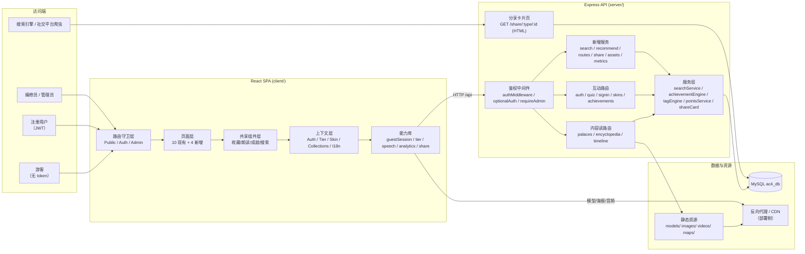
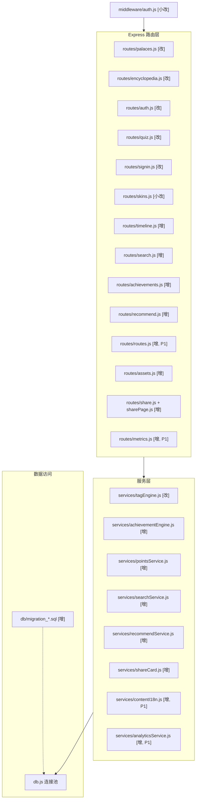
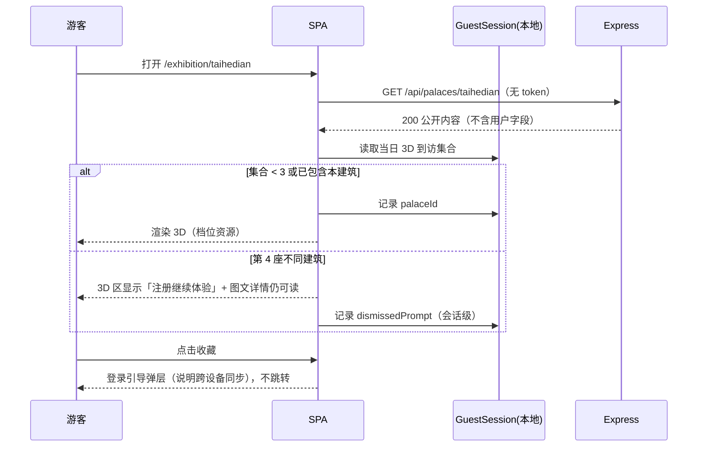
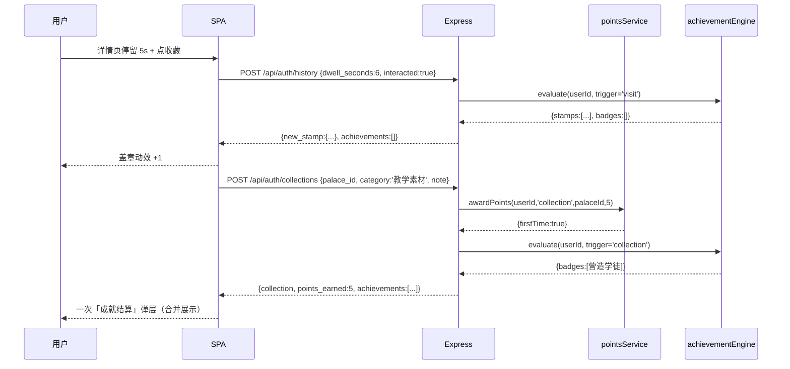
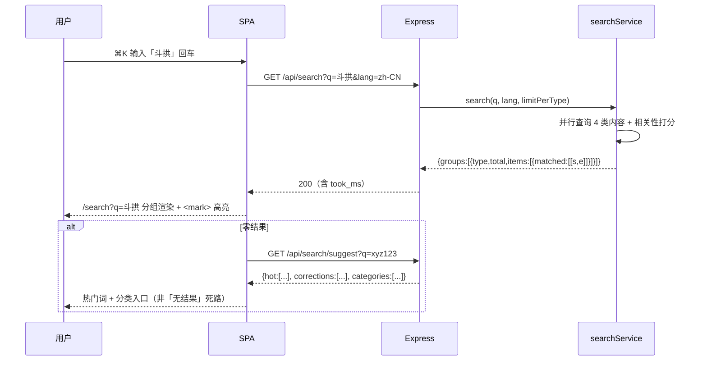
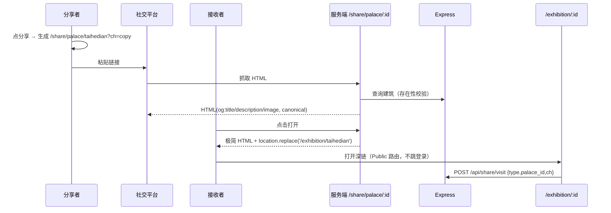
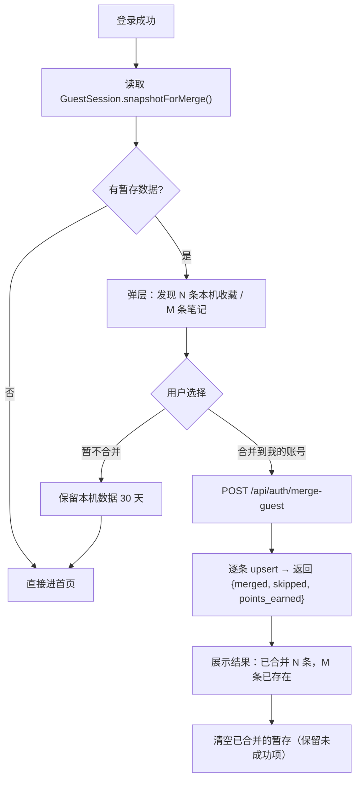
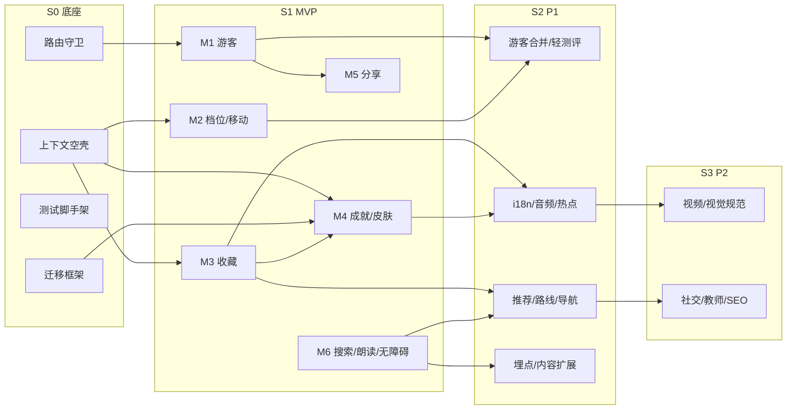

# 华夏古建可视化 · 大众化能力增强 实现方案（技术设计）

| 项 | 内容 |
|---|---|
| 文档编号 | DESIGN-PUBLIC-001 |
| 版本 | v1.0 |
| 状态 | 待评审 |
| 上游文档 | `docs/requirements/general-audience-enhancement-spec.md`（REQ-PUBLIC-001） |
| 设计范围 | REQ-01 ~ REQ-31 中 P0 全量 + MVP 六包（M1~M6）+ P1/P2 的可落地预留 |
| 关联代码库 | `D:\Ancient-architecture\ac1.1\acvisual 4` |
| 业务代码改动 | 无（本阶段只输出设计，不修改任何业务代码） |
| 下游阶段 | 编码任务规划（spec-task）由后续阶段负责 |

> 本文档回答「How」：模块如何划分、接口如何定义、数据如何演进、改造落点在哪、如何验收。
> 文中出现的前端文件省略前缀 `client/src/`，后端文件省略前缀 `server/src/`；数据库脚本省略前缀 `server/db/`。
> 行号引用基于当前仓库快照（main@7770bd4），仅用于定位，不构成契约。

---

## 目录

- [一、设计目标、约束与关键设计决策](#一设计目标约束与关键设计决策)
- [二、总体架构与模块划分](#二总体架构与模块划分)
- [三、游客模式与鉴权改造](#三游客模式与鉴权改造)
- [四、MVP 六包与 P0 需求的实现方案](#四mvp-六包与-p0-需求的实现方案)
- [五、数据模型与接口清单（汇总）](#五数据模型与接口清单汇总)
- [六、分阶段实施计划与风险](#六分阶段实施计划与风险)
- [七、测试与验证策略](#七测试与验证策略)
- [八、不改动范围与向后兼容策略](#八不改动范围与向后兼容策略)

---

# 一、设计目标、约束与关键设计决策

## 1.1 设计目标

| 编号 | 目标 | 可验证判据（对应验收） |
|---|---|---|
| G1 | 拆掉登录墙而不拆掉数据边界：游客可完整阅读公开内容，写入能力仍需登录 | AC-01、AC-02、AC-03 |
| G2 | 任何设备都能拿到「知识」：3D 不可用时以海报 + 图文等价替代，不出现空白舞台 | AC-07、AC-09、AC-10、AC-13 |
| G3 | 行为闭环：收藏 → 集章 → 徽章 → 分享，每一步都有即时反馈 | AC-26 ~ AC-35 |
| G4 | 内容可被找到与传播：跨类型搜索 + 稳定分享深链 + 可预览卡片 | AC-14 ~ AC-17、AC-23 ~ AC-25 |
| G5 | 改造成本可控且可回滚：不重构账号体系、不改既有 URL、迁移脚本只增不删 | DFX-C4、AC-54 |

**非目标（沿用 spec §9）**：实时多人同游、支付/会员、UGC 公开托管、原生 App/小程序、GIS 级测绘、账号体系重构、100% 全站翻译、视频批量生产。

## 1.2 存量技术约束（设计必须遵守）

| 编号 | 约束事实 | 证据（文件:行） | 对设计的影响 |
|---|---|---|---|
| C1 | 前端为纯 SPA，`server/src/app.js` 仅用 `express.static(clientDist)`，**无 history fallback、无 SSR** | `server/src/app.js:24-26` | 深链直接刷新会 404；OG 卡片必须由服务端单独出 HTML，不能依赖 SPA |
| C2 | 除 `/`、`/login` 外全部路由包在 `ProtectedRoute` | `client/src/App.jsx:21-25,54-131` | 需引入路由守卫分层，而不是逐条删包裹 |
| C3 | 后端已有 `optionalAuth` 中间件但**未被任何路由使用** | `middleware/auth.js:47-60` | 游客模型可零成本复用：token 可选，无 token 走匿名分支 |
| C4 | `quiz` 与 `skin` 路由使用 `router.use(authMiddleware)` 全局拦截 | `routes/quiz.js:23`、`routes/skins.js:13` | 游客轻测评需把这些路由改为「读可选鉴权 + 写强制鉴权」 |
| C5 | 收藏 CRUD 与 +5 积分已存在，但取消收藏为物理删除 | `routes/auth.js:344-435` | 「取消再收藏」会重复加分，违反 AC-28，需要积分幂等层 |
| C6 | `user_history` 对 `palaces(id)` 有 `ON DELETE CASCADE` | `init_full.sql:105-108` | 直接以 `user_history` 作为集章事实来源会在建筑下线时丢章，违反 11.4.3 |
| C7 | 徽章仅 `quiz_correct`、`consecutive_signin` 两类有发放逻辑 | `routes/quiz.js:507-546`、`routes/signin.js:140-170` | 需抽出统一成就引擎，而不是在 12 处各写一遍 |
| C8 | `PALACE_TAGS` 手写硬编码 10 座，`palaces.tags` 字段已存在但推荐未使用 | `services/tagEngine.js:21-32`、`init_full.sql:56` | 推荐候选池应改为「数据库派生优先、静态表兜底」，新增建筑自动纳入 |
| C9 | 3D 画质固定 `antialias:true` / `powerPreference:'high-performance'`，无 dpr 上限 | `ModelViewer.jsx:492-496`、`ExhibitionViewer.jsx:77`、`EighteenDouViewer.jsx:226-230` | 档位必须做成「上下文 + Canvas 参数 + 资源选择」三层，不能只改一处 |
| C10 | `ModelViewer` 已接受 `activeSkin` 参数，但唯一实现是雪景粒子；`HomePage` 调用时**未传该参数** | `ModelViewer.jsx:254-270,630`、`HomePage.jsx:336-352` | 皮肤生效 = 补传参 + 补材质分支 + 与后端激活态打通 |
| C11 | `GET /api/palaces/filter` 注册在 `GET /api/palaces/:id` **之后**，会被 `:id` 捕获 | `routes/palaces.js:111`、`routes/palaces.js:170` | 属于存量缺陷，需在本次改造中一并修正路由顺序（否则筛选接口不可用） |
| C12 | 时间轴页对每座建筑各发一次详情请求（N+1） | `pages/TimelinePage.jsx:53-75` | 全局搜索若复用该方式会放大延迟，需新增服务端聚合接口 |
| C13 | 已有 `prefers-reduced-motion` 处理与焦点样式变量 | `ModelViewer.jsx:312-324`、`styles/global.css:109,115` | 无障碍改造应「补齐」而非重建，复用现有 token |
| C14 | 依赖极简（前端无状态库、无 i18n 库；后端无 ORM、无测试框架） | `client/package.json`、`server/package.json` | 新增能力优先「零新依赖」实现（Context + 原生 API），测试依赖按需引入 |

## 1.3 关键设计决策（ADR）

> 每条决策包含：选择、被否方案、理由、代价。后续章节的落点均以此为准。

**ADR-01 路由守卫分层，而非在页面内做登录判断**
- 选择：`App.jsx` 中把路由声明改为配置表 `ROUTE_GUARD`，提供 `PublicRoute`（无守卫）、`AuthRoute`（原 `ProtectedRoute`）、`AdminRoute`（原样）三种包装器；页面内部只做「能力级」判断（能否收藏/答题计分）。
- 否决：在 `ProtectedRoute` 内用 `pathname` 白名单硬编码，或让每个页面自己 `Navigate`。
- 理由：白名单集中可审计（DFX-S1），新增页面不会意外落回登录墙；与 C2 的最小改动一致。
- 代价：路由表需与导航菜单同步维护，需在测试中锁定「公开页清单」。

**ADR-02 游客身份只存在于浏览器，服务端不建匿名账号**
- 选择：新增 `GuestSession`（localStorage，30 天 TTL），只存随机 `guestId`、试看计数、收藏暂存、笔记草稿、引导关闭记录；服务端公开接口不感知游客身份。
- 否决：服务端发匿名 token / 匿名用户表行。
- 理由：满足 DFX-S2（不采集可识别信息、不跨站复用）与 11.1；避免匿名数据污染 `users` 表与统计口径；试看额度本身是弱约束（spec 6.1.4-3 允许被绕过）。
- 代价：跨设备不同步；清缓存即丢失（已在 spec 中接受）；游客态逻辑集中在客户端，需前端单测覆盖。

**ADR-03 公开读接口统一「可选鉴权」，写接口保持强制鉴权**
- 选择：`GET /api/quiz/*` 读接口、新增搜索/推荐/分享统计接口使用 `optionalAuth`；`POST /api/quiz/answer` 采用「可选鉴权 + 分支」：携带有效 token → 落库计分发徽章；无 token → 只返回判定与解析，不落库。`records/stats/achievements/leaderboard` 保持 `authMiddleware`。
- 否决：为游客单独复制一套 `/api/public/*` 接口。
- 理由：复用 C3 已有中间件，接口数量减半，避免两套实现漂移；响应结构可在有/无 token 下保持一致（仅个人化字段为 `null`）。
- 代价：单个处理器内分支增多，需在响应中显式标注 `scope: 'guest' | 'user'` 以便前端与测试断言。

**ADR-04 试看额度按「建筑 ID 集合 + 自然日」计数，只限 3D 入口**
- 选择：额度 = 每日 3 座不同建筑的 3D 展厅（`/gallery` 选中或 `/exhibition/:id`）+ 1 次 5 题轻测评；图文详情、百科、时间轴、地图不限。
- 否决：按访问次数计数（刷新即消耗，体验差）；按停留时长（不可控）。
- 理由：对齐 AC-03「第 4 座起出现引导但图文仍可打开」；只限 3D 可同时控制带宽（spec 10.5 第一条风险）。
- 代价：需在「进入 3D」而非「打开页面」埋点计数，两处入口都要接（`HomePage` 选建筑、`ExhibitionPage` 挂载）。

**ADR-05 3D 档位做成独立上下文，资源选择走服务端清单**
- 选择：新增 `TierContext`（`smooth | standard | high`），判定输入为视口宽、触控、`deviceMemory`/`hardwareConcurrency`、WebGL2 探测、`connection.effectiveType`/`saveData`；用户覆盖值存 localStorage 并优先。模型 URL 由 `GET /api/assets/manifest`（服务端读目录动态生成、缓存 5 分钟）给出档位映射；缺失低模时**直接降级为海报 + 图文**，不做「假装加载」。
- 否决：①给 `palaces` 加 `model_path_lite` 字段并让编修台维护（内容侧负担、20 座需逐条补录）；②前端硬编码低模文件名（新增建筑即失效，违反 DFX-M1）。
- 理由：目录扫描 + 约定命名（`models/lite/{palace_id}.glb`）使「放文件即生效」，无需改代码与改表；海报作为最终兜底满足 DFX-R4。
- 代价：清单接口是新增依赖，需处理「目录扫描失败 → 全量回退海报」；部署需保证静态目录可读。

**ADR-06 积分发放统一收口到幂等「功德流水」**
- 选择：新增 `user_points_log(user_id, source_type, source_key, points, created_at)`，唯一键 `(user_id, source_type, source_key)`；`awardPoints()` 采用 `INSERT ... ON DUPLICATE KEY UPDATE id=id` 语义，返回是否首次发放。收藏（`source_key=palace_id`）、首次浏览、签到（日期）、答题（`quiz_record_id`）全部改为经此函数加积分。
- 否决：仅在收藏接口里加 `if existed` 判断。
- 理由：AC-28 要求「取消再收藏不重复加分」，而 C5 的物理删除使「存在性判断」失效；流水表同时为「积分明细」与对账提供事实来源（DFX-M4）。
- 代价：需改造 4 处现有加积分语句；`users.points` 保留为聚合缓存（读写兼容，不回填历史）。

**ADR-07 集章独立成表，不以浏览历史代替**
- 选择：新增 `user_stamps(user_id, palace_id, palace_name_snapshot, earned_at)`，唯一键 `(user_id, palace_id)`；`palace_id` 不设外键（保存建筑名快照）；集章总数 = `SELECT COUNT(*) FROM palaces`（动态）；到访判定为「详情页可见且停留 ≥5s」或「完成一次 3D 交互」。
- 否决：直接 `SELECT DISTINCT palace_id FROM user_history` 作为印章（C6 会在建筑下线时连带删除）。
- 理由：满足 11.4「不可撤销」「总数动态」两条硬约束；也避免新增重复事实表（印章本质是「已获得的到访」投影）。
- 代价：存在两份「到访」事实（`user_history` 与 `user_stamps`），需明确 `user_stamps` 是「已授予」状态、`user_history` 是「行为明细」，并在引擎中单向派生。

**ADR-08 成就判定集中为一个引擎，触发点只上报事件**
- 选择：新增 `services/achievementEngine.js`，暴露 `evaluate(userId, { trigger })`：一次性算出所有可授予徽章（含 `login_count / palaces_viewed / collections_count / points / badges_count / quiz_correct / quiz_all_categories / consecutive_signin`）与集章，返回 `{ stamps: [], badges: [] }`；调用方（登录、浏览、收藏、答题、签到）只负责传入触发原因并透传结果。一次请求最多返回一组新成就，前端合并为一个「成就结算」弹层。
- 否决：在 5 个路由各写一套 `checkAndAwardBadges`（现状即是如此，已产生 2 套重复实现）。
- 理由：AC-31 要求 12 枚徽章「每枚均有可复现获得路径」；集中判定可用一张表穷举条件，测试只需跑引擎，不必跑 5 条链路。
- 代价：`evaluate` 需多次聚合查询，需用单连接 + 并行查询控制在 ~10ms 内；引擎失败必须吞异常不影响主流程（沿用现状）。

**ADR-09 搜索采用「服务端聚合 + 前端分组渲染」，高亮不用 HTML 拼接**
- 选择：新增 `services/searchService.js`，对 `palaces / encyclopedia_terms / quiz_questions / palace_timeline` 分别查询后合并，返回 `{ groups: [{ type, total, items: [{ id, title, snippet, score, matched: [start,end][] , href }] }] }`；高亮区间用偏移量表达，前端按区间切分文本并用 `<mark>` 包裹，**禁止 `dangerouslySetInnerHTML`**。
- 否决：①前端并行调 4 个现有接口再合并（请求数多、无统一排序与总数）；②返回含 `<mark>` 的 HTML（XSS 风险，违反 DFX-S1 精神）。
- 理由：内容量小（20 建筑 / 25 术语 / 108 题 / 百余事件），单次 SQL LIKE 聚合足以满足 P95 ≤500ms；偏移量方案天然安全且便于测试。
- 代价：需为 4 类内容各写一段查询与相关性权重；新增类型（路线）时需扩展映射表。

**ADR-10 分享卡片用「最小服务端 HTML 页」，不做整站 SSR**
- 选择：新增 `GET /share/:type/:id`，服务端输出含 `og:title/description/image`、`twitter:card`、`canonical` 的极简 HTML，并在 `<script>` 中 `location.replace()` 到对应 SPA 深链；人类用户几乎无感，爬虫拿到完整 meta。分享统计由 `POST /api/share/visit` 记录匿名来源。
- 否决：①引入 SSR/预渲染框架（工期与 C1 冲突，属 REQ-31 P2）；②纯前端生成分享图（无法满足「粘贴到聊天工具出现卡片」的 AC-24）。
- 理由：用 1 个模板 + 1 个查询即可满足 AC-24/AC-25；与 `express.static` 共存无需改构建链路。
- 代价：需维护 URL 与 type 的映射；内容下线要渲染「已调整」页（DFX-R5），不能直接 404。

**ADR-11 轻量自研 i18n，内容翻译走独立表**
- 选择：UI 文案用 `client/src/i18n/{zh-CN,en}.json` + `I18nContext`（`t(key, vars)`、插值、缺失回退中文）；内容翻译用 `content_translations(entity_type, entity_id, field, locale, value, status)`，接口按 `lang` 返回「原文 + 覆盖级别」。语言存 localStorage + `?lang=` 覆盖，**不改 URL 路径结构**。
- 否决：引入 `i18next`（包体与配置成本）；给每张内容表加 `_en` 列（字段爆炸、覆盖分级难表达）。
- 理由：只有两种语言、文案量有限；独立表可承载「完整 / 标题级 / 未覆盖」三档（11.7），并让编修台后续可维护（DFX-M1）。
- 代价：内容查询多一次关联（可用内存字典缓存），需处理 `lang` 与既有 `name_en` 字段的字段级回退顺序。

**ADR-12 状态管理只用 Context + hooks，不引入状态库**
- 选择：新增 `TierContext`、`SkinContext`、`CollectionsContext`、`I18nContext`、`UiPrefsContext`，全部以 `useMemo` 稳定 value、以 hook 暴露细粒度选择器；服务端数据仍由页面自取（沿用现状）。
- 否决：Zustand/Redux（新增依赖、与现有「页面自取数据」风格冲突）。
- 理由：跨页共享的状态只有 5 类且都很小；避免为了 5 个开关引入 40KB+ 依赖与新的心智模型。
- 代价：Context 嵌套较深，需控制「value 重建」导致的整树重渲染（用 `useMemo` + 拆分 Provider）。

**ADR-13 静态版（`static-version/`）冻结，改造只在 `client/` 进行**
- 选择：本次所有前端改造落在 `client/`；`static-version/` 保持现状并在 README 标注「历史发布分支，不再同步」。
- 否决：双份同步改造（成本翻倍、易漂移）。
- 理由：回答 spec Q-09；`static-version` 无后端能力，无法承载游客试看、收藏、成就等服务端闭环。
- 代价：使用静态版的部署方将无法获得本次增强（需在发布说明中告知）。

## 1.4 设计一致性要求

1. **类型安全**：前端通过 JSDoc `@typedef` 在 `client/src/types.js` 定义核心契约（`Palace`、`SearchGroup`、`AchievementResult`、`DeviceTier`、`GuestSession`、`SkinState`），不引入 TypeScript 编译链；后端以「服务层返回固定形状 + 路由层不二次变形」为约束，所有新增字段必须有默认值与缺失兜底（DFX-C5）。
2. **禁止 `any` 语义**：前端动态数据统一用 `unknown` + 运行时守卫（`isPalace(obj)`），不使用 `obj.anything`。
3. **契约版本**：新增接口统一前缀 `/api/`，响应沿用 `{ success, data, message?, error?, code? }`；新增字段只增不改（见第八章）。

---

# 二、总体架构与模块划分

## 2.1 上下文视图



**通信协议与频率**

| 链路 | 协议 | 频率/量级 | 备注 |
|---|---|---|---|
| SPA → API | HTTP/1.1 + JSON（Bearer 可选） | 首屏 2~4 次；交互按需 | 沿用 `api.js` axios 拦截器，token 从 `palace_auth` 读取 |
| SPA → 模型/海报 | HTTP GET（静态） | 每建筑 1 次，档位化 | 建议部署侧开启 gzip/br 与强缓存 |
| 爬虫 → 分享页 | HTTP GET（HTML） | 低频 | 服务端模板，含 OG/Twitter meta |
| API → MySQL | mysql2 连接池（10） | 每请求 1~3 条语句 | 新增聚合查询需控制 JOIN 数量 |
| 前端 → TTS | Web Speech API | 用户显式触发 | 无网络依赖，浏览器内置 |

## 2.2 前端模块划分

### 2.2.1 目录演进

```text
client/src/
├─ App.jsx                        [改] 守卫分层 + 新增路由
├─ api.js                         [改] 新增 search/recommend/share/achievements/assets 封装
├─ types.js                       [增] JSDoc 契约定义
├─ context/
│  ├─ AuthContext.jsx             [改] 登出/登录时触发游客合并与状态清理
│  ├─ TierContext.jsx             [增] 设备档位 + 用户覆盖
│  ├─ SkinContext.jsx             [增] 激活皮肤（登录拉取 / 游客 default）
│  ├─ CollectionsContext.jsx      [增] 收藏状态缓存 + 游客暂存
│  ├─ I18nContext.jsx             [增] 语言切换与 t()
│  └─ UiPrefsContext.jsx          [增] 课堂模式/减少动效/个性化开关
├─ i18n/{zh-CN,en}.json           [增] UI 文案字典
├─ lib/
│  ├─ guestSession.js             [增] 匿名会话读写、额度、暂存、TTL
│  ├─ deviceTier.js               [增] 档位判定与覆盖
│  ├─ speech.js                   [增] TTS 封装（分段/语速/回调）
│  ├─ share.js                    [增] 生成分享链接/系统分享/复制
│  ├─ analytics.js                [增] 匿名埋点队列 + sendBeacon + 退出开关
│  └─ modelLoader.js              [改] 支持档位资源与加载失败回调
├─ components/
│  ├─ guards/{PublicRoute,AuthRoute,AdminRoute,RequireCapability}.jsx  [增]
│  ├─ SkipLink.jsx                [增] 跳到主内容
│  ├─ ModalShell.jsx              [增] 焦点锁定/ESC/焦点回归
│  ├─ Toast/AchievementToast.jsx  [增] 成就结算弹层（合并多条）
│  ├─ CollectionButton.jsx        [增] 收藏入口（卡片/详情/展厅/热点）
│  ├─ CollectionDialog.jsx        [增] 分类 + 笔记编辑
│  ├─ AudioGuidePlayer.jsx        [增] 朗读/音频播放器
│  ├─ PosterFallback.jsx          [增] 图文降级视图
│  ├─ TierBadge.jsx               [增] 档位提示与手动切换
│  ├─ LanguageSwitch.jsx          [增] 中/英切换
│  ├─ ShareButton.jsx             [增] 分享入口（含二维码降级）
│  ├─ RecommendationRail.jsx      [增] 推荐位（含理由）
│  ├─ GlobalSearchDialog.jsx      [增] ⌘K 弹层（可选）
│  └─ DetailPanel.jsx             [改] 收藏/朗读/分享/推荐/相关增强
├─ pages/
│  ├─ SearchPage.jsx              [增] /search 结果页
│  ├─ RoutePage.jsx               [增] /routes/:id 主题路线（P1）
│  ├─ ProfilePage.jsx             [改] 集章 20/20、徽章进度、收藏分类、设置
│  ├─ HomePage.jsx                [改] 传皮肤、档位、游客额度、收藏入口
│  ├─ ExhibitionPage.jsx          [改] 公开深链、分享/收藏、视频区（有则显）
│  ├─ QuizPage.jsx                [改] 游客轻测评分支
│  ├─ OverviewPage.jsx            [改] 推荐位、搜索跳转、卡片收藏
│  └─ EncyclopediaPage.jsx        [改] 朗读、分享、英文回退标注
└─ styles/                        [改/增] 新增组件样式，复用 global.css token
```

### 2.2.2 路由与守卫矩阵

| 路径 | 守卫 | 游客可见 | 页面 | 说明 |
|---|---|---|---|---|
| `/` | Public | ✅ | OverviewPage | 首页总览，新增推荐位与搜索入口 |
| `/gallery` | Public | ✅（3D 计额度） | HomePage | 三栏展厅，第 4 座起显示引导 |
| `/map` `/timeline` `/encyclopedia` | Public | ✅ | 既有页面 | 只读，无障碍与朗读补齐 |
| `/exhibition/:id` | Public | ✅（计额度） | ExhibitionPage | 分享深链落地页 |
| `/douba-eighteen` | Public | ✅ | EighteenDouPage | 只读 |
| `/quiz` | Public | ✅（1 次轻测评） | QuizPage | 游客不计分、不排行 |
| `/search` | Public | ✅ | SearchPage（新） | `?q=&type=` 可分享 |
| `/routes/:id` | Public | ✅ | RoutePage（新） | P1 交付，MVP 预留路由 |
| `/share/:type/:id` | 服务端 | ✅ | 服务端 HTML | 非 SPA 路由，出 OG 后跳转 |
| `/login` | Public | ✅ | LoginPage | 已登录跳首页 |
| `/profile` | Auth | ❌ | ProfilePage | 个人进度 |
| `/curator` | Admin | ❌ | CuratorPage | 编修台 |

> 实现方式：`App.jsx` 顶部维护 `ROUTE_GUARD` 常量（路径 → 守卫类型），`Routes` 内用 `<RouteGuard guard={...}>` 统一包裹，避免 12 处重复 JSX。`RequireCapability` 用于「页面公开但某按钮需登录」的场景（收藏、计分答题、皮肤激活），统一弹「登录即可保存进度」而非跳转。

### 2.2.3 上下文依赖顺序

`AuthProvider`（最外层）→ `I18nProvider` → `UiPrefsProvider` → `TierProvider` → `SkinProvider` → `CollectionsProvider`（依赖 Auth 判断登录态）→ `Router`。
理由：`Skin/Collections` 需要 `Auth` 的 token 与登录态；`Tier` 与语言无关可提前；`UiPrefs` 被 Tier/Skin 读取（如减少动效会影响档位内的粒子）。

## 2.3 后端模块划分



**分层规则（新增代码必须遵守）**
1. 路由层只做「参数校验 + 鉴权组合 + 服务调用 + 响应包装」，不写 SQL；服务层不感知 `req/res`。
2. 所有写操作必须声明幂等语义（见 ADR-06/07）。
3. 公开接口的响应禁止出现 `email / password_hash / points 明细 / user_id`（DFX-S1），由 `toPublicPalace()` 等序列化函数白名单输出。

## 2.4 数据与资源层

| 资源类型 | 位置 | 现状 | 本次变化 |
|---|---|---|---|
| 高清模型 | `models/forbidden-city/`、`models/national/` | 18 个 GLB，单件 1.6~33MB | 不变 |
| 低模 | `models/lite/`（新） | 不存在 | 约定命名 `{palace_id}.glb`，建议 ≤1.5MB；缺失即回退海报 |
| 海报 | `images/posters/` | 已有 8+ 张 | 需补齐 20 座，`smooth` 档作为主视觉 |
| 图影 | `images/views/`、`images/*.png` | 已有 | 不变，补 `alt` 文案 |
| 音频 | `audio/guides/`（新） | 不存在 | 约定命名 `{palace_id}.mp3` + `audio_guides` 元数据表（P1） |
| 视频 | `videos/` | 空目录 | 保持「有则显、无则隐」 |
| 地图 | `client/public/maps/` | 5 张故宫舆图 | 不变 |
| 资源清单 | `/api/assets/manifest`（新） | 无 | 动态扫描目录 + 5 分钟内存缓存 |

**静态服务改造点**（`server/src/app.js:18-26`）
- `express.static` 增加 `setHeaders`：模型/图片 `Cache-Control: public, max-age=86400, immutable`（文件名含时间戳的上传资源可更长）；`videos` 保留 Range（默认支持）。
- 新增 `app.use('/audio', static(...))` 与 `app.use('/models-lite', static(...))`（或统一由 `/models` 下的 `lite/` 子目录提供）。
- 新增 SPA history fallback：`app.get(/^\/(?!api|share|models|images|videos|audio|maps|draco|quiz-cats).*/, sendIndexHtml)`，修复 C1 的深链刷新 404（仅在 `NODE_ENV=production` 且 `client/dist` 存在时挂载）。

## 2.5 关键运行时链路

### 2.5.1 游客浏览 → 试看额度 → 注册引导



### 2.5.2 登录用户：收藏 → 集章 → 徽章



### 2.5.3 全局搜索



### 2.5.4 分享深链



---

# 三、游客模式与鉴权改造

> 本章回答「如何按路由/接口开只读白名单」「token 可选认证怎么用」，是 M1 的地基，也是 REQ-03/04/19 的前置条件。

## 3.1 鉴权模型：三层守卫 + 两类能力判断

### 3.1.1 前端守卫分层

| 守卫 | 语义 | 未登录行为 | 覆盖路由 |
|---|---|---|---|
| `PublicRoute` | 完全公开 | 正常渲染 | `/`、`/gallery`、`/map`、`/timeline`、`/encyclopedia`、`/exhibition/:id`、`/douba-eighteen`、`/quiz`、`/search`、`/routes/:id`、`/login` |
| `AuthRoute` | 需要身份与个人进度 | `<Navigate to="/login" state={{from}} />` | `/profile` |
| `AdminRoute` | 需要 `role==='admin'` | 未登录跳登录；非管理员展示 `CuratorGate` | `/curator` |
| `RequireCapability` | 页面公开、单个能力需登录 | 渲染 `LoginPrompt`（弹层，不跳转） | 收藏、计分答题、签到、皮肤激活、个人进度入口 |

**关键改造点（`client/src/App.jsx:21-141`）**
1. 保留 `AdminRoute` 原实现（`App.jsx:31-36`）。
2. `ProtectedRoute` 重命名为 `AuthRoute`，并支持 `state.from = location.pathname + search`，登录成功后回跳（现状 `LoginPage` 无回跳，改造点）。
3. 新增 `PublicRoute`：不做任何判断，只透传 children（作为声明式标记，便于路由表审计与测试扫描）。
4. 路由声明改为表驱动：`const ROUTES = [{ path, element, guard, meta }]`，`<Routes>` 内 `map` 渲染；`meta.publicReadonly` 供测试断言「公开页清单」。
5. `state.from` 回跳：`LoginPage`/`LoginModal` 成功后 `navigate(from ?? '/')`，并触发游客数据合并检查（见 3.4）。

### 3.1.2 后端鉴权矩阵

| 路由前缀 | 现状 | 目标 | 具体改法 |
|---|---|---|---|
| `/api/palaces` GET | 无鉴权 | 无鉴权 + 白名单序列化 | 列表/详情/搜索改走 `toPublicPalace()`，剔除内部字段 |
| `/api/palaces` POST/PUT/DELETE/upload | `authMiddleware + requireAdmin` | 不变 | 保持原样 |
| `/api/encyclopedia` GET | 无鉴权 | 无鉴权 + `lang` 支持 | 查询参数新增 `lang`，内容翻译回退 |
| `/api/quiz/categories`、`/questions`、`/questions/:id` | 全局 `authMiddleware` | `optionalAuth` | 有 token 返回个人进度，无 token 返回通用题量与题面 |
| `/api/quiz/answer` | `authMiddleware` | `optionalAuth` + 分支 | 无 token 只判定不落库；有 token 沿用现有逻辑 |
| `/api/quiz/records`、`/stats`、`/achievements`、`/leaderboard` | `authMiddleware` | 保持 `authMiddleware` | 个人数据与排行必须登录 |
| `/api/signin/*` | `authMiddleware` | 保持 | 签到是登录能力 |
| `/api/skins/*` | `authMiddleware` | 保持 | 皮肤是登录能力（游客用默认皮肤） |
| `/api/auth/*`（profile/history/collections） | `authMiddleware` | 保持 | 写操作需登录 |
| `/api/auth/register`、`/login` | 公开 | 公开 | 登录成功后返回 `achievements` 结算结果 |
| `/api/search`、`/api/search/suggest` | — | `optionalAuth` + 限流 | 匿名可搜；登录用户可加权（第二阶段） |
| `/api/recommend` | — | `optionalAuth` | 游客返回热门兜底，登录返回个性化 |
| `/api/routes`、`/api/routes/:id` | — | 无鉴权 | 路线是公开内容 |
| `/api/assets/manifest` | — | 无鉴权 + 缓存 | 档位资源清单 |
| `/api/share/visit`、`/api/share/stats` | — | 公开写入（限流）/ 管理员读 | 匿名聚合统计 |
| `/api/achievements/*` | — | `authMiddleware` | 成就总览、集章、设置 |
| `/api/metrics/*` | — | 公开写入（限流）/ 管理员读 | P1 |

**`optionalAuth` 使用方式（回答「token 可选认证的用法」）**
- 现有实现（`middleware/auth.js:47-60`）已满足需求：解析成功则挂 `req.user`，失败静默忽略、继续放行。
- 改造点：`quiz.js` 移除 `router.use(authMiddleware)`（第 23 行），改为逐路由声明：
  - 读接口 `[optionalAuth]`；
  - 写接口 `[optionalAuth, requireLogin]`（新增 `requireLogin`：`req.user` 存在则放行，否则按「游客模式」分支处理，由业务函数决定是否 401）。
- 响应约定：所有可选鉴权接口返回 `scope: 'guest' | 'user'` 与 `personalized: boolean`，前端据此决定是否展示「登录后可保存」。
- 安全边界：`optionalAuth` **不得**用于任何写入接口的「已登录分支」判断之外；一旦进入写库路径，必须显式 `if (!req.user) return 401`，避免「无 token 误写」。

## 3.2 匿名会话（GuestSession）设计

### 3.2.1 数据形状（localStorage key：`ac4_guest_v1`）

| 字段 | 类型 | 说明 | 约束 |
|---|---|---|---|
| `v` | number | 结构版本 | 当前 1；不匹配则丢弃重建 |
| `gid` | string | 本机匿名标识（`crypto.randomUUID()`） | 不含任何 PII；不参与服务端写入 |
| `createdAt` / `updatedAt` | number(ms) | 创建与最后访问时间 | 30 天未访问即清理 |
| `preview` | `{ date: 'YYYY-MM-DD', palaceIds: string[] }` | 当日 3D 到访集合 | 跨日自动重置（只保留当日） |
| `quizQuota` | `{ date, used: number }` | 当日轻测评次数（上限 1） | 跨日重置 |
| `quiz` | `{ date, answers: Array<{qid, correct}>, score }` | 最近一次轻测评结果（仅本机） | 不进入排行，不与账号合并 |
| `stagedCollections` | `Array<{ palaceId, category, note?, at }>` | 收藏暂存 | ≤20 条（11.1.3） |
| `noteDrafts` | `Array<{ palaceId, note, at }>` | 笔记草稿 | ≤5 条，每条 ≤500 字 |
| `lastVisited` | `Array<{ palaceId, at }>` | 最近浏览（用于「继续上次」） | ≤10 条 |
| `dismissed` | `{ registerPromptAt?: number, tierHint?: boolean }` | 引导关闭记录 | 会话级/长期两类分开 |
| `prefs` | `{ tier?: 'smooth'\|'standard'\|'high', lang?: 'zh-CN'\|'en', reducedData?: boolean }` | 游客偏好 | 与用户设置解耦 |

### 3.2.2 生命周期与容错

| 场景 | 行为 |
|---|---|
| 首次访问 | 无记录 → 初始化空会话（懒创建，不在首屏同步写） |
| `localStorage` 不可用（隐私模式/配额满） | 降级为内存 Map，仅当次会话有效；`GuestSession` API 返回同一接口，调用方无感 |
| 数据损坏/版本不匹配 | 捕获异常 → 静默重建，不向用户报错（spec 6.1.4-1） |
| 超过 30 天 | 读取时判定过期 → 清理并重建 |
| 用户主动清除 | 个人中心/设置提供「清除本机体验记录」；清除后试看额度重置（允许，不做风控） |
| 登录成功 | 不自动清空；进入「合并询问」流程（3.4） |

### 3.2.3 模块接口（`client/src/lib/guestSession.js`）

| 方法 | 入参 | 返回值 | 用途 |
|---|---|---|---|
| `read()` | — | `GuestSession`（永不为 null） | 全局读取（含容错） |
| `update(patch)` | `Partial<GuestSession>` | `GuestSession` | 局部更新并持久化（合并 `prefs`/`preview`） |
| `reset()` | `{ keepPrefs?: boolean }` | `void` | 清除体验数据 |
| `tryEnter3D(palaceId)` | `string` | `{ allowed: boolean, used: number, limit: number, isNewBuilding: boolean }` | 试看额度判定（M1 核心） |
| `tryStartQuiz()` | — | `{ allowed: boolean, used: number, limit: 1 }` | 轻测评额度 |
| `stageCollection(palaceId, category, note?)` | — | `{ ok: boolean, reason?: 'limit' }` | 游客收藏暂存 |
| `draftNote(palaceId, note)` | — | `{ ok: boolean }` | 笔记草稿 |
| `snapshotForMerge()` | — | `{ collections, notes, lastVisited }` | 登录后合并用 |
| `markDismissed(key)` | `'registerPrompt' \| 'tierHint'` | `void` | 引导只出现一次 |

**额度算法（`tryEnter3D`）**
1. 若 `preview.date !== today` → 重置 `palaceIds=[]` 并写回。
2. 若 `palaceIds.includes(palaceId)` → `allowed=true`（同一建筑当日可反复看，避免刷新即消耗）。
3. 若 `palaceIds.length < 3` → 加入集合并 `allowed=true`。
4. 否则 `allowed=false`（前端展示引导；**不拦截图文**，也不拦截 `/exhibition/:id` 的图文区块，仅拦截 3D 舞台渲染）。

## 3.3 游客能力限制的交互规范

| 能力 | 游客表现 | 实现要点 |
|---|---|---|
| 建筑图文详情 | 完全一致，无「登录后查看」遮挡 | 公开接口不裁剪字段；`DetailPanel` 无登录分支 |
| 3D 展厅 | 前 3 座可交互；第 4 座起在舞台区显示引导卡片，图文档案仍可读 | `HomePage` 在 `handleSelectPalace` 前调 `tryEnter3D`；`ExhibitionPage` 在挂载时判定 |
| 轻测评 | 可做 1 轮 5 题，看到得分与解析 | `POST /api/quiz/answer` 游客分支不落库；前端结果页标注「成绩仅存本机」 |
| 收藏/笔记 | 入口可见；点击弹 `LoginPrompt`，并提供「暂存到本机」次级按钮 | `CollectionButton` 分 `onGuestClick`；暂存后卡片显示「待合并」角标 |
| 答题计分/排行/签到/皮肤/个人进度 | 入口可见并说明需登录 | `RequireCapability` 统一实现 |
| 侧栏「编修」分组 | 不显示（现状 `OverviewHeader.jsx:171` 已按 `requiresAuth` 过滤） | 不变 |

**禁止项落实**：不得用全屏遮罩阻断首屏；引导弹层必须可关闭且 `dismissed.registerPromptAt` 记录后本会话不再出现（AC-06）。

## 3.4 游客数据迁移（REQ-03，P1 预留）

### 3.4.1 合并流程



### 3.4.2 接口契约：`POST /api/auth/merge-guest`（`authMiddleware`）

| 字段 | 类型 | 必填 | 约束 |
|---|---|---|---|
| `collections[]` | array | 否 | ≤20 条；每项 `{ palace_id, category, note? }` |
| `notes[]` | array | 否 | ≤5 条；`{ palace_id, note }`，`note` ≤500 字 |
| `source` | string | 否 | 固定 `guest_local`，用于日志溯源 |

**响应 `data`**

| 字段 | 类型 | 说明 |
|---|---|---|
| `merged` | number | 新增/更新成功条数 |
| `skipped` | number | 已存在且内容一致（不重复计分） |
| `rejected` | number | 校验失败（建筑不存在、超长、非法分类） |
| `points_earned` | number | 首次收藏产生的积分（已幂等） |
| `achievements` | `AchievementResult` | 合并后触发的集章/徽章 |
| `items[]` | array | 逐条结果 `{ palace_id, status: 'merged'\|'skipped'\|'rejected', reason? }` |

**业务规则**
1. 以账号已有数据为准：已存在则跳过，不覆盖用户已写的笔记（避免游客草稿覆盖账号内容）。
2. 幂等：重复提交同一 `palace_id` 返回 `skipped`，不重复加积分（依赖 `user_points_log` 唯一键）。
3. 只接受「有效建筑」，无效项返回 `rejected` 并保留在本地（用户可修改）。
4. 合并完成后前端清空 `stagedCollections` 中 `status!=='rejected'` 的项；保留 `rejected` 供用户处理。

## 3.5 后端改造落点清单（文件级）

| 文件 | 改造点 | 风险 |
|---|---|---|
| `middleware/auth.js` | 新增 `requireLogin`（与 `authMiddleware` 等价，但用于「可选鉴权后的写分支」表达意图）；导出不变 | 低 |
| `routes/quiz.js` | 删除第 23 行 `router.use(authMiddleware)`；读接口挂 `optionalAuth`；`/categories` 在无 `req.user` 时跳过个人进度查询；`/answer` 分支 | 中：`req.user.id` 在多处直接使用，需逐一判空 |
| `routes/palaces.js` | 修正 `/filter` 与 `/:id` 顺序（C11）；新增 `toPublicPalace()`；列表支持 `include=stats,tags` 瘦身 | 低 |
| `routes/auth.js` | 登录/注册响应增加 `achievements`；新增 `merge-guest`；收藏接口接入幂等积分与校验 | 中：积分改造涉及现有测试基线 |
| `routes/encyclopedia.js` | 新增 `lang` 参数与 `coverage` 字段（P1） | 低 |
| `routes/skins.js` | 激活后返回 `fallback_reason`（低档位的简化提示） | 低 |
| `routes/signin.js` | 发放逻辑改调 `achievementEngine` | 低 |
| `app.js` | 注册新路由、静态缓存头、SPA fallback（生产）、`/share` 路由 | 中：fallback 正则需排除 `/api` 等前缀 |

## 3.6 前端改造落点清单（文件级）

| 文件 | 改造点 |
|---|---|
| `App.jsx` | 路由表 + 三类守卫；新增 `/search`、`/routes/:id`；`LoginPage` 的 `from` 回跳 |
| `context/AuthContext.jsx` | `login/register` 返回 `achievements`；登录成功后置 `pendingGuestMerge` 标记；`logout` 清理 CollectionsContext 缓存并保留偏好 |
| `context/CollectionsContext.jsx`（新） | 登录用户收藏集合（`Set<palaceId>`）+ 游客暂存计数；暴露 `isCollected/toggle/updateNote` |
| `components/guards/*`（新） | 见 2.2.1 |
| `components/LoginPrompt.jsx`（新） | 统一「登录即可保存进度」弹层，含「本机暂存」次级 CTA |
| `pages/HomePage.jsx` | 公开访问下不再假设 `user` 存在（第 60 行 `useAuth()` 的 `user?.points` 已容错）；接入 `tryEnter3D`、`activeSkin`、收藏入口 |
| `pages/ExhibitionPage.jsx` | 挂载时 `tryEnter3D`；深链来源参数 `?from=share` 记录；收藏/分享入口 |
| `pages/QuizPage.jsx` | 游客分支：不请求 `stats/records/leaderboard/achievements`；答题结果含解析；榜单区替换为登录引导 |
| `components/OverviewHeader.jsx` | 搜索提交改为「跳转 `/search?q=`」；新增语言切换与档位入口；导航「浏览」组保持公开 |
| `pages/OverviewPage.jsx` | 保留页内过滤（`searchKeyword` 作为卡片筛选，不删）；搜索来源来自 URL 时同步到 `searchKeyword` |

## 3.7 异常与边界处理

| 异常 | 处理 | 用户可见 |
|---|---|---|
| 本机存储损坏 | 重建空会话，不阻塞 | 无提示；注册后仅提示「无可合并的本地记录」 |
| 合并时建筑已下线 | 该条 `rejected`，保留本地 | 「1 条收藏对应的建筑已调整，已保留在本机」 |
| 试看额度被绕过（清缓存） | 允许继续试看，不惩罚 | 无惩罚提示，引导文案保持 |
| 深链内容不存在 | `/exhibition/:id` 展示「内容已调整」页 + 相邻推荐 | 友好提示与替代入口（DFX-R5） |
| token 过期访问公开页 | 不跳登录；清理本地 token 并降级为 `scope:'guest'` | 顶部提示「登录已过期，可继续浏览」 |

---

# 四、MVP 六包与 P0 需求的实现方案

> 本章按 M1~M6 组织，每组给出：需求映射、改造落点、接口契约、数据变更、状态与交互、验收映射。
> 跨包能力（i18n、推荐、路线、热点、音频、视频、埋点、SEO、视觉规范）统一放在 4.7，避免重复。

## 4.1 M1 游客可用（REQ-01、REQ-02、REQ-04 简化版）

### 4.1.1 需求映射

| 需求 | 目标 | 验收 |
|---|---|---|
| REQ-01 免登录只读浏览 | 公开路由全放开，`/profile`、`/curator` 保持受保护 | AC-01、AC-02 |
| REQ-02 试看额度与轻互动 | 3 座 3D + 图文不限 + 1 次轻测评；收藏入口可见并引导 | AC-03、AC-04 |
| REQ-19 转化引导（P1 预留） | 试看后一次可关闭引导 | AC-06 |

### 4.1.2 改造落点

| 层 | 文件 | 改动 |
|---|---|---|
| 路由 | `App.jsx` | 见 3.1.1；新增 `/search` |
| 守卫 | `components/guards/PublicRoute.jsx` | 透传标记 |
| 能力 | `components/RequireCapability.jsx` | 统一登录引导 |
| 会话 | `lib/guestSession.js` | 额度/暂存/TTL |
| 页面 | `HomePage.jsx` | `tryEnter3D` 前置判定 + 舞台引导卡 |
| 页面 | `ExhibitionPage.jsx` | 挂载判定 + 图文区不受限 |
| 页面 | `QuizPage.jsx` | 游客分支（不请求个人接口） |
| 后端 | `routes/quiz.js` | 读接口 `optionalAuth`；`/answer` 游客分支 |
| 后端 | `routes/palaces.js` | 公开序列化白名单 |
| 后端 | `routes/auth.js` | `merge-guest` |

### 4.1.3 接口契约

**`GET /api/quiz/categories`（optionalAuth，改造后）**

| 字段 | 类型 | 说明 |
|---|---|---|
| `data[].category` | string | 四大分类 |
| `data[].question_total` | number | 题量（无 token 也返回） |
| `data[].answered/correct/accuracy` | number \| null | 无 token 时 `null`（前端不渲染进度条） |
| `scope` | `'guest' \| 'user'` | 新增 |

**`GET /api/quiz/questions?count=5&category=`（optionalAuth）**
- 保持现有响应字段（`id/question/options/category/difficulty/tags/palace_id`），新增 `scope`。
- 约束：`count` 上限 20（现状 `parseInt` 无上限，需加保护）；`ORDER BY RAND()` 在 108 题规模可接受。

**`POST /api/quiz/answer`（optionalAuth + 分支）**

| 请求字段 | 类型 | 必填 | 说明 |
|---|---|---|---|
| `question_id` | number | 是 | 题目 ID |
| `answer` | string | 是 | A/B/C/D |
| `client_session` | string | 否 | 游客本地会话摘要（仅用于日志关联，不含 PII） |

**响应 `data`（游客与登录结构一致）**

| 字段 | 类型 | 游客值 | 登录值 |
|---|---|---|---|
| `is_correct` | boolean | 判定结果 | 判定结果 |
| `correct_answer` | string \| null | 答对时为 `null`，答错时给出正确答案 | 同 |
| `explanation` | string | 解析 | 解析 |
| `points_earned` | number | `0` | 20 / 0 |
| `new_badge` | object \| null | `null` | 徽章对象 |
| `achievements` | `AchievementResult` | `{stamps:[],badges:[]}` | 结算结果 |
| `scope` | string | `'guest'` | `'user'` |
| `leaderboard_hint` | boolean | `true`（提示登录参与排行） | `false` |

**业务规则**
- 游客不写 `quiz_records`、不加积分、不发徽章、不进排行（11 章与 DFX-S3 精神）。
- 游客成绩仅存本机（`GuestSession.quiz = { date, answers: [{qid, correct}], score }`），用于结果页展示与「再来一轮」额度判定。
- 题目答案在游客分支仍由服务端判定（不在前端暴露 `correct_answer`），避免作弊与前端泄露。

### 4.1.4 前端状态与交互

| 场景 | 行为 |
|---|---|
| 进入 `/gallery` | 默认选中第 1 座 → `tryEnter3D` 通过后渲染；若被限，舞台显示 `GuestPreviewGate`（含「查看图文详情」「注册继续」） |
| 切换第 4 座建筑 | 舞台替换为引导卡；左侧 `DetailPanel` 正常展示（图文不限） |
| 进入 `/exhibition/:id` | 同样判定；若被限，展示 `PosterFallback` + 图文，3D 区提供「注册后继续」 |
| 点击收藏/答题计分/签到 | `RequireCapability` 弹层；收藏额外提供「暂存到本机」 |
| 完成 5 题 | 结果页展示得分/解析 + 「成绩仅存本机，登录后可参与排行」 |
| 关闭注册引导 | `markDismissed('registerPrompt')`，本会话不再出现 |

### 4.1.5 验收映射

- AC-01：路由表 `meta.publicReadonly` 单元测试 + Playwright 遍历 6 条路径，断言 URL 不含 `/login`。
- AC-02：`/profile`、`/curator` 断言重定向/权限页。
- AC-03：模拟 `tryEnter3D` 连续 4 座，断言第 4 座出现引导且 `DetailPanel` 可见。
- AC-04：游客答题链路断言 `points_earned=0`、`scope='guest'`、榜单入口显示登录提示。

## 4.2 M2 移动可用（REQ-05、REQ-06、REQ-07 预留）

### 4.2.1 需求映射

| 需求 | 目标 | 验收 |
|---|---|---|
| REQ-05 设备档位与降级 | 流畅/标准/高清三档；WebGL 不可用回退海报图文；单模型加载 | AC-07 ~ AC-10、AC-13 |
| REQ-06 移动布局与手势 | 320px 主任务可用；单指旋转/双指缩放/双击复位；不与滚动死锁 | AC-11、AC-12 |
| REQ-07 弱网加载（P1） | 进度、8s 超时切图文、局部重试 | AC-13 |

### 4.2.2 档位判定模型

| 档位 | 判定条件（满足任一即降档） | Canvas 配置 | 资源 |
|---|---|---|---|
| `high` | 桌面宽 ≥1024 且 `deviceMemory ≥8` 且 WebGL2 可用且 `effectiveType` 为 `4g` | `dpr=[1,2]`、`antialias:true`、`shadows:true`、`powerPreference:'high-performance'` | 现有 GLB |
| `standard` | 默认档（不满足 high 与 smooth） | `dpr=[1,1.5]`、`antialias:true`、`shadows:true`、`powerPreference:'default'` | 现有 GLB（可换低模，若清单存在） |
| `smooth` | 视口 <768 或 `deviceMemory ≤4` 或 `hardwareConcurrency ≤4` 或 `saveData` 或 `effectiveType ∈ {slow-2g,2g,3g}` 或 WebGL2 不可用 | `dpr=1`、`antialias:false`、`shadows:false`、`powerPreference:'low-power'` | 低模（≤1.5MB）；缺失→海报 |

**判定优先级**：用户显式覆盖（`ac4_tier_override`）> 网络 `saveData` > WebGL 可用性 > 设备内存/核数 > 视口。
**WebGL 探测**：`document.createElement('canvas').getContext('webgl2')`，结果缓存；不可用时不渲染 `Canvas`，直接 `PosterFallback`（AC-09）。

### 4.2.3 改造落点

| 层 | 文件 | 改动 |
|---|---|---|
| 判定 | `lib/deviceTier.js`（新） | `detectTier()`、`resolveTier(override, detected)`、`onNetworkChange()` |
| 上下文 | `context/TierContext.jsx`（新） | `{ tier, detected, override, setOverride, supports3D, reason }` |
| 资源 | `lib/modelLoader.js` | 新增 `resolveModelUrl(palace, tier, manifest)`；加载失败回调 `onModelError` |
| 资源 | `routes/assets.js`（新） | `GET /api/assets/manifest` |
| 渲染 | `ModelViewer.jsx:488-503` | Canvas 参数按档位；`dpr` 由 `TierContext` 提供；`shadows={tier!=='smooth'}` |
| 渲染 | `ExhibitionViewer.jsx:75-78` | 同上 |
| 渲染 | `EighteenDouViewer.jsx:224-230` | 同上（拆解页与展厅同档位，11.9.3） |
| 降级 | `components/PosterFallback.jsx`（新） | 海报 + 图文 + 「尝试 3D」+ 原因提示 |
| 加载 | `ModelViewer.jsx:308-320` | 进度已有 `useProgress`；补 8s 超时计时器 → 显示「切换图文模式」；补 `onError` 兜底 |
| 布局 | `styles/hall.css`、`overview.css`、`global.css` | ≤900px 三栏改「舞台优先 + 底部抽屉」；≤480px 单列；`overscroll-behavior: contain` |
| 手势 | `ModelViewer.jsx:601-608` | 保持 `ONE:ROTATE, TWO:DOLLY_PAN`；新增双击复位（`onDoubleClick` → 复用 `resetToken`）；`touchAction='none'` 仅作用于 canvas 元素 |
| 提示 | `components/TierBadge.jsx`（新） | 显示当前档位与「切换画质」菜单；`smooth` 时提示「已简化」 |

### 4.2.4 接口契约：`GET /api/assets/manifest`

| 查询参数 | 类型 | 说明 |
|---|---|---|
| `v` | string | 可选，客户端版本，用于缓存键 |

**响应 `data`**

| 字段 | 类型 | 说明 |
|---|---|---|
| `generated_at` | string(ISO) | 清单生成时间 |
| `ttl_seconds` | number | 300 |
| `palaces` | object | key = palace_id，value 见下 |
| `palaces[id].high` | string \| null | `/models/{model_path}` |
| `palaces[id].standard` | string \| null | 优先低模，其次高清 |
| `palaces[id].smooth` | string \| null | `/models/lite/{id}.glb`，缺失为 `null` |
| `palaces[id].poster` | string \| null | `/images/{poster_path}` |
| `palaces[id].bytes` | object | `{ high?, standard?, smooth? }` 用于弱网提示 |

**实现**：`assets.js` 递归扫描 `models/`、`models/lite/`、`images/posters/`，按 `palace_id` 聚合；5 分钟内存缓存；扫描失败返回最近一次成功结果（无则返回空 `palaces`，前端全量走海报）。
**理由**：新增建筑只要按约定放文件即可，无需改表改码（DFX-M1）；同时避免给 `palaces` 加易漂移的路径列。

### 4.2.5 验收映射

- AC-07：Playwright 模拟 `deviceMemory=2`、`hardwareConcurrency=4`、`viewport 390×844`，断言请求的都是 `lite` 或海报，且不请求高清模型。
- AC-08：手动切 `high` 后刷新，断言 `ac4_tier_override` 生效。
- AC-09：`page.addInitScript` 让 `getContext('webgl2')` 返回 null，断言出现 `PosterFallback` 文案与图文内容。
- AC-10：连续切换 5 座，用 `performance.memory`（Chromium）或 DevTools 协议断言不持续增长；断言网络请求只含当前模型。
- AC-11/12：320×568 下跑主任务脚本；手势用 Playwright touch 事件断言不复位失败。
- AC-13：限速 3G，等待 8s 断言「切换图文模式」按钮出现。

## 4.3 M3 收藏闭环（REQ-17）

### 4.3.1 需求映射

| 规则 | 目标 | 验收 |
|---|---|---|
| 收藏入口 | 卡片、详情、展厅工具栏、热点卡、搜索结果 | AC-26 |
| 笔记 | 0~500 字，可编辑删除，仅本人可见 | AC-26 |
| 分类 | 默认/想去/已研究/教学素材，可筛选 | AC-27 |
| 幂等 | 重复收藏不重复计数/积分；取消再收藏不重复加分 | AC-28 |

### 4.3.2 改造落点

| 层 | 文件 | 改动 |
|---|---|---|
| 后端 | `routes/auth.js:344-435` | 校验加固；分类白名单；接入 `pointsService`；返回 `collection` 与 `achievements` |
| 后端 | `services/pointsService.js`（新） | `awardPoints(userId, sourceType, sourceKey, points)` 幂等 |
| 后端 | `routes/achievements.js`（新） | 见 M4；收藏后由引擎统一判定 |
| 前端 | `api.js:148-162` | 保持，新增 `updateCollectionNote`（复用 addCollection 语义）与 `getCollections?category=` |
| 前端 | `context/CollectionsContext.jsx`（新） | 全局收藏集合、乐观更新、失败回滚 |
| 前端 | `components/CollectionButton.jsx`（新） | 图标按钮 + 状态（已收藏/未收藏/待合并） |
| 前端 | `components/CollectionDialog.jsx`（新） | 分类单选 + 笔记 textarea + 字数计数 |
| 前端 | `DetailPanel.jsx:150-158` | 头部加收藏 + 分享 + 朗读按钮组 |
| 前端 | `BuildingCard.jsx` | 卡片右上角收藏角标 |
| 前端 | `HomePage.jsx:363-426` | 工具栏加收藏按钮（当前建筑） |
| 前端 | `HotspotInfoCard.jsx:112-140` | 「了解更多」旁加「收藏该建筑」 |
| 前端 | `SearchPage.jsx` | 结果项加收藏快捷操作 |
| 数据 | `migration_public_m3_collections.sql` | 见 4.3.4 |

### 4.3.3 接口契约

**`GET /api/auth/collections?category=`（authMiddleware）**

| 字段 | 类型 | 说明 |
|---|---|---|
| `data[].id` | number | 收藏 ID |
| `data[].palace_id` | string | 建筑 ID |
| `data[].palace_name` / `category`(建筑类别) / `dynasty` | string | 展示用 |
| `data[].collection_category` | string | 收藏分类（新增校验后仅四值） |
| `data[].note` | string \| null | 笔记 |
| `data[].created_at` / `updated_at` | string | 新增 `updated_at`（需迁移） |
| `data[].poster_path` | string \| null | 新增，用于珍宝阁卡片 |

**`POST /api/auth/collections`（authMiddleware）**

| 请求字段 | 类型 | 必填 | 约束 |
|---|---|---|---|
| `palace_id` | string | 是 | 必须存在 |
| `category` | string | 否 | 枚举：`默认`/`想去`/`已研究`/`教学素材`；非法值回退 `默认` 并返回 `normalized:true` |
| `note` | string | 否 | `length ≤ 500`，去除首尾空白；禁止 `<script` 等标签（服务端 `sanitizeText` 转义存储） |

**响应 `data`**

| 字段 | 类型 | 说明 |
|---|---|---|
| `collection` | object | 归一化后的收藏对象（含 `note`/`category`/`updated_at`） |
| `points_earned` | number | 首次收藏 5，重复 0 |
| `created` | boolean | 是否新建（`false` 表示更新） |
| `achievements` | `AchievementResult` | 集章/徽章结算 |

**`DELETE /api/auth/collections/:palaceId`（authMiddleware）**
- 响应新增 `points_revoked: 0`（明确「取消收藏不扣分」，避免用户误解；积分流水保留）。
- 语义：物理删除收藏记录，但 `user_points_log` 保留 → 再次收藏不加分（AC-28）。

**`PUT /api/auth/collections/:palaceId/note`（authMiddleware，新增）**

| 请求字段 | 类型 | 必填 | 约束 |
|---|---|---|---|
| `note` | string | 是 | 允许空串（清空），≤500 字 |

- 用途：珍宝阁内单独编辑笔记，避免为了改笔记而重新提交分类。
- 响应：`{ note, updated_at }`。

### 4.3.4 数据模型变更

```sql
-- migration_public_m3_collections.sql（命名约定：migration_public_<包>_<主题>.sql）
ALTER TABLE user_collections
  ADD COLUMN updated_at TIMESTAMP DEFAULT CURRENT_TIMESTAMP ON UPDATE CURRENT_TIMESTAMP,
  MODIFY COLUMN category VARCHAR(20) NOT NULL DEFAULT '默认';
-- 说明：不新增索引，现有 uk_user_palace_collection 已覆盖幂等与查询
CREATE TABLE IF NOT EXISTS user_points_log (
  id BIGINT AUTO_INCREMENT PRIMARY KEY,
  user_id INT NOT NULL,
  source_type VARCHAR(32) NOT NULL,   -- collection/visit/quiz/signin/merge/skin
  source_key VARCHAR(64) NOT NULL,    -- palace_id / quiz_record_id / yyyy-mm-dd / skin_type
  points INT NOT NULL DEFAULT 0,
  created_at TIMESTAMP DEFAULT CURRENT_TIMESTAMP,
  UNIQUE KEY uk_user_source (user_id, source_type, source_key),
  INDEX idx_user_time (user_id, created_at),
  FOREIGN KEY (user_id) REFERENCES users(id) ON DELETE CASCADE
) ENGINE=InnoDB DEFAULT CHARSET=utf8mb4 COLLATE=utf8mb4_unicode_ci;
```

**幂等实现语义（`pointsService.awardPoints`）**
1. 以 `(user_id, source_type, source_key)` 唯一键尝试插入流水。
2. 插入成功 → `UPDATE users SET points = points + ?` → 返回 `{ firstTime: true, points }`。
3. 命中重复键 → 返回 `{ firstTime: false, points: 0 }`，**不更新聚合**。
4. 全过程使用同一连接；唯一键冲突视为正常分支而非错误（避免 500）。

### 4.3.5 验收映射

- AC-26：详情页收藏 → 断言按钮态、`GET /collections` 含条目、笔记可回显编辑。
- AC-27：选「教学素材」→ 珍宝阁按分类筛选返回 1 条。
- AC-28：脚本连续收藏/取消 3 次 → 断言 `SELECT COUNT(*)` 为 0/1，`users.points` 仅首次 +5，`user_points_log` 仅 1 行。

## 4.4 M4 成长闭环（REQ-18、REQ-20）

### 4.4.1 需求映射

| 规则 | 目标 | 验收 |
|---|---|---|
| 集章口径 | 总数 = 在架建筑数（当前 20），随新增自动变化 | AC-29 |
| 集章触发 | 详情页停留 ≥5s 或完成一次 3D 交互 → 即时盖章 | AC-30 |
| 徽章可获得 | 12 枚均有触发与进度，无「永远不可得」 | AC-31、AC-32 |
| 即时反馈 | 达成当次弹出，可跳转成就页；多条合并为一次结算 | AC-32 |
| 皮肤生效 | 线稿/雪景/古画在展厅可见差异，刷新保持，多页一致 | AC-33 |
| 皮肤降级 | 低档保留可感知差异并提示「已简化」 | AC-34、AC-35 |

### 4.4.2 集章模型

| 概念 | 设计 |
|---|---|
| 事实来源 | `user_stamps`（已授予）+ `user_history`（行为明细），单向派生 |
| 到访判定 | 前端在详情页累计可见停留（`document.visibilityState==='visible'` 时才计时），≥5s 或触发 3D 交互（`OrbitControls` 的 `start` 事件 / 程序化图层切换）→ 调 `POST /api/auth/history` 携带 `dwell_seconds`、`interacted` |
| 授予规则 | 服务端：`palace` 存在且（`dwell_seconds>=5` 或 `interacted`）→ upsert `user_stamps`；重复到访不重复授予 |
| 总数 | `GET /api/achievements/stamps` 返回 `{ total: COUNT(palaces), earned: COUNT(user_stamps), items[] }`，前端不再硬编码 10 |
| 不可撤销 | `user_stamps.palace_id` **不设外键**，并保存 `palace_name_snapshot`；建筑下线时印章保留，完成度按新总数重算 |
| 展示 | 每枚印章 `{ palace_id, name, chinese_seal_text, earned_at, design_key }`；`design_key` 由服务端按类别/朝代给出，前端复用现有印章纹样映射并补齐 20 座 |

**为何新增表而非复用历史（回答 C6）**：`user_history` 对 `palaces` 有级联删除，建筑下线会连带删除历史，导致「已获得的章丢失」，直接违反 11.4.3。新增表把「已授予」与「行为」解耦，代价是两份数据，但语义清晰且可回填（迁移时用 `SELECT DISTINCT palace_id FROM user_history` 初始化）。

### 4.4.3 徽章可获得性矩阵（12 枚全覆盖）

| 徽章 | 条件类型 | 阈值 | 触发点（改造后） | 现状 | 设计动作 |
|---|---|---|---|---|---|
| 紫禁城初访 | `login_count` | 1 | `POST /auth/login` 成功后 | ❌ 无发放 | 登录后 `evaluate(trigger='login')` |
| 紫禁城通 | `palaces_viewed` | 10 | `POST /auth/history` 首次到访 | ❌ | `evaluate(trigger='visit')`；阈值改为「建筑总数」动态比较（当前 20），见下 |
| 古建专家 | `badges_count` | 5 | 任一徽章授予后 | ❌ | 引擎内两阶段：先发其他徽章，再判定 `badges_count` |
| 营造学徒 | `collections_count` | 5 | 收藏新增 | ❌ | `evaluate(trigger='collection')` |
| 翰林学士 | `points` | 1000 | 任何积分发放后 | ❌ | `evaluate(trigger='points')`（签到/答题/收藏/浏览均触发） |
| 童生/秀才/举人/进士 | `quiz_correct` | 10/30/60/100 | `POST /quiz/answer` 答对 | ✅ 已有 | 收敛到引擎，保留原语义 |
| 营造大师 | `quiz_all_categories` | 1 | 答题后判定「四大分类均有答对」 | ❌ 无发放 | 引擎内单独判定（现有 `achievements` 查询已含该类型但无授予） |
| 签到勤勉/签到达人 | `consecutive_signin` | 7/30 | `POST /signin` | ✅ 已有 | 收敛到引擎 |

**阈值与内容规模的矛盾（必须修）**：`紫禁城通` 种子阈值为 10，但建筑已是 20。设计规则：`palaces_viewed` 类徽章的判定改为 `condition_value <= 0 ? 全部 : min(condition_value, palacesTotal)`，并把种子阈值通过迁移改为 20（`UPDATE badges SET condition_value=20, description='探访全部建筑' WHERE condition_type='palaces_viewed'`），避免「阈值高于上限」导致不可达（11.5.3）。

### 4.4.4 引擎接口与算法

**`services/achievementEngine.js`**

| 方法 | 签名 | 返回 |
|---|---|---|
| `evaluate` | `(userId: number, ctx: { trigger: string, palaceId?: string }) => Promise<AchievementResult>` | `{ stamps: Stamp[], badges: Badge[], progress: BadgeProgress[] }` |
| `grantStamp` | `(userId, palaceId) => Promise<Stamp \| null>` | 幂等：已存在返回 null |
| `grantBadge` | `(userId, badgeId) => Promise<Badge \| null>` | 幂等：依赖 `uk_user_badge` |
| `snapshot` | `(userId) => Promise<{ counts: {...}, progress: {...} }>` | 供 `/api/achievements` 概览 |

**判定顺序（单次 `evaluate` 内）**
1. 聚合一次用户指标：`login_count`、`DISTINCT palaces_viewed`、`collections_count`、`points`、`badges_count`、`correct_answers`、`quiz_categories_correct`、`consecutive_signin`、`palaces_total`。
2. 按 `condition_type` 计算「满足且未授予」的徽章集合，按 `condition_value` 升序授予（保证「童生」先于「秀才」）。
3. 授予后再判 `badges_count`（两阶段，最多再跑一次）。
4. 返回本次新授予项（可能多条），**不返回历史已获得项**。
5. 任一查询异常 → 记录 `console.error` 并返回空结果，不抛出（不阻塞主流程）。

**`AchievementResult` 契约**

| 字段 | 类型 | 说明 |
|---|---|---|
| `stamps[].palace_id` | string | 本次新授予的章 |
| `stamps[].name` | string | 建筑名 |
| `stamps[].earned_at` | string | 时间 |
| `badges[].id/name/description/icon` | — | 新徽章 |
| `badges[].earned_at` | string | 时间 |
| `badges[].next` | object \| null | 下一目标 `{ name, current, target }`（用于「下一步提示」） |

### 4.4.5 接口契约

**`POST /api/auth/history`（改，authMiddleware）**

| 请求字段 | 类型 | 必填 | 说明 |
|---|---|---|---|
| `palace_id` | string | 是 | 建筑 ID |
| `duration_seconds` | number | 否 | 兼容旧字段（前端现有调用传 0） |
| `dwell_seconds` | number | 否 | 新增，页面可见停留秒数 |
| `interacted` | boolean | 否 | 新增，是否发生 3D 交互 |
| `source` | string | 否 | `gallery`/`exhibition`/`detail`（埋点与分析） |

**响应 `data`**

| 字段 | 类型 | 说明 |
|---|---|---|
| `points_earned` | number | 首次到访 10（走 `awardPoints`） |
| `new_stamp` | object \| null | 本次盖章 |
| `achievements` | `AchievementResult` | 徽章结算 |
| `visited_total` / `palaces_total` | number | 进度 |

**兼容**：旧前端只传 `palace_id` + `duration_seconds=0` 时，`dwell_seconds` 缺省等于 `duration_seconds`；若两者均 <5 且 `interacted` 为 false → 不盖章但记录历史（保持现有行为不倒退）。

**`GET /api/achievements`（新，authMiddleware）**

| 字段 | 类型 | 说明 |
|---|---|---|
| `stamps` | `{ total, earned, items[] }` | 集章总览 |
| `badges` | array | 全部徽章 + `is_earned` + `progress {current,target,percentage}` |
| `next_targets[]` | array | 最接近达成的 3 个目标（用于首页「下一步」） |
| `points` | number | 当前积分 |

**`GET /api/achievements/stamps`（新，authMiddleware）**：仅返回集章，供个人中心首屏快速渲染（避免一次拉全量）。

### 4.4.6 皮肤生效设计（REQ-20）

**根因确认**：`HomePage.jsx:336-352` 调用 `ModelViewer` 时未传 `activeSkin`；`ModelViewer` 内部只有 `snow` 分支（`ModelViewer.jsx:630`）；`ExhibitionViewer` 完全不支持皮肤。

**设计**

| 层 | 文件 | 改动 |
|---|---|---|
| 状态 | `context/SkinContext.jsx`（新） | 登录后 `GET /api/skins` 取 `active_skin`；游客为 `default`；`activate(skinType)` 调后端并乐观更新 |
| 传参 | `HomePage.jsx:336` | `<ModelViewer activeSkin={activeSkin} />` |
| 传参 | `ExhibitionPage.jsx:126` | `<ExhibitionViewer activeSkin={activeSkin} />` |
| 渲染 | `ModelViewer.jsx` | 新增 `useSkinMaterials(activeSkin, tier)`：遍历模型 `mesh`，对克隆材质应用效果；`SnowParticles` 保留；新增 `WireframeOverlay`、`SepiaGrade` |
| 渲染 | `ExhibitionViewer.jsx` | 同逻辑复用 `useSkinMaterials` |
| 降级 | `ModelViewer` | `tier==='smooth'` 时：`wireframe` → 仅轮廓色（`MeshBasicMaterial` + 线框）；`sepia` → 仅全局色调；`snow` → 仅飘雪（粒子数量减半）；并显示 `TierBadge` 提示「皮肤已简化」 |

**效果实现（不引入后处理重依赖）**

| 皮肤 | 实现 | 可感知差异 |
|---|---|---|
| `wireframe` | 遍历 `mesh`：保留几何、替换为共享的 `MeshBasicMaterial({wireframe:true, color:'#5A5252'})`；关闭阴影 | 结构线稿 |
| `snow` | 现有粒子 + 场景背景转冷色（`BG_COLORS.cool`）+ 地面材质提亮 | 飘雪 + 冷调 |
| `sepia` | 遍历 `mesh` 材质 `color` 乘 `#D8C4A0` 并降 `roughness` 提升；背景改为绢本黄 | 古画色调 |
| `default` | 恢复克隆材质的原始值（在 `cloneScene` 时记录 `original`） | 无差异 |

**资源缺失回退**：某皮肤在 `procedural` 建筑上不适用（程序化材质由代码生成）→ 记录 `fallback_reason='procedural_unsupported'`，前端提示「该建筑暂不支持此皮肤」并回退 `default`（AC-35、spec 6.4.4-5）。

### 4.4.7 验收映射

- AC-29：`GET /achievements/stamps` 断言 `total=20`；脚本浏览 20 座断言 `earned=20`。
- AC-30：停留 5s 脚本断言响应含 `new_stamp`，个人中心进度同步。
- AC-31：引擎单测对 12 枚条件逐一构造数据，断言可授予；并断言 `palaces_viewed` 阈值 ≤ 建筑总数。
- AC-32：答对第 10 题断言响应 `badges` 含「童生」，前端只弹一次结算层。
- AC-33：激活 `wireframe` → 断言 `ModelViewer` 的材质 `wireframe===true`（通过暴露测试钩子或截图对比），刷新后 `SkinContext` 仍为 `wireframe`。
- AC-34/35：`tier=smooth` 断言提示文案；`procedural` 建筑断言回退 `default` 且有提示。

## 4.5 M5 传播（REQ-16）

### 4.5.1 需求映射

| 规则 | 目标 | 验收 |
|---|---|---|
| 分享入口 | 建筑详情、术语、搜索结果、路线 | AC-24 |
| 分享卡片 | 标题 + 摘要 + 封面（海报优先/品牌图兜底） | AC-24 |
| 深链免登录 | 打开不跳登录，收藏时提示 | AC-23 |
| 分享统计 | 匿名记录分享与回流 | AC-25 |

### 4.5.2 链接规范

| 类型 | 分享链接（对外） | 落地 SPA | OG 图 |
|---|---|---|---|
| 建筑 | `/share/palace/{palaceId}?ch={channel}` | `/exhibition/{palaceId}` | `poster_path` → 兜底品牌图 |
| 术语 | `/share/term/{termId}?ch=` | `/encyclopedia?term={termId}` | 术语图解首图 → 品牌图 |
| 搜索结果 | `/search?q={kw}&type=all`（直接分享 SPA URL） | 同左 | 品牌图 |
| 路线（P1） | `/share/route/{routeId}?ch=` | `/routes/{routeId}` | 路线封面 |

`ch` 取值：`system`（系统分享）/`copy`（复制链接）/`qr`（二维码）/`wechat`（预留）。`ch` 仅用于统计，不参与鉴权，**不得携带 token 或 user_id**（DFX-S4）。

### 4.5.3 服务端分享页

**`GET /share/:type/:id`（HTML，非 JSON）**

| 步骤 | 行为 |
|---|---|
| 1 | 参数白名单：`type ∈ {palace, term, route}`；非法 → 302 到 `/` |
| 2 | 查询内容；不存在或已下线 → 渲染「内容已调整」页（含相邻推荐 + 首页入口），HTTP 200（不 404，DFX-R5） |
| 3 | 输出 HTML：`<html lang="{lang}">`、`<title>`、OG/Twitter/canonical、内联极简样式（宣纸底 + 朱红，避免外链阻塞爬虫抓取） |
| 4 | 人类用户：`<script>location.replace('/exhibition/{id}?from=share&ch={ch}')</script>`；`<noscript>` 提供 `<a>` 链接 |
| 5 | 记录 `share_visits`（匿名：日期 + type + id + ch + referer 域名分类，不记 IP） |

**OG 字段映射（建筑）**

| meta | 取值 |
|---|---|
| `og:type` | `article` |
| `og:title` | `{name} · 华夏古建可视化` |
| `og:description` | `tagline` 或 `description` 截断 120 字 |
| `og:image` | `/{poster_url}`（建议 1200×630；无海报用 `/images/brand/og-default.webp`） |
| `og:url` | `https://{host}/share/palace/{id}` |
| `twitter:card` | `summary_large_image` |
| `canonical` | `https://{host}/exhibition/{id}` |

**缓存**：`Cache-Control: public, max-age=300`；爬虫 UA 与普通 UA 同模板（避免「UA 判别」引发的收录问题）。

### 4.5.4 前端分享组件

| 能力 | 实现 | 降级顺序 |
|---|---|---|
| 系统分享 | `navigator.share({title,text,url})`（需在用户手势内调用） | 不支持 → 复制链接 |
| 复制链接 | `navigator.clipboard.writeText` → Toast「已复制」 | 无剪贴板权限 → 弹出手动复制输入框（已选中） |
| 二维码 | P1：服务端 `/api/share/qr?data=` 生成 PNG（引入 `qrcode` 依赖，按需） | MVP 不交付，按钮隐藏 |
| 分享图 | 不做前端 Canvas 合成（无法满足聊天工具预览） | 依赖服务端 OG |

**入口落点**：`DetailPanel` 头部、`ExhibitionPage` 顶栏、`EncyclopediaPage` 术语详情、`SearchPage` 顶部「分享此搜索」、`RoutePage` 头部。

### 4.5.5 数据模型变更

```sql
-- migration_public_m5_share.sql
CREATE TABLE IF NOT EXISTS share_visits (
  id BIGINT AUTO_INCREMENT PRIMARY KEY,
  entity_type VARCHAR(16) NOT NULL,     -- palace/term/route/search
  entity_id VARCHAR(64) NOT NULL,
  channel VARCHAR(16) NOT NULL DEFAULT 'unknown',
  visit_date DATE NOT NULL,
  referer_class VARCHAR(32) DEFAULT NULL, -- search/social/direct/internal
  count INT NOT NULL DEFAULT 0,
  UNIQUE KEY uk_entity_channel_date (entity_type, entity_id, channel, visit_date),
  INDEX idx_date (visit_date)
) ENGINE=InnoDB DEFAULT CHARSET=utf8mb4 COLLATE=utf8mb4_unicode_ci;
-- 说明：以「日 + 类型 + ID + 渠道」聚合计数，不存任何接收者标识（DFX-S2）
```

**`POST /api/share/visit`**

| 请求字段 | 类型 | 必填 | 约束 |
|---|---|---|---|
| `entity_type` | string | 是 | 枚举 |
| `entity_id` | string | 是 | 存在性校验（失败静默成功，避免被枚举） |
| `channel` | string | 是 | 枚举，非法归 `unknown` |
| `referer_class` | string | 否 | 由服务端根据 `Referer` 归类，忽略客户端传值（防伪造） |

**限流**：按 `IP + 分钟` 内存令牌桶（默认 60 次/分钟/IP；`/share/visit` 与 `/api/search` 共用限流器实现，可配置）。超限返回 429 `{ code:'RATE_LIMITED' }`。

### 4.5.6 验收映射

- AC-23：未登录直接打开 `/exhibition/taihedian?from=share`，断言不出现 `/login`，收藏时出现 `LoginPrompt`。
- AC-24：`curl -A "Twitterbot" /share/palace/taihedian` 断言含 `og:title`/`og:description`/`og:image`。
- AC-25：打开分享链接后 `GET /api/share/stats?entity_type=palace&entity_id=taihedian&from=&to=`（管理员）断言计数 +1。

## 4.6 M6 发现与听觉（REQ-11、REQ-09、REQ-08 基线）

### 4.6.1 需求映射

| 需求 | 目标 | 验收 |
|---|---|---|
| REQ-11 全局搜索 | 跨 4 类内容、分组、高亮、总数、零结果兜底、URL 可分享 | AC-14 ~ AC-17 |
| REQ-09 朗读 | 播放/暂停/续播/语速/段落高亮；不自动播放；不支持时降级 | AC-39 ~ AC-41 |
| REQ-08 无障碍基线 | 键盘全流程、焦点管理、对比度、替代文本、减少动效 | AC-36 ~ AC-38、AC-42 |

### 4.6.2 搜索服务设计

**数据源与权重**

| 类型 | 表 | 匹配字段 | 权重 |
|---|---|---|---|
| 建筑 | `palaces` | `name`(4)、`name_en`(3)、`tagline`/`quote`(2)、`description`/`category`/`tags`/`region`/`city`(1) | 见左 |
| 术语 | `encyclopedia_terms` | `term`(4)、`synopsis`(2)、`content`(1)、`category`(1) | 见左 |
| 题目 | `quiz_questions` | `question`(3)、`explanation`(1)、`tags`(1) | 见左 |
| 时间轴 | `palace_timeline` | `event`(2)、`year`(3，精确年优先) | 见左 |

**`GET /api/search?q=&type=all&limit=8&lang=zh-CN`（optionalAuth）**

| 查询参数 | 类型 | 默认 | 约束 |
|---|---|---|---|
| `q` | string | — | 必填；1~50 字；`trim`；拒绝纯通配符 |
| `type` | string | `all` | `all/palace/term/question/timeline` |
| `limit` | number | 8 | 1~20（每种类型上限） |
| `lang` | string | `zh-CN` | `en` 时追加英文匹配 |

**响应 `data`**

| 字段 | 类型 | 说明 |
|---|---|---|
| `q` | string | 回显归一化关键词 |
| `total` | number | 全类型命中总数 |
| `took_ms` | number | 服务端耗时（用于性能断言） |
| `groups[]` | array | `{ type, label, total, items[] }` |
| `groups[].items[].id` | string | 内容 ID |
| `groups[].items[].title` | string | 展示标题 |
| `groups[].items[].snippet` | string | 摘要（≤120 字） |
| `groups[].items[].matched` | `[start,end][]` | 高亮区间（针对 `title` 与 `snippet` 拼接后的文本坐标） |
| `groups[].items[].href` | string | 落地路由（建筑→`/exhibition/{id}`，术语→`/encyclopedia?term=`，题目→`/quiz?question=`，时间轴→`/timeline?year=`） |
| `groups[].items[].meta` | object | `{ dynasty, category, poster_path }` 等展示补充 |

**`GET /api/search/suggest?q=&lang=`（optionalAuth）**

| 字段 | 类型 | 说明 |
|---|---|---|
| `hot` | string[] | 热门词（`search_hot_terms` 表，管理员维护；初始种子：斗拱、太和殿、庑殿顶、彩画、中轴线） |
| `corrections` | string[] | 纠错候选（编辑距离 ≤2，仅对建筑名/术语名做，词表 ≤ 50，O(n·m) 可接受） |
| `categories` | array | `{ label, href }` 分类入口 |
| `recommended` | array | 兜底推荐（建筑 3 条） |

**高亮实现**：服务端在拼接文本上定位关键词（大小写不敏感、全角半角归一），返回区间；前端 `HighlightText` 组件按区间切片渲染 `<mark>`，**不拼接 HTML**（ADR-09）。

**零结果兜底**：`total===0` 时结果页固定展示「热门搜索 + 按类型浏览 + 推荐建筑」，禁止只显示「无结果」（AC-16）。

**性能**：4 条查询并行（`Promise.all`），单条 `LIKE '%kw%'` 在 ≤200 行表上为毫秒级；`took_ms` 目标 ≤200ms，P95 ≤500ms。若后续内容量增长，再加 `FULLTEXT` 或倒排（本期不做）。

### 4.6.3 搜索结果页（`/search`）

| 区域 | 内容 |
|---|---|
| 顶部 | 搜索框（可改词）+ 总数 + `took_ms` + 「分享此搜索」 |
| 分组 | 建筑/术语/题目/时间轴，每组标题带条数；每组最多 `limit` 条 + 「查看更多」→ 同页 `type` 过滤 |
| 结果项 | 标题（高亮）、摘要（高亮）、元信息（朝代/分类）、右侧快捷操作（收藏/打开） |
| 零结果 | 见上 |
| 可分享 | URL 携带 `q` 与可选 `type`；页面挂载时以 URL 为准（不依赖组件内 state） |

**侧栏改造**（`OverviewHeader.jsx:89-94`）：提交时 `navigate('/search?q=' + encodeURIComponent(kw))`，不再回调首页过滤；首页 `handleNavAction('search')` 保留但仅用于「页内筛选」（`OverviewPage.jsx:252-259` 改为从 URL 参数同步）。这样「全站搜索」与「首页卡片过滤」职责分离（spec 6.3.5）。

### 4.6.4 朗读设计（REQ-09）

**能力封装（`lib/speech.js`）**

| 能力 | 实现 | 说明 |
|---|---|---|
| 可用性 | `'speechSynthesis' in window && 'SpeechSynthesisUtterance' in window` | 不可用则整体降级 |
| 分段 | 按 `。！？\n` 切句，单段 ≤120 字；长段按 `，、` 二次切分 | 段落切分是「续播不重头」与高亮的前提 |
| 播放 | `speak(new SpeechSynthesisUtterance(segment))`，逐段排队；`onend` 推进下一段 | 不使用 `speechSynthesis.speak` 长文本（多数浏览器 15s 截断） |
| 语速 | `utterance.rate ∈ [0.75, 1.5]`，默认 1.0 | 需求 6.2.2-8 |
| 控制 | `play/pause/resume/stop/setRate/seek(index)` | `pause()` 为浏览器原生暂停（Safari 行为差异需兜底为「停止并记录当前段」） |
| 音色 | `voices` 过滤 `lang.startsWith('zh')`；无则用默认 | 可用时展示选择器 |
| 事件 | `onSegmentStart(index)`、`onEnd()`、`onError(reason)` | 驱动高亮与 UI |
| 冲突 | 单例：新播放先 `stop()` 旧的 | 避免两段音频叠加（spec 6.2.4-5） |

**`components/AudioGuidePlayer.jsx`**

| 区域 | 内容 |
|---|---|
| 入口 | `DetailPanel` 的「语音讲解」由「展开文字」改为播放器（`DetailPanel.jsx:216-238`） |
| 控件 | 播放/暂停、停止、语速滑杆（0.75×/1×/1.25×/1.5×）、段落进度 `3/12` |
| 高亮 | 正文段落 `data-seg-index` + `aria-current="true"` + 背景高亮；滚动跟随（`prefers-reduced-motion` 时用 `auto`） |
| 无障碍 | `aria-live="polite"` 播报「正在朗读第 3 段」；按钮有可读名称 |
| 降级 | 不支持 TTS：按钮 `disabled` + 文案「当前浏览器不支持朗读，可复制讲解词」+ 复制按钮（AC-41） |
| 不自动播放 | 仅用户点击后启动（AC-40） |
| 真实音频（REQ-23） | 若 `audio_guides` 有有效 `audio_url`，优先 `<audio>` 元素（原生控件语义 + 进度拖动）；否则用 TTS |

**接入点**：建筑 `audio_guide`（详情/展厅）、百科术语 `content`（`EncyclopediaPage` 详情区）、路线每站看点（P1）。

### 4.6.5 无障碍基线（REQ-08）

| 项 | 设计 | 落点 |
|---|---|---|
| 跳到主内容 | `<a class="skip-link" href="#main">跳到主内容</a>`，聚焦时可见 | `App.jsx` 布局外层（新 `AppShell` 或各页面 `<main id="main">`） |
| 键盘可达 | 所有可点击 `div` 改 `button` 或补 `role/tabIndex/onKeyDown` | `DetailPanel` 折叠头（`div onClick` → `button`）、`OverviewHeader` 品牌区（已有）、`HotspotInfoCard` 关闭按钮 |
| 焦点可见 | 复用 `--focus-ring`（`global.css:109`），禁止 `outline:none` 无替代 | 全局 |
| 弹层焦点 | `ModalShell`：打开时记录 `activeElement`、焦点移入首个可聚焦元素、`Tab` 循环、`Esc` 关闭、关闭后焦点回归 | `LoginModal`、`CollectionDialog`、`QuizModal`、`AchievementToast` |
| 对比度 | 正文 `--ink` 已 7+:1；新组件只用 token，禁止新增低对比灰色文字 | 新 CSS |
| 替代文本 | 3D 场景提供 `aria-label`（建筑名 + 「可用键盘/按钮操作」）+ 等价图文（`PosterFallback` 的文本块） | `ModelViewer` 外层容器、`ExhibitionPage` |
| 状态播报 | 收藏成功/盖章/徽章/搜索零结果用 `role="status"` 或 `aria-live` | 新组件 |
| 减少动效 | 已有 `prefers-reduced-motion` 检查（`ModelViewer.jsx:312-324`）；新增动画（盖章、结算弹层）统一走 `useReducedMotion` | `lib/motion.js`（新） |
| 表单标签 | 筛选 chip 用 `aria-pressed`；搜索框 `aria-label`；错误提示 `role="alert"` | `OverviewPage`、`SearchPage`、`LoginPage` |

### 4.6.6 验收映射

- AC-14/16/17：搜索服务集成测试断言 4 组结构与 `total`；零结果断言 `suggest` 返回非空；URL 直达断言结果一致。
- AC-15：`OverviewHeader` 单测断言提交跳 `/search`；Playwright 断言 `Ctrl+K` 聚焦。
- AC-36/37/38：Playwright 键盘脚本 + axe-core 扫描（`@axe-core/playwright`），断言 0 serious/critical；Lighthouse CI 断言无障碍 ≥90。
- AC-39/40/41：`speech.js` 用 mock `speechSynthesis` 单测断言分段/语速/续播；不支持场景断言按钮 disabled + 复制可用。
- AC-42：模拟 `prefers-reduced-motion: reduce`，断言自转关闭、粒子关闭、结算层无位移动画。

## 4.7 跨包能力技术路径（P1/P2 落地预留）

### 4.7.1 多语言（REQ-22，P1）

| 层 | 设计 |
|---|---|
| UI 文案 | `client/src/i18n/zh-CN.json`、`en.json`；`I18nContext` 提供 `t(key, vars)`、`lang`、`setLang`、`formatNumber/Date/Unit` |
| 语言策略 | 优先级：`?lang=` > 用户设置（`users.locale`，新增列）> localStorage > `navigator.language` 匹配；**不改 URL 路径**（DFX-C4） |
| 切换体验 | 原地切换（不整页刷新），≤300ms；`document.documentElement.lang` 同步；切换后停留同一建筑/术语（URL 不变，天然满足 DFX-I2） |
| 内容翻译 | `content_translations(entity_type, entity_id, field, locale, value, status)`，`status ∈ {full, title, none}`；服务层 `localize(entity, lang)` 按字段回退：`en` 有值→用；无值→中文 + `_coverage.field='none'`（前端标注「English coming soon」，DFX-I4） |
| 字段级回退顺序 | `name_en`（既有）→ `content_translations(name)` → `name`（中文） |
| 单位与数字 | `formatUnit(value, unit, lang)`：`米/m`、`平方米/m²`、`公里/km`；年份不翻译；避免中英混排（DFX-I3） |
| 英文搜索 | `searchService` 在 `lang=en` 时把 `name_en`、`content_translations`（title/snippet）纳入匹配（AC-45） |
| 覆盖度 | `GET /api/content/coverage?lang=en` 返回 `{ palaces: {full,title,none,total}, terms: {...}, questions: {...} }`，用于页面「部分内容提供英文」说明 |
| 验收 | AC-43（en-US 首访英文、切中文后刷新保持）、AC-44（未覆盖明确标注）、AC-45（Temple of Heaven 命中天坛） |

**为何不引入 i18next**（补充 ADR-11）：本项目文案数量可控（导航 + 表单 + 状态提示约 300 key），自研 `t()` 约 60 行即可覆盖插值/复数（中文无复数）；引入 i18n 库会增加包体与初始化复杂度，且与「原地切换不刷新」目标无直接收益。

### 4.7.2 统一分类 / 标签 / 朝代导航（REQ-12，P1）

| 设计 | 内容 |
|---|---|
| 新增接口 | `GET /api/taxonomy` 返回 `{ categories[], regions[], dynasties[], terms[], routes[] }`（由 `palaces`/`encyclopedia_terms` 聚合，10 分钟缓存） |
| 前端 | `TaxonomyContext` + 侧栏「浏览」组下的二级导航；`/search?category=`、`/search?dynasty=` 复用结果页筛选 |
| 规则 | 分类与朝代来自数据推导（`OverviewPage.jsx:152-159` 已有类似逻辑），新增建筑自动出现（DFX-M1） |
| 验收 | 新增建筑后 `/api/taxonomy` 出现其分类/朝代，无需改前端 |

### 4.7.3 主题导览路线（REQ-13，P1）

```sql
-- migration_public_m7_routes.sql
CREATE TABLE IF NOT EXISTS curated_routes (
  id VARCHAR(50) PRIMARY KEY,
  name VARCHAR(100) NOT NULL,
  name_en VARCHAR(100),
  description TEXT,
  cover_path VARCHAR(255),
  duration_minutes INT DEFAULT 60,
  difficulty VARCHAR(16) DEFAULT 'easy',
  sort_order INT DEFAULT 0,
  is_published TINYINT(1) DEFAULT 1,
  created_at TIMESTAMP DEFAULT CURRENT_TIMESTAMP
) ENGINE=InnoDB DEFAULT CHARSET=utf8mb4 COLLATE=utf8mb4_unicode_ci;

CREATE TABLE IF NOT EXISTS route_stops (
  id INT AUTO_INCREMENT PRIMARY KEY,
  route_id VARCHAR(50) NOT NULL,
  palace_id VARCHAR(50) NOT NULL,
  stop_order INT NOT NULL,
  highlight VARCHAR(255),          -- 本站看点
  stay_minutes INT DEFAULT 10,
  UNIQUE KEY uk_route_order (route_id, stop_order),
  UNIQUE KEY uk_route_palace (route_id, palace_id),
  FOREIGN KEY (route_id) REFERENCES curated_routes(id) ON DELETE CASCADE,
  FOREIGN KEY (palace_id) REFERENCES palaces(id) ON DELETE CASCADE
) ENGINE=InnoDB DEFAULT CHARSET=utf8mb4 COLLATE=utf8mb4_unicode_ci;

CREATE TABLE IF NOT EXISTS user_route_progress (
  id INT AUTO_INCREMENT PRIMARY KEY,
  user_id INT NOT NULL,
  route_id VARCHAR(50) NOT NULL,
  stop_order INT NOT NULL DEFAULT 1,
  updated_at TIMESTAMP DEFAULT CURRENT_TIMESTAMP ON UPDATE CURRENT_TIMESTAMP,
  UNIQUE KEY uk_user_route (user_id, route_id),
  FOREIGN KEY (user_id) REFERENCES users(id) ON DELETE CASCADE
) ENGINE=InnoDB DEFAULT CHARSET=utf8mb4 COLLATE=utf8mb4_unicode_ci;
```

| 接口 | 说明 |
|---|---|
| `GET /api/routes` | 列表：`{ id, name, description, duration_minutes, stops_count, cover }` |
| `GET /api/routes/:id` | 详情：含 `stops[]`（按 `stop_order`），每站 `{ palace: {id,name,poster,category}, highlight, stay_minutes }`；建筑下线 → 跳过并在 `skipped[]` 说明（spec 6.3.4-3） |
| `PUT /api/routes/:id/progress`（auth） | `{ stop_order }`；游客存 `GuestSession` |
| `POST /api/palaces` 扩展 | 新增建筑若被路线引用，路线自动包含（无需改码） |

**前端 `/routes/:id`**：顶部进度 `3/8`、逐站卡片、「上一站/下一站」、完成度；游客进度存本地，登录后可在合并流程中一并提交（P1 可选）。

### 4.7.4 个性化推荐与相关推荐（REQ-14/15，P1）

| 层 | 设计 |
|---|---|
| 标签来源 | `tagEngine.getPalaceTags` 改为「`palaces.tags` 优先 + `PALACE_TAGS` 静态兜底」（C8）；新增 10 座华夏名筑/程序化建筑的标签种子（迁移） |
| 候选池 | `SELECT id, name, tags, category, region, dynasty, poster_path FROM palaces`（全量 20+，新增自动纳入） |
| 打分 | `score = Σ(用户标签权重 × 建筑标签命中) + 收藏相似度×2 + 同地区×0.5 - 已浏览惩罚`；`getActiveTags` 阈值沿用 5.0，冷启动（无活跃标签）走兜底 |
| 兜底策略 | 热门（`user_history` 近 7 天浏览计数 Top）+ 新上（`created_at` 倒序）+ 主题路线；保证推荐位非空（AC-20） |
| 理由 | 服务端按 `reason_code` 生成文案：`because_viewed`（因为你看过 X）、`because_collected`、`same_category`、`same_dynasty`、`popular`、`route`；文案模板在中英文案表内，内容侧无需维护（回答 Q-07） |
| 关闭个性化 | `users.personalization_enabled`（新增，默认 1）；`PUT /api/auth/preferences { personalization_enabled }`；关闭后返回 `strategy='popular'`（AC-21） |
| 曝光/采纳 | 扩展 `user_recommendations`：新增 `item_type`、`item_id`、`reason_code`、`is_clicked`、`clicked_at`；`route_id` 改为可空（兼容旧语义） |
| 相关推荐增强 | `DetailPanel.getRelatedPalaces`（`DetailPanel.jsx:77-105`）改为优先请求 `/api/recommend?scene=detail&palace_id=`，本地仅作兜底；关系类型扩展到「下一站/同主题/同结构/同朝代」 |

**`GET /api/recommend?scene=home|detail&palace_id=&limit=6`（optionalAuth）**

| 字段 | 类型 | 说明 |
|---|---|---|
| `strategy` | `'personalized' \| 'popular' \| 'route' \| 'fallback'` | 前端可据此显示「个性化」标识 |
| `personalization_enabled` | boolean | 用户开关状态 |
| `items[]` | array | `{ palace_id, name, poster_path, reason_code, reason_text, score }` |
| `items[].reason_text` | string | 已本地化的理由文案 |
| `excluded` | object | `{ viewed: number, collected: number }`（透明化，便于排查） |

**验收**：AC-19（浏览太和殿 ≥10s 后推荐相关并给理由）、AC-20（新用户兜底非空）、AC-21（关闭后转通用）、AC-22（相关至少一类新关系）、AC-50（新增第 21 座自动可推荐）。

### 4.7.5 导览音频（REQ-23，P1）

```sql
-- migration_public_m8_audio.sql
CREATE TABLE IF NOT EXISTS audio_guides (
  id INT AUTO_INCREMENT PRIMARY KEY,
  entity_type VARCHAR(16) NOT NULL DEFAULT 'palace',
  entity_id VARCHAR(64) NOT NULL,
  audio_url VARCHAR(255) NOT NULL,        -- /audio/guides/{id}.mp3
  duration_seconds INT DEFAULT NULL,
  transcript TEXT,                        -- 与文字稿一致（用于对齐与版本校验）
  transcript_hash CHAR(40) DEFAULT NULL,  -- 与 palaces.audio_guide 比对，判断是否为历史版本
  narrator VARCHAR(64) DEFAULT NULL,
  locale VARCHAR(10) DEFAULT 'zh-CN',
  status VARCHAR(16) DEFAULT 'published', -- draft/published/archived
  updated_at TIMESTAMP DEFAULT CURRENT_TIMESTAMP ON UPDATE CURRENT_TIMESTAMP,
  UNIQUE KEY uk_entity_locale (entity_type, entity_id, locale)
) ENGINE=InnoDB DEFAULT CHARSET=utf8mb4 COLLATE=utf8mb4_unicode_ci;
```

| 规则 | 设计 |
|---|---|
| 优先真人音频 | `GET /api/palaces/:id` 响应新增 `audio: { url, duration, is_current }`（联查 `audio_guides`）；有则播放器用 `<audio>` |
| 兜底 | 无音频或 `status!=='published'` → 播放器切 TTS（AC-47），不显示「加载失败」 |
| 版本不一致 | `transcript_hash !== hash(palaces.audio_guide)` → `is_current=false`，播放器提示「音频为历史版本，以文字为准」（spec 6.5.4-2） |
| 段落对齐 | 音频元数据可存 `segments: [{start,end,text_index}]`（JSON 列可选扩展）；无分段时按时间比例估算高亮 |
| 资源生产 | 由内容侧上传到 `audio/guides/`，**不走用户上传**（OOS-03） |

### 4.7.6 视频与沉浸展览（REQ-24，P2）

| 规则 | 设计 |
|---|---|
| 呈现 | `ExhibitionPage` 新增视频区：仅当 `has_video===1 && video_url` 且 HEAD 校验 200 时渲染 `<video controls preload="none" poster={poster}>`（AC-48） |
| 无资源 | 不渲染区块，不留空播放器（spec 6.5.2-6） |
| 失效 | HEAD 非 200 或加载 error → 隐藏播放器 + 记录 `console.warn`（不弹错） |
| 资源 | `videos/` 由内容侧提供，服务端静态服务已支持 Range（`app.js:22`） |
| 沉浸升级 | P2 再评估「展览模式运镜/字幕」，本期不做 |

### 4.7.7 热点闭环（REQ-25，P1）

| 层 | 设计 |
|---|---|
| 数据 | `hotspot_reads(user_id, palace_id, hotspot_id, read_at)`，唯一键 `(user_id, palace_id, hotspot_id)`；游客仅存本机 |
| 前端 | `HotspotInfoCard` 增加「关联术语」（已有 `termId`）、「关联题目」（`GET /api/quiz/questions?palace_id=&tags=构件`）、「收藏该建筑」、「标记已读」四个动作 |
| 3D 热点 | `ModelViewer.jsx:611-620` 目前仅在 `activeHotspotId` 时渲染 `HotspotSystem`（`onlyActive`）；改为 `showHotspots` 可配置，展厅默认显示热点，`prefers-reduced-motion` 下降低动画 |
| 个人中心 | 新增「学习记录」区块（最近已读热点 20 条），复用 `GET /api/achievements/learning`（新） |
| 验收 | AC-49：点击热点 → 术语 → 题目 → 返回，热点显示已读，个人中心可见记录 |

### 4.7.8 内容扩展与发布门槛（REQ-26，P1）

| 规则 | 设计 |
|---|---|
| 发布必填 | 编修台新增建筑时校验：`name`、`description`、`poster_path`、至少 1 条 `timeline` 或 1 条 `hotspot`；缺项保存为草稿（`palaces.status` 新增列 `draft/published`，默认 `published` 兼容存量） |
| 草稿隔离 | 公开列表/搜索/推荐/集章总数均过滤 `status='published'`（AC-51） |
| 自动纳入 | 搜索、集章总数、推荐候选、分类导航均基于数据库查询，新增发布即生效（AC-50、DFX-M1） |
| 前台不可见 | 草稿不出现在任何公开接口（DFX-S1 延伸） |

### 4.7.9 匿名埋点与漏斗（REQ-29，P1）

| 层 | 设计 |
|---|---|
| 前端 | `lib/analytics.js`：事件队列（内存）→ 批量 `sendBeacon('/api/metrics/events')`（页面隐藏/5 条触发）；事件白名单见下；尊重 `localStorage.ac4_analytics_off==='1'` |
| 事件白名单 | `page_view`、`guest_3d_enter`、`guest_quota_blocked`、`register_prompt_show/click`、`search`（仅记录 `q` 的哈希与长度，不记原文）、`search_zero`、`favorite_click`、`stamp_earned`、`badge_earned`、`share_click`、`share_open`、`tts_play`、`tier_fallback` |
| 表 | `metrics_events(id, event_name, entity_type, entity_id, anon_hash, session_hash, locale, tier, path, props JSON, created_at)`；`anon_hash = SHA256(gid + 日盐)` 每日轮换（DFX-S2） |
| 后端 | 批量写入（单事务多值 INSERT）；`GET /api/metrics/funnel?from=&to=`（管理员）返回 8 项指标（spec 5.4 M2） |
| 禁止 | 不记录用户名/邮箱/token/精确 IP/搜索原文/地理位置（AC-53） |
| 隐私 | 设置页提供「允许匿名统计」开关与说明（DFX-M3） |

### 4.7.10 SEO 与分享收录（REQ-31，P2）

| 项 | 设计 |
|---|---|
| 可爬取页面 | `/share/:type/:id`（服务端 HTML，含正文摘要）；`/`、`/gallery` 等 SPA 页在 P2 评估预渲染 |
| `robots.txt` | 允许 `/share/`、`/`、`/exhibition/`；禁止 `/api/`、`/profile`、`/curator` |
| `sitemap.xml` | 动态生成：20 建筑 `/exhibition/{id}` + 25 术语 `/encyclopedia?term=` + 路线 + 分享页 |
| 结构化数据 | 分享页输出 `Article`/`TouristAttraction` JSON-LD（仅公开字段） |
| hreflang | `zh-CN` 与 `en` 的 `link rel=alternate`（依赖 i18n 上线） |
| 验收 | 搜索平台抓取诊断无「已屏蔽/重复 canonical」；分享页 meta 完整 |

### 4.7.11 液态玻璃与视觉一致性（REQ-10，P2）

| 设计 | 内容 |
|---|---|
| 复用 | 已有 `liquid-glass-react`（根依赖）、`LiquidEther.jsx`、`--surface-glass*` token（`global.css:49-50`） |
| 允许使用位置 | 导航侧栏、搜索弹层、收藏/分享/朗读浮层、成就结算层、推荐位卡片的**外框** |
| 禁止 | 正文长文本容器、数据表格、表单输入框背景——避免对比度下降（DFX-A4） |
| 规范 | 统一 `.glass-panel` 类：`backdrop-filter: blur(12px)`、`background: var(--surface-glass-heavy)`、`border: 1px solid var(--border-warm)`、`box-shadow: var(--shadow-sm)`；不支持 `backdrop-filter` 时回退不透明底色（`@supports`） |
| 性能 | `smooth` 档禁用 `backdrop-filter`（GPU 成本），以不透明底色替代 |
| 验收 | 新增搜索结果页/分享页与首页视觉同源；正文对比度复测 ≥4.5:1 |

### 4.7.12 轻社交与教师模式（REQ-21/28，P2 预留）

| 能力 | 预留设计 |
|---|---|
| 排行榜 | 现有 `/api/quiz/leaderboard` 已可用；P2 增加防刷（答题去重、速率限制）与未成年人保护（隐藏精确排名、不展示头像） |
| 课堂模式 | `UiPrefsContext` 增 `classroomMode`：隐藏推荐/分享/社交、放大字号（`--font-scale` 覆盖）、固定展示路线与题目入口；不引入新页面，复用现有页面开关（符合「不新增组件」的收敛偏好） |
| 教师分享 | 路线/题目集生成只读链接（复用 `/routes/:id` 与 `/search`），不新增教师端 |

# 五、数据模型与接口清单（汇总）

## 5.1 数据模型变更总表

### 5.1.1 新增表

| 表 | 所属包/需求 | 关键字段 | 唯一键 / 索引 | 说明 |
|---|---|---|---|---|
| `user_points_log` | M3 / REQ-17 | `user_id, source_type, source_key, points` | `uk_user_source(user_id, source_type, source_key)` | 积分幂等流水（ADR-06） |
| `user_stamps` | M4 / REQ-18 | `user_id, palace_id, palace_name_snapshot, earned_at` | `uk_user_palace(user_id, palace_id)`；`idx_user_time` | 集章事实（ADR-07，`palace_id` 不设外键） |
| `share_visits` | M5 / REQ-16 | `entity_type, entity_id, channel, visit_date, referer_class, count` | `uk_entity_channel_date`；`idx_date` | 匿名分享回流聚合 |
| `search_hot_terms` | M6 / REQ-11 | `term, locale, weight, is_active` | `uk_term_locale` | 热门词与零结果兜底 |
| `content_translations` | P1 / REQ-22 | `entity_type, entity_id, field, locale, value, status` | `uk_entity_field_locale`；`idx_locale` | 双语内容（ADR-11） |
| `curated_routes` | P1 / REQ-13 | `id, name, description, duration_minutes, cover_path, is_published` | `pk(id)` | 主题路线 |
| `route_stops` | P1 / REQ-13 | `route_id, palace_id, stop_order, highlight` | `uk_route_order`；`uk_route_palace` | 路线站点（顺序唯一） |
| `user_route_progress` | P1 / REQ-13 | `user_id, route_id, stop_order` | `uk_user_route` | 路线进度 |
| `audio_guides` | P1 / REQ-23 | `entity_type, entity_id, audio_url, transcript, transcript_hash, locale, status` | `uk_entity_locale` | 真人音频元数据 |
| `hotspot_reads` | P1 / REQ-25 | `user_id, palace_id, hotspot_id, read_at` | `uk_user_hotspot(user_id, palace_id, hotspot_id)` | 热点已读 |
| `metrics_events` | P1 / REQ-29 | `event_name, entity_type, entity_id, anon_hash, locale, tier, props` | `idx_name_time`；`idx_date` | 匿名埋点 |
| ~~`user_settings`~~ | 备选（不实施） | `user_id, personalization_enabled, analytics_enabled, locale, classroom_mode` | `pk(user_id)` | 见 5.1.2 说明：本期改为在 `users` 加列 |

### 5.1.2 修改表（只增列，不删列）

| 表 | 变更 | 所属 | 兼容性 |
|---|---|---|---|
| `user_collections` | `+ updated_at`；`category` 默认值/枚举收敛 | M3 | 存量行 `updated_at` 自动填当前时间 |
| `badges` | `UPDATE palaces_viewed` 阈值 10→20，描述同步 | M4 | 已获得徽章不受影响（`user_badges` 不删） |
| `users` | `+ locale VARCHAR(10) DEFAULT 'zh-CN'`；`+ personalization_enabled TINYINT DEFAULT 1`；`+ analytics_enabled TINYINT DEFAULT 1`；`+ classroom_mode TINYINT DEFAULT 0` | P1 | 默认值保证旧前端无感 |
| `palaces` | `+ status VARCHAR(16) DEFAULT 'published'` | P1 / REQ-26 | 存量全部视为已发布 |
| `user_recommendations` | `+ item_type, item_id, reason_code, is_clicked, clicked_at`；`route_id` 改为 NULL 允许 | P1 / REQ-14 | 旧列保留可读写 |
| `user_history` | 无结构变更（新增请求字段，不落新列） | M4 | 旧数据可用 |

**备选方案说明**：新增 4 个用户偏好列也可以改为 `user_settings` 单表。选择「直接加列」的理由：`users` 已有 `interest_tag`/`active_skin` 等偏好列，再加 4 列语义一致、查询零 JOIN；代价是表宽增加，可接受（<20 列）。若后续偏好继续膨胀，再迁移到 `user_settings`（迁移脚本预留）。

### 5.1.3 明确不新增的表

| 不新增 | 理由 |
|---|---|
| 游客表 / 匿名用户表 | ADR-02：游客只存在于本机 |
| 收藏暂存表 | 游客暂存不上服务端（DFX-S2） |
| 到访明细新表 | `user_history` 已是明细；`user_stamps` 只存「已授予」 |
| 搜索索引表 | 内容量小，`LIKE` 足够；避免引入同步一致性负担 |
| 徽章定义新表 | 复用 `badges`，只收敛发放逻辑 |

## 5.2 迁移脚本清单与执行顺序

> 命名约定：`server/db/migration_public_<序号>_<主题>.sql`；全部**幂等**（`CREATE TABLE IF NOT EXISTS`、`ADD COLUMN` 需配合存在性判断或使用「先查 information_schema」的存储过程）；禁止 `DROP TABLE`/`DROP COLUMN`。

| 顺序 | 脚本 | 内容 | 依赖 | 可回滚性 |
|---|---|---|---|---|
| 0 | `migration_public_00_baseline_check.sql` | 校验 16 张基础表存在、记录 `schema_version` 表 | 无 | 只读 |
| 1 | `migration_public_03_collections.sql` | `user_collections.updated_at`、`user_points_log` | 0 | 可删表/列（需人工确认） |
| 2 | `migration_public_04_achievements.sql` | `user_stamps`、`badges` 阈值修订、`user_history` 索引 `idx_user_palace(user_id,palace_id)` | 0 | 可删表 |
| 3 | `migration_public_05_share.sql` | `share_visits` | 0 | 可删表 |
| 4 | `migration_public_06_search.sql` | `search_hot_terms` + 种子（5 词） | 0 | 可删表 |
| 5 | `migration_public_07_routes.sql` | `curated_routes`、`route_stops`、`user_route_progress` + 1 条示例路线种子 | 2 | 可删表 |
| 6 | `migration_public_08_audio.sql` | `audio_guides` | 0 | 可删表 |
| 7 | `migration_public_09_i18n.sql` | `content_translations`、`users.locale` | 0 | 可删表/列 |
| 8 | `migration_public_10_metrics.sql` | `metrics_events`、`users.analytics_enabled` | 0 | 可删表/列 |
| 9 | `migration_public_11_recommend.sql` | `users.personalization_enabled`、`user_recommendations` 扩展列 | 0 | 可删列 |
| 10 | `migration_public_12_content_status.sql` | `palaces.status` + 存量置 `published` | 0 | 可删列 |
| 11 | `migration_public_13_hotspots.sql` | `hotspot_reads` | 0 | 可删表 |

**回填脚本（一次性，可重跑）**

| 脚本 | 内容 |
|---|---|
| `backfill_public_04_stamps.sql` | `INSERT IGNORE INTO user_stamps SELECT DISTINCT user_id, palace_id, (SELECT name FROM palaces WHERE id=palace_id), MIN(viewed_at) FROM user_history GROUP BY user_id, palace_id` |
| `backfill_public_03_points.sql` | 不回溯历史积分（避免重复），仅从上线时点开始记录；`users.points` 保持既有值 |
| `seed_public_04_palace_tags.sql` | 为 10 座华夏名筑/程序化建筑补 `palaces.tags`（若为空） |

**`init_full.sql` 同步策略**：保持现有文件可独立初始化；新增表以「追加段落」方式合并进 `init_full.sql`（放在用户表与种子数据之间），但**不得修改既有表定义顺序与种子**。`init_full.sql` 与增量迁移必须产生一致结构（由测试 `schema-diff` 校验）。

### 5.2.1 容量与索引评估

| 表 | 预估行数（1 年） | 索引策略 |
|---|---|---|
| `user_points_log` | 用户数 × 行为次数 ≈ 10^5 | 唯一键覆盖幂等；按 `(user_id, created_at)` 查明细 |
| `user_stamps` | 用户数 × ≤20 | 唯一键；个人中心按 `user_id` 取全量（无需分页） |
| `metrics_events` | 日活 × 20 ≈ 10^6/年 | 按月分区（可选，P2）；本期仅按 `created_at` 索引 + 归档脚本 |
| `share_visits` | 内容数 × 渠道 × 日 ≈ 10^4 | 唯一键聚合，行数可控 |
| `content_translations` | 内容数 × 字段 × 语言 ≈ 10^3 | 唯一键；按 `locale` 缓存到内存 |

## 5.3 接口清单

### 5.3.1 新增接口

| 方法 | 路径 | 鉴权 | 用途 | 主要字段 | 需求 |
|---|---|---|---|---|---|
| GET | `/api/search` | optionalAuth | 跨类型搜索 | `q/type/limit/lang` → `groups/total/took_ms` | REQ-11 |
| GET | `/api/search/suggest` | optionalAuth | 零结果兜底 | `hot/corrections/categories/recommended` | REQ-11 |
| GET | `/api/timeline` | 公开 | 时间轴聚合（消除 N+1） | `events[]`（带 `palace_name`） | REQ-11/12 |
| GET | `/api/assets/manifest` | 公开 | 档位资源清单 | `palaces[id].{high,standard,smooth,poster}` | REQ-05 |
| GET | `/api/achievements` | auth | 成就总览 | `stamps/badges/next_targets/points` | REQ-18 |
| GET | `/api/achievements/stamps` | auth | 集章（轻量） | `total/earned/items` | REQ-18 |
| GET | `/api/achievements/learning` | auth | 热点已读记录 | `items[]` | REQ-25 |
| POST | `/api/share/visit` | 公开（限流） | 分享回流统计 | `entity_type/entity_id/channel` | REQ-16 |
| GET | `/api/share/stats` | admin | 分享统计查询 | `from/to/entity_type` → `rows[]` | REQ-16 |
| GET | `/share/:type/:id` | 公开 | 服务端分享卡片 HTML | OG/Twitter meta | REQ-16 |
| POST | `/api/auth/merge-guest` | auth | 游客数据合并 | `collections/notes` → `merged/skipped/rejected` | REQ-03 |
| PUT | `/api/auth/collections/:palaceId/note` | auth | 单独更新笔记 | `note` | REQ-17 |
| PUT | `/api/auth/preferences` | auth | 偏好设置 | `personalization_enabled/locale/analytics_enabled/classroom_mode` | REQ-14/22/29/28 |
| GET | `/api/recommend` | optionalAuth | 推荐候选 + 理由 | `strategy/items[].reason_text` | REQ-14/15 |
| GET | `/api/taxonomy` | 公开 | 统一分类/朝代/地区 | `categories/regions/dynasties` | REQ-12 |
| GET | `/api/routes` | 公开 | 路线列表 | `id/name/duration/stops_count` | REQ-13 |
| GET | `/api/routes/:id` | 公开 | 路线详情 | `stops[]/skipped[]` | REQ-13 |
| PUT | `/api/routes/:id/progress` | auth | 路线进度 | `stop_order` | REQ-13 |
| POST | `/api/metrics/events` | 公开（限流） | 匿名埋点批量写入 | `events[]`（白名单） | REQ-29 |
| GET | `/api/metrics/funnel` | admin | 漏斗指标 | 8 项指标 | REQ-29 |
| GET | `/api/content/coverage` | 公开 | 英文覆盖度 | `palaces/terms/questions` | REQ-22 |
| GET | `/sitemap.xml`、`/robots.txt` | 公开 | SEO | — | REQ-31 |

### 5.3.2 修改接口（保持向后兼容）

| 方法 | 路径 | 变更 | 兼容策略 |
|---|---|---|---|
| GET | `/api/palaces` | 新增 `status='published'` 过滤；支持 `include=stats` 瘦身 | 旧客户端无感（字段不减） |
| GET | `/api/palaces/:id` | 新增 `audio`、`coverage`、`related`（可选） | 新增字段可选 |
| GET | `/api/palaces/filter` | 修正路由顺序（C11） | 修复后首次真正可用 |
| GET | `/api/encyclopedia` | 新增 `lang`、`coverage` | 无 `lang` 时行为不变 |
| GET | `/api/quiz/categories` | 由强制鉴权改 `optionalAuth`；新增 `scope` | 有 token 行为不变 |
| GET | `/api/quiz/questions` | 同上；`count` 上限 20 | 有 token 行为不变 |
| POST | `/api/quiz/answer` | 游客分支；响应新增 `achievements`/`scope`/`leaderboard_hint` | 登录用户行为不变 |
| POST | `/api/auth/login`、`/register` | 响应新增 `achievements`、`pending_merge_hint` | 新增字段可选消费 |
| POST | `/api/auth/history` | 接受 `dwell_seconds`/`interacted`；响应新增 `new_stamp`/`achievements` | 旧调用不传新字段仍可用 |
| POST | `/api/auth/collections` | 校验分类/笔记；接入幂等积分；响应新增 `collection`/`achievements` | 旧前端忽略新增字段 |
| DELETE | `/api/auth/collections/:palaceId` | 响应新增 `points_revoked:0` | 兼容 |
| GET | `/api/auth/profile` | 新增 `stamps`、`settings`、`next_targets` | 兼容 |
| GET | `/api/skins` | 新增 `fallback_reason`（当前档位下是否简化） | 兼容 |
| POST | `/api/signin` | 发放逻辑改引擎；响应结构不变 | 兼容 |

### 5.3.3 接口通用约定

| 项 | 约定 |
|---|---|
| 响应包 | `{ success: boolean, data?: any, message?: string, error?: string, code?: string }` |
| 错误码 | `NO_TOKEN` / `TOKEN_EXPIRED` / `INVALID_TOKEN` / `FORBIDDEN` / `VALIDATION_FAILED` / `RATE_LIMITED` / `NOT_FOUND` |
| 分页 | `{ page, limit, total }`（沿用 quiz records 现状） |
| 时间 | ISO 8601 字符串（MySQL `TIMESTAMP` 直出需统一 `toISOString`） |
| 字段缺失 | 一律返回 `null` 或空数组，禁止 `undefined`（DFX-C5） |
| 隐私 | 公开接口不返回 `email/password_hash/user_id/points 明细`（DFX-S1） |

## 5.4 需求 → 代码落点映射

| 需求 | 前端主要落点 | 后端主要落点 | 数据 |
|---|---|---|---|
| REQ-01/02/03/04/19 | `App.jsx`、`guards/*`、`guestSession.js`、`LoginPrompt`、`QuizPage`、`HomePage`、`ExhibitionPage` | `quiz.js`、`palaces.js`、`auth.js` | 无（游客本地） / `merge-guest` |
| REQ-05/06/07 | `deviceTier.js`、`TierContext`、`ModelViewer`、`ExhibitionViewer`、`EighteenDouViewer`、`PosterFallback`、`styles/*` | `assets.js`、`app.js` 静态服务缓存头 | `models/lite/`、海报补齐 |
| REQ-08/09 | `SkipLink`、`ModalShell`、`AudioGuidePlayer`、`speech.js`、各页面语义化 | 无（前端能力） | `audio_guides`（P1） |
| REQ-10 | `styles/global.css`（`.glass-panel`） | — | — |
| REQ-11/12 | `SearchPage`、`OverviewHeader`、`GlobalSearchDialog`、`HighlightText` | `search.js`、`searchService.js`、`timeline.js`、`taxonomy` | `search_hot_terms` |
| REQ-13 | `RoutePage`、`RecommendationRail` | `routes.js` | `curated_routes`/`route_stops` |
| REQ-14/15 | `RecommendationRail`、`DetailPanel`、`ProfilePage` 设置 | `recommend.js`、`recommendService.js`、`tagEngine.js` | `user_tags`、`user_recommendations`、`palaces.tags` |
| REQ-16 | `ShareButton`、`share.js`、各详情页 | `share.js`、`sharePage.js`、`shareCard.js` | `share_visits` |
| REQ-17 | `CollectionsContext`、`CollectionButton`、`CollectionDialog`、`DetailPanel`、`ProfilePage` | `auth.js`、`pointsService.js` | `user_collections`、`user_points_log` |
| REQ-18 | `ProfilePage`、`AchievementToast`、`AchievementBadge` | `achievementEngine.js`、`achievements.js`、`quiz.js`、`signin.js`、`auth.js` | `user_stamps`、`badges`、`user_badges` |
| REQ-20 | `SkinContext`、`ModelViewer`、`ExhibitionViewer`、`ProfilePage` | `skins.js` | `user_skins`、`users.active_skin` |
| REQ-22 | `i18n/*`、`I18nContext`、`LanguageSwitch`、各页面文案抽取 | `contentI18n.js`、各读接口 | `content_translations`、`users.locale` |
| REQ-23 | `AudioGuidePlayer` | `audio_guides` 联查 | `audio_guides` |
| REQ-24 | `ExhibitionPage` 视频区 | 静态服务 | `videos/` |
| REQ-25 | `HotspotInfoCard`、`HotspotSystem`、`ProfilePage` 学习记录 | `achievements.js` | `hotspot_reads` + 现有热点数据 |
| REQ-26 | `CuratorPage`（校验与草稿） | `palaces.js`（status） | `palaces.status` |
| REQ-29 | `analytics.js`、设置页开关 | `metrics.js`、`analyticsService.js` | `metrics_events` |
| REQ-30 | `test/` 新增 | 同 | 测试库 |
| REQ-31 | 无（服务端） | `sharePage.js`、`sitemap` | — |

# 六、分阶段实施计划与风险

## 6.1 阶段划分（与 P0/P1/P2、M1~M6 对应）

| 阶段 | 名称 | 覆盖 | 交付物 | 预估 |
|---|---|---|---|---|
| S0 | 工程底座 | 路由守卫重构、迁移脚本框架、测试脚手架、埋点占位、档位上下文空壳 | 可回归的骨架，功能不变 | 4~6 人日 |
| S1 | 拆墙与闭环（MVP） | M1 游客 + M3 收藏 + M4 成长 + M5 分享 + M2 移动 + M6 搜索/朗读/无障碍 | 6 个能力包全量 | 38~50 人日 |
| S2 | 体验与发现 | REQ-03/04/07/12/13/14/15/19/22/25/26/29/30 | P1 增量 | 25~35 人日 |
| S3 | 增长与规模化 | REQ-10/21/23/24/27/28/31 | P2 增量 | 15~25 人日 |

## 6.2 任务分解与依赖

### S0 工程底座（必须先完成）

| 任务 | 落点 | 依赖 | 产出 |
|---|---|---|---|
| S0-1 路由守卫分层 | `App.jsx`、`components/guards/*` | — | 三类守卫 + 路由表 + 公开页清单 |
| S0-2 迁移脚本框架 | `db/migration_public_00_*`、`scripts/migrate.mjs` | — | 可重复执行的迁移器 + `schema_version` |
| S0-3 测试脚手架 | `client/vitest.config.js`、`server/test/*`、根 `package.json` scripts | — | `npm test` 可跑 |
| S0-4 上下文空壳 | `TierContext`、`SkinContext`、`I18nContext`、`CollectionsContext`、`UiPrefsContext` | S0-1 | 可挂载、默认值可用 |
| S0-5 契约与序列化 | `client/src/types.js`、`toPublicPalace()` | — | 公开字段白名单 |
| S0-6 存量缺陷修正 | `routes/palaces.js` 路由顺序（C11）、`quiz.js` 鉴权拆分 | S0-5 | `/filter` 可用、游客可读题 |

### S1 MVP（六个能力包，按依赖顺序）

| 序 | 任务 | 需求/包 | 关键落点 | 依赖 | 人日 |
|---|---|---|---|---|---|
| 1 | S1-1 游客只读与额度 | M1 / REQ-01/02 | `guestSession.js`、`PublicRoute`、`HomePage`、`ExhibitionPage`、`QuizPage` | S0-1 | 4 |
| 2 | S1-2 收藏闭环 | M3 / REQ-17 | `auth.js`、`pointsService.js`、`CollectionsContext`、`CollectionButton/Dialog`、`DetailPanel` | S0-4,S0-5 | 4 |
| 3 | S1-3 成就引擎与集章 | M4 / REQ-18 | `achievementEngine.js`、`achievements.js`、`user_stamps`、`ProfilePage` | S0-2 | 5 |
| 4 | S1-4 皮肤生效 | M4 / REQ-20 | `SkinContext`、`ModelViewer`、`ExhibitionViewer`、`skins.js` | S0-4 | 3 |
| 5 | S1-5 分享与深链 | M5 / REQ-16 | `share.js`、`sharePage.js`、`ShareButton`、`share_visits`、SPA fallback | S1-1 | 5 |
| 6 | S1-6 设备档位与降级 | M2 / REQ-05 | `deviceTier.js`、`assets.js`、三个 Viewer、`PosterFallback`、`models/lite` | S0-4 | 6 |
| 7 | S1-7 移动布局与手势 | M2 / REQ-06 | `hall.css`、`overview.css`、`ModelViewer` 双击复位 | S1-6 | 4 |
| 8 | S1-8 全局搜索 | M6 / REQ-11 | `searchService.js`、`search.js`、`SearchPage`、`timeline.js` | S0-6 | 6 |
| 9 | S1-9 朗读 | M6 / REQ-09 | `speech.js`、`AudioGuidePlayer`、`DetailPanel`、`EncyclopediaPage` | — | 3 |
| 10 | S1-10 无障碍基线 | M6 / REQ-08 | `SkipLink`、`ModalShell`、语义化改造、axe 扫描 | S1-9 | 4 |
| 11 | S1-11 回归与硬化 | REQ-30 前置 | Playwright 6 条主链路、性能基线 | 全部 | 4 |

**S1 关键路径**：S0-1 → S1-1 → S1-5；S0-2 → S1-3 → S1-4；S1-6 → S1-7。S1-2 与 S1-3 可并行（共享 `pointsService`，需先落 S1-2 的服务层）。

### S2 P1

| 序 | 任务 | 需求 | 依赖 | 人日 |
|---|---|---|---|---|
| 1 | 游客数据合并 | REQ-03 | S1-1、S1-2 | 3 |
| 2 | 免登录轻测评完整化 | REQ-04 | S1-1 | 2 |
| 3 | 弱网与加载体验 | REQ-07 | S1-6 | 3 |
| 4 | 统一分类导航 | REQ-12 | S1-8 | 2 |
| 5 | 主题路线 | REQ-13 | S0-2 | 5 |
| 6 | 推荐与相关增强 | REQ-14/15 | S1-2、S1-3、标签种子 | 5 |
| 7 | 转化引导 | REQ-19 | S1-1 | 2 |
| 8 | i18n（分级） | REQ-22 | S0-4、文案抽取 | 8 |
| 9 | 热点闭环 | REQ-25 | S1-2、S1-3 | 3 |
| 10 | 导览音频 | REQ-23 | S1-9 | 3 |
| 11 | 内容扩展与发布门槛 | REQ-26 | 编修台 | 3 |
| 12 | 埋点与漏斗 | REQ-29 | S0-2 | 4 |
| 13 | 自动化回归完善 | REQ-30 | S1-11 | 4 |

### S3 P2

| 任务 | 需求 | 说明 | 人日 |
|---|---|---|---|
| 液态玻璃规范 | REQ-10 | `.glass-panel` + 三个新页应用 | 3 |
| 视频呈现 | REQ-24 | 「有则播、无则隐」 | 2 |
| 排行榜与轻社交 | REQ-21 | 防刷 + 未成年人保护 | 5 |
| 教师/研学模式 | REQ-28 | `classroomMode` 开关 + 字号 | 3 |
| UGC 笔记公开 | REQ-27 | 需审核与举报，合规先行 | 8 |
| SEO 与收录 | REQ-31 | sitemap/robots/JSON-LD/hreflang | 4 |

## 6.3 依赖关系图



**可并行的工作流**
- 前端流：路由/游客 → 收藏 → 分享 → 搜索。
- 渲染流：档位 → 移动布局 → 皮肤（依赖 SkinContext 与档位降级）。
- 数据流：迁移框架 → 成就引擎 → 推荐 → 路线。

## 6.4 风险登记册

| 编号 | 风险 | 影响 | 概率 | 缓解措施 | 预警指标 |
|---|---|---|---|---|---|
| R-01 | 公开 3D 后带宽与并发上升，首屏变慢 | 高 | 高 | 档位化资源 + 海报优先 + 静态强缓存 + 单模型加载（AC-10）；上线前做 4G/3G 基线 | LCP >3s、模型请求数/会话 >1.2 |
| R-02 | 集章口径 10→20 引发老用户「进度倒退」感 | 中 | 高 | 回填 `user_stamps`；前端提示「集章总数已更新为 20，已获得的章保留」；不删旧章 | 个人中心投诉/退出率 |
| R-03 | 徽章补齐触发后集中弹窗打扰 | 中 | 中 | 一次「成就结算」层合并多条；同一会话最多 1 次全屏 | 弹层关闭率 >80% |
| R-04 | 分享卡片需服务端渲染，与 SPA 架构耦合 | 中 | 中 | 最小 HTML 模板 + `location.replace`；不做整站 SSR；AC-24 用 curl 断言 | 分享链接抓取失败率 |
| R-05 | TTS 浏览器差异（Safari 暂停/长文本截断） | 中 | 高 | 分段播放（≤120 字）；暂停失败降级为「停止并记位置」；提供复制讲解词 | 朗读中断率 |
| R-06 | 游客合并与积分幂等并发问题 | 中 | 中 | `user_points_log` 唯一键 + 事务；前端禁用重复提交；合并逐条返回状态 | 积分对账差异 >0 |
| R-07 | 路由顺序修复（C11）影响既有调用方 | 低 | 低 | 修复属「从不可用变为可用」，无破坏；加接口测试锁定 | `/filter` 4xx 计数 |
| R-08 | i18n 内容工作量被低估 | 高 | 高 | 严格分级（导航/标题/简介优先）；未覆盖明确标注；不承诺 100% | 英文覆盖率低于 60% |
| R-09 | 10 万+ 模型导致低端机内存崩溃 | 高 | 中 | `smooth` 强制低模/海报；模型切换时 dispose 旧纹理；`webglcontextlost` 监听降级 | 崩溃率、上下文丢失事件 |
| R-10 | 数据库迁移在存量库执行失败 | 高 | 低 | 迁移器幂等 + `schema_version` + 备份 + 先在副本演练；禁止 DROP | 迁移耗时/失败次数 |
| R-11 | `static-version/` 与新前端行为分叉 | 低 | 高 | 冻结并标注（ADR-13）；发布说明告知 | 静态版反馈 |
| R-12 | 搜索零结果率偏高（内容仅 20/25/108） | 中 | 中 | 热门词 + 纠错 + 分类入口 + 推荐兜底；同义词表（斗拱/斗栱） | 零结果率 >15% |
| R-13 | 匿名埋点触碰隐私红线 | 高 | 低 | 白名单事件、哈希日盐、不记原文/IP、可关闭；上线前合规评审 | 审计发现 PII |
| R-14 | 无障碍评分不达标（3D 区域） | 中 | 中 | 3D 提供等价图文与 `aria-label`；axe 扫描纳入 CI；Lighthouse ≥90 作为门槛 | 评分 <90 |

## 6.5 发布与回滚策略

| 项 | 策略 |
|---|---|
| 灰度 | 新增能力用「前端开关 + 后端兼容」：`UiPrefs`/localStorage 开关可按会话关闭；服务端新接口独立路径，旧路径不动 |
| 发布顺序 | ① 迁移脚本 → ② 后端（向后兼容）→ ③ 前端 |
| 回滚 | 前端回滚到上一构建即可（后端接口只增不改，旧前端可运行）；数据表保留不回滚（只增不删） |
| 观测 | 上线后 24h 观察：登录转化、3D 降级率、收藏点击、集章授予、分享回流、搜索 P95、错误率 |
| 开关清单 | `SKIN_RENDER_ENABLED`（后端下发能力位）、`SEARCH_ENABLED`、`SHARE_CARD_ENABLED`、`RECOMMEND_ENABLED`（服务端配置，便于逐项回退） |

---

# 七、测试与验证策略

## 7.1 分层测试与工具选型

| 层 | 工具 | 覆盖对象 | 运行方式 |
|---|---|---|---|
| 前端单元 | Vitest + @testing-library/react | `guestSession`、`deviceTier`、`speech` 分段、`HighlightText`、`CollectionsContext`、守卫 | `npm run test:client` |
| 后端单元/集成 | Vitest + Supertest（复用现有 `app`） | `searchService`、`achievementEngine`、`pointsService`、`recommendService`、路由鉴权矩阵 | `npm run test:server`（独立 `ac4_test` 库） |
| 端到端 | Playwright（已在根 devDependencies） | 6 条主链路 + AC 关键项 + 视觉基线 | `npm run test:e2e` |
| 无障碍 | `@axe-core/playwright` + Lighthouse CI | 首页/详情/搜索/个人中心 | CI job |
| 性能 | Lighthouse CI + Playwright 真机/模拟限速 | DFX-P1~P10 | 发布前门禁 |
| 数据一致性 | SQL 断言脚本 | 积分幂等、集章不重复、迁移幂等 | CI |

**新增 npm scripts（根 `package.json`）**

| 脚本 | 内容 |
|---|---|
| `test` | 依次执行 client + server 单测 |
| `test:e2e` | Playwright（需先启动后端与前端构建） |
| `test:all` | `test` + `test:e2e` |
| `db:test:init` | 对 `ac4_test` 执行 `init_full.sql` + 全部迁移 |
| `lint` | 沿用 `oxlint` |

**测试环境**：Node 22、MySQL 8（本地/CI 容器）、`NODE_ENV=test`、`DB_NAME=ac4_test`；每个测试文件用事务回滚或 `TRUNCATE` 隔离；固定种子数据（不依赖生产数据）。

## 7.2 关键测试数据集

| 数据集 | 内容 | 用途 |
|---|---|---|
| `fixtures/palaces.json` | 3 座（含 1 座程序化、1 座无海报） | 档位/降级/搜索 |
| `fixtures/terms.json` | 3 条（含「斗拱」） | 搜索命中与高亮 |
| `fixtures/questions.json` | 6 题（覆盖 4 分类） | 游客/登录答题、徽章 |
| `fixtures/badges.json` | 12 枚（与种子一致） | 可获得性穷举 |
| 用户 | `guest`（无 token）、`user_a`（0 数据）、`user_b`（预置 19 枚章、答对 9 题） | 成就边界 |

## 7.3 验收标准（AC-01 ~ AC-54）映射

| AC | 验证方式 | 自动化 | 阶段 |
|---|---|---|---|
| AC-01 | Playwright 遍历 6 个公开路由，断言 URL 无 `/login` | ✅ | S1 |
| AC-02 | 访问 `/profile`、`/curator` 断言重定向/权限页 | ✅ | S1 |
| AC-03 | `guestSession` 单测 + E2E 连续 4 座 | ✅ | S1 |
| AC-04 | 游客答题 E2E 断言 `points_earned=0`、榜单提示 | ✅ | S1 |
| AC-05 | `merge-guest` 集成测试（2 条收藏 → 合并 → 不重复计分） | ✅ | S2 |
| AC-06 | E2E 关闭引导后刷新不再出现 | ✅ | S2 |
| AC-07 | 模拟低配 + 断言请求为 lite/海报 | ✅ | S1 |
| AC-08 | 手动切档 + 刷新断言记忆 | ✅ | S1 |
| AC-09 | 禁用 WebGL2 断言 `PosterFallback` | ✅ | S1 |
| AC-10 | 切换 5 座断言请求只含当前模型 + 内存采样 | 半自动 | S1 |
| AC-11 | 320×568 E2E 主流程 | ✅ | S1 |
| AC-12 | touch 事件断言旋转/缩放/复位 | ✅ | S1 |
| AC-13 | 3G 限速 8s 断言切换按钮 | ✅ | S2 |
| AC-14 | `searchService` 单测 + E2E 分组/总数/高亮 | ✅ | S1 |
| AC-15 | `Ctrl+K` + 回车进 `/search` | ✅ | S1 |
| AC-16 | 零结果断言 suggest 非空 | ✅ | S1 |
| AC-17 | URL 直达断言结果一致 | ✅ | S1 |
| AC-18 | 路线页面顺序/进度 | ✅ | S2 |
| AC-19 | 浏览 10s → 推荐理由文本断言 | ✅ | S2 |
| AC-20 | 新用户兜底非空 | ✅ | S2 |
| AC-21 | 关闭个性化 → `strategy='popular'` | ✅ | S2 |
| AC-22 | 相关推荐含新关系（reason_code 集合） | ✅ | S2 |
| AC-23 | 未登录深链断言不跳登录 | ✅ | S1 |
| AC-24 | curl 抓 `og:*` 断言 | ✅ | S1 |
| AC-25 | `share_visits` 计数断言 | ✅ | S1 |
| AC-26 | 收藏 + 笔记 E2E | ✅ | S1 |
| AC-27 | 分类筛选断言 | ✅ | S1 |
| AC-28 | 收藏/取消 3 次 + SQL 断言 | ✅ | S1 |
| AC-29 | 集章 `total=20` + 浏览 20 座 | ✅ | S1 |
| AC-30 | 停留 5s → `new_stamp` | ✅ | S1 |
| AC-31 | 引擎穷举 12 枚 + 阈值 ≤ 总数 | ✅ | S1 |
| AC-32 | 答对第 10 题 → 童生 | ✅ | S1 |
| AC-33 | 皮肤材质断言 + 刷新保持 | 半自动（截图对比） | S1 |
| AC-34 | `smooth` + 雪景提示 | ✅ | S1 |
| AC-35 | 程序化建筑回退提示 | ✅ | S1 |
| AC-36 | 键盘全流程 E2E | ✅ | S1 |
| AC-37 | axe 扫描 + 读屏手测 | 半自动 | S1 |
| AC-38 | Lighthouse 无障碍 ≥90 | ✅ | S1 |
| AC-39 | `speech` mock 断言分段/语速/续播 | ✅ | S1 |
| AC-40 | 打开详情断言无自动播放调用 | ✅ | S1 |
| AC-41 | 无 TTS 环境断言 disabled + 复制 | ✅ | S1 |
| AC-42 | 模拟 reduce-motion 断言无自动动画 | ✅ | S1 |
| AC-43 | en-US 首访 + 切中文刷新 | ✅ | S2 |
| AC-44 | 英文未覆盖标注 | ✅ | S2 |
| AC-45 | 英文搜索命中 | ✅ | S2 |
| AC-46 | 有音频播放/暂停/拖进度 | ✅ | S2 |
| AC-47 | 无音频回退朗读 | ✅ | S2 |
| AC-48 | 无视频不渲染区块 | ✅ | S3 |
| AC-49 | 热点→术语→题目→已读 | ✅ | S2 |
| AC-50 | 编修台新增发布 → 搜索/集章/推荐 | ✅ | S2 |
| AC-51 | 缺必填保存草稿不可见 | ✅ | S2 |
| AC-52 | 上线一周指标看板 | 人工 | S2 |
| AC-53 | 上报内容审计（无 PII） | ✅（脚本） | S2 |
| AC-54 | 6 条主链路 E2E 全通过 | ✅ | S1/S2 |

## 7.4 DFX 专项验证

| 指标 | 方法 | 门槛 |
|---|---|---|
| DFX-P1/P2 | Lighthouse（移动模拟 4G + 中端 CPU 降速 4×） | LCP ≤2.5s、CLS ≤0.1 |
| DFX-P3/P4 | Playwright + `requestAnimationFrame` 采样 10s | 首帧 ≤4s；高清 ≥50fps、标准 ≥30fps、精简 ≥24fps |
| DFX-P5 | 资源清单字节断言 | smooth ≤1.5MB、standard ≤8MB |
| DFX-P6 | 搜索压测（50 并发 × 100 次） | P95 ≤500ms |
| DFX-P7 | 分享页 TTFB + 首屏 | ≤2.5s |
| DFX-P8/P9 | 手工 + 计时 | 朗读启动 ≤1s；语言切换 ≤300ms |
| DFX-P10 | 海报体积审计脚本 | 单张 ≤300KB（WebP/AVIF 优先） |
| DFX-R3 | 并发收藏/合并脚本 | 无重复记录、无重复积分 |
| DFX-R4 | 断网/资源 404 测试 | 必须出现海报 + 图文 |
| DFX-S1 | 公开接口字段快照 | 无隐私字段 |
| DFX-S4 | 分享链接解析 | 无 token/user_id |
| DFX-C3 | 视口矩阵 320/375/768/1024/2560 | 主任务可完成、无横向滚动 |
| DFX-A1~A8 | axe + 键盘脚本 + 对比度检查 | 见 4.6.5 |

## 7.5 CI 门禁

| 门禁 | 条件 | 阻塞级别 |
|---|---|---|
| 单测 | 全通过；新增服务层覆盖率 ≥70% | 阻塞合并 |
| 接口契约 | 公开字段快照无隐私字段；响应形状快照一致 | 阻塞合并 |
| 迁移幂等 | 同一脚本连续执行 2 次无报错；`init_full` 与迁移结构一致 | 阻塞合并 |
| E2E 主链路 | 6 条全通过 | 阻塞发布 |
| 无障碍 | axe 0 serious/critical；Lighthouse ≥90 | 阻塞发布 |
| 性能基线 | 与上次基线相比回退 ≤10% | 警告 |

---

# 八、不改动范围与向后兼容策略

## 8.1 明确不改动

| 类别 | 不改动项 | 理由 |
|---|---|---|
| 账号体系 | `users` 的认证字段、JWT 载荷结构（`id/username/email/role`）、`bcrypt` 流程、登录/注册 URL | OOS-07；避免破坏既有 token |
| 既有 URL | `/`、`/gallery`、`/map`、`/timeline`、`/encyclopedia`、`/quiz`、`/exhibition/:id`、`/douba-eighteen`、`/profile`、`/curator`、`/login` | DFX-C4；分享链接长期有效 |
| 既有接口语义 | `POST /api/auth/login` 的成功结构、`GET /api/palaces` 的数组返回、`GET /api/quiz/leaderboard` 的字段 | 旧前端/旧链接可继续工作 |
| 内容模型 | `palaces` 现有列不改类型、不删列；`encyclopedia_terms` / `quiz_questions` 结构不变 | 编修台与种子数据兼容 |
| 3D 资源 | 现有高清 GLB 不重制、不改名 | OOS-11 |
| 静态版 | `static-version/` 不改（ADR-13） | 避免双份维护 |
| 视频生产 | 不批量生产视频 | OOS-09 |
| 公开托管 | 不开放用户上传模型/视频 | OOS-03 |

## 8.2 向后兼容策略

| 维度 | 策略 |
|---|---|
| API | 只增字段不改字段；新增接口独立路径；旧字段保留至少一个小版本；错误码只在新增场景使用 |
| 数据库 | 只加表/列/索引；不删列不删表；`NOT NULL` 新增列必须带默认值；外键新增需评估级联 |
| URL | 新增 `/search`、`/routes/:id`、`/share/:type/:id`；不改既有路径；语言用 `?lang=` 不改路径 |
| 前端状态 | `palace_auth` 结构不变；新增 localStorage key 独立命名（`ac4_guest_v1`、`ac4_tier_override`、`ac4_lang`、`ac4_analytics_off`），不做迁移合并 |
| 游客 | 无痕：不登录不产生服务端数据；清缓存即回到初始态 |
| 降级 | 任何新能力缺失（无低模/无海报/无音频/无英文）必须有明确兜底，不出现空白或 `undefined`（DFX-C5） |
| 老用户进度 | 集章回填；积分不回溯；已获得徽章不回收；皮肤激活态保留 |

## 8.3 数据迁移与回滚

| 场景 | 操作 |
|---|---|
| 首次上线 | 备份 `ac4_db` → 执行 `migration_public_00` ~ `13` → 执行回填脚本 → 校验行数 |
| 回滚（应用层） | 前端回退构建；后端回退代码但**保留新表**（旧代码不引用，无副作用） |
| 回滚（数据层） | 不删表；如需撤销某能力，用服务端开关关闭读写，保留数据 |
| 迁移失败 | 迁移器按 `schema_version` 断点续跑；失败步骤记录日志并停止，不影响已完成步骤 |
| 数据校验 | 上线后断言：`user_stamps` 行数 ≥ 历史去重建筑数；`users.points` 总和不变（除新增行为）；`badges` 阈值已更新 |

## 8.4 发布前检查清单

- [ ] `init_full.sql` 与全部迁移在空库上执行成功，结构一致（`schema-diff` 通过）
- [ ] 公开接口字段快照无 `email/password_hash/user_id/points 明细`
- [ ] 路由表公开清单与 spec 6.1.2-1 完全一致（含 `/quiz`、`/search`）
- [ ] `GET /api/palaces/filter` 可用（C11 修复验证）
- [ ] `smooth` 档资源缺失清单为 0（或已确认全部回退海报）
- [ ] 20 座建筑均有海报；无海报者使用品牌兜底图
- [ ] `badges` 12 枚条件均可达成（引擎穷举测试通过）
- [ ] 分享页 OG 抓取验证（至少 3 个平台预览）
- [ ] 无障碍 axe 0 serious；Lighthouse ≥90
- [ ] TTS 在 Chrome/Safari/Edge 各验证一次分段与续播
- [ ] 埋点事件白名单与隐私说明已上线
- [ ] 回滚脚本与开关已验证

## 8.5 遗留与后续独立需求

| 项 | 说明 | 建议 |
|---|---|---|
| 全站 SSR/预渲染 | 本次仅分享页服务端 HTML；SPA 首屏 SEO 依赖后续方案 | 独立立项（REQ-31 延伸） |
| 100% 英文化 | 本期分级覆盖 | 内容项目，非技术阻塞 |
| 视频/音频生产 | 本期只做呈现与兜底 | 内容侧排期 |
| 排行榜防刷 | 现有排行仅统计正确数，易被刷 | P2 独立设计 |
| `static-version` 下线 | 冻结但未移除 | 下个大版本评估归档 |
| `encodeURIComponent` 搜索结果分享 | 结果页 URL 含中文需编码 | 前端统一 `URLSearchParams` |

---

## 附录 A：新增文件清单（供编码阶段直接对照）

| 类型 | 文件 |
|---|---|
| 前端 lib | `guestSession.js`、`deviceTier.js`、`speech.js`、`share.js`、`analytics.js`、`motion.js`、`types.js` |
| 前端 context | `TierContext.jsx`、`SkinContext.jsx`、`CollectionsContext.jsx`、`I18nContext.jsx`、`UiPrefsContext.jsx` |
| 前端组件 | `guards/{PublicRoute,AuthRoute,AdminRoute,RequireCapability}.jsx`、`SkipLink.jsx`、`ModalShell.jsx`、`LoginPrompt.jsx`、`CollectionButton.jsx`、`CollectionDialog.jsx`、`AudioGuidePlayer.jsx`、`PosterFallback.jsx`、`TierBadge.jsx`、`ShareButton.jsx`、`LanguageSwitch.jsx`、`RecommendationRail.jsx`、`AchievementToast.jsx`、`HighlightText.jsx`、`GlobalSearchDialog.jsx` |
| 前端页面 | `SearchPage.jsx`、`RoutePage.jsx` |
| 前端 i18n | `i18n/zh-CN.json`、`i18n/en.json` |
| 后端路由 | `search.js`、`timeline.js`、`achievements.js`、`recommend.js`、`routes.js`、`assets.js`、`share.js`、`sharePage.js`、`metrics.js` |
| 后端服务 | `achievementEngine.js`、`pointsService.js`、`searchService.js`、`recommendService.js`、`shareCard.js`、`contentI18n.js`、`analyticsService.js` |
| 数据库 | `migration_public_00_baseline_check.sql` ~ `migration_public_13_hotspots.sql`、`backfill_public_04_stamps.sql`、`seed_public_04_palace_tags.sql` |
| 测试 | `client/src/**/__tests__/*`、`server/test/*.test.js`、`test/e2e/*.spec.js`、`test/fixtures/*` |
| 脚本 | `scripts/migrate.mjs`、`scripts/audit-assets.mjs`（资源审计：海报/低模体积与缺失清单） |

## 附录 B：术语对照（设计与代码）

| 设计术语 | 代码落点 |
|---|---|
| 设备档位 | `DeviceTier = 'smooth' | 'standard' | 'high'`，`TierContext` |
| 匿名会话 | `GuestSession`，`ac4_guest_v1` |
| 试看额度 | `GuestSession.preview`，`tryEnter3D()` |
| 成就结算 | `AchievementResult`，`AchievementToast` |
| 集章 | `user_stamps`，`/api/achievements/stamps` |
| 降级路径 | `PosterFallback` + `TierContext.supports3D` |
| 深链 | `/share/:type/:id` → `/exhibition/:id?from=share` |
| 全局搜索 | `/api/search`、`/search?q=` |
| 主题路线 | `curated_routes`、`/api/routes`、`/routes/:id` |
| 内容覆盖度 | `content_translations.status`、`/api/content/coverage` |

---

**文档结束。**

> 本文件为实现方案（设计）产出，不含可直接执行的业务代码；编码任务拆解由 **编码任务规划阶段（spec-task）** 负责。