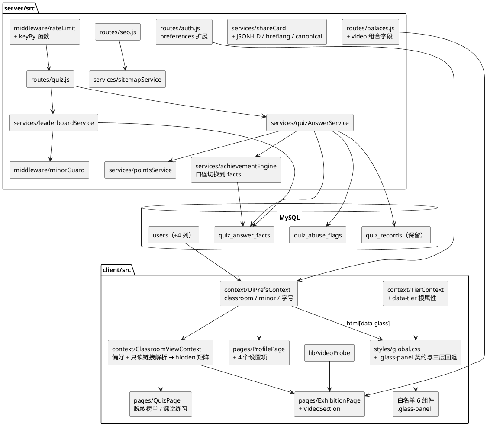
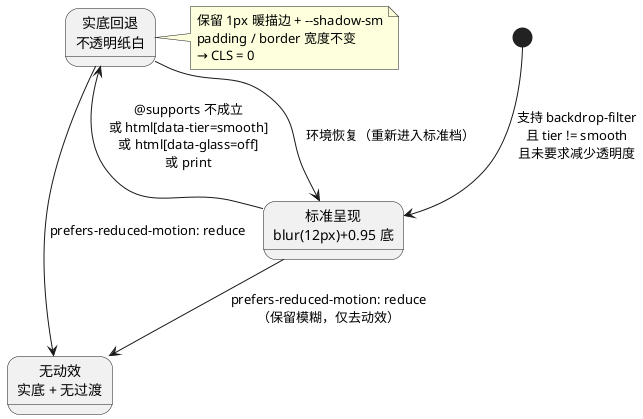
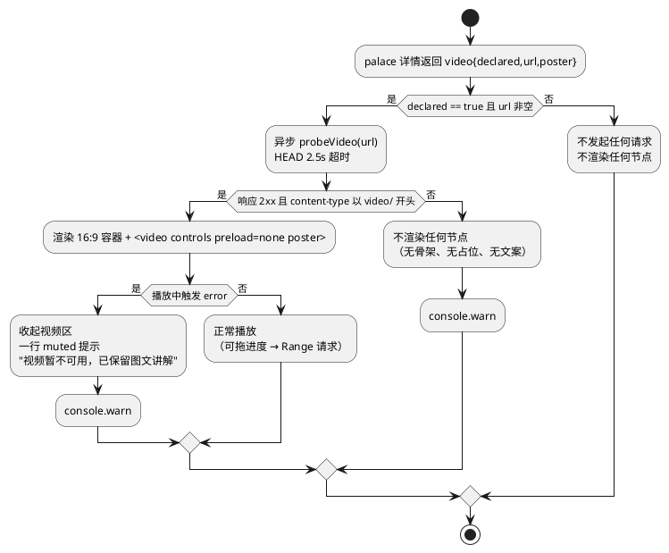
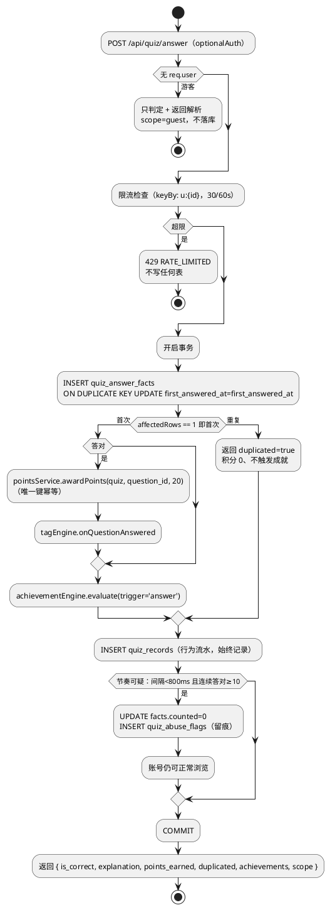
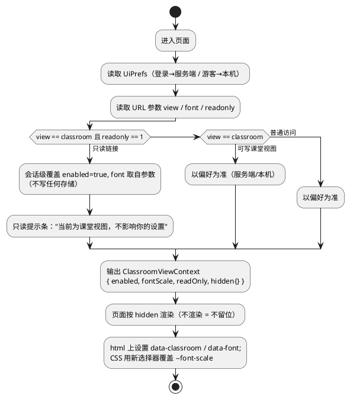
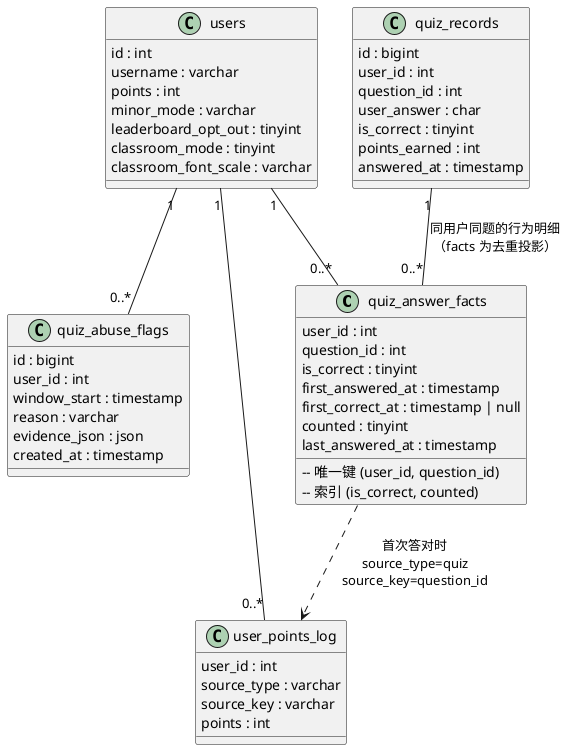
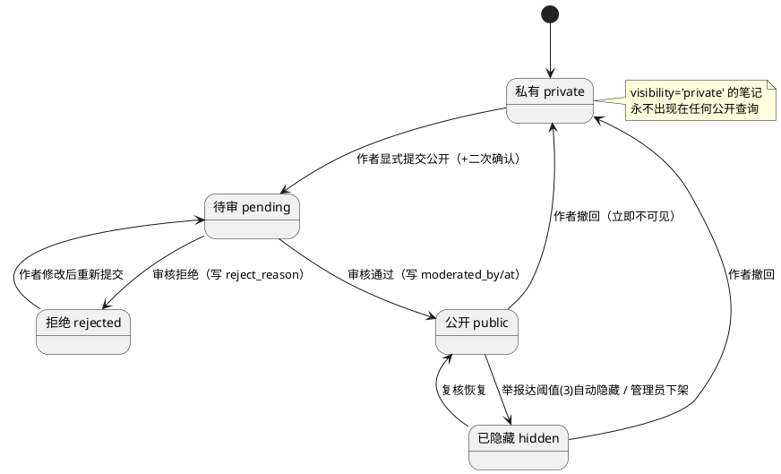

# 华夏古建可视化 · S3 P2 增量实现方案（技术设计）

| 项 | 内容 |
|---|---|
| 文档编号 | DESIGN-PUBLIC-S3P2-001 |
| 版本 | v1.0 |
| 状态 | 待评审（P2-5 部分为「门禁阻断设计」，不授权编码） |
| 上游文档 | `docs/requirements/s3-p2-requirements.md`（REQ-PUBLIC-S3P2-001）<br/>`docs/design/general-audience-enhancement-design.md`（DESIGN-PUBLIC-001）<br/>`docs/tasks/general-audience-enhancement-tasks.md`（§11 T-S3-01~05） |
| 设计范围 | P2-1 液态玻璃、P2-2 视频呈现、P2-3 排行榜与轻社交、P2-4 教师/研学模式、P2-5 UGC 公开（仅设计与门禁清单）、P2-6 SEO 与收录 |
| 关联代码库 | `D:\Ancient-architecture\ac1.1\acvisual 4`（S0~S2 已完成基线） |
| 业务代码改动 | **无**（本阶段只输出实现方案，不修改任何业务代码） |
| 下游阶段 | 编码任务规划（spec-task）由后续阶段负责 |

> 本文档回答「How」：改哪些文件、加什么接口、数据如何演进、如何降级、如何验收。
> 前端文件省略前缀 `client/src/`；后端文件省略前缀 `server/src/`；数据库脚本省略前缀 `server/db/`。
> 文中出现的行号基于当前仓库快照，仅用于定位，不构成契约。
> **P2-5（UGC 笔记公开）在 CG-01~CG-08 与 MG-01~MG-06 全部满足并完成书面评审前不进入编码**，本文档对该能力只输出「被门禁阻断的设计与前置清单」（见 2.4.5 与 1.3）。

---

## 目录

- [一、需求与存量功能关系分析](#一需求与存量功能关系分析)
  - [1.1 需求功能与存量功能对比](#11-需求功能与存量功能对比)
  - [1.2 存量功能详细分析](#12-存量功能详细分析)
  - [1.3 合规门禁现状评估（P2-5 阻断结论）](#13-合规门禁现状评估p2-5-阻断结论)
- [二、增量设计方案](#二增量设计方案)
  - [2.0 设计目标、约束与关键设计决策（ADR 摘要）](#20-设计目标约束与关键设计决策adr-摘要)
  - [2.1 实现模型（上下文视图 / 总体架构 / 实现设计）](#21-实现模型上下文视图--总体架构--实现设计)
  - [2.2 接口设计](#22-接口设计)
  - [2.3 数据模型](#23-数据模型)
  - [2.4 逐项实现方案（P2-1 ~ P2-6）](#24-逐项实现方案p2-1--p2-6)
  - [2.5 实施顺序、依赖与文件冲突](#25-实施顺序依赖与文件冲突)
  - [2.6 测试与验证策略（AC-S3-01~44）](#26-测试与验证策略ac-s3-0144)
  - [2.7 风险与缓解](#27-风险与缓解)
  - [2.8 MVP、Out of Scope 与向后兼容](#28-mvpout-of-scope-与向后兼容)
  - [2.9 开放问题与决策待办](#29-开放问题与决策待办)

---

# 一、需求与存量功能关系分析

> 本章逐项回答「需求的哪些部分已存在、哪些要扩展、哪些必须新建」，并给出代码位置证据。
> 匹配度四档：100%（完全匹配）/ 75%（主体可用，需补字段或补分支）/ 50%（概念可用，实现需重写）/ 25%（仅语义相似）/ 0%（无对应实现，归入新建）。

## 1.1 需求功能与存量功能对比

### 1.1.1 已实现功能（本轮直接复用）

| 需求功能 | 存量功能 | 代码位置 | 匹配度 |
|---|---|---|---|
| 游客免登录可做答题（不落库、不计分） | `POST /api/quiz/answer` 已存在 `optionalAuth` + 游客分支 | `server/src/routes/quiz.js:195-212` | 100% |
| 设备档位判定（smooth / standard / high） | `TierProvider` 暴露 `tier` 与 `useTier()` | `client/src/context/TierContext.jsx:25-62` | 100% |
| 设计 token（纸白、朱红、暖描边、阴影） | `--paper-white`、`--vermillion`、`--border-warm`、`--shadow-sm` | `client/src/styles/global.css:25-110` | 100% |
| 玻璃底色变量 | `--surface-glass`(0.88)、`--surface-glass-heavy`(0.95) | `client/src/styles/global.css:49-50` | 100%（token 已存在，缺使用契约） |
| 全站减少动效处理 | `@media (prefers-reduced-motion: reduce)` 统一归零时长 | `client/src/styles/global.css:115-130` | 100% |
| 视频字段与静态服务 | `palaces.has_video`、`palaces.video_url`；`app.use('/videos', express.static(...))` | `server/db/init_full.sql`（palaces 段）；`server/src/app.js:34` | 100%（数据与服务在，前端呈现无） |
| 视频字段进入公开白名单 | `toPublicPalace` 白名单含 `has_video`、`video_url` | `server/src/services/publicSerializer.js:23-24` | 100% |
| 答题积分（答对 +20） | `UPDATE users SET points = points + ?` | `server/src/routes/quiz.js:221-225` | 100%（缺幂等口径） |
| 积分幂等服务 | `pointsService.awardPoints`（唯一键幂等） | `server/src/services/pointsService.js` | 100% |
| 成就判定引擎（集中判定 + 徽章发放） | `achievementEngine.evaluate(userId,{trigger})` | `server/src/services/achievementEngine.js` | 100%（口径需换表） |
| 限流中间件（固定窗口 + 429 + Retry-After） | `rateLimit({windowMs,max,keyBy})` | `server/src/middleware/rateLimit.js:7-45` | 100%（`keyBy` 需支持函数） |
| 课程/路线内容与只读浏览 | `curated_routes`、`route_stops`、`GET /api/routes` | `server/src/routes/routes.js:20-60`；`migration_public_07_routes.sql` | 100% |
| 分享卡片页（OG/Twitter + 跳转） | `GET /share/:type/:id` 服务端 HTML | `server/src/routes/sharePage.js:16-66` | 100% |
| 分享内容查询（仅 published） | `getShareContent` 带 `status='published'` | `server/src/services/shareCard.js:49-91` | 100% |
| 内容发布状态（草稿隔离） | `palaces.status` + `idx_palaces_status` | `migration_public_12_content_status.sql` | 100% |
| 双语内容分级覆盖 | `content_translations` + `getCoverage()` | `migration_public_09_i18n.sql`；`server/src/services/contentI18n.js:49-87` | 75%（百科翻译为 0，见 1.1.2） |
| 匿名埋点白名单事件 | `EVENT_NAMES` / `ALLOWED_PROP_KEYS` | `client/src/lib/analytics.js:3-30` | 100%（需扩展 4 个事件名） |
| 设置页偏好开关（个性化 / 匿名统计） | `GET/PUT /api/auth/preferences` + ProfilePage 开关 | `server/src/routes/auth.js:361-441`；`client/src/pages/ProfilePage.jsx:311-343` | 100%（需扩展第 3、4 个字段） |
| 课堂模式字段（仅默认值） | `DEFAULT_PREFS.classroomMode = false` | `client/src/context/UiPrefsContext.jsx:12-17` | 25%（无 UI、无持久化、无消费方） |

### 1.1.2 需要扩展的功能

| 需求功能 | 存量功能 | 差异说明 | 扩展方向 |
|---|---|---|---|
| 玻璃面板统一契约（P2-1） | 仅 `--surface-glass*` token；模糊值散落 4/6/8/10/12/16px | ①无统一面板类；②无 `@supports` 回退；③无档位联动；④无"禁止位置"约束 | 在 `global.css` 新起 `.glass-panel` 选择器（不改既有选择器）；`TierContext` 写根属性；6 个白名单组件换类名 |
| 玻璃对比度验收（P2-1） | 面板底色 0.88/0.95，叠海报/深舞台时对比度未知 | 无最差背景样本、无文字色约束 | 规定面板内正文只用 `--ink`/`--ink-light`；建立"最差背景样本 + 计算式"验收法（见 2.4.1.4） |
| 视频呈现（P2-2） | 有 `has_video`/`video_url`，`ExhibitionPage` 无 `<video>` | ①无有效性判定；②无失败收敛；③无布局预留；④无文字稿入口 | `routes/palaces.js` 详情新增 `video` 组合字段（只增不改）；新增 `lib/videoProbe.js`；`ExhibitionPage.jsx` 内新增 `VideoSection` 子组件 |
| 排行榜去重口径（P2-3） | `COUNT(qr.id)` 统计答题行；同题可重复 +20 | ①无"用户+题目"唯一语义；②排序用 `points DESC` 兜底；③无首次达成时间 | 新增 `quiz_answer_facts` 事实表 + 迁移回填；`/leaderboard` 与 `achievementEngine` 改用事实表；排序改为「正确数降序、首次达成升序」 |
| 答题写入口幂等（P2-3） | 每次提交 `INSERT quiz_records` 并 `UPDATE points` | 无重复判定、无事务、无并发保护 | `/answer` 改事务 + `INSERT ... ON DUPLICATE KEY` 判首次；积分改走 `pointsService`（`source_key=question_id`） |
| 题库分类 / 统计口径（P2-3） | `/categories`、`/stats` 用 `COUNT(quiz_records)` | 与去重口径不一致，会出现"我的 100 题 / 榜单 3 题" | `records` 保留行为流水；`stats`/`categories` 新增 `distinct_correct` 字段（原字段保留） |
| 限流（P2-3） | `rateLimit` 只支持 `req[顶层属性]` 或 IP | 无法按 `req.user.id` 分桶；纯 IP 会在校园 NAT 误伤 | 扩展 `keyBy` 支持函数 `(req) => string`；答题按 userId 分桶 + IP 兜底桶 |
| 课堂模式（P2-4） | `classroomMode` 空壳；`--font-scale` 固定 1.2 未被页面消费；`PUT /preferences` 只接受 2 字段 | ①无开关 UI；②无持久化；③无消费方（推荐/分享/社交/字号） | `users` 增 2 列；`PUT/GET /preferences` 扩展；`UiPrefsContext` 实装；`global.css` 增字号档位选择器；6 处消费点接入 |
| 百科/路线作为 SEO 数据源（P2-6） | `encyclopedia_terms` 无 `updated_at`；`curated_routes` 有 `created_at` 无 `updated_at` | sitemap 需要 `lastmod`，不得伪造 | 用 `created_at` 兜底并标注"无更新时间时取创建时间"；后续如需精确新鲜度再补列（本轮不加） |
| 分享页元信息（P2-6） | OG/Twitter/canonical 已有；canonical 含 `?ch=` | ①缺 JSON-LD；②缺 hreflang；③canonical 未去参 | `shareCard.renderShareHtml` 增加 jsonLd/alternates 参数；`sharePage.js` 计算"去参 canonical" |
| 站点级抓取资产（P2-6） | 无 `/robots.txt`、无 `/sitemap.xml`；`app.get('*')` 会接管 | ①缺路由；②缺 fallback 排除；③无自检 | 新增 `routes/seo.js`（注册在 fallback 之前）；`app.js` fallback 排除前缀扩展；新增 `scripts/seo-check.mjs` |

### 1.1.3 需要新增的功能或接口

**A. 前端新增文件**

| 文件 | 职责 | 依赖 |
|---|---|---|
| `lib/videoProbe.js` | 视频可用性探测（HEAD → Range GET 回退，超时与取消） | 无（原生 fetch） |
| `context/ClassroomViewContext.jsx` | 课堂视图解析（偏好 + 只读链接参数），输出 `hidden` 隐藏矩阵与字号档 | `UiPrefsContext`、`useLocation` |
| `styles/s3p2-glass.css`（可选，也可并入 `global.css` 末尾） | `.glass-panel` 契约与三层回退 | `global.css` 的 token |

**B. 前端改造点（不新增页面）**

| 文件 | 改造点 |
|---|---|
| `pages/ExhibitionPage.jsx` | 新增 `VideoSection` 内联子组件（16:9 容器、探测、失败收敛、文字稿入口） |
| `pages/QuizPage.jsx` | 榜单脱敏展示、未成年人展示规则、空态、限流提示、课堂只读练习模式 |
| `pages/ProfilePage.jsx` | 设置区新增 3 项（课堂模式 / 字号档 / 未成年人模式 / 退出公开榜），一次性改造 |
| `pages/SearchPage.jsx`、`components/{GlobalSearchDialog,CollectionDialog,ShareButton,AchievementToast,RecommendationRail}.jsx` | 首个玻璃面板应用点（换类名 + 移除内联模糊） |
| `context/UiPrefsContext.jsx` | `classroomMode`/`classroomFontScale`/`minorMode` 持久化（登录→服务端，游客→本机） |
| `context/TierContext.jsx` | 将 `tier` 写入 `document.documentElement.dataset.tier` |
| `pages/{HomePage,OverviewPage,ExhibitionPage,RoutePage}.jsx`、`components/DetailPanel.jsx` | 课堂模式隐藏判定（推荐位/分享/社交/注册引导/成就弹层） |
| `lib/share.js` | 新增 `buildClassroomLink(path,{font})`（只读、无凭证） |
| `lib/analytics.js` | 白名单新增 4 个事件：`glass_fallback`、`video_unavailable`、`leaderboard_rate_limited`、`classroom_mode_toggle` |
| `App.jsx` | 无需新增路由；`/search` 保持 public（仅服务端加 `X-Robots-Tag`） |

**C. 后端新增文件**

| 文件 | 职责 |
|---|---|
| `routes/seo.js` | `GET /robots.txt`、`GET /sitemap.xml`（含分片分支）、可选 `GET /sitemap-index.xml` |
| `services/sitemapService.js` | 数据驱动生成 URL 集合（published palace / term / route）与 `lastmod`，5 分钟内存缓存 |
| `services/leaderboardService.js` | 去重聚合查询、脱敏序列化、可疑标记准入、榜单稳定排序 |
| `services/quizAnswerService.js` | 答题幂等写入（事务）、首次判定、积分与成就触发、可疑行为打标 |
| `middleware/minorGuard.js` | 解析用户未成年人/退出公开榜状态，供榜单与 UGC 路由使用 |
| `scripts/seo-check.mjs`（项目根 `scripts/`） | 抓取自检：robots/sitemap/分享页/搜索页头/状态码 |

**D. 后端改造点**

| 文件 | 改造点 |
|---|---|
| `routes/quiz.js` | `/answer` 委托 `quizAnswerService`；`/leaderboard` 委托 `leaderboardService`；`/stats`、`/categories` 增 `distinct_correct`；新增 `POST /practice/answer`（不落库） |
| `routes/auth.js` | `GET/PUT /preferences` 扩展 `classroom_mode`、`classroom_font_scale`、`minor_mode`、`leaderboard_opt_out` |
| `routes/palaces.js` | 详情响应新增 `video: { declared, url, poster }` 组合字段（既有字段保留） |
| `middleware/rateLimit.js` | `keyBy` 支持函数 |
| `services/achievementEngine.js` | `correct_answers` 与 `quiz_categories_correct` 子查询改用 `quiz_answer_facts` |
| `services/shareCard.js` | 新增 `buildJsonLd()`、`buildAlternates()`、`buildCanonical()`；`renderShareHtml` 内联 JSON-LD 与 hreflang |
| `routes/sharePage.js` | canonical 去参；内容下线时输出 `noindex,follow` |
| `app.js` | 注册 `seoRoutes`（在 `app.get('*')` 之前）；fallback 排除 `robots.txt|sitemap`；对 `/search`、`/profile`、`/curator` 回 SPA 时加 `X-Robots-Tag: noindex,follow` |

**E. 新增数据库迁移（命名沿用 `migration_public_XX_*.sql`，现有最大序号 13）**

| 脚本 | 内容 | 是否本期执行 |
|---|---|---|
| `migration_public_14_quiz_facts.sql` | `quiz_answer_facts`、`quiz_abuse_flags`；`users` 增 `minor_mode`、`leaderboard_opt_out`；历史首次结果回填；索引与回滚注释 | ✅ |
| `migration_public_15_classroom.sql` | `users` 增 `classroom_mode`、`classroom_font_scale`；幂等存储过程写法 | ✅ |
| `migration_public_16_ugc_public.sql` | 公开意愿、审核状态、举报、审计（**仅门禁通过后创建**） | ❌（本期不落地） |

## 1.2 存量功能详细分析

> 只分析本轮直接改动或直接依赖的存量实现，重点给出「接口契约、业务规则、扩展点、约束」四维，不复述代码。

### 1.2.1 排行榜与答题写入口（P2-3 的主战场）

**接口契约**
- `GET /api/quiz/leaderboard?limit&category`：`authMiddleware` 保护；返回 `{ data: { category, list[], me } }`，行字段由 `normalizeRankRow` 收敛为 Number（`server/src/routes/quiz.js:522-531`）。
- `POST /api/quiz/answer`：`optionalAuth`；游客分支只判定不落库（`:195-212`）；登录分支 `INSERT quiz_records` → `UPDATE users.points` → `tagEngine.onQuestionAnswered` → `achievementEngine.evaluate`（`:214-255`）。

**业务规则（现状）**
1. 排行正确数 = `COUNT(qr.id)`（全榜）或 `COUNT(qq.id)`（分类榜）（`:462-465`）；分类榜用 `LEFT JOIN ... AND qq.category = ?`，未命中分类时 `qq.id IS NULL` 被 `CASE` 过滤。
2. 排序：`RANK() OVER (ORDER BY correct_answers DESC, total_answers ASC, points DESC)`（`:480`）。**答得越多（含重复）越靠前**，且积分参与排序，与需求 §4.3.3-4「禁止以积分或答题次数作为主排序」直接冲突。
3. 返回字段含 `username`、`avatar_url`、`points`、`interest_tag`（`:469`），前端渲染 `#rank_no`、首字母头像与昵称（`client/src/pages/QuizPage.jsx:1203-1219`）——违反 DFX-S3-S1/S2。

**扩展点**
- 现有 `quiz_records` 是**行为流水**，无唯一键，适合保留为审计事实；不适合作为排行事实来源。
- `achievementEngine` 已提供统一判定入口（`evaluate`），可直接改用新事实表，不必改调用方。

**约束**
1. `quiz_records.question_id` 有 `FK ON DELETE CASCADE`（`init_full.sql` quiz_records 段）→ 一旦题库删除题目，历史行为会消失；**排行事实表不得依赖该外键级联**（事实表不建外键或用 `SET NULL`，见 2.3.2）。
2. 积分写入口当前两处（答题 / 收藏）语义不同，答题必须改走 `pointsService` 才能幂等（ADR-06 已确立该收口）。
3. 历史数据存在同题多行，**加唯一键会失败**，因此只能新增事实表 + 回填（见 2.4.3.3）。

### 1.2.2 分享页与元信息（P2-6 的改造基线）

**接口契约**
- `GET /share/:type/:id`：无鉴权；`type ∈ {palace,term,route}`（route 目前未实现，`shareCard.js:89-90` 返回 null）；成功 200 + `Cache-Control: public,max-age=300`，失败也返回 200 友好页（`sharePage.js:41-65`）。
- `renderShareHtml` 输出 `og:*`、`twitter:*`、`<link rel="canonical">`（`shareCard.js:188-204`）。

**业务规则**
1. palace 查询强制 `status='published'`（`shareCard.js:55`）——与发布门槛一致，sitemap 可复用同一条件。
2. canonical 现状 = `origin + req.originalUrl`（`sharePage.js:25`），**含 `?ch=copy&from=share`**，违反 AC-S3-41。

**扩展点**
- `renderShareHtml` 是单一模板入口，新增 JSON-LD/hreflang **只需加参数**，不需要改调用链结构。
- `shareEntityExists` 可用于"内容下线"判定；`getRecommendations` 已提供友好页推荐位。

**约束**
- `res.type('html')` 与 `escapeHtml` 是既有安全基线：JSON-LD **必须走 `JSON.stringify` + 转义 `</script>`**，不得字符串拼接用户内容。
- 分享页与 SPA 的关系是「别名 + 跳转」；canonical 指向内容页后，分享页不会被单独收录，这是有意取舍（见 ADR-S3-11）。
- **既有资源缺口**：`shareCard.DEFAULT_OG_IMAGE = '/images/brand/og-default.webp'`，但仓库中该文件不存在（仅 `images/posters/` 与 `images/views/` 有内容）。这会让"无封面内容"的分享卡片与 JSON-LD `image` 指向 404，直接影响 AC-S3-40。处理：①由内容侧补齐该文件（首选，命名不变）；②或 `buildJsonLd`/`shareCard` 改用已存在的兜底图（`images/posters/gugong.webp`）；③`seo-check.mjs` 增加"图片可访问（200）"断言，未补齐即阻断发布（R-S3-19）。

### 1.2.3 站点装配与回退（P2-6 的注册顺序风险）

**现状事实**
1. `express.static(clientDist)` 在全部 API 之前挂载（`app.js:38`），只匹配真实文件，不吞 API；但**会匹配 `/robots.txt` 若 dist 中存在同名文件**（当前不存在）。
2. `/share` 在 API 之后、fallback 之前（`app.js:65`）。
3. `app.get('*')` 是最后一道，仅排除 `/api`、`/share`（`app.js:68-76`），且**无条件挂载（不只生产）**。

**约束与影响**
- 新增 `/robots.txt`、`/sitemap.xml` 必须注册在 `app.get('*')` **之前**，否则必被返回 `index.html`（GAP-S3-08）。
- fallback 现会对 `GET /search` 返回 index.html（无 head 注入能力）→ 只能用响应头 `X-Robots-Tag` 实现 noindex（见 2.4.6.4）。
- `res.sendFile` 失败会 `next()`，最终 404；sitemap 生成失败必须显式 503，不能落到该分支。

### 1.2.4 展览页与视频字段（P2-2 的挂载点）

**现状事实**
- `ExhibitionPage` 的页面骨架为「绝对定位 3D 舞台 + 顶部栏 + 左右箭头 + 底部信息条」，详情信息在底部条内展开（`ExhibitionPage.jsx:200-342`）；`infoExpanded` 区块内已有 `AudioGuidePlayer`（`:328-336`）。
- 组件使用**内联 style 对象**（`:344-542`），其中含 `backdropFilter: 'blur(12px)/blur(8px)'`（`:407,438,458`）——P2-1 的"禁止各自声明模糊"需明确这些内联样式的处置（不纳入白名单，标记 legacy，不强制改造）。

**约束**
1. 页面为 `height:100vh; overflow:hidden`（`:346-352`），视频区不能插入舞台层，只能放在底部信息条展开区或独立可滚动浮层。
2. `palace` 详情由 `GET /api/palaces/:id` 提供，字段经 `publicSerializer` 白名单（含 `has_video`/`video_url`），因此视频元数据无需新增查询。

### 1.2.5 偏好与设置（P2-3/P2-4 的共享面）

**现状事实**
- `GET /api/auth/preferences` 返回 2 个布尔（`auth.js:361-381`）；`PUT` 逐字段校验后拼 `UPDATE`（`:387-441`），**已经是"只增字段即可扩展"的结构**。
- `ProfilePage` 设置区为两个 `role="switch"` 行（`ProfilePage.jsx:311-343`），新增开关只需复制行结构并接入同名 API。
- `UiPrefsContext` 仅内存态（`UiPrefsContext.jsx:19-34`），`updatePrefs` 恒返回成功 → 无法感知失败，也无服务端同步。

**约束**
1. 偏好字段必须**只增不改**：既有 `personalization_enabled`、`analytics_enabled` 的语义与默认值不得变化（DFX-S3-C1）。
2. `achievementEngine` 与 `recommendService` 已读取 `personalization_enabled`；课堂模式与未成年人模式**不得复用该字段**，避免一个开关控制两件事。
3. 游客偏好只能落本机（沿用 ADR-02 的 GuestSession 语义），不得新增匿名账号。

### 1.2.6 样式契约与性能（P2-1 的约束面）

**现状事实**
- token 已具备（`global.css:49-57,99-101,108-110`）；`--font-scale: 1.2` 固定，页面未用 `calc(var(--font-base) * var(--font-scale))` 消费。
- `backdrop-filter` 出现 20+ 处，模糊值 4~16px 不等（`global.css` 与 `guards.css`、`overview.css`），且部分组件用内联样式声明。
- 无 `@supports` 回退，无 `prefers-reduced-transparency`，无 `data-tier` 根属性。

**约束**
1. 新增样式必须**新起选择器**，不得改写既有选择器（TR-09：`global.css` 被多任务串行修改）。
2. 平滑档必须"零模糊"，而不是"更小模糊"（DFX-S3-P1）。
3. 面板出现前后不得改变布局尺寸（DFX-S3-P2）→ 玻璃面板只允许改变"视觉层"（背景/描边/阴影），不得改 padding/border 宽度（描边用 `box-shadow` inset 或固定 1px 且原本就有 1px 边框）。

## 1.3 合规门禁现状评估（P2-5 阻断结论）

> 结论先行：**CG-01~CG-08 与 MG-01~MG-06 全部未满足，P2-5 本期不进入编码**。本节只记录现状与前置清单，不产生任何代码落点。

| 条件 | 现状 | 交付物要求 | 阻塞级别 |
|---|---|---|---|
| CG-01 法律属性与平台责任 | 未评审 | 书面评审结论（含责任分工） | 硬阻塞 |
| CG-02 隐私政策/用户协议更新 | 现有政策仅承诺"笔记仅本人可见"，未含公开场景 | 上线文本 + 版本号 + 生效时间 | 硬阻塞 |
| CG-03 内容审核机制（规则/过滤/岗位/SLA） | 无审核规则、无岗位、无 SLA | 规则文档 + 排班 + 24h SLA 承诺 | 硬阻塞 |
| CG-04 举报与申诉通道 | 无举报入口、无处理时限 | 流程文档 + 对外入口 | 硬阻塞 |
| CG-05 未成年人规则（不可公开 + 监护同意） | 仅需求文本，无实现方案 | 规则文档 + 同意流程方案 | 硬阻塞 |
| CG-06 数据生命周期（下线/注销/缓存/审计留存） | 无策略 | 留存与删除策略 | 硬阻塞 |
| CG-07 运营与应急（下架/批量/上报） | 无权限清单与预案 | 应急预案 + 权限清单 | 硬阻塞 |
| CG-08 不做边界对外口径 | 无帮助中心/FAQ 口径 | 对外一致口径 | 硬阻塞 |
| MG-01 未成年人触发方式与保守默认 | 未定（Q-S3-03 未决） | 规则说明（含默认值） | P2-3 硬阻塞 |
| MG-02 排名展示规则 | 未定 | 展示规则表 | P2-3 硬阻塞 |
| MG-03 退出公开榜路径 | 未定 | 交互说明 | P2-3 硬阻塞 |
| MG-04 禁止项清单（社交登录/导流/广告/地理排名） | 部分已在既有 DFX-S6 | 检查清单 | P2-3 硬阻塞 |
| MG-05 数据最小化 | 未书面化 | 数据说明 | P2-3 硬阻塞 |
| MG-06 UGC 继承 MG-01~05 + 默认不可公开 | 未定 | 规则叠加说明 | P2-5 硬阻塞 |

**由门禁派生的三条设计约束（本方案已落实）**
1. 本方案对 P2-3 一律按「最小保护集」设计（脱敏昵称、无头像、无精确名次可关、无社交登录），不依赖 MG 签字也能上线（需求 §6.3）。
2. 本方案**不得**在 `config/features.js` 中注册 `UGC_PUBLIC_ENABLED` 之类开关（那会成为"隐藏入口"），P2-5 的开关只存在于"是否存在路由文件"这一物理事实。
3. 本方案所有 UGC 表结构与接口只出现在 2.4.5 的"获准后路径"，`migration_public_16_ugc_public.sql` **本期不创建**。
---

# 二、增量设计方案

## 2.0 设计目标、约束与关键设计决策（ADR 摘要）

### 2.0.1 设计目标

| 编号 | 目标 | 可验证判据 |
|---|---|---|
| DG-S3-01 | 视觉一致且可降级：玻璃质感只有一个定义来源，低端机零模糊 | AC-S3-01、AC-S3-02、AC-S3-03、AC-S3-06 |
| DG-S3-02 | 视频"有则显、无则隐"，任何失败都不留黑框与占位 | AC-S3-07 ~ AC-S3-11 |
| DG-S3-03 | 排行榜不可刷、不可识别、不伤害未成年人 | AC-S3-12 ~ AC-S3-19 |
| DG-S3-04 | 课堂模式只是"呈现模式"，不新增教师端、不改权限与数据 | AC-S3-21 ~ AC-S3-28 |
| DG-S3-05 | 抓取资产正确：robots/sitemap 可直达，分享页有结构化数据与规范地址 | AC-S3-37 ~ AC-S3-44 |
| DG-S3-06 | UGC 在门禁前"物理不存在"，不出现任何可达路径 | AC-S3-29 |
| DG-S3-07 | 全部改造向后兼容：URL、既有字段、既有表均不破坏 | 回归门禁 + DFX-S3-C1 |

### 2.0.2 设计约束（本轮新增，叠加既有 DESIGN-PUBLIC-001 §1.2）

| 编号 | 约束事实 | 证据 | 对设计的影响 |
|---|---|---|---|
| CS-01 | 排行正确数现按答题行统计，且排序含 `points` | `quiz.js:462-480` | 必须新增"去重事实表"，不能只改 SQL 聚合（见 ADR-S3-03） |
| CS-02 | `quiz_records` 无唯一键且有历史重复行 | `init_full.sql` quiz_records 段 | 不能给该表加唯一键；历史回填只能"取首次" |
| CS-03 | 成就引擎直接读 `quiz_records` | `achievementEngine.js:31` | 排行口径变更必须同步改引擎，否则"刷同题拿徽章"仍成立 |
| CS-04 | `rateLimit.keyBy` 只接受字符串属性名 | `rateLimit.js:11-14` | 需扩展为支持函数，否则无法按 userId 分桶 |
| CS-05 | `app.get('*')` 无条件兜底且只排除 `/api`、`/share` | `app.js:68-76` | 新 SEO 路由必须前置注册；noindex 只能靠响应头 |
| CS-06 | 分享页 canonical 用 `req.originalUrl` | `sharePage.js:25` | 需改为去参 canonical（AC-S3-41） |
| CS-07 | `ExhibitionPage` 为 `100vh + overflow:hidden`，舞台绝对定位 | `ExhibitionPage.jsx:346-352` | 视频区只能进底部展开区，不能覆盖舞台 |
| CS-08 | 玻璃模糊值分散 20+ 处、含内联样式 | `global.css`、`guards.css`、`ExhibitionPage.jsx:407-458` | 只收敛"白名单新组件"，存量内联样式标 legacy 不返工 |
| CS-09 | `UiPrefsContext` 仅内存态，`updatePrefs` 恒成功 | `UiPrefsContext.jsx:31-34` | 需引入"保存失败回滚 + 三态来源（服务端/本机/链接）" |
| CS-10 | `palaces.status` 已存在且有索引 | `migration_public_12_content_status.sql` | sitemap 与详情、分享页可复用同一发布条件 |
| CS-11 | `encyclopedia_terms` 无 `updated_at` | `init_full.sql` terms 段 | sitemap `lastmod` 用 `created_at`，不得伪造 |
| CS-12 | 百科英文覆盖为 0（`translated: 0`） | `contentI18n.js:81-84` | hreflang 本轮实际只在建筑（有 en name/description）上输出 |

### 2.0.3 关键设计决策（ADR 摘要）

> 每条含「选择 / 否决 / 理由 / 代价」。后续章节落点均以此为准。

**ADR-S3-01（玻璃契约）一个类 + 根属性驱动三层回退**
- 选择：在 `global.css` 末尾新起 `.glass-panel` 单一类承载「底色 + 模糊 + 描边 + 阴影」；模糊强度由变量 `--glass-blur` 单点定义；降级由**根元素属性**驱动：
  1. 能力层：`@supports not ((backdrop-filter: blur(1px)) or (-webkit-backdrop-filter: blur(1px)))` → 不透明；
  2. 档位层：`html[data-tier="smooth"] .glass-panel` → `backdrop-filter:none` + 不透明；
  3. 偏好层：`html[data-glass="off"] .glass-panel`（减少透明度）与 `@media print` → 不透明；`@media (prefers-reduced-motion:reduce)` → 取消动效。
- 否决：①各组件自行判断 `tier` 并传 `style`（6 处重复、必然漂移，违反 DFX-S3-M1）；②用 `filter: blur()` 模拟（会模糊面板内文字，需求 §4.1.3-8 明确禁止）；③运行时用 JS 测对比度动态调色（首屏额外布局与脚本成本，且不可回归测试）。
- 理由：CSS 级联天然「一处定义、全局生效」，且平滑档/系统偏好都是"环境状态"，用根属性表达比 props 更准确；面板外观变化不改变 box 尺寸，满足 CLS=0。
- 代价：`TierContext` 需写 `documentElement.dataset.tier`；既有内联模糊不收敛（明确标为 legacy，不做全站返工，OOS-S3-07）。

**ADR-S3-02（视频）服务端声明 + 前端异步探测两级门**
- 选择：详情接口只多返回一个组合字段 `video:{declared,url,poster}`（不阻塞）；前端在 `declared && url` 时才发起探测：`HEAD`（2.5s 超时）→ 失败则 `GET` + `Range: bytes=0-1` 回退（部分静态服务不支持 HEAD）→ 仅当 `2xx` 且 `content-type` 以 `video/` 开头才渲染。
- 否决：①服务端在详情请求内同步 HEAD（详情 P95 直接受外部资源影响，违反 DFX-S3-P3"首屏不阻塞"）；②只信 `has_video`（GAP-S3-03/09 已证明会造成黑框）；③无条件渲染 `<video>` 让浏览器自己报错（会出现空播放器与错误提示，违反 DFX-S3-R1）。
- 理由：把"资源是否真的可用"放在离资源最近的客户端判断，服务端只做声明与白名单；探测失败即"永久隐藏"，用户无感知。
- 代价：有视频的建筑多一次轻量探测请求；跨域/鉴权视频（本轮不存在）需在 `videoProbe` 中显式拒绝。

**ADR-S3-03（排行口径）新增"去重事实表"，`quiz_records` 降级为行为流水**
- 选择：新增 `quiz_answer_facts(user_id, question_id, is_correct, first_answered_at, counted, ...)`，唯一键 `(user_id, question_id)`；`/answer` 在事务中 `INSERT ... ON DUPLICATE KEY UPDATE first_answered_at=first_answered_at` 判首次；**只有首次答对**才发积分与触发成就；榜单与成就均以 `facts.counted=1 AND is_correct=1` 聚合。
- 否决：①给 `quiz_records` 加唯一键（历史重复行会失败，且丢失行为流水）；②每次查询用 `GROUP BY (user_id, question_id) + MIN(id)` 子查询（P95 风险、无法表达"首次达成时间"、无法标记可疑不计入）；③物理清洗历史重复行（破坏用户数据与审计，且需求 Q-S3-01 明确"保留原始"）。
- 理由：满足 AC-S3-12（同题 100 次不增长）、AC-S3-13（并发只一条有效）、AC-S3-17（同分按首次达成时间）；同时保留 `quiz_records` 作为答题行为与"我的记录"数据源，前端零改动。
- 代价：双表事实需一次回填与对账（见 2.4.3.3）；`stats` 需增 `distinct_correct` 以消除口径歧义。

**ADR-S3-04（限流）按 userId 分桶 + IP 兜底，课堂练习豁免**
- 选择：`rateLimit` 的 `keyBy` 支持函数；答题写入口用 `keyBy:(req)=>req.user?.id ? 'u:'+id : 'ip:'+ip`、`max=30/60s`；课堂随堂练习走独立接口 `/practice/answer`（不写库、不计数），不受该桶限制。
- 否决：纯 IP 限流（校园网 NAT 会把整班算成一个用户，R-S3-06 误伤）；纯前端节流（可绕过）。
- 理由：限流目的是"榜单准入"，分桶应与榜单主体（用户）对齐；IP 桶仅用于无 token 的异常流量兜底。
- 代价：内存桶（沿用现有实现）在多实例部署下不共享，需在文档标注"单实例假设，多实例需换 Redis"（本轮不改基础设施）。

**ADR-S3-05（排行隐私）服务端白名单序列化，前端不做"隐藏式脱敏"**
- 选择：新增 `toLeaderboardRow(row, { privacyMode })`，输出仅 `rank_no | null`、`display_name`（脱敏）、`correct_answers`、`badge_count`、`first_correct_at`；`me` 单独返回含精确 `rank_no`；未成年人/退出公开榜时 `rank_no:null`、`display_name` 固定为"营造学徒"、`avatar` 字段**不出现**。
- 否决：前端 CSS 隐藏名次/头像（接口已泄露，可被抓包，违反 DFX-S3-S1/S2）；接口返回后再前端替换昵称（原值已到达客户端）。
- 理由：最小暴露原则；前端只是"展示裁剪"而非"隐私边界"。
- 代价：`QuizPage` 需按 `privacy_mode` 渲染，不能再用 `#rank_no` 直出。

**ADR-S3-06（未成年人）声明式收紧，不采集年龄**
- 选择：`users.minor_mode ∈ {unset, minor}`（默认 `unset`）+ `users.leaderboard_opt_out`；`unset` 按"已脱敏的公开榜"展示（名次可见、昵称脱敏、无头像）；`minor` → 名次以区间表达、不进公开榜、无社交入口；游客用 `ac4_minor_mode` 本机值。开启 `minor` 时服务端自动置 `leaderboard_opt_out=1`。
- 否决：生日/身份证/年龄核验（引入新的敏感个人信息与合规负担，需求 §6.2 说明明确允许"自报 + 保守默认"）。
- 理由：在"无年龄采集"的约束下，用"默认脱敏 + 声明收紧"取得最优保护/成本比（R-S3-07 的既定缓解）。
- 代价：覆盖率依赖自报；默认脱敏是唯一兜底，因此 `display_name` 脱敏必须无条件生效（不做开关）。

**ADR-S3-07（课堂模式）呈现模式 + 双写偏好 + 链接只影响当前会话**
- 选择：`UiPrefsContext` 暴露 `classroomMode`、`classroomFontScale('standard'|'large'|'xlarge')`、`minorMode`；登录用户写 `users.classroom_mode/classroom_font_scale`，游客写 `ac4_classroom_v1`；只读链接用 `?view=classroom&font=large`，由 `ClassroomViewContext` 解析为**会话级覆盖**（`readOnly=true`），**不写**任何存储。
- 否决：①新增 `/classroom/*` 路由或独立教师端（OOS-S3-04）；②用 cookie 传课堂态（会被后续所有请求继承，等价于修改偏好）；③用 URL hash（分享时易丢失）。
- 理由：课堂模式本质是"同一页面的另一种呈现"，用偏好 + 视图参数两层表达最贴合；只读链接必须"看一眼就走"，不能污染接收者。
- 代价：需要 6 处消费点接入隐藏判定；字号档位需在 `global.css` 用新选择器实现，不能改 `:root` 默认值。

**ADR-S3-08（隐藏实现）不渲染而非 CSS 隐藏，避免空位与焦点陷阱**
- 选择：`ClassroomViewContext` 输出 `hidden: { recommendation, share, social, registerPrompt, achievementToast, personalizationHint }`；组件在**渲染前**返回 `null`；布局用 flex/grid 自动回流，不留占位。
- 否决：`display:none` 统一处理（实现简单但容易残留占位与"不可见却可聚焦"元素，违反 DFX-S3-A3）。
- 理由：与需求 §4.4.5-4「不弹注册引导」和 DFX-S3-A3「隐藏项不得成为键盘焦点陷阱」一致。
- 代价：需逐个组件加一行判定（6 处），但每处改动极小且可单测。

**ADR-S3-09（UGC）门禁阻断，只出设计与清单**
- 选择：本期不创建迁移、不创建路由、不创建 UI、不注册开关；在文档中给出获准后的状态机/接口/表结构/审计路径，供门禁通过后直接复用。
- 否决：先做"管理员灰度公开"或"隐藏路由"（需求 §6.1-2 明确禁止任何可达入口，包括灰度与仅管理员可见）。
- 理由：合规风险一旦引入不可控（R-S3-10）；且"先做后补"在 UGC 场景返工成本极高。
- 代价：本期不交付该能力。

**ADR-S3-10（SEO）独立路由前置注册 + 响应头 noindex + 自检脚本**
- 选择：新增 `routes/seo.js` 并 `app.use(seoRoutes)` 注册在 `app.get('*')` 之前；fallback 排除前缀追加 `robots.txt|sitemap`（双保险）；`/search`、`/profile`、`/curator` 在回 SPA 时加 `X-Robots-Tag: noindex,follow`；sitemap 5 分钟内存缓存、`max-age=3600`，生成失败 503。
- 否决：①把 robots/sitemap 放 `client/public` 静态文件（sitemap 必须数据驱动，且无法覆盖部署环境 origin）；②在前端 SPA 里"动态改 `<head>`"（爬虫首屏拿不到，且需要 SSR，OOS-S3-01）。
- 理由：服务端路由是唯一能"每次请求正确"的位置；`X-Robots-Tag` 是 SPA 无法注入 meta 时的标准替代。
- 代价：`app.js` 顺序调整需与 P2-2 的静态回归串行（同一文件面）。

**ADR-S3-11（分享页规范地址）canonical 指向内容页并去参，sitemap 只列规范地址**
- 选择：`buildCanonical(origin, type, id)` 固定为内容路由（palace → `/exhibition/:id`，term → `/encyclopedia?term=:id`，route → `/routes/:id`），**剥离 `ch/from/utm_*`**；sitemap 只列这三类规范地址，**不重复列 `/share/*`**。
- 否决：①canonical 保留 `?ch=`（同一内容多个规范地址，AC-S3-41 直接失败）；②canonical 指向分享页自身（分享页是别名，会造成"内容页与分享页"双入口竞争）。
- 理由：分享页的价值是"社交平台抓取卡片"（OG/Twitter），权重应归并到内容页；sitemap 列别名会产生重复 URL。
- 代价：与需求 AC-S3-38「sitemap 含分享页」的字面表述存在口径差异，已在 2.9 登记为待产品确认项（设计侧按"规范地址集合"实现，并在 sitemap 注释中说明分享页映射关系）。

**ADR-S3-12（SEO 边界）不承诺 SPA 首页/列表页正文收录**
- 选择：robots 允许 `/`、`/exhibition/`、`/encyclopedia`、`/routes`、`/share/`；禁止 `/api/`、`/profile`、`/curator`、`/search`、`/quiz`；发布说明写明"仅保证分享页元信息与站点资产正确"。
- 否决：引入预渲染/SSR（OOS-S3-01，成本远高于本轮）。
- 理由：与需求 §4.6.3-10 的边界声明一致，避免对外承诺"全站可收录"（R-S3-12）。
- 代价：`/quiz` 是否禁止索引是设计补充项（需求未列），因答题页含个人数据与动态内容，保守禁止。

### 2.0.4 类型与契约一致性要求

1. 前端新增契约用 JSDoc `@typedef` 落在 `client/src/types.js`：`VideoInfo`、`LeaderboardRow`、`ClassroomPrefs`、`SitemapEntry`；不使用 `any`，动态数据统一 `unknown` + 运行时守卫。
2. 后端新增服务层返回**固定形状**，路由层不二次变形；所有新增字段必须有默认值（`null`/`[]`/`false`），响应中不得出现 `undefined`（DFX-S3-C2）。
3. 响应包装沿用 `{ success, data, message?, error?, code? }`；新增错误码：`RATE_LIMITED`（沿用）、`MINOR_NOT_ALLOWED`（P2-5 预留）、`SITEMAP_UNAVAILABLE`。

## 2.1 实现模型（上下文视图 / 总体架构 / 实现设计）

### 2.1.1 上下文视图

```plantuml
@startuml
skinparam componentStyle rectangle
skinparam shadowing false
left to right direction

actor "教师 / 研学组织者" as T
actor "学生 / 未成年人" as S
actor "普通访客" as V
actor "搜索引擎 / 社交平台爬虫" as BOT
actor "内容审核员\n（P2-5 门禁通过后才存在）" as MOD

rectangle "华夏古建 SPA（client/）" as SPA {
  [页面层\nSearchPage / ExhibitionPage / QuizPage / ProfilePage / RoutePage] as P
  [共享组件层\nGlobalSearchDialog / ShareButton / AchievementToast\nRecommendationRail / CollectionDialog / VideoSection] as C
  [上下文层\nTierContext / UiPrefsContext / ClassroomViewContext / I18nContext] as CTX
  [能力库\nvideoProbe / share / analytics / guestSession] as LIB
}

rectangle "Express API（server/）" as API {
  [内容读路由\npalaces / encyclopedia / routes / content] as R1
  [互动路由\nauth / quiz / achievements] as R2
  [SEO 路由\nseo.js（robots / sitemap）] as R3
  [分享卡片页\n/share/:type/:id（HTML）] as R4
  [服务层\nleaderboardService / quizAnswerService\nsitemapService / shareCard / achievementEngine] as SVC
  [中间件\nauth / optionalAuth / rateLimit / minorGuard] as MW
}

database "MySQL ac4_db" as DB
folder "静态资源\nimages / models / videos" as FS

T --> P
S --> P
V --> P
BOT --> R3
BOT --> R4
P --> C --> CTX --> LIB
LIB -->|"HTTP /api（JSON）"| MW
MW --> R2
R1 --> SVC
R2 --> SVC
R3 --> SVC
R4 --> SVC
SVC --> DB
R1 --> FS
C -->|"HEAD / Range GET 视频"| FS
MOD ..> R2 : P2-5（本期不存在）
@enduml
```

**通信协议与频率**

| 链路 | 协议 | 频率 | 备注 |
|---|---|---|---|
| SPA → API | HTTP/1.1 + JSON（Bearer 可选） | 首屏 2~4 次；答题按用户操作 | 沿用 `api.js` axios 拦截器 |
| SPA → 视频资源 | HTTP HEAD，失败回退 Range GET | 每座"声明有视频"的建筑 1 次 | 2.5s 超时；失败即隐藏 |
| 爬虫 → `/robots.txt`、`/sitemap.xml` | HTTP GET | 低频（日级） | 纯文本 / XML；sitemap 内存缓存 5min |
| 爬虫/社交平台 → `/share/:type/:id` | HTTP GET（HTML） | 低频 | canonical 去参；JSON-LD 内联 |
| API → MySQL | mysql2 连接池 | 每请求 1~3 条语句；榜单 1 条 CTE | 事实表索引见 2.3.2 |

### 2.1.2 服务 / 组件总体架构



**分层规则（新增代码必须遵守）**
1. `routes/*` 只做「参数校验 + 鉴权组合 + 服务调用 + 响应包装」，不写 SQL；服务层不感知 `req/res`。
2. 一切写操作声明幂等语义：答题（用户+题目唯一）、课堂偏好（幂等 UPDATE）、UGC（若解禁，作者独占）。
3. 公开响应禁止出现 `email / password_hash / user_id（对外展示层）/ points 明细 / avatar_url`，由序列化函数白名单输出。

### 2.1.3 实现设计

**（1）玻璃面板状态机（P2-1）**



**（2）视频呈现判定流程（P2-2）**



**（3）答题写入幂等与可疑标记（P2-3）**



**（4）课堂视图解析（P2-4）**


## 2.2 接口设计

### 2.2.1 总体设计

**接口分类与稳定性**

| 分类 | 接口 | 变更类型 | 稳定性 |
|---|---|---|---|
| 内容读 | `GET /api/palaces/:id` | 扩展（新增 `video` 对象） | 稳定（只增字段） |
| 答题互动 | `POST /api/quiz/answer` | 行为变更（幂等 + 限流）+ 新增字段 | 稳定（前端契约兼容） |
| 答题互动 | `GET /api/quiz/leaderboard` | 语义变更（去重口径 + 隐私裁剪） | 实验（口径需公告） |
| 答题互动 | `GET /api/quiz/stats`、`/categories` | 扩展 `distinct_correct` | 稳定（只增字段） |
| 课堂练习 | `POST /api/quiz/practice/answer` | 新增 | 稳定 |
| 偏好 | `GET/PUT /api/auth/preferences` | 扩展 4 个字段 | 稳定（只增字段） |
| SEO | `GET /robots.txt`、`GET /sitemap.xml`（+ 分片） | 新增 | 稳定 |
| 分享 | `GET /share/:type/:id` | 元信息增强 + canonical 修正 | 稳定（HTML 对外） |
| UGC（门禁后） | 见 2.4.5 | 本期不实现 | 实验（预留） |

**接口设计原则落地**
1. 参数类型安全：偏好枚举用白名单校验（`classroom_font_scale ∈ {standard, large, xlarge}`、`minor_mode ∈ {unset, minor}`），拒绝其他值并返回 `VALIDATION_FAILED`。
2. 粒度适中：排行只保留一个 `GET /leaderboard`（分类筛选走 query），不拆"全榜/分类榜"两接口。
3. 版本策略：不引入 `/v2`；通过"只增字段 + 语义公告"演进（DFX-S3-C1）。排行榜语义变更需在上线公告中说明"口径=去重答对题数"。

### 2.2.2 接口清单

#### （1）`GET /api/palaces/:id`（扩展）

- **签名**：`GET /api/palaces/:id` → `{ success, data: PalaceDetail }`，无鉴权。
- **业务说明**：建筑详情（公开白名单输出），本轮新增 `video` 组合字段供展览页做呈现门判断。
- **前置条件**：无。仅返回 `status='published'` 内容（沿用既有发布门槛）。
- **后置条件**：无写入；不触发任何外部探测（服务端不做 HEAD）。
- **字段契约（新增部分）**：

| 字段 | 类型 | 说明 |
|---|---|---|
| `data.video.declared` | boolean | 等价于 `has_video===1`，缺省 `false` |
| `data.video.url` | string \| null | 规范化后的相对地址（`/videos/xxx.mp4`），空串归一为 `null` |
| `data.video.poster` | string \| null | 优先 `poster_path`，缺失 `null`（前端用品牌图兜底） |
| `data.has_video`、`data.video_url` | 原样保留 | 兼容既有消费方，不删不改语义 |

- **异常映射**：内容不存在/未发布 → `404 { success:false, error:'建筑不存在' }`；内部异常 → `500`。
- **调用示例**：`curl -s "http://localhost:3001/api/palaces/taihedian" | node -e "const d=JSON.parse(require('fs').readFileSync(0)).data;console.log(d.video)"`

#### （2）`POST /api/quiz/answer`（行为变更）

- **签名**：`POST /api/quiz/answer`，`optionalAuth`；Body `{ question_id: number, answer: 'A'|'B'|'C'|'D' }`。
- **业务说明**：判定答案；登录用户幂等落库、首次答对计分并发徽章；游客只判定。
- **前置条件**：`question_id` 存在；`answer` 为单字母（大小写不敏感）。
- **后置条件**：
  - 首次作答：`quiz_answer_facts` 新增 1 行；`quiz_records` 新增 1 行（行为流水）；首次答对 → `user_points_log` 新增 1 行 + `users.points` +20；触发一次成就判定。
  - 重复作答：`quiz_answer_facts` 不变（`first_answered_at` 不改）；`quiz_records` 新增 1 行（保留行为明细）；积分不变；不触发成就。
  - 游客：不写任何表。
- **响应 `data`（新增/变更字段加粗）**：

| 字段 | 类型 | 游客 | 登录（首次） | 登录（重复） |
|---|---|---|---|---|
| `is_correct` | boolean | 判定 | 判定 | 判定 |
| `correct_answer` | string \| null | 答错时给出 | 同 | 同 |
| `explanation` | string | 解析 | 解析 | 解析 |
| `points_earned` | number | 0 | 20 / 0 | **0** |
| **`duplicated`** | boolean | false | **false** | **true** |
| **`distinct_correct`** | number \| null | null | 该用户当前去重正确数 | 同（不变） |
| `achievements` | object | 空结构 | 结算结果 | 空结构（不重复发） |
| `scope` | string | `guest` | `user` | `user` |
| `leaderboard_hint` | boolean | true | false | false |

- **异常映射**：

| 场景 | HTTP | code | 说明 |
|---|---|---|---|
| 缺参数 | 400 | `VALIDATION_FAILED` | `缺少题目ID或答案` |
| 题不存在 | 404 | `NOT_FOUND` | `题目不存在` |
| 超限 | 429 | `RATE_LIMITED` | 携带 `Retry-After`；不写任何表 |
| 内部异常 | 500 | `INTERNAL_ERROR` | 事务已回滚 |

- **调用示例**：`curl -s -X POST http://localhost:3001/api/quiz/answer -H 'Content-Type: application/json' -H "Authorization: Bearer $TOKEN" -d '{"question_id":12,"answer":"B"}'`

#### （3）`GET /api/quiz/leaderboard`（语义变更）

- **签名**：`GET /api/quiz/leaderboard?limit=20&category=`，`authMiddleware`。
- **业务说明**：筑识榜，按**去重答对题数**降序；同分按首次达成时间升序；隐私裁剪后再出网。
- **前置条件**：登录（`authMiddleware`）。
- **后置条件**：只读。
- **响应 `data`**：

| 字段 | 类型 | 说明 |
|---|---|---|
| `category` | string \| null | 分类榜时为分类名 |
| `list[]` | array | 榜单行（≤ limit） |
| `list[].rank_no` | number \| null | 精确名次；未成年人/退出公开榜时为 `null` |
| `list[].display_name` | string | 脱敏昵称（见 2.4.3.5 规则） |
| `list[].correct_answers` | number | 去重答对题数 |
| `list[].badge_count` | number | 徽章数（仅计数，不含明细） |
| `list[].first_correct_at` | string(ISO) \| null | 首次答对时间（排序依据，可对前端隐藏展示但保留字段） |
| `me.rank_no` | number \| null | 我的精确名次（本人可见；未上榜 `null`） |
| `me.correct_answers` | number | 我的去重正确数 |
| `me.in_public_board` | boolean | 是否在公开榜（未成年/退出时为 false） |
| **`privacy_mode`** | string | `normal` / `minor` / `opted_out` |
| `empty_reason` | string \| null | `no_data`（新环境）/ `query_failed`（降级） |

- **禁止字段（永远不出现）**：`username`、`avatar_url`、`email`、`points`、`interest_tag`、`user_id`、`last_login_at`。
- **异常映射**：查询失败 → `200` + `list:[]` + `empty_reason:'query_failed'`（DFX-S3-R4 要求不得展示报错原文，也不允许 500 让前端无解）；鉴权失败 → `401`。
- **调用示例**：`curl -s -H "Authorization: Bearer $TOKEN" "http://localhost:3001/api/quiz/leaderboard?limit=20"`

#### （4）`GET /api/quiz/stats`、`GET /api/quiz/categories`（扩展）

- **签名**：不变，`authMiddleware` / `optionalAuth`。
- **业务说明**：新增"去重口径"字段，避免"我的答对 100 题 vs 榜单 3 题"的认知冲突。
- **字段契约**：

| 接口 | 新增字段 | 语义 |
|---|---|---|
| `/stats` | `data.distinct_correct` | 去重答对题数（= 榜单口径） |
| `/stats` | `data.category_stats[].distinct_correct` | 分类去重答对题数 |
| `/categories` | `data[].distinct_correct` | 分类去重答对题数（游客 `null`） |

- **约束**：既有 `correct_answers`、`accuracy`、`answered` 字段**语义不变**（仍为行为流水口径），仅新增字段；前端"我的答对题数"改读 `distinct_correct ?? correct_answers`。
- **异常映射**：沿用现状（500 + `服务器错误`）。

#### （5）`POST /api/quiz/practice/answer`（新增，课堂随堂练习）

- **签名**：`POST /api/quiz/practice/answer`，`optionalAuth`（匿名可用）；Body `{ question_id, answer }`。
- **业务说明**：课堂/研学场景的只读练习：只判定与返回解析，**不计分、不进榜、不写 `quiz_records`、不写 `quiz_answer_facts`、不触发成就**。
- **前置条件**：`question_id` 存在。
- **后置条件**：无任何写入（可加只读事务或直接不开启事务）。
- **响应 `data`**：`{ is_correct, correct_answer(答错时), explanation, category, palace_id, related_term_id, mode:'practice' }`。
- **异常映射**：400 / 404 / 500，同 `/answer`；**不返回 429**（不受答题限流桶约束）。
- **限流**：可选加宽松 IP 桶（120/60s），仅防滥用，不影响教学节奏。
- **调用示例**：`curl -s -X POST http://localhost:3001/api/quiz/practice/answer -H 'Content-Type: application/json' -d '{"question_id":12,"answer":"B"}'`

#### （6）`GET /api/auth/preferences`、`PUT /api/auth/preferences`（扩展）

- **签名**：不变，`authMiddleware`。
- **业务说明**：读取/更新偏好；新增课堂模式、字号档、未成年人模式、退出公开榜。
- **字段契约（新增）**：

| 字段 | 类型 | 取值 | 默认 | 校验 |
|---|---|---|---|---|
| `classroom_mode` | boolean | true/false/1/0 | false | 非白名单值 → 400 |
| `classroom_font_scale` | string | `standard`\|`large`\|`xlarge` | `large` | 非枚举 → 400 |
| `minor_mode` | string | `unset`\|`minor` | `unset` | 非枚举 → 400 |
| `leaderboard_opt_out` | boolean | true/false/1/0 | false | 非白名单值 → 400 |

- **业务规则**：
  1. `minor_mode='minor'` 写入时，服务端**自动**将 `leaderboard_opt_out=1`（同一条 `UPDATE`），并在响应中回显；反向不自动（退出公开榜不等于未成年人）。
  2. 既有 2 字段语义、默认值、校验错误文案完全不变（向后兼容）。
  3. `PUT` 允许部分更新；无任何可更新字段时返回 400（沿用现状）。
- **后置条件**：`users` 对应列更新；`GET` 回读一致。
- **异常映射**：3306/500 沿用；校验失败 → 400 `VALIDATION_FAILED`。
- **调用示例**：`curl -s -X PUT http://localhost:3001/api/auth/preferences -H 'Content-Type: application/json' -H "Authorization: Bearer $TOKEN" -d '{"classroom_mode":true,"classroom_font_scale":"large"}'`

#### （7）`GET /robots.txt`、`GET /sitemap.xml`（新增）

- **签名**：
  - `GET /robots.txt` → `text/plain; charset=utf-8`
  - `GET /sitemap.xml` → `application/xml; charset=utf-8`
  - `GET /sitemap-index.xml`、`GET /sitemap-:page.xml`（仅在 URL 数超过 `MAX_URLS_PER_SITEMAP=45000` 时启用）
- **业务说明**：站点抓取规则与数据驱动站点地图。
- **前置条件**：无鉴权；**必须**注册在 `app.get('*')` 之前。
- **后置条件**：无写入；sitemap 结果缓存 5 分钟（进程内）。
- **robots.txt 内容规则**：

| 指令 | 值 | 依据 |
|---|---|---|
| `User-agent` | `*` | 公开站点 |
| `Allow` | `/`、`/exhibition/`、`/encyclopedia`、`/routes`、`/share/` | 需求 §4.6.3-2 |
| `Disallow` | `/api/`、`/profile`、`/curator`、`/search` | 需求 §4.6.3-2 |
| `Disallow` | `/quiz` | 设计补充（含个人数据与动态内容） |
| `Sitemap` | `{origin}/sitemap.xml` | 便于发现 |

- **sitemap 条目来源与字段**：

| 来源 | 查询条件 | URL 形态 | `lastmod` |
|---|---|---|---|
| `palaces` | `status='published'` | `{origin}/exhibition/{id}` | `updated_at` |
| `encyclopedia_terms` | 全量 | `{origin}/encyclopedia?term={id}` | `created_at`（无更新时间，不伪造） |
| `curated_routes` | `is_published=1` | `{origin}/routes/{id}` | `created_at` |

- **异常映射**：生成失败 → `503 { code:'SITEMAP_UNAVAILABLE' }` + `Retry-After: 300`，**禁止返回空 `<urlset>`**（DFX-S3-R3）。
- **调用示例**：`curl -s -D - -o /dev/null http://localhost:3001/robots.txt`；`curl -s http://localhost:3001/sitemap.xml | head -c 200`

#### （8）`GET /share/:type/:id`（元信息增强）

- **签名**：不变，无鉴权。
- **业务说明**：服务端分享卡片页（OG/Twitter/JSON-LD/alternates），跳转 SPA 深链。
- **后置条件**：成功时异步记录 `share_visits`（沿用）。
- **新增输出（HTML `<head>` 内联，无额外请求）**：

| 输出 | 规则 |
|---|---|
| `<link rel="canonical">` | 内容页规范地址，**不含** `ch/from/utm_*` |
| `<script type="application/ld+json">` | palace → `TouristAttraction`；term → `Article`；仅公开字段（name/description/image/url），**无** `aggregateRating`/`review`/`author` 个人信息 |
| `<link rel="alternate" hreflang="zh-CN">`、`hreflang="en"`、`hreflang="x-default"` | 仅当 `content_translations` 同时具备 en 的 `name` 与 `description`（`status='full'`）时输出三组；否则只输出 `x-default` |
| `<meta name="robots" content="noindex,follow">` | 内容下线/不存在时输出（保持 200 友好页，AC-S3-43） |

- **异常映射**：`type` 非法 → 302 `/`（沿用）；查询异常 → 200 友好页 + `noindex`（沿用现状并补头）。
- **调用示例**：`curl -s "http://localhost:3001/share/palace/taihedian?ch=copy" | grep -E "canonical|ld\+json|hreflang"`

## 2.3 数据模型

### 2.3.1 设计目标

| 目标 | 说明 |
|---|---|
| 支持"同题只计一次首次结果" | 事实表以 `(user_id, question_id)` 唯一，天然幂等 |
| 支持"首次达成时间"排序 | 事实表保存 `first_answered_at`（首次作答时间）与 `first_correct_at`（首次答对时间） |
| 支持"可疑不计入" | 事实表 `counted` 标志 + 独立标记表留痕，不删除数据 |
| 保留行为流水 | `quiz_records` 不删不改，继续服务"我的记录"与行为分析 |
| 历史兼容 | 回填只 `INSERT ... SELECT`，不 `UPDATE`/`DELETE` 既有表；`users.points` 不回滚 |
| 课堂偏好跨设备 | `users` 增 2 列；游客走本机，不入库 |

**容量与性能目标**：单用户事实行数 ≤ 题库量（当前 108）；全表行数 ≈ 用户数 × 平均作答题数（万级）；榜单查询单条 CTE，P95 ≤ 500ms（DFX-S3-P4）。

### 2.3.2 模型实现



**对象关系与生命周期**
1. `quiz_answer_facts` 是「去重投影」：由答题写入口在事务内维护；**不随 `quiz_records` 删除而消失**（不建外键或 `ON DELETE SET NULL`），保证建筑/题目调整后排行不塌陷。
2. `quiz_abuse_flags` 只增不改，用于审计；`facts.counted=0` 是"不计入排行"，不是"删除事实"。
3. `users.points` 仍是聚合缓存（ADR-06），`user_points_log` 是事实来源；答题首次答对通过 `pointsService` 发放，保证"重复答对不重复加分"。

### 2.3.3 迁移脚本设计（命名与内容）

**`migration_public_14_quiz_facts.sql`**

| 段 | 内容 | 约束 |
|---|---|---|
| ① `quiz_answer_facts` | 字段见上图；`UNIQUE KEY uk_user_question (user_id, question_id)`；`INDEX idx_rank (is_correct, counted, user_id)`；**不建 `question_id` 外键**（保留历史事实） | `CREATE TABLE IF NOT EXISTS` |
| ② `quiz_abuse_flags` | `id, user_id, window_start, reason, evidence_json, created_at`；`INDEX idx_user_time (user_id, created_at)` | `CREATE TABLE IF NOT EXISTS` |
| ③ `users` 增列 | `minor_mode VARCHAR(8) DEFAULT 'unset'`、`leaderboard_opt_out TINYINT(1) DEFAULT 0` | 用 `information_schema` 判存的存储过程写法（沿用迁移 12 风格，幂等） |
| ④ 历史回填 | `INSERT ... SELECT user_id, question_id, MAX(is_correct) 取首次, MIN(answered_at), ... FROM quiz_records GROUP BY user_id, question_id ON DUPLICATE KEY UPDATE ...` | **"首次结果"口径**：按 `MIN(id)`（同秒并发时更稳定）取该用户该题的第一次作答行；`first_correct_at` 取该题首次答对时间；`counted=1` |
| ⑤ 对账输出 | 文件末尾附注释：回填后预期 `COUNT(*) FROM quiz_answer_facts` = 去重后的 `(user_id, question_id)` 组合数；并给出核对 SQL（注释形式，不自动执行） | 便于 QA 逐条核对 |
| ⑥ 回滚注释 | `-- rollback: DROP TABLE quiz_abuse_flags; DROP TABLE quiz_answer_facts;` 与 `-- rollback: ALTER TABLE users DROP COLUMN minor_mode; ...` | 必须存在 |

**`migration_public_15_classroom.sql`**

| 段 | 内容 | 约束 |
|---|---|---|
| ① `users` 增列 | `classroom_mode TINYINT(1) DEFAULT 0`、`classroom_font_scale VARCHAR(8) DEFAULT 'large'` | 幂等存储过程写法 |
| ② 数据校验 | `UPDATE users SET classroom_font_scale='large' WHERE classroom_font_scale NOT IN ('standard','large','xlarge') OR classroom_font_scale IS NULL` | 保证枚举合法 |
| ③ 回滚注释 | `-- rollback: ALTER TABLE users DROP COLUMN classroom_mode; ...` | 必须存在 |

**`migration_public_16_ugc_public.sql`（本期不创建，仅门禁通过后落地）**：见 2.4.5.4。

**`init_full.sql` 同步策略**：只在文件末尾**追加**与迁移 14/15 等价的段落（沿用迁移 03 的做法），不改既有表定义与种子顺序；由 QA 门禁校验"迁移结果 = init_full 结果"。

### 2.3.4 数据回填与兼容策略

| 场景 | 策略 |
|---|---|
| 历史同题多行（含多次答对） | 只取 `MIN(id)` 的首次结果作为 facts 初始值；`quiz_records` 原样保留 |
| 历史"首次答错、后答对" | `is_correct` 取**首次结果**（答错），`first_correct_at` 取首次答对时间；该题**不计入**去重正确数（严格符合"首次结果"口径） |
| 历史用户已获徽章 | 不回滚已发徽章（不可撤销原则）；引擎后续按新口径判定"新增" |
| `users.points` 历史虚高 | 不回填、不清零（避免破坏用户资产），但上线公告说明"积分不影响排名" |
| 榜单名次变化 | 上线前公告"口径改为去重答对题数"（R-S3-04）；`me` 中给出 `distinct_correct` 解释入口 |
| 题目被删除 | facts 保留（无外键级联），排行仍有效；分类榜 JOIN 不到分类时该题不计入分类榜（与现状一致） |
## 2.4 逐项实现方案（P2-1 ~ P2-6）

### 2.4.1 P2-1 液态玻璃视觉规范

#### （1）文件与改动点

| 层 | 文件 | 改动 |
|---|---|---|
| 样式（唯一契约源） | `client/src/styles/global.css`（末尾新起段落） | 新增变量 `--glass-blur`、`--glass-surface`、`--glass-border`、`--glass-shadow`；新增 `.glass-panel` 与三层回退选择器；新增 `@media print` 实底；**不改既有选择器** |
| 档位 | `client/src/context/TierContext.jsx` | `useEffect` 将 `tier` 写入 `document.documentElement.dataset.tier`（`smooth/standard/high`），卸载时移除 |
| 偏好 | `client/src/context/UiPrefsContext.jsx` | 新增减少透明度读取（`prefers-reduced-transparency` 无法用 JS 可靠读取时，默认不写 `data-glass`）；仅在"用户显式开启减少透明度"时写 `data-glass="off"` |
| 白名单组件（6 处） | `pages/SearchPage.jsx` 结果分组容器/筛选条；`components/GlobalSearchDialog.jsx` 弹层；`components/CollectionDialog.jsx` 容器；`components/ShareButton.jsx` 二维码/浮层；`components/AchievementToast.jsx` 结算层；`components/RecommendationRail.jsx` 外框 | 加 `glass-panel` 类名；**移除组件内联模糊声明**（若存在）；不改布局属性 |
| 埋点 | `client/src/lib/analytics.js` | 白名单新增 `glass_fallback`，`props.reason ∈ {unsupported, smooth_tier, reduced_transparency, print}`（仅统计一次/会话，不逐帧上报） |
| 回归对照 | 无新增 | 既有 `ExhibitionPage` 等内联 `backdropFilter` **标记 legacy，本轮不改造**（避免大面积回归，OOS-S3-07） |

#### （2）面板契约（四要素单点定义）

| 要素 | 取值来源 | 说明 |
|---|---|---|
| 底色 | `--glass-surface: var(--surface-glass-heavy)`（0.95） | 复用既有 token，不新增低对比色 |
| 模糊 | `--glass-blur: 12px` | 全站唯一模糊强度；`saturate(1.1)` 固定 |
| 描边 | `1px solid var(--border-warm)` | 与既有卡片一致 |
| 阴影 | `var(--shadow-sm)` | 层级靠描边 + 阴影表达，不外加发光 |

**强制规则**
1. 面板内正文只用 `--ink`（#2C2C2C）或 `--ink-light`（#5A5252）；**禁止** `--ink-muted` 作为正文色。
2. 面板**不得改变** padding / border 宽度 / 圆角相对于原容器的差异（若原容器无边框，用 `box-shadow: inset 0 0 0 1px` 提供描边，避免 1px 布局位移）。
3. 同一界面玻璃层叠 ≤ 2 层（需求 §11.1-2）。
4. 禁止 `filter: blur()`、禁止在面板内再次套玻璃面板（除非属于"允许的悬停浮层"且总层数 ≤2）。

#### （3）允许 / 禁止位置

| 判定 | 位置 | 依据 |
|---|---|---|
| ✅ 允许 | 侧栏导航、搜索弹层（`GlobalSearchDialog`）、搜索结果分组容器、收藏/分享/朗读浮层、成就结算层、推荐位外框、卡片悬停浮层 | 需求 §4.1.3-2 白名单 |
| ❌ 禁止 | 正文长文本容器（`DetailPanel` 正文段、百科正文）、数据表格（榜单/记录表）、表单输入框背景、错误/警告提示条、3D 舞台与视频画面覆盖层、打印视图 | 需求 §4.1.3-3 |

> 落地方式：禁止位置不加入 `glass-panel` 类；代码扫描规则=「`glass-panel` 只出现在白名单组件文件」（由 `scripts/seo-check.mjs` 之外的轻量 grep 断言，纳入 QA）。

#### （4）三层降级矩阵

| 条件 | 表现 | 实现位置 | 验收 |
|---|---|---|---|
| 浏览器不支持 `backdrop-filter` | 不透明纸白底 + 保留描边/阴影 | `@supports not ((backdrop-filter: blur(1px)) or (-webkit-backdrop-filter: blur(1px)))` | AC-S3-02 |
| `tier === 'smooth'` | `backdrop-filter:none` + 不透明底；布局尺寸不变 | `html[data-tier="smooth"] .glass-panel` | AC-S3-03 |
| 系统/用户要求减少透明度 | 不透明底 | `html[data-glass="off"] .glass-panel` +（若支持）`@media (prefers-reduced-transparency: reduce)` | AC-S3-06 |
| 减少动效 | 保留（或回退）外观，取消入场动画/过渡 | `@media (prefers-reduced-motion: reduce) .glass-panel` | AC-S3-06 / DFX-S3-A4 |
| 打印 | 实底、无阴影、无色块糊化 | `@media print .glass-panel` | 需求 §4.1.5-4 |

**平滑档判定来源**：`TierContext.tier`（用户覆盖优先于自动探测），因此"用户手动切 smooth"也会禁用模糊——与 DFX-S3-P1"平滑档为 0 额外帧耗时"一致。

#### （5）对比度验证方式（不引入运行时测量）

1. **最差背景样本（固定两个）**：
   - S1：`/` 首页海报轮播（`HomePage` 轮播区，背景为高对比图片）；
   - S2：`/exhibition/:id` 深色舞台边缘（`ExhibitionPage` `viewerArea` 的暗部区域）。
2. **测量方法（可重复）**：在样本上放置白名单组件 → 浏览器 DevTools 取"面板最终渲染色"（含 0.95 叠加后的等效色）与文字色 → 用 WCAG 对比度公式计算；正文目标 ≥ 4.5:1，≥18.66px 粗体或 ≥24px 目标 ≥ 3:1。
3. **设计侧保障（先验）**：面板底色固定 0.95 纸白，叠加后等效亮度变化极小（相对 0.88 显著提升）；正文强制 `--ink`/`--ink-light`，其中 `--ink` 在纸白上对比度约 13:1，`--ink-light` 约 6.5:1，均达标；**只要不使用 `--ink-muted` 作正文，理论即达标**。
4. **验收产物**：`docs/design/baselines/s3p2-glass-contrast.md`（记录采样点、取色值、计算式、结论），随评审归档；不在代码中做动态检测（避免首屏脚本开销与不可回归）。

#### （6）异常路径

| 异常 | 处理 | 用户感知 |
|---|---|---|
| 模糊能力被策略禁用（如企业策略） | `@supports` 判定为不支持 → 实底 | 面板可读，无"透明未模糊"糊状层 |
| 平滑档下仍出现模糊 | 视为缺陷（选择器覆盖失败），由 AC-S3-03 拦截 | — |
| 面板叠加深色舞台 | 底色 0.95 + `--ink` 正文 | 文字清晰 |
| 打印 | 实底黑白友好 | 打印件无灰糊块 |

#### （7）验收映射

AC-S3-01（视觉一致性基线）、AC-S3-02（不支持回退）、AC-S3-03（平滑档 + CLS=0）、AC-S3-04（对比度实测）、AC-S3-05（禁止位置代码扫描）、AC-S3-06（减少动效/透明度）。

### 2.4.2 P2-2 视频呈现

#### （1）文件与改动点

| 层 | 文件 | 改动 |
|---|---|---|
| 后端内容 | `server/src/routes/palaces.js` | 详情响应新增 `video:{declared,url,poster}` 组合字段（基于已查出的 `has_video/video_url/poster_path` 组装，**不新增查询**）；列表接口不加（减少体积） |
| 后端序列化 | `server/src/services/publicSerializer.js` | 新增 `toVideoInfo(row)`（`has_video` 为 `1/'1'/true` 归一为布尔；`video_url` 空串→`null`；相对路径补 `/videos/` 前缀；绝对 URL 原样） |
| 前端探测 | `client/src/lib/videoProbe.js`（新增） | `probeVideo(url,{timeoutMs=2500})` → `{ ok, contentType, reason }`；先 HEAD，`405/501/网络错误` 回退 `GET + Range: bytes=0-1`；`AbortController` 超时；同 URL 结果进程内缓存（避免切建筑回退重复探测） |
| 前端页面 | `client/src/pages/ExhibitionPage.jsx` | 新增同文件内 `VideoSection` 子组件；插入位置=底部信息条 `infoExpanded` 区块内、`AudioGuidePlayer` **之前**（视频优先于朗读，二者都属"扩展讲解"）；容器 16:9 |
| 静态服务 | `server/src/app.js` | 不改挂载；回归验证 `/videos` 的 `Accept-Ranges: bytes` 与 206 响应（见测试） |
| 埋点 | `client/src/lib/analytics.js` | 新增 `video_unavailable`（`props.reason ∈ {probe_failed, wrong_type, play_error, timeout}`） |

#### （2）呈现门（四条件）

| 条件 | 判定位置 | 不满足时 |
|---|---|---|
| ① 内容标记有视频 | `video.declared === true` | 不渲染、不请求 |
| ② 地址非空 | `video.url` 非空字符串 | 不渲染、不请求 |
| ③ 地址可访问 | `probeVideo` 返回 `ok:true` | 不渲染任何节点（无骨架/占位/文案） |
| ④ 媒体类型为视频 | `content-type` 以 `video/` 开头 | 视为不可用，隐藏 + `console.warn` |

#### （3）播放与布局规则

| 规则 | 实现 |
|---|---|
| 不自动播放 | `<video controls preload="none" playsInline>`，无 `autoplay` |
| 不预取全量 | `preload="none"`，仅在用户点击播放后请求 |
| 可拖动进度 | 依赖静态服务 Range（206）；`videoProbe` 的 Range 回退不作为播放器行为 |
| 布局稳定 | 容器 `aspect-ratio: 16/9` + `width:100%`；出现前不渲染容器（**不留骨架**），出现时下方内容整体下移由"展开区"自身滚动承载，不改变舞台层与页面高度 |
| 封面 | `poster` 优先 `video.poster`（= `poster_path`）；缺失时使用**仓库中真实存在**的站点兜底图（当前为 `images/posters/gugong.webp`）。**不得**使用 `images/brand/og-default.webp`：该文件当前不存在（既有资源缺口，见 R-S3-19） |
| 标题与说明 | `<h3>` 可读标题（`{palace.name} · 视频讲解`）+ 一句说明（`palace.tagline` 或"观看建筑空间与工艺"） |
| 无障碍 | 可键盘聚焦与控制（原生控件）；无字幕 → 提供"查看文字稿"链接，指向同区块内的 `audio_guide` 文本（折叠展示）或展开详情正文 |

#### （4）异常路径

| 异常 | 触发 | 行为 | 用户感知 |
|---|---|---|---|
| 资源声明与实际不一致 | `declared=1` 但 404 | 探测 `ok:false` → 不渲染；`console.warn`；`track('video_unavailable',{reason:'probe_failed'})` | 无视频入口、无错误提示 |
| 媒体类型错误 | `content-type: text/html`（SPA fallback 返回） | 隐藏（`wrong_type`） | 同上 |
| 探测超时 | 2.5s 未响应 | 视为不可用，隐藏；**不回退**为 GET 重试（避免二次长等待） | 同上，页面其余内容早已可用 |
| 播放中途失败 | 网络中断 / 资源移除 | 收起视频区（移除节点）+ 一行 muted 文案"视频暂不可用，已保留图文讲解"；保留 `AudioGuidePlayer` 与正文 | 不出现黑屏/无限缓冲 |
| 浏览器不支持编码 | `error` 事件 `MEDIA_ERR_SRC_NOT_SUPPORTED` | 视为不可用，隐藏 + 告警 | 无视频入口 |
| 全站无任何视频资源（当前常态） | 所有建筑 `declared=false` | 全站无视频区块 | 与现状一致 |

#### （5）性能设计（对应 DFX-S3-P3）

1. 探测**只在** `declared && url` 时发起，且 `useEffect` 依赖 `[palace.id, video.url]`，切换建筑取消上一个请求（`AbortController`）。
2. 不阻塞首屏：探测在 palace 详情返回后触发，3D/图文先渲染。
3. 探测结果按 URL 缓存（Map），同一会话内重复进入不重复请求。
4. 不引入额外接口：复用详情响应字段，无 `/api/videos/check` 端点（避免多一跳与服务端阻塞）。

#### （6）验收映射

AC-S3-07（无资源不渲染）、AC-S3-08（有效资源可播放 + 拖进度）、AC-S3-09（404/类型错误隐藏 + 告警）、AC-S3-10（16:9 预留 + 无自动播放 + 无跳动）、AC-S3-11（键盘操作 + 文字稿入口）。
### 2.4.3 P2-3 排行榜与轻社交

#### （1）文件与改动点

| 层 | 文件 | 改动 |
|---|---|---|
| 数据 | `server/db/migration_public_14_quiz_facts.sql`（新增） | 事实表、可疑标记表、`users` 两列、历史回填（见 2.3.3） |
| 服务 | `server/src/services/quizAnswerService.js`（新增） | 幂等写入、首次判定、积分/成就触发、可疑打标、重复响应 |
| 服务 | `server/src/services/leaderboardService.js`（新增） | 去重聚合、稳定排序、脱敏序列化、空态/失败降级 |
| 服务 | `server/src/services/achievementEngine.js` | `correct_answers`、`quiz_categories_correct` 子查询切换到 `quiz_answer_facts`（`counted=1 AND is_correct=1`） |
| 中间件 | `server/src/middleware/rateLimit.js` | `keyBy` 支持函数 `(req)=>string`；行为不变（默认仍 `ip`） |
| 中间件 | `server/src/middleware/minorGuard.js`（新增） | 读取 `users.minor_mode`、`leaderboard_opt_out`（可缓存同请求一次），产出 `privacyMode` |
| 路由 | `server/src/routes/quiz.js` | `/answer` 委托服务；`/leaderboard` 委托服务；`/stats`、`/categories` 增 `distinct_correct`；新增 `/practice/answer` |
| 前端页面 | `client/src/pages/QuizPage.jsx` | 榜单脱敏渲染（`display_name`、无头像）、`privacy_mode` 分支（名次为区间/"—"）、空态、限流提示、课堂练习模式 |
| 前端偏好 | `client/src/context/UiPrefsContext.jsx` | 新增 `minorMode`、`leaderboardOptOut` 持久化（与服务端同步） |
| 前端设置 | `client/src/pages/ProfilePage.jsx` | 设置区新增"未成年人模式""退出公开榜"两个开关（与课堂模式同批改造） |
| 埋点 | `client/src/lib/analytics.js` | 新增 `leaderboard_view`、`leaderboard_rate_limited`、`score_share_click` |

#### （2）排行榜聚合设计

**聚合口径（全榜）**

| 指标 | 口径 |
|---|---|
| `distinct_correct` | `COUNT(*) WHERE is_correct=1 AND counted=1`，按 `user_id` 分组 |
| `first_correct_at` | `MIN(first_correct_at) WHERE is_correct=1 AND counted=1` |
| `badge_count` | `user_badges` 计数（可与聚合并行子查询） |
| 上榜条件 | `distinct_correct > 0`（需求 §11.3-2：正确数为 0 不进榜） |
| 排序 | `distinct_correct DESC, first_correct_at ASC, user_id ASC`（用 `ROW_NUMBER()` 保证无并列 → AC-S3-17） |

**分类榜口径**：`JOIN quiz_questions ON question_id AND category = ?`，仅统计该分类；排序规则同全榜。分类榜字段中**不得**再出现 `total_answers` 参与排序。

**性能**：单条 CTE（`agg` → `ranked` → 取前 N + 取本人），索引 `idx_rank (is_correct, counted, user_id)` 覆盖聚合；`limit ≤ 100`；目标 P95 ≤ 500ms（DFX-S3-P4）。若后续用户量上升，改为"定时物化 `leaderboard_snapshot` 表"（本轮不做，登记为扩展点）。

#### （3）写入口幂等与限速

| 规则 | 实现要点 |
|---|---|
| 幂等键 | `(user_id, question_id)` 唯一 |
| 首次判定 | 事务内 `INSERT ... ON DUPLICATE KEY UPDATE first_answered_at = first_answered_at, last_answered_at = VALUES(...)`；以 `affectedRows === 1` 判首次 |
| 首次答对计分 | 首次且 `is_correct=1` → `pointsService.awardPoints(userId,'quiz',question_id,20)`（唯一键幂等，第二次必返回 `firstTime:false`） |
| 重复提交 | 返回 `duplicated:true`、`points_earned:0`、`achievements` 空结构；**不**新增事实、**不**发徽章（AC-S3-13） |
| 行为流水 | 无论首次与重复，都写 `quiz_records`（保留"我的记录"与"连续答对天数"现状） |
| 限流 | 路由级 `rateLimit({windowMs:60000, max:30, keyBy:(req)=>req.user?.id?'u:'+req.user.id:'ip:'+ip})`；超限 429，**在任何写入之前**（AC-S3-14） |
| 课堂豁免 | 随堂练习走 `/practice/answer`，不写库、不进入该桶（R-S3-06） |

**阈值可配置**：`QUIZ_ANSWER_RATE_MAX`（默认 30）、`QUIZ_ANSWER_RATE_WINDOW_MS`（默认 60000），沿用 `config/features.js` 的环境变量读取风格（不新增开关，只做参数）。

#### （4）可疑行为准入

| 规则 | 触发条件（保守） | 处理 |
|---|---|---|
| 非人类节奏 | 同一用户相邻两次提交间隔 `< 800ms` 且连续答对 `≥ 10` 题 | 该批次写入的 facts 置 `counted=0`；插入 `quiz_abuse_flags`（`reason='non_human_cadence'`，`evidence_json` 仅含 `interval_ms` 序列与题号，不含答案/身份） |
| 超高频覆盖 | 24h 内作答题目数 `> 80%` 题库量且平均间隔 `< 1500ms` | 同上（`reason='bulk_coverage'`） |
| 处理边界 | 不封禁账号、不阻断浏览（AC-S3-19）；标记只用于"是否计入排行" | 留痕可查，管理侧可用 SQL 审计 |

**防误伤**：课堂模式练习不写 facts，不计数；正常成人用户连续答题间隔通常 >1.5s；阈值可通过环境变量上调。

#### （5）隐私脱敏规则

| 字段 | 输出规则 |
|---|---|
| `display_name` | 取 `username` 后：①长度 ≤ 2 → 原样（已无可识别性）；②长度为 3~4 → 保留首字 + `**`；③长度 ≥ 5 → 保留首末字 + 中间以 `*` 替代（如 `zhangsan` → `z******n`）；④若用户名为邮箱形态（含 `@`）→ 一律 `营造学徒`；脱敏在**服务端**完成 |
| 头像 | 不返回 `avatar_url`；前端用固定字形占位（不请求图片） |
| 名次 | `privacy_mode='normal'` 且有成绩 → 精确数字；`minor` → `null`，前端显示"你已上榜（名次已隐藏）"；`opted_out` → `null`，前端显示"未参与公开榜" |
| 徽章 | 只返回数量 `badge_count`，不返回徽章明细 |
| 其它 | 禁止 `user_id`、`points`、`email`、`interest_tag`、`last_login_at`、`total_answers` |

**验收方式**：服务层单测对响应做 `JSON.stringify` 断言不含禁用键；E2E 抓包断言页面无 `#rank_no`（未成年模式）。

#### （6）轻社交最小集

| 能力 | 实现 |
|---|---|
| 我的成绩与榜单对比 | 榜单页"我的"卡片：`me.distinct_correct`、`me.rank_no`（隐私模式为 null）、与榜首差值（仅当 `privacy_mode='normal'`） |
| 分享我的成绩（只读链接） | `client/src/lib/share.js` 新增 `buildScoreLink({correct})` → `/quiz?score=12`；分享页仅展示数量，**不进入分享卡片服务端模板**、**不写入分享统计**、**不进入 sitemap**；前端渲染一句"我的去重答对 12 题 · 一起挑战" |
| 禁止项 | 无关注、无评论、无点赞、无私信、无用户主页（前端不新增任何入口；代码扫描断言榜单组件无相关词） |

#### （7）空态与失败降级

| 场景 | 行为 |
|---|---|
| 新环境无任何答题 | `list:[]` + `empty_reason:'no_data'`；前端展示"暂无成绩 + 去答题"入口（AC-S3-18） |
| 聚合查询失败 | 捕获异常 → `200` + `list:[]` + `empty_reason:'query_failed'`；前端展示同一空态（不显示报错原文，DFX-S3-R4） |
| 未上榜本人 | `me.rank_no=null`，展示"答题即可登榜" |
| 限流命中 | 答题提交返回 429 → 前端 toast"操作过快，稍后可继续"，作答进度不丢失（需求 §4.3.5-2） |

#### （8）连带影响（必须与 P2-3 同批处理）

1. `achievementEngine` 口径切换：否则"同题刷 100 次"仍可拿满 `quiz_correct` 徽章（AC-S3-12 的精神延伸）。
2. `QuizPage` 的"我的答对题数"改为 `stats.distinct_correct`（否则页面自相矛盾）。
3. `stats` 的"连续答对天数"沿用 `quiz_records`（行为口径），**不改**（避免破坏既有 AC-32 语义）。
4. 上线公告与"口径说明"文案：放在榜单页副标题（"按去重答对题数排名"）与个人中心成绩说明。

#### （9）验收映射

AC-S3-12（同题 100 次不变）、AC-S3-13（并发仅一条有效 + 徽章一次）、AC-S3-14（限流）、AC-S3-15（无身份字段 + 脱敏 + 无头像）、AC-S3-16（未成年模式无精确名次/头像/真实昵称/社交登录）、AC-S3-17（同分按首次达成时间，稳定）、AC-S3-18（空态）、AC-S3-19（可疑标记 + 可正常浏览）、AC-S3-20（成绩只读链接不含令牌）。

### 2.4.4 P2-4 教师 / 研学模式

#### （1）文件与改动点

| 层 | 文件 | 改动 |
|---|---|---|
| 数据 | `server/db/migration_public_15_classroom.sql`（新增） | `users` 增 `classroom_mode`、`classroom_font_scale`（见 2.3.3） |
| 后端 | `server/src/routes/auth.js` | `GET/PUT /preferences` 扩展 4 字段（见 2.2.2-6） |
| 前端偏好 | `client/src/context/UiPrefsContext.jsx` | 实装持久化：模块加载时读本机 `ac4_classroom_v1`；登录后以服务端值为准（未设置则沿用本机一次）；`updatePrefs` 改为"乐观更新 + 失败回滚" |
| 前端视图 | `client/src/context/ClassroomViewContext.jsx`（新增） | 合并「偏好 + 只读链接参数」→ `{enabled, fontScale, readOnly, hidden}`；写根属性 `data-classroom`、`data-font` |
| 样式 | `client/src/styles/global.css`（末尾新起段落） | 新增 `html[data-classroom="on"]` 下的 `--font-scale` 三档；仅在课堂模式生效，**不改 `:root` 默认值** |
| 页面 | `client/src/pages/ProfilePage.jsx` | 设置区新增"课堂模式"开关 + 字号三档选择（同一区域，不新增页面） |
| 页面 | `client/src/pages/HomePage.jsx` | 隐藏推荐位、注册引导、个性化提示；课堂模式显示固定入口条 |
| 页面 | `client/src/pages/OverviewPage.jsx` | 隐藏推荐位与分享按钮 |
| 页面 | `client/src/pages/ExhibitionPage.jsx` | 隐藏分享按钮；成就改为静默（不弹层） |
| 组件 | `client/src/components/DetailPanel.jsx` | 隐藏分享/收藏的社交性提示（收藏本身保留可用，仅不出现"分享给好友"类入口） |
| 组件 | `client/src/components/RecommendationRail.jsx` | `hidden.recommendation` 时返回 `null`（不渲染、不留位） |
| 组件 | `client/src/components/AchievementToast.jsx` | 课堂模式下不弹层（改为静默记录，由 `achievementBus` 丢弃展示事件） |
| 页面 | `client/src/pages/RoutePage.jsx`、`QuizPage.jsx` | 固定入口跳转目标；`QuizPage` 支持 `mode='practice'`（只读练习） |
| 链接 | `client/src/lib/share.js` | 新增 `buildClassroomLink(path,{font})` → `path?view=classroom&font=large&readonly=1`（**不含任何凭证**） |
| 埋点 | `client/src/lib/analytics.js` | 新增 `classroom_mode_toggle`、`classroom_practice_complete` |

#### （2）偏好持久化与来源优先级

| 来源 | 优先 | 生效范围 | 写入 |
|---|---|---|---|
| 只读链接参数（`view=classroom&readonly=1`） | 最高（仅当前会话） | 当前视图 | **不写**任何存储 |
| 登录用户服务端偏好 | 次高 | 跨设备 | `PUT /preferences` |
| 游客本机 `ac4_classroom_v1` | 次高（游客） | 本机 | localStorage |
| 默认值 | 最低 | — | `enabled=false`、`fontScale='large'` |

**游客登录冲突处理**（需求 §4.4.5-1）：登录成功后读取服务端偏好；若服务端为默认值且本机为 `enabled=true`，则**一次性**应用本机值并 `PUT` 同步，随后本机值保留但不再作为来源；不弹二次询问。

**会话结构（本机）**：`{ v:1, enabled:boolean, fontScale:'standard'|'large'|'xlarge', updatedAt:number }`；`localStorage` 不可用时降级为内存（沿用 GuestSession 容错策略）。

#### （3）呈现规则（隐藏矩阵）

| 元素 | 普通模式 | 课堂模式 | 实现 |
|---|---|---|---|
| 推荐位（`RecommendationRail`） | 显示 | 隐藏 | `hidden.recommendation` → 不渲染 |
| 分享按钮（`ShareButton`） | 显示 | 隐藏 | `hidden.share` → 不渲染 |
| 社交入口（登录后好友类/外部导流） | 现状无 | 隐藏 | 现状本无该入口；**新增断言**"课堂模式不引入任何社交入口" |
| 个性化提示（"根据你的浏览…"） | 显示 | 隐藏 | `hidden.personalizationHint` |
| 注册引导（`LoginPrompt` 自动弹出） | 显示 | 不弹 | `hidden.registerPrompt`；页脚保留低调登录链接（需求 §4.4.5-4） |
| 成就结算弹层 | 显示 | 静默 | `hidden.achievementToast`；成就仍记录 |
| 固定入口条（主题路线 / 随堂练习） | 不显示 | **常驻显示** | `position: sticky` 顶部条，一次点击可达（AC-S3-24） |

**隐藏实现约束**：一律"渲染前返回 null"；禁止 `display:none`（避免空位与焦点陷阱）；隐藏后布局由 flex/grid 自动回流。

#### （4）字号与投屏

| 档位 | `--font-scale` | 正文基准 | 说明 |
|---|---|---|---|
| `standard` | 1.125（16 → 18px） | ≥18px | 课堂模式最低档（满足需求 §4.4.3-3） |
| `large` | 1.25（16 → 20px） | 20px | **默认档** |
| `xlarge` | 1.4（16 → 22.4px） | 22.4px | 大屏/低视力 |

**实现位置**：`html[data-classroom="on"][data-font="large"] { --font-scale: 1.25 }` 等三条新选择器；组件消费方式= `font-size: calc(var(--font-base) * var(--font-scale))`（仅改造课堂模式涉及的容器：正文段落、榜单行、按钮文字；**不做全站字号重构**）。

**投屏适配**：课堂模式容器 `max-width: 1600px; margin-inline: auto`；1920×1080 下内容居中；禁止横向滚动（`overflow-x: hidden` 仅作用于课堂模式容器，且优先通过换行/纵向滚动解决）。
**窄屏保护**：320px 下 `xlarge` 自动降为 `large`（仅课堂模式），避免横向滚动（需求 §4.4.5-3）。

#### （5）随堂练习（只读）

| 项 | 规则 |
|---|---|
| 入口 | 课堂固定入口条"随堂练习" → `/quiz?mode=practice&view=classroom` |
| 接口 | `POST /api/quiz/practice/answer`（见 2.2.2-5）：不写 `quiz_records`/`quiz_answer_facts`、不加积分、不触发成就 |
| 前端 | `QuizPage` 在 `mode='practice'` 时不请求 `stats/records/leaderboard/achievements`；结果页只展示判定与解析；页头标注"随堂练习 · 不计分" |
| 验收 | 完成一轮后 `users.points` 不变、`quiz_records` 行数不变、`quiz_answer_facts` 行数不变、`user_badges` 不变（AC-S3-25） |

#### （6）只读课堂链接

- 生成：`buildClassroomLink('/routes/first-axis',{font:'large'})` → `/routes/first-axis?view=classroom&font=large&readonly=1`；亦支持 `/quiz?mode=practice&view=classroom&readonly=1`。
- 打开：`ClassroomViewContext` 判定 `readonly=1` → `readOnly=true`，全部偏好写入被禁用（`updatePrefs` 在该会话下不写存储，只改内存）。
- 提示：设置页/页面顶部显示"当前为课堂视图（只读），关闭链接后恢复你的设置"。
- 安全：链接不含 token/用户标识/会话信息；不得加入 `utm_*` 或 `score` 等个人数据（DFX-S3-S3）。

#### （7）异常路径

| 异常 | 处理 |
|---|---|
| 字号放大导致截断 | `xlarge` + 窄屏 → 自动降档；仍溢出则纵向滚动，禁止横向滚动 |
| 课堂模式下点击收藏/排行 | 不弹注册引导；跳转登录时保留 `from` 回跳；页脚低调入口 |
| 偏好保存失败 | 乐观更新回滚 + toast"设置未保存，请重试"；课堂模式立即恢复原状（不出现"半开"状态） |
| 只读链接被用于改设置 | 设置项禁用并提示"课堂视图不支持修改设置" |
| 刷新/重启 | 登录用户从服务端恢复；游客从本机恢复（AC-S3-21） |

#### （8）验收映射

AC-S3-21（持久化/跨设备）、AC-S3-22（隐藏项）、AC-S3-23（三档字号 + 320/1920 + 焦点顺序）、AC-S3-24（固定入口）、AC-S3-25（只读练习不计分）、AC-S3-26（只读链接不改接收者偏好）、AC-S3-27（一键退出恢复）、AC-S3-28（1920×1080 投屏走查）。
### 2.4.5 P2-5 UGC 笔记公开（**门禁阻断：本期不进入编码**）

#### （1）阻断结论

| 结论项 | 内容 |
|---|---|
| 当前状态 | **阻断（Blocked）**：CG-01~CG-08、MG-01~MG-06 全部未满足（见 1.3） |
| 允许的实现程度 | **零**：不创建迁移、不创建路由、不创建 UI、不注册任何特性开关、不提供隐藏入口/灰度入口/仅管理员入口 |
| 本期保留 | 现有「笔记仅本人可见」的私有能力，行为不变；`user_collections.note` 的既有读写接口不改语义 |
| 解禁条件 | ①CG-01~08 全部满足并完成书面评审；②MG-01~06 全部满足（UGC 继承）；③评审包含"审核人力能否支撑预估公开量"的明确判断 |
| 解禁后入口 | 由 spec-task 重新立项，按本节技术路径落地，不沿用本期任务编号 |

#### （2）门禁未通过期间必须成立的"反向验收"（AC-S3-29）

由 QA 以静态检查 + 运行时探测共同断言：

| 检查项 | 通过判据 |
|---|---|
| 迁移文件 | `server/db/` 下**不存在** `migration_public_16_ugc*` |
| 路由文件 | `server/src/routes/` 下不存在 `ugc*`；`app.js` 无 `/api/ugc` 挂载 |
| 接口探测 | `GET /api/ugc/public`、`POST /api/ugc/reports` 返回 `404`（非 403/401，避免暴露存在性） |
| 前端入口 | 个人中心/收藏弹层/详情面板无"公开/发布/审核/举报"字样与可达按钮（文本扫描 + E2E 查询 `[data-testid*=public]` 为空） |
| 搜索/站点地图 | `searchService` 查询集合不含 `user_collections`；`sitemap.xml` 无笔记条目 |
| 特性开关 | `config/features.js` 无 `UGC*` 键；不存在"关闭即隐藏"的开关后门 |

#### （3）解禁后的设计目标（仅备查，不实施）

1. 默认私有：公开必须由作者显式勾选 + 二次确认。
2. 先审后发：待审不可见，通过才可见，拒绝需可读原因。
3. 举报与申诉闭环：固定举报类型、24h 处理、阈值自动隐藏待复核。
4. 未成年人默认不可公开，且禁止教师代发。
5. 可追溯、可下架、可审计：作者可定位，管理员操作留痕。
6. 展示边界：纯文本 ≤500 字，禁止外链/联系方式/二维码/图片，昵称脱敏。
7. 搜索与 SEO 边界（MVP）：不进站内搜索、不进 sitemap、不被单独收录。

#### （4）解禁后的技术路径（数据模型与接口契约）

**迁移：`migration_public_16_ugc_public.sql`（门禁通过后才创建）**

| 变更 | 字段 / 约束 |
|---|---|
| `user_collections` 增列 | `visibility VARCHAR(16) NOT NULL DEFAULT 'private'`（`private/pending/public/rejected/hidden`）；`published_at TIMESTAMP NULL`；`moderated_by INT NULL`；`moderated_at TIMESTAMP NULL`；`reject_reason VARCHAR(255) NULL`；`report_count INT NOT NULL DEFAULT 0`；`content_hash CHAR(64) NULL` |
| 新表 `ugc_reports` | `id, collection_id, reporter_id, reason_code VARCHAR(16), status VARCHAR(16) DEFAULT 'pending', created_at, handled_by, handled_at, handle_note`；唯一键 `(collection_id, reporter_id)`（举报去重，需求 §11.5-4） |
| 新表 `ugc_audit_log` | `id, collection_id, actor_id, action VARCHAR(32), before_state, after_state, reason, created_at`；`INDEX idx_collection_time` |
| 索引 | `user_collections` 增 `idx_visibility_palace (visibility, palace_id)`（公开列表查询）；`ugc_reports` 增 `idx_status_time` |
| 回滚 | `-- rollback:` 完整反向语句 |

**状态机**



**接口契约（解禁后）**

| 接口 | 鉴权 | 入参 | 出参 | 规则 |
|---|---|---|---|---|
| `PUT /api/auth/collections/:palaceId/visibility` | 作者本人 | `{ visibility:'public'\|'private' }` | `{ visibility, status }` | 提交 public → 实际置 `pending`；`minor_mode='minor'` → 403 `MINOR_NOT_ALLOWED`；撤回 → 立即 `private` |
| `GET /api/ugc/public?palace_id=&page=` | 无 | 分页 | `{ items:[{id, palace_id, palace_name, display_name, content, published_at}] }` | 仅 `visibility='public'`；不含作者 ID/邮箱；不含分类/草稿/答题记录 |
| `POST /api/ugc/reports` | 登录 + 限流 | `{ collection_id, reason_code }` | `{ status:'pending' }` | `reason_code ∈ {illegal,infringe,ad,abuse,privacy}`；同人同笔记去重 |
| `GET /api/ugc/moderation/queue` | admin | `status, page` | `{ items[] }` | 队列按提交时间升序；含正文与命中规则 |
| `POST /api/ugc/moderation/:id/decision` | admin | `{ decision:'approve'\|'reject', reason? }` | `{ visibility }` | 写 `ugc_audit_log`；拒绝必须给原因 |
| `POST /api/ugc/moderation/:id/takedown` | admin | `{ reason }` | `{ visibility:'hidden' }` | 立即不可见；审计含操作人/时间/依据 |

**内容规则（服务端校验 + 人工复核）**

| 规则 | 判定 | 处理 |
|---|---|---|
| 长度 | trim 后 1~500 字 | 超限 400 |
| 外链 | `https?://`、`www.`、常见短链域名 | 拒绝 `LINK_NOT_ALLOWED`（不改写正文） |
| 联系方式 | 手机号/邮箱/微信号/QQ 号正则 | 拒绝 `CONTACT_NOT_ALLOWED` |
| 二维码/图片 | 富文本标签、base64、图片扩展名 | 拒绝 `ATTACHMENT_NOT_ALLOWED` |
| 敏感内容 | 敏感词库 + 人工复核（**不得自动放行**） | 拒绝或人工判定 |

**数据生命周期**

| 事件 | 处理 | 时限 |
|---|---|---|
| 作者撤回 | `visibility='private'`；公开查询即时失效 | 立即 |
| 举报达阈值 | 自动 `hidden`，作者可见"待复核" | 立即 |
| 账号注销 | `CASCADE` 删除笔记；公开查询即时失效 | 立即 |
| 缓存 | 公开列表接口 `Cache-Control: no-store`（或 `max-age=60`）；分享页 `max-age=300` | 撤回后最长 24h 内彻底清除（DFX-S3-R6） |
| 审计留存 | `ugc_audit_log` 至少 180 天（以 CG-06 结论为准） | 按策略 |

**审核人力不足的熔断**：`ugc_public_enabled` 运行时开关（配置在 `config/features.js`，**仅解禁后才允许存在**）；SLA 连续 7 天不达标 → 关闭新的公开提交（保留存量），并在个人中心提示"公开名额暂满，可先保存为私有"。

**搜索/SEO 排除（MVP）**：`searchService` 不新增 `user_collections` 数据源；`sitemapService` 不含笔记；公开笔记页不提供独立 URL（仅建筑详情内的区块），因此天然不产生可索引地址。

#### （5）验收映射（解禁后）

AC-S3-29（门禁前无入口）、AC-S3-30（未勾选公开不出现）、AC-S3-31（先审后发）、AC-S3-32（外链/联系方式拒绝且不改写）、AC-S3-33（3 条有效举报自动隐藏）、AC-S3-34（撤回立即消失 + 私有保留）、AC-S3-35（未成年人不可公开）、AC-S3-36（下架 + 审计）。

### 2.4.6 P2-6 SEO 与收录

#### （1）文件与改动点

| 层 | 文件 | 改动 |
|---|---|---|
| 后端路由 | `server/src/routes/seo.js`（新增） | `GET /robots.txt`、`GET /sitemap.xml`、`GET /sitemap-index.xml`、`GET /sitemap-:page.xml` |
| 后端服务 | `server/src/services/sitemapService.js`（新增） | 数据查询、URL 组装、`lastmod`、XML 转义、5 分钟内存缓存、分片逻辑 |
| 后端装配 | `server/src/app.js` | ①`app.use(seoRoutes)` 注册在 `app.get('*')` **之前**；②fallback 排除前缀追加 `robots.txt|sitemap`；③fallback 内对 `/search`、`/profile`、`/curator` 设 `X-Robots-Tag: noindex, follow` |
| 分享模板 | `server/src/services/shareCard.js` | 新增 `buildCanonical()`、`buildJsonLd()`、`buildAlternates()`；`renderShareHtml` 内联 JSON-LD / hreflang / 下线页 `noindex` |
| 分享路由 | `server/src/routes/sharePage.js` | canonical 改用 `buildCanonical()`（去参）；向模板传 `canonicalUrl`、`jsonLd`、`alternates`、`isOffline` |
| 自检 | `scripts/seo-check.mjs`（新增） | 可重复执行的抓取自检（见 （5）） |
| 发布说明 | 文档 | 写明"仅保证分享页与站点资产正确，不承诺首页/列表页正文收录"（AC 边界声明） |

#### （2）`app.js` 注册顺序（关键修正）

**目标顺序**

| 序号 | 挂载 | 说明 |
|---|---|---|
| 1 | `cors`、`express.json` | 不变 |
| 2 | `/images`、`/models`、`/videos` 静态 | 不变（Range 回归） |
| 3 | `express.static(clientDist)` | 不变（若 dist 存在同名 robots.txt 会优先命中 → 构建时**不得**生成同名文件） |
| 4 | `/api/*` 全部路由 | 不变 |
| 5 | **`seoRoutes`（robots/sitemap）** | **新增，必须在第 6 步之前** |
| 6 | `/share` | 不变 |
| 7 | `app.get('*')` fallback | 排除 `api|share|robots.txt|sitemap`；按路径加 `X-Robots-Tag` |

**fallback 行为矩阵**

| 请求路径 | 返回 | 响应头 |
|---|---|---|
| `/exhibition/:id` | `index.html` | 无 noindex |
| `/search` | `index.html` | `X-Robots-Tag: noindex, follow` |
| `/profile`、`/curator` | `index.html` | `X-Robots-Tag: noindex, follow` |
| `/robots.txt` | 纯文本 | `Content-Type: text/plain`，`Cache-Control: public, max-age=3600` |
| `/sitemap.xml` | XML | `Content-Type: application/xml`，`Cache-Control: public, max-age=3600` |
| `/api/*` | JSON（由各路由处理） | 不变 |

#### （3）sitemap 生成规则

| 规则 | 实现 |
|---|---|
| 数据驱动 | 每次生成（缓存失效后）查 `palaces(status='published')`、`encyclopedia_terms`、`curated_routes(is_published=1)` |
| 只含公开内容 | 草稿、私有、个人页、搜索结果页、答题页、UGC 笔记一律不含 |
| `lastmod` | palace → `updated_at`；term/route → `created_at`（无更新时间，**不得**用 `NOW()` 伪造） |
| 规模 | `MAX_URLS_PER_SITEMAP = 45000`；超出 → `sitemap-index.xml` + 分片 `sitemap-1.xml…`；分片 URL 数按 45000 均分 |
| XML 合法性 | `<?xml version="1.0" encoding="UTF-8"?>` + `<urlset xmlns="...">`；所有动态值经 XML 转义；`id` 经 `encodeURIComponent` |
| 失败处理 | 查询异常 → `503` + `SITEMAP_UNAVAILABLE` + `Retry-After`；**禁止**返回空 `urlset` |
| 缓存 | 进程内 5 分钟；`Cache-Control: public, max-age=3600`；`ETag` 可选（内容哈希） |
| 新增内容可见 | 新增已发布建筑 → 缓存过期（≤5min）后出现在 sitemap，满足"24h 内"（AC-S3-39） |

**分享页与 sitemap 的关系（ADR-S3-11 落地说明）**：sitemap 只列**规范地址**（`/exhibition/:id`、`/encyclopedia?term=:id`、`/routes/:id`）；`/share/*` 是同内容的别名且 canonical 指向上述地址，故不重复列入。此口径已登记为待产品确认项（2.9-Q1）。

#### （4）分享页元信息实现细节

| 输出 | 规则 |
|---|---|
| canonical | `buildCanonical(origin, type, id)`：palace → `${origin}/exhibition/${id}`；term → `${origin}/encyclopedia?term=${id}`；route → `${origin}/routes/${id}`；**剥离** `ch/from/utm_source/utm_medium/utm_campaign` |
| JSON-LD（palace） | `@type: 'TouristAttraction'`；`name`、`description`（截断 160）、`image`（绝对 URL）、`url`（canonical）；`address` 仅在 `city/region` 存在时输出 `PostalAddress`（只到城市级）；**无** `aggregateRating`/`review`/`author`。`image` 必须指向**可访问（200）**的资源：内容侧补 `images/brand/og-default.webp` 前，兜底改用已存在的 `images/posters/gugong.webp` |
| JSON-LD（term） | `@type: 'Article'`；`headline`、`description`、`image`、`url`；`author`/`publisher` 输出 `Organization`（站点名），不含个人 |
| JSON-LD 安全 | 用 `JSON.stringify` 生成后替换 `</` → `<\/`，禁止拼接未转义字符串（XSS 基线） |
| hreflang | 仅当 `content_translations` 存在 `en` 的 `name` 与 `description`（`status='full'`）→ 输出 `zh-CN`、`en`、`x-default` 三组互指；否则只输出 `x-default`（当前仅 taihedian/tiantan/wumen 满足 → AC-S3-42 可验证两种情形） |
| 下线页 | `content === null` → 200 + 推荐位 + `<meta name="robots" content="noindex,follow">` + **无** JSON-LD（AC-S3-43） |
| TTFB | 全部内联，无额外请求（DFX-S3-P7） |

#### （5）抓取自检（`scripts/seo-check.mjs`）

| 检查 | 断言 | 失败示例 |
|---|---|---|
| robots 可直达 | `200` + `content-type` 含 `text/plain` + 响应体以 `User-agent` 开头 | 返回 `<!DOCTYPE html>` → 判"被 fallback 吞掉" |
| robots 清单 | 含 `Disallow: /api/`、`/profile`、`/curator`、`/search`；含 `Sitemap:` | 缺项 |
| sitemap 合法 | `200` + `application/xml` + 以 `<?xml` 开头 + 含 `<urlset`；URL 数 ≤ 45000 | 空文件/HTML |
| sitemap 内容 | 含至少 1 条 `/exhibition/`；不含 `/profile`、`/search`、`/api/` | 混入私有页 |
| 分享页 | `200`；含 `rel="canonical"` 且**不含** `ch=`；含 `application/ld+json`；JSON 可被 `JSON.parse` | canonical 含参数 |
| hreflang | 双语建筑含 3 组 `hreflang`；单语内容不含 `hreflang="en"` | 全部输出 |
| 搜索页 noindex | `/search` 响应头含 `X-Robots-Tag: noindex` | 无该头 |
| 下线页 | 不存在建筑 → `200` + `noindex` + 无 JSON-LD | 404 / 死链 |
| 图片可访问 | 分享页 `og:image` 与 JSON-LD `image` 的绝对 URL 返回 `200` 且 `content-type` 为图片 | 404（当前 `images/brand/og-default.webp` 缺失，见 R-S3-19） |
| 状态码 | 上述请求均不为 5xx（sitemap 故障场景除外） | — |

**执行方式**：`node scripts/seo-check.mjs --base=http://localhost:3001`；退出码 0/1；纳入发布前检查清单。

#### （6）异常路径

| 异常 | 处理 |
|---|---|
| robots/sitemap 被 fallback 接管 | 自检拦下（返回 HTML 即失败），阻断发布（R-S3-11） |
| sitemap 过大 | 自动分片 + 索引文件；索引文件本身可访问 |
| 双语覆盖不一致 | 不输出英文互指（避免软 404，R-S3-13） |
| 内容下线后仍被索引 | 200 友好页 + `noindex` + 从 sitemap 移除（缓存过期后） |
| `client/dist` 无 index.html（开发态） | fallback 的 `sendFile` 失败 → `next()` → 404；不影响 SEO 路由（已先匹配） |
| 部署在反向代理 | 依赖 `X-Forwarded-Proto/Host` 生成 origin；文档要求代理透传，否则 canonical/sitemap 使用错误域名（登记为部署检查项） |

#### （7）验收映射

AC-S3-37（robots 纯文本 + 清单）、AC-S3-38（sitemap 合法 + 仅公开内容；分享页口径见 2.9-Q1）、AC-S3-39（新增已发布 24h 内出现）、AC-S3-40（JSON-LD 仅公开字段）、AC-S3-41（canonical 唯一去参）、AC-S3-42（双语互指/单语不输出）、AC-S3-43（下线页 200 + noindex）、AC-S3-44（搜索页 noindex + 不进 sitemap）。
## 2.5 实施顺序、依赖与文件冲突

### 2.5.1 阶段划分（按"低风险优先 + 文件冲突串行"排序）

| 阶段 | 能力 | 主要产出 | 前置 | 预估 | 并行性 |
|---|---|---|---|---|---|
| **S3P2-A** | P2-2 视频呈现 | `routes/palaces.js` 的 `video` 字段、`lib/videoProbe.js`、`ExhibitionPage` 的 `VideoSection` | 无 | 1.5 人日 | 可与 B/C 并行（文件面独立） |
| **S3P2-B** | P2-1 液态玻璃 | `global.css` 的 `.glass-panel` 与三层回退、`TierContext` 根属性、6 组件换类 | A 不阻塞；需 `TierContext` 已存在（已完成） | 3 人日 | `global.css` 独占，**不得与 E 并行** |
| **S3P2-C** | P2-6 SEO 与收录 | `routes/seo.js`、`services/sitemapService.js`、`shareCard` JSON-LD/canonical/hreflang、`app.js` 顺序、`scripts/seo-check.mjs` | A（app.js 静态回归需一起验） | 3 人日 | 可与 A 并行；`app.js` 与 A 串行 |
| **S3P2-D** | P2-3 排行榜与轻社交 | `migration_public_14`、`quizAnswerService`、`leaderboardService`、`quiz.js`、`achievementEngine`、`QuizPage`、`ProfilePage`（未成年人/退出公开榜） | 成就引擎与积分幂等（已完成） | 4 人日 | 与 E 串行（共享 `QuizPage`、`UiPrefsContext`、`ProfilePage`） |
| **S3P2-E** | P2-4 课堂模式 | `migration_public_15`、`auth.js` preferences、`UiPrefsContext`、`ClassroomViewContext`、`global.css` 字号、`ProfilePage`、4 页面隐藏、只读链接、`/practice/answer` | B（视觉规则）、D（只读练习口径）、C（分享链接不含凭证的习惯） | 2.5 人日 | 串行（依赖 B、D） |
| **S3P2-F** | P2-5 UGC 公开 | **无代码产出**：仅门禁清单与反向验收（AC-S3-29） | 合规评审签字（未满足） | 0（阻断） | — |

**总预估**：A 1.5 + B 3 + C 3 + D 4 + E 2.5 = **14 人日**（与既有 tasks §11 的 1.5+3+3+4+2.5 一致），不含 P2-5 的 8 人日（不排期）。

### 2.5.2 依赖关系图

```plantuml
@startuml
skinparam shadowing false
left to right direction

rectangle "已完成基线 S0~S2" {
  [TierContext / smooth 档] as B1
  [分享页 + shareCard] as B2
  [i18n + 覆盖度] as B3
  [成就引擎 / 积分幂等] as B4
  [路线 + 练习页] as B5
  [global.css token] as B6
  [palaces.status 发布门槛] as B7
}

rectangle "S3 P2" {
  [S3P2-A P2-2 视频] as A
  [S3P2-B P2-1 玻璃] as B
  [S3P2-C P2-6 SEO] as C
  [S3P2-D P2-3 排行榜] as D
  [S3P2-E P2-4 课堂] as E
  [S3P2-F P2-5 UGC] as F
}

B1 --> B
B6 --> B
B6 --> E
B2 --> C
B3 --> C
B7 --> C
B4 --> D
B5 --> E
B --> E
D --> E
C --> E : 只读链接生成需沿用"无凭证链接"约定
GATE["合规闸门 CG-01~08 / MG-01~06"] --> F : 未通过 → 阻断
A --> C : app.js 静态/顺序一次验
@enduml
```

**依赖说明**

| 依赖 | 原因 | 处理 |
|---|---|---|
| A → C（仅 `app.js`） | 两者都改 `app.js`（A 回归静态 Range，C 调整注册顺序） | **串行**：先 A 验证 `/videos` Range，再由 C 一次性调整顺序并加自检 |
| B → E | 课堂模式复用实底规则与字号变量 | B 先定 `.glass-panel` 与"新起选择器"惯例 |
| D → E | 随堂练习"不计分"依赖 D 的 facts 口径与"不写事实"边界 | D 先落 facts 与 `/practice/answer` 契约 |
| C → E | 只读课堂链接必须不含凭证/统计参数，与 canonical 去参同源 | C 先确立"链接参数白名单" |
| 门禁 → F | 无签字不得编码 | 硬阻塞 |

### 2.5.3 关键串行约束（文件冲突矩阵）

| 文件 | 涉及能力 | 约束 | 落地方式 |
|---|---|---|---|
| `client/src/styles/global.css` | P2-1（B）、P2-4（E） | **必须串行**；新增样式一律**新起选择器**，不改既有选择器 | B 先追加 `.glass-panel` 段落 → E 再追加 `html[data-classroom]` 字号段落；两段物理相邻但互不改写 |
| `client/src/pages/QuizPage.jsx` | P2-3（D）、P2-4（E） | **必须串行**；先排行口径与展示，再课堂只读练习 | D 改榜单/空态/限流提示 → E 加 `mode='practice'` 分支与固定入口 |
| `client/src/context/UiPrefsContext.jsx` | P2-3（D：minor）、P2-4（E：classroom） | **一次改造完成两个开关**，避免二次改 | 把"D 与 E 的偏好改造"合并为一次提交：新增 4 个字段 + 持久化 + 失败回滚 + `readOnly` 支持 |
| `server/src/app.js` | P2-2（A：静态回归）、P2-6（C：顺序） | **一次做完并加自检** | A 只验不改 → C 一次性调整：`seoRoutes` 前置、fallback 排除、`X-Robots-Tag` |
| `client/src/pages/ProfilePage.jsx` | P2-3（D：未成年人/退出榜）、P2-4（E：课堂/字号） | **串行，集中一次改造设置区** | D+E 合并为一个"设置区一次性改造"提交（4 个开关） |
| `server/src/routes/quiz.js` | P2-3（D）、P2-4（E：`/practice/answer`） | 尽量同批 | D 落 `/answer`/`/leaderboard` → E 追加 `/practice/answer`（独立 handler，不改 D 的 handler） |
| `server/src/routes/auth.js` | P2-3（D：minor/opt_out）、P2-4（E：classroom/scale） | 一次扩展 4 字段 | `PUT`/`GET` 的字段块一次性加完，避免两次改动同一函数 |

### 2.5.4 阶段性交付检查点

| 检查点 | 时点 | 通过条件 |
|---|---|---|
| CP-1 | A 完成 | 无资源建筑不出现视频区；模拟有效资源可播放并可拖进度（206）；模拟 404/类型错误无黑框无占位；`/videos` Range 回归通过 |
| CP-2 | B 完成 | 6 个白名单组件视觉同源；不支持模糊/平滑档/减少透明度三条回退通过；对比度基线文档归档；代码扫描无"白名单外使用 `glass-panel`" |
| CP-3 | C 完成 | `robots.txt`/`sitemap.xml` 可直达且非 HTML；分享页 JSON-LD/canonical/hreflang 自检通过；`/search` 带 `X-Robots-Tag` |
| CP-4 | D 完成 | 同题 100 次不增长；并发仅一条有效；限流生效；榜单无身份字段；未成年模式无精确名次/头像；空态正确 |
| CP-5 | E 完成 | 课堂开关持久化（含跨设备）；三档字号；隐藏项无残留；固定入口常驻；只读链接不改接收者偏好；随堂练习零写入 |
| CP-6 | 合规签字后（本期不进入） | UGC 公开入口才允许合入；此前反向验收 AC-S3-29 通过 |

## 2.6 测试与验证策略（AC-S3-01~44）

### 2.6.1 分层测试策略

| 层 | 工具 | 覆盖对象 | 门禁归属 |
|---|---|---|---|
| 单元/集成（后端） | vitest + supertest（既有 `server/test/*`） | 服务层口径、路由契约、迁移回填、隐私字段 | `npm run test:server` |
| 单元（前端） | vitest + jsdom + Testing Library | `videoProbe`、`ClassroomViewContext`、偏好回滚、隐藏矩阵 | `npm run test:client` |
| 契约/隐私快照 | supertest + JSON 断言 | 榜单/偏好/详情/new 接口的禁用字段 | `npm run test:server -- contract` |
| E2E | Playwright（既有 `test/e2e/*`） | 视频门、玻璃回退、榜单展示、课堂模式、只读链接、SEO 头 | `npm run test:e2e` |
| 人工 | 检查清单 | 对比度、键盘、投屏 1920×1080、真机帧率 | 发布前评审 |
| 基线 | 截图对比 | 玻璃面板视觉同源 | 评审归档 |
| 自检 | `scripts/seo-check.mjs` | 抓取资产与分享页元信息 | 发布前检查清单 |

### 2.6.2 新增测试文件清单

| 文件 | 覆盖 |
|---|---|
| `server/test/quiz-answer-idempotent.test.js` | 同题 100 次、并发重复、首次积分、`duplicated`、事务回滚 |
| `server/test/leaderboard.test.js` | 去重聚合、排序稳定、同分首次达成、隐私字段、空态/失败降级、可疑不计入 |
| `server/test/quiz-practice.test.js` | 随堂练习零写入（三类表均不增长） |
| `server/test/preferences-classroom.test.js` | 4 字段校验、默认值、`minor` 自动置 opt_out、只增字段兼容 |
| `server/test/quiz-facts-migration.test.js` | 回填口径（首次结果）、幂等重跑、对账 |
| `server/test/seo-routes.test.js` | robots/sitemap 直达、仅公开内容、分片分支、503 分支 |
| `server/test/share-jsonld.test.js` | JSON-LD 仅公开字段、canonical 去参、hreflang 双/单语、下线 noindex |
| `client/src/lib/__tests__/videoProbe.test.js` | HEAD 成功、HEAD 405 回退 Range、超时、类型错误、缓存 |
| `client/src/context/__tests__/ClassroomViewContext.test.jsx` | 偏好优先级、只读链接不写存储、窄屏降档、隐藏矩阵 |
| `client/src/pages/__tests__/QuizBoard.privacy.test.jsx` | 脱敏展示、`privacy_mode` 分支、空态、限流提示 |
| `test/e2e/video.spec.js` | AC-S3-07~10（含布局无跳动） |
| `test/e2e/glass-fallback.spec.js` | AC-S3-02/03/06（模拟不支持与 smooth 档） |
| `test/e2e/leaderboard.spec.js` | AC-S3-15/16/18 |
| `test/e2e/classroom.spec.js` | AC-S3-21/22/24/26/27 |
| `test/e2e/seo.spec.js` | AC-S3-37/44（响应头与纯文本） |

### 2.6.3 AC-S3-01~44 验证映射

| AC | 能力 | 验证形式 | 测试落点 | 发布门禁 |
|---|---|---|---|---|
| AC-S3-01 | P2-1 | 基线 | 截图对比（SearchPage + 5 组件） | 评审 |
| AC-S3-02 | P2-1 | E2E | `glass-fallback.spec.js`（强制 `@supports` 不成立：禁用 CSS 特性/打补丁类） | ✅ |
| AC-S3-03 | P2-1 | E2E + 基线 | 同文件 + `data-tier="smooth"` + CLS 采样 | ✅ |
| AC-S3-04 | P2-1 | 人工 + 工具 | 对比度基线文档（最差背景两样本） | 评审 |
| AC-S3-05 | P2-1 | 代码扫描 + 人工 | grep 白名单文件集；禁止位置走查 | ✅ |
| AC-S3-06 | P2-1 | E2E | `data-glass="off"` + reduced-motion 断言（无 animation） | ✅ |
| AC-S3-07 | P2-2 | E2E | `video.spec.js` 无资源建筑 | ✅ |
| AC-S3-08 | P2-2 | E2E + 人工 | 测试样例视频（不入正式内容）+ 206 断言 | ✅ |
| AC-S3-09 | P2-2 | 单测 + 人工 | `videoProbe.test.js` + 浏览器 Network 走查 | ✅ |
| AC-S3-10 | P2-2 | E2E | 出现前后 layout shift 采样 + `autoplay` 断言 | ✅ |
| AC-S3-11 | P2-2 | 人工 | 键盘操作 + 文字稿入口可见 | 评审 |
| AC-S3-12 | P2-3 | 单测 + SQL 对账 | `quiz-answer-idempotent.test.js` | ✅ |
| AC-S3-13 | P2-3 | 单测 | 并发 10 次 → facts 1 行、徽章 1 次 | ✅ |
| AC-S3-14 | P2-3 | 单测 + E2E | 429 + 三表不变；前端 toast | ✅ |
| AC-S3-15 | P2-3 | 单测 + E2E | 禁用键 JSON 扫描 + 页面无头像 | ✅ |
| AC-S3-16 | P2-3 | E2E | `privacy_mode='minor'` → 无名次/头像/真实昵称/社交登录 | ✅ |
| AC-S3-17 | P2-3 | 单测 | 同分构造 → `ROW_NUMBER` 稳定（多次刷新同序） | ✅ |
| AC-S3-18 | P2-3 | E2E | 空库 → 空态 + 参与入口 | ✅ |
| AC-S3-19 | P2-3 | 单测 + 人工 | 高频脚本 → `counted=0` + flag；账号仍可浏览 | ✅ |
| AC-S3-20 | P2-3 | E2E | 成绩链接无 token、无他人身份 | 可选（P2-B） |
| AC-S3-21 | P2-4 | E2E + 人工 | 刷新/换设备一致；游客本机一致 | ✅ |
| AC-S3-22 | P2-4 | E2E | 5 类元素不可见 + 无空位残留 | ✅ |
| AC-S3-23 | P2-4 | E2E + 人工 | 三档 × 320/1920；`≥18px`；无横向滚动；焦点顺序 | ✅ |
| AC-S3-24 | P2-4 | E2E | 固定入口常驻（滚动后仍可见） | ✅ |
| AC-S3-25 | P2-4 | 单测 + E2E | `quiz-practice.test.js` 三表零增长 | ✅ |
| AC-S3-26 | P2-4 | E2E | 无痕窗口打开只读链接 → 接收者偏好未变（存储/服务端均比对） | ✅ |
| AC-S3-27 | P2-4 | E2E | 退出后字号与入口恢复；刷新仍为退出态 | ✅ |
| AC-S3-28 | P2-4 | 人工 | 1920×1080 投屏走查清单 | 评审 |
| AC-S3-29 | P2-5 | 代码审查 + 自检 | 反向验收清单（2.4.5.2） | ✅（门禁前） |
| AC-S3-30~36 | P2-5 | 单测 + E2E + 人工 | 解禁后另立项；本期不适用 | —（不排期） |
| AC-S3-37 | P2-6 | 自检 | `seo-check.mjs` robots | ✅ |
| AC-S3-38 | P2-6 | 自检 + 单测 | `seo-routes.test.js` + 自检（分享页口径见 2.9-Q1） | ✅ |
| AC-S3-39 | P2-6 | 单测 | 新增 published 建筑 → 缓存过期后出现 | ✅ |
| AC-S3-40 | P2-6 | 自检 | `share-jsonld.test.js` + 自检 JSON 可解析 | ✅ |
| AC-S3-41 | P2-6 | 自检 | canonical 无 `ch=`/`from=`；三类页面互不冲突 | ✅ |
| AC-S3-42 | P2-6 | 自检 + 单测 | 双语（taihedian）三组；单语（其余）不含 `en` | ✅ |
| AC-S3-43 | P2-6 | 自检 | 不存在建筑 → 200 + noindex + 无 JSON-LD | ✅ |
| AC-S3-44 | P2-6 | 自检 | `/search` 含 `X-Robots-Tag: noindex`；sitemap 不含 `/search` | ✅ |

### 2.6.4 回归与性能门禁

| 门禁 | 内容 | 判定 |
|---|---|---|
| R-1 既有 AC 回归 | AC-01~54 抽样（公开路由、游客答题、收藏积分、分享深链、搜索、朗读、档位降级） | 不得回退 |
| R-2 隐私快照 | 所有公开接口 JSON 不含 `email/password_hash/points 明细/avatar_url/user_id` | 严格 |
| R-3 迁移幂等 | 迁移 14/15 连续执行两次无报错；`schema_version` 记录正确 | 严格 |
| R-4 性能 | 榜单 P95 ≤500ms；robots/sitemap ≤300ms；sitemap 命中缓存 | 采样 |
| R-5 真实帧率 | 平滑档开启玻璃面板前后帧耗时增幅 = 0（无模糊）；标准档 ≤1.5ms | 真机采样 |
| R-6 无障碍 | 课堂模式 Tab 顺序合理、无不可见可聚焦元素；视频键盘可操作 | 人工 + axe |

### 2.6.5 测试数据与夹具

| 夹具 | 用途 |
|---|---|
| 同题 100 次提交脚本（supertest 循环） | AC-S3-12 |
| 并发 10 次同题（`Promise.all`） | AC-S3-13 |
| 同分双用户（相同正确数、不同首次时间） | AC-S3-17 |
| 高频脚本模拟（间隔 100ms×40 题） | AC-S3-19 |
| 最小样例视频（≤1MB，测试专用，不入 `videos/` 正式内容） | AC-S3-08 |
| 双语/单语建筑各 1 座 | AC-S3-42 |
| 草稿建筑 1 座 | AC-S3-38（sitemap 不含） |
## 2.7 风险与缓解

> 沿用需求 §8 的 R-S3-01~14 编号，并补充本设计新增的 4 条实现级风险。

| 编号 | 风险 | 影响 | 概率 | 缓解措施 | 责任阶段 |
|---|---|---|---|---|---|
| R-S3-01 | 玻璃模糊在低端机掉帧 | 中 | 高 | 与平滑档强绑定（`html[data-tier=smooth]` 零模糊）；模糊值单点固定；真机帧率采样作为门禁（R-5） | B |
| R-S3-02 | 复杂背景对比度不达标需返工 | 中 | 高 | 先立"最差背景两样本"；面板底色锁定 0.95；正文禁 `--ink-muted`；对比度文档随评审归档 | B |
| R-S3-03 | 无正式视频资源，正向路径无法验收 | 中 | 高 | 代码一律"缺失即隐藏"；用测试专用样例视频验正向；验收以回退路径为主 | A |
| R-S3-04 | 排行口径变更引发老用户名次下降与投诉 | 高 | 高 | 上线公告"口径=去重答对题数"；榜单副标题与个人中心写明说明；`me` 提供解释入口 | D |
| R-S3-05 | 历史重复答题数据导致名次异常 | 高 | 中 | 迁移按 `MIN(id)` 首次结果回填；保留原始表；提供对账 SQL；QA 抽样核对 | D |
| R-S3-06 | 限流误伤课堂/研学批量练习 | 中 | 中 | 随堂练习走 `/practice/answer` 不受限；阈值可配；错误提示可读；IP 兜底不用于主分桶 | D/E |
| R-S3-07 | 未成年人模式覆盖率低（依赖自报） | 中 | 高 | 默认展示已无条件脱敏（名次可见、昵称脱敏、无头像）；教师/家长开启路径显眼；规则说明写明保守默认 | D |
| R-S3-08 | 课堂模式隐藏项与既有布局冲突产生空位 | 中 | 中 | "渲染前返回 null"统一实现；4 页面逐页走查；AC-S3-22 断言无空位残留 | E |
| R-S3-09 | UGC 审核人力不足导致 SLA 失守 | 高 | 中 | 门禁要求评估人力；不达标即本期不做；解禁后预留"新提交熔断" | F（阻断） |
| R-S3-10 | UGC 内容违法/侵权 | 高 | 低 | 先审后发 + 举报 + 下架 + 审计；禁外链/图片；保留追责信息 | F（阻断） |
| R-S3-11 | SEO 路由被 fallback 吞掉 | 中 | 中 | 注册顺序修正 + fallback 双保险；自检发现 HTML 即失败并阻断发布 | C |
| R-S3-12 | 无 SSR 导致收录效果低于预期 | 中 | 高 | 明确边界（仅分享页与站点资产）；不对外承诺全站收录；发布说明写明 | C |
| R-S3-13 | hreflang 配置错误引发软 404 | 中 | 中 | 仅双语齐全（`status='full'` 的 name+description）才输出三组；自检断言双/单语两种情形 | C |
| R-S3-14 | 文件冲突（`global.css`、`QuizPage`、`UiPrefsContext`、`ProfilePage`、`app.js`） | 中 | 高 | 严格串行（见 2.5.3）；新增样式新起选择器；偏好 4 字段一次改造；设置区一次改造 | B/D/E/C |
| **R-S3-15** | 事实表回填口径错误（如误取最后一次结果） | 高 | 中 | 回填用 `MIN(id)`；迁移内附对账 SQL；单测覆盖"先错后对"与"多次答对"两类样本 | D |
| **R-S3-16** | 玻璃根属性未覆盖导致"档位已平滑但仍模糊" | 中 | 中 | `TierContext` 写入 + 卸载清理；AC-S3-03 E2E 直接断言 `backdrop-filter` 计算值为 `none` | B |
| **R-S3-17** | `seo-check.mjs` 依赖部署 origin，反向代理未透传 `X-Forwarded-*` 导致 canonical 域名错误 | 中 | 中 | 文档登记部署检查项；自检支持 `--base` 显式指定；发布清单增加"代理头透传"核对 | C |
| **R-S3-18** | 课堂只读链接被误当作"修改设置"入口 | 低 | 中 | 只读会话禁用所有偏好写入；设置页显示只读提示；AC-S3-26 用无痕窗口比对存储与服务端 | E |
| **R-S3-19** | 兜底图片资源缺失：`images/brand/og-default.webp` 不存在，`shareCard.DEFAULT_OG_IMAGE` 指向 404；视频封面若沿用同一路径同样 404 | 中 | **高（已确认存在）** | ①内容侧补齐 `images/brand/og-default.webp`（命名不变，首选）；②或代码改用 `images/posters/gugong.webp` 兜底；③`seo-check.mjs` 增加图片 200 断言，未补齐即阻断发布；④视频封面同样不使用该路径 | C/A |

**风险接受原则**
1. 涉及"合规与未成年人"的风险（R-S3-07、R-S3-09、R-S3-10）不接受"先上线后补"，只能通过门禁或默认保护缓解。
2. 涉及"数据正确性"的风险（R-S3-05、R-S3-15）必须有"可对账、可回滚、不删原始数据"三件套。
3. 涉及"视觉/性能"的风险（R-S3-01、R-S3-02、R-S3-16）必须有可重复的量化门禁，不接受"目测通过"。

## 2.8 MVP、Out of Scope 与向后兼容

### 2.8.1 本轮 MVP 范围（对应需求 §9.1）

| 能力 | MVP 交付定义 | 不包含 |
|---|---|---|
| P2-1 液态玻璃 | 面板契约 + 白名单 6 处 + 三条回退路径 + 对比度基线 | 既有页面全面推广、动效体系、主题化 |
| P2-2 视频 | 四条件呈现门 + 异步探测 + 失败收敛 + 16:9 布局 + 文字稿入口 | 上传/转码/弹幕/倍速/播放列表 |
| P2-3 排行榜 | 去重口径 + 幂等 + 限流 + 隐私脱敏 + 未成年展示规则 + 空态 + 可疑标记 | 赛季/段位/战队/分类榜扩展、成绩只读分享（P2-B） |
| P2-4 课堂模式（基础） | 开关 + 持久化 + 三档字号 + 隐藏矩阵 + 固定入口 + 只读链接 + 随堂练习 | 教师端/班级/作业/学情分析 |
| P2-6 SEO | robots + 动态 sitemap + JSON-LD + canonical + hreflang + 自检 | 预渲染/SSR/AMP/视频结构化数据 |
| P2-5 UGC | **不交付**（门禁阻断），仅反向验收"无入口" | 全部 |

**MVP 明确不含（沿用需求 §9.1）**
1. UGC 公开（P2-5）——门禁前一律不做。
2. 排行榜"我的成绩"只读分享（AC-S3-20 属 P2-B）。
3. 玻璃面板在既有 P1 页面的全面推广。
4. 课堂模式的班级/作业/学情与实时互动。

### 2.8.2 可选增强（P2-B，按价值排序）

| 增强 | 价值 | 前置 | 本设计预留点 |
|---|---|---|---|
| 我的成绩只读分享 | 轻社交闭环 | P2-3 隐私规则 | `lib/share.js` 的 `buildScoreLink`，链接参数白名单 |
| 视频倍速与章节标记 | 研学预习更实用 | 视频资源到位 | `VideoSection` 的 `controlsList`/章节数据可挂 `video.chapters`（本轮不实现） |
| 分类榜/单建筑榜 | 更细参与动机 | 排行口径稳定 | `leaderboardService` 已支持 `category` query |
| 玻璃面板动效与主题化 | 品牌质感 | P2-1 契约稳定 | `--glass-blur`/`data-glass` 已预留 |
| 公开笔记进入站内搜索 | 内容二次利用 | P2-5 门禁 + 审核稳定 | `searchService` 数据源表可追加 |
| 结构化数据扩展（FAQ/视频） | 富摘要 | 内容与资源到位 | `shareCard.buildJsonLd` 可按 type 分派 |

### 2.8.3 向后兼容策略（强制）

| 维度 | 策略 | 验证 |
|---|---|---|
| URL | 不新增教师端路径、不改既有路径；只读课堂视图用 query 参数 | 路由表快照对比 |
| 接口字段 | 只增不改；`has_video/video_url/correct_answers/accuracy/total_answers` 语义与字段名不变 | 契约快照（R-2） |
| 数据库 | 只增列/增表，不删列/不改类型；`quiz_records` 与 `users.points` 原样保留 | 迁移幂等（R-3）+ `SHOW CREATE TABLE` 对比 |
| 积分与徽章 | 已发徽章不回滚；`users.points` 不清零 | 迁移后对账 |
| 分享链接 | 既有 `/share/:type/:id?ch=` 仍可访问（canonical 变化不影响访问） | 回归 |
| 测试内容 | 测试样例视频不入正式 `videos/` 内容 | 目录检查 |
| 静态版 | `static-version/` 冻结不改（ADR-13） | 目录 diff 为空 |

**兼容性"红线"清单（任一违反即视为设计失败）**
1. 不得出现 `quiz_records` 结构变更。
2. 不得给 `user_collections` 增加**必填**字段（默认值必须存在）。
3. 不得把 `personalization_enabled` 复用为课堂/未成年人开关。
4. 不得让 `/share` 之外的路径依赖 canonical 逻辑才能正常访问。
5. 不得让课堂模式影响未开启课堂模式的用户（含游客）。

## 2.9 开放问题与决策待办

| 编号 | 问题 | 影响 | 设计侧默认（未决前按此实现） | 需谁确认 |
|---|---|---|---|---|
| Q1 | **AC-S3-38 "sitemap 含分享页"与 AC-S3-41 "分享页 canonical 指向内容页"存在口径冲突**：分享页若同时进 sitemap 又会 canonical 到内容页，会产生重复 URL | 直接影响 AC-S3-38 判定 | **sitemap 只列规范地址**（消费分享页等价映射），分享页不进 sitemap；自检断言"内容规范地址存在" | 产品 + 增长 |
| Q2 | 答题限流阈值取 30 次/分钟是否合适（需求 Q-S3-02 建议 30） | 影响正常用户与课堂 | 30/60s，可用环境变量覆盖；课堂练习豁免 | 产品 |
| Q3 | 未成年人模式默认值：未声明时"名次可见但已脱敏"（需求 Q-S3-03 建议） | 影响 MG-01 签字 | 按建议默认；`minor` 声明后立即收紧 | 产品 + 合规 |
| Q4 | 课堂模式跨设备一致的范围：仅偏好（开关+字号）还是含"当前路线/题目" | 影响服务端字段 | 仅偏好两列；路线/题目不进服务端（无学生数据） | 产品 |
| Q5 | 历史"首次答错、后答对"的题是否计入去重正确数 | 影响部分用户名次 | **不计入**（严格"首次结果"）；若产品倾向"曾经答对即计入"，需改回填 SQL 与文案 | 产品 |
| Q6 | `lastmod` 对 `encyclopedia_terms`/`curated_routes` 用 `created_at` 是否可接受（无 `updated_at`） | 影响新鲜度准确性 | 可接受并注明；后续如需精确再补列（本轮不加） | 产品 + 内容 |
| Q7 | `/quiz` 是否加入 robots `Disallow`（需求未列） | 影响答题页收录 | 默认 Disallow（含个人数据与动态内容） | 产品 |
| Q8 | 玻璃面板"允许悬停浮层"是否包含 `DetailPanel` 卡片悬停态（会触及既有页面） | 影响回归范围 | 默认**不含**（首批仅 6 处），悬停浮层列为 P2-B | 设计 + 前端 |
| Q9 | 仅读链接是否允许携带 `font` 参数（会改变接收者视图字号） | 影响"不改接收者偏好"判据 | 允许携带 `font`，但只作用于当前视图且不写存储；AC-S3-26 断言"存储未变" | 产品 |
| Q10 | UGC 门禁评审的时间点与责任人 | 决定 P2-5 是否进入下一轮排期 | 本期不排期；由产品发起书面评审 | 产品 + 法务/合规 |
| Q11 | 兜底图片由谁补齐：`images/brand/og-default.webp` 当前不存在（`shareCard.DEFAULT_OG_IMAGE` 指向它，视频封面亦需兜底） | 影响 AC-S3-40 与分享卡片观感 | 内容侧补齐该文件（首选）；未补齐前代码改用 `images/posters/gugong.webp`，并由自检阻断发布 | 内容 + 前端 |

**决策记录要求**：Q1~Q10 的结论需在评审纪要中逐条记录，并在本文档变更记录中登记（版本号 +1）。Q1/Q5 若结论与本设计默认不一致，需相应修改 2.3.3 回填 SQL 说明与 2.4.6.3 sitemap 规则，并重跑 AC-S3-38/AC-S3-12 的测试。

---

## 变更记录

| 版本 | 日期 | 变更 | 作者 |
|---|---|---|---|
| v1.0 | 2026-11-22 | 依据 REQ-PUBLIC-S3P2-001 与当前代码基线，产出 S3 P2 实现方案：6 个能力的设计落点、12 条 ADR、2 个新增迁移（14/15）、1 个阻断迁移（16）、8 个新增后端文件、3 个新增前端文件、44 条 AC 验证映射、18 条风险与 10 个开放问题 | 实现方案阶段（spec-design） |

---

**文档结束。**

> 后续说明：本文档仅覆盖实现方案（架构、接口、数据、降级与验收），不包含可执行代码。
> P2-5（UGC 笔记公开）在 CG-01~CG-08 与 MG-01~MG-06 全部满足并完成书面评审前**不得进入编码**；本期仅保留其"设计与前置清单"。
> 编码任务拆解（tasks）由 spec-task 阶段负责，本阶段不产生任务编号与排期。