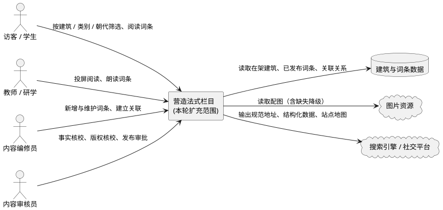
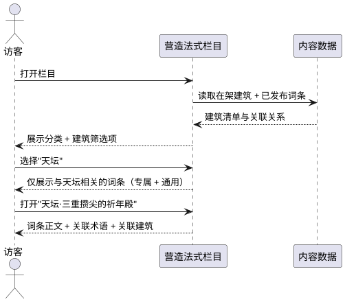
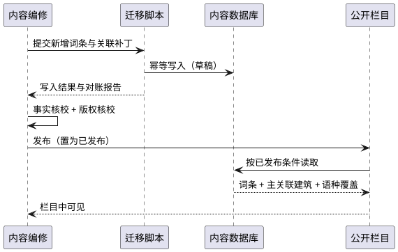
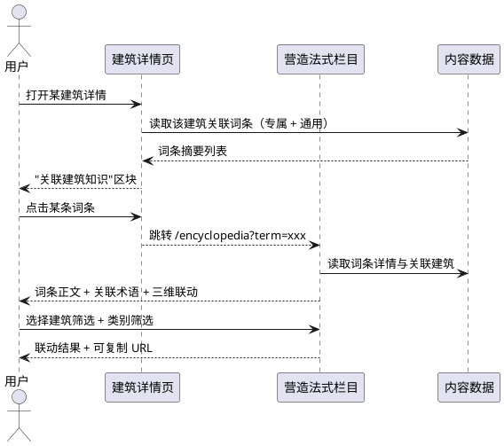
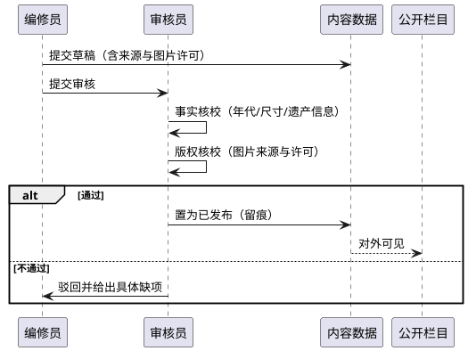

# 华夏古建可视化 · 建筑知识科普内容扩充 需求规格

> 本文件为**需求规格（What / Why）**，回答"这一轮补什么内容、补到什么程度、怎么判定完成"。
> 不含数据库设计、接口参数结构、算法与代码实现；文中出现的文件路径、表名、字段名仅作为**需求落点引用**，用于评估影响面与可追溯性，不构成接口契约。
> 需求编号使用 `R-BK-xx`，验收编号使用 `AC-BK-xx`，与本项目既有的 `REQ-01~31`、`REQ-S3P2-xx`、`AC-01~54`、`AC-S3-xx` **互不覆盖**。
> 下游阶段：实现方案（design）与编码任务（tasks）由后续阶段负责，本文档不越界。

| 项 | 内容 |
|---|---|
| 文档编号 | REQ-PUBLIC-BK-001 |
| 版本 | v1.0 |
| 状态 | 待评审 |
| 主题 | 「营造法式」建筑知识科普栏目内容扩充（补齐故宫以外建筑） |
| 需求来源 | 用户在分支「建筑模型的功能修改」上提出：再分支下修改，我的建筑知识科普中的建筑知识只有故宫的，帮我补齐其他的另外的建筑的相关建筑知识内容，让 栏目变得更丰富点 |
| 上游文档 | `docs/requirements/general-audience-enhancement-spec.md`（REQ-PUBLIC-001） `docs/requirements/s3-p2-requirements.md`（REQ-PUBLIC-S3P2-001） `docs/design/s3-p2-design.md`（DESIGN-PUBLIC-S3P2-001） `docs/tasks/s3-p2-tasks.md`（TASKS-PUBLIC-S3P2-001） |
| 关联代码库 | `D:\Ancient-architecture\ac1.1\acvisual 4`（分支：建筑模型的功能修改，基于 55852d8「AC4建筑修改」） |
| 业务代码改动 | **无**（本文档阶段不修改任何业务代码） |
| 覆盖栏目 | 前端 `/encyclopedia`（营造法式页）与建筑详情面板的关联知识入口 |

---

# 1. 本轮定位与范围

## 1.1 为什么需要这一轮

「营造法式」栏目当前的**内容结构是故宫单体的解释体系**，而非"中国古建筑知识库"。这带来三个具体问题：

1. **词条与建筑的关联是单边的**：26 条词条全部是通用营造术语（屋顶、斗拱、彩画、脊兽、纹饰、台基、门窗、建筑规制等），其中 `related_palaces` 只指向 10 座故宫单体；长城、天坛、莫高窟、布达拉宫、黄鹤楼、福建土楼、应县木塔、佛光寺东大殿、岳阳楼等建筑**没有任何一条以自己的营造特点为主体的知识**。
2. **前端只认识故宫**：百科页存在一份仅含 10 座故宫建筑 id 与名称的硬编码映射（`client/src/pages/EncyclopediaPage.jsx` 的 `PALACE_NAMES` 与 `PALACE_PRIORITY`），非故宫建筑即使被关联，也会显示成 `changcheng` 这样的 id 字符串，或被排序逻辑直接踢到末位。
3. **缺少建筑维度的导航**：栏目只有"按构件类别筛选"与关键词搜索，没有"按建筑看知识"的入口；建筑详情页也没有"这座建筑有哪些建筑知识"的反查区块。用户在这个栏目里**无法以建筑为线索阅读**，这正是"只有故宫的"这一观感的直接来源。

因此本轮的核心不是"再多写几篇文章"，而是**把栏目的组织维度从"只有构件、只有故宫"扩展为"构件 + 建筑"两条主轴**，并让内容规模、关联关系、发布门槛与验收口径都可测量。

## 1.2 现状证据（GAP-BK）

| 编号 | 差距 | 现状证据 | 用户/业务影响 |
|---|---|---|---|
| GAP-BK-01 | 词条全部为通用营造术语，无"建筑专属知识"体例 | `server/db/init_full.sql` 的 `encyclopedia_terms` 种子段（26 条），`category` 取值集中在屋顶/斗拱/彩画/柱础/台基/门窗/脊兽/琉璃/纹饰/建筑规制/建筑装饰 | 栏目读起来像"故宫构件词典"，讲不到其他建筑 |
| GAP-BK-02 | 关联建筑全部是故宫 10 座单体 | 同上段落的 `related_palaces` 字段取值仅出现 `wumen/taihemen/taihedian/zhonghedian/baohedian/qianqingmen/qianqinggong/jiaotaidian/kunninggong/shenwumen`；另有 1 条为空数组 | 其他 10 座建筑在栏目中"不存在" |
| GAP-BK-03 | 建筑名称解析硬编码，仅覆盖故宫 | `EncyclopediaPage.jsx` 的 `PALACE_NAMES`（10 条）与 `PALACE_PRIORITY`（10 条） | 非故宫建筑显示 id；三维联动默认兜底到太和殿 |
| GAP-BK-04 | 无建筑维度筛选，也无朝代/地区维度 | `EncyclopediaPage.jsx` 左侧仅有 `CATEGORIES` 构件分类 + 关键词搜索；`filteredTerms` 只按 `category` 与关键词过滤 | 用户无法"按建筑浏览"，无法验证某座建筑是否已被覆盖 |
| GAP-BK-05 | 建筑详情页无关联知识反查 | `client/src/components/DetailPanel.jsx` 只有"相关建筑"（相邻/同类/同地区），无任何百科词条入口 | 看完 3D 与简介后没有"继续读它的营造做法"的路径 |
| GAP-BK-06 | 百科词条无发布状态 | `encyclopedia_terms` 表无 `status` 字段；仅 `palaces.status` 具备 draft/published 语义（`migration_public_12_content_status.sql`） | 新增内容无法"先草稿后发布"，与既有内容发布门槛不一致 |
| GAP-BK-07 | 百科英文覆盖为 0 | `server/src/services/contentI18n.js` 的覆盖度统计中百科翻译数为 0；`content_translations` 当前仅覆盖少数建筑 | 英文界面下百科全为中文，无法对外说明覆盖度 |
| GAP-BK-08 | 百科无法在编修台维护 | `client/src/pages/CuratorPage.jsx` 无百科相关引用，`server/src/routes/` 无百科写入路由 | 内容只能靠种子/迁移入库，新增成本高、易出错 |
| GAP-BK-09 | 三维联动对无热点/程序化建筑失效 | `client/src/data/buildingHotspots.js` 只覆盖部分建筑；`modelTarget` 兜底为 `taihedian` | 程序化建筑（应县木塔/佛光寺/岳阳楼）点击"前往 3D 查看"会跳到不相关建筑 |

## 1.3 覆盖对象与数量口径（重要）

本规格的覆盖对象定义为：**当前在架（published）建筑中，除 10 座故宫单体之外的全部建筑**。

- 10 座故宫单体（明确排除，维持现状）：`wumen`、`taihemen`、`taihedian`、`zhonghedian`、`baohedian`、`qianqingmen`、`qianqinggong`、`jiaotaidian`、`kunninggong`、`shenwumen`。
- 当前需覆盖的建筑清单（10 座）：`changcheng`（长城）、`gugong`（故宫全景）、`huanghelou`（黄鹤楼）、`mogao`（莫高窟）、`potala`（布达拉宫）、`tiantan`（天坛）、`tulou`（福建土楼）、`yingxian_muta`（应县木塔）、`foguangsi`（佛光寺东大殿）、`yueyanglou`（岳阳楼）。

**口径说明（必须写清楚，避免验收争议）**：

1. 用户在需求描述中称"现有 21 座建筑"，经本轮代码核查，`palaces` 种子与迁移合计为 **20 座**（故宫单体 10 + 其他 10）。该差异登记为开放问题 `Q-BK-01`。
2. 因此**覆盖率的分母、词条总量的下限公式、验收查询一律以数据库实时查询结果为准，禁止在文档、代码与对外文案中硬编码"20"或"21"**。若数据库中确实存在第 21 座非故宫建筑，它自动进入覆盖范围与分母，不得通过改口径使其"消失"。
3. `gugong`（故宫全景）**计入覆盖范围**（它不是单体殿宇，且其词条定位是"宫城整体"，与 10 座单体的解释体系不重复），但**不计入"故宫单体"排除项**。

## 1.4 本轮明确不做（Out of Scope）

| 编号 | 不做项 | 原因 |
|---|---|---|
| OOS-BK-01 | 新增或修改任何 3D 模型、低模、贴图、材质资产 | 内容侧工作量与体积成本不可控；本轮只做**文字+图片**知识 |
| OOS-BK-02 | 新增视频、音频、TTS 语音包生产 | 视频资源当前为空（既有 GAP-S3-03/S3-09），朗读复用既有能力即可 |
| OOS-BK-03 | UGC：用户投稿、用户编辑词条、词条评论/点赞 | 与既有 OOS-S3-06 一致；审核与追责不可控 |
| OOS-BK-04 | 外部爬虫/自动抓取生成词条，或用大模型批量生成后直接发布 | 事实准确性与版权不可控，违反本规格 §5.4 的质量门槛 |
| OOS-BK-05 | 全文机器翻译，或整站多语言架构重构 | 只做"标题+摘要"分级覆盖（§5.5） |
| OOS-BK-06 | 新建独立"百科编修台"页面或新的后台系统 | 沿用种子/迁移入库 + 现有编修能力，避免与 P2-4 设置区改造冲突 |
| OOS-BK-07 | 把百科词条改造成"建筑-词条"独立多对多关系表并大规模重构 | 仅在实现方案证明现有 JSON 关联不足以支撑筛选时才允许演进，且必须幂等可回滚 |
| OOS-BK-08 | 改动既有 URL 形态（`/encyclopedia?term=`）、既有词条 id、既有 26 条词条正文语义 | 沿用 DFX-C4 与 DFX-S3-C1 的兼容约束 |
| OOS-BK-09 | 独立"建筑知识"新页面/新路由 | 内容并入既有 `/encyclopedia`，避免入口碎片化 |
| OOS-BK-10 | 内容学术化（论文级考据、版本校勘、测绘数据发布） | 沿用 REQ-PUBLIC-001 §1.4-4 的边界 |

---

# 2. 领域术语

**通用营造术语（General Craft Term）**
: 描述中国古建筑**共性做法**的词条（如斗拱、庑殿顶、和玺彩画、须弥座），不以某一座建筑为唯一主体，可被多座建筑共同引用。

**建筑专属知识词条（Building-specific Knowledge Entry）**
: 以**某一座特定建筑**为主关联对象、讲解其独有营造做法与看点的词条（如"长城·依山就势的墙体与烽燧"）；其 `term` 或 `synopsis` 必须能明确指向该建筑，脱离该建筑即失去主要意义。

**主关联建筑（Primary Linked Building）**
: 一条词条唯一指定的"第一归属建筑"，用于建筑维度筛选与详情页反查的归属判定；一条词条有且只有一个主关联建筑。

**知识覆盖（Knowledge Coverage）**
: 在架的非故宫建筑中，至少拥有 1 条建筑专属知识词条、且至少被 3 条通用营造术语关联的建筑所占比例。

**知识维度（Knowledge Dimension）**
: 本规格规定的五类建筑知识视角：选址与布局、结构与材料、屋顶与装饰、礼制与功能、保护与遗产。

**发布门槛（Publish Gate）**
: 词条从"创作完成"到"对外可见"之间必须通过的检查集合，至少包含内容状态（草稿/已发布）、事实核校、版权核校三项。

**内容状态（Content Status）**
: 词条的生命周期状态，沿用既有 `palaces.status` 的语义，至少包含"草稿（draft）"与"已发布（published）"两种；草稿不得出现在任何公开入口。

**栏目可发现性（Discoverability）**
: 用户从站点任一主要入口到达"某座建筑的相关建筑知识"所需的最少点击次数。

---

# 3. 角色与边界

## 3.1 核心角色

| 角色 | 职责与特征 | 本轮诉求 |
|---|---|---|
| 首次访客 / 游客 | 从搜索或分享进入，先看内容再决定是否注册 | 打开栏目就能看到故宫以外的建筑知识，不被登录墙阻断（沿用 REQ-01） |
| 学生 / 亲子用户 | 课后自学、家长陪看，多在手机端 | 能按建筑浏览、"这座建筑有什么特别的做法"能一次找到 |
| 教师 / 研学组织者 | 备课、课堂投屏、参观前预习 | 每座建筑都有成体系的知识条目，可投屏朗读（沿用 REQ-28 课堂模式） |
| 内容编修员 | 维护建筑档案与百科词条 | 有明确的体例、字数、来源、图片版权要求，新增不必改代码 |
| 内容审核 / 事实核校员（本轮明确角色） | 核对年代、尺寸、世界遗产信息、图片来源与许可 | 有可执行的检查清单与留痕要求 |
| 项目方 / 运营 | 关注栏目是否"真的变丰富" | 有可量化的数量、覆盖率、可发现性指标 |

## 3.2 外部系统

| 系统 | 交互内容 |
|---|---|
| 内容数据库（`palaces`、`encyclopedia_terms`、`content_translations`） | 建筑档案、词条正文与关联关系、双语内容 |
| 搜索引擎与社交平台 | 抓取 `/encyclopedia?term=` 规范地址与分享卡片（沿用 P2-6） |
| 静态图片资源 | 词条配图与图解（本轮唯一新增的媒体类型） |
| 匿名埋点服务 | 词条曝光、筛选使用、反查点击的匿名聚合（沿用既有白名单机制） |

## 3.3 交互上下文

---

# 4. DFX 增量约束

> 沿用 REQ-PUBLIC-001 §5 全部 DFX 条款与 REQ-PUBLIC-S3P2-001 §3 增量条款；以下为本轮**新增或收紧**的可量化红线。

## 4.1 性能

| 编号 | 约束 | 验收方式 |
|---|---|---|
| DFX-BK-P1 | 百科列表首屏（含全部词条摘要，含筛选维度元数据）加载 ≤ 1.5s（4G），不得整页阻塞在图片上 | 真机 + 网络面板 |
| DFX-BK-P2 | 筛选切换（建筑/类别/朝代任意组合）响应 ≤ 200ms，不得整页刷新 | 手工 + 性能面板 |
| DFX-BK-P3 | 词条详情打开 ≤ 800ms（含关联建筑解析），关联区块不得二次串行请求 | 真机 |
| DFX-BK-P4 | 建筑详情页新增的"关联建筑知识"区块不得增加首屏接口请求数（与既有关联建筑同批复用或懒加载） | 网络面板对比 |
| DFX-BK-P5 | 词条配图单张 ≤ 300KB（WebP/AVIF 优先），列表页不预加载词条详情图 | 资源审计 |

## 4.2 可靠性

| 编号 | 约束 |
|---|---|
| DFX-BK-R1 | 筛选无结果、关联为空、图片缺失均必须收敛为可见空态或降级呈现，不得出现空块、`undefined`、id 字符串裸奔 |
| DFX-BK-R2 | 数据迁移必须幂等：同一脚本重复执行不新增重复词条、不改变既有词条 id 与正文；失败必须整体回滚 |
| DFX-BK-R3 | 新增词条不得因单条内容错误导致栏目整体不可用；单条数据异常按"该词条暂不可用"跳过 |
| DFX-BK-R4 | 任一关联指向不存在或已下架建筑时，必须忽略该关联并保留其余内容，不得整条词条消失 |

## 4.3 安全性

| 编号 | 约束 |
|---|---|
| DFX-BK-S1 | 词条公开接口不得返回草稿内容、内部审核备注、审核人身份 |
| DFX-BK-S2 | 词条正文与配图说明渲染必须转义，禁止注入 HTML/脚本（沿用既有 XSS 基线） |
| DFX-BK-S3 | 图片来源与许可信息若含个人联系方式，不得在公开页展示 |
| DFX-BK-S4 | 百科写入（新增/修改/发布）仅限管理员角色，沿用既有鉴权语义，不得为内容扩充放宽权限 |

## 4.4 无障碍

| 编号 | 约束 |
|---|---|
| DFX-BK-A1 | 新增筛选项必须有关联可读标签与键盘可达；筛选结果数量变化需被辅助技术感知 |
| DFX-BK-A2 | 词条配图必须有替代文本；纯装饰图对辅助技术隐藏 |
| DFX-BK-A3 | 建筑详情页"关联建筑知识"区块须有明确标题层级，可键盘进入并逐条打开 |
| DFX-BK-A4 | 筛选与列表的对比度沿用 DFX-A4（正文 ≥ 4.5:1），不得用低对比灰色承载词条摘要 |

## 4.5 可维护性与兼容性

| 编号 | 约束 |
|---|---|
| DFX-BK-M1 | 新增词条只通过内容数据（种子/迁移）入库即可进入列表、筛选、搜索、站点地图与建筑反查，**无需改前端代码** |
| DFX-BK-M2 | 建筑名称、朝代、地区必须由建筑数据派生，禁止再新增任何"只列部分建筑"的前端硬编码映射 |
| DFX-BK-M3 | 词条体例（分类取值、字数、来源、图片许可）必须可在内容评审中逐条核对，不依赖口头约定 |
| DFX-BK-C1 | 既有 26 条词条的 id、term、category、正文语义与 `/encyclopedia?term=` 深链保持可用 |
| DFX-BK-C2 | 既有搜索"斗拱""屋顶"的命中结果不得因本轮改造减少；分类导航键值保持向后兼容 |

## 4.6 国际化

| 编号 | 约束 |
|---|---|
| DFX-BK-I1 | 新增词条必须至少具备英文标题与英文摘要，未覆盖字段在英文界面回退中文并明确标注，不得空白 |
| DFX-BK-I2 | 英文覆盖度必须在既有覆盖度接口中可见，不得以中文冒充英文 |
| DFX-BK-I3 | 只有同一词条中英文均可用时才输出语言互指声明（沿用 AC-S3-42） |

---

# 5. 核心能力

> 写法沿用项目既有规范：需求正文使用 **EARS 引导词 + shall**，规则级验收统一写作 `[触发场景] → [预期行为]`。
> EARS 引导词对应：**When**（当…时）/ **While**（当…处于…状态时）/ **If**（如果…）/ **Where**（对于…/在…处）。

## 5.1 能力一：补齐范围与最低配置

### 5.1.1 目标与问题

**目标**：让"除了故宫，别的建筑也有自己的建筑知识"成为**可验收的事实**，而不是一次性写几篇稿子。

**要解决的问题**：
1. 没有定义"一座建筑算被覆盖"的判据，导致补了内容也说不清是否补全。
2. 没有最低配置，容易出现"某座建筑只有一句简介"的注水内容。
3. 没有分批交付口径，一次性铺 10 座建筑会拖成不可控的大工程。

### 5.1.2 业务规则

1. **R-BK-01 每座非故宫建筑必须有专属知识词条**
   **When** 内容发布完成时，系统应（shall）保证每一座在架的非故宫建筑至少拥有 1 条以其为主关联建筑的"建筑专属知识"词条。
   a. 验收条件：`[逐座核对在架非故宫建筑]` → `[每座都能在栏目中筛到至少 1 条主关联为本建筑的词条]`。

2. **R-BK-02 每座非故宫建筑必须被通用术语关联**
   **When** 内容发布完成时，系统应（shall）保证每一座在架的非故宫建筑至少被 3 条通用营造术语关联（即从该建筑出发可读到至少 3 条共性做法）。
   a. 验收条件：`[从建筑详情页打开"关联建筑知识"]` → `[至少出现 3 条通用营造术语（如屋顶/斗拱/台基/彩画等），且可逐条打开]`。

3. **R-BK-03 栏目总量下限必须随覆盖对象自动推算**
   **Where** 计算栏目丰富度时，词条总数下限应（shall）满足 `总数 ≥ 26 + 在架非故宫建筑数 × 1`，且不低于 40 条；该下限必须由查询推算，禁止在文案与代码中硬编码固定数字。
   a. 验收条件：`[执行验收查询]` → `[已发布词条总数 ≥ 推算下限，且档位说明中不出现硬编码的"20 条/21 条"等静态数字]`。

4. **R-BK-04 每座建筑的知识维度必须成体系**
   **When** 为某座建筑编写专属词条时，内容应（shall）覆盖"选址与布局 / 结构与材料 / 屋顶与装饰 / 礼制与功能 / 保护与遗产"五个知识维度中至少 2 个，并在词条中显式标注所属维度。
   a. 验收条件：`[抽查任一座非故宫建筑的全部专属词条]` → `[维度标注覆盖 ≥ 2 个不同维度，且每条词条只标注其真实对应的维度]`。

5. **R-BK-05 允许分批交付但覆盖率必须收敛到 100%**
   **While** 处于分批交付期间，系统应（shall）保证已交付的那一批建筑达到 100% 覆盖，且栏目对外展示的覆盖进度必须真实可查；全部批次完成后，在架非故宫建筑覆盖率必须达到 100%。
   a. 验收条件：`[第一批 ≥ 5 座建筑发布后]` → `[这 5 座覆盖率 100%，未交付建筑不出现"空词条占位"]`；`[全部批次完成后]` → `[覆盖率 100%，无遗漏建筑]`。

### 5.1.3 交互流程

### 5.1.4 异常场景

1. **某座建筑确实没有可写的专属知识**
   a. 触发条件：内容侧评估后判定该建筑暂无可考据的独有做法。
   b. 系统行为：仍必须补齐"该建筑在既有构件体系中的定位"类词条（至少说明其屋顶形制、结构体系与礼制功能），保证覆盖判据成立。
   c. 用户感知：栏目中该建筑有内容可读，不出现空分类。

2. **新增建筑进入在架清单**
   a. 触发条件：新增一座已发布建筑。
   b. 系统行为：覆盖率分母自动变化，该建筑在补齐前显示为"知识待补充"，不得静默计入已覆盖。
   c. 用户感知：可看到"该建筑知识正在补充"的明确提示，而非空白。

---

## 5.2 能力二：内容模型与数据迁移

### 5.2.1 目标与问题

**目标**：让"建筑专属知识"与"通用营造术语"在数据层面可区分、可筛选、可反查，同时**不动既有 26 条内容的语义**。

**要解决的问题**：
1. 现有 `category` 全部是构件类目，建筑专属词条无处安放，混进去会污染构件导航。
2. `related_palaces` 是数组，语义上无法表达"谁是主关联"，导致筛选与反查无法判定归属。
3. `encyclopedia_terms` 没有发布状态，与 `palaces.status` 的门槛不一致。
4. 缺少幂等与回滚口径，一次错误的批量回填可能污染线上内容。

### 5.2.2 业务规则

6. **R-BK-06 必须区分两类词条并各自可见**
   **When** 展示分类导航时，系统应（shall）明确区分"通用营造术语"与"建筑专属知识"两类；建筑专属词条必须归入独立的类别（如"建筑实例"/"名筑档案"，命名以开放问题 Q-BK-07 结论为准），禁止混入屋顶/斗拱/彩画等构件类目。
   a. 验收条件：`[查看分类导航]` → `[存在建筑专属类别，且构件类目下不含建筑专属词条]`。

7. **R-BK-07 主关联建筑必须唯一且有效**
   **When** 保存一条词条时，系统应（shall）保证其主关联建筑唯一，且指向一座存在且在架的建筑；通用营造术语可以不设主关联，但一旦设置，同样受唯一性与有效性约束。
   a. 验收条件：`[保存主关联为空数组或多于一个主关联的词条]` → `[保存失败并提示原因]`；`[主关联指向已下架建筑]` → `[该关联被忽略，词条其余内容仍正常展示]`。

8. **R-BK-08 地域、朝代、结构类型必须由建筑派生**
   **Where** 涉及建筑的地域、朝代、结构类型等属性时，词条应（shall）一律由主关联建筑派生，禁止在词条上重复硬编码并产生与建筑档案冲突的第二套事实。
   a. 验收条件：`[修改某建筑的朝代]` → `[其关联词条的朝代筛选结果同步变化，不出现词条侧旧值]`。

9. **R-BK-09 词条必须具备与建筑一致的发布门槛**
   **While** 词条处于草稿状态时，系统应（shall）保证其不出现在列表、分类计数、关键词搜索、建筑反查、站点地图、分享页与首页推荐中；只有已发布词条可被公开访问。
   a. 验收条件：`[新增一条草稿词条]` → `[全站任何公开入口均不可见，站点地图不含该词条]`；`[改为已发布]` → `[列表、搜索、反查、站点地图同步可见]`。

10. **R-BK-10 数据迁移必须幂等**
    **When** 执行内容迁移脚本时，系统应（shall）保证重复执行不产生重复词条、不改变既有 26 条词条的 id/term/category/正文语义，且失败时整体回滚。
    a. 验收条件：`[连续执行同一迁移脚本两次]` → `[词条总数与 id 集合完全一致，正文哈希不变]`；`[脚本中途失败]` → `[数据回到执行前状态]`。

11. **R-BK-11 关联回填必须只追加、可对账、可回滚**
    **When** 为既有通用术语补充非故宫建筑的关联时，系统应（shall）只做"追加关联"，不得删除或替换既有 `related_palaces`、`related_terms` 取值；并必须提供可重复执行的对账口径与回滚说明。
    a. 验收条件：`[比对回填前后的既有 26 条词条]` → `[每条既有关系均为原值 + 追加项，无缺失项]`；`[执行回滚]` → `[关系恢复回填前取值]`。

12. **R-BK-12 既有词条与深链必须保持兼容**
    **While** 本轮改造生效期间，系统应（shall）保持既有 26 条词条的 id、term、category 与 `/encyclopedia?term=<id>` 深链完全可用，不得因新增类目或字段改动导致旧链接失效或旧词条内容被改写。
    a. 验收条件：`[逐一打开 26 条旧词条深链]` → `[全部正常渲染，正文与改造前一致]`。

### 5.2.3 交互流程

### 5.2.4 异常场景

1. **迁移在中途失败**
   a. 触发条件：数据库连接中断或约束冲突。
   b. 系统行为：整体回滚，保留执行日志与失败位置。
   c. 用户感知：栏目内容不变，后台可见"本次迁移未生效"。

2. **同一建筑出现两条重复专属词条**
   a. 触发条件：两次入库使用不同 id 但指向同一建筑同一主题。
   b. 系统行为：允许存在（内容侧可能确有多个主题），但主关联与主题必须不同；若主题完全相同，审核阶段标记为重复并要求合并。
   c. 用户感知：不出现两条标题几乎相同、内容雷同的条目并列展示。

3. **词条主关联指向已移除建筑**
   a. 触发条件：建筑被删除或下架。
   b. 系统行为：词条转为"关联待修复"并退出建筑维度筛选，正文仍可通过直接链接访问（或按内容侧决定下线）。
   c. 用户感知：不出现指向空建筑的死链；栏目不出现空分类。

---

## 5.3 能力三：展示与交互

### 5.3.1 目标与问题

**目标**：让"按建筑看知识"成为与"按构件看知识"并列的一等入口，并让建筑详情页能反查自己的知识条目。

**要解决的问题**：
1. 栏目只有构件筛选，"某座建筑有什么知识"无法回答。
2. 前端硬编码只认 10 座故宫，非故宫建筑名解析失败。
3. 建筑详情页与百科完全割裂。
4. 程序化建筑的三维联动按钮指向错误建筑。

### 5.3.2 业务规则

13. **R-BK-13 栏目必须提供建筑维度筛选**
    **When** 用户打开营造法式栏目时，系统应（shall）提供"按建筑"筛选，选项必须覆盖全部在架非故宫建筑，并与既有"按类别"筛选并列，不得只放在二级菜单里难以发现。
    a. 验收条件：`[打开栏目]` → `[可一次看到建筑筛选项的数量与全部在架建筑名称，无 id 字符串]`。

14. **R-BK-14 必须支持建筑、类别、朝代/地区的组合筛选且可分享**
    **When** 用户选择任意筛选组合时，系统应（shall）实时联动结果，并把筛选条件反映到 URL 上，使链接可复制、可回退、可直接打开并还原同一筛选状态。
    a. 验收条件：`[选择"天坛 + 屋顶"后复制 URL 到新标签打开]` → `[筛选状态与结果完全一致]`。

15. **R-BK-15 筛选空态必须给出可行动出口**
    **If** 组合筛选无结果时，系统应（shall）展示明确空态、提供"清除筛选"与至少一种替代入口（相邻建筑/相邻类别/热门词条），禁止只显示"无结果"。
    a. 验收条件：`[选择"莫高窟 + 脊兽"这类无结果组合]` → `[空态 + 清除筛选 + 至少 2 条替代推荐]`。

16. **R-BK-16 建筑详情页必须能反查关联知识**
    **When** 用户打开任一在架建筑的详情时，系统应（shall）提供"关联建筑知识"区块，至少列出该建筑的专属词条与关联通用术语；点击可直达对应词条。该区块不得依赖用户先进入百科页。
    a. 验收条件：`[打开长城详情]` → `[可见长城专属词条与 ≥3 条通用术语入口，逐条可打开]`；`[打开任一无关联建筑]` → `[区块隐藏或显示"暂无关联知识"，不留空容器]`。

17. **R-BK-17 建筑名称与排序不得硬编码**
    **Where** 任何需要展示建筑名称、建筑顺序或建筑归属的位置，系统应（shall）从建筑数据派生，禁止使用只列部分建筑的硬编码映射；非故宫建筑必须显示真实名称而非 id。
    a. 验收条件：`[在栏目中打开任一非故宫建筑相关词条]` → `[显示"应县木塔""莫高窟"等真实名称，不出现 `yingxian_muta` 之类 id]`。

18. **R-BK-18 无热点或无模型建筑的三维联动必须降级**
    **If** 词条的主关联建筑没有对应 3D 热点或没有可交互模型时，系统应（shall）隐藏"前往 3D 查看该构件"按钮，改为"阅读图文"或"查看该建筑详情"的等价出口，禁止跳到不相关建筑。
    a. 验收条件：`[打开程序化建筑相关词条并点击联动]` → `[进入该建筑自身详情，不跳到太和殿或其他建筑]`。

19. **R-BK-19 列表必须分组可辨且搜索高亮**
    **When** 展示词条列表时，系统应（shall）让建筑专属词条与通用营造术语在视觉上可区分（分组、标签或角标其一），关键词搜索命中项必须高亮。
    a. 验收条件：`[搜索"木塔"]` → `[建筑专属词条与通用术语不混淆，命中词高亮，显示命中数量]`。

### 5.3.3 交互流程

### 5.3.4 异常场景

1. **关联词条接口失败**
   a. 触发条件：网络异常或服务错误。
   b. 系统行为：隐藏该区块并保留建筑详情其余内容，不整页报错。
   c. 用户感知：详情页正常可读，无错误弹窗。

2. **筛选状态来自失效 URL**
   a. 触发条件：URL 中的建筑或类别已被下线。
   b. 系统行为：忽略失效条件并保留有效条件，给出"部分筛选条件已失效"的轻提示。
   c. 用户感知：仍能看到内容，不会被带到空结果页。

3. **建筑名称为空**
   a. 触发条件：建筑档案缺失名称字段（历史数据）。
   b. 系统行为：以"该建筑"占位并记录数据告警，不显示 id。
   c. 用户感知：阅读不中断，不出现技术标识。

---

## 5.4 能力四：内容质量与版权

### 5.4.1 目标与问题

**目标**：让扩充后的内容"敢对外"，不因事实错误或图片侵权带来信任与法律风险。

**要解决的问题**：
1. 新增内容来自多渠道，缺少统一的来源与核校要求。
2. 没有字数与结构下限，容易出现"一句话词条"。
3. 图片是本轮唯一新增媒体，版权风险集中在这里。

### 5.4.2 业务规则

20. **R-BK-20 每条新增词条必须可追溯来源**
    **When** 提交一条新增词条时，系统应（shall）要求记录至少一个权威参考来源（文献、官方机构资料、遗产地公开资料），并保证来源可被内容审核复核；禁止无来源的臆造与"网络流传说法"。
    a. 验收条件：`[抽查任一条新增词条]` → `[可见来源记录；来源缺失的词条不得发布]`。

21. **R-BK-21 新增词条必须达到字数与结构下限**
    **When** 审核一条新增词条时，内容应（shall）满足：摘要 40–120 字、正文 ≥ 300 字、至少 3 个结构小节、具备图解说明；建筑专属词条还必须包含"该建筑的独有做法"与"与通用术语的关系"两项内容。
    a. 验收条件：`[提交不足 300 字或缺小节的词条]` → `[审核不通过并给出具体缺项]`。

22. **R-BK-22 图片必须可授权且缺失时可降级**
    **Where** 词条使用配图时，系统应（shall）只允许自有拍摄、公共领域或明确许可（如 CC 协议）的图片，并记录来源与许可；无授权图片一律不得上线；图片缺失时隐藏轮播并保留图解说明文字，不得出现裂图或空轮播。
    a. 验收条件：`[检查每条新增词条的配图]` → `[均有来源与许可记录]`；`[移除某词条全部图片]` → `[轮播隐藏，正文与图解说明正常]`。

23. **R-BK-23 发布前必须通过事实核校与版权核校**
    **When** 将词条从草稿置为已发布时，系统应（shall）要求"事实核校"与"版权核校"两项检查均已通过并留痕（谁、何时、依据）；任一未通过不得发布。
    a. 验收条件：`[仅完成事实核校即尝试发布]` → `[发布被拒绝并提示缺少版权核校]`。

24. **R-BK-24 关键数据必须与建筑档案一致**
    **Where** 词条出现年代、通高、占地、世界遗产年份等关键数据时，系统应（shall）与对应建筑档案取值口径一致；若权威来源与档案冲突，必须以建筑档案为准并登记待修订，禁止同一站点出现两套互相矛盾的数字。
    a. 验收条件：`[抽查"应县木塔"词条与建筑档案的高度]` → `[数值与单位一致，或在词条中明确标注差异原因]`。

### 5.4.3 交互流程

### 5.4.4 异常场景

1. **来源已失联**
   a. 触发条件：参考来源链接失效但内容已发布。
   b. 系统行为：不自动下线，登记复查任务；复查后无替代来源则转为草稿。
   c. 用户感知：内容短期不变，后台有明确待办。

2. **图片许可存疑**
   a. 触发条件：审核阶段无法确认许可范围。
   b. 系统行为：按"未授权"处理，移除图片并保留文字内容。
   c. 用户感知：词条仍可读，只是不展示该图片。

3. **关键数据冲突**
   a. 触发条件：词条与建筑档案数值不一致。
   b. 系统行为：以建筑档案为准，词条标注"以档案数据为准"，登记修订。
   c. 用户感知：不出现两个不同数字并列且无解释。

---

## 5.5 能力五：多语言与 SEO

### 5.5.1 目标与问题

**目标**：让扩充后的内容能被海外访客与搜索引擎正确理解，同时不把成本推到"全文翻译"。

**要解决的问题**：
1. 百科英文覆盖为 0，英文界面下栏目全是中文。
2. 新增词条若不进入站点地图，搜索引擎无法发现扩充成果。
3. 新增的建筑维度筛选会产生大量重复 URL，存在重复收录风险。

### 5.5.2 业务规则

25. **R-BK-25 新增词条必须至少具备英文标题与摘要**
    **Where** 词条面向公开访问时，系统应（shall）至少提供英文标题与英文摘要（分级覆盖）；英文缺失时在英文界面回退中文并明确标注"English coming soon"或等价提示，不得空白、不得以中文冒充英文。
    a. 验收条件：`[英文界面打开新增词条]` → `[标题与摘要为英文；未覆盖正文有明确提示]`；`[覆盖度接口]` → `[百科英文覆盖数 > 0 且与实际一致]`。

26. **R-BK-26 已发布词条必须可被收录**
    **When** 生成站点地图与分享卡片时，系统应（shall）按既有 P2-6 规则纳入全部已发布词条，规范地址保持 `/encyclopedia?term=<id>`，结构化数据使用文章类（Article）且只含公开字段；草稿词条不得进入站点地图。
    a. 验收条件：`[请求站点地图]` → `[含全部已发布词条，不含草稿]`；`[抓取词条分享页]` → `[JSON-LD 可解析，无评分/评论/个人信息]`。

27. **R-BK-27 筛选结果页不得单独被索引**
    **If** URL 携带建筑/类别/朝代筛选参数时，系统应（shall）声明该地址不被单独索引，规范地址指向栏目的规范地址，避免同一内容产生大量重复入口。
    a. 验收条件：`[检查带筛选参数的页面]` → `[声明不索引，规范地址不含筛选参数]`。

### 5.5.3 异常场景

1. **英文摘要缺失**
   a. 触发条件：新增词条只写了中文。
   b. 系统行为：英文界面回退中文并标注未覆盖；覆盖度接口计为未覆盖。
   c. 用户感知：可读但不误以为已完成英文化。

2. **双语覆盖不一致**
   a. 触发条件：仅有英文标题、无英文摘要。
   b. 系统行为：不输出语言互指声明（沿用 AC-S3-42），避免软 404。
   c. 用户感知：不会被跳到空白英文页。

---

## 5.6 能力六：计量与验收

### 5.6.1 目标与问题

**目标**：让"栏目变得更丰富"成为可测量结论，而不是主观判断。

### 5.6.2 业务规则

28. **R-BK-28 必须可统计内容使用情况**
    **When** 用户使用栏目时，系统应（shall）可匿名统计：词条曝光、词条打开、建筑筛选使用、建筑反查点击；统计不得包含个人身份信息，并复用既有埋点白名单机制。
    a. 验收条件：`[检查埋点事件]` → `[上述四类行为均有对应事件，且属性键在白名单内，无身份字段]`。

29. **R-BK-29 覆盖率必须由可执行查询定义**
    **Where** 判定知识覆盖时，系统应（shall）以"在架非故宫建筑中，拥有 ≥1 条专属词条且被 ≥3 条通用术语关联"的比例为准；该口径必须可通过一条可重复执行的查询复现，禁止人工估算。
    a. 验收条件：`[执行验收查询]` → `[返回覆盖率 100%，且可列出每座建筑的专属词条数与通用术语关联数]`。

30. **R-BK-30 栏目必须满足可发现性要求**
    **When** 用户从站点主要入口（首页、建筑列表、建筑详情、全局搜索）出发时，系统应（shall）保证到达"某座建筑的关联建筑知识"不超过 2 次点击；且栏目本身必须可从主导航或既有入口进入。
    a. 验收条件：`[从首页与从任一座非故宫建筑详情出发]` → `[≤2 次点击到达该建筑的知识条目]`。

31. **R-BK-31 本轮改造不得造成回归**
    **While** 本轮上线后，系统应（shall）保证既有 26 条词条、既有搜索命中、既有 3D 联动、既有分类导航与既有分享深链均未劣化。
    a. 验收条件：`[回归既有 AC-11 搜索、AC-S3-38 站点地图、26 条深链、3D 联动]` → `[全部通过，搜索"斗拱"命中数不减少]`。

---

# 6. 验收点总表

> 编号规则：`AC-BK-xx` 为本轮新增，不覆盖既有 `AC-01~54` 与 `AC-S3-01~44`。
> 验证形式：E2E = 端到端自动化；单测 = 单元/集成；查询 = 可重复执行的数据库查询；人工 = 走查或真机；基线 = 截图/视觉对比。

## 6.1 补齐范围

| 编号 | 对应 | 操作 | 预期结果 | 形式 |
|---|---|---|---|---|
| AC-BK-01 | R-BK-01 | 逐座筛选在架非故宫建筑 | 每座至少 1 条主关联为本建筑的专属词条 | 查询 + E2E |
| AC-BK-02 | R-BK-02 | 打开每座非故宫建筑详情 | 关联通用术语 ≥ 3 条且可逐条打开 | E2E |
| AC-BK-03 | R-BK-03 | 执行总量查询 | 已发布词条总数 ≥ `26 + 在架非故宫建筑数`，且 ≥ 40 | 查询 |
| AC-BK-04 | R-BK-04 | 抽查任一座建筑的专属词条 | 知识维度覆盖 ≥ 2 个且标注正确 | 人工 |
| AC-BK-05 | R-BK-05 | 检查分批交付批次 | 已交付批次覆盖 100%，未交付建筑无占位空词条 | 查询 + E2E |

## 6.2 内容模型与迁移

| 编号 | 对应 | 操作 | 预期结果 | 形式 |
|---|---|---|---|---|
| AC-BK-06 | R-BK-06 | 查看分类导航 | 存在建筑专属类别；构件类目不含建筑专属词条 | E2E |
| AC-BK-07 | R-BK-07 | 保存无主关联/多主关联/指向已下架建筑的词条 | 分别被拒绝或该关联被忽略，其余内容正常 | 单测 |
| AC-BK-08 | R-BK-08 | 修改某建筑朝代后重新筛选 | 关联词条朝代随建筑变化，无第二套事实 | 单测 + E2E |
| AC-BK-09 | R-BK-09 | 新增草稿词条 | 列表/搜索/反查/站点地图/分享页均不可见 | 单测 + 查询 |
| AC-BK-10 | R-BK-10 | 连续执行迁移两次；模拟中途失败 | 结果完全一致；失败时整体回滚 | 查询 |
| AC-BK-11 | R-BK-11 | 对账回填前后既有 26 条词条 | 关系只增不减；回滚后恢复原值 | 查询 |
| AC-BK-12 | R-BK-12 | 逐一打开 26 条旧词条深链 | 全部正常，正文与改造前一致 | E2E |

## 6.3 展示与交互

| 编号 | 对应 | 操作 | 预期结果 | 形式 |
|---|---|---|---|---|
| AC-BK-13 | R-BK-13 | 打开栏目 | 建筑筛选项覆盖全部在架非故宫建筑，名称正确 | E2E |
| AC-BK-14 | R-BK-14 | 组合筛选后复制 URL 新标签打开 | 筛选状态与结果一致，可回退 | E2E |
| AC-BK-15 | R-BK-15 | 构造无结果组合 | 空态 + 清除筛选 + ≥2 条替代推荐 | E2E |
| AC-BK-16 | R-BK-16 | 打开有/无关联的建筑详情 | 有关联时列出并可打开；无关联时隐藏或显示明确空态，不留空块 | E2E |
| AC-BK-17 | R-BK-17 | 检查非故宫建筑名称展示 | 显示真实名称，不出现 id 字符串 | E2E + 代码审查 |
| AC-BK-18 | R-BK-18 | 打开程序化建筑相关词条并点击联动 | 进入该建筑自身详情，不跳太和殿 | E2E |
| AC-BK-19 | R-BK-19 | 搜索"木塔" | 两类词条可区分、命中高亮、显示数量 | E2E |

## 6.4 内容质量与版权

| 编号 | 对应 | 操作 | 预期结果 | 形式 |
|---|---|---|---|---|
| AC-BK-20 | R-BK-20 | 抽查新增词条来源记录 | 均有权威来源；无来源者不可发布 | 人工 |
| AC-BK-21 | R-BK-21 | 提交字数/小节不足的词条 | 审核不通过并列出缺项 | 单测 + 人工 |
| AC-BK-22 | R-BK-22 | 检查配图许可；移除全部图片后打开 | 均有来源与许可；无图时轮播隐藏、文字正常 | 人工 + E2E |
| AC-BK-23 | R-BK-23 | 只做事实核校即尝试发布 | 拒绝发布并提示缺少版权核校 | 单测 + 人工 |
| AC-BK-24 | R-BK-24 | 抽查词条与建筑档案关键数据 | 数值与单位一致，或差异有明确说明 | 人工 |

## 6.5 多语言与 SEO

| 编号 | 对应 | 操作 | 预期结果 | 形式 |
|---|---|---|---|---|
| AC-BK-25 | R-BK-25 | 英文界面打开新增词条；查覆盖度接口 | 标题与摘要为英文，未覆盖处有标注；覆盖数 > 0 | E2E + 查询 |
| AC-BK-26 | R-BK-26 | 请求站点地图；抓取词条分享页 | 含全部已发布词条、不含草稿；JSON-LD 合法且仅公开字段 | 自检 + 单测 |
| AC-BK-27 | R-BK-27 | 打开带筛选参数的页面 | 声明不索引，规范地址不含筛选参数 | 自检 |

## 6.6 计量与验收

| 编号 | 对应 | 操作 | 预期结果 | 形式 |
|---|---|---|---|---|
| AC-BK-28 | R-BK-28 | 检查埋点事件与属性 | 四类行为均有事件，属性在白名单内，无身份字段 | 单测 + 代码审查 |
| AC-BK-29 | R-BK-29 | 执行覆盖率验收查询 | 覆盖率 100%，可列出每座建筑明细 | 查询 |
| AC-BK-30 | R-BK-30 | 从首页与建筑详情出发 | ≤2 次点击到达该建筑的知识条目 | 人工 + E2E |
| AC-BK-31 | R-BK-31 | 回归既有搜索、站点地图、深链、3D 联动 | 全部通过，搜索命中数不减少 | 回归 + 自检 |

**覆盖结论**：31 条需求对应 31 条验收点，覆盖补齐范围、内容模型、展示交互、质量版权、多语言 SEO、计量验收六个能力域；其中 5 条（AC-BK-20~24）为人工评审项，须在上线前完成书面签核。

---

# 7. 风险与依赖

## 7.1 风险

| 编号 | 风险 | 影响 | 概率 | 缓解 |
|---|---|---|---|---|
| R-BK-01 | 权威资料获取成本高，内容进度延误 | 高 | 高 | 先做可考据度高的 5 座（天坛、应县木塔、佛光寺、长城、福建土楼），分批交付 |
| R-BK-02 | 事实错误（年代/尺寸）导致公信力受损 | 高 | 中 | 强制来源记录 + 事实核校留痕；与建筑档案口径对齐 |
| R-BK-03 | 图片版权不明导致侵权 | 高 | 中 | 只允许自有/公共领域/明确许可；无授权即无图；建立许可台账 |
| R-BK-04 | 审核人力不足导致发布积压 | 中 | 高 | 分批交付 + 明确 SLA；人力不足时降为"少而精"，不为凑数降低质量门槛 |
| R-BK-05 | 建筑数量口径（20 vs 21）引发验收争议 | 中 | 高 | 分母由查询定义（§1.3），文档与代码不硬编码数字；差异登记 Q-BK-01 |
| R-BK-06 | 迁移脚本污染既有内容 | 高 | 中 | 幂等 + 整体回滚 + 对账查询 + 先在测试库（`ac4_test`）验证 |
| R-BK-07 | 清理前端硬编码引发既有页面回归 | 中 | 中 | 保留 `?term=` 深链；回归 AC-BK-31；范围只限建筑名称与排序解析 |
| R-BK-08 | 筛选页产生大量重复 URL 影响收录 | 中 | 中 | 筛选页不单独索引 + 规范地址（R-BK-27） |
| R-BK-09 | 新增类目与既有分类导航冲突 | 中 | 中 | 新类目只在既有导航追加，不改既有键值（DFX-BK-C2） |
| R-BK-10 | 双语覆盖不足导致英文体验割裂 | 低 | 高 | 只要求标题+摘要，并明确标注未覆盖（R-BK-25） |

## 7.2 依赖

| 依赖 | 内容 | 阻塞级别 |
|---|---|---|
| 内容资料与考据 | 权威文献、遗产地官方资料、建筑年代与尺寸依据 | 硬依赖（无资料即无法发布） |
| 图片资源与许可 | 可授权配图及其许可记录 | 硬依赖（无授权即无图） |
| 内容审核人力 | 事实核校 + 版权核校的执行人 | 硬依赖（未核校不得发布） |
| 既有发布门槛 | `palaces.status` 的 draft/published 语义（`migration_public_12_content_status.sql`） | 复用，不得另立一套 |
| 既有 i18n 覆盖度 | `content_translations` 与 `/api/content/coverage` | 复用，只增不改 |
| 既有 SEO 能力 | 站点地图服务、分享卡片、robots 规则（P2-6） | 复用，需扩展数据源与 noindex 规则 |
| 既有建筑数据 | `palaces` 的 `region`、`dynasty`、`style`、`tags`、`status` | 复用，作为派生来源 |
| 既有搜索与埋点 | `/api/search`、`client/src/lib/analytics.js` 白名单 | 复用，需扩展事件名与索引字段 |

---

# 8. 开放问题（需产品 / 内容 / 合规确认）

| 编号 | 问题 | 影响 | 建议默认 |
|---|---|---|---|
| Q-BK-01 | 在架建筑究竟是 20 座还是 21 座？是否包含 `gugong`（故宫全景）？ | 覆盖率分母、总量下限、验收口径 | 以查询结果为准；`gugong` 计入覆盖范围（§1.3） |
| Q-BK-02 | 每座建筑专属词条是 1 条还是 2 条？ | 工作量与丰富度 | MVP 每座 ≥1 条，第二批补至 ≥2 条 |
| Q-BK-03 | 词条发布状态是新增独立状态字段，还是并入统一内容状态机制？ | 数据迁移范围与后续维护成本 | 优先并入统一内容状态语义，避免两套门槛 |
| Q-BK-04 | 英文覆盖是"仅标题+摘要"还是"全文"？ | 翻译成本 | 本轮仅标题+摘要，全文列入后续 |
| Q-BK-05 | 配图来源以自有拍摄、官方开放资源、CC 许可中的哪一类为主？ | 版权风险与可获取量 | 公共领域与官方开放资源优先；商业图库不采用 |
| Q-BK-06 | 百科词条是否纳入编修台管理？ | 后续维护成本 | 本轮沿用种子/迁移；编修台列入下一轮 |
| Q-BK-07 | 建筑专属类目的名称取"建筑实例"还是"名筑档案"？ | 导航文案与用户理解 | "名筑档案"，与栏目"营造法式"的书面语风格一致 |
| Q-BK-08 | 封面/默认配图缺失时使用统一品牌图，还是按建筑海报替代？ | 降级呈现一致性 | 优先建筑自身海报，缺失时统一品牌图 |
| Q-BK-09 | 某建筑被下架时，其专属词条应下线还是转为通用表述？ | 内容资产处置 | 转为"关联待修复"并退出筛选，保留可访问链接 |

---

# 9. 数据约束（逻辑层面）

> 仅描述业务含义与取值约束；不涉及表结构、字段类型、索引设计。

## 9.1 词条（Knowledge Entry）

1. **标识**：每条词条必须有全局唯一且稳定的标识，一经发布不得变更（保证深链与分享长期有效）。
2. **类别**：必须属于"通用营造术语"或"建筑专属知识"之一；建筑专属知识必须使用独立类别取值。
3. **主关联建筑**：建筑专属词条必须有且只有 1 个主关联建筑，且该建筑必须存在且在架；通用术语可无主关联。
4. **关联建筑集合**：可包含多个关联建筑，主关联必须是其中之一；集合中不得出现不存在的建筑标识。
5. **关联术语集合**：可包含多个其他词条标识，不得包含自身，不得包含不存在的词条标识。
6. **知识维度**：建筑专属词条必须标注至少 1 个知识维度，取值限于本规格定义的五个维度。
7. **内容状态**：取值为"草稿"或"已发布"两种；草稿不得对外可见。
8. **来源**：新增词条必须至少 1 个来源记录，包含来源名称与可核验依据。
9. **正文结构**：摘要 40–120 字；正文 ≥ 300 字；≥ 3 个结构小节；建筑专属词条必须含"独有做法"与"与通用术语关系"两部分。
10. **配图许可**：每张配图必须记录来源与许可类型；无许可记录的图片不得随词条发布。
11. **双语覆盖**：英文标题与英文摘要为必需项（可后补，但未补时状态为"未覆盖"）；正文英文为可选项。
12. **排序与等级**：排序权重必须稳定可复现；等级取值只用于"等级类"术语（如屋顶等级、斗拱踩数），建筑专属词条不得滥用等级标识。

## 9.2 建筑与词条关联

1. **唯一性**：同一建筑可拥有多条专属词条，但同一"建筑 + 主题"不得重复。
2. **有效性**：所有关联必须指向存在且在架的建筑与已发布词条；失效关联必须被忽略而非报错。
3. **派生一致**：建筑的地域、朝代、结构类型以建筑档案为唯一事实来源，词条不得独立维护同名属性。
4. **可反查**：任一在架建筑必须能反查到自己被关联的全部已发布词条，且反查结果不得依赖前端硬编码。

## 9.3 迁移与回滚

1. **幂等**：同一迁移重复执行，词条总数、标识集合与正文内容必须完全一致。
2. **可回滚**：每个迁移必须配套回滚说明或回滚脚本，回滚后数据恢复至执行前状态。
3. **只增不改**：对既有 26 条词条只允许追加关联与补充双语字段，不得删改既有正文、类别与标识。
4. **对账**：迁移前后必须可对账（词条数、关联数、失效关联数），失败项可定位。

---

# 10. 变更记录

| 版本 | 日期 | 变更 | 作者 |
|---|---|---|---|
| v1.0 | 2026-11-23 | 依据 REQ-PUBLIC-001、REQ-PUBLIC-S3P2-001 与当前代码基线核查（`encyclopedia_terms` 26 条、`palaces` 在架 20 座、前端 `PALACE_NAMES` 硬编码 10 座），生成建筑知识科普内容扩充需求规格：6 个能力域、31 条需求、31 条验收点、9 项开放问题 | 需求规格阶段（spec-requirement） |

---

**文档结束。**

> 后续说明：本文档仅覆盖需求规格，不包含实现方案、数据表结构与接口契约。
> 实现方案（字段演进、迁移脚本、筛选查询策略）由实现方案阶段负责；编码任务拆解由任务规划阶段负责。
> 本文档不授权任何内容自动生成或抓取行为；所有新增词条须经来源核校、版权核校后方可发布。