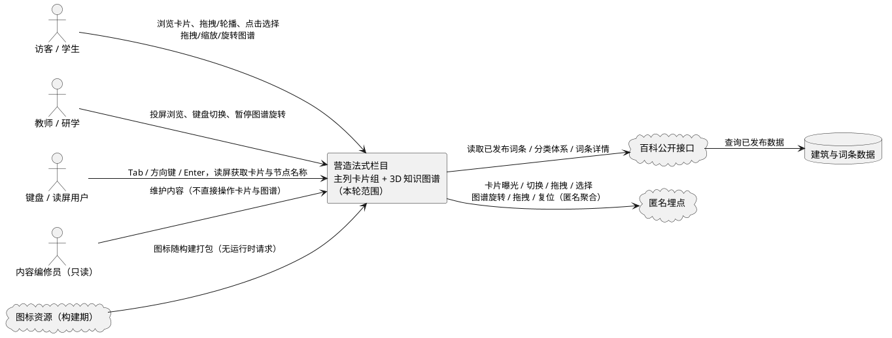
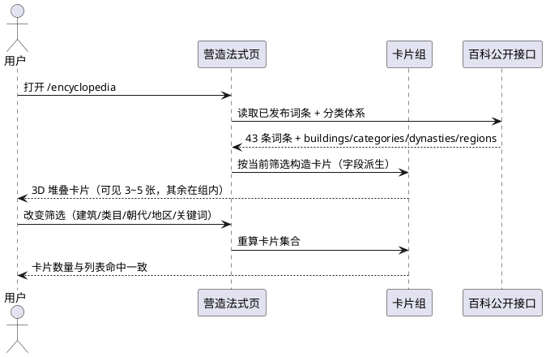
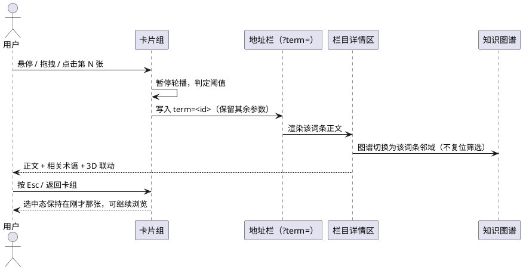
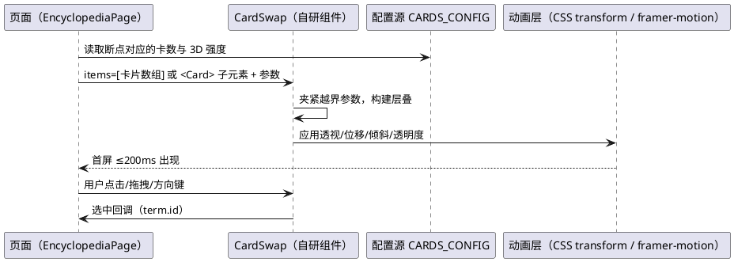
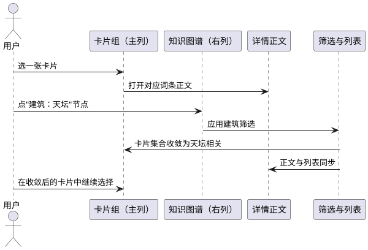
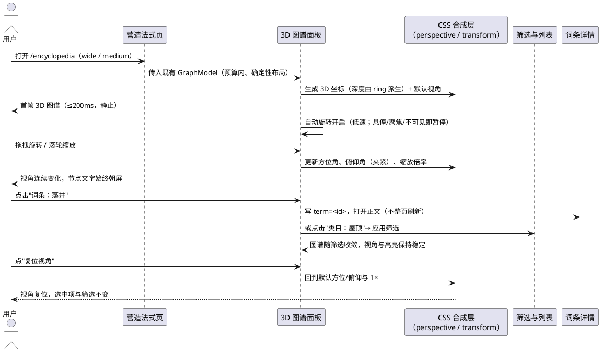

# 华夏古建可视化 · 「营造法式」3D 悬浮卡片选择与知识图谱 3D 立体旋转 需求规格

> 本文件为**需求规格（What / Why）**，回答"这一轮把百科的浏览入口改成什么样、卡片代表什么、怎么点进详情、知识图谱如何 3D 立体旋转、代价与边界在哪、怎么判定完成"。
> 不含数据库设计、接口参数结构、算法与代码实现；文中出现的文件路径、样式类名、接口名、参数名仅作为**需求落点引用**，用于评估影响面与可追溯性，不构成接口契约。
> 需求编号使用 `R-CARD-xx`，验收编号使用 `AC-CARD-xx`，与既有 `REQ-01~31`、`REQ-S3P2-xx`、`R-BK-01~31`、`R-BG-01~39`、`AC-01~54`、`AC-S3-xx`、`AC-BK-xx`、`AC-BG-xx` **互不覆盖**。
> 下游阶段：实现方案（design）与编码任务（tasks）由后续阶段负责，本文档不越界；本文档阶段**不修改任何业务代码**。

| 项 | 内容 |
|---|---|
| 文档编号 | REQ-PUBLIC-CARD-001 |
| 版本 | v1.1（在 v1.0 上增补"知识图谱 3D 立体旋转"，既有 R-CARD-01~44 与 AC-CARD-01~44 全部保留、不改义） |
| 状态 | 待评审（Q-CARD-01~06 与新增 Q-CARD-09~11 未确认前不进入编码；Q-CARD-07~08、Q-CARD-12~14 为补充记录项，按默认口径执行即可） |
| 主题 | 「营造法式」百科浏览入口改为 3D 悬浮卡片组选择，点击卡片进入信息展示；**右侧知识图谱升级为 3D 立体旋转**；配套依赖/图标升级与既有图谱、筛选、无障碍的兼容治理 |
| 需求来源 | 用户在分支「建筑模型的功能修改」上分两轮提出（原文逐字保留，见 §0.1 与 §0.2） |
| 上游文档（必须已读） | `docs/requirements/encyclopedia-knowledge-graph-spec.md`（REQ-PUBLIC-BG-001） `docs/design/encyclopedia-knowledge-graph-design.md`（DESIGN-PUBLIC-BG-001） `docs/tasks/encyclopedia-knowledge-graph-tasks.md`（TASKS-PUBLIC-BG-001） `docs/requirements/building-knowledge-enrichment-spec.md`（REQ-PUBLIC-BK-001） `docs/design/building-knowledge-enrichment-design.md`（DESIGN-PUBLIC-BK-001） `docs/tasks/building-knowledge-enrichment-tasks.md`（TASKS-PUBLIC-BK-001） |
| 关联代码库 | `D:\Ancient-architecture\ac1.1\acvisual 4`（分支：建筑模型的功能修改；React 19 + Vite + Three.js；Express + MySQL） |
| 业务代码改动 | **无**（v1.1 仅更新本需求文档，不修改任何业务代码） |
| 覆盖栏目 | 前端 `/encyclopedia`（营造法式页）：主列浏览入口（引导态卡片区）、卡片选择与详情进入、**右侧知识图谱的 3D 立体旋转**、与左栏筛选和知识图谱的关系 |
| 关联既有约束 | DFX-BG-P1~P6、DFX-BG-R1~R4、DFX-BG-S1~S3、DFX-BG-A1~A4、DFX-BG-M1~M3、DFX-BG-C1~C3；DFX-BK-A1~A4、DFX-BK-C1~C2；RED-BG-01~12；本轮新增 DFX-CARD-P7~P9、R6~R9、S5~S6、A6~A8、M5~M6、C4~C5 |

---

# 0. 用户原始请求（逐字保留，未改写）

## 0.1 v1.0 原始请求：3D 悬浮卡片与依赖升级

~~~text
我想将我的建筑知识科普中科普的内容的整体UI样式进行修改，我想让每个建筑知识的展现形式是3D悬浮的卡片形式，用立体展示进行选择，然后再点击卡片，进入到卡片的信息展示页面，其中的
npm install @hugeicons/react @hugeicons/core-free-icons进行组件升级和适配
import CardSwap, { Card } from './CardSwap'

const items = [
  { title: 'Golden hour', image: '/photos/sky.jpg' },
  { title: 'Canola field', image: '/photos/field.jpg' },
  { title: 'The pier', image: '/photos/pier.jpg' },
  { title: 'Pink drift', image: '/photos/clouds.jpg' }
];

  <CardSwap items={items} delay={4000}
  cardDistance={60}
  verticalDistance={70}
  depth={90}
  skewAmount={6}
  visibleCards={4}
  cardRadius={18}
  delay={4000}
  speed={1}
  bounce={0.35}
  parallax={0.5}
  hoverSpread={0.12}
  dim={0.5}
  autoplay
  pauseOnHover
  draggable
/>

  <CardSwap width={420} height={300}>
    <Card>Your content</Card>
    <Card>Your content</Card>
    <Card>Your content</Card>
  </CardSwap>

~~~

> 说明：原文中的 `delay={4000}` 在同一处声明了**两次**；`width` / `height` / `image` / `title` 在两种用法中含义不同。这些都需要在需求层先定义口径（见 §5.3），否则实现阶段会出现"参数听谁的"的争议。

## 0.2 v1.1 追加请求：知识图谱 3D 立体旋转

~~~text
知识图谱改成3d立体旋转的效果
~~~

> 说明：本次请求**不推翻** v1.0 的卡片、依赖与图标条款；v1.1 只在其上补充"右侧知识图谱从 2D 环形 SVG 升级为 3D 立体旋转"。原文既未指定技术栈，也未说明"3D"是 WebGL 还是 CSS 透视，因此技术边界必须先由需求层定义（见 R-CARD-46 与 Q-CARD-09）。

## 0.3 v1.1 变更记录（相对 v1.0）

| 项 | v1.0 | v1.1 |
|---|---|---|
| 覆盖范围 | 主列 3D 卡片组、选择与详情进入 | 追加右侧知识图谱 3D 立体旋转（卡片条款不变） |
| 需求条数 | R-CARD-01~44（44 条） | 追加 R-CARD-45~65（21 条），共 65 条 |
| 验收条数 | AC-CARD-01~44（44 条） | 追加 AC-CARD-45~65（21 条），共 65 条 |
| DFX 条款 | P1~P6、R1~R5、S1~S4、A1~A5、M1~M4、C1~C3 | 追加 P7~P9、R6~R9、S5~S6、A6~A8、M5~M6、C4~C5 |
| 待确认项 | Q-CARD-01~08 | 追加 Q-CARD-09~14（其中 09~11 为必须确认项） |
| 术语 | 卡片类 10 条 | 追加 3D 图谱类 8 条 |
| 不做项 | OOS-CARD-01~12 | 追加 OOS-CARD-13~18（WebGL 图谱、全站 3D、动画库、后端/DB 等） |
| 既有约束关系 | 未涉及 | 明确 OOS-BG-02 / R-BG-10 的"禁 WebGL"不含 CSS 3D 透视（见 R-CARD-47） |

---

# 1. 本轮定位与范围

## 1.1 为什么需要这一轮

「营造法式」栏目在内容与关系两侧都已补齐（43 条已发布词条 = 10 条建筑专属 + 33 条通用术语；20 座建筑；知识覆盖 100%；知识图谱与三栏布局已落地），但**浏览入口仍是"列表 + 平面导引卡"**：

1. **入口不像"可探索的知识"**：左栏是一列文字，主列是 4 张平面导引卡（`EncyclopediaGuide`）。用户看到的仍是"目录"，而不是"一摞可以翻的建筑知识卡片"。
2. **"立体展示进行选择"完全缺失**：页面内唯一的 3D 能力集中在展厅（`three` / `@react-three/fiber`），百科页没有任何深度、层叠、视差的表达，用户明确提出的"3D 悬浮卡片"诉求未实现。
3. **缺少"卡片 → 信息展示页"的明确动线**：当前从列表点词条进入正文是"隐式切换"，没有"先选卡、再展开"的两段式节奏，也没有卡片级的选中态与可分享状态。
4. **用户同时提出了组件与依赖升级**（`@hugeicons/react`、`@hugeicons/core-free-icons`），但项目当前图标体系是 Font Awesome 类名（`fas fa-*`），仓库内**没有任何 hugeicons 依赖，也没有 `CardSwap` 组件**——这两件事都必须先在需求层决定"做不做、做到哪、代价多少"。
5. **右侧知识图谱仍是 2D 平面图**：`computeLayout` 只产出 `x / y / ring / angle / radius`，渲染为单个 `<svg viewBox>`，没有任何 z 轴、透视或旋转；用户 v1.1 提出的"3D 立体旋转"在现有实现中没有对应能力。
6. **两处 3D 的并存规则尚未定义**：v1.0 只写了"卡片=选择、图谱=关系"，没有写两者同时展示/切换的形态与手势边界；若不定义，3D 卡片与 3D 图谱会争夺同一块主列、同一组合成层与同一个横向拖拽手势。

因此本轮的核心不是"再改一次配色"，而是：**在不改动 43 条词条正文语义、不推翻既有三栏与知识图谱语义、不新增后端与数据库的前提下，把主列浏览入口替换为 3D 悬浮卡片组，并把右侧图谱升级为 3D 立体旋转，同时定义清楚两条 3D 路径的技术边界、降级、性能与无障碍等价路径。**

## 1.2 现状事实与差距（GAP-CARD）

| 编号 | 差距 | 现状证据（已核对仓库） | 用户/业务影响 |
|---|---|---|---|
| GAP-CARD-01 | 无 `CardSwap` 组件 | 全仓库检索 `CardSwap` 命中 0 处；`client/src/components/` 下无卡片轮播/堆叠组件 | 用户示例中的 `import CardSwap, { Card } from './CardSwap'` 无对应实现，必须先决定自研/引入 |
| GAP-CARD-02 | 引导态是平面导引卡 | `client/src/components/EncyclopediaGuide.jsx` 由 `EncyclopediaPage.jsx:876-892` 渲染 4 张分类导引卡，无堆叠、无深度、无视差 | "立体展示进行选择"无落点 |
| GAP-CARD-03 | 3D 能力未用于百科 | `client/package.json` 已有 `three ^0.185.1`、`@react-three/fiber ^9.6.1`，但仅服务于展厅/模型查看器（`ModelViewer.jsx`） | 用户看到"站内有 3D"，但百科页仍是平面，观感割裂 |
| GAP-CARD-04 | 示例 API 与项目无对应物 | 用户给出 15 个参数 + 两种用法（`items` 数组 / `<Card>` 子元素）；仓库无同名组件、无同名参数；示例中 `delay` 重复声明 | 组件契约与默认值缺失，容易做成"参数写了但没效果" |
| GAP-CARD-05 | 图标体系为 Font Awesome | 页面内大量 `className="fas fa-*"`（如 `fa-book`、`fa-filter`、`fa-cube`）；`package.json` 无 `@hugeicons/*` | 用户要求"组件升级和适配"，但替换范围与包体代价未定义 |
| GAP-CARD-06 | 视觉契约与"立体悬浮"直觉冲突 | `client/src/styles/encyclopedia.css:1-5` 文件头明确"禁用渐变、玻璃拟态与大圆角，层级靠留白与 1px 细线建立"；既有 `--enc-surface:#fdfbf6`、`--enc-line`、`--radius-lg` | 若直接套用通用 3D 卡片模板（大阴影 + 玻璃 + 渐变），必然破坏全站纸质阅读感 |
| GAP-CARD-07 | 卡片粒度、落点、与图谱关系未定义 | 现有布局为左栏筛选 + 主列（导引/正文）+ 右侧图谱（`GRAPH_CONFIG.BREAKPOINTS` 六态）；卡片可替换左栏、主列或插条，三种做法验收完全不同 | 范围不清会导致"做了卡片却把图谱/筛选/深链打坏" |
| GAP-CARD-08 | 卡组尚无无障碍与降效基线 | 既有列表 `AnimatedList.jsx` 已使用 `useReducedMotion`；`encyclopedia.css` 含 3 处 `@media (prefers-reduced-motion: reduce)`；卡组为 0 | 3D + 自动轮播若无降级，会同时踩无障碍与性能两条红线 |
| GAP-CARD-09 | 图谱仍是平面 2D 环形 | `client/src/lib/encyclopediaGraph.js` 的 `computeLayout` 只输出 `x/y/ring/angle/radius`；`EncyclopediaKnowledgeGraph.jsx` 用单个 `<svg viewBox>` 渲染，无 z 轴、无透视、无旋转 | v1.1 的"3D 立体旋转"无落点，观感与诉求不符 |
| GAP-CARD-10 | 既有需求禁 WebGL 图谱，但未界定 CSS 3D | `OOS-BG-02`（不做 3D/WebGL 图谱）、`R-BG-10`（禁 WebGL 渲染图谱）与本次诉求表面冲突；项目已有 CSS 3D 先例（`overview.css` 的 `perspective` / `preserve-3d`） | 不澄清会被误判为"需求自相矛盾"，评审无法签字 |
| GAP-CARD-11 | 图谱无旋转状态与旋转交互 | 组件仅有 `viewBox`（缩放/平移）、`collapsed`、`listView`；无方位角/俯仰角、无自动旋转、无暂停、无复位视角 | 自动旋转、拖拽旋转、复位三项能力全部缺失 |
| GAP-CARD-12 | 图谱埋点无旋转类事件 | `analytics.js` 的 `EVENT_NAMES` 只有 `graph_view` / `graph_node_click` / `graph_expand` / `graph_fallback` | 无法度量旋转使用率、拖拽使用率与降级率 |
| GAP-CARD-13 | 3D 卡片与 3D 图谱并存规则缺失 | v1.0 R-CARD-22/23 只定义"卡片=选择、图谱=关系"与"卡片在主列"，未定义同时展示/切换/上下分区与手势边界 | 两处 3D 可能互相遮挡、争夺横向拖拽与合成层预算 |

## 1.3 覆盖对象与数量口径

| 项 | 口径 | 说明 |
|---|---|---|
| 卡片主体 | 已发布词条（默认 43 条量级） | 具体粒度见 Q-CARD-01；本轮**默认按词条**，不按建筑聚合 |
| 建筑专属卡片 | `entry_type === 'building'`（当前 10 条） | 必须与通用术语卡片在视觉与读屏名称上可区分 |
| 可见卡片数 | 由断点派生，桌面 3~5 张，**上限 5** | 禁止把"总数 43"当成"同时渲染 43 张 3D 卡" |
| 卡片字段 | 标题 / 摘要 / 类目 / 建筑角标 / 3D 角标 / 朝代或地区（派生）/ 缩略图（可选）/ 序号 | 全部来自既有公开接口，字段约束见 §7 |
| 数据源 | `GET /api/encyclopedia`、`/api/encyclopedia/taxonomy`、`/api/encyclopedia/:id` | 复用，**不新增接口** |
| 数量表述 | 卡片数、总数一律由实时数据插值 | 沿用 DFX-BG-M2/RED-BG-12：文档、代码、文案、断言均不得把 43/20 写成固定事实 |
| 图谱 3D 形态 | 由断点派生：wide/medium 完整 3D；compact 静态 2.5D 或 2D；≤1024 回退 2D；≤480 列表 | 取值为默认口径，最终以 Q-CARD-13 确认结果为准；不得在任一断点出现空白画布 |
| 图谱旋转状态 | 仅存当前会话的 React 状态（方位角、俯仰角、缩放、开关） | 不写 URL、不写 localStorage/sessionStorage（沿用 RED-BG-11）；刷新回默认视角 |

## 1.4 本轮明确不做（Out of Scope）

| 编号 | 不做项 | 原因 |
|---|---|---|
| OOS-CARD-01 | 改写、重写、润色既有 43 条词条的 `term` / `synopsis` / `content` 正文语义 | 沿用 OOS-BG-01；本轮只做呈现层 |
| OOS-CARD-02 | 用 WebGL / Three.js / Canvas 渲染卡片本体，或为卡片新建渲染上下文 | 与 R-BG-10 的轻量原则一致；卡片只需要 CSS 3D |
| OOS-CARD-03 | 引入第三方卡片轮播/3D 动画库（swiper、embla、gsap、react-spring 等） | 体积与维护成本不可控；`framer-motion` 已在依赖内 |
| OOS-CARD-04 | UGC：用户投稿卡片、自定义卡片顺序、收藏夹 | 沿用 OOS-S3-06 / OOS-BK-03 |
| OOS-CARD-05 | 新增后端接口、图谱聚合接口或卡片专属接口 | 现有列表 + taxonomy 已足够；见 ADR 类约束 R-CARD-03 |
| OOS-CARD-06 | 修改数据库结构、新增表字段、批量回填 | 本轮零数据改动 |
| OOS-CARD-07 | 新增 `/encyclopedia/card`、`/encyclopedia/:id/card` 等路由；新增独立"卡片页" | 沿用 OOS-BG-05 / R-BG-17；卡片必须内嵌既有栏目 |
| OOS-CARD-08 | 全站替换图标体系（把 Font Awesome 全部换成 hugeicons） | 回归面过大；见 R-CARD-19 与 Q-CARD-04 |
| OOS-CARD-09 | 全站背景/浮层式卡片、跨页面常驻 3D 卡组 | 遮挡正文，性能与无障碍代价高 |
| OOS-CARD-10 | 引入重型图库或授权配图批量采购、爬取第三方图片 | 版权风险，沿用 R-BK-22"无授权即无图" |
| OOS-CARD-11 | 暗色主题、品牌视觉改版、整站布局重构 | 沿用 OOS-BG-08 |
| OOS-CARD-12 | 改动 `.encyclopedia-layout` / `.encyclopedia-sidebar` / `.encyclopedia-detail` 的既有样式声明 | 沿用 RED-BG-04：`global.css`、`guards.css` 一行不改 |
| OOS-CARD-13 | 用 WebGL / Three.js / 任何 3D 引擎渲染知识图谱 | 与既有 R-BG-10、OOS-BG-02 一致；本次 3D 只由 CSS 3D 合成实现；若评审要求 WebGL，见 Q-CARD-09 并须单列风险 |
| OOS-CARD-14 | 全站 3D 化（其他页面、导航、背景浮层加入旋转图谱） | 只改 `/encyclopedia` 图谱区，其他页面零改动（沿用 G1「栏目内全局」） |
| OOS-CARD-15 | 引入旋转/3D/图谱第三方库（three、gsap、react-spring、d3、cytoscape 等） | 体积、维护与无障碍成本不可控；复用 CSS 3D 与既有 `framer-motion` |
| OOS-CARD-16 | 改动后端、数据库、图谱接口、数据模型与节点/边语义 | 本轮纯呈现层；五类节点、四类边、预算与裁剪顺序一律不变 |
| OOS-CARD-17 | 把旋转角度、缩放倍率、旋转开关写入 URL 或持久化存储 | 沿用 RED-BG-11；避免污染深链、分享与统计口径 |
| OOS-CARD-18 | 3D 图谱的图片/视频导出、录屏、全息球体、粒子图等特效 | 非本轮诉求，且与性能、无障碍红线冲突 |

---

# 2. 领域术语

**知识卡片（Knowledge Card）**
: 以一条已发布词条为主体、可被 3D 堆叠展示与选择的可视单元；一张卡片对应一个可访问的词条对象，不得对应装饰性内容。

**卡片组（Card Deck）**
: 由若干知识卡片按确定顺序堆叠形成的整体容器，承担"浏览 + 选择"职责；卡片组是 `CardSwap` 能力在业务上的称呼。

**3D 悬浮（3D Floating）**
: 通过透视、层级偏移、轻微旋转与不透明度差，使卡片呈现前后层次与悬浮感的视觉效果；其实现边界为 CSS 3D 变换，不含 WebGL。

**景深（Depth）**
: 卡片沿视线方向的堆叠位移量，决定"后面的卡片退到多远"；数值越大，层次越强，遮挡与可读性风险越高。

**倾斜（Skew）**
: 卡片相对水平轴的轻微旋转角度，用于强化立体感；必须在可读性阈值内，且不参与文字排版。

**视差（Parallax）**
: 指针或设备倾斜引起卡片位移的差速效果；仅为装饰性反馈，不得承载唯一信息。

**卡片选择（Card Selection）**
: 将某一张卡片置为当前项并进入其信息展示视图的动作；选择必须同时反映在可见选中态与可分享地址上。

**信息展示视图（Detail View）**
: 卡片被选中后展示词条正文的区域；本轮默认沿用栏目内既有详情区（`/encyclopedia?term=<id>`），不新增页面。

**卡片组配置（Deck Config）**
: `CardSwap` 参数默认值与取值上限的唯一来源；同一参数不得在组件内散落第二份默认值。

**平面降级（Flat Fallback）**
: 当设备能力、屏幕宽度或用户动效偏好不满足 3D 呈现条件时，卡片退化为无透视、无倾斜、无视差的平面卡片或列表，但选择与进入详情的能力必须等价保留。

**卡片曝光（Card Impression）**
: 某张卡片进入可视区域并被判定为"用户可见"一次；同一会话内同一卡片最多计一次。

**3D 知识图谱（3D Knowledge Graph）**
: 在既有五类节点、四类边与筛选口径不变的前提下，通过透视与景深使节点与边在空间中呈现前后层次与可旋转视角的图谱视图；其实现边界为 CSS 3D 合成，不含 WebGL。

**旋转态（Rotation State）**
: 图谱正在自动旋转或被用户拖动旋转的状态；旋转态只改变观察视角，不改变节点坐标语义、邻接关系与筛选结果。

**静止态（Rest State）**
: 图谱停止自动旋转且无进行中的拖拽/缩放过渡，视角保持当前值的状态；静止态必须仍可点击、可缩放、可键盘操作。

**默认视角（Default View）**
: 进入页面或执行"复位"时图谱采用的固定方位角、俯仰角与缩放倍率；同一数据与视口下必须可复现，用于截图基线与回归比对。

**方位角（Azimuth）/ 俯仰角（Pitch）**
: 方位角描述绕竖直轴的左右旋转（可 360° 连续），俯仰角描述绕水平轴的上下俯仰（必须夹紧在可读范围内）；二者共同决定观察方向。

**背向节点（Back-facing Node）**
: 因旋转而朝向背面、其标签无法正视阅读的节点；背向节点必须按统一规则处理（隐藏视觉文字或降透明度），但不得丢失可访问名称与点击能力。

**旋转降级（Rotation Fallback）**
: 当断点、设备能力、用户动效偏好或运行时性能不满足 3D 旋转条件时，图谱回退为静态 2.5D、既有 2D SVG 或关联列表的形态；降级不得减少节点、边与出口。

**视角配置（View Config）**
: 默认视角、方位/俯仰范围、自动旋转速度、缩放区间与 3D 启用断点的唯一取值来源；必须与既有 `GRAPH_CONFIG` 同源或作为其子配置，不得在组件内散落魔法数字。

---

# 3. 角色与边界

## 3.1 核心角色

| 角色 | 职责与特征 | 本轮诉求 |
|---|---|---|
| 首次访客 / 游客 | 从搜索或分享进入，先浏览再决定读哪条 | 第一眼看到"一摞可翻的建筑知识卡片"，不出现空白或看不懂的 3D |
| 学生 / 亲子用户 | 多在手机或平板，按兴趣跳读 | 点一下就能进正文，滑动/点击都能切换，不卡顿 |
| 教师 / 研学组织者 | 桌面投屏，需要一页讲清结构 | 宽屏卡片层次清晰、文字可读、可键盘操作、可投屏；图谱可暂停旋转并固定视角，投屏时不"自己转" |
| 键盘 / 读屏用户 | 不使用鼠标，依赖焦点与朗读 | 卡组可 Tab、可方向键、有完整可读名称与可感知选中态；图谱旋转不导致焦点丢失或位置漂移 |
| 内容编修员（只读） | 维护词条与建筑档案 | 新增词条自动出现在卡组，无需改前端 |
| 项目方 / 运营 | 关注"改完是否更好用" | 有可量化的选择转化、渲染耗时与降级率 |

## 3.2 外部系统

| 系统 | 交互内容 |
|---|---|
| 内容数据库（`encyclopedia_terms`、`palaces`） | 已发布词条、类目、主关联建筑、朝代/地区元数据 |
| 百科公开接口（`/api/encyclopedia`、`/api/encyclopedia/taxonomy`、`/api/encyclopedia/:id`） | 卡片字段与卡片组集合的数据来源（复用，不新增） |
| 匿名埋点服务（`/api/metrics/events`） | 卡片曝光、切换、拖拽、选择进入的匿名聚合（白名单机制） |
| 浏览器读屏与键盘 | 卡片可读名称、焦点顺序、选中态播报 |
| 图标资源包（`@hugeicons/*`，待 Q-CARD-04 确认） | 卡片区新增图标的构建期依赖；不运行时联网 |
| 浏览器合成与渲染管线 | CSS 3D 变换、合成层与降级判定；图谱 3D 不得为其创建 WebGL 上下文 |

## 3.3 交互上下文

---

# 4. DFX 约束

> 沿用 REQ-PUBLIC-001 §5、REQ-PUBLIC-S3P2-001 §3、REQ-PUBLIC-BK-001 §4 与 REQ-PUBLIC-BG-001 §4 全部条款；以下为本轮**新增或收紧**的可量化红线。
> v1.1 追加的图谱 3D 条款（P7~P9、R6~R9、S5~S6、A6~A8、M5~M6、C4~C5）与卡片条款并列生效，二者同时展示时取更严格者。

## 4.1 性能

| 编号 | 约束 | 验收方式 |
|---|---|---|
| DFX-CARD-P1 | 卡片组从数据就绪到首屏可见 ≤ 200ms（与 DFX-BG-P1 同口径） | 性能面板 + 打点 |
| DFX-CARD-P2 | 轮播/切换/拖拽期间：桌面帧率 ≥ 55fps、移动 ≥ 45fps；单次主线程长任务 ≤ 50ms | Performance 录制 |
| DFX-CARD-P3 | 同屏参与 3D 变换的卡片层数 ≤ 5；单卡片 DOM 节点 ≤ 12；不得对 43 条全量卡片同时施加透视 | 代码审查 + DOM 计数 |
| DFX-CARD-P4 | 卡片区新增前端资源（组件 + 样式 + 图标）增量 ≤ 40KB gzip；不新增动画/3D 库 | 构建产物审计 |
| DFX-CARD-P5 | 卡片组不得新增首屏接口请求（复用既有列表与 taxonomy 两请求） | 网络面板对比 |
| DFX-CARD-P6 | 布局位移：卡片组出现/切换引起的 CLS ≤ 0.02，正文标题位置偏差 ≤ 2px | Layout Shift 采样 |
| DFX-CARD-P7 | 3D 图谱自动旋转/拖拽/缩放期间：桌面帧率 ≥ 50fps、移动/低端 ≥ 45fps；从数据就绪到 3D 首帧 ≤ 200ms；单次主线程长任务 ≤ 50ms | Performance 录制 ≥10 秒取中位帧率；`graph:build:start` / `graph:paint:end` 打点 |
| DFX-CARD-P8 | 3D 图谱新增前端资源（样式 + 视角逻辑 + 文案）增量 ≤ 20KB gzip；不新增任何 3D/动画/图谱依赖 | 构建产物审计 + `package.json` 审查 |
| DFX-CARD-P9 | 旋转与缩放期间不得引起布局位移：CLS ≤ 0.02；图谱列宽、正文位置、卡片区位置在旋转前后不变 | Layout Shift 采样 + 前后位置量测 |

## 4.2 可靠性

| 编号 | 约束 |
|---|---|
| DFX-CARD-R1 | 卡片数据缺失、字段非法或渲染异常时，必须收敛为平面降级卡/占位卡，不得出现空容器、`undefined`、裸 `id` |
| DFX-CARD-R2 | 卡片组失败不得影响左栏筛选、正文、知识图谱与分享入口；正文在卡片失败时仍完整可读 |
| DFX-CARD-R3 | 当前筛选下无命中时，必须展示明确空态与"清除筛选"出口，不得渲染空卡组容器 |
| DFX-CARD-R4 | 卡片切换必须"以最后一次操作为准"，快速连点/连拖不得出现卡片与正文不一致 |
| DFX-CARD-R5 | 卡片组渲染异常不得抛到页面级错误边界导致整页白屏 |
| DFX-CARD-R6 | 3D 合成异常、旋转控制器异常或运行时持续掉帧时，必须自动回退到既有 2D SVG 图谱，不得白屏、空白画布或丢失节点/边 |
| DFX-CARD-R7 | 浏览器不支持 `transform-style: preserve-3d`、合成层被禁用或 GPU 降级时，按断点降级规则回退，节点、边、筛选与点击能力等价 |
| DFX-CARD-R8 | 连续快速拖拽、缩放、切换筛选时以最后一次操作为准，不得出现视角跳变、节点与高亮错位或点击目标漂移 |
| DFX-CARD-R9 | 旋转不得使节点热区与视觉位置脱节；若出现系统性错位（点击命中率 < 100%），必须判定为缺陷并回退 2D |

## 4.3 安全性

| 编号 | 约束 |
|---|---|
| DFX-CARD-S1 | 卡片只消费已发布（published）公开数据；草稿词条、下架建筑、审核字段不得出现在卡片、角标或提示中 |
| DFX-CARD-S2 | 卡片标题、摘要、类目、错误提示一律按纯文本渲染并转义，禁止注入 HTML/脚本 |
| DFX-CARD-S3 | 卡片埋点不得包含账号、昵称、设备指纹、正文或搜索原词；属性键必须落在既有白名单内 |
| DFX-CARD-S4 | 卡片不得加载未授权第三方图片，不得运行时请求外部 CDN（含图标与字体） |
| DFX-CARD-S5 | 3D 图谱埋点不得采集旋转角度、帧率、设备型号、账号、设备指纹或正文；不得新增属性键 |
| DFX-CARD-S6 | 3D 图谱不得引入 `dangerouslySetInnerHTML`、外部脚本或远程资源；节点名称与标签继续按纯文本转义渲染 |

## 4.4 无障碍

| 编号 | 约束 |
|---|---|
| DFX-CARD-A1 | 每张卡片可被键盘聚焦，读屏可获知"词条名 + 类目 + 类型 + 第 i/N 张" |
| DFX-CARD-A2 | 卡组不得成为焦点陷阱；必须可 Tab 进入与离开，并提供"跳过卡片"等价路径 |
| DFX-CARD-A3 | 卡片标题/摘要对比度 ≥ 4.5:1；3D 描边与焦点环对比度 ≥ 3:1 |
| DFX-CARD-A4 | `prefers-reduced-motion: reduce` 时禁止自动轮播、透视位移、视差与回弹动画 |
| DFX-CARD-A5 | 卡片状态变化（数量、选中项）须通过 `aria-live="polite"` 或等价方式被辅助技术感知，且不得打断朗读 |
| DFX-CARD-A6 | 3D 图谱必须提供与 2D 等价的键盘路径：进入/离开面板、方向键在环内移动、跨环切换、Enter/Space 激活、Home/End、Esc，以及"跳至正文" |
| DFX-CARD-A7 | 旋转开关、放大、缩小、复位、列表视图等按钮必须有可读名称与状态（`aria-pressed` / `aria-label`），状态变化可被辅助技术感知且不打断朗读 |
| DFX-CARD-A8 | `prefers-reduced-motion: reduce` 时禁止自动旋转、惯性、旋转过渡与缩放缓动，仅允许 ≤100ms 的透明度/描边变化；节点与边数量不得减少 |

## 4.5 可维护性与兼容性

| 编号 | 约束 |
|---|---|
| DFX-CARD-M1 | 卡片组配置（可见卡数、景深、倾斜、延迟、断点）必须只有一处定义来源，不得在组件内散落魔法数字 |
| DFX-CARD-M2 | 卡片新增/调整文案必须进入既有 `encyclopedia.*` 命名空间（建议 `encyclopedia.card.*`），中英双语，不得在 JSX 内新增中文字面量 |
| DFX-CARD-M3 | 卡片排序与卡片字段构造必须是纯函数，可单测且不依赖 DOM |
| DFX-CARD-M4 | `CardSwap` 两种用法（`items` / `<Card>` 子元素）必须共用同一套渲染与交互逻辑，不得双份实现 |
| DFX-CARD-M5 | 3D 视角参数（默认方位角/俯仰角、范围、自动旋转速度、缩放区间、3D 启用断点）必须与 `GRAPH_CONFIG` 同源，或作为其子配置单一定义；组件与 CSS 不得出现魔法数字 |
| DFX-CARD-M6 | 3D 坐标与视角变换的构造必须是纯函数、同输入同输出、不依赖 DOM，可被单元测试断言 |
| DFX-CARD-C1 | 既有 `/encyclopedia?term=<id>` 深链、7 个筛选参数、43 条词条可访问性保持不变 |
| DFX-CARD-C2 | 既有搜索命中、双主轴筛选结果、知识图谱节点/边与点击路径不得因卡片改造减少或失效 |
| DFX-CARD-C3 | 既有 `.enc-*` 结构与 `encyclopedia.css` 只在文件末尾追加；不得改写既有选择器规则文本 |
| DFX-CARD-C4 | 既有 2D SVG 图谱（R-BG-06~24）与折叠/列表降级（R-BG-31）不得因 3D 化失效；2D 必须作为降级与回滚路径持续可用 |
| DFX-CARD-C5 | 3D 相关样式只能追加到 `encyclopedia.css` 末尾，或新增独立修饰类；不得改写既有 `.enc-graph-*` 规则文本与 `global.css` / `guards.css` |

---

# 5. 核心能力

> 写法沿用项目既有规范：需求正文使用 **EARS 引导词 + shall**，规则级验收统一写作 `[触发场景] → [预期行为]`。
> EARS 引导词对应：**When**（当…时）/ **While**（当…处于…状态时）/ **If**（如果…）/ **Where**（对于…/在…处）。

## 5.1 能力一：卡片内容模型与数据同源

### 5.1.1 目标与问题

**目标**：让"卡片上写什么"有唯一口径，避免出现"卡片显示的内容和列表/详情对不上"的经典问题。

**要解决的问题**：
1. 卡片粒度未定（43 条词条 / 10 条建筑专属 / 20 座建筑聚合），不同选择会让卡片数、角标与筛选联动完全不同。
2. 词条本身不存朝代与地区，必须从主关联建筑派生，否则会出现第二套事实。
3. 现状无授权配图，缩略图几乎是空的，若把"有图"当成前提，卡片会整体塌掉。

### 5.1.2 业务规则

1. **R-CARD-01 卡片粒度默认与词条同源**
   **When** 构建卡片组时，系统应（shall）默认以"已发布词条"为单卡粒度（不默认按建筑聚合），卡片集合与 `/api/encyclopedia` 列表同源；建筑专属词条必须在卡片上以角标明确区分。
   a. 验收条件：`[打开引导态并核对卡片与数据]` → `[每张卡片都能对应到一个真实且已发布的 term.id；建筑专属卡片带"建筑"角标；不存在无法追溯到对象的装饰卡]`。

2. **R-CARD-02 卡片字段集合与派生规则**
   **Where** 卡片展示内容时，系统应（shall）包含标题、摘要（可截断）、类目、类型角标（建筑专属/通用术语）、3D 角标（该词条主关联建筑是否具备 3D）、可选缩略图、序号；朝代与地区必须由主关联建筑派生，无主关联时隐藏该字段；禁止展示对象 id、草稿字段或内部审核信息。
   a. 验收条件：`[抽查含主关联与不含主关联的词条各 5 条]` → `[字段按规则出现或隐藏；页面上不出现 yingxian_muta 之类的 id 字符串，也不出现未发布内容]`。

3. **R-CARD-03 卡片不新增数据来源**
   **While** 卡片组工作期间，系统应（shall）只使用既有 `/api/encyclopedia`、`/api/encyclopedia/taxonomy` 与 `/api/encyclopedia/:id` 三类数据；不得新增后端接口、不得新增数据库字段、不得为卡片单独抓取后台数据。
   a. 验收条件：`[抓包对比改造前后]` → `[首屏请求数不增加；无新增接口路径；卡片所需字段均可在既有响应中找到]`。

4. **R-CARD-04 卡片必须与筛选同源收敛**
   **When** 用户改变建筑、类目、朝代、地区或关键词筛选时，系统应（shall）在 ≤200ms 内重算卡片集合并与左侧列表命中口径一致，不得展示已被筛除的词条。
   a. 验收条件：`[筛选"天坛"后同时核对卡片数与左侧"命中 N 条"]` → `[两者一致；卡片中不含天坛以外的词条；切换筛选不整页刷新]`。

5. **R-CARD-05 卡片顺序必须确定性可复现**
   **Where** 卡片排列时，系统应（shall）采用与列表一致的分组顺序（建筑专属在前）+ 稳定次级键（词条名称/标识），不得使用随机、时间戳或依赖对象遍历顺序的排序。
   a. 验收条件：`[同一筛选条件下连续刷新 3 次]` → `[卡片顺序完全一致]`；`[同一输入调用两次构造函数]` → `[输出序列相同（单测）]`。

### 5.1.3 交互流程

### 5.1.4 异常场景

1. **某条词条缺少类目或主关联建筑**
   a. 触发条件：历史数据字段缺失。
   b. 系统行为：类目显示"未分类"占位，朝代/地区字段隐藏，卡片仍可用；记录数据告警。
   c. 用户感知：卡片正常可读可点，不出现空白标签或 `null`。
2. **筛选后无命中**
   a. 触发条件：组合筛选结果为空。
   b. 系统行为：渲染空态说明 + "清除筛选"，不渲染空卡组容器。
   c. 用户感知：知道为什么没内容，并能一键回到有内容状态。

---

## 5.2 能力二：3D 悬浮卡片与选择交互

### 5.2.1 目标与问题

**目标**：让"立体展示进行选择"成为真实可用的交互，而不是一张静态效果图。

**要解决的问题**：
1. 3D 与可读性天然冲突：层叠会遮挡文字，倾斜会让人误以为字是歪的。
2. 自动轮播与用户操作会打架：用户正要看第三张，被自动翻走。
3. 拖拽与页面滚动会抢手势，尤其在触屏上。
4. 点击之后"去哪里"必须唯一，否则会出现"有时在右侧、有时跳新页"的割裂。

### 5.2.2 业务规则

6. **R-CARD-06 3D 呈现的技术边界**
   **While** 卡片处于展示状态，系统应（shall）以 CSS 3D 变换（透视、层级位移、轻微旋转、缩放与不透明度差）表达悬浮堆叠；禁止使用 WebGL / Three.js / Canvas 绘制卡片本体，禁止为卡片新建渲染上下文。
   a. 验收条件：`[审查渲染层]` → `[卡片区域无 WebGL 上下文、无 canvas 卡片；在禁用 WebGL 的浏览器中卡片与选择功能正常]`。

7. **R-CARD-07 卡组参数必须单一来源且可夹紧**
   **Where** 使用 `CardSwap` 参数时，系统应（shall）在唯一配置源（建议 `CARDS_CONFIG`）中定义默认值与上下限：`cardDistance` 0–120、`verticalDistance` 0–140、`depth` 0–180、`skewAmount` 0–12、`visibleCards` 1–5、`cardRadius` 0–28、`delay` 2000–8000ms、`speed` 0.5–2、`bounce` 0–1、`parallax` 0–2、`hoverSpread` 0–0.5、`dim` 0–1；越界值必须夹紧并在开发环境告警，运行时不崩溃。
   a. 验收条件：`[传入 depth=999、visibleCards=0、delay=10 等越界值]` → `[卡片仍正常渲染，取值被夹紧到边界，开发环境有告警]`；`[全仓检索默认值]` → `[同一参数只有一处默认值定义]`。

8. **R-CARD-08 自动轮播必须可暂停、可关闭、可记忆**
   **While** `autoplay` 开启，系统应（shall）按 `delay`（默认 4000ms）轮播；当指针悬停、卡组内有焦点、页面不可见或卡组滚出视口时暂停（`pauseOnHover` 语义扩展为"悬停/聚焦/不可见"三种）；当系统要求减少动效时强制关闭；用户手动关闭后不得自动恢复；桌面默认开启、触屏默认关闭，开关状态仅在当前会话内记忆。
   a. 验收条件：`[悬停 5 秒]` → `[不切换]`；`[切到其他标签页 10 秒再回来]` → `[不出现连跳多张]`；`[开启减少动效]` → `[永不自动切换]`；`[手动关闭后等待 10 秒]` → `[保持不回弹]`。

9. **R-CARD-09 拖拽必须有阈值且不抢页面手势**
   **When** 用户在卡组区域按下并拖动，系统应（shall）在位移超过阈值（建议 8px）后才进入拖拽态并暂停轮播；拖拽期间不得选中页面文字、不得触发页面横向滚动；松手时按位移/速度判定切换一张或回弹，回弹动画 ≤300ms；纵向拖动不得被卡组拦截。
   a. 验收条件：`[横向拖动 50px 后松手]` → `[切换一张，未选中任何文字，页面未横向滚动]`；`[纵向拖动 80px]` → `[页面正常纵向滚动]`。

10. **R-CARD-10 点击必须"先选中、再进详情"**
    **When** 用户点击（或键盘激活）非当前卡片时，系统应（shall）先把该卡片置为选中态并把 `term` 写入地址，再在栏目内展示该词条详情（沿用既有详情区，不新增路由、不整页跳转）；点击角标、图片放大等次级热区不得误触发选择。
    a. 验收条件：`[点击第 2 张卡片]` → `[卡片进入选中态，地址变为 /encyclopedia?term=<id>，主列显示对应正文，无整页刷新]`；`[点击卡片上的"建筑"角标]` → `[不触发选择]`。

11. **R-CARD-11 选中态必须唯一且双通道可感知**
    **Where** 任一时刻，系统应（shall）保证最多一张卡片处于选中态，并以视觉（描边/位置/层级）与语义（`aria-selected` 或 `aria-current`）两种方式表达；通过 `?term=` 直接进入时，选中卡片必须与地址一致并滚动到可视区域。
    a. 验收条件：`[地址直接打开某词条]` → `[对应卡片为选中态且可见；读屏播报当前项]`；`[连续点击两张]` → `[仅一张保持选中]`。

12. **R-CARD-12 切换与进入详情不得破坏阅读上下文**
    **When** 卡片切换或进入详情时，系统应（shall）保留当前筛选参数、图谱折叠状态与列表选中项，不得清空筛选、不得重置图谱、不得回到页面顶部；切换完成 ≤200ms。
    a. 验收条件：`[先筛"天坛 + 屋顶"，再点第 3 张卡]` → `[地址仍保留 building/category 参数；图谱仍为该口径；左栏选中项一致]`。

### 5.2.3 交互流程

### 5.2.4 异常场景

1. **用户快速连点不同卡片**
   a. 触发条件：1 秒内点击 3 张以上卡片。
   b. 系统行为：以最后一次点击为准，取消前序未完成的切换，避免正文与选中态错位。
   c. 用户感知：最终看到的是最后点的那张。
2. **卡片地址对应的词条已下线**
   a. 触发条件：深链 `term` 指向已下架对象。
   b. 系统行为：回到卡片组并提示"该内容已下线"，保留筛选条件。
   c. 用户感知：不跳空白页、不显示错误原文。
3. **拖拽过程中页面滚动**
   a. 触发条件：触屏用户斜向拖动。
   b. 系统行为：超过主轴夹角阈值即交还页面滚动，取消本次拖拽切换。
   c. 用户感知：想滚页面就滚页面，不会被卡片"抢走"。

---

## 5.3 能力三：CardSwap 组件来源与 API 契约

### 5.3.1 目标与问题

**目标**：把"用户给的组件用法"变成**项目内可维护的一份实现**，并明确"哪些参数真的生效"。

**要解决的问题**：
1. 仓库没有 `CardSwap`，示例中的 `./CardSwap` 不可直接使用。
2. 用户示例里 `delay` 声明了两次，`width/height` 与 `items/cardDistance` 在两种用法中语义不同。
3. 若不定义 API 契约，很容易做成"参数传了但看不出效果"，验收时无法判定。

### 5.3.2 业务规则

13. **R-CARD-13 组件来源必须自研，不用第三方卡组库**
    **Where** 需要 `CardSwap` 能力时，系统应（shall）以本项目自有 React 组件实现（落点建议 `client/src/components/CardSwap.jsx`），不引入第三方卡片轮播 / 3D 卡片库；组件必须同时支持 `items` 数组与 `<Card>` 子元素两种用法，且两种用法共用同一套渲染与交互逻辑。
    a. 验收条件：`[审查 package.json 与 import]` → `[无新增第三方卡组库；两种用法示例均可正常渲染与切换]`。

14. **R-CARD-14 参数清单必须全部生效或显式声明忽略**
    **Where** 组件接收参数时，系统应（shall）支持 `delay`、`cardDistance`、`verticalDistance`、`depth`、`skewAmount`、`visibleCards`、`cardRadius`、`speed`、`bounce`、`parallax`、`hoverSpread`、`dim`、`autoplay`、`pauseOnHover`、`draggable` 共 15 项；任一未实现项必须在需求与设计中显式标注"本轮忽略"，不得静默接受；同一 prop 重复声明时以最后一次为准，并在文档中写明；`items` 用法下 `width/height` 视为容器尺寸建议值，`<Card>` 用法下为卡片尺寸约束，二者不得互相覆盖。
    a. 验收条件：`[逐参数改动并观察]` → `[每项要么有可见效果，要么能在文档/测试中找到"显式忽略"的记录]`；`[传入重复 delay]` → `[不报错，取最后一次的取值]`。

15. **R-CARD-15 动画实现技术边界**
    **While** 卡片动画运行，系统应（shall）只使用 CSS transform/opacity 与项目已有依赖 `framer-motion`；不得新增 GSAP、three 动画驱动、react-spring 等重型动画库；单卡片 DOM 节点数 ≤ 12。
    a. 验收条件：`[构建产物与 package.json 审计]` → `[无新增动画库；单卡 DOM 计数达标；Performance 面板无连续 layout thrash]`。

16. **R-CARD-16 卡片性能预算**
    **When** 卡片组首屏渲染时，系统应（shall）保证从数据就绪到可见 ≤ 200ms；轮播/切换/拖拽期间桌面帧率 ≥ 55fps、移动 ≥ 45fps，单次长任务 ≤ 50ms；同屏参与 3D 变换的卡片 ≤ 5 张。
    a. 验收条件：`[注入当前全量 43 条词条数据并录制]` → `[三项指标达标；卡片层数 ≤ 5]`。

17. **R-CARD-17 3D 不可用时必须平面降级**
    **If** 设备不支持 3D 变换、命中低端设备判定、用户开启减少动效，或运行环境缺失所需能力，系统应（shall）自动退化为平面卡片（无透视、无倾斜、无视差），但必须完整保留切换、选中与进入详情的能力。
    a. 验收条件：`[强制移除透视/3D 变换能力后打开]` → `[卡片为平面排列，仍可切换与进入详情，无横向滚动、无功能缺失]`。

### 5.3.3 交互流程

### 5.3.4 异常场景

1. **参数被传入 `null` / 字符串**
   a. 触发条件：调用方拼装参数出错。
   b. 系统行为：回落到默认值并告警，不抛异常。
   c. 用户感知：卡片正常显示。
2. **`items` 为空数组**
   a. 触发条件：筛选无结果或数据未就绪。
   b. 系统行为：渲染空态占位（骨架或说明），不渲染 0 高度容器。
   c. 用户感知：不出现"塌陷"的空白区块。

---

## 5.4 能力四：依赖与图标

### 5.4.1 目标与问题

**目标**：既响应用户"进行组件升级和适配"的诉求，又不把包体、构建与全站视觉拖进不可控状态。

**要解决的问题**：
1. 项目当前零 hugeicons 依赖，图标全靠 Font Awesome 类名，混用两套图标会视觉不一致。
2. `@hugeicons/core-free-icons` 若全量引入，包体会明显膨胀。
3. 运行时从 CDN 拉图标/字体在离线与内网环境会直接失效。

### 5.4.2 业务规则

18. **R-CARD-18 依赖安装需先确认且必须按需引入**
    **If** Q-CARD-04 确认允许，系统应（shall）才安装 `@hugeicons/react` 与 `@hugeicons/core-free-icons`；必须锁定精确版本、提交 lock 文件、仅作为 `client` 依赖；只允许具名按需导入，禁止 `import * as` 全量引入；图标相关构建增量 ≤ 30KB gzip。
    a. 验收条件：`[检查 package.json 与 lock]` → `[版本为精确值、无服务端依赖]`；`[构建产物对比]` → `[图标增量 ≤ 30KB gzip]`；`[代码审查]` → `[无全量星号导入]`。

19. **R-CARD-19 图标替换范围默认只限新增区域**
    **Where** 使用新图标时，系统应（shall）默认只用于卡片区与卡片相关新增控件；既有 `fas fa-*` 图标保持不动；若需全站替换，必须另立需求并配套回归计划，不得在本次顺带铺开。
    a. 验收条件：`[比对改动文件]` → `[图标改动只出现在卡片相关组件；其他页面图标零变化]`。

20. **R-CARD-20 图标不得承担唯一语义**
    **When** 图标用于按钮、状态或角标时，系统应（shall）同时提供文本或 `aria-label`；纯装饰图标必须 `aria-hidden="true"`；图标点击热区 ≥24×24px，触屏 ≥44×44px；禁止用图标替代可读文字作为唯一信息载体。
    a. 验收条件：`[读屏走查]` → `[每个图标按钮都有可读名称；装饰图标不被朗读；热区尺寸达标]`。

21. **R-CARD-21 图标与字体必须离线可用**
    **While** 构建、预览与离线访问时，系统应（shall）让图标随构建打包或本地资源提供，不得在运行时向 CDN 或远程字体服务请求；预渲染/SSR 路径不得直接访问 `window`。
    a. 验收条件：`[断网后刷新卡片区]` → `[图标正常显示]`；`[执行 npm run build]` → `[无 window 未定义类报错]`。

### 5.4.3 异常场景

1. **图标包升级导致导出名变化**
   a. 触发条件：依赖小版本升级。
   b. 系统行为：图标缺失时回落到文本标签或内置线框，不出现方块乱码。
   c. 用户感知：按钮仍然看得懂。
2. **包体超预算**
   a. 触发条件：按需导入仍超出 30KB gzip。
   b. 系统行为：缩减到仅卡片区必要图标（≤6 个），其余沿用既有 Font Awesome。
   c. 用户感知：视觉略有不一致，但功能与性能不受损。

---

## 5.5 能力五：与知识图谱的关系

### 5.5.1 目标与问题

**目标**：让"卡片"与"图谱"各司其职，而不是互相替代或互相遮挡。

**要解决的问题**：
1. 用户说"整体 UI 样式修改"，容易被理解成"把右边图谱换掉"。
2. 图谱是上一轮刚验收的成果（R-BG-14/17/18、AC-BG-14/18/19），一旦被卡片挤压或替换，会直接造成回归。
3. 两块都在抢"浏览入口"的心智，若不分工，用户会不知道点哪个。

### 5.5.2 业务规则

22. **R-CARD-22 卡片与图谱必须并存且分工明确**
    **Where** 同一页面同时存在卡片组与知识图谱时，系统应（shall）明确分工：卡片组承担"选择与概览浏览"，图谱承担"关系阅读与跳转"；不得用卡片组替换图谱，也不得用图谱替代卡片选择；知识图谱的"栏目内全局（G1）"口径保持不变。
    a. 验收条件：`[1440 与 1920 视口检查]` → `[卡片区与图谱栏同时可见；图谱节点点击仍能切换词条/进入建筑/收敛筛选（沿用 AC-BG-18/19）]`。

23. **R-CARD-23 默认落点必须与既有布局兼容**
    **Where** 决定卡片组位置时，系统应（shall）默认放在主列（引导态主位，替代或改造现有 4 张平面导引卡的展示位），左栏筛选与右侧图谱列保持原位；不得新增第四列，不得改动 `.encyclopedia-layout` / `.encyclopedia-sidebar` / `.encyclopedia-detail` 的既有声明（见 Q-CARD-07）。
    a. 验收条件：`[1440 / 1920 检查三栏结构]` → `[左栏宽度不变、图谱栏仍为 320–420px、卡片区在主列]`；`[diff 检查]` → `[global.css 与 guards.css 零改动]`。

24. **R-CARD-24 区域故障必须隔离**
    **If** 卡片组数据异常或渲染失败，系统应（shall）只降级卡片区域，左栏列表、正文、图谱与分享入口保持可用；不得整页白屏，也不得把异常抛到页面级错误边界之外。
    a. 验收条件：`[注入损坏卡片数据（缺 id、类目为对象、图片路径非法）]` → `[卡片区显示降级占位；正文可读、图谱可交互、筛选可用]`。

### 5.5.3 交互流程

### 5.5.4 异常场景

1. **窄屏卡片与图谱都想占首屏**
   a. 触发条件：视口 481–720。
   b. 系统行为：卡片平面化、图谱默认折叠为入口条；先卡片后图谱，二者都可纵向到达。
   c. 用户感知：首屏不被两块 3D/图形区同时挤满。
2. **用户在卡片与图谱间来回点击**
   a. 触发条件：连续交叉操作。
   b. 系统行为：以最后一次操作为准，两处选中态同步到同一 `term`。
   c. 用户感知：不会出现"卡片是高亮 A、正文是 B"。

---

## 5.6 能力六：筛选与 URL 双向联动

### 5.6.1 目标与问题

**目标**：让卡片选择"可分享、可回退、可还原"，同时不破坏已有的 7 个参数语义。

**要解决的问题**：
1. 现有 `syncUrl` 会在筛选变化时清空 `term`，卡片若不遵守会与列表不一致。
2. 卡片临时状态（轮播索引、拖拽偏移）若写进 URL，会污染深链与统计。
3. 深链进入时若无选中项，卡片组需要明确默认行为。

### 5.6.2 业务规则

25. **R-CARD-25 URL 参数语义必须保持不变**
    **While** 卡片组与筛选共存，系统应（shall）保持 `building`、`entry_type`、`category`、`dynasty`、`region`、`q`、`term` 七个参数的既有语义不变；卡片选择只写入 `term`，不改动其他参数；筛选变化时清空 `term`（沿用既有行为）；不得新增 URL 参数。
    a. 验收条件：`[选卡片后复制链接到新标签打开]` → `[筛选与选中项完全一致]`；`[改变筛选]` → `[term 被清空，卡片回到组视图；URL 中无新增参数]`。

26. **R-CARD-26 深链必须能还原选中卡片**
    **When** 用户通过 `?term=<id>` 直接进入时，系统应（shall）把对应卡片置为选中并展示详情；若 `term` 指向不存在或已下线对象，应（shall）回落到卡片组并给出轻提示，不得出现空白主列。
    a. 验收条件：`[合法 term 直达]` → `[卡片选中 + 正文正确]`；`[伪造 term]` → `[提示 + 卡片组可用，地址被修正或提示可清除]`。

27. **R-CARD-27 卡片临时状态不得进入 URL 或持久化**
    **Where** 轮播开关、堆叠索引、拖拽偏移、悬停状态等临时状态，系统应（shall）只保存在 React 状态；不得写入 URL，不得写入 localStorage / sessionStorage（沿用 RED-BG-11）。
    a. 验收条件：`[切换若干张后刷新]` → `[回到默认索引，URL 无额外参数]`；`[检查存储]` → `[无新增卡片状态键]`。

### 5.6.3 异常场景

1. **地址同时含失效筛选与有效 term**
   a. 触发条件：分享链接中的建筑已下架。
   b. 系统行为：忽略失效筛选、保留 `term`，并提示"部分筛选条件已失效"（沿用既有 `droppedNotice`）。
   c. 用户感知：仍能读到原词条。
2. **浏览器前进/后退**
   a. 触发条件：用户多次选择后回退。
   b. 系统行为：卡片选中态随地址同步，不出现"地址变了卡片没变"。
   c. 用户感知：回退符合预期。

---

## 5.7 能力七：响应式与降级

### 5.7.1 目标与问题

**目标**：让卡片从 1920 投屏到 320 手机都成立，且不产生横向滚动与首屏拥堵。

### 5.7.2 业务规则

28. **R-CARD-28 断点卡数与 3D 强度必须单一配置**
    **Where** 视口跨断点时，系统应（shall）按既有 `GRAPH_CONFIG.BREAKPOINTS` 六态给出卡片数量与 3D 强度：≥1440 五张/全强度；1284–1439 四张/全强度；1025–1283 三张/70%；721–1024 三张/50%；481–720 两张/平面；≤480 列表降级（3–5 条）。断点数值不得在组件内重复定义。
    a. 验收条件：`[逐断点截图与计数]` → `[卡片数与透视强度符合表值；六态均无横向滚动；断点常量只有一处来源]`。

29. **R-CARD-29 无横向滚动且不挤占首屏**
    **While** 任一断点，系统应（shall）保证 `document.scrollWidth ≤ clientWidth`；卡片区可视高度 ≤ 视口高度的 45%（桌面）/ 55%（移动）；1920×1080 首屏必须仍能看到正文标题或主列内容起点。
    a. 验收条件：`[六断点量测]` → `[无横向滚动；高度占比达标；1920×1080 首屏可见正文标题]`。

30. **R-CARD-30 触屏交互必须与 hover 等价**
    **Where** 触屏设备上，系统应（shall）以点击/滑动替代悬停视差与 `hoverSpread`；不得存在"只有 hover 才能触发"的功能；滑动切换需以主轴夹角阈值与页面纵向滚动区分。
    a. 验收条件：`[320 / 768 触屏实测]` → `[点击与滑动均可切换与选择；不出现悬停专属效果；页面纵向滚动不被拦截]`。

31. **R-CARD-31 降级不得静默丢内容**
    **When** 进入 ≤480 列表降级形态，系统应（shall）保证当前筛选下的全部卡片可被访问（纵向列表或分页），并保留"进入详情"出口；不得只显示前 3 条而无后续入口。
    a. 验收条件：`[320 视口筛选出 10 条以上]` → `[可逐条到达全部命中词条；无"还有 N 条"死胡同]`。

### 5.7.3 异常场景

1. **横竖屏切换**
   a. 触发条件：平板旋转。
   b. 系统行为：重新按当前宽度进入对应断点，选中卡片与地址不变。
   c. 用户感知：卡片重排但不丢失当前选择。
2. **浏览器缩放 150%+**
   a. 触发条件：系统 DPI 或页面缩放。
   b. 系统行为：按实际 CSS 宽度重新选择断点，不叠加固定像素假设。
   c. 用户感知：不出现卡片被裁切或文字溢出。

---

## 5.8 能力八：无障碍与动效

### 5.8.1 目标与问题

**目标**：3D 与自动轮播是"增强"，不能成为"进不去的门"。

### 5.8.2 业务规则

32. **R-CARD-32 卡组必须全程键盘可达**
    **When** 用户仅使用键盘时，系统应（shall）支持 Tab 进入卡组、←/→ 与 Home/End 在卡片间移动、Enter/Space 选择、Esc 从详情返回卡组；焦点顺序必须与视觉顺序一致；焦点环对比度 ≥3:1 且不得被卡片裁切。
    a. 验收条件：`[纯键盘完成"进入卡组→选第 3 张→读到正文→返回" ]` → `[全程可达，焦点始终可见，无焦点丢失]`。

33. **R-CARD-33 卡组必须有完整读屏语义**
    **Where** 卡组对辅助技术可见时，系统应（shall）以 `role="group"`（或 list）加可读组名（如"建筑知识卡片，共 N 张"）组织；每张卡片为按钮语义，可读名称包含词条名、类目、是否建筑专属与"第 i/N 张"；选中项使用 `aria-current`；数量或选中变化以 `aria-live="polite"` 提示。
    a. 验收条件：`[读屏逐卡走查]` → `[每卡播报完整，不出现"按钮"三个字了事；选中态与数量变化可感知]`。

34. **R-CARD-34 减少动效必须彻底关闭运动**
    **While** 系统处于 `prefers-reduced-motion: reduce`，系统应（shall）关闭自动轮播、透视倾斜、视差、悬停位移与回弹动画，仅保留 ≤100ms 的透明度/描边变化；选择结果与功能不得减少。
    a. 验收条件：`[开启减少动效后操作]` → `[无自动切换、无位移与缩放动画；点击/键盘选择仍正常]`。

35. **R-CARD-35 不得形成焦点陷阱且必须有跳过路径**
    **Where** 卡组位于主列，系统应（shall）提供"跳过卡片，直接到正文/筛选"的等价路径；Tab 可离开卡组；`draggable` 不得拦截键盘、读屏与浏览器快捷键（如 Ctrl+F）。
    a. 验收条件：`[连续 Tab]` → `[可走出卡组进入正文与筛选，不循环困住]`；`[在卡组内按 Ctrl+F]` → `[浏览器查找正常打开]`。

### 5.8.3 异常场景

1. **读屏开启且自动轮播未关**
   a. 触发条件：读屏用户首次进入。
   b. 系统行为：聚焦卡组时立即暂停轮播，避免朗读被打断。
   c. 用户感知：正在读的卡片不会自己跑掉。
2. **高对比度系统主题**
   a. 触发条件：系统开启高对比度。
   b. 系统行为：卡片描边与文字按系统色绘制，3D 层次不得依赖低对比阴影。
   c. 用户感知：层次与文字仍可辨。

---

## 5.9 能力九：内容与视觉

### 5.9.1 目标与问题

**目标**：让卡片看起来是"同一张宣纸上的卡片"，而不是从别处搬来的效果控件。

**要解决的问题**：
1. 3D 卡片模板通常自带大阴影、玻璃拟态与渐变，与既有纸质契约直接冲突。
2. 当前无授权配图，卡片若依赖图片会"整片空白"。
3. 中英文字长差异会撑破卡面。

### 5.9.2 业务规则

36. **R-CARD-36 视觉必须复用既有令牌并沿用禁项**
    **Where** 卡片使用颜色、圆角、描边、阴影时，系统应（shall）复用 `--enc-surface`、`--enc-sunken`、`--enc-line`、`--vermillion`、`--enc-serif`、`--radius-*` 等既有令牌；沿用既有"禁用渐变、玻璃拟态与大圆角"约束；立体感只允许用 1px 描边 + 层级偏移 + `dim` 透明度差建立；卡面阴影不透明度 ≤0.08 且模糊 ≤12px。
    a. 验收条件：`[视觉比对与样式审查]` → `[无 `linear-gradient`/`backdrop-filter`；无新增品牌色；灰度截图下前后层仍可区分]`。

37. **R-CARD-37 缩略图缺失必须优雅降级**
    **If** 卡片没有可用且已授权的缩略图，系统应（shall）使用纸白底 + 类目文字或线描角标占位；禁止引用未授权第三方图片、禁止出现裂图与空框；有图/无图不得改变卡片尺寸与层叠结构。
    a. 验收条件：`[移除全部 image_paths 后打开]` → `[卡片尺寸不变、无 404 图片请求、无明显空白块]`。

38. **R-CARD-38 文本截断与双语兼容**
    **Where** 卡片显示标题与摘要时，系统应（shall）限制标题 ≤2 行、摘要 ≤3 行，溢出省略并提供完整文本（`title` 或读屏文本）；切换英文后不得溢出卡面、不得改变卡片高度。
    a. 验收条件：`[切换中/英并检查最长条目]` → `[无文字溢出、无高度跳动，省略处可获知完整内容]`。

### 5.9.3 异常场景

1. **超长词条名（如"故宫·太和殿重檐庑殿顶与脊兽序列"）**
   a. 触发条件：标题长度超过两行。
   b. 系统行为：两行截断 + 完整提示，角标不被挤压换行。
   c. 用户感知：卡面整齐，想看全名可悬停或读屏。
2. **用户偏好"液态玻璃"**
   a. 触发条件：提出玻璃质感需求。
   b. 系统行为：本轮按既有契约不启用玻璃；如需启用，登记 Q-CARD-08 并整体评估。
   c. 用户感知：卡片保持纸质质感，不出现半透明叠加导致的文字发灰。

---

## 5.10 能力十：埋点与度量

### 5.10.1 目标与问题

**目标**：能回答"卡片到底有没有被用起来"，同时不制造埋点噪声与隐私风险。

### 5.10.2 业务规则

39. **R-CARD-39 新增埋点事件必须最小化**
    **Where** 需要统计卡片使用时，系统应（shall）只新增 `card_view`（卡片曝光）、`card_swap`（轮播/切换）、`card_drag`（拖拽）三个事件，并复用既有 `encyclopedia_term_open` 记录"选择进入详情"；不得新增属性键（沿用既有 12 键白名单）。
    a. 验收条件：`[检查 analytics 白名单与调用点]` → `[仅 3 个新增事件、0 个新增属性键；选择行为落在 encyclopedia_term_open]`。

40. **R-CARD-40 埋点必须节流且不含身份**
    **While** 上报卡片事件，系统应（shall）只携带 `entity_type`、`entity_id`、`category`、`stage`、`result_count` 等白名单键；不得包含账号、昵称、设备指纹、正文、搜索原词；卡片曝光在同一会话内每卡最多 1 次，切换事件按 500ms 去抖。
    a. 验收条件：`[抓包与代码审查]` → `[无敏感字段；连续滑动 10 次上报 ≤3 条；重复曝光不重复计数]`。

41. **R-CARD-41 关键指标必须可取数**
    **When** 上线准备完成时，系统应（shall）可取数：卡片曝光→选择转化率、选择→详情打开率、拖拽使用率、卡片首屏渲染耗时、切换帧率；口径可复现且与既有性能口径一致。
    a. 验收条件：`[查看埋点与性能记录]` → `[五项均可取数；渲染 ≤200ms；帧率达标]`。

### 5.10.3 异常场景

1. **埋点被用户关闭**
   a. 触发条件：`ac4_analytics_off=1`。
   b. 系统行为：不采集、不报错，卡片功能不受影响。
   c. 用户感知：无感知。
2. **埋点服务不可用**
   a. 触发条件：`/api/metrics/events` 失败。
   b. 系统行为：静默丢弃，不阻塞卡片切换与详情进入。
   c. 用户感知：无感知。

---

## 5.11 能力十一：SEO 与回滚

### 5.11.1 业务规则

42. **R-CARD-42 不新增路由且 SEO 语义不变**
    **Where** 卡片进入详情时，系统应（shall）沿用 `/encyclopedia?term=<id>`，不新增 `/encyclopedia/card` 等路由（若确需新增，必须单独论证并登记）；canonical 仍按既有逻辑输出（`/encyclopedia` 或 `/encyclopedia?term=<id>`），带筛选参数的页面继续声明不单独索引。
    a. 验收条件：`[检查路由表与 head]` → `[路由无新增；canonical 与 noindex 行为与改造前一致]`。

43. **R-CARD-43 卡片内容必须可被抓取与复制**
    **While** 卡组渲染时，系统应（shall）以真实 DOM 文本呈现标题与摘要，不得用 canvas、背景图或纯图片替代文字；每张卡片必须能对应到一个可复制的 `?term=` 地址（可直接由详情区 canonical 承担）。
    a. 验收条件：`[查看 DOM 与页面源码]` → `[卡片标题/摘要为文本节点；按词条可复制出可访问地址]`。

44. **R-CARD-44 必须纯前端可回滚**
    **If** 需要回滚，系统应（shall）通过单一开关（构建期或运行期其一）退回既有"列表 + 导引卡"形态，且不依赖数据库、后端接口或数据迁移；回滚后 URL、深链、图谱与筛选行为保持与改造前一致。
    a. 验收条件：`[关闭开关后回归]` → `[页面与改造前一致；无后端改动；43 条深链可打开；图谱正常]`。

---

## 5.12 能力十二：知识图谱 3D 立体旋转（v1.1 新增）

### 5.12.1 目标与问题

**目标**：在**不改变图谱语义**（五类节点、四类边、筛选口径、点击目标）与**不放弃既有 2D SVG 降级路径**的前提下，把右侧图谱从"平面环形图"升级为有透视与景深的"3D 立体图谱"，支持自动旋转、拖拽旋转、缩放与复位，让"沿关系浏览"具备空间感。

**要解决的问题**：
1. 现实现只有 `x / y` 与 `ring / angle`，没有任何深度分量与透视，观感与"3D 立体旋转"诉求不符。
2. 既有 `OOS-BG-02` 与 `R-BG-10` 禁止的是"WebGL/Three.js 图谱"，但从未界定"CSS 3D 透视"是否属于禁令——不澄清就会被评审判为需求自相矛盾。
3. 旋转天然带来四类风险：文字镜像/不可读、点击命中与视觉错位、眩晕与无障碍退化、帧率与主线程抖动。
4. 3D 卡片（v1.0）与 3D 图谱（v1.1）会同时存在，若不定空间分工，会出现两个 3D 区互相遮挡、争抢同一横向拖拽手势与同一合成层预算。

### 5.12.2 业务规则

45. **R-CARD-45 图谱必须升级为 3D 立体旋转呈现**
    **Where** 视口处于启用 3D 的断点时，系统应（shall）以透视、景深（节点沿视线方向的前后层次）与方位/俯仰旋转表达图谱的立体结构；节点与边的集合、类型、语义、邻接关系与点击目标必须与 2D 图谱完全一致；不得新增第六类节点、第五类边或装饰性节点。
    a. 验收条件：`[对比 2D 与 3D 两态的节点/边清单]` → `[集合、类型、邻接、计数完全一致；3D 态可观察到明确的前后层次与透视]`。

46. **R-CARD-46 3D 图谱的技术边界必须是 CSS 3D 合成，禁止 WebGL 图谱**
    **While** 图谱处于 3D 呈现状态，系统应（shall）仅使用 CSS 3D 变换（`perspective`、`transform`、`transform-style`、合成层）对既有 DOM + SVG 施加旋转与景深；禁止为图谱创建 WebGL 上下文，禁止引入 Three.js、任何 3D 引擎、第三方图谱库或重型旋转动画库（gsap、react-spring 等）；若评审要求 WebGL（Q-CARD-09），必须单列性能、降级与可访问性风险并书面确认后方可变更本条。
    a. 验收条件：`[审查渲染层与依赖清单]` → `[图谱区域无 canvas / WebGL 上下文；package.json 无新增 3D、图谱、动画依赖]`；`[在禁用 WebGL 的浏览器中打开]` → `[3D 图谱与全部交互正常]`。

47. **R-CARD-47 必须与既有预算、确定性布局及"禁 WebGL"约束兼容**
    **Where** 生成 3D 坐标与视角时，系统应（shall）复用既有 `GRAPH_CONFIG` 的节点预算（≤120，概览 ≤60）、边预算（≤300）、断点、缩放区间与画布常量，并保持既有确定性布局的排序与分环结果作为 3D 投影的输入；3D 化只能增加"深度分量与视角变换"，不得改变节点排序、环归属、邻接集合与裁剪顺序；同时应（shall）明确：`OOS-BG-02` 与 `R-BG-10` 所禁止的是 WebGL/Three.js 图谱渲染，**CSS 3D 透视合成不属于该禁令**，本次变更不构成对既有约束的推翻。
    a. 验收条件：`[同输入两次构造 3D 坐标]` → `[输出完全一致，节点顺序与 2D 布局一致]`；`[注入超预算数据]` → `[仍 ≤120 节点 / ≤300 边，且出现规模提示]`；`[评审文档]` → `[对既有禁令的边界有明确书面说明]`。

48. **R-CARD-48 默认视角与空间范围必须确定且可复现**
    **Where** 定义 3D 视图时，系统应（shall）给出固定默认视角（初始方位角、俯仰角、景深强度）与可达范围：方位角可 360° 连续旋转；俯仰角必须夹紧在 -30°~+30°，不得翻转到节点不可读；同一数据、同一视口下首帧视角必须一致，可用于截图基线；任何旋转都不得改变节点之间的语义距离（同环节点仍处同一深度层）。
    a. 验收条件：`[连续刷新 3 次并对比首帧截图]` → `[视角一致]`；`[将俯仰拖到极限]` → `[角度被夹紧，不出现翻面不可读]`；`[旋转多圈后检查分层]` → `[同环节点仍同深度层]`。

49. **R-CARD-49 自动旋转必须可暂停、可关闭、可感知**
    **While** 自动旋转开启，系统应（shall）以低速匀速（建议 6°–12°/秒）旋转；当指针悬停、图谱内有焦点、页面不可见、图谱滚出视口、用户开始拖拽/缩放、或系统要求减少动效时自动暂停；用户手动关闭后不得自动恢复；开关状态仅在当前会话内记忆；桌面默认开启，触屏与减少动效默认关闭。
    a. 验收条件：`[悬停 5 秒]` → `[停止旋转且角度保持]`；`[切到其他标签页 10 秒再回来]` → `[不出现角度跳跃式追赶]`；`[手动关闭后等待 30 秒]` → `[保持静止]`；`[开启减少动效]` → `[永不自动旋转]`。

50. **R-CARD-50 拖拽旋转必须有阈值、可回稳且不抢页面手势**
    **When** 用户在图谱画布上按下并拖动，系统应（shall）在位移超过阈值（建议 4–8px，与既有 `DRAG_CLICK_THRESHOLD` 同源）后才进入旋转态；水平拖动改变方位角，垂直拖动改变俯仰角（受 R-CARD-48 夹紧）；拖拽期间不得选中页面文字、不得触发页面横向滚动；松手后允许惯性，但必须在 ≤600ms 内停稳或立即停在松手角度；拖拽旋转过程中的误触不得触发节点跳转；纵向拖动不得被画布整体拦截。
    a. 验收条件：`[横向拖拽 200px 后松手]` → `[视角随方向变化并在 ≤600ms 内停稳，未选中文字、页面未横向滚动、未触发节点跳转]`；`[在图谱内纵向滚动页面]` → `[页面正常滚动，或明确要求先进入拖拽态]`。

51. **R-CARD-51 缩放与复位必须等价于既有 2D 能力**
    **Where** 3D 图谱启用缩放时，系统应（shall）提供滚轮（命中画布时）、放大按钮、缩小按钮与"复位视角"四种入口，缩放范围沿用 `ZOOM_MIN`–`ZOOM_MAX`（0.5×–2.0×）；缩放与旋转叠加时，已渲染节点不得被全部移出可视区（内容保留阈值沿用既有 viewBox 夹紧口径）；"复位"必须同时恢复默认视角与 1× 缩放，且不改变当前选中节点与筛选。
    a. 验收条件：`[连续放大到上限、缩小到下限]` → `[倍率被夹紧，节点仍可见]`；`[旋转 + 缩放后点复位]` → `[回到默认视角与 1×，选中项与筛选不变]`。

52. **R-CARD-52 节点激活语义必须与 2D 完全一致**
    **When** 用户在 3D 图谱中点击或键盘激活节点，系统应（shall）沿用既有语义：词条节点切换词条（`?term=`）、建筑节点进入既有建筑详情、类目/朝代/地区节点应用对应筛选；点击命中必须与视觉位置一致（可设最小热区，但不得出现"看着点 A 实际触发 B"）；拖拽旋转中的误触不得触发跳转。
    a. 验收条件：`[分别点击四类节点]` → `[行为与 AC-BG-18 完全一致]`；`[点击节点中心与边缘]` → `[均触发同一目标]`；`[拖拽 100px 后松手不点击]` → `[不发生跳转]`。

53. **R-CARD-53 邻接高亮在旋转中必须稳定**
    **When** 某节点被聚焦或选中，系统应（shall）高亮其一跳邻接节点与边、弱化其余部分；高亮不得改变节点坐标、环归属、深度层与渲染顺序（只能切换样式）；旋转进行中高亮关系不得漂移或丢失；背向或离屏节点的弱化不得等同于删除。
    a. 验收条件：`[选中"藻井"并持续旋转]` → `[邻接高亮始终正确，节点坐标与层级不变，非邻接仅样式弱化]`。

54. **R-CARD-54 3D 下文字必须始终可读且不得镜像**
    **Where** 节点标签在 3D 变换中呈现时，系统应（shall）保证文字始终朝向屏幕（不随节点翻面而镜像或倒置）；投影后的标签字号不得小于既有 2D 图谱的最小可读字号（建议等效 ≥11px）；背向节点的处理（隐藏视觉文字 / 仅保留形状 / 降透明度）必须按统一规则执行，且不得因隐藏视觉文字而丢失 `aria-label` 与点击能力。
    a. 验收条件：`[旋转 360° 逐帧检查]` → `[文字不镜像、不倒置，字号达标，背向规则一致]`；`[读屏检查背向节点]` → `[仍可获知节点名称与类型]`。

55. **R-CARD-55 卡片与图谱的并存关系必须定案且互不遮挡**
    **Where** 同一页面同时存在 3D 卡片组与 3D 图谱时，系统应（shall）遵守分工：卡片承担"选择与概览"，图谱承担"关系浏览与跳转"；旋转图谱不得改变卡片选中项、不得触发卡片轮播；两者不得互相遮挡；横向拖拽按区域划界（卡片区内切换卡片、图谱区内旋转视角）；具体形态（同时展示 / Tab 切换 / 上下分区）见 Q-CARD-10，未确认前按"wide/medium 同时展示、其余断点切换或折叠"执行。
    a. 验收条件：`[1440 同时展示]` → `[两区均可见、无覆盖；图谱内拖动不切换卡片；点卡片不改变图谱视角]`。

56. **R-CARD-56 3D 图谱必须保持完整无障碍等价路径**
    **When** 用户仅使用键盘或读屏，系统应（shall）保证：图谱面板可 Tab 进入与离开；方向键在同一环内顺时针/逆时针移动焦点，并提供跨环切换；Enter/Space 激活节点（等价点击）；Home/End 跳到首/末节点；Esc 退出当前焦点态；提供"暂停/继续旋转""放大""缩小""复位""列表视图""跳至正文"的可聚焦按钮，且具备可读名称与状态（如 `aria-pressed`）；节点 `aria-label` 含类型与名称；旋转不得导致焦点丢失或焦点移出可视区。
    a. 验收条件：`[纯键盘完成"进入图谱 → 暂停旋转 → 选中节点 → Enter 打开 → 跳至正文"]` → `[全程可达，焦点环可见且不被裁切，状态可被读屏播报]`。

57. **R-CARD-57 减少动效必须回落到静态视图**
    **While** 系统处于 `prefers-reduced-motion: reduce`，系统应（shall）关闭自动旋转、惯性、旋转过渡与缩放缓动，以静态 2.5D（固定视角的透视/景深，可手动一步到位旋转）或既有 2D 视图呈现；暂停或关闭旋转不得减少任何节点、边、筛选与点击能力；不得出现"只剩一个静止但无法操作的图"。
    a. 验收条件：`[开启减少动效后打开并操作图谱]` → `[无自动旋转与缓动；可手动旋转、缩放、点击；节点与边数量与常规态一致]`。

58. **R-CARD-58 窄屏与低端设备必须分级降级**
    **Where** 当前断点或设备能力不满足 3D 条件，系统应（shall）按 `GRAPH_CONFIG.BREAKPOINTS` 分级：wide/medium 启用完整 3D；compact 允许静态 2.5D（无自动旋转）或 2D，取值见 Q-CARD-13；stacked/narrow 回退既有 2D SVG 折叠态；minimal（≤480）回退关联列表；命中低端设备判定或运行时持续掉帧时，必须自动回退 2D SVG；任何降级都不得静默丢节点或丢点击出口。
    a. 验收条件：`[逐断点与低端设备模拟]` → `[形态符合分级；≤480 为列表；降级后节点数与关联关系一致；无空白容器]`。

59. **R-CARD-59 3D 旋转性能必须可测量且不劣化既有预算**
    **While** 3D 图谱自动旋转或拖拽时，系统应（shall）保证桌面帧率 ≥50fps、移动/低端 ≥45fps；数据就绪到 3D 首帧 ≤200ms；单次主线程长任务 ≤50ms；旋转期间 CLS ≤0.02；节点 ≤120 / 边 ≤300 预算不变；旋转实现只允许合成友好属性（`transform` / `opacity`），禁止在旋转帧内修改布局属性（`width` / `height` / `top` / `left`），禁止逐帧 `setState` 触发整树重渲染，禁止对每条边逐帧重算路径。**测量方法**：Performance 面板录制 ≥10 秒旋转取中位帧率；首帧用既有 `graph:build:start` / `graph:paint:end` 打点；CLS 用 Layout Shift 采样。
    a. 验收条件：`[120 节点 / 300 边合成数据 + 10 秒旋转录制]` → `[帧率、首帧、长任务、CLS 四项达标]`；`[代码审查]` → `[旋转帧内无布局属性写入、无逐帧整树重渲染]`。

60. **R-CARD-60 3D 视觉必须与卡片共用语言且不破坏纸质契约**
    **Where** 3D 图谱使用颜色、圆角、描边、阴影、透明度时，系统应（shall）复用 `--enc-surface`、`--enc-line`、`--vermillion`、`--enc-serif`、`--radius-*` 等既有令牌；沿用"禁用渐变、玻璃拟态与大圆角"；立体感只用透视 + 层级 + 1px 描边 + 有限透明度差建立；不得新增品牌色；节点阴影不透明度 ≤0.08 且模糊 ≤12px（与卡片同口径）；3D 图谱与 3D 卡片必须共享同一组景深/透视参数的语义与降级规则（数值可不同），且互不遮挡。
    a. 验收条件：`[样式审查 + 灰度截图]` → `[无渐变、无背景模糊、无新增色值；灰度下前后层可区分；与卡片区并排无覆盖]`。

61. **R-CARD-61 断点行为必须明确且无横向滚动**
    **When** 视口跨断点，系统应（shall）按既有六态给出图谱形态：≥1440（wide）3D 常驻右列；1284–1439（medium）3D 常驻右列（宽度 320）；1025–1283（compact）静态 2.5D 或 2D 折叠条（按 Q-CARD-13）；721–1024（stacked）2D 折叠条；481–720（narrow）2D 折叠条；≤480（minimal）关联列表；任一断点下 `document.scrollWidth ≤ clientWidth`；断点数值与既有 `GRAPH_CONFIG.BREAKPOINTS` 单一来源，不得在组件内重复定义。
    a. 验收条件：`[六断点截图与量测]` → `[形态与表一致，无横向滚动，断点常量仅一处定义]`。

62. **R-CARD-62 旋转与选择不得改变筛选与 URL 语义**
    **While** 3D 图谱工作期间，系统应（shall）保持 `building`、`entry_type`、`category`、`dynasty`、`region`、`q`、`term` 七个参数语义不变；旋转角度、缩放倍率、自动旋转开关、折叠状态一律只存 React 状态，不得写入 URL，不得写入 localStorage / sessionStorage（沿用 RED-BG-11）；节点点击只按既有语义写入 `term` 或应用筛选；分享链接必须还原一致的筛选与选中（但不还原视角）。
    a. 验收条件：`[旋转 + 缩放后复制链接到新标签打开]` → `[筛选与选中一致，视角回到默认，URL 无新增参数]`；`[检查存储]` → `[无旋转相关键]`。

63. **R-CARD-63 旋转相关埋点必须最小化且不含身份**
    **Where** 需要统计 3D 图谱使用，系统应（shall）只新增 `graph_rotate`（自动旋转开启/暂停/关闭）、`graph_drag`（一次拖拽旋转结束）、`graph_reset`（复位视角）三个事件，并复用既有 `graph_view`、`graph_node_click`、`graph_expand`、`graph_fallback`；不得新增属性键（沿用既有 12 键白名单），不得采集旋转角度、帧率、设备型号、账号、昵称、设备指纹或正文；`graph_drag` 按 500ms 去抖，`graph_rotate` 仅在状态切换时各上报 1 条。
    a. 验收条件：`[检查白名单与调用点]` → `[恰好新增 3 个事件、0 个新增属性键]`；`[连续拖拽 10 次并抓包]` → `[上报 ≤3 条，无敏感字段]`。

64. **R-CARD-64 不新增路由、SEO 语义不变、且必须纯前端可回滚**
    **Where** 3D 图谱上线，系统应（shall）不新增任何路由或页面；canonical 与 noindex 行为与改造前一致；图谱仍只在 `/encyclopedia` 内出现；必须提供纯前端回滚开关（构建期或运行期其一），关闭后回到既有 2D SVG 环形图（含折叠与列表降级），不依赖数据库、后端接口或数据迁移；打印时图谱不得输出 3D 变换残留，须退化为静态 2D 或文字列表。
    a. 验收条件：`[检查路由表与 head]` → `[路由无新增，canonical / noindex 不变]`；`[关闭开关后回归]` → `[2D 图谱与 AC-BG 系列全部通过，深链与筛选正常]`；`[打印预览]` → `[无残缺 3D 图形]`。

65. **R-CARD-65 本轮明确不做（3D 图谱专项）**
    **Where** 实施 3D 图谱，系统应（shall）不做以下事项：不新增 WebGL / Three.js 图谱渲染（Q-CARD-09 未获批准前绝对不做）；不做全站 3D 或跨页面图谱浮层；不改后端、数据库、接口与数据模型；不新增路由；不引入任何动画 / 3D / 图谱第三方库；不改变既有 2D SVG 的节点/边语义、预算与确定性布局结论；不把旋转角度写入 URL 或存储；不改 `global.css`、`guards.css` 与既有 `.enc-*` 选择器规则文本（仅允许在 `encyclopedia.css` 末尾追加）。
    a. 验收条件：`[依赖 / 路由 / diff / 存储四项审查]` → `[全部为"无新增 / 无改动"；2D 与列表降级路径仍可用]`。

### 5.12.3 交互流程

### 5.12.4 异常场景

1. **旋转导致点击错位**
   a. 触发条件：3D 变换后节点热区与视觉位置不一致。
   b. 系统行为：立即判定为缺陷；运行时若检测到系统性错位则回退 2D SVG；修复前不得上线。
   c. 用户感知：不会出现"点 A 跳到 B"。
2. **低端设备或持续掉帧**
   a. 触发条件：旋转帧率连续低于目标值，或命中既有低端设备判定。
   b. 系统行为：自动关闭自动旋转；仍不达标则回退 2D SVG，保留全部节点与出口。
   c. 用户感知：图仍可看可点，只是不再旋转。
3. **用户开启减少动效**
   a. 触发条件：`prefers-reduced-motion: reduce`。
   b. 系统行为：关闭自动旋转与惯性，回落静态 2.5D/2D，仅保留手动一步旋转。
   c. 用户感知：无运动，但信息不减少。
4. **拖拽与卡片手势冲突**
   a. 触发条件：视口同时展示卡片与图谱，用户在两者交界处横向拖动。
   b. 系统行为：按区域划界，只在起始区域生效；不得同时切换卡片与旋转图谱。
   c. 用户感知：拖哪里就只影响哪里。
5. **视角被拖到极端**
   a. 触发条件：连续拖拽俯仰或缩放。
   b. 系统行为：角度与倍率夹紧，节点不被全部移出可视区，并提供复位入口。
   c. 用户感知：图不会"跑丢"。
6. **筛选变化时正在旋转**
   a. 触发条件：自动旋转中切换建筑/类目筛选。
   b. 系统行为：图谱数据收敛，视角保持或平滑回到默认视角（不出现瞬移与闪烁），高亮按新结果重算。
   c. 用户感知：图不会突然空白或跳到陌生角度。

---

# 6. 验收点总表

> 编号规则：`AC-CARD-xx` 为本轮新增，不覆盖既有 `AC-01~54`、`AC-S3-xx`、`AC-BK-xx`、`AC-BG-xx`。
> 验证形式：E2E = 端到端自动化；单测 = 单元/集成；量测 = 脚本或工具量取；人工 = 走查或真机；基线 = 截图/视觉对比。

## 6.1 内容模型与数据同源

| 编号 | 对应 | 操作 | 预期结果 | 形式 |
|---|---|---|---|---|
| AC-CARD-01 | R-CARD-01 | 打开引导态，逐卡核对来源 | 每卡对应真实已发布 `term.id`，建筑专属卡有角标 | E2E + 单测 |
| AC-CARD-02 | R-CARD-02 | 抽查含/不含主关联词条各 5 条 | 字段按规则出现或隐藏，无 id 串、无草稿字段 | E2E + 人工 |
| AC-CARD-03 | R-CARD-03 | 抓包对比改造前后 | 首屏请求数不增，无新增接口与字段 | 网络面板 + 代码审查 |
| AC-CARD-04 | R-CARD-04 | 筛选"天坛"后核对卡片与列表 | 数量与口径一致，切换 ≤200ms，无整页刷新 | E2E + 量测 |
| AC-CARD-05 | R-CARD-05 | 连续刷新 3 次；同输入调用两次构造 | 顺序完全一致 | 单测 + E2E |

## 6.2 3D 悬浮与选择交互

| 编号 | 对应 | 操作 | 预期结果 | 形式 |
|---|---|---|---|---|
| AC-CARD-06 | R-CARD-06 | 审查渲染层；禁用 WebGL 打开 | 无 WebGL/canvas 卡片，功能正常 | 代码审查 + E2E |
| AC-CARD-07 | R-CARD-07 | 传入越界参数；检索默认值 | 取值被夹紧，告警可见，默认值单处定义 | 单测 |
| AC-CARD-08 | R-CARD-08 | 悬停 5s；切标签 10s；减少动效；手动关闭 | 均不自动切换，关闭后不回弹 | E2E + 人工 |
| AC-CARD-09 | R-CARD-09 | 横向拖 50px；纵向拖 80px | 横向切换一张且不选中文字；纵向正常滚动 | E2E |
| AC-CARD-10 | R-CARD-10 | 点击第 2 张；点击角标 | 选中 + 地址 + 正文同步；角标不触发选择 | E2E |
| AC-CARD-11 | R-CARD-11 | 深链直达；连续点两张 | 选中态唯一且可感知，滚动到可视 | E2E + 人工 |
| AC-CARD-12 | R-CARD-12 | 筛选后切卡 | 筛选、图谱状态、列表选中均保留 | E2E |

## 6.3 组件来源与 API 契约

| 编号 | 对应 | 操作 | 预期结果 | 形式 |
|---|---|---|---|---|
| AC-CARD-13 | R-CARD-13 | 审查依赖；渲染两种用法 | 无第三方卡组库，两种用法均可用 | 代码审查 + E2E |
| AC-CARD-14 | R-CARD-14 | 逐参数改动；重复 delay | 每项生效或显式声明忽略；取末值不报错 | 单测 + 人工 |
| AC-CARD-15 | R-CARD-15 | 包体审计；DOM 计数 | 无新增动画库，单卡 DOM ≤12 | 代码审查 + 量测 |
| AC-CARD-16 | R-CARD-16 | 注入全量数据并录制 | 首屏 ≤200ms，帧率达标，层数 ≤5 | 量测 |
| AC-CARD-17 | R-CARD-17 | 移除 3D 能力后打开 | 平面降级，功能等价，无横向滚动 | E2E |

## 6.4 依赖与图标

| 编号 | 对应 | 操作 | 预期结果 | 形式 |
|---|---|---|---|---|
| AC-CARD-18 | R-CARD-18 | 检查 package/lock/构建产物 | 精确版本，仅 client，增量 ≤30KB gzip | 代码审查 + 量测 |
| AC-CARD-19 | R-CARD-19 | 比对改动文件 | 图标仅改卡片区，他页零变化 | 代码审查 |
| AC-CARD-20 | R-CARD-20 | 读屏走查与 axe | 图标按钮有可读名称，装饰图标不被朗读 | 人工 + 自检 |
| AC-CARD-21 | R-CARD-21 | 断网刷新；执行构建 | 图标仍显示，构建无 window 报错 | 人工 + 构建 |

## 6.5 与图谱关系

| 编号 | 对应 | 操作 | 预期结果 | 形式 |
|---|---|---|---|---|
| AC-CARD-22 | R-CARD-22 | 1440/1920 检查并点图谱节点 | 卡片与图谱并存，图谱交互与 AC-BG-18/19 一致 | E2E + 基线 |
| AC-CARD-23 | R-CARD-23 | 检查三栏与 global.css diff | 卡片在主列，左栏与图谱列不变，外层零改动 | 代码审查 + 基线 |
| AC-CARD-24 | R-CARD-24 | 注入损坏卡片数据 | 仅卡片降级，正文/图谱/筛选可用 | 单测 + E2E |

## 6.6 筛选与 URL

| 编号 | 对应 | 操作 | 预期结果 | 形式 |
|---|---|---|---|---|
| AC-CARD-25 | R-CARD-25 | 选卡后复制链接新窗口打开；改筛选 | 状态一致；改筛选清空 term；无新增参数 | E2E |
| AC-CARD-26 | R-CARD-26 | 合法 term 与伪造 term 直达 | 分别正确还原与回落提示 | E2E |
| AC-CARD-27 | R-CARD-27 | 切换后刷新；检查存储 | 回默认索引，URL 与存储无卡片状态 | E2E + 代码审查 |

## 6.7 响应式与降级

| 编号 | 对应 | 操作 | 预期结果 | 形式 |
|---|---|---|---|---|
| AC-CARD-28 | R-CARD-28 | 六断点截图计数 | 卡片数与 3D 强度符合表值，配置单源 | 基线 + 代码审查 |
| AC-CARD-29 | R-CARD-29 | 六断点量测宽度与高度 | 无横向滚动，高度占比达标，首屏可见正文 | 量测 |
| AC-CARD-30 | R-CARD-30 | 320/768 触屏点击与滑动 | 均可切换选择，无 hover 专属功能 | 人工 |
| AC-CARD-31 | R-CARD-31 | 320 视口筛出 10+ 条 | 可到达全部词条，无死胡同 | E2E |

## 6.8 无障碍与动效

| 编号 | 对应 | 操作 | 预期结果 | 形式 |
|---|---|---|---|---|
| AC-CARD-32 | R-CARD-32 | 纯键盘完成选择与返回 | 全程可达，焦点环可见 | 人工 |
| AC-CARD-33 | R-CARD-33 | 读屏逐卡走查 | 名称完整，选中与数量可感知 | 人工 |
| AC-CARD-34 | R-CARD-34 | 开启减少动效操作 | 无自动切换与位移动画，功能正常 | 人工 |
| AC-CARD-35 | R-CARD-35 | 连续 Tab；卡组内 Ctrl+F | 可离开卡组，快捷键正常 | 人工 |

## 6.9 内容与视觉

| 编号 | 对应 | 操作 | 预期结果 | 形式 |
|---|---|---|---|---|
| AC-CARD-36 | R-CARD-36 | 样式审查 + 灰度截图 | 无渐变/玻璃/大阴影，层级仍可辨 | 代码审查 + 基线 |
| AC-CARD-37 | R-CARD-37 | 移除全部 image_paths | 布局不变，无裂图无 404 | E2E + 网络面板 |
| AC-CARD-38 | R-CARD-38 | 切中/英并检查最长条目 | 无溢出、无高度跳动，可获知完整文本 | 人工 + 基线 |

## 6.10 埋点与度量

| 编号 | 对应 | 操作 | 预期结果 | 形式 |
|---|---|---|---|---|
| AC-CARD-39 | R-CARD-39 | 检查白名单与调用点 | 仅 3 个新事件、0 个新属性键 | 单测 + 代码审查 |
| AC-CARD-40 | R-CARD-40 | 抓包；连续滑动 10 次 | 无敏感字段，上报 ≤3 条，曝光不重复 | 单测 + 抓包 |
| AC-CARD-41 | R-CARD-41 | 查看埋点与性能记录 | 五项指标可取数，渲染 ≤200ms | 人工 + 量测 |

## 6.11 SEO 与回滚

| 编号 | 对应 | 操作 | 预期结果 | 形式 |
|---|---|---|---|---|
| AC-CARD-42 | R-CARD-42 | 检查路由表与 head | 无新增路由，canonical/noindex 不变 | 代码审查 + 自检 |
| AC-CARD-43 | R-CARD-43 | 查看 DOM 与复制地址 | 文本为真实节点，地址可访问 | 代码审查 + E2E |
| AC-CARD-44 | R-CARD-44 | 关闭开关后回归 | 恢复列表+导引卡，深链与图谱正常 | E2E + 回归 |

## 6.12 知识图谱 3D 立体旋转（v1.1 新增）

| 编号 | 对应 | 操作 | 预期结果 | 形式 |
|---|---|---|---|---|
| AC-CARD-45 | R-CARD-45 | 对比 2D 与 3D 两态节点/边清单 | 集合、类型、邻接、计数一致；3D 有明确透视与前后层次 | E2E + 基线 |
| AC-CARD-46 | R-CARD-46 | 审查渲染层与依赖；禁用 WebGL 打开 | 无 canvas/WebGL；无新增 3D/图谱/动画依赖；交互正常 | 代码审查 + E2E |
| AC-CARD-47 | R-CARD-47 | 同输入两次构造；注入超预算；评审边界说明 | 坐标与顺序一致；≤120/300 且有提示；禁令边界有书面结论 | 单测 + 代码审查 + 人工 |
| AC-CARD-48 | R-CARD-48 | 刷新 3 次对比首帧；拖俯仰到极限；旋转多圈 | 视角一致；角度夹紧；同环节点仍同层 | 基线 + E2E |
| AC-CARD-49 | R-CARD-49 | 悬停 5s；切标签 10s；手动关闭；减少动效 | 暂停且角度保持；无角度追赶；关闭后不回弹；减效不旋转 | E2E + 人工 |
| AC-CARD-50 | R-CARD-50 | 横向拖 200px；纵向滚页面；拖后不点击 | ≤600ms 停稳、不选中文字、不横向滚动、不误触发；纵向滚动正常 | E2E |
| AC-CARD-51 | R-CARD-51 | 放大/缩小到极限；旋转+缩放后复位 | 倍率夹紧、节点可见；复位回默认视角与 1×，选中与筛选不变 | E2E |
| AC-CARD-52 | R-CARD-52 | 点击四类节点；点中心与边缘；拖后松手 | 与 AC-BG-18 一致；命中一致；拖拽不跳转 | E2E |
| AC-CARD-53 | R-CARD-53 | 选中节点并持续旋转 | 邻接高亮稳定，坐标与层级不变 | E2E + 基线 |
| AC-CARD-54 | R-CARD-54 | 旋转 360° 逐帧检查；读屏背向节点 | 文字不镜像不倒置、字号达标；背向节点仍可读屏 | 人工 + 基线 |
| AC-CARD-55 | R-CARD-55 | 1440 同时展示卡片与图谱并交叉操作 | 无遮挡；图谱拖动不换卡；点卡不改视角 | E2E + 基线 |
| AC-CARD-56 | R-CARD-56 | 纯键盘完成暂停→选节点→打开→跳正文 | 全程可达，焦点环可见，状态可播报 | 人工 |
| AC-CARD-57 | R-CARD-57 | 开启减少动效后操作 | 无自动旋转与缓动；可手动操作；节点边不减少 | 人工 |
| AC-CARD-58 | R-CARD-58 | 六断点 + 低端设备模拟 | 形态符合分级；≤480 列表；降级不丢节点与出口 | E2E + 人工 |
| AC-CARD-59 | R-CARD-59 | 120/300 合成数据 + 10 秒旋转录制 | 帧率、首帧 ≤200ms、长任务、CLS 四项达标 | 量测 |
| AC-CARD-60 | R-CARD-60 | 样式审查 + 灰度截图 + 与卡片并排 | 无渐变/玻璃/新增色；层次可辨；无覆盖 | 代码审查 + 基线 |
| AC-CARD-61 | R-CARD-61 | 六断点截图与宽度量测 | 形态与表一致；无横向滚动；断点单源 | 基线 + 量测 |
| AC-CARD-62 | R-CARD-62 | 旋转缩放后复制链接；检查存储 | 筛选与选中一致、视角回默认、无新增参数与键 | E2E + 代码审查 |
| AC-CARD-63 | R-CARD-63 | 检查白名单、调用点；连续拖拽抓包 | 仅 3 个新事件、0 新属性键；上报 ≤3 条、无身份 | 单测 + 抓包 |
| AC-CARD-64 | R-CARD-64 | 检查路由与 head；关闭开关回归；打印预览 | 路由与 SEO 不变；2D 回归通过；打印无 3D 残留 | 代码审查 + E2E |
| AC-CARD-65 | R-CARD-65 | 依赖/路由/diff/存储四项审查 | 均为无新增/无改动；2D 与列表降级可用 | 代码审查 |

**覆盖结论**：v1.1 共计 **65 条需求对应 65 条验收点**。其中 v1.0 的 44 条覆盖内容模型、3D 卡片交互、组件契约、依赖图标、图谱关系、筛选 URL、响应式、无障碍、视觉、埋点、SEO 与回滚十一个能力域；v1.1 新增的 21 条（AC-CARD-45~65）覆盖 3D 图谱呈现、技术边界、既有约束兼容、视角确定性、自动旋转、拖拽、缩放复位、点击语义、邻接高亮、文字可读性、卡片并存、无障碍、减少动效、分级降级、性能、视觉、断点、URL、埋点、SEO 与回滚十二个方面。人工走查项在原有 `AC-CARD-08/09/20/30/32/33/34/35/38` 基础上新增 `AC-CARD-47`（边界评审）、`AC-CARD-54`、`AC-CARD-56`、`AC-CARD-57`、`AC-CARD-58`，须在上线前完成书面签核。

---

# 7. 数据约束（逻辑层面）

> 仅描述业务含义与取值约束；不涉及表结构、字段类型、索引与存储方式。

## 7.1 知识卡片（Knowledge Card）

1. **标识**：必须对应一个真实且已发布的词条标识；不得出现无法追溯对象的卡片。
2. **标题**：必填，取词条的 `term`；不得为空字符串；展示上限 2 行。
3. **摘要**：取 `synopsis`，可截断；展示上限 3 行；不得为空占位。
4. **类目**：必填，取自分类体系；缺失时显示"未分类"占位而非空白。
5. **类型角标**：取值限"建筑专属 / 通用术语"；`entry_type === 'building'` 时必须显示。
6. **3D 角标**：仅当主关联建筑具备 3D 能力时显示；不得由前端硬编码建筑映射推导。
7. **朝代 / 地区**：由主关联建筑派生；无主关联或无该属性时整项隐藏。
8. **缩略图**：可选；必须为已授权且本地可用的资源；缺失时按占位规则降级。
9. **序号**：在卡片组内唯一，按确定性排序生成。
10. **选中态**：全局唯一；与地址 `term` 保持一致。

## 7.2 卡片组配置（Deck Config）

| 参数 | 默认值 | 取值范围 | 约束 |
|---|---|---|---|
| `visibleCards` | 4 | 1–5 | 仅控制可见层数，不控制卡片总数 |
| `cardDistance` | 60 | 0–120 | 水平堆叠位移 |
| `verticalDistance` | 70 | 0–140 | 垂直堆叠位移 |
| `depth` | 90 | 0–180 | 景深位移，不得超过可读性阈值 |
| `skewAmount` | 6 | 0–12 | 倾斜角度，不参与文本排版 |
| `cardRadius` | 18 | 0–28 | 与既有圆角令牌协调，不出现超大圆角 |
| `delay` | 4000 | 2000–8000ms | 重复声明取末值 |
| `speed` | 1 | 0.5–2 | 过渡速度倍率 |
| `bounce` | 0.35 | 0–1 | 回弹强度；减少动效时强制 0 |
| `parallax` | 0.5 | 0–2 | 视差幅度；触屏与减少动效时强制 0 |
| `hoverSpread` | 0.12 | 0–0.5 | 悬停展开幅度；触屏禁用 |
| `dim` | 0.5 | 0–1 | 非当前卡透明度差；对比度不得低于 4.5:1 |
| `autoplay` | 桌面 true / 触屏 false | 布尔 | 减少动效时强制 false |
| `pauseOnHover` | true | 布尔 | 语义扩展为悬停/聚焦/不可见 |
| `draggable` | true | 布尔 | 触屏保留；键盘等价必选 |

## 7.3 3D 图谱视图（GraphView3D）

> 只描述业务含义与取值约束；深度分量的落点、矩阵计算与合成层实现由 design 阶段决定。

1. **默认方位角**：取值 -180°~180°，默认值来自视角配置；同一数据下必须唯一。
2. **默认俯仰角**：取值 -30°~30°，默认值来自视角配置；不得越界，不得翻转到不可读。
3. **方位角可达范围**：可 360° 连续旋转，边界处必须循环，不得出现"卡住"或跳回。
4. **自动旋转速度**：6°–12°/秒，默认取慢档；减少动效时必须为 0。
5. **旋转开关**：布尔；桌面默认 true、触屏默认 false、减少动效强制 false；仅存当前会话。
6. **缩放倍率**：0.5×–2.0×，与既有 `ZOOM_MIN` / `ZOOM_MAX` 同源。
7. **节点深度层**：必须由既有 2D 布局的 `ring`（0/1/2）派生，不得随机、不得按渲染顺序生成。
8. **背向阈值**：背向节点判定角度必须统一（建议与视线夹角 >60°），同一节点不得在两种规则间摆动。
9. **点击热区**：与 2D 一致，最小 24×24px、触屏 44×44px；热区中心必须与视觉中心一致。
10. **视角状态**：不入 URL、不入存储；刷新与分享打开时回默认视角。

---

# 8. 风险与依赖

## 8.1 风险

| 编号 | 风险 | 影响 | 概率 | 缓解 |
|---|---|---|---|---|
| RISK-CARD-01 | 3D 层叠导致文字被遮挡或降低可读性 | 高 | 高 | 可见层数 ≤5、倾斜 ≤12°、`dim` 有下限、层叠位置保证当前卡完整可读 |
| RISK-CARD-02 | 3D 变换层过多引发合成开销与掉帧 | 高 | 中 | 限制同屏层数、只用 transform/opacity、禁用 box-shadow 动画、建立帧率基线 |
| RISK-CARD-03 | 视觉契约冲突（玻璃/渐变/大阴影） | 中 | 高 | 严格复用 `--enc-*` 令牌；评审时以灰度截图判定层次 |
| RISK-CARD-04 | 自动轮播打断阅读与读屏 | 中 | 高 | 悬停/聚焦/不可见三态暂停；读屏聚焦即暂停；减少动效强制关闭 |
| RISK-CARD-05 | 拖拽与页面滚动抢手势 | 中 | 中 | 阈值 + 主轴夹角判定；纵向放手即交还滚动 |
| RISK-CARD-06 | hugeicons 包体超预算或与 Font Awesome 混用 | 中 | 中 | 精确版本 + 按需导入 + 仅卡片区 + ≤30KB gzip 门禁 |
| RISK-CARD-07 | 卡片替换导引卡导致既有引导路径与验收回归 | 中 | 中 | 保留导引语义与分类入口；回归 AC-BG-14/18/19 与 AC-BK-13/14/15 |
| RISK-CARD-08 | 卡片与图谱争夺视觉主次 | 中 | 中 | 明确分工（R-CARD-22）；窄屏先卡片后图谱、图谱折叠 |
| RISK-CARD-09 | 缩略图缺失导致卡片"整片空白" | 中 | 高 | 占位规则 + 无授权不上图（R-CARD-37） |
| RISK-CARD-10 | 双份实现（items 与 Card 用法）漂移 | 低 | 中 | 共用渲染与交互逻辑（DFX-CARD-M4）+ 同一套单测 |
| RISK-CARD-11 | 3D 旋转导致节点文字镜像、倒置或过小不可读 | 高（信息不可读） | 高 | 文字始终朝屏（R-CARD-54）、俯仰夹紧（R-CARD-48）、字号下限、背向规则统一 |
| RISK-CARD-12 | 旋转帧率不足或主线程抖动 | 高（卡顿、眩晕） | 中 | 只动 transform/opacity、rAF 合并、禁逐帧 setState、持续掉帧自动回退 2D |
| RISK-CARD-13 | 3D 点击命中与视觉位置错位 | 高（点错内容） | 中 | 命中层与视觉层同源、最小热区、中心/边缘点击矩阵验收（AC-CARD-52） |
| RISK-CARD-14 | 自动旋转引发眩晕或无障碍退化 | 中（用户流失） | 高 | 默认低速、悬停/聚焦/不可见暂停、可关闭、减少动效静态化 |
| RISK-CARD-15 | 与 v1.0 卡片争夺合成层与横向拖拽手势 | 中（体验割裂） | 中 | 区域手势划界（R-CARD-55）、合并性能预算评估、Q-CARD-10 定案 |
| RISK-CARD-16 | 既有 2D 图谱验收（AC-BG 系列）回归 | 中（已验收成果被破坏） | 中 | 2D 作为独立降级/回滚路径保留（DFX-CARD-C4）、关闭开关可回滚、AC-BG 全量回归 |

## 8.2 依赖

| 依赖 | 内容 | 阻塞级别 |
|---|---|---|
| 既有百科数据与接口 | 已发布列表、taxonomy、词条详情 | 硬依赖（无数据即无卡片） |
| 既有图谱实现 | `EncyclopediaKnowledgeGraph` 与 `GRAPH_CONFIG.BREAKPOINTS` | 复用，必须保持兼容 |
| 既有动画依赖 | `framer-motion ^12.42.2`（已在 `client/package.json`） | 复用，不得新增动画库 |
| 既有埋点白名单 | `client/src/lib/analytics.js`（事件集合 + 12 个属性键） | 需扩展 3 个事件名，属性键零新增 |
| 既有 i18n 资源 | `client/src/i18n/{zh-CN,en}.json` 的 `encyclopedia.*` | 需新增 `encyclopedia.card.*`，双语 |
| 既有样式契约 | `encyclopedia.css` 仅末尾追加；`global.css`/`guards.css` 不改 | 硬约束 |
| 图标依赖 | `@hugeicons/react`、`@hugeicons/core-free-icons` | 软依赖，取决于 Q-CARD-04 |
| 配图授权 | 缩略图资源与许可 | 软依赖，缺失时走占位 |
| 既有图谱预算与布局 | `GRAPH_CONFIG`（120 / 300 / 60、`BREAKPOINTS`、`ZOOM_MIN/MAX`、`DRAG_CLICK_THRESHOLD`）与 `computeLayout` 的确定性结果 | 硬依赖，3D 必须复用，不得另建一套 |
| 既有 CSS 3D 能力 | `overview.css` 已在用的 `perspective` / `preserve-3d` 等 CSS 能力 | 复用，不新增依赖 |
| 新增依赖 | **无**（不安装 Three.js / gsap / react-spring / 任何图谱库） | 硬约束 |

---

# 9. 待确认项（Q-CARD）

> Q-CARD-01~06 与 Q-CARD-09~11 为本次必须确认项；在确认前不进入编码。Q-CARD-07~08、Q-CARD-12~14 为补充记录项，可按"建议默认"先行推进，确认后回填。
> 其中 Q-CARD-01~08 来自 v1.0（卡片与依赖），Q-CARD-09~14 来自 v1.1（图谱 3D 旋转）。

## 9.1 必须确认项

| 编号 | 问题 | 影响 | 建议默认 |
|---|---|---|---|
| Q-CARD-01 | 卡片内容粒度：按"词条"（43 条）还是按"建筑"（20 座）聚合？ | 卡片数量、角标、筛选联动、与列表口径是否一致 | **按词条**（43 条量级），建筑专属 10 条以角标突出；不按建筑聚合 |
| Q-CARD-02 | "进入信息展示页面"的形态：沿用栏目内详情区 / 栏目内独立详情视图 / 新增路由？ | 是否新增路由、SEO、回滚成本、与图谱共处方式 | **沿用栏目内详情区** + `?term=`，不新增路由 |
| Q-CARD-03 | 右侧知识图谱去留：保留 / 卡片替代 / 两者并存分工？ | 上一轮已验收成果是否回归、三栏是否还成立 | **两者并存**（卡片=选择、图谱=关系），G1「栏目内全局」不变 |
| Q-CARD-04 | 是否允许安装 `@hugeicons/react` 与 `@hugeicons/core-free-icons`？图标替换范围？ | 包体、构建、视觉一致性、离线可用 | **允许安装**，精确锁版本 + 按需导入 + **仅卡片区**使用；全站替换不做 |
| Q-CARD-05 | 自动轮播默认开关？ | 阅读节奏、无障碍、性能 | **桌面默认开、触屏默认关闭**；均可手动切换 |
| Q-CARD-06 | 移动端是否保留 3D？ | 移动性能、手势冲突、可读性 | **≤720px 不保留 3D**（平面 + 横向滑动）；721px 以上保留并逐级减弱 |
| Q-CARD-09 | 3D 图谱是否允许使用 WebGL / Three.js？ | 渲染栈、首帧、降级、无障碍、回滚与包体 | **不允许**：只做 CSS 3D 合成（R-CARD-46）。若评审要求 WebGL，必须单列性能/降级/可访问性风险并另行确认 |
| Q-CARD-10 | 3D 卡片与 3D 图谱的并存形态：同时展示 / Tab 切换 / 上下分区？ | 布局、首屏高度、合成层压力、横向拖拽手势归属 | **wide/medium 同时展示**（卡片主列、图谱右列）；compact 及以下切换或折叠；手势按区域划界 |
| Q-CARD-11 | 自动旋转默认与速度：默认开/关、速度档位？ | 眩晕风险、性能、阅读节奏、无障碍 | **桌面默认开、触屏默认关；速度取慢档（约 8°/秒，范围 6°–12°/秒）；开关仅当前会话记忆** |

> Q-CARD-09~11 为 v1.1 新增的必须确认项；确认前 3D 图谱相关实现（R-CARD-45~65）不得进入编码。

## 9.2 补充记录项（不阻塞，按建议默认执行）

| 编号 | 问题 | 影响 | 建议默认 |
|---|---|---|---|
| Q-CARD-07 | 卡片组落点：引导态主列（替换现有 4 张导引卡）/ 替换左栏列表 / 详情态插条？ | 与既有列表、AnimatedList 键盘导航、图谱列的关系；回归面大小 | **引导态主列**（改造现有导引位），左栏列表与右栏图谱保留；不替换左栏 |
| Q-CARD-08 | 视觉取向：是否要"液态玻璃"质感？ | 与 `encyclopedia.css` 既有"禁用玻璃拟态/渐变"契约直接冲突，需整体重做视觉验收 | **本轮沿用既有禁玻璃契约**；如需玻璃质感，应单独立项并重新评估 AC-BG-29 / AC-CARD-36 / AC-CARD-60 |
| Q-CARD-12 | 俯仰角范围与默认视角取值？ | 立体感强度、文字可读性、截图基线 | **俯仰 -30°~+30°、默认约 -8°；方位默认约 -18°、可 360° 连续** |
| Q-CARD-13 | 3D 启用断点：compact（1025–1283）是否保留静态 2.5D？ | 与 v1.0 R-CARD-28 的卡片 3D 强度表对齐、窄屏性能 | **≥1284 启用完整 3D；1025–1283 静态 2.5D（无自动旋转）；≤1024 回退 2D** |
| Q-CARD-14 | 背向节点标签策略：隐藏文字 / 保留 / 降透明度？ | 可读性、标签重叠、读屏一致性 | **与视线夹角 >60° 时隐藏视觉文字、保留形状与 `aria-label`；不显示镜像文字** |

---

**文档结束**。本文件仅定义需求与验收口径；实现方案与任务拆分由 design / tasks 阶段产出。

> v1.1 说明：本次仅在 v1.0 基础上**追加**"知识图谱 3D 立体旋转"相关条款（R-CARD-45~65、AC-CARD-45~65、DFX-CARD-P7~P9/R6~R9/S5~S6/A6~A8/M5~M6/C4~C5、Q-CARD-09~14、OOS-CARD-13~18），未删改 v1.0 任何既有需求、验收与待确认项；若 v1.1 条款与 v1.0 出现口径重叠，以更具体者为准（如卡片 3D 强度见 R-CARD-28，图谱 3D 形态见 R-CARD-61）。