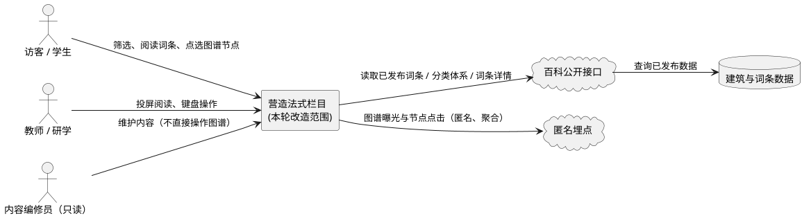
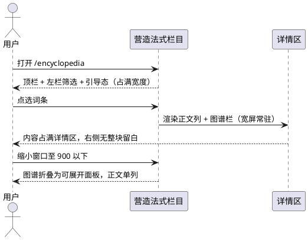
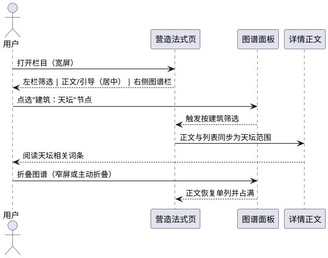
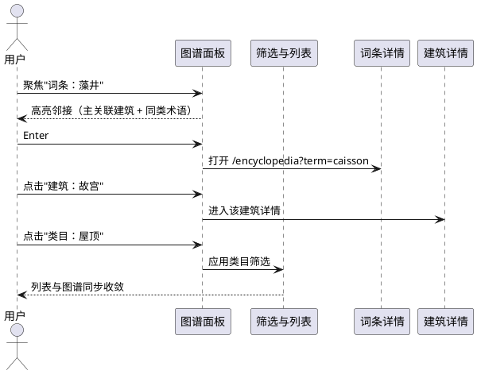

# 华夏古建可视化 · 营造法式知识图谱与布局空白治理 需求规格

> 本文件为**需求规格（What / Why）**，回答"这一轮改什么文字、空白怎么消、知识图谱展示到哪里、怎么判定完成"。
> 不含数据库设计、接口参数结构、算法与代码实现；文中出现的文件路径、样式类名、接口名仅作为**需求落点引用**，用于评估影响面与可追溯性，不构成接口契约。
> 需求编号使用 `R-BG-xx`，验收编号使用 `AC-BG-xx`，与既有 `REQ-01~31`、`REQ-S3P2-xx`、`R-BK-01~31`、`AC-01~54`、`AC-S3-xx`、`AC-BK-xx` **互不覆盖**。
> 下游阶段：实现方案（design）与编码任务（tasks）由后续阶段负责，本文档不越界。

| 项 | 内容 |
|---|---|
| 文档编号 | REQ-PUBLIC-BG-001 |
| 版本 | v1.0 |
| 状态 | 待评审（Q-BG-01~06 未确认前不进入编码） |
| 主题 | 「营造法式」文案微调、详情区右侧空白治理、知识图谱展示位置与全局呈现 |
| 需求来源 | 用户在分支「建筑模型的功能修改」上提出：**将营造法式文字修改一下，将知识展示界面的空白部分修改，让知识图谱展示到全局样式**（原文逐字保留） |
| 上游文档 | `docs/requirements/building-knowledge-enrichment-spec.md`（REQ-PUBLIC-BK-001） `docs/design/building-knowledge-enrichment-design.md`（DESIGN-PUBLIC-BK-001） `docs/tasks/building-knowledge-enrichment-tasks.md`（TASKS-PUBLIC-BK-001） `docs/design/s3-p2-design.md`（DESIGN-PUBLIC-S3P2-001） `docs/requirements/s3-p2-requirements.md`（REQ-PUBLIC-S3P2-001） |
| 关联代码库 | `D:\Ancient-architecture\ac1.1\acvisual 4`（分支：建筑模型的功能修改，基线 55852d8「AC4建筑修改」） |
| 业务代码改动 | **无**（本文档阶段不修改任何业务代码，仅新建需求文档） |
| 覆盖栏目 | 前端 `/encyclopedia`（营造法式页）：顶部标题区、左侧筛选栏、右侧详情区、新增知识图谱展示区 |

---

# 1. 本轮定位与范围

## 1.1 为什么需要这一轮

「营造法式」页在内容侧已完成双主轴扩充（43 条已发布词条 = 10 条建筑专属 + 33 条通用术语，20 座建筑，建筑覆盖 100%），但**页面层出现了三个"看起来像没做完"的问题**：

1. **右侧约 1/3~1/4 的画面是纯白空白**，从页面顶部贯穿到底部。用户第一眼会认为页面"加载不完整"或"排版坏了"，这是最直接的体验损伤。
2. **页面没有"知识图谱"**：栏目叫"知识百科"，但用户只能靠搜索与筛选逐条读，看不到建筑、词条、类目、朝代、地区之间的关联结构；"知识图谱"是用户明确提出要的东西，当前一个字、一条线都没有。
3. **顶部文字信息量偏低**：主标题固定在"营造法式"，副标题为"中国古代建筑知识百科 · 已发布 43 条 · 建筑覆盖 100%"，没有说明"这一页能怎么用"，也没有为图谱区提供任何引导语。

因此本轮不是"再补内容"，而是**在不改动 43 条词条正文语义的前提下，修掉布局空白、把知识图谱落到页面上、并把页面文字改到能自解释**。

## 1.2 现状事实与证据（GAP-BG）

| 编号 | 差距 | 现状证据（已核对） | 用户/业务影响 |
|---|---|---|---|
| GAP-BG-01 | 详情区右侧大面积留白 | `client/src/styles/global.css` 中 `.encyclopedia-layout { display:flex; height: calc(100vh - 73px) }`、`.encyclopedia-sidebar { width:340px; flex-shrink:0 }`、`.encyclopedia-detail { flex:1; padding:32px 40px }`；`client/src/styles/encyclopedia.css` 中 `.enc-article { max-width:1040px }` 且**无居中/拉伸**。视口 1920 时详情区可用宽度约 1500px，内容列仅 1040px，右侧固定留白约 460px（≈详情区 30%，≈整屏 24%），与截图"最右 1/3~1/4 纯白、顶部贯穿到底部"完全吻合 | 页面看起来未完成；宽屏用户视野被浪费；用户明确要求"把空白部分修改" |
| GAP-BG-02 | 无知识图谱任何形态 | 全仓库检索无"图谱 / graph"相关组件、样式与路由；`/encyclopedia` 仅有序列表 + 详情文章；无节点、无连线、无图例 | 栏目无法表达"建筑—词条—类目—朝代—地区"的关联结构，"知识图谱"诉求完全未实现 |
| GAP-BG-03 | 顶部文案单薄且无使用引导 | `EncyclopediaPage.jsx` 顶栏为固定"营造法式" + 副标题 `中国古代建筑知识百科 · 已发布 N 条 · 建筑覆盖 M%`；无导引语、无图谱说明、无图例文案；未选中词条时仅有 `EncyclopediaGuide` 四张导引卡 | 新访客不知道"可以按建筑看、可以点关联继续读"；图谱上线后若不配文案会变成"看不懂的图" |
| GAP-BG-04 | "全局样式"语义未定义 | 用户原文"让知识图谱展示到全局样式"存在两种可解释路径：①栏目内贯穿全局布局（整页常驻第三栏）；②全站级背景/浮层（跨页面可见）。当前无任何约定 | 范围不清会导致实现方向完全分叉（一个改布局、一个改全站壳层），必须先确认 |
| GAP-BG-05 | 页面文字与数据存在"硬编码观感" | 副标题中"已发布 N 条 / 建筑覆盖 M%"虽来自 `taxonomy.totals`，但无单位说明与口径入口；`encyclopedia` 命名空间已存在（`filter/group/empty/coverage/knowledge`），文案仍大量中文字面量直接写在 JSX | 文案难维护、无法双语、无法统一调整；与既有 i18n 契约不一致 |

## 1.3 覆盖对象与数量口径

| 项 | 口径 | 说明 |
|---|---|---|
| 词条 | 已发布 43 条（10 条建筑专属 + 33 条通用术语） | 本轮**不改正文语义**；数量以 `/api/encyclopedia` meta 与 `/api/encyclopedia/taxonomy` 实时返回为准，禁止在文案与代码中硬编码 43 |
| 建筑 | 20 座（故宫 10 单体 + 10 座其他建筑） | 图谱建筑节点必须由 taxonomy 的 `buildings` 派生，不得新增前端硬编码映射 |
| 类目 | 由 taxonomy `categories` 派生（名筑档案、屋顶、斗拱、彩画、柱础、台基、门窗、脊兽、琉璃、纹饰、建筑规制、建筑装饰等） | 类目节点数量随数据变化，不得写死 |
| 朝代 / 地区 | 由 taxonomy `dynasties` / `regions` 派生 | 同上 |
| 图谱规模 | 默认**节点 ≤ 120、边 ≤ 300**；超限必须裁剪并显式提示 | 当前全量约 43+20+12+朝代地区 ≈ 90 节点，默认上限留有余量 |

## 1.4 本轮明确不做（Out of Scope）

| 编号 | 不做项 | 原因 |
|---|---|---|
| OOS-BG-01 | 改写、重写、润色既有 43 条词条的 `term` / `synopsis` / `content` 正文语义 | 内容资产已完成审核，本轮只做**呈现层文案**；正文改写属内容侧新一轮任务 |
| OOS-BG-02 | 3D / WebGL / Three.js 知识图谱、全息球体、粒子图 | 与页面阅读场景冲突，性能与无障碍代价高；图谱只做 2D |
| OOS-BG-03 | UGC：用户提交节点、编辑关系、评论图谱 | 与既有 OOS-S3-06 / OOS-BK-03 一致 |
| OOS-BG-04 | 编修台内的图谱编辑能力（增删边、拖拽布局入库） | 本轮只读展示；`/curator` 不改 |
| OOS-BG-05 | 新增页面路由（如 `/encyclopedia/graph`）或独立图谱页 | 图谱必须内嵌 `/encyclopedia`，避免入口碎片化与收录风险 |
| OOS-BG-06 | 引入第三方图谱库（d3、cytoscape、vis-network、sigma、echarts-graph 等） | 体积与维护成本不可控；现有 SVG/DOM + CSS 足够表达 ≤120 节点 |
| OOS-BG-07 | 图谱数据的持久化建模（新建图谱表、图数据库） | 本轮数据由既有 taxonomy + 列表 + 详情在运行时聚合 |
| OOS-BG-08 | 暗色主题、品牌视觉改版、全站布局重构 | 沿用 REQ-PUBLIC-S3P2-001 §1.5-OOS-S3-07 |
| OOS-BG-09 | 修改既有 URL 形态（`/encyclopedia?term=`、筛选参数）与 43 条深链 | 沿用 DFX-BK-C1、DFX-S3-C1 |
| OOS-BG-10 | 为图谱新增用户账号、收藏图谱、导出图片/PDF | 非本轮诉求 |

---

# 2. 领域术语

**知识图谱（Knowledge Graph）**
: 以节点与边表达"建筑、词条、类目、朝代、地区"及其关联关系的只读可视化视图，用于帮助用户在栏目内沿关系继续阅读。

**图谱节点（Graph Node）**
: 图谱中可被点选的实体，其类型限定为建筑、词条、类目、朝代、地区五类之一。

**图谱边（Graph Edge）**
: 连接两个节点的关联关系，其语义限定为主关联、关联建筑、关联术语、同域（同分类/同朝代/同地区）四类之一。

**主关联边（Primary Link Edge）**
: 由词条的 `primary_palace_id` 指向其唯一"第一归属建筑"的边，语义强于普通关联，必须可与其他边区分。

**同域边（Peer Edge）**
: 当两个实体共享同一分类、同一朝代或同一地区时生成的弱关联边，用于补足"同类可一起看"的阅读路径。

**图谱面板（Graph Panel）**
: 承载知识图谱的界面容器，包含标题、图例、画布、空态与降级列表。

**布局空白率（Blank Ratio）**
: 详情区中"未被有效内容覆盖的水平空间"占详情区可用宽度的比例；计算方式为 `1 - 内容实际覆盖宽度 / 详情区可用宽度`，在指定断点与指定页面状态下测量。

**有效内容宽度（Effective Content Width）**
: 在某一断点下，正文列（或正文列 + 图谱栏）实际占据的宽度，不含页面外边距与滚动条。

**全局呈现（Global Presentation）**
: 知识图谱在整个栏目布局层面持续可见的呈现方式；本规格区分两种解读——**栏目内全局**（贯穿整页高度的常驻图谱栏）与**全站全局**（跨页面背景/浮层），具体取值见 Q-BG-02。

**图谱规模预算（Graph Budget）**
: 单次渲染允许的节点数与边数上限，以及超限时的裁剪与提示规则。

**降级视图（Fallback View）**
: 图谱无法渲染或数据不足时替代呈现的关联列表/文字说明，必须保留原有阅读路径，不得出现空白容器。

---

# 3. 角色与边界

## 3.1 核心角色

| 角色 | 职责与特征 | 本轮诉求 |
|---|---|---|
| 首次访客 / 游客 | 从搜索或分享进入，先看内容再决定是否注册 | 打开页面就看到完整布局与一张能看懂的关系图，不出现"页面坏了"的错觉 |
| 学生 / 亲子用户 | 多在手机或平板，按兴趣跳读 | 能从"藻井"跳到建筑、再跳到同朝代词条，路径不断 |
| 教师 / 研学组织者 | 桌面投屏，需要一页讲清结构 | 图谱在宽屏下常驻可见、字号可读、可键盘操作、可投屏 |
| 内容编修员（只读） | 维护词条与建筑档案 | 图谱关系必须由数据派生，新增词条自动上图，无需改前端 |
| 项目方 / 运营 | 关注页面是否"真的补齐" | 有可量化的空白率、图谱可交互率与点击转化指标 |

## 3.2 外部系统

| 系统 | 交互内容 |
|---|---|
| 内容数据库（`encyclopedia_terms`、`palaces`） | 已发布词条、建筑归属、分类/朝代/地区元数据 |
| 百科公开接口（`/api/encyclopedia`、`/api/encyclopedia/taxonomy`、`/api/encyclopedia/:id`） | 图谱节点与边的数据来源（复用，是否新增聚合接口见 Q-BG-04） |
| 匿名埋点服务 | 图谱曝光、节点点击、折叠展开、降级发生的匿名聚合（白名单机制） |
| 浏览器读屏与键盘 | 节点的可读名称、焦点顺序与键盘操作 |

## 3.3 交互上下文

---

# 4. DFX 约束

> 沿用 REQ-PUBLIC-001 §5、REQ-PUBLIC-S3P2-001 §3 与 REQ-PUBLIC-BK-001 §4 全部 DFX 条款；以下为本轮**新增或收紧**的可量化红线。

## 4.1 性能

| 编号 | 约束 | 验收方式 |
|---|---|---|
| DFX-BG-P1 | 图谱首次渲染（从数据就绪到画面可见）≤ 200ms；在 ≤120 节点 / ≤300 边预算内必须成立 | 性能面板 + 打点 |
| DFX-BG-P2 | 布局改造引起的累积布局位移 CLS ≤ 0.02，图谱出现前后正文位置不得跳动 | Layout Shift 采样 |
| DFX-BG-P3 | 筛选条件变化后图谱重算与重绘 ≤ 200ms，不得触发整页刷新 | 手工 + 性能面板 |
| DFX-BG-P4 | ≥1440 视口、任一词条详情打开时，详情区右侧布局空白率 ≤ 8% | 截图测量 + 脚本量取 |
| DFX-BG-P5 | 图谱不得新增首屏接口请求数；若最终确认新增聚合接口（Q-BG-04），首屏请求增量 ≤ 1 且不得串行阻塞正文 | 网络面板对比 |
| DFX-BG-P6 | 图谱相关前端资源（含样式）增量 ≤ 40KB（gzip），且不得引入第三方图谱库 | 构建产物审计 |

## 4.2 可靠性

| 编号 | 约束 |
|---|---|
| DFX-BG-R1 | 图谱数据缺失、接口失败或解析异常时，必须收敛为降级视图（关联列表或说明文字），不得出现空白画布、`undefined`、裸节点 id |
| DFX-BG-R2 | 任一边指向不存在或已下架对象时，必须忽略该边并保留其余节点，不得使整张图谱消失 |
| DFX-BG-R3 | 图谱渲染异常不得影响左侧筛选与右侧正文阅读，正文必须在图谱失败时仍完整可用 |
| DFX-BG-R4 | 空图谱（当前筛选下无任何关联）必须展示明确空态并提供"清除筛选"出口，不得只显示空画布 |

## 4.3 安全性

| 编号 | 约束 |
|---|---|
| DFX-BG-S1 | 图谱只消费已发布（published）公开数据；草稿词条、下架建筑、内部审核字段不得出现在节点、边或悬浮提示中 |
| DFX-BG-S2 | 节点名称、标签与悬浮提示必须按纯文本渲染并转义，禁止注入 HTML/脚本（沿用既有 XSS 基线） |
| DFX-BG-S3 | 图谱埋点不得包含任何用户身份、账号、设备指纹或正文内容；属性键必须落在既有白名单内 |

## 4.4 无障碍

| 编号 | 约束 |
|---|---|
| DFX-BG-A1 | 每个可点选节点必须可被键盘聚焦，并具备可被读屏朗读的名称与类型（如"词条：藻井"） |
| DFX-BG-A2 | 图谱必须提供"跳至正文"或"跳过图谱"的等价路径，不得成为键盘焦点陷阱 |
| DFX-BG-A3 | 节点文字、图例文字与连线的对比度：正文类文字 ≥ 4.5:1，图形性线条 ≥ 3:1 |
| DFX-BG-A4 | 系统要求减少动效（`prefers-reduced-motion: reduce`）时，图谱不得有入场动画、脉冲高亮或位移动画，仅允许瞬时状态切换 |

## 4.5 可维护性与兼容性

| 编号 | 约束 |
|---|---|
| DFX-BG-M1 | 图谱的节点上限、边上限、断点与列宽必须只有一处定义来源，不得在组件内散落魔法数字 |
| DFX-BG-M2 | 本轮新增/调整的文案必须集中在 i18n 资源中，键位沿用 `encyclopedia.*` 命名空间，不得继续在 JSX 内硬编码中文字面量（图谱区必须如此） |
| DFX-BG-M3 | 图谱节点与边的构造必须可被单元测试覆盖（同输入同输出），不得依赖 DOM 才能构造 |
| DFX-BG-C1 | 既有 `/encyclopedia?term=<id>` 深链、筛选参数、43 条词条可访问性保持不变 |
| DFX-BG-C2 | 既有搜索命中（"斗拱""屋顶"等）与双主轴筛选结果不得因布局与图谱改造而减少 |
| DFX-BG-C3 | 不新增路由；符合条件的既有页面结构（`.encyclopedia-layout`、`.encyclopedia-detail`、`.enc-*`）以增量方式扩展，不整块重写 |

---

# 5. 核心能力

> 写法沿用项目既有规范：需求正文使用 **EARS 引导词 + shall**，规则级验收统一写作 `[触发场景] → [预期行为]`。
> EARS 引导词对应：**When**（当…时）/ **While**（当…处于…状态时）/ **If**（如果…）/ **Where**（对于…/在…处）。

## 5.1 能力一：布局与空白治理

### 5.1.1 目标与问题

**目标**：让 `/encyclopedia` 在 320 / 900 / 1440 / 1920 四个断点下都"占满、可读、不跳动"，把右侧贯穿到底部的空白转化为有效内容区（优先用于知识图谱）。

**要解决的问题**：
1. 详情区 `flex:1` 铺满，但内层内容列 `max-width:1040px` 未居中，宽度差全部堆到右侧，形成"固定白边"。
2. 引导态（未选词条）与详情态（已选词条）的容器宽度规则不一致，切换时视觉跳变。
3. 缺少空白率、最小内容宽度等可验收口径，改完也无法判定"空白是否真的消掉了"。

### 5.1.2 业务规则

1. **R-BG-01 详情区内容必须占满并居中**
   **While** 任一词条详情处于打开状态且视口宽度 ≥ 1440px 时，系统应（shall）保证详情区内的内容列（正文列 + 图谱栏）填满详情区可用宽度，并在左右留白之间居中分布，不得出现单侧固定空白。
   a. 验收条件：`[1920 视口打开词条详情并量取]` → `[内容列右边缘距详情区右边缘 ≤ 24px 常规内边距，无额外整块留白]`。

2. **R-BG-02 右侧布局空白率必须达标**
   **While** 视口宽度 ≥ 1440px 且任一词条详情打开时，系统应（shall）保证详情区布局空白率 ≤ 8%。
   a. 验收条件：`[在 1440 与 1920 视口分别量取]` → `[空白率均 ≤ 8%；改造前 1920 口径约 30%，须有前后对比截图]`。

3. **R-BG-03 四个断点必须全覆盖且无横向滚动**
   **When** 视口宽度处于 320 / 900 / 1440 / 1920 四个断点区间时，系统应（shall）分别给出可用的布局形态：≤900 单列并允许纵向滚动、900–1439 双列且图谱可折叠、≥1440 正文 + 常驻图谱栏；任何断点下均不得出现横向滚动。
   a. 验收条件：`[逐断点打开页面并检查 document 宽度]` → `[各断点下 scrollWidth ≤ clientWidth，无横向滚动条]`。

4. **R-BG-04 新增区域不得挤压既有筛选与阅读**
   **Where** 在任意断点引入图谱区或调整列宽时，系统应（shall）保持左侧筛选栏宽度不变、正文可读行宽保持在 60–75 个字符区间、详情区不出现内容截断。
   a. 验收条件：`[对比改造前后]` → `[左侧栏仍为 340px（≥1180 断点），正文段落最大行宽在 60–75 字符之间，摘要与标题无截断]`。

5. **R-BG-05 布局变化不得引起视觉跳动**
   **When** 页面由引导态切换到详情态、或图谱异步加载完成时，系统应（shall）保证正文区域不发生位置跳动。
   a. 验收条件：`[从列表点开词条并等待图谱加载]` → `[标题与首段在加载前后位置偏差 ≤ 2px，CLS ≤ 0.02]`。

### 5.1.3 空白成因与治理方向（需求层假设，供实现阶段验证）

| 假设 | 依据 | 治理方向（需求要求，不规定实现） |
|---|---|---|
| H1 内容列未居中 | `.enc-article{max-width:1040px}` 无 `margin:0 auto`，父容器 `flex:1` | 内容区改为"正文 + 图谱"两列并整体居中，正文自身保持可读行宽 |
| H2 详情区缺第三列 | `.encyclopedia-detail` 只有单列滚动容器 | 增加一个 320–420px 的图谱列，占掉多余水平空间 |
| H3 引导态与详情态宽度规则不一致 | `.enc-guide` 无 `max-width`、`.enc-article` 有 | 统一两态的容器与内边距规则 |
| H4 全局留白由页面外边距叠加 | 既有 `guards.css` 在小屏追加左右 padding | 仅在窄断点保留外边距，宽断点由内容列吸收剩余空间 |

### 5.1.4 交互流程

### 5.1.5 异常场景

1. **超宽屏（≥2560）**
   a. 触发条件：显示器分辨率远超设计断点。
   b. 系统行为：内容列整体居中并受最大宽度约束，两侧对称留白，不得单侧堆积。
   c. 用户感知：页面居中、对称、不出现"右边一大块白"。
2. **浏览器缩放 150%+**
   a. 触发条件：用户缩放或系统 DPI 放大。
   b. 系统行为：按实际 CSS 宽度重新进入对应断点布局，不叠加固定像素假设。
   c. 用户感知：不出现横向滚动与内容截断。
3. **图谱数据未就绪**
   a. 触发条件：图谱数据晚于正文返回。
   b. 系统行为：图谱列先占位但不撑高、不遮挡正文，就绪后原位渲染。
   c. 用户感知：正文可先读，无跳动。

---

## 5.2 能力二：知识图谱数据模型

### 5.2.1 目标与问题

**目标**：用一套**当前数据即可构造、规模可控、语义明确**的图谱模型，把"建筑—词条—类目—朝代—地区"的关系表达出来，而不是为了好看画一堆没有意义的线。

**要解决的问题**：
1. 没有节点/边定义，无法判断"这张图是否表达了知识结构"。
2. 现有接口返回的数据形状各异（列表扁平、taxonomy 聚合、详情含 `_relatedTerms/_relatedPalaces`），缺少统一聚合口径。
3. 没有规模上限，全量关系膨胀后首屏会卡。

### 5.2.2 业务规则

6. **R-BG-06 节点类型必须限定为五类**
   **Where** 构造图谱时，系统应（shall）只使用五种节点类型：建筑（building）、词条（term）、类目（category）、朝代（dynasty）、地区（region）；不得引入无法指向真实内容的装饰性节点。
   a. 验收条件：`[检查图谱节点集合]` → `[每个节点类型属于五类之一，且建筑/词条节点均可点击进入真实对象]`。

7. **R-BG-07 边语义必须限定为四类且可区分**
   **When** 生成图谱边时，系统应（shall）只生成四类边：主关联（词条 → 其 `primary_palace_id` 建筑）、关联建筑（词条 → `related_palaces`）、关联术语（词条 ↔ `_relatedTerms`/`related_terms`）、同域（同分类 / 同朝代 / 同地区）；主关联边必须在视觉上强于其他三类。
   a. 验收条件：`[打开含主关联的词条并检查图例与样式]` → `[四类边均有图例说明，主关联边可一眼区分，不存在无图例的第五类边]`。

8. **R-BG-08 图谱数据必须来自已发布公开数据，并优先复用既有接口**
   **When** 页面加载图谱时，系统应（shall）只使用 `/api/encyclopedia`（已发布列表）、`/api/encyclopedia/taxonomy`（分类体系）与 `/api/encyclopedia/:id`（详情关联）三类既有数据源；不得为图谱单独抓取未发布或后台数据。
   a. 验收条件：`[抓包检查请求]` → `[图谱所需数据在既有请求响应中可得；无草稿、无后台字段]`。

9. **R-BG-09 图谱规模预算与裁剪必须可复现**
   **While** 图谱节点或边超过预算时，系统应（shall）按"当前选中词条邻接优先 → 主关联优先 → 同域补充"的顺序裁剪，并在面板上显式显示"已展示 N / 共 M"的规模提示；默认预算为节点 ≤ 120、边 ≤ 300。
   a. 验收条件：`[注入超预算数据集或模拟全量]` → `[节点 ≤ 120、边 ≤ 300，提示文案出现，页面仍可交互]`。

10. **R-BG-10 图谱渲染必须轻量且非 WebGL**
    **When** 渲染图谱时，系统应（shall）使用 2D 矢量/DOM 方式（如 SVG）或 Canvas 2D，禁止使用 WebGL/Three.js 渲染图谱；≤120 节点时首屏渲染 ≤ 200ms。
    a. 验收条件：`[审查渲染层]` → `[无 WebGL 上下文用于图谱；性能面板显示渲染耗时 ≤ 200ms]`。

11. **R-BG-11 图谱必须与当前筛选上下文一致**
    **When** 用户改变建筑、类目、朝代、地区或关键词筛选时，系统应（shall）同步更新图谱节点集合与数量提示，不得展示与筛选结果矛盾的节点。
    a. 验收条件：`[筛选"天坛"后查看图谱]` → `[图谱仅保留天坛及其关联词条/类目，节点数与列表命中口径一致]`。

12. **R-BG-12 无效关联必须被忽略**
    **If** 某条边指向不存在、已下架或不可访问的对象，系统应（shall）忽略该边，并保留其余节点与边，不得整图失效或显示裸 id。
    a. 验收条件：`[构造指向已下架建筑的关联]` → `[该边不出现，其余图谱正常，无 id 字符串]`。

### 5.2.3 图谱模型定义（需求层，不含表结构）

| 维度 | 定义 |
|---|---|
| 节点：建筑 | 来自 taxonomy `buildings`，含名称、朝代、地区、`has_3d`、`entry_count`；点击进入建筑详情 |
| 节点：词条 | 来自已发布列表，含 `id`、`term`、`category`、`entry_type`、可选 `primary_palace_id`；点击切换词条 |
| 节点：类目 | 来自 taxonomy `categories`，作为"同分类"聚类枢纽；点击等价于按该类目筛选 |
| 节点：朝代 | 来自 taxonomy `dynasties`；点击等价于按朝代筛选 |
| 节点：地区 | 来自 taxonomy `regions`；点击等价于按地区筛选 |
| 边：主关联 | 词条 → 其唯一主关联建筑，强度最高 |
| 边：关联建筑 | 词条 → `related_palaces` 中除主关联外的建筑 |
| 边：关联术语 | 词条 ↔ `_relatedTerms` / `related_terms` 中的词条，双向 |
| 边：同域 | 词条 ↔ 同分类词条；建筑 ↔ 同朝代/同地区建筑（默认弱化显示，可开关） |

### 5.2.4 数据来源对比（需求结论）

| 方案 | 做法 | 优点 | 风险 | 结论 |
|---|---|---|---|---|
| S1 一次拉取、纯前端聚合 | 复用首屏已有的列表 + taxonomy，选中词条后用详情补 `_relatedTerms` | 零新增接口、无串行等待、与筛选天然一致 | 若列表接口未返回 `related_terms`，同域边只能由 `category`/`dynasty` 派生，隶属边需按需补 | **默认推荐** |
| S2 新增图谱聚合接口 | 服务端一次返回子图 | 前端逻辑简单、可服务端裁剪 | 新增接口与缓存、权限、测试成本；首屏请求 +1 | 备选，取决于 Q-BG-04 |

> 需求层面要求：无论选择 S1 或 S2，都不得改变 §5.2.2 的节点/边语义与 §4.1 的性能预算。

### 5.2.5 异常场景

1. **列表接口缺少关联术语字段**
   a. 触发条件：列表响应不含 `related_terms`。
   b. 系统行为：先渲染建筑/类目/朝代/地区与同域边，选中词条后用详情响应补齐关联术语边。
   c. 用户感知：图谱逐步完善，不出现空图。
2. **taxonomy 返回空**
   a. 触发条件：分类体系接口失败。
   b. 系统行为：退化为"仅词条 + 主关联建筑"的最小图，或直接进入降级列表。
   c. 用户感知：仍能看到关联关系，不出现错误页。
3. **数据中出现循环/自环**
   a. 触发条件：词条关联自身或关系成环。
   b. 系统行为：过滤自环，允许双向边只保留一条视觉线。
   c. 用户感知：不出现自连线与重复线叠加。

---

## 5.3 能力三：展示位置与"全局样式"

### 5.3.1 目标与问题

**目标**：把"知识图谱展示到全局样式"落成一个**站位明确、不遮挡、可持续**的展示形态，并同时消掉右侧空白。

**要解决的问题**：
1. 用户原话"全局样式"存在两种解释，若不先定义，实现可能做成"全站背景水印"（遮挡、性能差）或"详情页一个小方块"（不满足"全局"）。
2. 候选方案缺少对比，容易被最省事的方案（塞进详情区中部一段）带偏。
3. 图谱与正文的视觉主次关系未定义。

### 5.3.2 候选方案对比（需求层结论）

| 方案 | 形态 | 对空白的治理 | 对"全局"的满足 | 风险 | 结论 |
|---|---|---|---|---|---|
| A 右侧固定图谱侧栏 | 详情区改为"正文 + 图谱"两列，图谱栏 320–420px、随页面滚动常驻 | 直接吃掉右侧留白，空白率可降到 ≤8% | 满足"栏目内全局"（贯穿整页高度、常驻可见） | 窄屏需折叠；需控制正文行宽 | **推荐** |
| B 栏目内可折叠图谱面板 | 图谱作为详情区内的一个可折叠区块（位于正文之上/之下） | 仅部分利用空白，宽屏仍有留白 | 仅"局部呈现" | 折叠后失去"全局"含义；易被忽略 | 作为 A 的窄屏降级形态 |
| C 全站背景/全局浮层 | 固定浮层或页面背景水印，跨页面可见 | 不解决详情区空白，且遮挡正文 | 满足"全站全局"字面 | 可读性、性能、无障碍、埋点污染四项风险 | **不推荐**，须 Q-BG-02 明确结论后方可评估 |

### 5.3.3 业务规则

13. **R-BG-13 展示形态必须以"推荐 + 备选 + 否决"三档记录**
    **When** 进入实现阶段前，需求应以（shall）明确记录 A/B/C 三方案对比与推荐结论（A 为推荐，B 为 A 的窄屏降级，C 默认否决），不得只写"加个图谱"。
    a. 验收条件：`[评审文档]` → `[三方案均有对比维度、推荐结论与理由；C 方案有明确否决理由]`。

14. **R-BG-14 图谱必须默认以常驻侧栏呈现并占掉右侧留白**
    **Where** 视口宽度 ≥ 1440px 时，系统应（shall）在详情区右侧常驻展示图谱面板（宽度 320–420px），使详情区不再出现整块空白；图谱栏在引导态与详情态均可见。
    a. 验收条件：`[1440 与 1920 视口打开页面]` → `[两种状态下右侧均有图谱栏，无纯白空列]`。

15. **R-BG-15 "全局"语义必须二选一并显式标注**
    **When** 描述图谱的呈现范围时，系统应（shall）明确采用以下之一：G1「栏目内全局」= 贯穿 `/encyclopedia` 整页布局、常驻可见；G2「全站全局」= 跨页面背景/浮层可见；默认采用 G1，G2 必须经 Q-BG-02 确认后方可进入设计。
    a. 验收条件：`[检查需求与文案]` → `[呈现范围有唯一结论；若为 G1，则不得在任何其他页面出现图谱浮层]`。

16. **R-BG-16 图谱不得遮挡正文与操作**
    **While** 图谱处于展示状态时，系统应（shall）保证图谱不覆盖正文、不遮挡分享/朗读/筛选等既有操作，也不得成为阅读的强制前置。
    a. 验收条件：`[在任意断点检查]` → `[正文无被遮挡区域，既有按钮全部可点击，图谱可被跳过]`。

17. **R-BG-17 图谱必须内嵌既有页面，不新增路由**
    **When** 用户访问图谱时，系统应（shall）在 `/encyclopedia` 内完成展示与交互，不得新增独立图谱路由或独立页面。
    a. 验收条件：`[检查路由表与页面跳转]` → `[无新增路由；图谱仅在 /encyclopedia 内出现]`。

### 5.3.4 交互流程

### 5.3.5 异常场景

1. **用户主动折叠图谱**
   a. 触发条件：用户点击折叠。
   b. 系统行为：正文列扩展为占满宽度，折叠状态在当前会话内保持。
   c. 用户感知：阅读更宽，图谱可随时恢复。
2. **窄屏默认折叠**
   a. 触发条件：视口 < 900px。
   b. 系统行为：图谱默认折叠为一条"查看知识图谱"入口，展开后以全宽面板呈现。
   c. 用户感知：不挤压正文，需要时再展开。
3. **打印/导出**
   a. 触发条件：打印页面。
   b. 系统行为：图谱不参与打印或转为静态文字列表。
   c. 用户感知：打印件不出现残缺图形。

---

## 5.4 能力四：交互

### 5.4.1 目标与问题

**目标**：让图谱不是"装饰图"，而是可以真的用来跳读的导航。

**要解决的问题**：
1. 点节点之后去哪里，没有约定。
2. 图谱与筛选的关系未定义，容易各走各的。
3. 缩放/拖拽不做边界会带来"图跑丢了"的体验事故。
4. 键盘用户与读屏用户在图谱上完全不可用。

### 5.4.2 业务规则

18. **R-BG-18 节点点击必须指向真实对象**
    **When** 用户点击词条节点时，系统应（shall）切换为对应词条详情（地址保持 `/encyclopedia?term=<id>`）；点击建筑节点时，应（shall）进入该建筑详情（沿用既有建筑详情入口）；点击类目/朝代/地区节点时，应（shall）等价于对应筛选条件。
    a. 验收条件：`[分别点击四类节点]` → `[词条切换正确、建筑详情正确、类目/朝代/地区筛选生效，URL 可复现]`。

19. **R-BG-19 图谱与筛选必须双向联动**
    **When** 图谱节点或筛选条件变化时，系统应（shall）保证两者表达同一结果集；筛选后图谱同步收敛，图谱触发筛选后列表同步收敛。
    a. 验收条件：`[先筛"莫高窟"再点"屋顶"节点]` → `[列表与图谱同时为莫高窟 + 屋顶口径，命中数一致]`。

20. **R-BG-20 邻接关系必须可高亮**
    **When** 用户聚焦或选中某个节点时，系统应（shall）高亮该节点的一跳邻接节点与边，并弱化非邻接部分；高亮不得改变布局位置。
    a. 验收条件：`[选中"藻井"节点]` → `[其主关联建筑与关联术语高亮，其余淡化，节点不位移]`。

21. **R-BG-21 缩放与拖拽必须有边界与复位**
    **If** 图谱启用缩放或拖拽（是否启用见 Q-BG-03），系统应（shall）限制缩放范围（建议 0.5×–2.0×），限制节点不得被完全拖出可视区，并提供"复位视图"入口。
    a. 验收条件：`[连续放大与拖拽]` → `[缩放不超范围、图不丢失、复位后回到初始视图]`。

22. **R-BG-22 图谱必须键盘可达**
    **When** 用户仅使用键盘操作时，系统应（shall）保证节点可通过 Tab/方向键遍历，Enter/Space 可触发与点击等价的动作，焦点位置有可见指示。
    a. 验收条件：`[仅用键盘完成"选词条 → 跳到建筑"]` → `[全程可达，焦点环可见，无焦点丢失]`。

23. **R-BG-23 空态与降级必须给出可行动出口**
    **If** 当前筛选下没有任何可展示关联，或图谱数据不可用，系统应（shall）展示空态/降级列表，并至少提供"清除筛选""从建筑详情进入"两个出口之一；不得显示空画布或错误原文。
    a. 验收条件：`[构造零关联筛选 + 模拟图谱数据失败]` → `[分别出现空态与降级列表，均有可点击出口，正文正常]`。

24. **R-BG-24 动效必须尊重系统偏好**
    **While** 系统处于减少动效模式时，系统应（shall）关闭图谱入场、脉冲与位移动画，仅保留瞬时状态变化。
    a. 验收条件：`[开启减少动效后打开与操作图谱]` → `[无动画、无过渡位移，功能正常]`。

### 5.4.3 交互流程

### 5.4.4 异常场景

1. **节点目标已下架**
   a. 触发条件：点击的节点对应对象已下架。
   b. 系统行为：给出"该内容已下线"的轻提示并保留当前视图。
   c. 用户感知：不跳转到空白页。
2. **快速连续点击**
   a. 触发条件：用户快速切换多个节点。
   b. 系统行为：以最后一次操作为准，避免并发请求造成错乱。
   c. 用户感知：最终视图与最后一次点击一致。
3. **读屏环境**
   a. 触发条件：使用读屏软件浏览图谱。
   b. 系统行为：节点以可读名称与类型播报，图例可读；图谱可整体跳过。
   c. 用户感知：不陷入无法退出的图形区域。

---

## 5.5 能力五：文字调整

### 5.5.1 目标与问题

**目标**：把"文字修改一下"收敛成一个**边界清楚、可执行**的文案清单：只改呈现层文案，不动 43 条词条正文。

**要解决的问题**：
1. "文字修改"没有范围，容易被理解成重写正文（违反内容已审核状态）。
2. 页面文案散落在 JSX 中，改动会破坏双语与一致性。
3. 图谱上线后若没有说明与图例，用户看不懂图。

### 5.5.2 业务规则

25. **R-BG-25 文字修改范围必须限定在呈现层**
    **Where** 执行本轮文案调整时，系统应（shall）只允许修改：页面主标题、副标题、导引语、图谱区标题与说明、图例文案、空态与降级文案、按钮标签；**禁止**修改既有 43 条词条的 `term`、`synopsis`、`content` 及 `category` 取值。
    a. 验收条件：`[比对改造前后词条数据]` → `[43 条词条的 term/synopsis/content 哈希不变；仅前端文案与 i18n 资源变化]`。

26. **R-BG-26 新增文案必须进入既有 i18n 命名空间**
    **When** 新增或修改文案时，系统应（shall）使用 `encyclopedia.*` 命名空间的键位（图谱相关统一挂在 `encyclopedia.graph.*` 下），并提供中英双语；不得在 JSX 内新增中文字面量。
    a. 验收条件：`[切换中/英]` → `[页面标题、图谱标题、图例、空态均正确切换，无中文残留（内容数据除外）]`。

27. **R-BG-27 文案不得承诺未实现的能力**
    **Where** 撰写图谱区文案时，系统应（shall）只描述真实存在的能力（如"点选节点可跳转""连线表示关联关系"），禁止出现"智能生成""实时更新""自动推荐"等当前不具备的表述。
    a. 验收条件：`[逐条核对图谱文案]` → `[每条描述都能在页面上找到对应行为]`。

28. **R-BG-28 既有文案键位必须保持兼容**
    **While** 本轮文案调整生效期间，系统应（shall）保持既有 `encyclopedia.filter.*`、`encyclopedia.group.*`、`encyclopedia.empty.*`、`encyclopedia.coverage.*`、`encyclopedia.knowledge.*` 键位可用，不得删除或改义。
    a. 验收条件：`[检查 i18n 资源与引用]` → `[既有键全部存在且语义未变，删除数 = 0]`。

### 5.5.3 文案修改清单（需求级建议，中文为基准，英文为对照）

| 位置 | 现状 | 建议文案（中） | 建议文案（英） | 键位建议 |
|---|---|---|---|---|
| 页面主标题 | 营造法式 | 保持「营造法式」（是否改见 Q-BG-01） | The Yingzao Fashi | `encyclopedia.page.title` |
| 页面副标题 | 中国古代建筑知识百科 · 已发布 43 条 · 建筑覆盖 100% | 中国古代建筑知识百科 · 已发布 {count} 条 · 建筑覆盖 {rate}% | Ancient Chinese architecture knowledge · {count} entries · {rate}% building coverage | `encyclopedia.page.subtitle` |
| 图谱区标题 | 无 | 知识图谱 | Knowledge graph | `encyclopedia.graph.title` |
| 图谱区说明 | 无 | 从一座建筑或一个构件出发，沿连线继续阅读 | Start from a building or an element, then follow the lines to keep reading | `encyclopedia.graph.hint` |
| 图例（节点） | 无 | 建筑 · 词条 · 类目 · 朝代 · 地区 | Building · Entry · Category · Dynasty · Region | `encyclopedia.graph.legend.*` |
| 图例（边） | 无 | 主关联 · 关联建筑 · 关联术语 · 同域 | Primary · Related building · Related entry · Same domain | `encyclopedia.graph.edge.*` |
| 规模提示 | 无 | 已展示 {shown} / {total} 个节点 | Showing {shown} of {total} nodes | `encyclopedia.graph.scale` |
| 折叠/展开 | 无 | 收起图谱 / 展开图谱 | Collapse / Expand graph | `encyclopedia.graph.collapse` / `.expand` |
| 空态 | 无 | 当前筛选下暂无可展示的关联 | No related items under current filters | `encyclopedia.graph.empty` |
| 降级 | 无 | 图谱暂不可用，已切换为关联列表 | Graph unavailable; showing a related list instead | `encyclopedia.graph.fallback` |
| 导引语（引导态） | 仅有四张导引卡 | 先选一类构件或一座建筑，右侧图谱会展示它们的关联 | Pick an element category or a building; the graph shows how they connect | `encyclopedia.guide.lead` |

> 说明：以上为**建议文案**，最终措辞以 Q-BG-01 确认结果为准；未确认前不得直接落码。

### 5.5.4 异常场景

1. **英文缺失**
   a. 触发条件：新增键位只有中文。
   b. 系统行为：英文界面回退中文并标注未覆盖（沿用既有 i18n 缺失样式）。
   c. 用户感知：可读，但不误以为已英文化。
2. **文案过长打断布局**
   a. 触发条件：英文文案明显长于中文。
   b. 系统行为：图谱说明允许换行，副标题允许截断并给完整 title，不得撑破列宽。
   c. 用户感知：布局不变形。
3. **文案与数据不一致**
   a. 触发条件：文案写死数量而数据变化。
   b. 系统行为：数量必须由数据插值，禁止硬编码。
   c. 用户感知：副标题数量与列表一致。

---

## 5.6 能力六：响应式与视觉一致性

### 5.6.1 目标与问题

**目标**：让图谱与既有页面"同一种纸"，并且在小屏到投屏都成立。

**要解决的问题**：
1. 新增组件容易自带一套颜色与圆角，破坏既有纸质阅读感。
2. 窄屏图谱若直接摊开会挤爆正文。
3. 颜色单编码对色弱用户不友好。

### 5.6.2 业务规则

29. **R-BG-29 图谱视觉必须复用既有设计契约**
    **Where** 图谱使用颜色、圆角、边框、阴影时，系统应（shall）复用既有 `--enc-*` 变量与 `.enc-*` 类承载的纸白底、朱红强调、圆角卡片风格，以及与 `.glass-panel` 一致的描边与低阴影；不得另起一套色板。
    a. 验收条件：`[比对图谱与既有详情卡]` → `[底色、描边、圆角、字族一致；无新增品牌色]`。

30. **R-BG-30 禁止引入第三方图谱库**
    **When** 实现图谱时，系统应（shall）不引入 d3/cytoscape/vis-network/sigma/echarts 等图库；如确需引入，必须先在 Q-BG-03 中评估体积、维护与无障碍成本并获书面同意。
    a. 验收条件：`[检查 package.json 与构建产物]` → `[无新增图谱依赖；包体增量 ≤ 40KB gzip]`。

31. **R-BG-31 窄屏图谱必须折叠且不遮挡**
    **While** 视口宽度 < 900px 时，系统应（shall）默认收起图谱，仅保留可展开入口；展开后以全宽区域呈现在正文之前或之后，不得以浮层覆盖正文。
    a. 验收条件：`[320 与 900 视口]` → `[默认不展开、无遮挡、无横向滚动，展开后可正常操作]`。

32. **R-BG-32 图谱信息必须双编码**
    **Where** 区分节点类型与边类型时，系统应（shall）同时使用颜色 + 形状/标签/线型至少两种编码，保证色觉差异用户仍可区分。
    a. 验收条件：`[灰度截图检查]` → `[五类节点与四类边仍可区分]`。

### 5.6.3 异常场景

1. **高对比度系统主题**
   a. 触发条件：系统开启高对比度。
   b. 系统行为：节点描边与文字按系统色可读，不以低对比浅色绘制。
   c. 用户感知：图仍可读。
2. **投屏 1920×1080**
   a. 触发条件：教室投屏。
   b. 系统行为：图谱栏常驻、节点标签可读、无缩放需求。
   c. 用户感知：一屏讲清结构。

---

## 5.7 能力七：数据与隐私

### 5.7.1 业务规则

33. **R-BG-33 图谱只使用公开已发布数据**
    **When** 构造图谱节点与边时，系统应（shall）只纳入已发布词条与在架建筑；草稿、下架、审核中内容不得以任何形式（节点、边、悬浮、计数）出现。
    a. 验收条件：`[新增草稿词条与下架建筑]` → `[图谱节点数与边数不变，提示与计数不变]`。

34. **R-BG-34 图谱不得采集用户身份**
    **When** 上报图谱相关行为时，系统应（shall）只上报事件名与白名单内的非身份属性（如 `entity_type`、`entity_id`、`stage`、`result_count`），不得包含账号、设备指纹、正文或搜索原词。
    a. 验收条件：`[抓包与代码审查]` → `[请求中无身份字段；搜索词以既有 `q_hash`/`q_length` 形式处理]`。

35. **R-BG-35 新增埋点事件必须列明并可拒绝**
    **Where** 需要统计图谱使用时，系统应（shall）在既有白名单中新增且仅新增以下事件：`graph_view`（图谱曝光）、`graph_node_click`（节点点击）、`graph_expand`（展开/折叠）、`graph_fallback`（降级发生）；未列明的事件一律不得上报。
    a. 验收条件：`[检查 analytics 白名单与调用点]` → `[仅存在上述四类新增事件，且属性在允许键内]`。

### 5.7.2 隐私边界

1. 图谱不写入任何用户可识别的浏览历史；点击行为仅做匿名聚合。
2. 图谱不提供"你认识的人""同校用户"等社交维度。
3. 图谱的 `entity_id` 仅用于聚合去重，不用于跨会话追踪。

---

## 5.8 能力八：验收与度量

### 5.8.1 业务规则

36. **R-BG-36 空白治理必须可度量**
    **When** 完成布局改造后，系统应（shall）提供可复现的测量口径：在 1440 与 1920 视口、引导态与详情态各测一次布局空白率，并留存改造前后对比截图。
    a. 验收条件：`[执行测量]` → `[四个组合的空白率均 ≤ 8%，对比截图齐全]`。

37. **R-BG-37 图谱可见性与可交互率必须可度量**
    **When** 打开任意一个含关联的词条详情时，系统应（shall）保证图谱至少渲染 ≥ 1 个邻接节点，且可点击节点占已渲染节点的比例 = 100%（装饰性节点不计入）。
    a. 验收条件：`[抽样 10 条词条]` → `[每条均有邻接节点，可点击率 100%]`。

38. **R-BG-38 点击转化与性能必须可度量**
    **When** 完成上线准备时，系统应（shall）能回答：图谱曝光到节点点击的转化率、图谱渲染耗时、筛选后重绘耗时。
    a. 验收条件：`[查看埋点与性能记录]` → `[三项指标均可取数，渲染 ≤ 200ms，重绘 ≤ 200ms]`。

39. **R-BG-39 无障碍与回归必须通过**
    **While** 本轮上线后，系统应（shall）保证图谱键盘可达、可被读屏理解，并保证既有 43 条深链、搜索命中、双主轴筛选、3D 联动、分享入口均未劣化。
    a. 验收条件：`[执行键盘走查 + 自动化 axe + 既有回归用例]` → `[无严重无障碍问题；43 条深链全部可开；搜索"斗拱"命中数不减少]`。

---

# 6. 验收点总表

> 编号规则：`AC-BG-xx` 为本轮新增，不覆盖既有 `AC-01~54`、`AC-S3-01~44`、`AC-BK-01~31`。
> 验证形式：E2E = 端到端自动化；单测 = 单元/集成；量测 = 脚本或工具量取；人工 = 走查或真机；基线 = 截图对比。

## 6.1 布局与空白治理

| 编号 | 对应 | 操作 | 预期结果 | 形式 |
|---|---|---|---|---|
| AC-BG-01 | R-BG-01 | 1920 视口打开词条详情并量取内容列右边缘 | 内容列填满详情区并居中，右边缘仅剩常规内边距 | 量测 |
| AC-BG-02 | R-BG-02 | 1440 / 1920 各量取空白率 | 均 ≤ 8%；附改造前后对比截图 | 量测 + 基线 |
| AC-BG-03 | R-BG-03 | 320 / 900 / 1440 / 1920 逐断点打开 | 各断点布局可用，`scrollWidth ≤ clientWidth` | E2E + 量测 |
| AC-BG-04 | R-BG-04 | 对比改造前后左栏宽度与正文行宽 | 左栏宽度不变，正文行宽 60–75 字符，无截断 | 量测 |
| AC-BG-05 | R-BG-05 | 从列表点开词条并等待图谱加载 | 标题位置偏差 ≤ 2px，CLS ≤ 0.02 | 量测 |

## 6.2 知识图谱数据模型

| 编号 | 对应 | 操作 | 预期结果 | 形式 |
|---|---|---|---|---|
| AC-BG-06 | R-BG-06 | 检查节点类型集合 | 仅五类，且建筑/词条节点可点击进入真实对象 | 单测 + E2E |
| AC-BG-07 | R-BG-07 | 检查边类型与图例 | 四类边齐全，主关联可区分，无第五类 | 单测 + 人工 |
| AC-BG-08 | R-BG-08 | 抓包核对图谱数据来源 | 仅使用既有公开接口，无草稿与后台字段 | 单测 + 人工 |
| AC-BG-09 | R-BG-09 | 注入超预算数据 | 节点 ≤ 120、边 ≤ 300，出现规模提示，仍可交互 | 单测 + E2E |
| AC-BG-10 | R-BG-10 | 审查渲染层并测耗时 | 非 WebGL，渲染 ≤ 200ms | 代码审查 + 量测 |
| AC-BG-11 | R-BG-11 | 筛选后查看图谱 | 节点集合同步收敛，与列表口径一致 | E2E |
| AC-BG-12 | R-BG-12 | 构造失效关联 | 该边被忽略，其余正常，无裸 id | 单测 |

## 6.3 展示位置与全局样式

| 编号 | 对应 | 操作 | 预期结果 | 形式 |
|---|---|---|---|---|
| AC-BG-13 | R-BG-13 | 评审文档 | A/B/C 三方案对比齐全，推荐与否决理由明确 | 人工 |
| AC-BG-14 | R-BG-14 | 1440 / 1920 打开引导态与详情态 | 右侧常驻图谱栏，无纯白空列 | E2E + 基线 |
| AC-BG-15 | R-BG-15 | 检查需求与页面 | 「全局」有唯一结论；G1 时其他页面无图谱浮层 | 人工 |
| AC-BG-16 | R-BG-16 | 各断点检查遮挡 | 正文不被覆盖，既有按钮可点击，图谱可跳过 | E2E + 人工 |
| AC-BG-17 | R-BG-17 | 检查路由表 | 无新增路由，图谱仅在 `/encyclopedia` | 代码审查 |

## 6.4 交互

| 编号 | 对应 | 操作 | 预期结果 | 形式 |
|---|---|---|---|---|
| AC-BG-18 | R-BG-18 | 分别点击四类节点 | 词条切换、建筑详情、筛选等价行为均正确 | E2E |
| AC-BG-19 | R-BG-19 | 筛选 + 图谱互点 | 列表与图谱结果集一致 | E2E |
| AC-BG-20 | R-BG-20 | 选中节点 | 一跳邻接高亮，非邻接淡化，节点不位移 | E2E + 基线 |
| AC-BG-21 | R-BG-21 | 缩放拖拽与复位 | 缩放 0.5–2.0，图不丢失，复位有效 | E2E |
| AC-BG-22 | R-BG-22 | 仅键盘操作 | 全程可达，焦点可见，动作等价 | 人工 |
| AC-BG-23 | R-BG-23 | 零关联 + 模拟失败 | 空态/降级列表 + 可点击出口，正文正常 | E2E |
| AC-BG-24 | R-BG-24 | 开启减少动效 | 无动画，功能正常 | 人工 |

## 6.5 文字调整

| 编号 | 对应 | 操作 | 预期结果 | 形式 |
|---|---|---|---|---|
| AC-BG-25 | R-BG-25 | 比对改造前后词条数据 | 43 条 term/synopsis/content 哈希不变 | 单测 + 查询 |
| AC-BG-26 | R-BG-26 | 中英切换 | 标题/图谱/图例/空态正确切换，无中文残留 | E2E |
| AC-BG-27 | R-BG-27 | 逐条核对文案 | 每条描述都有对应真实行为 | 人工 |
| AC-BG-28 | R-BG-28 | 检查既有键位 | 既有键全部存在且语义未变 | 单测 |

## 6.6 响应式、视觉、数据与验收

| 编号 | 对应 | 操作 | 预期结果 | 形式 |
|---|---|---|---|---|
| AC-BG-29 | R-BG-29 | 比对视觉契约 | 底色/描边/圆角/字族一致，无新品牌色 | 基线 |
| AC-BG-30 | R-BG-30 | 检查依赖与产物 | 无图谱库；增量 ≤ 40KB gzip | 代码审查 + 构建审计 |
| AC-BG-31 | R-BG-31 | 320 / 900 断点 | 默认折叠、不遮挡、无横向滚动 | E2E |
| AC-BG-32 | R-BG-32 | 灰度截图 | 五类节点与四类边仍可区分 | 人工 |
| AC-BG-33 | R-BG-33 | 注入草稿与下架对象 | 图谱节点/边/计数不变 | 单测 |
| AC-BG-34 | R-BG-34 | 抓包与代码审查 | 无身份字段，搜索词按既有哈希口径 | 单测 + 人工 |
| AC-BG-35 | R-BG-35 | 检查埋点 | 仅四个新增事件，属性在允许键内 | 单测 |
| AC-BG-36 | R-BG-36 | 四组合空白率测量 | 均 ≤ 8%，截图齐全 | 量测 + 基线 |
| AC-BG-37 | R-BG-37 | 抽样 10 条词条 | 均有邻接节点，可点击率 100% | E2E |
| AC-BG-38 | R-BG-38 | 取数与性能记录 | 转化、渲染、重绘三项可取；渲染/重绘 ≤ 200ms | 埋点 + 量测 |
| AC-BG-39 | R-BG-39 | 键盘走查 + axe + 既有回归 | 无严重无障碍问题；深链/搜索/筛选/3D/分享无劣化 | 回归 |

**覆盖结论**：39 条需求对应 39 条验收点，覆盖布局空白、图谱数据模型、展示位置与全局语义、交互、文字调整、响应式与视觉、数据隐私、验收度量八个能力域；其中 AC-BG-13、AC-BG-15、AC-BG-27、AC-BG-32、AC-BG-36 为人工/评审项，须在评审记录中签核。

---

# 7. 风险与依赖

## 7.1 风险

| 编号 | 风险 | 影响 | 概率 | 缓解 |
|---|---|---|---|---|
| RISK-BG-01 | "文字修改"被理解为重写正文 | 高（内容返工、审核失效） | 中 | §1.4-OOS-BG-01 + R-BG-25 硬边界；先确认 Q-BG-01 |
| RISK-BG-02 | "全局样式"被做成全站浮层 | 高（遮挡、性能、无障碍） | 中 | §5.3.2 三方案对比；R-BG-15/R-BG-16；先确认 Q-BG-02 |
| RISK-BG-03 | 两列布局挤压正文可读性 | 中 | 中 | R-BG-04 行宽 60–75 字符；窄断点折叠 |
| RISK-BG-04 | 图谱关系膨胀导致首屏卡顿 | 中 | 中 | 规模预算 + 裁剪顺序（R-BG-09/R-BG-10） |
| RISK-BG-05 | 前端无法从列表拿到 `related_terms` | 中（图谱稀疏） | 中 | §5.2.4 S1 的两段式补齐；必要时评估 Q-BG-04 |
| RISK-BG-06 | 引入图库带来体积与维护负担 | 中 | 低 | OOS-BG-06 + R-BG-30 硬禁止 |
| RISK-BG-07 | 布局改造引发既有页面样式回归 | 中 | 中 | 仅增量扩展 `.enc-*`；R-BG-39 回归 |
| RISK-BG-08 | 图谱文案与真实能力不符 | 中（信任） | 中 | R-BG-27 逐条核对 |
| RISK-BG-09 | 窄屏图谱挤压导致横向滚动 | 中 | 中 | R-BG-31 + 断点验收 |
| RISK-BG-10 | 色弱用户无法区分节点 | 中 | 中 | R-BG-32 双编码 |

## 7.2 依赖

| 依赖 | 内容 | 阻塞级别 |
|---|---|---|
| 既有百科接口 | `/api/encyclopedia`、`/api/encyclopedia/taxonomy`、`/api/encyclopedia/:id` 的字段可用性（尤其 `related_terms`、`primary_palace_id`） | 硬依赖（决定图谱边是否完整） |
| 既有发布门槛 | 只消费 published 内容的既有语义 | 复用，不得另立一套 |
| 既有样式契约 | `client/src/styles/global.css` 与 `encyclopedia.css` 的 `.enc-*`、`--enc-*` | 复用，不得另起色板 |
| 既有 i18n | `client/src/i18n/zh-CN.json` / `en.json` 的 `encyclopedia.*` 命名空间 | 复用，只增不改 |
| 既有埋点 | `client/src/lib/analytics.js` 的 `EVENT_NAMES` 与 `ALLOWED_PROP_KEYS` | 复用，新增事件须列明 |
| 既有路由 | `client/src/App.jsx` 的 `ROUTES` | 复用，不新增路由 |

---

# 8. 待确认项（需产品 / 内容 / 设计确认，未确认前不进入编码）

| 编号 | 问题 | 影响范围 | 建议默认 |
|---|---|---|---|
| Q-BG-01 | 「文字修改」具体指哪些文字？是主标题/副标题/导引语/图谱区说明，还是包含既有 43 条词条的标题、摘要与正文措辞？ | 文案清单范围、内容返工量、审核口径 | 只改呈现层（标题/副标题/导引/图谱说明/空态/图例），**正文与摘要不动**；主标题保留「营造法式」 |
| Q-BG-02 | 「全局样式」是指全站级背景/浮层，还是栏目内右侧固定区（贯穿整页布局）？ | 是改 `.encyclopedia-*` 布局，还是改全站壳层；性能与无障碍风险等级 | 采用 G1「栏目内全局」：右侧常驻图谱栏；C 方案（全站浮层）默认否决 |
| Q-BG-03 | 图谱规模与交互深度：只读展示，还是允许缩放/拖拽/邻接高亮？节点与边的上限取多少？ | 交互复杂度、性能预算、无障碍实现成本 | 默认 120 节点 / 300 边；允许缩放（0.5–2.0×）与拖拽 + 复位；邻接高亮必须做 |
| Q-BG-04 | 是否允许新增图谱聚合接口（服务端一次返回子图）？还是坚持纯前端复用既有接口聚合？ | 首屏请求数、缓存与权限、测试范围 | 默认 S1 纯前端复用；若列表缺 `related_terms` 再评估 S2 |
| Q-BG-05 | 移动端形态：默认折叠入口，还是不做图谱只保留关联列表？ | 窄屏体验、验收范围 | 默认折叠入口 + 展开后全宽面板；< 480px 仅保留关联列表降级 |
| Q-BG-06 | 图谱在引导态（未选词条）是否也常驻？若常驻，展示"全量概览图"还是"分类入口图"？ | 布局一致性、首屏性能 | 默认常驻，引导态展示"类目 + 建筑"概览（≤60 节点），详情态收敛为当前词条邻域 |

---

# 9. 数据约束（逻辑层面）

> 仅描述业务含义与取值约束；不涉及表结构、字段类型、索引与存储方式。

## 9.1 图谱节点（GraphNode）

1. **标识**：每个节点必须有在当前图谱内唯一的标识，由"类型 + 实体标识"构成，不得仅用名称（避免同名建筑/词条冲突）。
2. **类型**：取值限定为建筑、词条、类目、朝代、地区五类。
3. **名称**：必须来自实体真实名称；建筑名称由建筑数据派生，禁止使用 id 字符串展示。
4. **可点击性**：建筑与词条节点必须可点击并指向真实对象；类目/朝代/地区节点点击必须等价于对应筛选。
5. **可见性**：只允许已发布词条与在架建筑成为节点；草稿、下架对象不得出现。

## 9.2 图谱边（GraphEdge）

1. **端点有效性**：边的两端必须都是已渲染节点，不得指向被裁剪或不可见的对象。
2. **语义唯一**：同一对节点之间同一语义只保留一条边。
3. **主关联唯一**：主关联边必须是词条指向其唯一 `primary_palace_id` 的边；不得出现一条词条多条主关联边。
4. **自环禁止**：不得出现节点指向自身的边。
5. **强度分级**：主关联 > 关联建筑 ≈ 关联术语 > 同域；强度必须体现在视觉上，不得仅以颜色区分。

## 9.3 图谱规模（GraphBudget）

1. **预算**：默认节点 ≤ 120、边 ≤ 300；预算取值为单一配置来源。
2. **裁剪顺序**：当前选中词条邻接 → 主关联 → 关联建筑/关联术语 → 同域。
3. **提示**：发生裁剪时必须显示"已展示 N / 共 M"，不得静默截断。

## 9.4 文案（Copy）

1. **来源**：所有呈现层文案必须来自 i18n 资源，键位位于 `encyclopedia.*`。
2. **数据插值**：涉及数量的文案必须使用变量插值，禁止写死数字。
3. **边界**：不得包含未实现能力的承诺性描述。
4. **兼容**：既有 `encyclopedia.filter/group/empty/coverage/knowledge` 键必须保留。