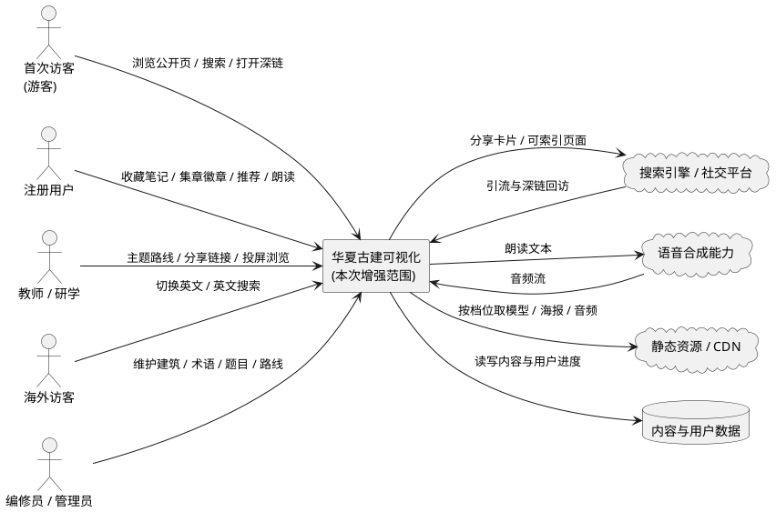
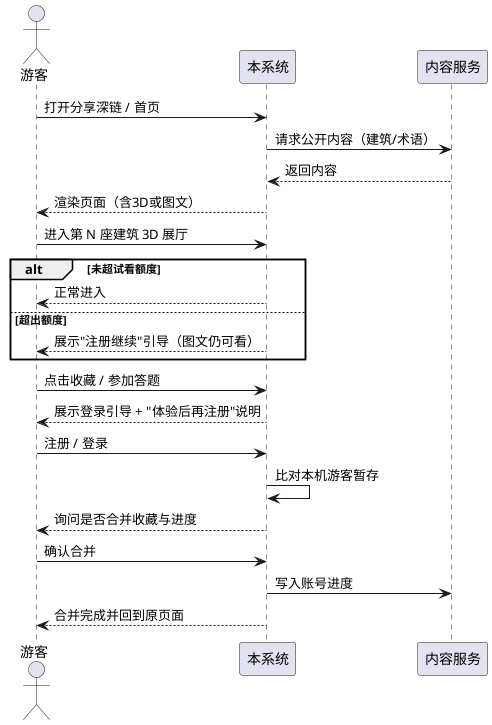
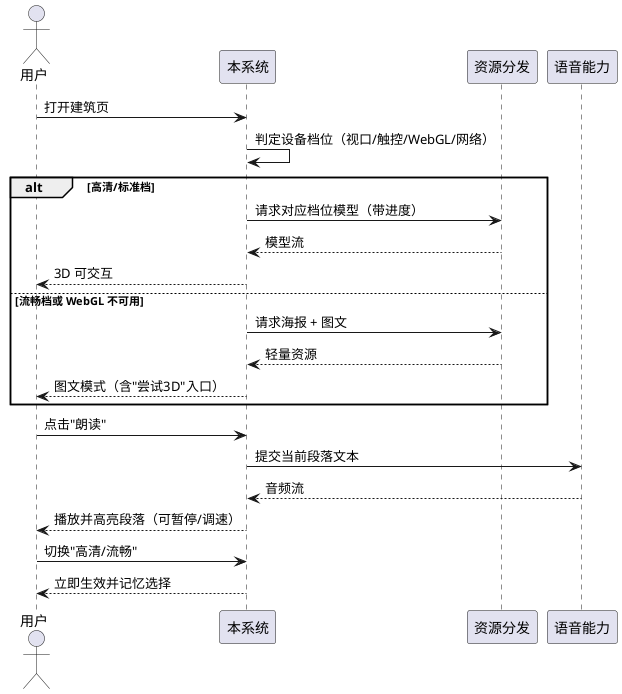
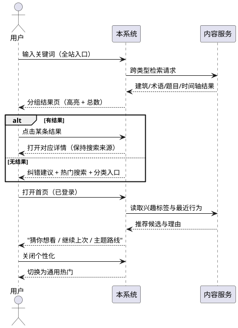
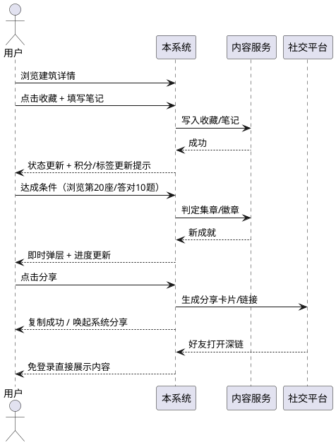
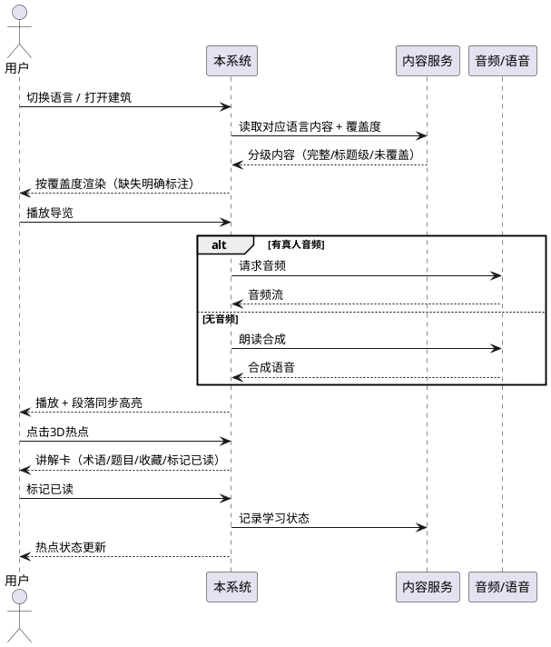

# 华夏古建可视化 · 大众化能力增强 需求规格

> 本文件为**需求规格（What / Why）**，不含实现方案、数据库设计、接口参数与代码结构。
> 文中出现的文件路径、现有接口名称仅作为**需求落点引用**，用于评估影响面与可追溯性。

| 项 | 内容 |
|---|---|
| 文档编号 | REQ-PUBLIC-001 |
| 版本 | v1.0 |
| 状态 | 待评审 |
| 主题 | 提升项目的大众性 / 普适性（降低门槛、扩大受众、增强传播与留存） |
| 需求来源 | 项目现状分析 + 产品目标对齐 |
| 关联代码库 | `D:\Ancient-architecture\ac1.1\acvisual 4` |
| 业务代码改动 | 无（本文档阶段不修改任何业务代码） |
| 下游阶段 | 实现方案（design）、编码任务（tasks）由后续阶段负责 |

---

# 1. 组件定位

## 1.1 核心职责

本组件负责把"中国古建筑 3D 可视化科普网站"从**面向已注册爱好者的深度工具**升级为**面向大众的公共文化产品**，核心价值是让未注册、非专业、移动端、海外与无障碍需求的用户都能在 30 秒内获得有效内容，并具备可传播、可留存、可复访的闭环。

## 1.2 核心输入

| 输入 | 来源 | 内容概要 |
|---|---|---|
| 匿名浏览请求 | 搜索引擎、社交分享链接、直接访问 | 建筑列表、建筑详情、3D 模型、百科术语、时间轴、地图等只读内容请求 |
| 注册用户行为 | 已登录用户 | 浏览时长、收藏、笔记、答题、签到、皮肤切换、分享行为 |
| 内容档案 | 管理员 / 编修台 | 建筑档案（20 座：故宫 10 + 华夏名筑 7 + 程序化复原 3）、术语 25 条、题库 108 题、模型 176MB、图片 55MB |
| 设备与网络信号 | 浏览器 | 视口尺寸、触控能力、WebGL 支持、`devicePixelRatio`、`prefers-reduced-motion`、网络有效类型 |
| 语言偏好 | 浏览器 / 用户选择 | `zh-CN` / `en`（当前仅中文） |
| 搜索与筛选条件 | 用户 | 关键词、建筑类型、地区、朝代、术语分类、题目分类 |

## 1.3 核心输出

| 输出 | 目标 | 内容概要 |
|---|---|---|
| 公开可读内容页 | 游客与搜索引擎 | 建筑主页、详情、百科、时间轴、地图、展览页的可索引 HTML |
| 3D / 图文浏览体验 | 全量访客 | 按设备档位自适应的 3D 场景、海报占位、拆解与热点讲解 |
| 搜索结果 | 全量访客 | 跨建筑 / 术语 / 题目的统一检索结果与命中高亮 |
| 分享与深链 | 社交平台、IM | 可预览的分享卡片、免登录可打开的详情深链、二维码/复制链接 |
| 学习与成就进度 | 注册用户 | 收藏与笔记、集章（20 座）、徽章进度、推荐内容、朗读播放 |
| 个性化推荐 | 注册用户 | "猜你想看 / 下一站" 建筑与术语推荐 |
| 运营与质量指标 | 项目方 | 匿名漏斗指标、性能指标、错误率、搜索零结果率 |
| 多语言内容 | 海外访客 | 中/英双语导航、建筑名与简介、百科与题目（按覆盖度分级） |

## 1.4 职责边界（明确不做）

1. **不做**实时多人同游、语音房、弹幕等强社交能力。
2. **不做**在线支付、会员订阅、实体票务与文创电商。
3. **不做**用户上传视频/3D 模型的公开托管（编修台仍为管理员受控上传）。
4. **不做**替代专业学术数据库（不做论文级考据、版本校勘、专业测绘数据发布）。
5. **不做**原生 App 与小程序（本期只做 Web，含移动端 Web）。
6. **不做**线下场馆导览硬件对接与室内定位。
7. **不做**账号体系重构（沿用现有 JWT 登录与用户表语义）。

---

# 2. 项目现状与大众化差距

## 2.1 能力基线（带证据）

| 能力域 | 现状 | 大众化判断 | 证据（文件 / 行为） |
|---|---|---|---|
| 访问门槛 | 除首页 `/` 与 `/login` 外，`/gallery`、`/map`、`/timeline`、`/encyclopedia`、`/quiz`、`/exhibition/:id`、`/douba-eighteen`、`/profile` 全部走 `ProtectedRoute`，未登录直接跳 `/login` | **阻断级** | `client/src/App.jsx:21-25,44-141` |
| 公开读接口 | `/api/palaces`、`/api/palaces/search`、`/api/palaces/filter`、`/api/encyclopedia` 无需鉴权（仅写操作需管理员） | 有利条件，可直接复用 | `server/src/routes/palaces.js:65-200,391+`；`server/src/app.js:28-34` |
| 首页发现能力 | 首页有海报轮播、类型/地区/朝代筛选、客户端关键词过滤、分页（`PAGE_SIZE`） | 仅覆盖建筑，未跨内容 | `client/src/pages/OverviewPage.jsx:203-242,480-540` |
| 搜索范围 | 侧栏 ⌘K 检索把关键词传给首页做**建筑卡片本地过滤**；不搜百科、不搜题目、不搜时间轴事件；无独立结果页与零结果建议 | 弱 | `client/src/components/OverviewHeader.jsx:64-94,157-167`；`OverviewPage.jsx:252-259` |
| 收藏能力 | 后端收藏/笔记 CRUD 完整（+5 积分、写入兴趣标签），前端 API 已封装，但**详情面板与卡片均无收藏入口**，仅个人中心可看列表 | 半成品（无闭环） | `server/src/routes/auth.js:336-435`；`client/src/api.js:148-162`；`DetailPanel.jsx:147-414`（无收藏按钮） |
| 3D 皮肤 | 4 套皮肤（默认/线稿/雪景/古画）可解锁、可激活，个人中心有完整 UI；但展厅渲染未传入激活皮肤，仅雪景粒子存在实现 | 半成品（不生效） | `server/src/routes/skins.js:16-49`；`ProfilePage.jsx:415-460`；`HomePage.jsx:336`（未传 `activeSkin`）；`ModelViewer.jsx:254-270,630` |
| 成就徽章 | 12 枚徽章种子；仅 `quiz_correct`（答题）与 `consecutive_signin`（签到）有发放逻辑；`login_count`、`palaces_viewed`、`collections_count`、`points`、`badges_count`、`quiz_all_categories` 无发放触发 | 多数不可获得 | `server/db/init_full.sql:706-718`；`server/src/routes/quiz.js:362-397,505-545`；`signin.js:137-170` |
| 集章 | 个人中心按 **10 座** 计算（`stampsTotal = 10`，印章表仅 10 个 id），实际建筑 20 座 | 数据口径错误 | `ProfilePage.jsx:88-105` |
| 个性化推荐 | `tagEngine` 有浏览/收藏/答题权重更新与阈值查询（5.0），但**无推荐查询接口、无推荐结果读取**；`user_recommendations` 表无任何读写；`PALACE_TAGS` 仅覆盖 10 座故宫 | 数据层有、产品层无 | `server/src/services/tagEngine.js:20-32,126-153`；`init_full.sql:258-270`；前端无 `recommend` 调用 |
| 语音讲解 | `audio_guide` 字段有内容；详情页"语音讲解"实为**展开文字**，无音频/TTS 播放 | 名不副实 | `DetailPanel.jsx:216-238`；`CuratorPage.jsx:918-925` |
| 视频 | `has_video`、`video_url` 字段存在；`videos/forbidden-city/` 为空目录；展览页无播放器 | 资源与呈现双缺 | `ExhibitionPage.jsx`（无 video 引用）；`videos/` 仅 4KB |
| 热点讲解 | 3D 热点系统、热点信息卡、建筑热点数据存在；但与收藏、答题、足迹、推荐无任何联动 | 单点能力 | `client/src/components/HotspotSystem.jsx`、`HotspotInfoCard.jsx`、`client/src/data/buildingHotspots.js` |
| 移动端 | 有 26 处 `@media`（`global.css`）与触摸事件；但 3D 画质固定 `antialias: true`、`powerPreference: 'high-performance'`，无 `dpr` 上限、无低模、无海报回退；模型单件 3.5–33MB | 可用但"重" | `ModelViewer.jsx:493-497`；`ExhibitionViewer.jsx:75-78`；`models/` 176MB |
| 无障碍 | 局部有 `aria-label` / `aria-expanded`，模型支持 `prefers-reduced-motion`；无跳转链接、无焦点管理规范、无朗读、无对比度声明 | 基线不足 | `OverviewHeader.jsx:105-124`；`ModelViewer.jsx:312-324`；`DetailPanel.jsx:219-233` |
| 多语言 | 全站中文硬编码；`palaces.name_en` 字段存在；`index.html lang="zh-CN"`；无语言切换与路由策略 | 无 | `client/index.html:2`；`server/db/init_full.sql:273` |
| 分享传播 | 无 `navigator.share`、无复制链接、无 OG/Twitter 卡片、无分享海报；深链 `/exhibition/:id` 需登录，外部打开会跳登录页 | 无 | 全仓无 `share` / `clipboard.writeText` 调用；`App.jsx:104-111` |
| 游客数据 | 无游客态概念：无匿名会话、无本机暂存、无注册后迁移 | 无 | `AuthContext.jsx:27-121`（仅已登录态） |
| 内容规模 | 建筑 20 座、术语 25 条、题目 108 题、视频 0 | 偏薄 | `init_full.sql` 种子数据；`models/` 目录 |
| 质量保障 | 无测试目录、根 `package.json` 无测试脚本；仅 Playwright 截图脚本 | 无 | `test/` 不存在；`package.json:6-12` |

## 2.2 五条精炼结论

1. **最大的大众化障碍不是内容质量，而是登录墙与"半成品功能"的观感**：深度内容全部被登录拦截，而已登录后收藏、皮肤、推荐、音频又多为"看得见入口、用不出效果"。
2. **发现能力只覆盖"建筑卡片过滤"**：搜索不跨百科/题库/时间轴，无独立结果页，无零结果兜底，用户找不到内容就会离开。
3. **留存机制存在系统性断点**：集章按 10 座算（实际 20 座）、9 类徽章条件无发放逻辑、皮肤不生效——用户完成行为后**拿不到反馈**，成长体系失效。
4. **移动端与低配设备缺少"可降级路径"**：176MB 模型 + 固定高画质渲染，弱网/低端机上首屏与 3D 体验不可控，这是大众流量的主要流失点。
5. **传播与国际化是空白**：没有分享卡片、没有免登录深链、没有双语入口，内容无法在社交与搜索场景二次分发，海外受众不可达。

## 2.3 差距清单（GAP → 需求映射）

| GAP | 差距描述 | 影响 | 对应需求 |
|---|---|---|---|
| GAP-01 | 除首页/登录页外全部需登录 | 游客无法验证价值即被要求注册，转化断崖 | REQ-01, REQ-02, REQ-03 |
| GAP-02 | 无游客态数据与"先体验后注册"路径 | 注册动机弱、体验割裂 | REQ-02, REQ-03, REQ-19 |
| GAP-03 | 3D 无画质分级、无低模、无海报回退 | 移动端/低配机卡顿、流量浪费、跳出 | REQ-05, REQ-06, REQ-07 |
| GAP-04 | 无障碍基线缺失、无朗读 | 排除老年/视障/听障与课堂投屏场景 | REQ-08, REQ-09 |
| GAP-05 | 搜索仅建筑本地过滤、无结果页 | 内容"找不到" | REQ-11, REQ-12 |
| GAP-06 | 无主题路线与场景化导览 | 首次访客不知从哪看起 | REQ-13, REQ-15 |
| GAP-07 | 推荐数据层有、产品层无 | 复访无个性化 | REQ-14 |
| GAP-08 | 无分享、无深链、无 OG 卡片 | 无法社交传播与搜索收录 | REQ-16 |
| GAP-09 | 收藏后端完备但前端无入口 | 用户想收藏却做不到 | REQ-17 |
| GAP-10 | 集章 10 座口径、徽章多数不可获得 | 成长体系失效、信任受损 | REQ-18 |
| GAP-11 | 皮肤可解锁但不生效 | "付费"（积分）后无反馈，负面体验 | REQ-20 |
| GAP-12 | 多语言缺失 | 海外受众与双语教学场景不可达 | REQ-22 |
| GAP-13 | 语音讲解仅文本、视频无资源 | 通勤/亲子/低视力场景不可用 | REQ-09, REQ-23, REQ-24 |
| GAP-14 | 热点无闭环 | 3D 交互价值未转化为学习与留存 | REQ-25 |
| GAP-15 | 内容广度不足（20 座/25 术语/108 题） | 复访内容消耗快 | REQ-26 |
| GAP-16 | 无埋点、无测试 | 改动无法验证、无法量化大众化效果 | REQ-29, REQ-30, REQ-31 |

---

# 3. 领域术语

**游客（Anonymous Visitor）**
: 未登录或未注册、仅以匿名会话访问公开内容的访问者。

**匿名会话（Anonymous Session）**
: 游客在本机浏览器中产生的临时身份与行为暂存，不写入用户账号数据，可由用户主动清除。

**试看额度（Preview Quota）**
: 游客在免登录状态下可访问的深度内容上限，按"内容条目数 + 交互次数"定义，而非按时间定义。

**设备档位（Device Tier）**
: 依据视口、触控、GPU/WebGL 能力与网络状况划分的渲染档位，至少包含"精简 / 标准 / 高清"三档。
: 备注：对外文案建议使用"流畅 / 标准 / 高清"，避免技术术语。

**降级路径（Graceful Degradation）**
: 当 3D 不可用或性能不足时，自动切换为静态海报 + 图文讲解 + 关键构件的等价替代方案，**不丢失核心知识信息**。

**朗读（Read-Aloud）**
: 将建筑简介、讲解稿、术语正文转为可听语音，支持播放/暂停/语速/进度，与"语音讲解"共用同一入口。

**集章（Stamp Collection）**
: 用户"到访"某座建筑后获得的虚拟印章，集章总数为**当前在架建筑总数**（当前为 20），需随内容扩充自动扩展。

**成就闭环（Achievement Loop）**
: "行为发生 → 条件判定 → 即时反馈 → 权益/展示 → 下一目标提示"的完整链路；任一环节缺失即视为未闭环。

**深链（Deep Link）**
: 可直接定位到某座建筑、某条术语、某道题或某个展览状态的 URL，游客打开后**不跳登录页**。

**全局搜索（Global Search）**
: 跨建筑、百科术语、题目、时间轴事件的统一检索，含分组结果、命中高亮、零结果建议。

**主题路线（Curated Route）**
: 由内容侧编排的、有叙事顺序的建筑集合（如"中轴线一日""木构入门""屋顶等级"），带预计时长与顺序导航。

**个性化推荐（Personalized Recommendation）**
: 基于用户兴趣标签权重与行为，给出"猜你想看""下一站""继续上次"等推荐位。

**双语内容（Bilingual Content）**
: 同一内容对象具备中文与英文两套可展示文案，允许按字段分级覆盖（完整 / 仅标题 / 未覆盖）。

**内容覆盖度（Content Coverage）**
: 某语言下已具备可用文案的内容对象占比，用于对外说明与内部验收，不等同于"翻译完成率"。

---

# 4. 角色与边界

## 4.1 核心角色

| 角色 | 职责与特征 | 主要诉求 |
|---|---|---|
| 首次访客 | 从搜索/社交链接进入，停留 30 秒内决定去留 | 不注册也能立刻看到"这网站有什么"、能打开 3D 或图文 |
| 学生 / 亲子用户 | 课后自学、家长陪看，多在手机/平板上 | 内容好懂、能听、能收藏、有测验与成就感 |
| 教师 / 研学组织者 | 备课、课堂投屏、组织参观前预习 | 主题路线、可分享链接、可打印/可投屏、双语 |
| 海外访客 / 双语学习者 | 英文界面或中英对照 | 英文导航与核心介绍、英文搜索 |
| 注册用户 | 已登录的深度使用者 | 收藏笔记、集章、徽章、推荐、皮肤、跨设备同步 |
| 内容编修员 / 管理员 | 维护建筑档案、术语、题目 | 新增内容后无需改代码即可进入搜索/集章/推荐 |
| 运营 / 项目方 | 关注增长与质量 | 漏斗指标、零结果率、性能与错误率 |

## 4.2 外部系统

| 系统 | 交互内容 |
|---|---|
| 浏览器 / WebGL 运行环境 | 渲染 3D、提供语音合成、分享 API、本地暂存、无障碍辅助技术 |
| 搜索引擎与社交平台 | 抓取公开页、生成分享预览卡片、承接深链流量 |
| 语音合成服务（浏览器内置或外部 TTS） | 将讲解文本转为音频流，提供语速与音色 |
| 静态资源与 CDN | 分发模型、图片、音频、视频；决定首包体积与弱网表现 |
| 用户与内容数据库 | 账号、收藏、笔记、集章、徽章、标签、内容档案 |
| 监控与日志平台 | 收集匿名漏斗、性能、错误与搜索质量指标 |

## 4.3 交互上下文



---

# 5. DFX 约束

> 所有指标均为可量化、可验证的验收红线；未达标不得进入发布。

## 5.1 性能

| 编号 | 约束 | 验收方式 |
|---|---|---|
| DFX-P1 | 首页（4G、中端安卓、冷启动）LCP ≤ 2.5s，CLS ≤ 0.1 | Lighthouse / 真机 |
| DFX-P2 | 建筑详情页（图文版）首屏可读 ≤ 3s（4G） | Lighthouse / 真机 |
| DFX-P3 | 3D 展厅首帧可交互 ≤ 4s（4G 标准档）/ ≤ 8s（3G 精简档） | 真机 + 网络限速 |
| DFX-P4 | 3D 交互帧率：桌面高清档 ≥ 50fps；中端机标准档 ≥ 30fps；低端机精简档 ≥ 24fps | 真机帧率采样 |
| DFX-P5 | 模型首包：精简档 ≤ 1.5MB，标准档 ≤ 8MB，高清档按现有资源 | 资源审计 |
| DFX-P6 | 全局搜索 P95 ≤ 500ms（含跨类型聚合） | 压测 |
| DFX-P7 | 分享卡片生成/打开 ≤ 2s；分享页首屏 ≤ 2.5s | 真机 |
| DFX-P8 | 朗读启动 ≤ 1s，暂停/续播响应 ≤ 300ms | 手工验收 |
| DFX-P9 | 语言切换 ≤ 300ms（不整页白屏） | 手工验收 |
| DFX-P10 | 静态海报替代图单张 ≤ 300KB（WebP/AVIF 优先） | 资源审计 |

## 5.2 可靠性

| 编号 | 约束 |
|---|---|
| DFX-R1 | 公开内容页月度可用性 ≥ 99.5% |
| DFX-R2 | 游客会话与本地暂存数据丢失不影响主流程；服务端不可用时，公开页至少可展示缓存/静态兜底 |
| DFX-R3 | 收藏、笔记、集章、徽章写入具备幂等语义：重复提交不得产生重复记录或重复积分 |
| DFX-R4 | 3D 加载失败必须有可解释的降级结果（海报 + 图文），不得出现永久空白舞台 |
| DFX-R5 | 分享链接长期有效，内容下线时返回"该内容已调整"提示页而非 404 死链 |

## 5.3 安全性

| 编号 | 约束 |
|---|---|
| DFX-S1 | 公开只读接口不得返回用户隐私字段（邮箱、密码哈希、积分明细） |
| DFX-S2 | 游客态不采集可识别个人身份的信息；匿名标识不得跨站复用 |
| DFX-S3 | 收藏笔记为私有内容，仅本人可读；若未来开放公开笔记，必须经用户显式同意 |
| DFX-S4 | 分享链接不得携带令牌或会话信息；链接中的内容 ID 需做存在性校验 |
| DFX-S5 | 对外暴露的搜索与推荐接口需具备频率限制，防止枚举与爬取 |
| DFX-S6 | 未成年人相关内容不得包含外链社交登录与个性化广告能力 |

## 5.4 可维护性与可观测性

| 编号 | 约束 |
|---|---|
| DFX-M1 | 新增建筑、术语、题目、路线仅通过编修台/种子数据即可进入搜索、集章、推荐，无需改前端代码 |
| DFX-M2 | 必须可采集：匿名访问量、试看→注册转化率、搜索次数/零结果率、分享点击、收藏转化、集章完成率、朗读使用率 |
| DFX-M3 | 指标采集需匿名化，且提供"是否允许统计"的说明与关闭方式 |
| DFX-M4 | 关键路径（登录、收藏、答题、集章）必须可在日志中定位失败原因，不记录明文密码与令牌 |

## 5.5 兼容性

| 编号 | 约束 |
|---|---|
| DFX-C1 | Chrome / Edge / Safari / Firefox 最近两个大版本可用；iOS Safari 与 Android Chrome 为主力移动端 |
| DFX-C2 | 不支持 WebGL2 的环境进入图文降级模式，功能不缺失 |
| DFX-C3 | 视口 320px–2560px 均可完成核心任务（浏览、搜索、收藏、朗读） |
| DFX-C4 | 现有 URL 与既有数据字段保持兼容；新增语言与路由不得破坏既有链接 |
| DFX-C5 | 新增字段/内容缺失时按"未覆盖"优雅展示，不得出现 `undefined`、空块或报错 |

## 5.6 无障碍（WCAG 2.1 AA 基线）

| 编号 | 约束 |
|---|---|
| DFX-A1 | 核心页面 Lighthouse 无障碍评分 ≥ 90 |
| DFX-A2 | 全站可用键盘完成：导航、搜索、打开详情、收藏、播放朗读、关闭弹层 |
| DFX-A3 | 焦点可见且顺序合理；弹层打开时焦点锁定，关闭后焦点回归触发元素 |
| DFX-A4 | 正文文本对比度 ≥ 4.5:1，大字号 ≥ 3:1；不得仅以颜色传达状态 |
| DFX-A5 | 所有图片/3D 场景提供替代文本或等价文字说明；装饰元素对辅助技术隐藏 |
| DFX-A6 | 尊重 `prefers-reduced-motion`：自动巡游、粒子、转场需降级或关闭 |
| DFX-A7 | 表单与筛选控件具备可读标签；错误提示需被辅助技术播报 |
| DFX-A8 | 朗读功能可关闭、可调速、可暂停，且不自动播放 |

## 5.7 国际化

| 编号 | 约束 |
|---|---|
| DFX-I1 | 语言可切换且记忆用户选择；未登录用户用浏览器语言匹配 |
| DFX-I2 | 语言切换后当前内容位置不丢失（停留在同一建筑/术语） |
| DFX-I3 | 数字、年代、单位（米/平方米/公里）在英文下表达正确，不出现中英混排乱码 |
| DFX-I4 | 英文覆盖度对外可见（如"部分内容提供英文"），不得以中文冒充英文 |

---

# 6. 核心能力

> 每个主题包含：需求卡（价值/问题/范围/影响面）、业务规则（含规则级验收）、交互流程、异常场景。

## 6.1 主题 A：门槛降低（游客可看、可试、可转化）

**主题目标**：让未注册用户在 30 秒内看到"值得看的内容"，并在产生兴趣后再引导注册，而不是先拦门。

### 6.1.1 需求清单

| 编号 | 需求 | 优先级 | 目标用户 | 解决的具体问题 |
|---|---|---|---|---|
| REQ-01 | 游客免登录只读浏览 | P0 | 首次访客、搜索/社交流量 | GAP-01：登录墙导致首访即流失 |
| REQ-02 | 游客试看深度与轻互动额度 | P0 | 首次访客、学生 | GAP-02：无法验证深度内容价值 |
| REQ-03 | 渐进式注册与游客数据迁移 | P1 | 体验后的游客 | GAP-02：注册后进度清零、体验割裂 |
| REQ-04 | 免登录的轻测评体验 | P1 | 学生、亲子 | 答题被登录拦住，缺少"玩一下"的钩子 |

### 6.1.2 业务规则

1. **公开只读范围**：游客必须可访问首页、建筑详情（图文 + 3D 展厅）、沉浸展览、百科、时间轴、地图、十八斗拆解页。
   a. 验收条件：[未登录访问 `/gallery`、`/encyclopedia`、`/timeline`、`/map`、`/exhibition/:id`、`/douba-eighteen`] → [页面正常渲染，不跳转 `/login`]。
2. **公开内容深度**：游客可查看完整建筑简介、关键数据、沿革、典故、图影、热点讲解文字；可操作 3D 旋转/缩放/拆解。
   a. 验收条件：[游客打开任一座建筑详情] → [内容区块与登录用户一致，不出现"登录后查看"遮挡]。
3. **游客受限项必须显式**：收藏、笔记、答题计分、签到、皮肤激活、个人进度为登录后能力；入口必须可见，点击后弹出"登录即可保存进度"的说明，禁止静默消失或直接跳转。
   a. 验收条件：[游客点击收藏] → [出现登录引导弹层，说明收藏可跨设备同步]。
4. **试看额度**：游客可完整浏览 3 座建筑的 3D 展厅与 1 次 5 题轻测评；超出后展示"继续体验需注册"的引导，但**仍允许查看图文详情**。
   a. 验收条件：[游客第 4 次进入不同建筑的 3D 展厅] → [展示引导而非硬拦截，图文详情仍可打开]。
5. **禁止项**：禁止在未登录时丢失用户已产生的内容（如试看进度、轻测评成绩）；禁止用弹窗阻断页面首屏阅读。
   a. 验收条件：[游客关闭浏览器再打开同站] → [本机仍保留其试看计数与最近浏览，不外泄到服务端账号数据]。
6. **游客数据迁移**：游客在本机产生的收藏暂存、笔记草稿、试看进度，在注册/登录后必须提供"合并到我的账号"的明确选择。
   a. 验收条件：[游客暂存 2 条收藏后注册] → [提示合并，确认后收藏出现在个人中心]。
7. **轻测评**：游客可完成一轮 5 题测评并看到得分与解析；结果仅存本机，不进入排行榜。
   a. 验收条件：[游客完成测评] → [显示得分与解析，榜单入口提示登录后参与]。

### 6.1.3 交互流程



### 6.1.4 异常场景

1. **游客暂存损坏**
   a. 触发条件：本机存储不可读或被清除。
   b. 系统行为：按"无暂存"处理，不报错，不阻塞浏览。
   c. 用户感知：不出现异常提示；注册后仅提示"无可合并的本地记录"。
2. **合并冲突**
   a. 触发条件：本机暂存的收藏已在账号中存在。
   b. 系统行为：以账号数据为准，跳过重复项，不重复计分。
   c. 用户感知："已合并 N 条，M 条已存在"。
3. **试看额度被绕过**
   a. 触发条件：用户清除本机数据后重复试看。
   b. 系统行为：允许继续试看（不做过强风控），但引导文案保持；不产生账号数据。
   c. 用户感知：无惩罚性提示。
4. **深链内容不存在**
   a. 触发条件：分享的建筑/术语已下线。
   b. 系统行为：展示"内容已调整"页并推荐相邻内容。
   c. 用户感知：可见的友好提示与替代入口。

### 6.1.5 影响面（需求落点）

| 层 | 需要改造/新增的落点 |
|---|---|
| 前端路由 | `client/src/App.jsx` 的 `ProtectedRoute` 需按路由区分"公开只读 / 需登录写入"；`/profile`、`/curator` 保持受保护 |
| 前端页面 | `HomePage.jsx`（移除登录前置、保留个人化能力判断）、`DetailPanel.jsx`（收藏/笔记入口按登录态分支）、`QuizPage.jsx`（游客模式）、`ProfilePage.jsx`（未登录引导） |
| 前端状态 | `client/src/context/AuthContext.jsx` 增加匿名会话/本机暂存语义（不改账号体系） |
| 后端接口 | 复用公开读接口 `GET /api/palaces`、`/api/palaces/search`、`/api/palaces/filter`、`/api/encyclopedia`；收藏/答题/签到继续使用 `server/src/routes/auth.js`、`quiz.js`、`signin.js` 的鉴权接口 |
| 后端新增 | 游客不写入账号数据；如需要，提供"合并本地记录"的受保护写入入口（复用现有收藏/历史接口语义） |
| 数据 | 复用 `users`、`user_collections`、`user_history` 现有语义，不改变账号模型 |

---

## 6.2 主题 B：体验适配（移动端、低配、弱网、无障碍、朗读）

**主题目标**：让内容在低端手机、弱网、投屏、以及需要"听"的场景下都可用，做到"3D 不可用也不丢知识"。

### 6.2.1 需求清单

| 编号 | 需求 | 优先级 | 目标用户 | 解决的具体问题 |
|---|---|---|---|---|
| REQ-05 | 设备能力探测与画质档位 | P0 | 移动端、低配机 | GAP-03：模型重、渲染固定高画质 |
| REQ-06 | 移动端布局与触控手势规范 | P0 | 手机/平板用户 | 三栏布局在窄屏可用性差、手势冲突 |
| REQ-07 | 弱网与加载体验 | P1 | 通勤/流量受限用户 | 加载无进度、失败无兜底 |
| REQ-08 | 无障碍基线 | P0 | 老年、视障、键盘用户 | GAP-04：不可键盘操作、语义缺失 |
| REQ-09 | 讲解朗读 | P0 | 通勤、亲子、低视力、听障辅助 | GAP-13：语音仅文本 |
| REQ-10 | 视觉一致性与液态玻璃规范 | P2 | 全量用户 | 新增页面风格漂移、品牌感弱 |

### 6.2.2 业务规则

1. **档位自动判定**：系统必须依据视口宽度、触控能力、WebGL2 支持、`devicePixelRatio` 与网络状况自动选择"流畅 / 标准 / 高清"档，并允许用户手动覆盖。
   a. 验收条件：[在 4.7 英寸、2GB 内存级别安卓机首次进入 3D] → [进入"流畅"档，不尝试加载高清模型]。
2. **降级不丢信息**：任何档位下都必须可获取建筑简介、关键数据、沿革、典故、图影与热点文字；3D 不可用时以海报 + 图文替代。
   a. 验收条件：[禁用 WebGL 打开展厅] → [展示海报与图文讲解，并提示"当前设备以图文模式浏览"]。
3. **模型按需加载**：模型资源必须按档位与可见性加载；同一页面不得同时预取多个高清模型。
   a. 验收条件：[在展厅切换 5 座建筑] → [仅当前建筑模型被加载，内存不持续增长至崩溃]。
4. **移动端主任务可用**：320px 宽度下必须可完成"筛选 → 打开详情 → 收藏 → 朗读 → 分享"。
   a. 验收条件：[320×568 视口] → [无横向滚动，主按钮可点击，弹层不超出视口]。
5. **触控手势**：3D 单指旋转、双指缩放、双击复位；不得与页面滚动冲突；提供显式"复位视角"按钮。
   a. 验收条件：[在 3D 区域上滑] → [页面滚动按预期或明确提示手势区域，不出现"卡住"感]。
6. **加载反馈**：模型加载必须显示进度与预计等待；超过 8s 提供"切换图文模式"按钮。
   a. 验收条件：[3G 网络加载模型 8s 未完成] → [出现"切换图文模式"入口]。
7. **无障碍基线**：核心页面满足 DFX-A1~A8；提供"跳到主内容"链接；所有交互控件有可读名称与状态。
   a. 验收条件：[仅用 Tab + Enter 浏览首页到详情] → [可完成全部主任务，焦点可见]。
8. **朗读能力**：建筑简介与讲解稿必须可朗读；支持播放/暂停/继续/停止、语速 0.75×–1.5×、音色切换（可用时）；朗读时高亮对应段落。
   a. 验收条件：[点击朗读] → [开始播报，当前段落高亮；切换段落后续播不重头]。
9. **朗读不自动播放**：进入页面不得自动发声；必须由用户显式触发。
   a. 验收条件：[打开详情页] → [无自动音频；仅显示朗读按钮]。
10. **视觉一致性**：新增/改造页面必须沿用现有"宣纸底 + 朱红强调 + 宋体"设计语言；可在导航、弹层、卡片上使用现有液态玻璃/毛玻璃质感（`liquid-glass-react`、`LiquidEther`）以强化品牌，但不得牺牲正文可读性与对比度。
    a. 验收条件：[新增搜索结果页/分享页] → [与首页视觉同源；正文对比度仍满足 DFX-A4]。

### 6.2.3 交互流程



### 6.2.4 异常场景

1. **低内存导致 3D 崩溃**
   a. 触发条件：移动端加载大模型时上下文丢失/崩溃。
   b. 系统行为：捕获失败，自动切换图文模式并降低档位记忆。
   c. 用户感知："已切换为图文模式，可在设置中重试 3D"。
2. **语音合成不可用**
   a. 触发条件：浏览器不支持或用户拒绝语音。
   b. 系统行为：隐藏朗读按钮或置灰并说明；保留完整文字稿与"复制讲解词"。
   c. 用户感知："当前浏览器不支持朗读，可阅读文字稿"。
3. **网络中途断开**
   a. 触发条件：模型/音频加载中断。
   b. 系统行为：保留已加载内容，提供重试；不整页报错。
   c. 用户感知：局部重试按钮与"切换图文"。
4. **用户强制减少动画**
   a. 触发条件：系统开启"减少动态效果"。
   b. 系统行为：关闭自动巡游、粒子、转场；3D 保持静态可交互。
   c. 用户感知：无眩晕型动画。
5. **朗读与页面切换冲突**
   a. 触发条件：朗读中切换建筑。
   b. 系统行为：停止当前朗读并询问是否朗读新内容（或按用户偏好自动停止）。
   c. 用户感知：不出现两段音频叠加。

### 6.2.5 影响面（需求落点）

| 层 | 需要改造/新增的落点 |
|---|---|
| 前端渲染 | `ModelViewer.jsx`（`Canvas` 的 `antialias` / `powerPreference` / `dpr` 需按档位变化）、`ExhibitionViewer.jsx`、`EighteenDouViewer.jsx`（同一档位策略） |
| 前端能力探测 | 新增设备档位判定与用户覆盖（本机记忆）；`ModelViewer.jsx:312-324` 已有 `prefers-reduced-motion` 可复用 |
| 前端布局 | `global.css`、`hall.css`、`overview.css` 的断点与三栏/侧栏布局；`OverviewHeader.jsx` 的抽屉导航 |
| 前端朗读 | `DetailPanel.jsx:216-238` 的"语音讲解"扩展为播放器；百科页正文复用同一朗读组件 |
| 前端无障碍 | `OverviewHeader.jsx`、`DetailPanel.jsx`、`HomePage.jsx` 的语义标签、焦点管理、跳转链接 |
| 后端/资源 | 模型与海报的档位化资源组织（`models/`、`images/posters`）、按档位返回资源的静态服务策略（`server/src/app.js:18-26`） |
| 资源 | 需补充低模或等价轻量资源；`models/` 当前 176MB，单件 3.5–33MB |

---

## 6.3 主题 C：内容发现（搜索、导航、路线、推荐）

**主题目标**：让用户"想找什么都能找到，不知道看什么也有得看"。

### 6.3.1 需求清单

| 编号 | 需求 | 优先级 | 目标用户 | 解决的具体问题 |
|---|---|---|---|---|
| REQ-11 | 全局搜索（跨建筑/术语/题目/时间轴） | P0 | 全量用户 | GAP-05：搜索只在首页过滤建筑 |
| REQ-12 | 统一分类 / 标签 / 朝代导航 | P1 | 学生、教师 | 分类分散在不同页面，心智不统一 |
| REQ-13 | 主题导览路线 | P1 | 首次访客、教师 | GAP-06：不知道从哪看起 |
| REQ-14 | 个性化推荐 | P1 | 注册用户 | GAP-07：推荐数据层空转 |
| REQ-15 | 相关推荐与"下一站"增强 | P1 | 全量用户 | 详情页相关建筑仅按相邻/同类，缺少语义相关性 |

### 6.3.2 业务规则

1. **全局搜索范围**：搜索必须覆盖建筑（名称/英文名/简介/标签/地区/朝代/诗句）、百科术语（术语/释义/分类）、题目（题干/解析/分类）、时间轴事件（年份/事件）。
   a. 验收条件：[搜索"斗拱"] → [结果分组展示建筑、术语、题目、时间轴命中，且组内有条数]。
2. **搜索入口**：搜索必须从"仅首页"升级为全站可达（侧栏/顶部常驻），支持快捷键，并支持直接 URL 打开结果页。
   a. 验收条件：[在任意页面按 Ctrl/⌘+K] → [打开搜索框并输入]，[回车后进入独立结果页]。
3. **结果页规则**：结果按类型分组；每组默认展示前 N 条并可"查看更多"；关键词高亮；显示总数。
   a. 验收条件：[搜索"明"命中 12 条] → [显示分组与总数，命中词高亮]。
4. **零结果兜底**：必须有纠错建议、热门搜索、分类入口、推荐内容之一；禁止只显示"无结果"。
   a. 验收条件：[搜索"xyz123"] → [展示热门词与"按类型浏览"入口]。
5. **搜索可被分享**：搜索结果 URL 可复制、可回退、可被直接打开。
   a. 验收条件：[复制搜索结果链接在新标签打开] → [结果一致]。
6. **主题路线**：路线必须包含名称、简介、预计时长、建筑顺序、每站看点；支持"上一站/下一站"与进度记忆。
   a. 验收条件：[进入"中轴线一日"] → [可顺序游览并看到进度 3/8]。
7. **个性化推荐**：注册用户在首页/详情页/个人中心必须看到至少一个推荐位（"猜你想看"/"继续上次"/"下一站"）；推荐结果需可解释（"因为你看过/收藏了…"）。
   a. 验收条件：[用户浏览太和殿 ≥10 秒后回到首页] → [推荐位出现与"外朝/宫殿/屋顶"相关建筑并给出理由]。
8. **冷启动**：无行为数据用户必须获得"热门/新上/主题路线"兜底推荐，不得出现空推荐位。
   a. 验收条件：[新注册用户首次进首页] → [推荐位展示热门或路线，而非空白]。
9. **推荐可关闭**：用户必须可关闭个性化推荐并回到通用排序。
   a. 验收条件：[在设置关闭个性化] → [推荐位改为通用热门，且不再基于标签]。
10. **推荐覆盖面**：推荐内容必须覆盖全部 20 座建筑（当前标签映射仅 10 座故宫），新增建筑自动纳入候选池。
    a. 验收条件：[新增第 21 座建筑并发布] → [可被推荐与搜索命中，无需改代码]。

### 6.3.3 交互流程



### 6.3.4 异常场景

1. **搜索服务超时**
   a. 触发条件：跨类型检索超时。
   b. 系统行为：先返回已完成的类型结果，其他类型显示"加载中/重试"。
   c. 用户感知：部分结果可用，不整页失败。
2. **推荐计算失败**
   a. 触发条件：标签读取异常或候选为空。
   b. 系统行为：回退到热门/新上/路线兜底。
   c. 用户感知：推荐位仍有内容，不暴露错误。
3. **路线中的建筑下线**
   a. 触发条件：路线引用的建筑被删除或隐藏。
   b. 系统行为：跳过该站并提示"该站暂不可用"，保持顺序完整。
   c. 用户感知：路线可继续。
4. **搜索被高频调用**
   a. 触发条件：异常高频请求。
   b. 系统行为：限流并返回友好提示。
   c. 用户感知："操作过于频繁，请稍后再试"。

### 6.3.5 影响面（需求落点）

| 层 | 需要改造/新增的落点 |
|---|---|
| 前端搜索 | `OverviewHeader.jsx:64-94,157-167` 的检索需从"传入首页过滤"升级为独立结果页入口；`OverviewPage.jsx:203-215` 的本地过滤保留为"页内筛选" |
| 前端结果页 | 新增搜索结果页（分组/高亮/零结果/可分享 URL） |
| 前端推荐 | 首页、`DetailPanel.jsx:395-411`、`ProfilePage.jsx` 增加推荐位；`DetailPanel.jsx:74-105` 的相关推荐规则需增强 |
| 后端检索 | 现有 `palaces.js:65-100`（`/search` 已按名称/英文名/简介/分类/标签/地区/诗句排序）可复用；需扩展到百科 `encyclopedia.js`、题库 `quiz.js`、时间轴数据 |
| 后端推荐 | `services/tagEngine.js` 需补齐：标签映射扩展到 20 座、提供"推荐候选 + 理由"查询；`user_recommendations`（`init_full.sql:258-270`）当前无读写，需定义推荐曝光/采纳语义 |
| 内容 | 需新增主题路线数据（名称/顺序/看点/时长），并纳入编修台维护范围 |

---

## 6.4 主题 D：传播留存（分享、收藏、成就、皮肤、转化）

**主题目标**：把"看过"变成"留下、带走、传出去"。

### 6.4.1 需求清单

| 编号 | 需求 | 优先级 | 目标用户 | 解决的具体问题 |
|---|---|---|---|---|
| REQ-16 | 分享与深链 | P0 | 全量用户、社交流量 | GAP-08：无法传播，深链需登录 |
| REQ-17 | 收藏与笔记闭环 | P0 | 注册用户、学生 | GAP-09：有后端无入口 |
| REQ-18 | 成就与集章闭环（20 座） | P0 | 注册用户、学生 | GAP-10：集章口径错误、徽章不可得 |
| REQ-19 | 游客转化引导 | P1 | 游客 | 体验后无自然转化路径 |
| REQ-20 | 皮肤系统生效 | P0 | 注册用户 | GAP-11：解锁后不生效 |
| REQ-21 | 排行榜与轻社交 | P2 | 学生、竞赛型用户 | 缺少同伴激励与回访理由 |

### 6.4.2 业务规则

1. **分享入口**：每座建筑详情、每条百科术语、每条搜索结果页、每个主题路线必须提供分享入口（系统分享 / 复制链接 / 二维码至少其一可用）。
   a. 验收条件：[在建筑详情点击分享] → [至少一种分享方式成功，且链接可被他人打开]。
2. **分享卡片**：分享链接必须生成标题、摘要、封面图；封面优先使用建筑海报，缺省使用统一品牌图。
   a. 验收条件：[把链接粘贴到聊天工具] → [出现含建筑名与封面的预览卡片]。
3. **深链免登录**：分享链接指向的公开内容必须游客可直接查看，不得跳登录页；需要登录的操作在页内引导。
   a. 验收条件：[未登录打开 `/exhibition/taihedian`] → [直接看到内容，收藏时提示登录]。
4. **分享统计**：分享行为与分享带来的访问需可统计（匿名聚合），用于评估传播效果。
   a. 验收条件：[分享后产生访问] → [后台可看到该分享来源的访问计数]。
5. **收藏入口**：建筑卡片、详情面板、3D 展厅、搜索结果、热点信息卡必须提供收藏入口，并即时反馈状态（已收藏/未收藏）。
   a. 验收条件：[在详情页点击收藏] → [按钮变为已收藏，个人中心"珍宝阁"立即出现该条目]。
6. **笔记能力**：收藏必须支持附加笔记（文本，长度上限需定义），可编辑、可删除；笔记仅本人可见。
   a. 验收条件：[为建筑写 200 字笔记并保存] → [再次打开详情可看到并编辑；其他用户不可见]。
7. **收藏分类**：收藏支持至少"默认/想去/已研究/教学素材"分类，可筛选。
   a. 验收条件：[收藏时选择"教学素材"] → [珍宝阁可按该分类筛选]。
8. **收藏与足迹一致**：同一建筑重复收藏不重复计数、不重复积分；取消收藏后再次收藏按"更新"处理。
   a. 验收条件：[连续收藏/取消 3 次] → [收藏数始终为 0 或 1，积分不重复增加]。
9. **集章口径**：集章总数必须等于当前在架建筑总数（当前 20），并随建筑新增自动变化；印章必须覆盖全部建筑（含华夏名筑与程序化复原）。
   a. 验收条件：[浏览全部 20 座] → [集章 20/20，进度 100%]。
10. **集章触发**：进入建筑详情并停留达到阈值（建议 ≥5 秒）或完成 3D 交互即视为"到访"，即时盖章并反馈。
    a. 验收条件：[首次打开某建筑 5 秒] → [出现盖章动效与 +1 提示]。
11. **徽章可获得性**：所有已定义徽章必须存在明确的发放触发，且触发后可见进度与"已获得"状态；不得存在"永远无法获得"的徽章。
    a. 验收条件：[逐条核对 12 枚徽章] → [每枚均有可复现的获得路径与进度展示]。
12. **成就即时反馈**：任何徽章/集章达成必须在当次操作内反馈（弹层/动效/提示），并可跳转到成就页。
    a. 验收条件：[答对第 10 题] → [立即弹出"童生"徽章并获得入口]。
13. **皮肤生效**：用户在个人中心激活的皮肤必须在 3D 展厅实际生效（至少线稿/雪景/古画具备可见差异），并在多页面保持一致。
    a. 验收条件：[激活"线稿模式"后进入展厅] → [模型呈现线稿效果；刷新后仍保持]。
14. **皮肤降级**：低配档位下皮肤可降级为"仅色调/仅降噪"，但必须保留可感知差异并提示原因。
    a. 验收条件：[流畅档激活雪景] → [至少保留色调/飘雪之一，并提示"已简化" ]。
15. **转化引导**：游客完成试看、收藏点击、轻测评后，必须出现一次非阻断的注册引导（可关闭、可不再提示）。
    a. 验收条件：[游客完成 5 题测评] → [出现一次可关闭的注册引导]。

### 6.4.3 交互流程



### 6.4.4 异常场景

1. **收藏写入失败**
   a. 触发条件：网络或服务异常。
   b. 系统行为：保留本地待同步状态，提示重试，不显示"已收藏"假状态。
   c. 用户感知："收藏未保存，点击重试"。
2. **积分/徽章重复发放**
   a. 触发条件：并发或重复请求。
   b. 系统行为：幂等判定，重复请求返回既有结果。
   c. 用户感知：不出现重复弹层或积分翻倍。
3. **分享链接被滥用**
   a. 触发条件：高频生成分享链接。
   b. 系统行为：限流与短时失效策略。
   c. 用户感知："生成过于频繁，请稍后再试"。
4. **集章总数变化**
   a. 触发条件：新增/下线建筑导致总数变化。
   b. 系统行为：总数动态计算；已获得的印章不丢失；完成度按新总数重算。
   c. 用户感知："集章总数已更新为 21"。
5. **皮肤资源缺失**
   a. 触发条件：某皮肤在部分建筑上未适配。
   b. 系统行为：回退默认皮肤并提示"该建筑暂不支持此皮肤"。
   c. 用户感知：不出现黑屏或异常材质。

### 6.4.5 影响面（需求落点）

| 层 | 需要改造/新增的落点 |
|---|---|
| 前端收藏 | `DetailPanel.jsx` 增加收藏/笔记入口与状态；`BuildingCard.jsx`、`HomePage.jsx`、`HotspotInfoCard.jsx` 复用入口；`api.js:148-162` 已具备 `getCollections/addCollection/removeCollection` |
| 前端分享 | `DetailPanel.jsx`、`EncyclopediaPage.jsx`、新增结果页/路线页增加分享；需新增 OG/分享卡片能力（前端无法独立生成卡片，需服务端配合） |
| 前端成就 | `ProfilePage.jsx:88-105` 集章口径与印章表需覆盖 20 座；`QuizPage.jsx:1023-1135` 徽章展示需与全站成就统一 |
| 前端皮肤 | `HomePage.jsx:336` 需传入激活皮肤；`ModelViewer.jsx:254-270,630` 需支持线稿/古画/雪景的可见差异 |
| 后端收藏 | `server/src/routes/auth.js:336-435` 已实现 CRUD 与 +5 积分、标签更新；需补幂等与笔记长度/分类校验 |
| 后端成就 | `server/src/routes/quiz.js:505-545`、`signin.js:137-170` 已有两种发放；需为 `login_count`、`palaces_viewed`、`collections_count`、`points`、`badges_count`、`quiz_all_categories` 补发放触发 |
| 后端分享 | 需新增分享卡片元数据与访问统计能力；深链路由需在 `App.jsx` 放开鉴权 |
| 数据 | `badges`（`init_full.sql:706-718`）、`user_badges`、`user_collections` 现有语义可复用；集章建议以"浏览/到访记录"为事实来源，避免新增重复事实表 |

---

## 6.5 主题 E：内容广度（双语、音频、视频、热点、扩展）

**主题目标**：让内容"够看、看得懂、听得见、可延伸"。

### 6.5.1 需求清单

| 编号 | 需求 | 优先级 | 目标用户 | 解决的具体问题 |
|---|---|---|---|---|
| REQ-22 | 多语言（中/英） | P1 | 海外访客、双语教学 | GAP-12：全中文，海外不可达 |
| REQ-23 | 导览音频 | P1 | 通勤、亲子、低视力 | GAP-13：无音频资源 |
| REQ-24 | 视频与沉浸展览升级 | P2 | 全量用户 | 展览页无视频、沉浸感不足 |
| REQ-25 | 热点闭环 | P1 | 学生、深度用户 | GAP-14：热点看完即走 |
| REQ-26 | 内容扩展（建筑/术语/题库/专题） | P1 | 全量用户 | GAP-15：内容消耗快 |
| REQ-27 | UGC 笔记与打卡 | P2 | 学生、社交型用户 | 缺少参与感与二次内容 |
| REQ-28 | 教师/研学模式 | P2 | 教师 | 课堂场景缺专用路径 |

### 6.5.2 业务规则

1. **语言切换**：全站必须提供简体中文与 English 切换；默认按浏览器语言，用户选择需记忆。
   a. 验收条件：[浏览器语言为 en-US 首次访问] → [进入英文界面；切换中文后刷新仍为中文]。
2. **双语覆盖分级**：英文必须至少覆盖导航、按钮、建筑名称与一句话简介、百科术语名与摘要；未覆盖字段需明确标注"English coming soon"或回退中文并标注，不得空白。
   a. 验收条件：[英文模式打开某建筑] → [标题/简介为英文；未覆盖段落有明确提示]。
3. **搜索多语言**：英文模式下必须支持英文关键词命中（至少建筑英文名与英文简介）。
   a. 验收条件：[英文模式搜索 "Temple of Heaven"] → [命中天坛]。
4. **导览音频**：建筑讲解必须提供可播放音频；优先真人音频，缺资源时以朗读合成兜底；音频需与文字稿一致、可按段落播放。
   a. 验收条件：[打开有音频的建筑] → [可播放、可暂停、可拖进度；文字与音频段落对应]。
5. **音频兜底规则**：`videos/` 与音频资源为空时，不得展示"音频加载失败"死状态，必须回退到朗读或文字稿。
   a. 验收条件：[无音频文件的建筑] → [显示"朗读讲解"而非错误]。
6. **视频呈现**：具备 `has_video` 且 `video_url` 有效时，展览页必须可播放；无资源时隐藏播放入口，不显示空播放器。
   a. 验收条件：[无视频资源] → [页面不出现视频区块]。
7. **热点闭环**：热点必须支持"查看讲解 → 关联术语 → 关联题目 → 收藏/标记已读"链路，并记录已读状态。
   a. 验收条件：[点击热点"斗拱"→ 关联术语 → 做 1 题 → 返回] → [热点显示已读，个人中心可见学习记录]。
8. **内容扩展规则**：新增建筑/术语/题目/专题必须自动进入搜索、集章、推荐与分类导航；新增建筑必须有海报、简介、至少 1 条热点或 1 条沿革，否则不得发布为"可见"。
   a. 验收条件：[编修台新增并发布建筑] → [搜索可命中、集章总数 +1、可作为推荐候选]。
9. **UGC 边界**：用户笔记默认私有；若开放公开展示，必须显式同意、可随时撤回，并具备内容审核与举报入口。
   a. 验收条件：[用户未同意公开] → [笔记不出现在任何公开页]。
10. **教师模式**：必须提供"课堂模式"：隐藏个人化元素、放大字号、隐藏分享/社交、提供路线与题目快捷入口。
    a. 验收条件：[开启课堂模式] → [页面去除个人化推荐与社交入口，字号增大]。

### 6.5.3 交互流程



### 6.5.4 异常场景

1. **某语言内容缺失**
   a. 触发条件：英文未覆盖。
   b. 系统行为：回退中文并标注"该段暂未提供英文"。
   c. 用户感知：不出现空白或机器乱码。
2. **音频与文字不一致**
   a. 触发条件：内容更新但音频未更新。
   b. 系统行为：以文字稿为准，提示"音频为历史版本"。
   c. 用户感知：明确版本提示。
3. **视频资源失效**
   a. 触发条件：`video_url` 指向资源不存在。
   b. 系统行为：隐藏播放器，记录告警。
   c. 用户感知：不出现加载失败黑框。
4. **新增内容未补全**
   a. 触发条件：建筑缺少海报/简介。
   b. 系统行为：保存为草稿，不进入公开列表与搜索。
   c. 用户感知：编修台提示"缺少必填项，未发布"。

### 6.5.5 影响面（需求落点）

| 层 | 需要改造/新增的落点 |
|---|---|
| 前端国际化 | `client/index.html:2` 的 `lang` 需随语言变化；全站文案抽取；`OverviewHeader.jsx:10-36` 导航、`DetailPanel.jsx` 字段标签、`QuizPage.jsx`、`ProfilePage.jsx`、`EncyclopediaPage.jsx` 均需双语资源 |
| 前端音频 | `DetailPanel.jsx:216-238` 扩展播放器；`ExhibitionPage.jsx` 增加视频/音频区块；百科页复用 |
| 前端热点 | `HotspotSystem.jsx`、`HotspotInfoCard.jsx`、`data/buildingHotspots.js` 增加术语/题目/收藏/已读联动 |
| 后端内容 | `palaces.js`（`name_en` 已存在）、`encyclopedia.js`（需补充英文字段/回退规则）、`quiz.js`（题干/解析双语） |
| 后端音频 | 需新增音频元数据与资源位（`videos/` 当前为空；可复用 `audio_guide` 文本作为合成源） |
| 视频 | `has_video`、`video_url` 字段已存在（`init_full.sql:273`），需补资源与播放能力 |
| 内容生产 | 建筑 20→更多、术语 25→更多、题库 108→更多；需编修台支持专题/路线 |

---

## 6.6 主题 F：度量与质量（支撑大众化决策）

| 编号 | 需求 | 优先级 | 价值 | 影响面 |
|---|---|---|---|---|
| REQ-29 | 匿名埋点与转化漏斗 | P1 | 用数据验证"大众化"是否达成 | 前端关键页埋点；后端匿名聚合；需隐私说明 |
| REQ-30 | 自动化测试与回归 | P1 | 大改版不破坏既有能力 | 根 `package.json` 无测试脚本、`test/` 不存在；需补关键路径测试（登录、收藏、答题、集章、搜索、分享） |
| REQ-31 | SEO 与分享收录 | P2 | 让内容被搜索引擎与社交平台发现 | 公开页需可被爬取（当前前端 SPA 直出需评估）；OG/结构化数据；多语言 hreflang |

**业务规则（摘要）**

1. 必须能统计：游客访问量、试看→注册转化率、搜索次数与零结果率、分享点击与回流、收藏率、集章完成率、朗读使用率、3D 降级率。
   a. 验收条件：[上线后一周] → [以上指标均有数据且可在同一看板对比]。
2. 埋点不得采集可识别个人身份的信息；必须提供隐私说明与关闭方式。
   a. 验收条件：[检查上报内容] → [不含用户名、邮箱、令牌、精确位置]。
3. 关键路径必须有自动化回归，发布前全部通过。
   a. 验收条件：[执行测试] → [登录/收藏/答题/集章/搜索/分享 6 条主链路通过]。

---

# 7. 优先级清单与依赖

## 7.1 P0（不做则"大众化"目标不成立）

| 编号 | 需求 | 依赖 | 预估（人日） |
|---|---|---|---|
| REQ-01 | 游客免登录只读浏览 | 无 | 3–5 |
| REQ-02 | 游客试看额度与轻互动 | REQ-01 | 3–4 |
| REQ-05 | 设备档位与降级路径 | 需轻量资源/海报 | 5–8 |
| REQ-06 | 移动端布局与触控规范 | REQ-05 | 3–5 |
| REQ-08 | 无障碍基线 | 无 | 3–5 |
| REQ-09 | 讲解朗读 | REQ-08 | 3–4 |
| REQ-11 | 全局搜索 | 后端检索扩展 | 5–7 |
| REQ-16 | 分享与深链 | REQ-01、服务端卡片 | 5–7 |
| REQ-17 | 收藏与笔记闭环 | 无（后端已具备） | 3–5 |
| REQ-18 | 成就与集章闭环（20 座） | 无 | 4–6 |
| REQ-20 | 皮肤系统生效 | 无 | 2–3 |

**P0 小计：约 39–54 人日**

## 7.2 P1（显著提升完成度）

| 编号 | 需求 | 依赖 |
|---|---|---|
| REQ-03 | 游客数据迁移 | REQ-01/02 |
| REQ-04 | 免登录轻测评 | REQ-02 |
| REQ-07 | 弱网与加载体验 | REQ-05 |
| REQ-12 | 统一分类/标签导航 | REQ-11 |
| REQ-13 | 主题导览路线 | REQ-11 |
| REQ-14 | 个性化推荐 | 标签扩展到 20 座 |
| REQ-15 | 相关推荐增强 | REQ-14 |
| REQ-19 | 游客转化引导 | REQ-02 |
| REQ-22 | 多语言（中/英分级） | 文案抽取 |
| REQ-23 | 导览音频（真人/合成） | REQ-09 |
| REQ-25 | 热点闭环 | REQ-17/18 |
| REQ-26 | 内容扩展 | 编修台能力 |
| REQ-29 | 匿名埋点与漏斗 | 无 |
| REQ-30 | 自动化测试 | 无 |

## 7.3 P2（增长与规模化）

| 编号 | 需求 | 说明 |
|---|---|---|
| REQ-10 | 液态玻璃视觉规范 | 统一新增页面品牌质感，非阻塞 |
| REQ-21 | 排行榜与轻社交 | 需防刷与未成年人保护 |
| REQ-24 | 视频与沉浸展览升级 | 依赖视频资源生产 |
| REQ-27 | UGC 笔记与打卡 | 依赖审核与合规 |
| REQ-28 | 教师/研学模式 | 依赖路线与双语 |
| REQ-31 | SEO 与分享收录 | 依赖公开页可爬取方案 |

## 7.4 推荐实施顺序（依赖视角）

```
第一批：REQ-01 → REQ-02 → REQ-17 → REQ-20 → REQ-18 → REQ-16 → REQ-08/09 → REQ-05/06 → REQ-11
第二批：REQ-03/04 → REQ-19 → REQ-07 → REQ-14/15 → REQ-13/12 → REQ-22 → REQ-25
第三批：REQ-23 → REQ-26 → REQ-29/30 → REQ-24 → REQ-27/28 → REQ-21 → REQ-31 → REQ-10
```

---

# 8. 验收标准（端到端可验证）

> 前置条件统一为：构建产物可运行、数据库已初始化、测试账号与游客环境各一。所有条目必须可复现。

## 8.1 门槛与转化

| 编号 | 对应需求 | 操作 | 预期结果 |
|---|---|---|---|
| AC-01 | REQ-01 | 未登录依次打开 `/gallery`、`/map`、`/timeline`、`/encyclopedia`、`/exhibition/taihedian`、`/douba-eighteen` | 均正常渲染，无一次跳转 `/login` |
| AC-02 | REQ-01 | 未登录打开 `/profile`、`/curator` | 仍要求登录/权限说明（不放开） |
| AC-03 | REQ-02 | 游客连续进入第 1~5 座建筑的 3D 展厅 | 前 3 座正常；第 4 座起出现注册引导，但图文详情仍可打开 |
| AC-04 | REQ-02 | 游客完成 5 题测评 | 显示得分与解析；榜单入口提示登录 |
| AC-05 | REQ-03 | 游客本机暂存 2 条收藏后注册并确认合并 | 个人中心出现 2 条收藏；不重复计分 |
| AC-06 | REQ-19 | 游客完成试看后停留 10 秒 | 出现一次可关闭的注册引导；关闭后本会话不再出现 |

## 8.2 移动端与降级

| 编号 | 对应需求 | 操作 | 预期结果 |
|---|---|---|---|
| AC-07 | REQ-05 | 中端安卓 4G 首次进入 3D 展厅 | 自动进入"标准/流畅"档；不请求高清模型；首帧 ≤4s |
| AC-08 | REQ-05 | 桌面手动切"高清"后刷新 | 记忆选择，进入高清档 |
| AC-09 | REQ-05 | 禁用 WebGL 打开展厅 | 展示海报 + 图文，提示"图文模式"，无空白舞台 |
| AC-10 | REQ-05 | 在展厅连续切换 5 座建筑 | 仅当前模型加载；无崩溃；内存不持续攀升 |
| AC-11 | REQ-06 | 320×568 视口完成"筛选→详情→收藏→朗读→分享" | 全流程可完成；无横向滚动；弹层不出界 |
| AC-12 | REQ-06 | 3D 区域单指/双指/双击 | 旋转/缩放/复位生效；不与页面滚动产生死锁 |
| AC-13 | REQ-07 | 3G 限速加载模型 8s | 出现"切换图文模式"按钮；切换后内容完整 |

## 8.3 搜索与发现

| 编号 | 对应需求 | 操作 | 预期结果 |
|---|---|---|---|
| AC-14 | REQ-11 | 搜索"斗拱" | 分组展示建筑/术语/题目/时间轴命中；组内显示条数；关键词高亮 |
| AC-15 | REQ-11 | 任意页面按 Ctrl/⌘+K 输入后回车 | 进入独立结果页；URL 可复制 |
| AC-16 | REQ-11 | 搜索"xyz123" | 展示纠错建议/热门搜索/分类入口，非仅"无结果" |
| AC-17 | REQ-11 | 复制结果页 URL 新标签打开 | 结果一致 |
| AC-18 | REQ-13 | 打开"中轴线"主题路线并顺序浏览 | 显示预计时长、顺序、每站看点；进度随浏览更新 |
| AC-19 | REQ-14 | 浏览太和殿 ≥10s 后回首页 | 推荐位出现相关建筑并给出"因为你看过…"理由 |
| AC-20 | REQ-14 | 新注册用户首次进首页 | 推荐位展示热门/路线兜底，非空白 |
| AC-21 | REQ-14 | 关闭个性化推荐 | 推荐位改为通用热门；不再基于标签 |
| AC-22 | REQ-15 | 打开任意建筑详情 | 相关推荐包含"下一站/同主题/同结构"至少一类新关系，非仅相邻 |

## 8.4 分享与留存

| 编号 | 对应需求 | 操作 | 预期结果 |
|---|---|---|---|
| AC-23 | REQ-16 | 未登录打开分享的 `/exhibition/:id` | 直接看到内容；收藏时提示登录；不跳登录页 |
| AC-24 | REQ-16 | 复制建筑链接到聊天工具 | 出现标题+摘要+封面卡片 |
| AC-25 | REQ-16 | 分享后由他人打开 | 后台可统计该分享来源访问 |
| AC-26 | REQ-17 | 详情页收藏并写 200 字笔记 | 按钮变"已收藏"；珍宝阁出现条目；再次进入可编辑 |
| AC-27 | REQ-17 | 收藏时选择"教学素材"分类 | 珍宝阁可按分类筛选 |
| AC-28 | REQ-17 | 同一建筑收藏/取消 3 次 | 收藏数始终 0/1；积分不重复增加 |
| AC-29 | REQ-18 | 游客/用户浏览全部 20 座建筑 | 集章 20/20；印章含华夏名筑与程序化建筑 |
| AC-30 | REQ-18 | 首次在某建筑停留 5s | 即时盖章动效 +1，个人中心进度同步 |
| AC-31 | REQ-18 | 逐条验证 12 枚徽章获得路径 | 每枚均有可复现触发与进度展示；无"不可获得" |
| AC-32 | REQ-18 | 答对第 10 题 | 立即弹出"童生"徽章并可跳转成就页 |
| AC-33 | REQ-20 | 激活"线稿模式"后进入展厅并刷新 | 模型呈线稿效果；刷新后保持；多建筑一致 |
| AC-34 | REQ-20 | 流畅档激活"雪景" | 至少保留色调/飘雪差异并提示"已简化" |
| AC-35 | REQ-20 | 某建筑不支持所选皮肤 | 回退默认并提示，不黑屏 |

## 8.5 无障碍与朗读

| 编号 | 对应需求 | 操作 | 预期结果 |
|---|---|---|---|
| AC-36 | REQ-08 | 仅用键盘完成首页→详情→收藏→朗读 | 全流程可达；焦点可见；顺序合理 |
| AC-37 | REQ-08 | 用读屏软件浏览首页与详情 | 图片有替代文本；按钮有可读名称；弹层焦点锁定 |
| AC-38 | REQ-08 | Lighthouse 无障碍审计核心页 | 得分 ≥90 |
| AC-39 | REQ-09 | 点击朗读并调速/暂停/续播 | 播放正常；语速生效；段落高亮跟随；续播不重头 |
| AC-40 | REQ-09 | 打开详情页未点击朗读 | 无自动发声 |
| AC-41 | REQ-09 | 浏览器不支持语音合成 | 朗读入口置灰并说明；文字稿可读/可复制 |
| AC-42 | REQ-08 | 系统开启"减少动态效果" | 自动巡游/粒子/转场关闭；3D 仍可静态交互 |

## 8.6 多语言、音频与内容

| 编号 | 对应需求 | 操作 | 预期结果 |
|---|---|---|---|
| AC-43 | REQ-22 | 浏览器 en-US 首次访问并切中文后刷新 | 默认英文；切中文后刷新仍中文；当前页面位置不丢 |
| AC-44 | REQ-22 | 英文模式打开建筑 | 标题/简介英文；未覆盖段落明确标注，不空白 |
| AC-45 | REQ-22 | 英文模式搜索 "Temple of Heaven" | 命中天坛 |
| AC-46 | REQ-23 | 打开有音频建筑并播放 | 可播放/暂停/拖进度；段落与文字对应 |
| AC-47 | REQ-23 | 打开无音频资源建筑 | 回退"朗读讲解"，不显示加载失败 |
| AC-48 | REQ-24 | 打开无视频资源建筑展览页 | 不出现视频区块；有资源时可播放 |
| AC-49 | REQ-25 | 点击热点→术语→题目→返回 | 热点显示已读；个人中心可见学习记录 |
| AC-50 | REQ-26 | 编修台新增建筑并发布 | 搜索可命中；集章总数 +1；可作为推荐候选 |
| AC-51 | REQ-26 | 新增建筑缺少海报/简介 | 保存为草稿，不进入公开列表 |

## 8.7 质量与度量

| 编号 | 对应需求 | 操作 | 预期结果 |
|---|---|---|---|
| AC-52 | REQ-29 | 上线一周后查看指标 | 游客量/转化率/零结果率/分享回流/收藏率/集章完成率/朗读率/降级率均有数据 |
| AC-53 | REQ-29 | 检查上报内容 | 不含用户名/邮箱/令牌/精确位置 |
| AC-54 | REQ-30 | 执行自动化测试 | 登录/收藏/答题/集章/搜索/分享 6 条主链路全部通过 |

---

# 9. 不做的范围（Out of Scope）

| 编号 | 不做项 | 原因 |
|---|---|---|
| OOS-01 | 实时多人同游、语音房、弹幕 | 与"科普浏览"主场景偏离，成本高 |
| OOS-02 | 会员订阅、付费课程、电商 | 本期不引入商业化 |
| OOS-03 | 用户公开上传 3D 模型/视频 | 版权与审核不可控 |
| OOS-04 | 原生 App / 小程序 | 本期只做 Web |
| OOS-05 | 专业 GIS、测绘级数据、学术考据版本管理 | 超出大众产品边界 |
| OOS-06 | 线下场馆硬件对接、室内定位、AR 实景 | 依赖外部条件 |
| OOS-07 | 账号体系重构（第三方登录、手机号体系） | 非本次瓶颈；可作为后续独立需求 |
| OOS-08 | 全站完整英文化（100% 字段） | 本期只做分级覆盖，完整翻译另立内容项目 |
| OOS-09 | 视频内容的批量生产 | 本期只做"有则播、无则隐"的呈现规则 |
| OOS-10 | 社区化运营（关注、评论、私信） | 审核与运营成本高，P2 以后再评估 |
| OOS-11 | 3D 模型的美术重制与高精度重建 | 属内容生产，不在本期范围 |
| OOS-12 | 现有 URL 结构与账号数据模型的重构 | 需保持兼容 |

---

# 10. 首批落地最小可行范围（MVP）

## 10.1 MVP 目标

用**最小改动**验证三件事：
1. 拆掉登录墙后，游客是否愿意继续浏览（门槛）；
2. 手机/低配是否能稳定看到内容（可用性）；
3. 用户行为是否能被"收藏→集章→徽章→分享"接住（留存与传播）。

## 10.2 MVP 范围（6 个能力包）

| 包 | 包含需求 | 最小交付定义 | 验收门槛 |
|---|---|---|---|
| M1 游客可用 | REQ-01、REQ-02（试看额度可先用"3 座 3D + 图文不限"） | 公开路由放开；收藏/答题入口可见并引导登录；游客本机暂存试看计数 | AC-01、AC-03、AC-04（简化版） |
| M2 移动可用 | REQ-05、REQ-06 | 三档画质；WebGL 不可用回退海报图文；320px 主任务可用；触控手势与复位 | AC-07、AC-09、AC-10、AC-11、AC-12 |
| M3 收藏闭环 | REQ-17 | 卡片/详情/展厅收藏入口 + 笔记 + 分类 + 幂等 | AC-26、AC-27、AC-28 |
| M4 成长闭环 | REQ-18、REQ-20 | 集章改 20 座；12 枚徽章全部可获得；皮肤在展厅生效 | AC-29~AC-35 |
| M5 传播 | REQ-16 | 分享/复制链接 + 免登录深链 + 基础分享卡片 | AC-23、AC-24 |
| M6 发现与听觉 | REQ-11、REQ-09、REQ-08（基线） | 跨建筑/术语/题目的搜索结果页 + 朗读播放器 + 键盘可达 | AC-14~AC-17、AC-36、AC-39、AC-40 |

## 10.3 MVP 明确不做（推迟到第二批）

- REQ-03 游客数据迁移、REQ-04 完整轻测评、REQ-07 弱网细化
- REQ-12/13 统一导航与主题路线、REQ-14/15 个性化推荐
- REQ-22 多语言（MVP 只保留"语言入口占位 + 架构预留"，不交付英文内容）
- REQ-23 真人音频（MVP 以朗读兜底）、REQ-24 视频、REQ-25 热点闭环、REQ-26 内容扩展
- REQ-27/28/21/31、REQ-10 视觉规范

## 10.4 MVP 成功判据（上线 4 周）

| 指标 | 目标 |
|---|---|
| 游客可访问内容页占全部内容页比例 | ≥ 80% |
| 游客→注册转化率 | ≥ 3%（对比当前基线） |
| 移动端 3D 降级率（进入图文模式） | ≤ 25%，且降级后停留 ≥ 60s 占比 ≥ 50% |
| 详情页收藏点击率（登录用户） | ≥ 15% |
| 集章完成 1 枚以上的活跃用户占比 | ≥ 40% |
| 分享链接打开成功率 | ≥ 95% |
| 核心页无障碍评分 | ≥ 90 |
| 关键路径错误率 | < 1% |

## 10.5 MVP 风险与缓解

| 风险 | 影响 | 缓解 |
|---|---|---|
| 公开 3D 后带宽/并发上升 | 首屏变慢、成本上升 | 档位化资源 + 海报优先 + 缓存/CDN |
| 集章口径改为 20 座导致老用户体验断裂 | 进度"倒退"感 | 保留历史印章，按新总数重算并提示"总数已更新" |
| 徽章补齐触发后集中弹窗 | 打扰 | 合并为一次"成就结算"弹层 |
| 分享卡片需服务端渲染 | 工期与 SEO 方案耦合 | MVP 先交付"链接 + 封面图 + 标题"最小卡片，SPA 预渲染另立 |
| 朗读效果因浏览器而异 | 体验不一致 | 提供"复制讲解词"兜底；标注"由浏览器语音合成" |
| 收藏幂等与积分并发 | 重复积分 | 以唯一约束/幂等判定为准，前端禁用重复提交 |

---

# 11. 数据约束（领域对象逻辑约束）

> 仅描述业务含义与取值约束，不涉及表结构、字段类型与索引。

## 11.1 游客会话

1. **匿名标识**：本机唯一，不得包含可识别个人身份的信息。
2. **试看计数**：按"建筑 ID 集合 + 日期"记录，跨日可重置；不得上传为账号数据。
3. **暂存条目**：最多 20 条收藏暂存与 5 条笔记草稿；超出时提示"请先注册保存"。
4. **有效期**：暂存默认保留 30 天；用户可一键清除。

## 11.2 收藏条目

1. **唯一性**：同一用户对同一建筑至多 1 条有效收藏。
2. **分类**：取值必须属于预定义集合（默认/想去/已研究/教学素材）。
3. **笔记**：纯文本，长度 0–500 字；不得包含脚本标签；仅本人可见。
4. **时间**：记录创建与更新时间；取消收藏为逻辑删除或物理删除需全局一致。

## 11.3 笔记草稿（游客）

1. **归属**：仅存在于本机，不绑定账号。
2. **合并**：注册后由用户确认合并；冲突以账号已有内容为准。

## 11.4 集章记录

1. **事实来源**：以"到访记录（建筑 + 时间 + 停留阈值达成）"为准，不重复计数。
2. **总数**：等于当前"公开可见"建筑总数，动态计算。
3. **不可撤销**：印章一旦获得不因建筑下线而删除；完成度按新总数重算。
4. **展示**：每枚印章需有建筑名、图形标识、获得时间。

## 11.5 徽章

1. **条件类型**：必须属于已实现集合（登录次数/浏览建筑数/收藏数/积分/徽章数/答题正确数/全分类/连续签到）。
2. **唯一性**：同一用户同一徽章至多 1 次。
3. **可达成性**：每枚徽章的条件必须可由现有行为触达，阈值不得高于内容上限（如浏览类阈值 ≤ 建筑总数）。
4. **进度**：未获得徽章需可展示当前值/目标值；不可展示无限进度。

## 11.6 分享链接

1. **内容指向**：必须指向存在的公开内容（建筑/术语/结果页/路线）。
2. **无凭证**：不得包含令牌、用户 ID、会话信息。
3. **可失效**：内容下线后展示替代页；链接本身不做永久 404。
4. **统计**：可记录匿名来源与打开次数，不记录接收者身份。

## 11.7 语言资源

1. **语言标识**：至少 `zh-CN`、`en`。
2. **覆盖级别**：完整 / 标题级 / 未覆盖；未覆盖必须显式标注。
3. **一致性**：同一内容同一语言不得出现中英混排（专名除外）。
4. **回退**：英文缺失回退中文，不得回退空白。

## 11.8 话题路线

1. **顺序**：站点顺序唯一且完整；不得跳号。
2. **规模**：3–12 站。
3. **必备信息**：名称、简介、预计时长、每站看点。
4. **有效性**：引用的建筑必须为公开可见；下线的站点需可跳过。

## 11.9 设备档位

1. **取值**：流畅 / 标准 / 高清。
2. **判定**：自动判定结果必须可被用户覆盖，覆盖结果需记忆。
3. **一致性**：同一会话内展厅、展览、拆解页使用同一档位。
4. **回退**：任意资源失败必须可回退到更低档位。

---

# 12. 风险与开放问题

| 编号 | 问题 | 需确认方 | 影响 |
|---|---|---|---|
| Q-01 | 游客试看额度具体取"3 座建筑 + 1 次轻测评"是否合适？是否按"每日"重置？ | 产品 | 影响 REQ-02 验收 |
| Q-02 | 集章"到访"阈值定为 5 秒还是 10 秒？是否要求完成一次 3D 交互？ | 产品 | 影响集章公平性 |
| Q-03 | 皮肤在低配档是否需要保留完整效果，还是允许"色调简化"？ | 设计/产品 | 影响 REQ-20 验收 |
| Q-04 | 英文内容的范围：仅导航+建筑核心字段，还是含百科与题库？ | 内容/产品 | 影响 REQ-22 工期 |
| Q-05 | 分享卡片由服务端渲染还是前端生成图片？ | 技术（下游设计阶段定） | 影响 REQ-16 方案 |
| Q-06 | 是否允许游客产生任何服务端数据（如匿名统计）？合规口径需明确 | 法务/产品 | 影响 REQ-29 与隐私说明 |
| Q-07 | 推荐是否展示"理由"？理由文案由谁维护？ | 产品/内容 | 影响 REQ-14 验收 |
| Q-08 | 是否需要"课堂模式"进入 MVP？ | 产品 | 影响范围与工期 |
| Q-09 | 现有 `static-version` 是否参与发布链路？新旧前端如何共存？ | 技术 | 影响改造落点 |
| Q-10 | 视频/音频资源由谁生产、版权如何确认？ | 内容 | 影响 REQ-23/24 |

---

# 13. 需求追踪矩阵

| GAP | 需求 | 验收 | MVP |
|---|---|---|---|
| GAP-01 | REQ-01 | AC-01, AC-02 | ✅ M1 |
| GAP-02 | REQ-02, REQ-03, REQ-19 | AC-03~AC-06 | REQ-02 ✅ / 其余二批 |
| GAP-03 | REQ-05, REQ-06, REQ-07 | AC-07~AC-13 | REQ-05/06 ✅ |
| GAP-04 | REQ-08, REQ-09 | AC-36~AC-42 | ✅ M6 |
| GAP-05 | REQ-11, REQ-12 | AC-14~AC-17 | REQ-11 ✅ |
| GAP-06 | REQ-13, REQ-15 | AC-18, AC-22 | 二批 |
| GAP-07 | REQ-14 | AC-19~AC-21 | 二批 |
| GAP-08 | REQ-16 | AC-23~AC-25 | ✅ M5 |
| GAP-09 | REQ-17 | AC-26~AC-28 | ✅ M3 |
| GAP-10 | REQ-18 | AC-29~AC-32 | ✅ M4 |
| GAP-11 | REQ-20 | AC-33~AC-35 | ✅ M4 |
| GAP-12 | REQ-22 | AC-43~AC-45 | 二批（MVP 仅预留） |
| GAP-13 | REQ-09, REQ-23, REQ-24 | AC-39~AC-41, AC-46~AC-48 | REQ-09 ✅ |
| GAP-14 | REQ-25 | AC-49 | 二批 |
| GAP-15 | REQ-26 | AC-50, AC-51 | 二批 |
| GAP-16 | REQ-29, REQ-30, REQ-31 | AC-52~AC-54 | 二批 |

---

**文档结束。**

> 后续阶段说明：本文档仅覆盖需求规格。实现方案（架构、接口、数据结构）由 **实现方案阶段** 负责；编码任务拆解由 **编码任务规划阶段** 负责。本文档阶段不修改任何业务代码。