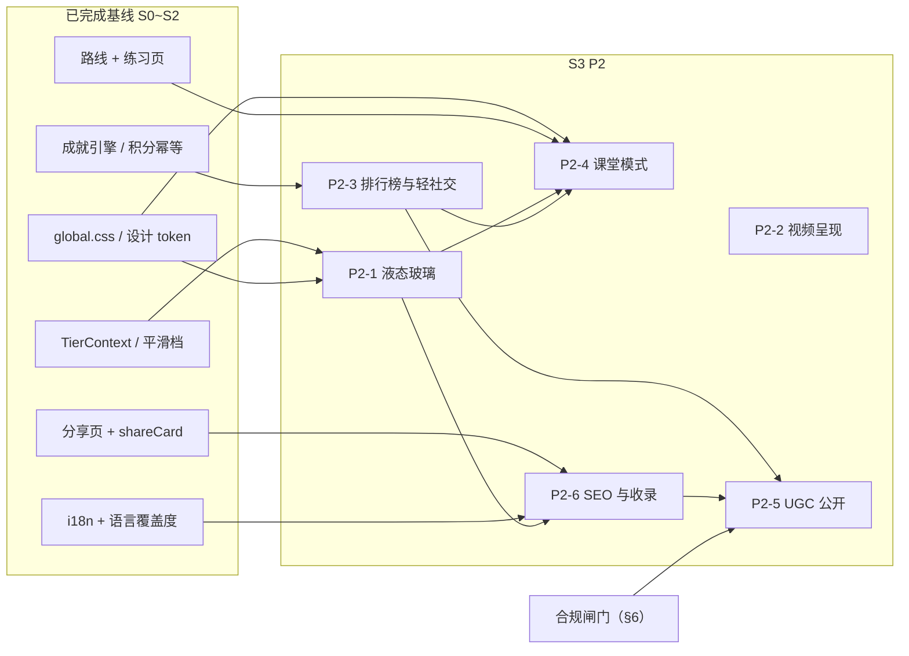

# 华夏古建可视化 · S3 P2 增量需求规格

> 本文件为**需求规格（What / Why）**，回答"这一轮做什么、为什么做、做到什么程度算完成"。
> 不含数据库设计、接口参数结构、算法与代码实现。
> 文中出现的文件路径与接口名仅作为**需求落点引用**，用于评估影响面与可追溯性，不构成接口契约。
> 既有需求编号（REQ-01~31）、验收编号（AC-01~54）、任务编号（T-S3-xx）保持不变，本轮增量使用 `REQ-S3P2-xx` / `AC-S3-xx` 独立编号，互不覆盖。

| 项 | 内容 |
|---|---|
| 文档编号 | REQ-PUBLIC-S3P2-001 |
| 版本 | v1.0 |
| 状态 | 待评审（UGC 部分需合规评审签字后方可进入编码） |
| 主题 | S3 P2：视觉统一、视频呈现、排行榜与轻社交、教师/研学模式、UGC 笔记公开、SEO 与收录 |
| 上游文档 | `docs/requirements/general-audience-enhancement-spec.md`（REQ-PUBLIC-001） `docs/design/general-audience-enhancement-design.md`（DESIGN-PUBLIC-001） `docs/tasks/general-audience-enhancement-tasks.md`（§11 S3 P2 增量） |
| 覆盖需求 | 原 REQ-10、REQ-21、REQ-24、REQ-27、REQ-28、REQ-31 |
| 关联代码库 | `D:\Ancient-architecture\ac1.1\acvisual 4`（main@7770bd4 之后的 S0~S2 已完成状态） |
| 业务代码改动 | 无（本文档阶段不修改任何业务代码） |
| 下游阶段 | 实现方案（design）与编码任务（tasks）由后续阶段负责，本文档不越界 |

---

# 1. 本轮定位与范围

## 1.1 为什么需要这一轮

S0~S2 解决的是**"能不能用"**：拆掉登录墙、3D 降级、搜索、朗读、收藏、成就、分享、i18n、路线、推荐、热点、音频、发布门槛、匿名埋点与 QA 门禁都已具备可运行的能力基线。

进入 S3 P2 后，问题从"功能缺失"转为三类新问题：

1. **一致性风险**：新增的搜索页、分享页、弹窗、推荐位来自不同批次，视觉与性能开始漂移（玻璃质感用得越多，越容易出现"半透明糊成一片 + 低端机掉帧"）。
2. **规模化风险**：一旦有真实流量，排行榜就是最容易被刷的地方；答题接口目前允许同题反复得分，这在 P2 之前不致命，在 P2 之后会直接摧毁榜单公信力。
3. **合规风险**：UGC 公开与未成年人参与排行，是本项目第一次触碰"用户生成内容"与"未成年人个人信息"，一旦先写代码后补合规，返工成本极高且不可控。

因此本轮的核心不是"再造六个功能"，而是**在可控风险下把产品从"可用"推进到"可规模化"**，并明确哪些能力在没有合规前提时**宁可不做**。

## 1.2 范围总表

| 逻辑编号 | 需求 | 原需求 | 优先级 | 类型 | 合规门禁 | 是否进 MVP |
|---|---|---|---|---|---|---|
| P2-1 | 液态玻璃视觉规范 | REQ-10 | P2-A | 一致性 / 性能 | 无 | ✅ |
| P2-2 | 视频呈现 | REQ-24 | P2-A | 内容呈现 | 无 | ✅ |
| P2-3 | 排行榜与轻社交 | REQ-21 | P2-A | 增长 / 风控 | 未成年人保护为本批硬要求 | ✅（含最小保护） |
| P2-4 | 教师 / 研学模式 | REQ-28 | P2-B | 场景扩展 | 无（但涉及未成年人展示边界） | 部分（基础开关进 MVP） |
| P2-5 | UGC 笔记公开 | REQ-27 | P2-C（条件性） | 内容 / 合规 | **强门禁：不通过不得编码** | ❌ |
| P2-6 | SEO 与收录 | REQ-31 | P2-A | 获客 | 无 | ✅ |

> 优先级说明：`P2-A` = 本轮必须交付；`P2-B` = 本轮应交付、可分批；`P2-C` = 仅在合规闸门通过后启动。UGC 不因"排期靠后"而弱化门禁，见第 6 章。

## 1.3 能力基线（已完成，本轮只复用不重做）

| 能力 | 现状 | 与本轮的关系 |
|---|---|---|
| 游客免登录与试看额度 | 公开路由分层、`guestSession` 本机额度 | P2-4 课堂模式需复用"游客本机偏好"语义 |
| 3D 档位与降级 | `TierContext`（smooth / standard / high）、`PosterFallback` | P2-1 玻璃必须与 `smooth` 档联动降级 |
| 收藏与成就 | `user_points_log` 幂等积分、`achievementEngine`、`user_stamps` | P2-3 去重与积分幂等必须复用同一套幂等语义 |
| 分享与深链 | `/share/:type/:id` 服务端卡片、`share_visits` | P2-6 在既有卡片上补结构化数据与 canonical |
| 搜索 | `/api/search`、`SearchPage` | P2-1 的首个"新页面应用点"；P2-6 需对结果页设 noindex |
| i18n | `I18nContext`、`content_translations`、`/api/content/coverage` | P2-6 的 hreflang 依赖语言覆盖度 |
| 路线 | `/api/routes`、`RoutePage` | P2-4 课堂模式固定入口之一 |
| 推荐 | `/api/recommend`、`RecommendationRail` | P2-4 需隐藏 |
| 音频 | `audio_guides` + TTS 兜底 | P2-2 视频"无资源"的等价替代（图文/朗读） |
| 发布门槛 | `palaces.status`（draft / published） | P2-2、P2-6 必须只消费 published 内容 |
| 匿名埋点 | `client/src/lib/analytics.js` 白名单事件 | P2-1/P2-3/P2-4 的指标需在白名单内扩展 |
| QA 门禁 | `server/test/*`、`test/e2e/*` | 本轮每个 AC 必须可挂到现有门禁 |

## 1.4 现状差距与证据

| 编号 | 差距 | 现状证据 | 用户/业务影响 | 对应 |
|---|---|---|---|---|
| GAP-S3-01 | 无统一玻璃面板契约 | `client/src/styles/global.css` 仅有 `--surface-glass*` token；`backdrop-filter` 的模糊值分散为 4/6/8/12/16px 十余处；无 `@supports` 回退；无档位联动 | 新页面各自发挥，低端机模糊开销不可控，正文可读性无基线 | P2-1 |
| GAP-S3-02 | 玻璃对比度无验证口径 | 面板底色为 0.88/0.95 半透明，叠加在首页海报轮播与深色 3D 舞台边缘时对比度未知 | 老年/低视力用户在复杂背景上看不清正文 | P2-1 |
| GAP-S3-03 | 视频字段有、呈现无 | `palaces` 存在 `has_video`、`video_url`；`client/src/pages/ExhibitionPage.jsx` 全文无 `<video>` 引用；`videos/` 仅有一个空目录 | 即使补了视频资源也播不出来；未来补资源时易出现空播放器/黑框 | P2-2 |
| GAP-S3-04 | 排行榜可被同题刷榜 | `server/src/routes/quiz.js` 的 `/leaderboard` 以 `COUNT(qr.id)` 统计答题行；`/answer` 每次提交直接新增记录并 +20 分；答题记录表无"用户 + 题目"唯一语义 | 同题答对 100 次即正确数 +100，榜单公信力归零 | P2-3 |
| GAP-S3-05 | 排行展示缺少隐私边界 | 榜单行返回 `username`、`avatar_url`、`points`；前端直接渲染 `#rank_no` | 可识别身份暴露；未成年人可被精确定位 | P2-3 |
| GAP-S3-06 | 课堂模式是空壳 | `client/src/context/UiPrefsContext.jsx` 已定义 `classroomMode: false`，但无 UI 开关、无持久化、无任何消费方；`--font-scale` 未联动；`PUT /api/auth/preferences` 仅接受个性化与统计两项；`users` 无对应偏好 | 教师打开课堂投屏仍会看到推荐位、分享按钮与 16px 正文 | P2-4 |
| GAP-S3-07 | UGC 无合规承载 | `user_collections.note` 为私有笔记，仅有"仅本人可见"约束；无公开意愿、无审核状态、无举报入口、无未成年人规则 | 直接开放公开会同时违反隐私承诺与内容审核要求 | P2-5 |
| GAP-S3-08 | SEO 资产缺失且被 fallback 吞掉 | 无 `/robots.txt`、`/sitemap.xml` 路由；`server/src/app.js` 末尾 `app.get('*')` 会把这两条路径返回 SPA 的 `index.html`；`shareCard.js` 仅有 og/twitter/canonical，无 JSON-LD、无 hreflang | 搜索引擎抓不到有效内容；分享页无法被识别为结构化条目 | P2-6 |
| GAP-S3-09 | `videos/` 无资源与"有则显"策略未落地 | 内容侧尚无视频产出（既有风险 TR-03） | P2-2 的正向路径可能无法验收，只能验证回退路径 | P2-2 |

## 1.5 本轮明确不做（与既有 Out of Scope 保持一致并补充）

| 编号 | 不做项 | 原因 |
|---|---|---|
| OOS-S3-01 | 整站 SSR / 预渲染 / 动态渲染服务 | 与既有 SPA 架构冲突，成本远高于本轮；P2-6 只保证分享页与站点地图正确 |
| OOS-S3-02 | 视频批量生产、转码、上传、播放列表、弹幕、DRM | 沿用 OOS-03/OOS-09，内容侧行为不在本轮 |
| OOS-S3-03 | 社交化运营（关注、评论、私信、用户主页、点赞） | 沿用 OOS-10；P2-3 的"轻社交"仅限成绩对比与只读分享 |
| OOS-S3-04 | 独立教师端、班级管理、作业批改、学生账号体系 | P2-4 只做"现有页面的呈现模式开关" |
| OOS-S3-05 | 面向未成年人的个性化广告、社交登录、外部导流 | DFX-S6，硬禁止 |
| OOS-S3-06 | UGC 图片/视频上传、匿名发布、跨建筑用户主页 | 审核与追责不可控 |
| OOS-S3-07 | 暗色主题、全站视觉重设计 | P2-1 只做规范收敛，不做品牌改版 |
| OOS-S3-08 | 账号体系与 JWT 载荷变更、既有 URL 变更 | 沿用 OOS-07/OOS-12、DFX-C4 |

---

# 2. 术语与角色

## 2.1 本轮新增术语

**玻璃面板（Glass Panel）**
: 以半透明底色 + 背景模糊 + 暖色描边 + 低阴影构成的浮层容器，用于让前景内容与背景产生层次而不遮挡背景信息。

**面板白名单（Panel Allowlist）**
: 明确规定允许使用玻璃面板的界面位置集合；不在此集合内的位置一律视为违规使用。

**平滑档（Smooth Tier）**
: 既有设备档位中的最低档，代表低端机、弱网或关闭高性能渲染的会话；该档位下玻璃面板必须放弃模糊效果。

**回退实底（Opaque Fallback）**
: 当浏览器不支持背景模糊、用户要求减少透明度、或处于平滑档时，玻璃面板改用不透明底色呈现，视觉层级由描边与阴影承担。

**课堂模式（Classroom Mode）**
: 一种**呈现模式**而非账号角色：放大字号、隐藏推荐与社交入口、固定展示路线与练习入口，用于课堂投屏与研学集体浏览。

**只读课堂链接（Read-only Classroom Link）**
: 携带课堂视图参数的公开链接，打开后以课堂模式呈现内容，但不修改接收者的个人偏好、不携带任何身份凭证。

**随堂练习（Class Practice）**
: 课堂模式下进入的答题视图，只展示题目、判定与解析，不计分、不进排行、不写入个人答题记录。

**去重正确数（Distinct Correct Count）**
: 同一用户在同一道题上无论作答多少次，仅以首次结果计入排行榜的"答对题数"口径。

**公开笔记（Public Note）**
: 用户在建筑笔记上显式选择公开、并经过审核后，可被其他访客阅读的笔记；未公开笔记仍为私有。

**审核状态（Moderation Status）**
: 公开笔记的生命周期状态，至少包含"待审 / 通过 / 拒绝 / 已隐藏"四种，拒绝需给出可读原因。

**未成年人模式（Minor Mode）**
: 面向未成年访客的展示与参与限制集合：排行隐藏精确名次与头像、不提供社交登录与外部导流、笔记默认不可公开。

**规范 URL（Canonical URL）**
: 一个内容对象对外唯一推荐的访问地址，用于避免同一内容因携带统计参数而重复收录。

## 2.2 角色增量

| 角色 | 特征 | 本轮新增诉求 |
|---|---|---|
| 教师 / 研学组织者 | 课堂投屏、带队预习，多在桌面或大屏 | 一键进入课堂视图、可复制的只读链接、字号可读、无社交干扰 |
| 未成年人 / 家长 | 学生在校或家庭场景使用；家长关注内容与隐私 | 不被精确排名、不被展示头像与真实昵称、无外部导流 |
| 内容审核员（新增） | 处理公开笔记的审核与举报 | 明确的审核队列、可见的拒绝原因、可下架与审计 |
| 搜索引擎 / 社交平台爬虫 | 抓取分享页与站点地图 | 可解析的元信息、结构化数据、稳定的规范地址 |

> 交互上下文与既有 REQ-PUBLIC-001 §4.3 一致，本轮仅在既有上下文中新增"审核员"与"爬虫"两条边，不重复绘制整图。

---

# 3. DFX 增量约束

> 沿用 REQ-PUBLIC-001 §5 全部 DFX 条款；以下为**本轮新增或收紧**的可量化红线。

## 3.1 性能

| 编号 | 约束 | 验收方式 |
|---|---|---|
| DFX-S3-P1 | 玻璃面板带来的额外帧耗时：标准/高清档单帧增幅 ≤ 1.5ms；平滑档为 0（禁用模糊） | 真机帧率采样对比开关前后 |
| DFX-S3-P2 | 面板启用前后布局尺寸不得变化，CLS 增量 = 0 | Layout Shift 采样 |
| DFX-S3-P3 | 视频区块从判定到可播放 ≤ 2s（4G），且首屏不因视频判定阻塞（判定异步） | 真机 + 网络面板 |
| DFX-S3-P4 | 排行榜查询 P95 ≤ 500ms（含去重聚合） | 压测 |
| DFX-S3-P5 | 课堂模式切换 ≤ 200ms，不整页刷新、不新增首屏接口请求 | 手工 + 网络面板 |
| DFX-S3-P6 | `/robots.txt`、`/sitemap.xml` 响应 ≤ 300ms（sitemap 可缓存） | curl 计时 |
| DFX-S3-P7 | 分享页结构化数据不增加首字节时间（内联输出，无额外请求） | TTFB 对比 |

## 3.2 可靠性

| 编号 | 约束 |
|---|---|
| DFX-S3-R1 | 视频 HEAD 探测失败、超时或播放错误，必须收敛为"不展示视频区块"，不得出现黑框、无限缓冲或错误弹窗 |
| DFX-S3-R2 | 不支持背景模糊的环境必须得到可读的实底面板，不得出现"透明但未模糊"的糊状层 |
| DFX-S3-R3 | `/robots.txt` 与 `/sitemap.xml` 不得被单页应用回退逻辑接管；sitemap 生成失败时返回明确的 5xx 而非空文件 |
| DFX-S3-R4 | 排行榜查询失败时展示"暂无成绩 + 参与入口"，不得展示空表头、`rank 0` 或报错原文 |
| DFX-S3-R5 | 课堂模式的开关状态在刷新、路由切换、浏览器重启后保持一致（登录用户跨设备一致，游客本机一致） |
| DFX-S3-R6 | 公开笔记撤回后，所有公开入口立即不可见；缓存最长 24h 内清除 |

## 3.3 安全与隐私

| 编号 | 约束 |
|---|---|
| DFX-S3-S1 | 排行榜公开数据不得包含邮箱、用户 ID、积分明细、登录记录；昵称必须脱敏 |
| DFX-S3-S2 | 未成年人模式下不得展示精确名次、头像、真实昵称，不得出现社交登录与外部导流（沿用 DFX-S6） |
| DFX-S3-S3 | 只读课堂链接不得携带令牌、用户标识或会话信息；打开后不得修改接收者的个人偏好 |
| DFX-S3-S4 | 公开笔记作者可见、可追溯、可下架；禁止匿名发布；不得公开收藏分类、草稿、答题记录 |
| DFX-S3-S5 | 公开笔记正文禁止外链、联系方式、二维码、图片；拒绝内容需留存可审计记录（谁、何时、依据） |
| DFX-S3-S6 | 分享页结构化数据只允许输出公开字段，不得包含用户评分、评论数、个人信息 |
| DFX-S3-S7 | 答题限速与可疑行为标记只用于榜单准入，不得用于对用户进行画像或跨站追踪 |

## 3.4 无障碍

| 编号 | 约束 |
|---|---|
| DFX-S3-A1 | 玻璃面板上的正文对比度 ≥ 4.5:1，大字号 ≥ 3:1；以最差背景（海报轮播、深色舞台边缘）实测为准 |
| DFX-S3-A2 | 视频元素有可读标题与说明，可键盘操作；无字幕时必须提供文字稿或等价图文入口 |
| DFX-S3-A3 | 课堂模式放大字号后，焦点顺序不变、无内容截断、无横向滚动 |
| DFX-S3-A4 | 系统要求减少透明度（若浏览器支持）或减少动效时，面板回退实底且无入场动画 |

## 3.5 可维护性与兼容性

| 编号 | 约束 |
|---|---|
| DFX-S3-M1 | 玻璃面板的视觉规则只有一个定义来源；业务组件不得各自声明模糊强度 |
| DFX-S3-M2 | 站点地图内容必须由数据驱动（新增已发布内容自动进入），不得手工维护清单 |
| DFX-S3-C1 | 既有 URL、既有接口字段、既有分享链接保持可用；新增参数（如课堂视图、只读标记）不得改变默认行为 |
| DFX-S3-C2 | 内容缺失（无视频、无双语、无公开笔记）时一律"隐藏入口或降级展示"，不得出现空块与 `undefined` |

---

# 4. 核心能力

> 每个能力包含：目标用户价值、要解决的具体问题、功能范围、业务规则（含验收）、涉及模块、异常场景、不做边界。
> 规则统一使用"必须 / 应当 / 禁止"，验收统一写作 `[触发场景] → [预期行为]`。

## 4.1 P2-1 液态玻璃视觉规范（REQ-10）

### 4.1.1 目标用户价值与问题

**用户价值**：让新页面（搜索结果、分享落地、各类浮层）与首页"宣纸底 + 朱红 + 宋体"同源，形成可信任的品牌质感；同时保证在低端机与复杂背景下依然"看得清、跑得动"。

**要解决的问题**：
1. 玻璃效果没有统一契约，模糊强度从 4px 到 16px 各自为政，视觉不一致且难以维护。
2. 半透明面板被用在正文长文本、表格与输入框上，直接伤及可读性与对比度。
3. 低端机与弱网会话仍在支付模糊的 GPU 成本，与既有"平滑档"策略脱节。
4. 没有"不支持模糊怎么办"的兜底，也没有对比度验收口径。

### 4.1.2 功能范围

1. 建立**唯一**的玻璃面板视觉契约（一个面板类承载底色、模糊、描边、阴影四要素）。
2. 明确**允许位置白名单**与**禁止位置黑名单**。
3. 建立三层降级：不支持背景模糊 → 实底；平滑档 → 实底；系统减少透明度 → 实底。
4. 建立对比度验收方法与最差背景样本。
5. 首批应用点：搜索结果页、分享落地浮层、全局搜索弹层、收藏弹窗、成就结算层、推荐位外框。

### 4.1.3 业务规则

1. **单一契约**：所有玻璃面板必须使用同一面板类；同一层级的模糊强度必须一致，不得在业务组件内单独声明模糊值。
   a. 验收条件：[扫描新增/改造样式] → [不存在业务组件私自定义的模糊强度，仅有一处定义来源]。
2. **允许位置**：玻璃面板仅可用于"浮于内容之上的轻量容器"——侧栏导航、搜索弹层、收藏/分享/朗读浮层、成就结算层、推荐位外框、卡片悬停浮层。
   a. 验收条件：[逐一核对白名单内组件] → [视觉一致，且面板内不存在长文本正文]。
3. **禁止位置**：禁止用于正文长文本容器、数据表格、表单输入框背景、错误/警告提示条、3D 舞台与视频画面的覆盖层、打印视图。
   a. 验收条件：[检查上述位置] → [使用实底或不透明表面，不出现半透明模糊]。
4. **不支持即回退**：运行环境不支持背景模糊时，系统必须回退为不透明底，保留描边与阴影，保证层级可辨。
   a. 验收条件：[模拟不支持背景模糊] → [面板为实底、文字清晰、无"透明未模糊"的糊状外观]。
5. **平滑档降级**：设备档位为平滑档时，必须禁用模糊与半透明，且面板尺寸、位置、内边距不得变化。
   a. 验收条件：[平滑档打开搜索结果页与任一浮层] → [无模糊、无半透明、布局与标准档一致，CLS 增量为 0]。
6. **对比度基线**：面板上的正文文本对比度必须 ≥ 4.5:1，大字号 ≥ 3:1，以最差背景（首页海报轮播、深色 3D 舞台边缘）为样本。
   a. 验收条件：[在最差背景下打开面板并测量] → [正文与大字号均达标，不依赖降低正文不透明度换取"通透感"]。
7. **系统偏好优先**：当系统或用户要求减少透明度/减少动效时，面板必须回退实底并取消入场动画。
   a. 验收条件：[开启减少动效] → [面板无位移/缩放动画，呈实底]。
8. **禁止项**：禁止用普通模糊滤镜模拟背景模糊（会连带模糊面板内文字）；禁止新增低对比灰色文字变量；禁止为视觉统一而改动既有页面布局结构。
   a. 验收条件：[代码审查] → [无滤镜模拟、无新增低对比色变量、无布局结构改动]。

### 4.1.4 涉及模块（需求落点）

| 层 | 落点 | 说明 |
|---|---|---|
| 前端样式 | `client/src/styles/global.css` | 面板契约与回退规则的定义位置（既有 `--surface-glass*`、`--border-warm`、`--shadow-sm` token 复用） |
| 前端档位 | `client/src/context/TierContext.jsx` | 提供平滑档判定，驱动面板降级 |
| 前端组件 | `client/src/pages/SearchPage.jsx`、`client/src/components/GlobalSearchDialog.jsx`、`CollectionDialog.jsx`、`ShareButton.jsx`、`AchievementToast.jsx`、`RecommendationRail.jsx` | 首批应用与回归对象 |
| 前端偏好 | `client/src/context/UiPrefsContext.jsx` | 减少动效/减少透明度的读取入口 |
| 埋点 | `client/src/lib/analytics.js` | 如需统计"降级发生"，须在白名单内新增事件 |
| 后端 | 无 | 纯前端视觉与性能议题，不引入接口 |

### 4.1.5 异常场景

1. **模糊不被支持**
   a. 触发条件：浏览器不支持背景模糊或相关能力被策略禁用。
   b. 系统行为：回退实底，保留描边与阴影。
   c. 用户感知：面板正常可读，无样式错乱、无透明空洞。
2. **低端机掉帧**
   a. 触发条件：平滑档或实测帧率低于档位红线。
   b. 系统行为：自动禁用模糊（不改变用户档位选择）。
   c. 用户感知：界面无提示，仅表现为更流畅；若用户主动查看画质设置，可看到"已简化玻璃效果"的说明。
3. **复杂背景导致对比度不足**
   a. 触发条件：面板叠加在高对比海报或深色画面上。
   b. 系统行为：提高面板不透明底或加深文字色（不得同时降低文字不透明度）。
   c. 用户感知：文字清晰可读。
4. **打印/导出**
   a. 触发条件：用户打印页面或导出为 PDF。
   b. 系统行为：面板转为实底黑白友好呈现。
   c. 用户感知：打印件不出现灰糊块。

### 4.1.6 不做边界

1. 不做暗色主题、不做品牌视觉改版、不做动效体系重设计。
2. 不引入新的 UI 组件库或玻璃效果依赖。
3. 不把玻璃面板推广到所有既有页面（仅白名单 + 首批应用点），避免大面积回归。
4. 不改动 3D 渲染与视频画面的呈现方式。

---

## 4.2 P2-2 视频呈现（REQ-24）

### 4.2.1 目标用户价值与问题

**用户价值**：为建筑提供"看得见的空间感"，补充图文难以表达的比例、轴线与工艺过程；对教师投屏与研学预习是低成本增强。

**要解决的问题**：
1. 数据库早有 `has_video`、`video_url` 字段，但展览页完全没有播放入口——有资源也播不出来。
2. 若直接按字段渲染，在资源缺失时会产出空播放器、黑框与"加载失败"提示，反而损伤信任。
3. 缺少"资源有效性判定"的统一口径，无法保证拖动进度、跨端播放可用。

### 4.2.2 功能范围

1. 在展览页建立视频区，**仅当资源确实可用时出现**。
2. 建立资源有效性判定（字段声明 + 实际可访问 + 媒体类型正确）。
3. 建立失败收敛：判定失败或播放出错 → 隐藏区块，退回既有图文/热点/朗读路径。
4. 保证播放体验：不自动播放、不预取全量、可拖动进度、封面使用建筑海报、布局稳定。

### 4.2.3 业务规则

1. **四条件呈现门**：视频区必须同时满足"内容标记为有视频、视频地址非空、地址可访问、媒体类型为视频"才渲染。
   a. 验收条件：[任一条件不满足] → [页面不出现视频区块，无空容器、无骨架占位]。
2. **异步判定**：有效性判定必须异步进行，不得阻塞首屏图文与 3D 的呈现。
   a. 验收条件：[弱网打开展览页] → [图文与 3D 正常先呈现，视频区随后出现或始终不出现]。
3. **失败收敛**：判定超时、非成功响应、媒体类型不符或播放报错时，必须收起视频区，不得弹错误框、不得留黑框、不得无限缓冲。
   a. 验收条件：[模拟资源 404 与媒体类型错误] → [视频区消失，页面其余内容正常，控制台仅记录告警]。
4. **播放行为**：禁止自动播放；禁止预取完整视频；必须保留原生播放控件；必须可拖动进度定位。
   a. 验收条件：[打开有视频的建筑] → [无自动播放；点击后可播放；拖动进度可跳转且不重新缓冲整段]。
5. **布局稳定**：视频区必须预留固定比例容器（16:9），加载前后不引起布局位移。
   a. 验收条件：[视频区出现/消失] → [下方内容位置不发生跳动]。
6. **封面与说明**：封面优先使用建筑海报，缺失时使用统一品牌图；视频必须有可读标题与一句说明。
   a. 验收条件：[无海报建筑] → [封面为品牌图，不出现空白帧]。
7. **无障碍**：视频可键盘聚焦与控制；无字幕时必须提供文字稿或等价图文入口；静音/音量状态可感知。
   a. 验收条件：[仅用键盘] → [可聚焦、播放、暂停、调节进度]；[无字幕] → [可见"查看文字稿"入口]。
8. **兼容**：视频服务必须支持按范围请求（拖动进度依赖），并与既有静态资源策略一致。
   a. 验收条件：[请求视频片段] → [返回分段响应而非整段重传]。
9. **禁止项**：禁止展示"即将上线"的视频占位；禁止用视频替代图文正文；禁止批量插入自动播放的背景视频。
   a. 验收条件：[无资源建筑] → [完全无视频相关文案与占位]。

### 4.2.4 涉及模块（需求落点）

| 层 | 落点 | 说明 |
|---|---|---|
| 前端页面 | `client/src/pages/ExhibitionPage.jsx` | 视频区挂载点；当前无任何视频引用 |
| 前端接口封装 | `client/src/api.js` | 如需前端探测资源可用性，复用既有请求封装 |
| 后端内容 | `server/src/routes/palaces.js` | 公开详情需返回视频标记与地址（仅公开字段） |
| 后端静态服务 | `server/src/app.js` | `/videos` 静态服务；需回归范围请求行为 |
| 数据 | `server/db/init_full.sql`（`palaces.has_video`、`video_url`） | 已有字段，不新增结构 |
| 资源 | `videos/`（当前仅有空目录） | 内容侧提供，无资源时按回退路径验收 |
| 埋点 | `client/src/lib/analytics.js` | 如需统计播放/失败，须在白名单内新增事件 |

### 4.2.5 异常场景

1. **资源声明与实际不一致**
   a. 触发条件：标记有视频但文件不存在。
   b. 系统行为：判定失败 → 不渲染区块。
   c. 用户感知：页面正常，无视频入口，无错误提示。
2. **播放中途失败**
   a. 触发条件：网络中断或资源被移除。
   b. 系统行为：收起视频区，保留图文并提示"视频暂不可用，已保留图文讲解"。
   c. 用户感知：不出现黑屏与循环加载。
3. **格式不被浏览器支持**
   a. 触发条件：编码格式在当前浏览器不可播。
   b. 系统行为：视为不可用，隐藏区块并告警。
   c. 用户感知：无视频入口，无失败提示。
4. **无任何视频资源（当前常态）**
   a. 触发条件：全部建筑均无资源。
   b. 系统行为：全站不出现视频区块。
   c. 用户感知：与现状一致，无"缺失感"。

### 4.2.6 不做边界

1. 不做视频上传、转码、剪辑、封面自动截帧。
2. 不做播放列表、连播、推荐下一个视频、弹幕、倍速（倍速可列入可选增强）。
3. 不做字幕生产（仅要求"无字幕时有文字稿入口"）。
4. 不把视频作为展览页的主视觉，3D 仍为主入口。

---

## 4.3 P2-3 排行榜与轻社交（REQ-21）

### 4.3.1 目标用户价值与问题

**用户价值**：把"答题"从单机行为变成有同伴参照的轻竞赛，给学生复访理由；同时让家长与教师放心——榜单不暴露身份、不制造过度竞争。

**要解决的问题**：
1. 现行榜单按"答题行数"统计，同一道题答对 100 次就能刷到第一，榜单没有可信度。
2. 答题接口没有幂等与速率约束，重复提交既加正确数又加积分，还能反复触发成就。
3. 榜单直接展示用户名、头像与积分，既泄露身份，也不符合未成年人保护要求。
4. "轻社交"缺少边界定义，容易滑向关注/评论/私信这类高审核成本能力。

### 4.3.2 功能范围（MVP 严格收敛）

1. **计分口径改造**：排行以"去重正确数"为准，重复作答不计入。
2. **写入幂等与限速**：重复提交幂等；高频提交限流并给出可读提示。
3. **隐私展示**：昵称脱敏、隐藏用户 ID 与积分明细、头像默认不展示。
4. **未成年人保护**：未成年人模式下隐藏精确名次/头像/真实昵称，不提供社交登录与外部导流，可选择不参与公开榜。
5. **轻社交（最小集）**：只做"我的成绩与榜单对比"与"分享我的成绩（只读链接）"。
6. **可疑行为处理**：识别异常高频与非人类答题节奏，不计入榜单并留痕。

### 4.3.3 业务规则

1. **去重计分**：同一用户在同一道题上的多次作答，排行榜只采用首次结果；重复答对不得增加"去重正确数"。
   a. 验收条件：[同一题连续答对 100 次] → [排行榜正确数不变，积分不重复增加]。
2. **幂等写入**：重复提交同一题必须返回一致结果并标记为重复，不得新增排行事实、不得重复发徽章。
   a. 验收条件：[并发重复提交同一题] → [仅一条有效记录，成就只触发一次]。
3. **速率限制**：答题接口必须按用户与时间窗限流；超限返回明确的状态与可读提示，且不写入记录。
   a. 验收条件：[一分钟内提交超过上限] → [返回限流提示，正确数与积分均不变化]。
4. **排序规则**：榜单按去重正确数降序，同分按首次达成时间升序；禁止以积分或答题次数作为主排序。
   a. 验收条件：[两名用户正确数相同] → [先达成者排前，排序稳定可复现]。
5. **隐私展示**：公开榜只显示脱敏昵称、去重正确数、徽章数；禁止显示邮箱、用户标识、积分明细、登录时间；头像默认不展示。
   a. 验收条件：[检查榜单响应与页面] → [无任何可识别身份字段，昵称为脱敏形式]。
6. **未成年人保护（必须与本能力同批上线）**：未成年人模式开启后，不显示精确名次（以区间或"我的成绩"替代）、不显示头像与真实昵称、不出现社交登录与外部导流，且不参与公开榜排名。
   a. 验收条件：[开启未成年人模式] → [页面无 `#名次`、无头像、无真实昵称、无社交登录入口]。
7. **可疑行为准入**：短时间内超高频、或明显非人类节奏（如连续极短间隔答对）必须被标记为可疑，不计入排行并保留可查记录；不得因此直接封禁账号。
   a. 验收条件：[脚本 1 分钟内高频刷不同题] → [正确数不增长，产生可查标记，账号仍可正常浏览]。
8. **空榜与失败降级**：无数据或查询失败时，必须展示"暂无成绩 + 参与入口"，不得出现空表头、`rank 0` 或错误原文。
   a. 验收条件：[新环境无任何答题数据] → [展示空态与"去答题"入口]。
9. **轻社交边界**：只允许"查看我的成绩对比"与"生成我的成绩只读链接"；禁止关注、评论、私信、点赞、公开用户主页。
   a. 验收条件：[检查榜单与成绩页] → [无任何关注/评论/私信入口]。
10. **禁止项**：禁止把答题次数、积分、签到天数用于公开榜排序；禁止按地理位置或学校维度排名；禁止展示"最后活跃时间"。
    a. 验收条件：[检查排序与字段] → [仅去重正确数与首次达成时间参与排序]。

### 4.3.4 涉及模块（需求落点）

| 层 | 落点 | 说明 |
|---|---|---|
| 后端接口 | `server/src/routes/quiz.js`（`POST /answer`、`GET /leaderboard`） | 去重、幂等、限速、排序、隐私字段收敛 |
| 后端服务 | `server/src/services/achievementEngine.js`、`pointsService.js` | 复用既有幂等语义，避免重复发徽章/积分 |
| 后端数据 | `quiz_records`（现有答题记录） | 需明确"用户 + 题目"的唯一语义；历史数据存在重复行，需一次性口径处理 |
| 后端限流 | 复用既有搜索/分享的限流实现 | 保持一致的超限响应与错误码 |
| 前端页面 | `client/src/pages/QuizPage.jsx` | 榜单展示、空态、未成年人模式展示规则、成绩对比 |
| 前端偏好 | `client/src/context/UiPrefsContext.jsx` | 未成年人模式/退出公开榜的开关入口 |
| 埋点 | `client/src/lib/analytics.js` | 榜单曝光、成绩分享、限流命中（白名单内新增） |
| 分享 | `server/src/services/shareCard.js`、`sharePage.js` | 成绩只读链接（可不进搜索引擎） |

### 4.3.5 异常场景

1. **历史重复答题数据**
   a. 触发条件：改造前已存在同题多条答对记录。
   b. 系统行为：按"首次结果"口径重新聚合，榜单不因历史刷分而偏高；不删除用户原始记录。
   c. 用户感知：名次可能变化，页面说明"榜单口径已更新为去重答对题数"。
2. **限流误伤**
   a. 触发条件：正常用户在短时间内连续答题（如课堂练习）。
   b. 系统行为：提示"操作过快，稍后可继续"，已提交的题目仍正常计入；课堂练习走只读视图不受影响。
   c. 用户感知：可读提示，进度不丢失。
3. **榜单加载失败**
   a. 触发条件：聚合查询超时或异常。
   b. 系统行为：展示空态与参与入口。
   c. 用户感知：不出现报错原文与空白表。
4. **未成年人模式中途切换**
   a. 触发条件：用户在查看榜单时开启/关闭未成年人模式。
   b. 系统行为：立即重绘榜单展示，不刷新整页。
   c. 用户感知：名次与头像即时隐藏/恢复，无闪烁错位。

### 4.3.6 不做边界

1. 不做实时对战、赛季、段位、战队、好友榜。
2. 不做关注/评论/私信/点赞/用户主页（沿用 OOS-10）。
3. 不做实名认证、年龄核验、家长账号体系。
4. 不做跨境/跨校排名，不按地理位置分组。

---

## 4.4 P2-4 教师/研学模式（REQ-28）

### 4.4.1 目标用户价值与问题

**用户价值**：让教师在课堂大屏上一键切换到"干净、字大、有固定入口"的视图，无需逐页关弹窗、关推荐；研学组织者可以把路线与练习以只读链接发给学生。

**要解决的问题**：
1. 课堂场景下推荐位、分享按钮、个性化提示反复干扰讲解节奏。
2. 16px 正文在投屏后不可读，缺少字号放大路径。
3. 教师每节课都要手动找路线与题目，没有固定入口。
4. 分享给学生的链接会污染学生的个人偏好，也缺少"只读、不计分"的练习形态。

### 4.4.2 功能范围

1. **课堂模式开关**：登录用户可持久化到个人偏好；游客保存在本机；支持一键进入与一键退出。
2. **呈现规则**：放大字号（三档）、隐藏推荐/分享/社交/个性化元素、固定展示路线与练习入口。
3. **随堂练习**：只读答题视图，不计分、不进排行、不写个人记录。
4. **只读课堂链接**：路线与练习可生成只读链接，打开即课堂视图，不修改接收者偏好。
5. **投屏适配**：大屏下内容居中、最大宽度约束、无横向滚动。

### 4.4.3 业务规则

1. **模式语义**：课堂模式是呈现模式，不得被当作角色或权限；开启后不改变账号权限与数据归属。
   a. 验收条件：[普通用户开启课堂模式] → [权限与个人数据不变，仅呈现变化]。
2. **持久化**：登录用户的开关必须跨设备一致；游客的开关必须本机保留并在刷新后恢复。
   a. 验收条件：[开启后刷新/换设备] → [登录用户保持一致；游客刷新后保持]。
3. **字号**：开启后正文基准字号必须 ≥ 18px（约默认的 1.25 倍），并提供标准/较大/最大三档；放大后不得出现横向滚动或内容截断。
   a. 验收条件：[在 320px 与 1920px 宽度切换三档] → [无横向滚动、无截断、正文 ≥ 18px]。
4. **隐藏项**：必须隐藏推荐位、分享按钮、社交入口、个性化提示、注册引导与成就弹层（成就改为静默记录）。
   a. 验收条件：[开启课堂模式浏览首页与详情] → [上述元素全部不可见，页面无空位残留]。
5. **固定入口**：课堂模式下必须固定展示"主题路线"与"随堂练习"两个入口，位置不随滚动消失。
   a. 验收条件：[开启课堂模式] → [两个入口常驻可见，一次点击可达]。
6. **随堂练习只读**：练习视图只展示题目、判定与解析；不计分、不进排行、不写入个人答题记录、不触发成就。
   a. 验收条件：[完成一轮随堂练习] → [无积分变化、榜单不变、个人答题记录不新增]。
7. **只读链接**：路线/练习的课堂链接必须可复制、可公开打开；链接不得携带令牌或用户标识；打开后不得修改接收者的个人偏好。
   a. 验收条件：[复制链接用无痕窗口打开] → [进入课堂视图；关闭后接收者个人设置未变化]。
8. **一键退出**：退出后必须恢复原字号与全部入口，且不残留隐藏状态。
   a. 验收条件：[退出课堂模式] → [字号与入口恢复，刷新后仍为退出态]。
9. **投屏可用**：在 1920×1080 投屏尺寸下，内容必须居中、字号可读、无横向滚动，关键操作（切换站点、翻题）一次可达。
   a. 验收条件：[1920×1080 投屏] → [布局居中，正文可读，操作无需缩放页面]。
10. **无障碍**：字号放大后焦点顺序不变；课堂模式下的隐藏项不得成为键盘焦点陷阱。
    a. 验收条件：[仅用键盘] → [Tab 顺序合理，无不可见但可聚焦元素]。
11. **禁止项**：禁止新增独立教师端页面；禁止采集学生身份或班级信息；禁止在课堂模式内出现任何推荐、广告、分享与外部导流。
    a. 验收条件：[检查路由与页面] → [无新增教师端路由；课堂视图无上述元素]。

### 4.4.4 涉及模块（需求落点）

| 层 | 落点 | 说明 |
|---|---|---|
| 前端偏好 | `client/src/context/UiPrefsContext.jsx` | `classroomMode` 已有默认值但未接线；需补开关、持久化、消费方 |
| 前端样式 | `client/src/styles/global.css` | 既有 `--font-scale` 需与课堂模式联动（三档） |
| 前端页面 | `client/src/pages/ProfilePage.jsx` | 设置区已有个性化/统计两个开关，课堂模式开关并入同一区域（不新增页面） |
| 前端页面 | `client/src/pages/HomePage.jsx`、`OverviewPage.jsx`、`ExhibitionPage.jsx`、`DetailPanel.jsx` | 隐藏推荐/分享/社交入口的判定点 |
| 前端页面 | `client/src/pages/RoutePage.jsx`、`QuizPage.jsx` | 固定入口与只读练习视图 |
| 前端路由 | `client/src/App.jsx`（`ROUTES` 表） | 只读链接参数解析，不改既有路径 |
| 后端接口 | `server/src/routes/auth.js`（`GET/PUT /preferences`） | 当前仅支持两项偏好，需扩展课堂模式；字段只增不改 |
| 后端数据 | `users` 偏好列 | 需新增课堂模式偏好（逻辑层面：登录用户跨设备一致） |
| 分享 | `client/src/lib/share.js`、`server/src/services/shareCard.js` | 路线/练习只读链接生成（不带凭证） |

### 4.4.5 异常场景

1. **游客开启课堂模式后登录**
   a. 触发条件：游客在本机开启，随后登录。
   b. 系统行为：以账号偏好为准；若账号未设置，则沿用本机设置一次并提示已应用。
   c. 用户感知：无重复询问、无突然还原。
2. **只读链接被用于修改设置**
   a. 触发条件：接收者从课堂链接进入后误触设置。
   b. 系统行为：链接仅影响当前视图，不写入偏好；设置页显示"当前为课堂视图"提示。
   c. 用户感知：退出链接后恢复个人视图。
3. **字号放大导致内容截断**
   a. 触发条件：最大字号 + 窄屏。
   b. 系统行为：降为可用档位或改为纵向滚动，禁止横向滚动。
   c. 用户感知：内容完整可读。
4. **课堂模式下进入需要登录的能力**
   a. 触发条件：教师点击收藏/参与排行。
   b. 系统行为：不弹注册引导（课堂场景不打扰），仅在页脚提供低调的登录入口。
   c. 用户感知：讲解不被打断。

### 4.4.6 不做边界

1. 不做班级/学生名册/作业/批改/学情分析。
2. 不做课堂实时答题统计与投屏互动。
3. 不做独立教师端或教师角色权限。
4. 不做课堂模式专属内容（复用现有路线与题库）。

---

## 4.5 P2-5 UGC 笔记公开（REQ-27）— 条件性能力

> ⚠️ 本能力**默认不进入本轮 MVP**。第 6 章的合规前置条件全部满足并完成书面评审后，方可进入编码；任一条件未满足，仅保留"私有笔记"现状，公开入口不得出现（包括隐藏入口、灰度入口与开关后门）。

### 4.5.1 目标用户价值与问题

**用户价值**：让优质的用户观察成为内容的二次来源（"我在现场看到的细节"），提升参与感与复访；为教师提供可参考的研学记录。

**要解决的问题**：
1. 现有笔记为私有，用户缺少"被看见"的动力。
2. 一旦开放公开，就会同时引入内容审核、举报处理、未成年人保护与隐私边界四类风险。
3. 缺少"公开意愿、可见范围、撤回机制"的产品定义，直接用现有笔记字段开放等于违背"仅本人可见"的既有承诺（DFX-S3）。

### 4.5.2 功能范围（获准后）

1. 用户可对建筑笔记显式选择公开，并可随时撤回。
2. 公开笔记进入审核，审核通过后才对外展示。
3. 每条公开笔记提供举报入口与处理流程。
4. 公开笔记的展示边界：昵称脱敏、无外链、无联系方式、无图片。
5. 未成年人默认不可公开（需监护人同意流程，未上线则禁止）。
6. 管理员具备下架与审计能力。

### 4.5.3 业务规则

1. **默认私有（硬规则）**：笔记默认私有；公开必须由用户显式勾选并二次确认；未确认的内容不得出现在任何公开页面。
   a. 验收条件：[用户未选择公开] → [站内搜索、建筑详情、分享页、站点地图均不含该笔记]。
2. **可选范围**：仅建筑笔记可公开；收藏分类、笔记草稿、答题记录、学习进度、个人成就一律不得公开。
   a. 验收条件：[检查公开接口] → [仅返回建筑笔记的正文、脱敏昵称、时间与建筑标识]。
3. **先审后发**：公开笔记必须经过审核；审核状态至少包含待审/通过/拒绝/已隐藏；拒绝必须给出可读原因。
   a. 验收条件：[提交公开] → [状态为待审，公开页不可见]；[审核通过] → [公开页可见]；[拒绝] → [仅作者可见原因]。
4. **审核时效**：审核必须在 24 小时内完成（工作日）；超时未审的内容保持不可见，不得"先发后审"。
   a. 验收条件：[提交后 24h] → [状态已变更或仍为待审且不可见，不出现未审先展示]。
5. **举报入口**：每条公开笔记必须提供举报入口，举报类型固定（违法/侵权/广告/辱骂/隐私泄露）。
   a. 验收条件：[打开公开笔记] → [可见举报入口，提交后进入处理队列]。
6. **举报处理**：举报必须在 24 小时内处理；同一笔记被举报达到阈值时自动隐藏并等待复核。
   a. 验收条件：[3 条有效举报] → [笔记自动隐藏，作者可见"待复核"状态]。
7. **撤回机制**：作者撤回后，公开页必须立即不可见，缓存最长 24 小时内清除；私有笔记本身不删除。
   a. 验收条件：[点击撤回] → [公开页立即消失；私有笔记仍在个人中心]。
8. **展示边界**：公开笔记必须展示脱敏昵称、相对时间、正文、关联建筑；禁止外链、联系方式、二维码、图片；正文沿用私有笔记长度上限。
   a. 验收条件：[审核通过后查看] → [无链接、无联系方式、无图片，昵称已脱敏]。
9. **未成年人限制**：未成年人账号默认禁止公开；在监护人同意流程上线前，一律不可公开（含教师代为发布）。
   a. 验收条件：[未成年人模式账号] → [公开入口不可用，或仅显示"暂不支持公开"]。
10. **可追溯与可下架**：公开笔记必须可追溯到作者；管理员必须可下架并记录操作人、时间与依据。
    a. 验收条件：[管理员下架] → [内容立即不可见，审计记录可查]。
11. **搜索与收录边界（MVP）**：公开笔记不进入站内搜索结果、不进入站点地图、不被搜索引擎单独收录。
    a. 验收条件：[站内搜索与站点地图] → [不含公开笔记条目]。
12. **禁止项**：禁止匿名发布；禁止点赞/关注/评论；禁止跨建筑聚合"用户主页"；禁止把公开笔记用于广告或推荐位。
    a. 验收条件：[功能走查] → [上述入口均不存在]。

### 4.5.4 涉及模块（需求落点）

| 层 | 落点 | 说明 |
|---|---|---|
| 后端接口 | `server/src/routes/auth.js`（收藏/笔记 CRUD） | 需增加"公开意愿"与"撤回"语义 |
| 后端接口 | 新增审核与举报入口（管理员与作者） | 审核队列、举报队列、下架 |
| 后端服务 | 内容安全与文本校验 | 禁止外链/联系方式；敏感内容识别 |
| 前端页面 | `client/src/pages/ProfilePage.jsx`、`client/src/components/CollectionDialog.jsx`、`DetailPanel.jsx` | 公开开关、状态展示、撤回、举报入口、公开笔记区 |
| 前端页面 | `client/src/pages/CuratorPage.jsx` 或新增管理视图 | 审核与下架（复用编修台，不新增独立端） |
| 数据 | 笔记记录（现有） | 需新增公开意愿、审核状态、举报计数等逻辑约束（不含表结构设计） |
| 搜索/SEO | `server/src/services/searchService.js`、站点地图生成 | 明确排除公开笔记（MVP） |
| 埋点 | `client/src/lib/analytics.js` | 公开/撤回/举报事件（白名单内新增，不含正文） |

### 4.5.5 异常场景

1. **审核队列积压**
   a. 触发条件：公开量超过审核能力。
   b. 系统行为：关闭新的公开提交入口（保留已有内容），提示"公开名额暂满，可先保存为私有"。
   c. 用户感知：明确原因，私有笔记不受影响。
2. **举报滥用**
   a. 触发条件：恶意批量举报。
   b. 系统行为：按举报者信誉与频次过滤，仅计入有效举报；被误伤的笔记复核后恢复。
   c. 用户感知：作者可见"复核中/已恢复"。
3. **内容含敏感信息**
   a. 触发条件：正文包含手机号、二维码文本、外链。
   b. 系统行为：审核拒绝并给出修改建议；不自动改写正文。
   c. 用户感知：可见具体原因，可修改后重新提交。
4. **作者注销账号**
   a. 触发条件：账号注销。
   b. 系统行为：其公开笔记随账号一并下线。
   c. 用户感知：其他访客看到"该内容已调整"占位或直接不展示。

### 4.5.6 不做边界

1. 不做图片/视频上传、不做富文本、不做笔记点赞/收藏/评论。
2. 不做用户主页、不做关注关系、不做消息通知中心（仅站内状态提示）。
3. 不做笔记进入搜索引擎收录与推荐位（MVP 明确排除）。
4. 不做机器自动放行（必须有人工复核环节）。

---

## 4.6 P2-6 SEO 与收录（REQ-31）

### 4.6.1 目标用户价值与问题

**用户价值**：让"搜一座古建筑"能搜到本站；让分享到社交平台的链接有完整卡片与结构化信息，提升点击与信任。

**要解决的问题**：
1. 站点没有 `robots.txt` 与 `sitemap.xml`，爬虫没有入口；且现有单页应用回退逻辑会把这两个路径返回空壳页面。
2. 分享页只有基础社交元信息，缺少结构化数据，搜索结果中难以形成富摘要。
3. 同一内容存在带统计参数的多个地址，缺规范地址会导致重复收录与权重分散。
4. 双语内容已具备分级覆盖，但没有语言互指声明。

### 4.6.2 功能范围

1. 提供站点抓取规则与站点地图（动态、只含已发布内容）。
2. 分享页输出结构化数据（仅公开字段）。
3. 规范地址规则（分享页 → 规范内容页；搜索结果页不索引）。
4. 多语言互指声明（中/英/默认），仅在双语均可用的内容上输出。
5. 内容下线的友好处理与索引退出。
6. 抓取自检方式（可重复执行的验证步骤）。

### 4.6.3 业务规则

1. **抓取规则可访问**：抓取规则文件必须可被直接访问且内容正确，不得被单页应用回退接管。
   a. 验收条件：[直接请求抓取规则地址] → [返回纯文本规则，非 HTML 首页]。
2. **允许与禁止清单**：必须允许首页、建筑详情、百科、路线与分享页；必须禁止接口、个人中心、编修台与搜索结果页。
   a. 验收条件：[逐条核对] → [允许项可被抓取，禁止项返回禁止声明；搜索结果页不被索引]。
3. **站点地图动态生成**：站点地图必须由数据生成，覆盖已发布的建筑详情、术语、路线与分享页；草稿与私有内容不得出现。
   a. 验收条件：[新增一座已发布建筑] → [站点地图在 24h 内出现其详情地址]；[草稿建筑] → [不出现]。
4. **站点地图规模与新鲜度**：单文件不得超过搜索引擎上限；内容更新时间必须体现在条目中；生成失败必须返回明确错误而非空文件。
   a. 验收条件：[请求站点地图] → [XML 合法、条目数在上限内、含更新时间]。
5. **结构化数据**：分享页必须输出与内容类型匹配的结构化数据（建筑为景点类、术语为文章类），字段仅限公开信息。
   a. 验收条件：[抓取分享页] → [可见合法结构化数据，无用户数据、无评分与评论]。
6. **规范地址**：每个可索引页面必须有唯一规范地址；分享页的规范地址必须指向对应内容页，且不含统计参数与来源参数。
   a. 验收条件：[检查分享页与内容页] → [规范地址唯一、互不冲突、无 `?ch=`/`?from=` 残留]。
7. **多语言互指**：中/英/默认三组语言声明必须互指；仅当同一内容两种语言都可用时才输出，未覆盖语言不得输出（避免软 404）。
   a. 验收条件：[双语齐全的建筑] → [三组声明互指]；[仅中文的建筑] → [不输出英文声明]。
8. **内容下线处理**：内容下线时展示友好"内容已调整"页并声明不索引，不得返回死链 404，也不得让旧地址继续被索引。
   a. 验收条件：[打开已下线内容地址] → [友好页 + 不索引声明，页面 200]。
9. **抓取自检**：必须提供可重复执行的抓取自检步骤（元信息、结构化数据、规范地址、状态码、站点地图合法性），并纳入发布前检查。
   a. 验收条件：[执行自检脚本/清单] → [全部通过，失败项可定位]。
10. **边界声明**：本轮不承诺单页应用首页与列表页的正文被抓取；仅保证分享页、站点地图、规范地址与结构化数据正确。
    a. 验收条件：[检查发布说明] → [明确写出该边界，不对外承诺"全站可收录"]。
11. **禁止项**：禁止关键词堆砌、桥页、伪造更新时间、把私有页面写入站点地图、用同一规范地址指向多个内容。
    a. 验收条件：[审查输出] → [无上述行为]。

### 4.6.4 涉及模块（需求落点）

| 层 | 落点 | 说明 |
|---|---|---|
| 后端路由 | 新增抓取规则与站点地图路由 | 必须在单页应用回退之前注册 |
| 后端装配 | `server/src/app.js` | 现有末尾 `app.get('*')` 会接管未匹配路径，需调整注册顺序 |
| 后端服务 | `server/src/services/shareCard.js`、`server/src/routes/sharePage.js` | 补结构化数据、规范地址、语言互指 |
| 后端内容 | `server/src/routes/palaces.js`、`encyclopedia.js`、`routes.js`、`content.js` | 站点地图数据源；只取已发布内容 |
| 后端 i18n | `server/src/services/contentI18n.js`、`/api/content/coverage` | 判断双语是否可用，决定是否输出语言互指 |
| 前端 | `client/src/context/I18nContext.jsx`（已同步页面语言） | 无新增前端改造；仅确认语言值传递到服务端渲染 |
| 运维 | 发布检查清单 | 抓取自检、站点地图可访问性 |

### 4.6.5 异常场景

1. **抓取规则被回退逻辑吞掉**
   a. 触发条件：路由注册顺序错误。
   b. 系统行为：自检必须拦下（返回 HTML 视为失败），阻断发布。
   c. 用户感知：搜索引擎报"格式错误"，由自检提前发现。
2. **站点地图过大**
   a. 触发条件：内容量超过单文件上限。
   b. 系统行为：拆分为索引文件 + 分片地图，索引文件本身可被访问。
   c. 用户感知：收录不受影响。
3. **双语覆盖不一致**
   a. 触发条件：内容有中文无英文。
   b. 系统行为：不输出英文互指声明。
   c. 用户感知：不会跳到空白英文页。
4. **内容下线后仍被索引**
   a. 触发条件：旧地址仍在搜索索引中。
   b. 系统行为：返回友好页并声明不索引；从站点地图中移除。
   c. 用户感知：点击后看到"内容已调整 + 相关推荐"，不是死链。

### 4.6.6 不做边界

1. 不做整站服务端渲染/预渲染/动态渲染服务。
2. 不做 AMP、不做多域名/多站点、不做付费收录。
3. 不做视频结构化数据与 FAQ 结构化数据（资源与内容未就绪）。
4. 不承诺首页与列表页正文被收录（本轮仅保证分享页与站点级资产正确）。

---

# 5. 依赖关系与建议实施顺序

## 5.1 依赖关系

**依赖说明**

| 依赖 | 原因 | 处理方式 |
|---|---|---|
| P2-1 → P2-4 | 课堂模式复用玻璃/表面的实底规则与字号变量，需先定契约 | P2-1 先完成面板契约与字号变量接入 |
| P2-3 → P2-4 | 随堂练习的"只读不计分"依赖排行榜的新计分口径 | P2-3 先落口径，P2-4 再引用 |
| P2-1 → P2-6 | 分享/搜索页会应用玻璃面板，SEO 元信息需与最终页面结构一致 | 视觉先定，SEO 后置 |
| P2-3 → P2-5 | 未成年人保护是公开笔记的前置；公开笔记不得早于保护机制 | 顺序固定，不可并行 |
| §6 合规闸门 → P2-5 | 无评审签字不得编码 | 硬阻塞，见第 6 章 |
| P2-2 独立 | 只涉及展览页与静态资源 | 可与任何任务并行（不同文件面） |

## 5.2 建议实施顺序

> 编号沿用 4.1~4.6 的**逻辑编号**（与上游任务清单一致）；下表是**执行顺序**，两者不同是因为执行顺序按"风险与文件冲突"排序，而非按功能重要性排序。

| 执行序 | 能力 | 理由 | 前置 | 预估 | 并行性 |
|---|---|---|---|---|---|
| 1 | P2-2 视频呈现 | 独立、低风险、可立即完成 AC-48 的正向与回退两条路径；先做可尽早暴露资源缺失问题 | 无 | 1.5 人日 | 可与 2/3 并行 |
| 2 | P2-1 液态玻璃 | 先定契约，避免 P2-4 与 P2-6 的页面改造二次返工；`global.css` 是冲突高发文件 | 档位上下文（已具备） | 3 人日 | `global.css` 独占，不与 P2-4 并行 |
| 3 | P2-6 SEO 与收录 | 只动服务端路由与服务层；与前端文件面几乎无交集；早做可尽早验证抓取 | 分享页（已具备）、i18n（已具备） | 3 人日 | 可与 1 并行 |
| 4 | P2-3 排行榜 | 涉及答题口径与历史数据，需产品确认口径后再动；改动集中在 `quiz.js` 与 `QuizPage` | 成就引擎（已具备） | 4 人日 | 与 P2-4 串行（共享 `QuizPage`） |
| 5 | P2-4 课堂模式 | 依赖 P2-1 的视觉规则与 P2-3 的只读练习口径；涉及 `UiPrefsContext`、`ProfilePage`、`global.css` | P2-1、P2-3 | 2.5 人日 | 串行 |
| 6 | P2-5 UGC 公开 | **仅当 §6 全部满足**；涉及审核、举报、未成年人、内容安全，工作量最大 | P2-3、P2-6、合规签字 | 8 人日 | 独立工作流，串行于 4/5 之后 |

**关键串行约束（文件冲突）**

| 文件 | 涉及能力 | 约束 |
|---|---|---|
| `client/src/styles/global.css` | P2-1、P2-4 | 必须串行；新增样式一律新起选择器，不改既有选择器 |
| `client/src/pages/QuizPage.jsx` | P2-3、P2-4 | 必须串行；先排行口径与展示，再课堂只读练习 |
| `client/src/context/UiPrefsContext.jsx` | P2-3（未成年人模式）、P2-4（课堂模式） | 建议同一次改造完成两个开关，避免二次改 |
| `server/src/app.js` | P2-6、P2-2（静态服务回归） | 路由注册顺序变更需一次做完并加自检 |
| `client/src/pages/ProfilePage.jsx` | P2-4（设置项）、P2-3（未成年人/退出公开榜） | 串行，集中一次改造设置区 |

## 5.3 阶段性交付检查点

| 检查点 | 时点 | 通过条件 |
|---|---|---|
| CP-1 | 执行序 1 完成 | 无资源建筑不出现视频区；模拟有效资源可播放并可拖动；模拟 404 无黑框 |
| CP-2 | 执行序 2 完成 | 白名单组件视觉一致；不支持模糊/平滑档两条回退路径通过；对比度实测达标 |
| CP-3 | 执行序 3 完成 | 抓取规则与站点地图可直达且不被回退吞掉；分享页结构化数据与规范地址自检通过 |
| CP-4 | 执行序 4 完成 | 同题重复 100 次不计分；限流生效；榜单无身份字段；未成年人模式隐藏名次 |
| CP-5 | 执行序 5 完成 | 课堂模式开关持久化、字号三档、入口隐藏与固定入口、只读链接均通过 |
| CP-6 | 合规签字后 | UGC 公开入口才允许合入；此前代码不得包含可达的公开路径 |

---

# 6. 合规前置条件（硬门禁）

> 本章是本轮唯一的"不做完就不许开工"条款。适用于 P2-5（UGC 公开）与 P2-3/P2-5 中的未成年人相关部分。
> 判定方式：由产品负责人与法务（或合规责任人）共同签署《S3 P2 合规评审结论》，记录在本轮变更记录中。口头确认、会议纪要、"先做后补"均不视为满足。

## 6.1 UGC 公开必须前置的条件

| 编号 | 条件 | 交付物 | 不满足的后果 |
|---|---|---|---|
| CG-01 | 完成合规评审，明确公开笔记的法律属性（用户生成内容）与平台责任边界 | 评审结论（含责任分工） | 不得编码 |
| CG-02 | 更新隐私政策与用户协议：明确公开范围、审核、举报、撤回、留存与删除 | 上线文本 + 版本号 + 生效时间 | 不得编码 |
| CG-03 | 建立内容审核机制：审核规则、敏感词/外链/联系方式过滤规则、人工复核岗位与 SLA | 审核规则文档 + 排班与 SLA 承诺 | 不得编码 |
| CG-04 | 建立举报与申诉通道：举报入口、处理时限、复核与恢复流程、对外联系渠道 | 流程文档 + 对外入口 | 不得编码 |
| CG-05 | 建立未成年人规则：未成年人不可公开、监护人同意流程（如未来开放）、未成年人信息处理说明 | 规则文档 + 同意的实现方案 | 不得编码 |
| CG-06 | 建立数据生命周期：撤回/注销后的下线时限、缓存清理时限、审计日志保留期 | 数据留存与删除策略 | 不得编码 |
| CG-07 | 建立运营与应急能力：内容下架权限、批量下架、舆情与违法内容上报流程 | 应急预案 + 权限清单 | 不得编码 |
| CG-08 | 明确不做的边界并对外一致：不做匿名发布、不做图片上传、不做点赞评论、不做笔记 SEO 收录 | 对外口径（帮助中心/FAQ） | 不得编码 |

**门禁判定规则**

1. CG-01 ~ CG-08 **全部**满足才可进入 P2-5 编码；缺一项即视为未通过。
2. 未通过期间：仅保留现有"私有笔记"能力；**不得**合入任何可达的公开入口（包括隐藏路由、灰度开关、仅管理员可见的入口）。
3. 评审结论需包含"审核人力是否足够支撑预估公开量"的判断；若人力不足，结论应为"本期不做"，而非"先上线再补"。
4. 若上线后审核 SLA 连续 7 天不达标，必须自动关闭新的公开提交（保留存量内容），并记录处置。

## 6.2 未成年人保护必须前置的条件（P2-3 必须满足，P2-5 强制继承）

| 编号 | 条件 | 交付物 | 不满足的后果 |
|---|---|---|---|
| MG-01 | 明确未成年人模式的触发方式与默认值（自报/教师开启/家长开启），并说明无年龄采集时的保守默认 | 规则说明 | P2-3 不得上线 |
| MG-02 | 明确排名展示规则：隐藏精确名次、头像、真实昵称；仅展示区间或"我的成绩" | 展示规则表 | P2-3 不得上线 |
| MG-03 | 明确"不参与公开榜"的退出路径，且退出后不影响答题与学习记录 | 交互说明 | P2-3 不得上线 |
| MG-04 | 明确禁止项：无社交登录、无外部导流、无个性化广告、无地理位置排名 | 检查清单 | P2-3 不得上线 |
| MG-05 | 明确数据最小化：榜单与答题仅保留必要字段，不做画像与跨站追踪 | 数据说明 | P2-3 不得上线 |
| MG-06 | 若 UGC 开放，必须继承 MG-01~MG-05，并叠加"未成年人默认不可公开" | 规则叠加说明 | P2-5 不得上线 |

> 说明：MG-01 不要求引入实名或年龄采集（那会带来新的合规负担）。允许采用"教师/家长开启 + 用户自报"的保守默认：未声明时按"公开榜可见但已脱敏"处理，声明为未成年人后立即收紧。该默认值需在 MG-01 的规则说明中写明并由产品确认。

## 6.3 未满足门禁时的能力开关矩阵

| 能力 | 门禁未满足时的状态 | 允许的实现程度 |
|---|---|---|
| P2-5 UGC 公开 | 完全关闭 | 仅私有笔记；无公开入口、无审核队列页面、无举报入口 |
| P2-3 排行榜 | 可上线，但必须含最小保护（脱敏昵称、无身份字段、无头像、无精确名次开关） | 去重 + 限流 + 隐私脱敏 + 未成年人展示规则，缺一不可 |
| P2-4 课堂模式 | 可上线 | 不得在课堂模式中展示任何排行名次或学生身份 |
| P2-2 / P2-1 / P2-6 | 不受门禁影响 | 按各自规则交付 |

---

# 7. 验收点总表

> 编号规则：`AC-S3-xx` 为本轮新增，不覆盖既有 AC-01~54。既有 AC-48（无视频不渲染区块）作为回归项并入 AC-S3-06。
> 验证形式：E2E = 端到端自动化；单测 = 单元/集成；人工 = 走查或真机；基线 = 截图/视觉对比；自检 = 可重复脚本。

## 7.1 P2-1 液态玻璃

| 编号 | 对应 | 操作 | 预期结果 | 形式 |
|---|---|---|---|---|
| AC-S3-01 | REQ-10 | 打开首个应用页面与 5 个浮层组件 | 面板视觉同源，无各自为政的模糊强度 | 基线 |
| AC-S3-02 | REQ-10 | 模拟不支持背景模糊 | 面板回退实底，文字清晰，无糊状透明层 | E2E |
| AC-S3-03 | REQ-10 | 切到平滑档打开面板 | 无模糊、无半透明，布局与标准档一致，CLS 增量为 0 | E2E + 基线 |
| AC-S3-04 | REQ-10 / DFX-A4 | 在最差背景（海报轮播、深色舞台边缘）测量面板正文 | 正文 ≥ 4.5:1，大字号 ≥ 3:1 | 人工 + 工具 |
| AC-S3-05 | REQ-10 | 检查禁止位置（正文长文本、表格、输入框、错误提示） | 均未使用玻璃面板 | 代码扫描 + 人工 |
| AC-S3-06 | REQ-10 | 开启减少动效与减少透明度 | 面板无入场动画，呈实底 | E2E |

## 7.2 P2-2 视频呈现

| 编号 | 对应 | 操作 | 预期结果 | 形式 |
|---|---|---|---|---|
| AC-S3-07 | REQ-24 / AC-48 | 打开无视频资源建筑 | 页面无视频区块、无空容器、无占位文案 | E2E |
| AC-S3-08 | REQ-24 | 构造有效视频资源并打开 | 视频区出现，可播放，可拖动进度（分段请求生效） | E2E + 人工 |
| AC-S3-09 | REQ-24 | 模拟地址 404 与媒体类型错误 | 视频区隐藏，无黑框、无错误弹窗，控制台有告警 | 单测 + 人工 |
| AC-S3-10 | REQ-24 | 视频区出现前后观察布局 | 16:9 预留生效，无布局跳动；不自动播放 | E2E |
| AC-S3-11 | REQ-24 / DFX-A2 | 仅用键盘操作视频、无字幕场景 | 可聚焦/播放/暂停/调进度；可见文字稿入口 | 人工 |

## 7.3 P2-3 排行榜与轻社交

| 编号 | 对应 | 操作 | 预期结果 | 形式 |
|---|---|---|---|---|
| AC-S3-12 | REQ-21 | 同一题连续答对 100 次 | 排行榜正确数不变，积分不重复增加 | 单测 + SQL 对账 |
| AC-S3-13 | REQ-21 | 并发重复提交同一题 | 仅一条有效记录，徽章只触发一次 | 单测 |
| AC-S3-14 | REQ-21 | 超过限流阈值连续提交 | 返回限流提示，记录、积分、正确数均不变 | 单测 + E2E |
| AC-S3-15 | REQ-21 | 检查榜单响应与页面字段 | 无邮箱、无用户标识、无积分明细；昵称脱敏；头像默认不展示 | 单测 + E2E |
| AC-S3-16 | REQ-21 / DFX-S6 | 开启未成年人模式查看榜单 | 无精确名次、无头像、无真实昵称、无社交登录与外部导流 | E2E |
| AC-S3-17 | REQ-21 | 构造同分用户 | 按首次达成时间排序，多次刷新结果稳定 | 单测 |
| AC-S3-18 | REQ-21 | 空数据环境打开榜单 | 展示"暂无成绩 + 参与入口"，无 `rank 0`、无空表头 | E2E |
| AC-S3-19 | REQ-21 | 脚本高频刷不同题 | 标记可疑、不计入排行，账号仍可正常浏览 | 单测 + 人工 |
| AC-S3-20 | REQ-21 | 生成"我的成绩"只读链接并用无痕窗口打开 | 可打开、不含令牌、不暴露他人身份 | E2E |

## 7.4 P2-4 教师/研学模式

| 编号 | 对应 | 操作 | 预期结果 | 形式 |
|---|---|---|---|---|
| AC-S3-21 | REQ-28 | 开启课堂模式并刷新/换设备 | 登录用户一致、游客刷新保持 | E2E + 人工 |
| AC-S3-22 | REQ-28 | 课堂模式下浏览首页与详情 | 推荐位、分享、社交、个性化提示、注册引导、成就弹层均不可见 | E2E |
| AC-S3-23 | REQ-28 / DFX-A3 | 三档字号 + 320px/1920px | 正文 ≥ 18px，无横向滚动、无截断，焦点顺序不变 | E2E + 人工 |
| AC-S3-24 | REQ-28 | 课堂模式查看固定入口 | 路线与练习入口常驻可见，一次点击可达 | E2E |
| AC-S3-25 | REQ-28 | 完成一轮随堂练习 | 无积分、无排行、无个人答题记录、无成就 | 单测 + E2E |
| AC-S3-26 | REQ-28 | 复制只读课堂链接并用无痕窗口打开 | 进入课堂视图；接收者个人偏好未被修改 | E2E |
| AC-S3-27 | REQ-28 | 退出课堂模式 | 字号与入口恢复，刷新后仍为退出态 | E2E |
| AC-S3-28 | REQ-28 | 1920×1080 投屏走查 | 内容居中、可读、无横向滚动，关键操作一次可达 | 人工 |

## 7.5 P2-5 UGC 笔记公开（仅在门禁通过后适用）

| 编号 | 对应 | 操作 | 预期结果 | 形式 |
|---|---|---|---|---|
| AC-S3-29 | REQ-27 / CG | 门禁未通过时检查全站 | 无任何可达的公开入口（含隐藏路由与灰度开关） | 代码审查 + 自检 |
| AC-S3-30 | REQ-27 | 未勾选公开的笔记 | 站内搜索、详情、分享页、站点地图均无该笔记 | 单测 + E2E |
| AC-S3-31 | REQ-27 | 提交公开并等待审核 | 待审不可见；通过后可见；拒绝后仅作者可见原因 | E2E |
| AC-S3-32 | REQ-27 | 提交含外链/联系方式的笔记 | 审核拒绝并给出可读原因，不改写用户正文 | 单测 |
| AC-S3-33 | REQ-27 | 3 条有效举报 | 自动隐藏待复核；24h 内处理可查 | 单测 + 人工 |
| AC-S3-34 | REQ-27 | 作者撤回公开 | 公开页立即消失，私有笔记仍在个人中心，缓存 24h 内清除 | E2E |
| AC-S3-35 | REQ-27 / DFX-S6 | 未成年人账号尝试公开 | 入口不可用或提示不支持，无旁路 | E2E |
| AC-S3-36 | REQ-27 | 管理员下架一篇公开笔记 | 立即不可见，审计记录含操作人/时间/依据 | 单测 + 人工 |

## 7.6 P2-6 SEO 与收录

| 编号 | 对应 | 操作 | 预期结果 | 形式 |
|---|---|---|---|---|
| AC-S3-37 | REQ-31 | 直接请求抓取规则地址 | 返回纯文本规则，不被单页应用回退接管；允许/禁止清单正确 | 自检 |
| AC-S3-38 | REQ-31 | 请求站点地图 | XML 合法，含已发布建筑/术语/路线/分享页，不含草稿与个人页 | 自检 + 单测 |
| AC-S3-39 | REQ-31 | 新增一座已发布建筑后再次请求站点地图 | 24h 内出现其详情地址 | 单测 |
| AC-S3-40 | REQ-31 | 抓取分享页 | 含合法结构化数据，仅公开字段，无评分/评论/用户数据 | 自检 |
| AC-S3-41 | REQ-31 | 检查各页规范地址 | 唯一、互不冲突；分享页指向内容页，无统计参数残留 | 自检 |
| AC-S3-42 | REQ-31 | 检查双语齐全与仅单语的内容 | 双语输出三组互指声明；单语不输出另一种语言声明 | 自检 + 单测 |
| AC-S3-43 | REQ-31 / DFX-R5 | 打开已下线内容地址 | 友好"内容已调整"页 + 不索引声明，HTTP 200，非死链 | 自检 |
| AC-S3-44 | REQ-31 | 搜索结果页检查 | 声明不索引，不进入站点地图 | 自检 |

**覆盖结论**：44 条验收点覆盖 6 个能力，其中 P2-5 的 8 条仅在门禁通过后启用；P2-2 的 AC-S3-07 与既有 AC-48 为同一判据的回归项。

---

# 8. 风险与缓解

| 编号 | 风险 | 影响 | 概率 | 缓解 |
|---|---|---|---|---|
| R-S3-01 | 玻璃模糊在低端机导致掉帧 | 中 | 高 | 与平滑档强绑定；模糊值固定不叠加；真机帧率采样作为门禁 |
| R-S3-02 | 复杂背景导致对比度不达标，返工样式 | 中 | 高 | 先建立"最差背景样本"再定面板底色；对比度作为验收项而非事后检查 |
| R-S3-03 | 无视频资源，正向路径无法验收 | 中 | 高 | 代码一律实现"缺失即隐藏"；验收以回退路径为主；用测试用的最小样例视频验证正向路径（不入库） |
| R-S3-04 | 排行口径变更导致老用户名次下降与投诉 | 高 | 高 | 上线前公告"口径改为去重答对题数"；不删除原始记录；提供"我的成绩"说明 |
| R-S3-05 | 历史重复答题数据导致名次异常 | 高 | 中 | 上线前按首次结果重新聚合；保留原始数据；提供对账脚本 |
| R-S3-06 | 限流误伤课堂/研学批量练习 | 中 | 中 | 课堂模式练习走只读视图不受限；限流阈值可配置；提示可读 |
| R-S3-07 | 未成年人模式覆盖率低（依赖自报/教师开启） | 中 | 高 | 默认展示已脱敏；教师/家长开启路径显眼；规则说明写明保守默认 |
| R-S3-08 | 课堂模式与既有页面隐藏逻辑冲突，出现空位 | 中 | 中 | 隐藏而非占位；统一由偏好上下文驱动；逐页走查 |
| R-S3-09 | UGC 审核人力不足导致 SLA 失守 | 高 | 中 | 门禁要求评估人力；不达标则本期不做；上线后 SLA 连续 7 天不达标自动关闭新提交 |
| R-S3-10 | UGC 内容违法/侵权 | 高 | 低 | 先审后发 + 举报 + 下架 + 审计；禁止外链与图片；保留追责信息 |
| R-S3-11 | SEO 路由被单页回退吞掉 | 中 | 中 | 注册顺序调整 + 自检（返回 HTML 即失败）纳入发布门禁 |
| R-S3-12 | 无服务端渲染导致收录效果低于预期 | 中 | 高 | 明确边界（仅分享页与站点资产）；不对外承诺全站收录；预渲染另立项 |
| R-S3-13 | 语言互指配置错误引发软 404 | 中 | 中 | 仅双语齐全时输出；覆盖度接口作为判定依据；自检断言互指 |
| R-S3-14 | 文件冲突（`global.css`、`QuizPage`、`UiPrefsContext`） | 中 | 高 | 严格串行；新增样式新起选择器；偏好开关一次改造完成 |

---

# 9. 本轮最小可交付范围（MVP）与可选增强

## 9.1 MVP 范围（P2-A，约 8~10 人日）

| 能力 | MVP 交付定义 | 验收门槛 |
|---|---|---|
| P2-2 视频呈现 | 完整交付（呈现门、失败收敛、布局稳定、无障碍入口） | AC-S3-07 ~ AC-S3-11 |
| P2-1 液态玻璃 | 面板契约 + 白名单 6 处 + 两条回退路径 + 对比度基线；不做全站推广 | AC-S3-01 ~ AC-S3-06 |
| P2-6 SEO | 抓取规则 + 站点地图 + 结构化数据 + 规范地址 + 双语互指；不做预渲染 | AC-S3-37 ~ AC-S3-44 |
| P2-3 排行榜（最小保护集） | 去重计分 + 幂等 + 限流 + 隐私脱敏 + 未成年人展示规则 + 空态；不做赛季/分类榜 | AC-S3-12 ~ AC-S3-19 |
| P2-4 课堂模式（基础） | 开关 + 持久化 + 三档字号 + 隐藏项 + 固定入口；只读链接与练习视图可放到下一批 | AC-S3-21 ~ AC-S3-24、AC-S3-27 |

**MVP 不含**

1. UGC 公开（P2-5）——门禁通过前一律不做。
2. 课堂模式的只读链接与随堂练习完整化（依赖 P2-3 口径落地后再做）。
3. 排行榜的成绩只读链接（AC-S3-20，可延后）。
4. 玻璃面板在既有 P1 页面的全面推广。

## 9.2 可选增强（P2-B，按价值排序）

| 增强 | 价值 | 前置 |
|---|---|---|
| 课堂模式只读链接 + 随堂练习完整化 | 教师可直接发链接给学生，闭环最强 | P2-3 口径落地 |
| "我的成绩"只读分享 | 轻社交闭环 | P2-3 隐私规则 |
| 视频倍速与章节标记 | 研学预习更实用 | 视频资源到位 |
| 玻璃面板动效与主题化 | 品牌质感提升 | P2-1 契约稳定 |
| 分类榜 / 单建筑榜 | 更细的参与动机 | 排行口径稳定 |
| 公开笔记进入站内搜索 | 内容二次利用 | P2-5 门禁 + 审核稳定 |
| 结构化数据扩展（FAQ/视频） | 富摘要 | 内容与资源到位 |

## 9.3 明确推迟（本轮不做，也不在验收范围）

1. 整站预渲染/SSR、AMP、动态渲染服务。
2. 教师端、班级、作业、学情分析。
3. 关注/评论/私信/用户主页/点赞。
4. 视频转码、上传、字幕生产。
5. 未成年人实名核验与家长账号体系。
6. 任何形式的笔记 SEO 收录（在 P2-5 获得独立评审前）。

---

# 10. 开放问题（需产品/内容/合规确认）

| 编号 | 问题 | 影响 | 建议默认 |
|---|---|---|---|
| Q-S3-01 | 排行口径变更是否需要公告与一次性重新聚合？历史重复答题行如何处理（保留原始、仅改聚合口径）？ | AC-S3-12、R-S3-04/R-S3-05 | 保留原始数据，仅改聚合口径，并公告 |
| Q-S3-02 | 答题限流阈值取多少（建议 30 次/分钟）？课堂模式是否完全豁免？ | AC-S3-14、R-S3-06 | 30 次/分钟；课堂只读视图豁免 |
| Q-S3-03 | 未成年人模式由谁开启（教师/家长/自报）？未声明时的默认展示是什么？ | MG-01、AC-S3-16 | 未声明按"已脱敏的公开榜"；声明后收紧 |
| Q-S3-04 | 课堂模式是否需要跨设备一致（服务端偏好），还是本机即可？ | AC-S3-21 | 登录用户服务端保存，游客本机 |
| Q-S3-05 | 玻璃面板是否允许在 P1 既有页面推广？推广范围多大？ | P2-1 工期与回归成本 | MVP 仅白名单 6 处；推广另批 |
| Q-S3-06 | 视频资源本轮是否能提供（至少 1 条样例）？若不提供，正向路径只能以测试样例验收 | AC-S3-08、TR-03 | 至少 1 条样例用于验收，不入正式内容 |
| Q-S3-07 | UGC 审核由谁承担、SLA 能否承诺 24h？人力不足时是否直接判定"本期不做"？ | CG-03、R-S3-09 | 人力不足即本期不做 |
| Q-S3-08 | 公开笔记是否需要在未来进入站内搜索与 SEO？本轮是否明确排除？ | AC-S3-30、AC-S3-38 | 本轮明确排除，未来单独评审 |
| Q-S3-09 | i18n 英文覆盖度是否达到"可索引"门槛（至少标题 + 摘要）？未达标是否只输出中文互指？ | AC-S3-42、R-S3-13 | 仅双语齐全输出互指，否则只中文 |
| Q-S3-10 | 内容下线时希望返回 200 友好页（沿用 DFX-R5）还是 410？ | AC-S3-43 | 沿用 200 + 不索引，避免破坏既有约束 |

---

# 11. 数据约束（逻辑层面）

> 仅描述业务含义与取值约束；不涉及表结构、字段类型、索引设计。

## 11.1 玻璃面板使用约束

1. **位置**：必须属于白名单集合；黑名单位置一律禁止。
2. **层级**：同一界面内玻璃面板层级不得叠加超过两层（避免"玻璃叠玻璃"导致可读性崩溃）。
3. **文字**：面板内正文对比度必须达标；禁止在面板内使用低对比灰色正文。

## 11.2 视频资源

1. **存在性**：只有"声明有视频 + 地址可访问 + 媒体类型正确"三者同时成立才视为存在。
2. **时长与封面**：对外展示需要有可读标题与封面；封面缺失使用品牌图。
3. **下线**：资源下线后对应建筑的视频区自动消失，不保留"暂无视频"文案。

## 11.3 排行榜条目

1. **唯一性**：同一用户同一题在排行口径中只计一次（首次结果）。
2. **取值范围**：去重正确数不得超过题库总量；正确数为 0 不进入公开榜。
3. **展示名**：必须为脱敏昵称；不得展示真实姓名、邮箱、用户标识。
4. **可追溯**：可疑标记与限流记录需可查，但不对外展示。

## 11.4 课堂模式偏好

1. **归属**：登录用户归账号；游客归本机；互不覆盖。
2. **字号**：三档取值（标准/较大/最大），默认较大（正文 ≥ 18px）。
3. **来源**：只读链接携带的课堂视图参数只影响当前会话，不写入偏好。

## 11.5 公开笔记（门禁通过后）

1. **公开意愿**：必须由作者显式确认；未确认即为私有。
2. **审核状态**：四值（待审/通过/拒绝/已隐藏）；拒绝必须有原因。
3. **正文**：纯文本、长度沿用私有笔记上限；禁止外链、联系方式、图片、二维码。
4. **举报**：同一笔记的举报需去重计数；达到阈值自动隐藏。
5. **撤回**：撤回后公开可见性立即失效；私有记录保留。
6. **可追溯**：必须能定位作者；禁止匿名。

## 11.6 SEO 条目

1. **索引范围**：只包含已发布内容；草稿、私有、个人页一律不可索引。
2. **规范地址**：同一内容只有一个规范地址，不带统计参数与来源参数。
3. **语言可用性**：只有两种语言均可用时才声明互指；未覆盖语言不声明。
4. **新鲜度**：站点地图条目的更新时间必须来自内容真实更新时间，禁止伪造。

---

# 12. 变更记录

| 版本 | 日期 | 变更 | 作者 |
|---|---|---|---|
| v1.0 | 2026-11-22 | 依据 REQ-PUBLIC-001、DESIGN-PUBLIC-001 与任务清单 §11（T-S3-01~05），结合当前代码基线核查，生成 S3 P2 增量需求规格：6 个能力、44 条验收点、8 项 UGC 合规门禁与 6 项未成年人保护前置条件 | 需求规格阶段（spec-requirement） |

---

**文档结束。**

> 后续说明：本文档仅覆盖需求规格，不包含实现方案与接口契约。UGC 公开能力在第 6 章合规条件全部满足并完成书面评审前，不得进入设计与编码阶段。
> 实现方案（架构、接口、数据结构）由实现方案阶段负责；编码任务拆解由任务规划阶段负责。