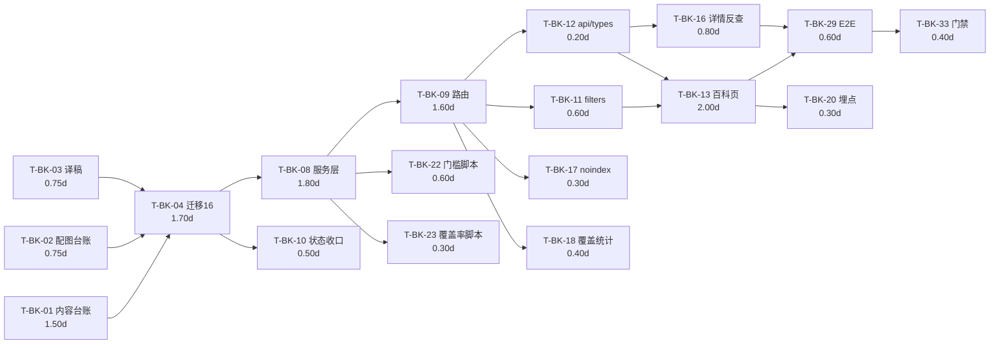

# 华夏古建可视化 · 建筑知识科普内容扩充 编码任务规划（tasks）

| 项 | 内容 |
|---|---|
| 文档编号 | TASKS-PUBLIC-BK-001 |
| 版本 | v1.0 |
| 状态 | 待评审（等待人工确认后方可进入编码；本文件不授权编码） |
| 上游文档 | `docs/requirements/building-knowledge-enrichment-spec.md`（REQ-PUBLIC-BK-001，R-BK-01~31 / AC-BK-01~31）<br/>`docs/design/building-knowledge-enrichment-design.md`（DESIGN-PUBLIC-BK-001，ADR-BK-01~13）<br/>`docs/tasks/s3-p2-tasks.md`（TASKS-PUBLIC-S3P2-001，任务卡格式与迁移编号红线）<br/>`docs/requirements/s3-p2-requirements.md`、`docs/design/s3-p2-design.md`、`docs/requirements/general-audience-enhancement-spec.md`（全局约束） |
| 任务范围 | `/encyclopedia` 从「只有构件 + 只有故宫」扩为「构件术语 ↔ 建筑知识」双主轴：内容补齐、数据迁移、接口扩展、前端筛选与反查、SEO/i18n、埋点计量、发布门槛、测试门禁 |
| 关联代码库 | `D:\Ancient-architecture\ac1.1\acvisual 4`（分支：建筑模型的功能修改，基线 `55852d8`） |
| 技术栈 | React 19 + Vite + Three.js；Express + MySQL（`ac4_db` / `ac4_test`） |
| 业务代码改动 | **无**（本阶段只输出任务规划，不新建/修改任何业务源文件） |
| 编码执行方 | 后续「任务执行」阶段；本文件不授权编码 |
| 编号兼容 | 使用 `T-BK-01~33` 前缀，不与 `T-S3-01~05`、`T-S3P2-*` 冲突；需求侧使用 `R-BK`/`AC-BK`，设计侧使用 `ADR-BK` |

> 本文档回答「按什么顺序改、改哪些文件、做到什么程度、如何验收」。
> 前端文件省略前缀 `client/src/`，后端文件省略前缀 `server/src/`，数据库脚本省略前缀 `server/db/`，脚本省略前缀 `scripts/`，测试省略前缀 `server/test/`。
> **口径声明（全篇生效）**：覆盖率分母、词条总量下限、验收结论一律由数据库实时查询得出，**文档、代码、文案、断言中不得把「20 座」「21 座」「43 条」写成实现常量**。文中出现的数字仅为当前快照的基线说明，不是实现依据。
> **已确认口径（不在此重开）**：分母以 `palaces` 查询为准（当前快照 20 座，含 `gugong` 故宫全景）；每座非故宫建筑 ≥1 条专属词条；通用术语关联 ≥3；双类目为「名筑档案 / 构件术语」；「≤2 次点击」中展开计 1 次点击；不新增「营造工艺」类目；配图沿用 `images/encyclopedia/`；不做新路由、3D/视频、UGC、爬虫、全文翻译、百科编修台。

---

## 0. 阅读指引与全局约定

### 0.1 任务批次、数量与人日

| 批次 | 名称 | 任务 | 任务数 | 人日 |
|---|---|---|---|---|
| A | 内容与资源准备 | T-BK-01~03 | 3 | 3.00 |
| B | 数据与迁移 | T-BK-04~07 | 4 | 3.00 |
| C | 后端 API | T-BK-08~10 | 3 | 3.90 |
| D | 前端筛选与展示 | T-BK-11~15 | 5 | 3.50 |
| E | 详情反查 | T-BK-16 | 1 | 0.80 |
| F | SEO 与 i18n | T-BK-17~19 | 3 | 1.00 |
| G | 埋点与计量 | T-BK-20~21 | 2 | 0.45 |
| H | 质量校验脚本 | T-BK-22~23 | 2 | 0.90 |
| I | 测试与人工验收 | T-BK-24~30 | 7 | 2.00 |
| J | 发布门禁与回滚 | T-BK-31~33 | 3 | 0.80 |
| **合计** | | | **33** | **19.35** |

> 19.35 人日中，内容创作与核校（A 批）3.00 人日、纯工程 16.35 人日。人日含单测与自检，不含等待审核人力的日历时间。

### 0.2 任务卡字段定义（沿用项目既有格式）

| 字段 | 含义 |
|---|---|
| 目标 | 一句话可观察结果 |
| 前置依赖 | 未满足不得开工（任务编号或外部条件） |
| 涉及文件 | 新增（标「新增」）/ 修改（标「修改」），精确到现有路径 |
| 实现要点 | 实现级约束（不含完整代码，不写长篇正文） |
| 完成定义（DoD） | 可判定的完成标准，每条可用命令或操作验证 |
| 覆盖 AC | `R-BK-xx` → `AC-BK-xx` 追溯 |
| 预估 | 人日（0.05 步进，含单测） |
| 并行性 | 可并行 / 不可并行及阻塞关系 |
| 验证方式 | 可复制执行的命令或手工步骤 |
| 边界（不做） | 防止顺手重构 |

### 0.3 通用 DoD（每条任务默认叠加）

1. `npm run lint` 无新增告警；不引入任何新的运行时依赖（`server` 侧不新增 npm 包，前端不新增状态库/SEO 库）。
2. 新增公开响应字段只增不改，缺失值为 `null` / `[]` / `false`，响应中不得出现 `undefined`；响应包装保持 `{ success, data, message?, error?, code? }`。
3. 新增 `server/test/*.test.js` **必须登记到 `server/package.json` 的 `test` 脚本显式文件列表**（未登记不会被执行）；前端测试文件放在 `client/src/**/__tests__/*.test.js(x)`，由 vitest 自动发现。
4. 不修改 `static-version/`；不改既有 URL 形态（`/encyclopedia?term=<id>` 必须保持可用）；不删除既有列/表/字段；既有 26 条词条的 `id/term/category/content` 语义不得改变。
5. 公开接口（列表、详情、搜索、分享、sitemap）不得返回 `draft` 词条；不得返回审核人姓名（只返回布尔）。
6. 新增样式只追加到 `styles/encyclopedia.css` **末尾**，新起选择器，不改写既有选择器（TR-09 延续）；新增交互继承 `prefers-reduced-motion` 归零规则。
7. 所有新增建筑名称、朝代、地区、排序、可联动性必须由服务端从 `palaces` 派生；前端不得再新增「只列部分建筑」的映射表。

### 0.4 全局红线（任一违反即任务失败）

| 编号 | 红线 | 来源 |
|---|---|---|
| RED-BK-01 | 不得创建 `server/db/migration_public_16_ugc_public.sql`；迁移 16 文件名固定为 `migration_public_16_building_knowledge.sql` | `s3-p2-tasks.md` RED-01 |
| RED-BK-02 | 迁移脚本内禁止 `DROP TABLE` / `DELETE` / `TRUNCATE` 既有数据；禁止 `INSERT IGNORE` | ADR-BK-11 / R-BK-10 |
| RED-BK-03 | `related_palaces` 回填禁止整值覆盖（`SET related_palaces='[...]'`），只能 `JSON_CONTAINS` 判重后追加 | R-BK-11 |
| RED-BK-04 | 回滚脚本不得以 `migration_public_` 前缀命名（否则被 `migration-idempotent.test.js` 自动执行） | CS-BK-08 |
| RED-BK-05 | 前端不得再出现 `PALACE_NAMES` / `PALACE_PRIORITY` / `{ id: 'taihedian' }` 兜底；3D 联动不得跨建筑兜底 | R-BK-17/18 |
| RED-BK-06 | 不得新增 `/encyclopedia/building/:id` 等路由，不得新建 `encyclopedia_term_palaces` 关联表 | OOS-BK-07/09、ADR-BK-03 |
| RED-BK-07 | 不得为百科新增写接口 / 编修台 UI / 审批流水表 | OOS-BK-06、ADR-BK-04 |
| RED-BK-08 | 不得用 `dangerouslySetInnerHTML` 渲染命中高亮或词条正文 | DFX-BK-S2 |
| RED-BK-09 | 不得在文档、代码、文案、测试断言中把建筑数量或词条总量写成固定事实（仅允许 `MIN_PUBLISHED_TERMS = 40` 一个下限常量） | R-BK-03、RQ §1.3-2 |
| RED-BK-10 | 不得改 `GET /api/palaces/:id` 的响应结构（反查必须走懒加载） | DFX-BK-P4、NB-BK-04 |
| RED-BK-11 | 不得新增「营造工艺」类目（用户已确认）；7 条新术语只能归入既有 11 个类目 | 本轮口径 |
| RED-BK-12 | 不得让 SEO 路由注册在 `app.get('*')` 之后 | ADR-S3-10 |

### 0.5 基线核对结论（编码起点事实）

| 事实 | 证据 |
|---|---|
| `encyclopedia_terms` 有 `created_at`、**无** `status/entry_type/primary_palace_id/updated_at` | `server/db/init_full.sql:180-195` |
| 词条种子 26 条，`related_palaces` 仅指向 10 座故宫单体，`xuanshan-roof` 为空数组 | `init_full.sql:734-899` |
| 既有 `category` 取值 11 类：屋顶 / 斗拱 / 彩画 / 柱础 / 台基 / 门窗 / 琉璃 / 脊兽 / 纹饰 / 建筑规制 / 建筑装饰 | `init_full.sql:734-899` |
| 非故宫建筑 id：`changcheng`、`gugong`、`huanghelou`、`mogao`、`potala`、`tiantan`、`tulou`、`yingxian_muta`、`foguangsi`、`yueyanglou` | `init_full.sql:540-687` |
| 后三者 `model_path` 为 `procedural:*`，无 3D 热点 | `init_full.sql:625-645`；`client/src/data/buildingHotspots.js:102-118` |
| `GET /api/encyclopedia` 为 `SELECT *`、裸数组 `data`、无状态过滤 | `routes/encyclopedia.js:16-50` |
| `GET /api/encyclopedia/:id` 返回 `_relatedTerms` / `_relatedPalaces` | `routes/encyclopedia.js:72-115` |
| 前端 `PALACE_NAMES`（10 条）、`PALACE_PRIORITY`（10 条）、兜底 `taihedian` | `pages/EncyclopediaPage.jsx:44-69,289-290` |
| `CATEGORIES` 白名单会过滤掉新类目 | `pages/EncyclopediaPage.jsx:20-33,238-242` |
| `DetailPanel` 有 accordion，无百科入口 | `components/DetailPanel.jsx:248-488` |
| `contentI18n.getCoverage` 百科 translated 恒为 0 | `services/contentI18n.js:81-84` |
| `content_translations` 唯一键 `(entity_type, entity_id, field, locale)` | `migration_public_09_i18n.sql:7-18` |
| 迁移执行器支持 `--status` / `--dry-run` / `--db=` / `--to=` | `scripts/migrate.mjs:30-51` |
| `schema:diff` 会建两个临时库对比 `init_full` 与「全量迁移」结构 | `scripts/schema-diff.mjs:13-16` |
| 后端测试为显式文件列表 | `server/package.json` 的 `test` 脚本 |
| 前端测试由 vitest 自动发现 | `client/vite.config.js` |
| 根脚本已含 `test:client` / `test:server` / `test:contract` / `test:e2e` / `schema:diff` / `ci:gate` / `audit:assets` / `seo:check` | 根 `package.json:5-25` |
| E2E 需先 `npm run build`；后端测试需 `ac4_test` | `test/e2e/playwright.config.js`；`scripts/db-test-init.mjs` |

---

## 1. 任务总览

### 1.1 任务清单总表

| 编号 | 任务名称 | 前置依赖 | 人日 | 可并行 | 覆盖 AC |
|---|---|---|---|---|---|
| T-BK-01 | 内容台账：10 座建筑 + 7 条术语 + 26 条关联补丁 + 文案 key | — | 1.50 | 是（内容侧） | AC-BK-01、04、20、24 |
| T-BK-02 | 配图与许可台账（`images/encyclopedia/`） | — | 0.75 | 是（内容侧） | AC-BK-22 |
| T-BK-03 | 英文标题与摘要译稿（17 条新词条 + 26 条可选补译） | — | 0.75 | 是（内容侧） | AC-BK-25 |
| T-BK-04 | 迁移 16：列 + 索引 + 归一 + 17 条种子 + 双语 + 26 条回填 + 自检 | T-BK-01、02、03 | 1.70 | 否（独占迁移文件） | AC-BK-01~12、20~23 |
| T-BK-05 | 回滚脚本 `rollback_public_16_building_knowledge.sql` | T-BK-04 | 0.40 | 可并行（不同文件） | AC-BK-10、11 |
| T-BK-06 | `init_full.sql` 同步（表定义 + 种子段 + 末尾幂等段） | T-BK-04 | 0.60 | 否（独占该文件） | AC-BK-10、12 |
| T-BK-07 | `ac4_test` 迁移演练与对账（幂等复跑 + `schema:diff`） | T-BK-04、05、06 | 0.30 | 否 | AC-BK-10、11 |
| T-BK-08 | `services/encyclopediaService.js`（查询/派生/计数/覆盖率/`validateTerm`） | T-BK-04 | 1.80 | 否（独占该文件） | AC-BK-03、07、08、17、18、29 |
| T-BK-09 | `routes/encyclopedia.js`（列表/`/taxonomy`/`/stats`/`/categories`/详情） | T-BK-08 | 1.60 | 否（独占该文件） | AC-BK-06、09、13、14、25、26 |
| T-BK-10 | 状态收口：`searchService` / `sitemapService` / `shareCard` | T-BK-04 | 0.50 | 可并行（与 T-BK-08 不同文件） | AC-BK-09、26、31 |
| T-BK-11 | `lib/encyclopediaFilters.js`（参数白名单/URL/失效剔除/分组/高亮）+ 单测 | T-BK-09 | 0.60 | 是 | AC-BK-14、19 |
| T-BK-12 | `api.js` 新增 taxonomy/stats 封装 + `types.js` 类型注释 | T-BK-09 | 0.20 | 是 | AC-BK-13 |
| T-BK-13 | `pages/EncyclopediaPage.jsx` 双主轴改造（唯一主改） | T-BK-11、12、19 | 2.00 | 否（独占该文件） | AC-BK-06、08、13~19、22、27、30、31 |
| T-BK-14 | `components/EncyclopediaGuide.jsx` 数据驱动去故宫化 | T-BK-09 | 0.30 | 可并行（不同文件） | AC-BK-06 |
| T-BK-15 | `styles/encyclopedia.css` 新类 + 无障碍与对比度 | T-BK-13 | 0.40 | 否（同文件串行） | AC-BK-19 |
| T-BK-16 | `components/DetailPanel.jsx` 关联建筑知识区块（唯一主改） | T-BK-12 | 0.80 | 否（独占该文件） | AC-BK-16、22、30 |
| T-BK-17 | `app.js` `shouldNoindex(path, query)` + 单测 | T-BK-09 | 0.30 | 否（独占 `app.js`） | AC-BK-27 |
| T-BK-18 | `services/contentI18n.js` term 覆盖统计与译文读取 | T-BK-03、T-BK-09 | 0.40 | 可并行（不同文件） | AC-BK-25 |
| T-BK-19 | `i18n/{zh-CN,en}.json` 新增 `encyclopedia.*` + canonical/hreflang 验收 | T-BK-03 | 0.30 | 可并行（仅 json 文件） | AC-BK-25、27 |
| T-BK-20 | `lib/analytics.js` 4 事件 + 3 属性 | T-BK-13、16 | 0.30 | 否（独占该文件） | AC-BK-28 |
| T-BK-21 | `scripts/check-bk-events.mjs` 埋点静态校验 | T-BK-20 | 0.15 | 是 | AC-BK-28 |
| T-BK-22 | `scripts/content-check-bk.mjs` 发布门槛校验 | T-BK-08 | 0.60 | 是 | AC-BK-20~23 |
| T-BK-23 | `scripts/verify-bk-coverage.mjs` 覆盖率验收查询 | T-BK-08 | 0.30 | 是 | AC-BK-01~03、29 |
| T-BK-24 | `test/encyclopedia-migration.test.js` | T-BK-04~07 | 0.30 | 是 | AC-BK-10、11 |
| T-BK-25 | `test/encyclopedia-service.test.js` | T-BK-08 | 0.30 | 是 | AC-BK-07、08、09、17 |
| T-BK-26 | `test/encyclopedia-taxonomy.test.js` | T-BK-08、09 | 0.30 | 是 | AC-BK-03、29 |
| T-BK-27 | `test/encyclopedia-draft-isolation.test.js` | T-BK-09、10、17 | 0.25 | 是 | AC-BK-09 |
| T-BK-28 | `server/package.json` 测试登记（唯一主改） | T-BK-24~27 | 0.10 | 否 | AC-BK-31 |
| T-BK-29 | `test/e2e/encyclopedia-knowledge.spec.js` | T-BK-13~16 | 0.60 | 否（收尾） | AC-BK-01~19、21、22、30、31 |
| T-BK-30 | 人工验收清单（事实/版权/字数/数据一致/可发现性） | T-BK-22 | 0.15 | 否 | AC-BK-20、21、23、24、30 |
| T-BK-31 | 根 `package.json` 新增 `bk:*` 脚本（唯一主改） | T-BK-21~23 | 0.20 | 否 | AC-BK-28、29 |
| T-BK-32 | 发布说明、口径公告与回滚手册 | T-BK-33 前 | 0.20 | 是 | AC-BK-31 |
| T-BK-33 | 合并审查 + 全量回归 + 门禁报告 | 全部 | 0.40 | 否 | AC-BK-12、31 |
| **合计** | | | **19.35** | | **31/31 全覆盖** |

### 1.2 里程碑

| 里程碑 | 判定条件 | 可对外说明 |
|---|---|---|
| **M-BK1 数据可迁移** | T-BK-04~07 DoD 通过 | `ac4_test` 连跑两遍结果一致，结构无差异，既有 26 条哈希不变 |
| **M-BK2 接口可读** | T-BK-08~10 DoD 通过 | 列表可筛建筑/朝代/地区，taxonomy/stats 由查询给出，草稿不可见 |
| **M-BK3 双主轴可见** | T-BK-11~15 DoD 通过 | 建筑筛选条上线、分组与高亮可用、URL 可分享、无 id 裸奔、3D 不跳错 |
| **M-BK4 反查可用** | T-BK-16 DoD 通过 | 建筑详情「关联建筑知识」可展开并直达词条，无关联不留空块 |
| **M-BK5 可收录可分享** | T-BK-17~19 DoD 通过 | 筛选页 noindex、词条 sitemap 只含已发布、英文标题/摘要可见 |
| **M-BK6 可计量** | T-BK-20~23 DoD 通过 | 4 类事件可统计、发布门槛与覆盖率脚本退出码可信 |
| **M-BK7 可发布** | T-BK-24~30 DoD 通过 | 20 个测试文件全绿 + E2E 通过 + 5 条人工签核完成 |
| **M-BK-Release** | T-BK-31~33 通过 | `npm run ci:gate` 全绿 + 门禁报告 + 回滚手册就位 |

### 1.3 关键路径与批次依赖



**工程关键路径（最长链，单位人日）**

`T-BK-04(1.70) → T-BK-08(1.80) → T-BK-09(1.60) → T-BK-12(0.20) → T-BK-13(2.00) → T-BK-16(0.80) → T-BK-29(0.60) → T-BK-33(0.40) = 9.10`

**含内容前置的关键路径**

若 T-BK-01 与 T-BK-04 串行（内容侧未先交付）：`1.50 + 9.10 = 10.60`；若 T-BK-01~03 在 T-BK-04 起草列/索引期间并行（推荐）：关键路径仍为 **9.10 人日**。

**次级路径**

- 计量链：`T-BK-09 → T-BK-22 → T-BK-30 → T-BK-33` = 1.60 + 0.60 + 0.15 + 0.40 = 2.75
- SEO 链：`T-BK-09 → T-BK-17 → T-BK-19 → T-BK-27 → T-BK-33` = 1.60 + 0.30 + 0.30 + 0.25 + 0.40 = 2.85
- 口径链：`T-BK-08 → T-BK-23 → T-BK-26` = 1.80 + 0.30 + 0.30 = 2.40
- 前端辅助链：`T-BK-13 → T-BK-15` = 2.00 + 0.40 = 2.40

### 1.4 可并行工作流与角色建议

| 工作流 | 任务序列 | 独占文件面 | 建议角色 |
|---|---|---|---|
| 内容流 | T-BK-01 → T-BK-02 → T-BK-03（互不依赖，可三人并行） | `docs/content/**`、`images/encyclopedia/**` | 内容编修 / 事实核校 |
| 数据流 | T-BK-04 → T-BK-05 → T-BK-06 → T-BK-07 | `server/db/migration_public_16_*`、`rollback_public_16_*`、`init_full.sql` | 后端 A（数据库） |
| 接口流 | T-BK-08 → T-BK-09 → T-BK-17 / T-BK-18 | `services/encyclopediaService.js`、`routes/encyclopedia.js`、`app.js`、`services/contentI18n.js` | 后端 B（接口） |
| 收口流 | T-BK-10 → T-BK-24 → T-BK-27 | `services/{searchService,sitemapService,shareCard}.js`、对应测试 | 后端 C（横切） |
| 前端流 | T-BK-11 → T-BK-12 → T-BK-13 → T-BK-15 | `lib/encyclopediaFilters.js`、`api.js`、`types.js`、`pages/EncyclopediaPage.jsx`、`styles/encyclopedia.css` | 前端 A |
| 反查流 | T-BK-16 → T-BK-19 → T-BK-20 | `components/DetailPanel.jsx`、`i18n/*.json`、`lib/analytics.js` | 前端 B |
| 校验流 | T-BK-22 → T-BK-23 → T-BK-21 → T-BK-31 | `scripts/content-check-bk.mjs`、`scripts/verify-bk-coverage.mjs`、`scripts/check-bk-events.mjs`、根 `package.json` | 后端 A/B + QA |
| 门禁流 | T-BK-25 → T-BK-26 → T-BK-28 → T-BK-29 → T-BK-30 → T-BK-32 → T-BK-33 | `server/test/*`、`server/package.json`、`test/e2e/*`、`docs/tasks/*` | QA + 全员 |

### 1.5 必须串行的文件冲突矩阵（同一文件只允许一个任务主改）

| 文件 | 唯一主改任务 | 串行规则 |
|---|---|---|
| `server/db/migration_public_16_building_knowledge.sql` | **T-BK-04** | T-BK-04 一次写全（列/索引/归一/种子/双语/回填/自检）；T-BK-05~07 只读不改 |
| `server/db/rollback_public_16_building_knowledge.sql` | **T-BK-05** | T-BK-05 独占；其他任务只在演练时执行，不改内容 |
| `server/db/init_full.sql` | **T-BK-06** | T-BK-06 独占；T-BK-04 不得顺手改 `init_full.sql`，反之亦然 |
| `server/src/services/encyclopediaService.js` | **T-BK-08** | 查询、派生、计数、覆盖率、`validateTerm` 全部收敛在此；T-BK-09 只调用不内联 SQL |
| `server/src/routes/encyclopedia.js` | **T-BK-09** | 列表、`/taxonomy`、`/stats`、`/categories`、`/:id` 一次改完，新增静态段必须在 `/:id` 之前；T-BK-11/13/16/17 只消费不改 |
| `server/src/services/searchService.js`、`sitemapService.js`、`shareCard.js` | **T-BK-10** | 三个文件同批同人修改；其他任务不得单独改其中任一文件 |
| `server/src/app.js` | **T-BK-17** | `shouldNoindex` 抽函数并改 fallback；不得新增其他分支 |
| `server/src/services/contentI18n.js` | **T-BK-18** | 只改 `getCoverage` 的 encyclopedia 分支与 term 译文读取；`palaces`/`ui` 分支不动 |
| `client/src/pages/EncyclopediaPage.jsx` | **T-BK-13** | 删除两份硬编码、筛选、URL、分组、高亮、空态、3D 降级、`▲` 分块、canonical、i18n 消费、埋点调用全部在此任务内完成；T-BK-11/12/19 只提供依赖 |
| `client/src/components/DetailPanel.jsx` | **T-BK-16** | 反查区块、头部直链、懒加载、埋点全部在此任务内完成 |
| `client/src/lib/analytics.js` | **T-BK-20** | 白名单只在此任务扩展；T-BK-13/16 只调用 `track()` |
| `client/src/i18n/zh-CN.json`、`en.json` | **T-BK-19** | 只新增 `encyclopedia.*` 键，不改既有键值；T-BK-13/16 只消费 |
| `client/src/styles/encyclopedia.css` | **T-BK-15** | 只在文件末尾追加，不改写既有选择器 |
| `client/src/api.js` | **T-BK-12** | 新增 2 个封装，既有三个百科函数签名不变 |
| `server/package.json` | **T-BK-28** | 4 个新测试文件一次性登记，避免多人抢改 `test` 脚本 |
| 根 `package.json` | **T-BK-31** | 新增 `bk:*` 脚本一次性登记 |
| `docs/tasks/building-knowledge-release-notes.md` | **T-BK-32** | 发布说明与回滚手册同文件 |

> 同一人串行建议：`T-BK-04 → T-BK-05 → T-BK-06 → T-BK-07`（数据库）；`T-BK-08 → T-BK-09`（接口，服务层先冻结形状）；`T-BK-11 → T-BK-13 → T-BK-15`（前端 A）；`T-BK-12 → T-BK-16`（前端 B）。

---

## 2. 批次 A：内容与资源准备

**批次小结**

| 维度 | 内容 |
|---|---|
| 数据迁移 | 无 |
| 接口契约 | 无 |
| 产出 | 内容台账、配图许可台账、英文译稿台账（均为文档与资源，不含长篇正文进任务卡） |
| 测试 | 无（由 T-BK-22 的脚本对台账落地结果做机器校验） |
| 验证命令 | `node scripts/content-check-bk.mjs --db=ac4_test --mode=all`（T-BK-22 完成后） |

### T-BK-01 内容台账：10 座建筑 + 7 条术语 + 26 条关联补丁 + 文案 key

| 项 | 内容 |
|---|---|
| 目标 | 用一份可逐条核对的台账，冻结本轮全部内容条目、字段、来源与关联关系，使 T-BK-04 的种子写入无需二次决策 |
| 前置依赖 | — |
| 涉及文件 | 新增 `docs/content/building-knowledge-content-register.md`（台账，唯一主改）<br/>参考只读：`docs/design/building-knowledge-enrichment-design.md` §4.1/§4.2/§3.5.4 |
| 实现要点 | ① 台账每条记录固定字段：`term_id` / `term`（标题）/ `category`（既有 11 类之一或「名筑档案」）/ `entry_type` / `primary_palace_id` / `synopsis`（**只填字数区间，正文另存**）/ `knowledge_dimensions`（代码枚举）/ `related_terms`（≥2）/ `related_palaces` / `source_refs`（≥1，含名称与链接）/ `image_dir` / 许可状态 / 审核人 / 核校日期；② 建筑专属词条 10 条按 §4.1 MVP 行落地（`gugong` 计入）；③ 新增通用术语 7 条按 §4.2 落地，**因不新增「营造工艺」类目**，`hangtu`/`fengsui`/`shiqiang`/`yabi-kaizao`/`yuanxing-weiyuan` 归「建筑规制」，`bihua-caisu` 归「建筑装饰」，`feiyan` 归「屋顶」；④ 既有 26 条 `related_palaces` 追加清单按 §3.5.4 逐条抄录（只追加，不得改原值），并标注每条追加的建筑 id；⑤ 输出「文案 key 表」：`encyclopedia.filter.*`、`encyclopedia.group.*`、`encyclopedia.empty.*`、`encyclopedia.coverage.*`、`encyclopedia.knowledge.*`、`encyclopedia.englishComingSoon` 的键名与中文文案（供 T-BK-19 直接落地）；⑥ 台账不得包含整篇正文，正文由内容侧在 T-BK-04 前放入独立稿件文件（`docs/content/entries/<term_id>.md`），避免任务卡膨胀 |
| 完成定义（DoD） | ① 10 座非故宫建筑每座 ≥1 条专属词条行，`primary_palace_id` 与建筑 id 完全一致；② 7 条通用术语行齐全，`category` 均在既有 11 类内（无「营造工艺」）；③ 26 条既有词条的追加清单齐全，且每条追加项均标注「追加/不改原值」；④ 每行 `source_refs` ≥1 且非空字符串；⑤ 每行 `synopsis` 字数落在 40–120；⑥ 文案 key 表可被 T-BK-19 逐键复制 |
| 覆盖 AC | R-BK-01/04/20/24 → AC-BK-01、AC-BK-04、AC-BK-20、AC-BK-24 |
| 预估 | 1.50 人日 |
| 并行性 | 可并行（内容侧独立）；**阻塞 T-BK-04** |
| 验证方式 | 人工逐行走查 +（T-BK-22 完成后）`node scripts/content-check-bk.mjs --mode=content-register --file=docs/content/building-knowledge-content-register.md`；`git diff --stat docs/content/` 确认只新增文档 |
| 边界（不做） | 不写整篇正文；不新增类目；不修改既有 26 条正文；不做英文翻译（T-BK-03） |

**内容清单（T-BK-01 必须逐行落表的 10 座建筑 + 7 条术语）**

| # | 建筑 id | 名称 | 建议 term_id | 标题 | 分类 | 主关联建筑 | 摘要字数 | 关联通用术语（≥3） | 来源（须填具体条目） | 配图目录 |
|---|---|---|---|---|---|---|---|---|---|---|
| 1 | `changcheng` | 长城 | `changcheng-wall` | 长城·依山就势的墙体与烽燧体系 | 名筑档案 | `changcheng` | 60–110 | `hangtu`、`fengsui`、`shiqiang` | 遗产地官方资料 + 保护规划公开文本 | `images/encyclopedia/changcheng-wall/` |
| 2 | `gugong` | 故宫全景 | `gugong-axis` | 故宫全景·中轴秩序与「三朝五门」 | 名筑档案 | `gugong` | 80–120 | `sanchaodian`、`gongdian-buju`、`qianchaohouqin` | 故宫博物院官网 + 《周礼·考工记》 | `images/encyclopedia/gugong-axis/` |
| 3 | `huanghelou` | 黄鹤楼 | `huanghelou-eaves` | 黄鹤楼·五层飞檐与屡毁屡建 | 名筑档案 | `huanghelou` | 60–110 | `roof-ranking`、`feiyan`、`xiangyunwen` | 景区官方资料 + 地方志 | `images/encyclopedia/huanghelou-eaves/` |
| 4 | `mogao` | 莫高窟 | `mogao-cliff` | 莫高窟·崖壁开窟与千年壁画彩塑 | 名筑档案 | `mogao` | 70–120 | `yabi-kaizao`、`bihua-caisu`、`goudang` | 敦煌研究院公开资料 + 世界遗产中心条目 | `images/encyclopedia/mogao-cliff/` |
| 5 | `potala` | 布达拉宫 | `potala-fortress` | 布达拉宫·依山而建的宫堡体系 | 名筑档案 | `potala` | 60–110 | `hangtu`、`gongdian-buju`、`gongmen` | 世界遗产中心条目 + 管理处公开资料 | `images/encyclopedia/potala-fortress/` |
| 6 | `tiantan` | 天坛 | `tiantan-eaves` | 天坛·三重攒尖与二十八柱的祈年殿 | 名筑档案 | `tiantan` | 70–120 | `roof-ranking`、`dougong`、`goudang` | 世界遗产中心条目 + 公园官方资料 | `images/encyclopedia/tiantan-eaves/` |
| 7 | `tulou` | 福建土楼 | `tulou-earthen` | 福建土楼·生土夯筑的环形围合 | 名筑档案 | `tulou` | 60–110 | `hangtu`、`yuanxing-weiyuan`、`goudang` | 世界遗产中心条目 + 地方志 | `images/encyclopedia/tulou-earthen/` |
| 8 | `yingxian_muta` | 应县木塔 | `yingxian-bracket` | 应县木塔·明五暗四与斗拱博物馆 | 名筑档案 | `yingxian_muta` | 70–120 | `dougong`、`dougong-levels`、`goudang` | 全国重点文物保护单位名录 + 木塔管理处公开资料 | `images/encyclopedia/yingxian-bracket/` |
| 9 | `foguangsi` | 佛光寺东大殿 | `foguangsi-eave` | 佛光寺东大殿·七铺作斗拱与深远出檐 | 名筑档案 | `foguangsi` | 70–120 | `dougong`、`dougong-levels`、`wudian-roof` | 五台山世界遗产资料 + 文物局公开资料 | `images/encyclopedia/foguangsi-eave/` |
| 10 | `yueyanglou` | 岳阳楼 | `yueyanglou-helmet` | 岳阳楼·三层三檐与四角盔顶 | 名筑档案 | `yueyanglou` | 60–110 | `roof-ranking`、`feiyan`、`xiangyunwen` | 景区官方资料 + 《岳阳楼记》 | `images/encyclopedia/yueyanglou-helmet/` |

| # | term_id | 术语 | 分类（既有类目） | 主关联建筑 | 摘要字数 | 主要关联建筑（写入 `related_palaces`） | 来源（须填具体条目） | 配图目录 |
|---|---|---|---|---|---|---|---|---|
| 11 | `hangtu` | 夯土版筑 | 建筑规制 | `null`（通用术语） | 50–100 | `changcheng`、`tulou`、`potala` | 建筑技术史公开资料 | `images/encyclopedia/hangtu/` |
| 12 | `fengsui` | 烽燧与关隘 | 建筑规制 | `null` | 50–100 | `changcheng` | 长城保护公开资料 | `images/encyclopedia/fengsui/` |
| 13 | `shiqiang` | 条石与砖石砌筑 | 建筑规制 | `null` | 50–100 | `changcheng`、`potala` | 建筑技术史公开资料 | `images/encyclopedia/shiqiang/` |
| 14 | `yabi-kaizao` | 崖壁开窟 | 建筑规制 | `null` | 50–100 | `mogao` | 敦煌研究院公开资料 | `images/encyclopedia/yabi-kaizao/` |
| 15 | `bihua-caisu` | 壁画与彩塑 | 建筑装饰 | `null` | 50–100 | `mogao` | 敦煌研究院公开资料 | `images/encyclopedia/bihua-caisu/` |
| 16 | `feiyan` | 飞檐与翼角 | 屋顶 | `null` | 50–100 | `huanghelou`、`yueyanglou` | 古建营造公开资料 | `images/encyclopedia/feiyan/` |
| 17 | `yuanxing-weiyuan` | 环形围合 | 建筑规制 | `null` | 50–100 | `tulou` | 世界遗产中心条目 + 地方志 | `images/encyclopedia/yuanxing-weiyuan/` |

> 说明：以上 17 条为**结构清单**，正文（≥300 字、≥3 个 `▲` 小节、建筑专属词条必含「该建筑的独有做法」「与通用术语的关系」两节）由内容侧写入 `docs/content/entries/<term_id>.md`，不在任务卡中展开。
> 说明：本表 `source` 列只规定来源类别，台账中必须补全具体文献/页面名称与链接，否则 AC-BK-20 不通过。

### T-BK-02 配图与许可台账（`images/encyclopedia/`）

| 项 | 内容 |
|---|---|
| 目标 | 每条新增词条有可用且有许可的配图目录；无授权即无图，缺失时可降级 |
| 前置依赖 | —（可与 T-BK-01 并行） |
| 涉及文件 | 新增 `docs/content/bk-image-credits.md`（许可台账，唯一主改）<br/>新增资源目录 `images/encyclopedia/<term_id>/cover.webp`（17 个目录） |
| 实现要点 | ① 每条词条至少 1 张、至多 4 张；单张 ≤300KB，优先 WebP/AVIF；② 命名固定 `cover.webp`、`fig-1.webp`、`fig-2.webp`；③ 台账逐图记录：`path` / `source`（自有拍摄、公共领域、CC 协议的具体名称与链接）/ `license` / `author` / `retrieved_at` / 是否含个人联系方式（含则不进公开页）；④ 与 T-BK-01 的 `image_dir` 一一对应；⑤ 目录缺失或图片缺失时不得建占位裂图，由 T-BK-13 的「无图隐藏轮播」承接；⑥ 不移动、不重命名任何既有 `images/` 文件 |
| 完成定义（DoD） | ① 17 个目录存在且每个 ≥1 张图；② 每张图有 `license` 字段；③ `du -k` 或 `audit:assets` 报告的单词条单图体积 ≤300KB；④ 台账与目录一一对应，无孤儿图；⑤ 至少 1 条词条被标注为「无图」（用于验证降级路径）或明确记录「本轮全有图，降级由 T-BK-30 人工移除图片验证」 |
| 覆盖 AC | R-BK-22 → AC-BK-22 |
| 预估 | 0.75 人日 |
| 并行性 | 可并行；**阻塞 T-BK-04 的 `image_credits` 字段** |
| 验证方式 | `npm run audit:assets`；人工核对 `docs/content/bk-image-credits.md` 与目录；`node -e "..."` 逐图读文件大小（见第 14 章命令索引） |
| 边界（不做） | 不做图片压缩流水线；不新增图库；不改既有 `images/posters/`、`images/views/`；不使用商业图库 |

### T-BK-03 英文标题与摘要译稿

| 项 | 内容 |
|---|---|
| 目标 | 17 条新增词条具备英文标题与英文摘要（分级覆盖），未覆盖者显式标注而非空白 |
| 前置依赖 | T-BK-01（标题与摘要定稿） |
| 涉及文件 | 新增 `docs/content/bk-translations-en.md`（译稿台账，唯一主改） |
| 实现要点 | ① 每条新词条 2 行：`field='term'`（英文标题）、`field='synopsis'`（英文摘要），`status='full'`；② 仅标题可用而摘要未定时，标题行 `status='title'`，摘要不写；③ 英文摘要长度以 160–400 字符为宜（不强制）；④ 栏目标题专用名词使用拼音 + 释义（如 `Dougong (bracket set)`），不用机器直译腔；⑤ 台账格式可直接被 T-BK-04 转成 `content_translations` 的 `INSERT`；⑥ 既有 26 条的补译不在本轮必做范围，可在台账末尾列为「可选补译」，不计入 AC-BK-25 |
| 完成定义（DoD） | ① 17 条词条各 ≥1 行 `field='term'` 且 `status ∈ {full,title}`；② `status='full'` 的行必须同时有 `synopsis`；③ 英文标题不含中文标点；④ 台账行数与 T-BK-01 的 17 条一致 |
| 覆盖 AC | R-BK-25 → AC-BK-25 |
| 预估 | 0.75 人日 |
| 并行性 | 可并行（依赖 T-BK-01 定稿）；**阻塞 T-BK-04 的双语写入** |
| 验证方式 | 人工逐行走查；T-BK-04 落地后用 `SELECT field,status,COUNT(*) FROM content_translations WHERE entity_type='term' GROUP BY field,status;` 对账 |
| 边界（不做） | 不做全文翻译；不做整站多语言重构；不改既有 `ui`/`palaces` 译文 |

---

## 3. 批次 B：数据与迁移

**批次小结**

| 维度 | 内容 |
|---|---|
| 数据迁移 | 迁移 16 全量（11 列 + 3 索引 + 归一回填 + 17 条种子 + 双语 + 26 条关联追加 + 自检） |
| 接口契约 | 无（仅数据） |
| 回滚 | 独立脚本 + 演练 |
| 测试 | 幂等复跑、`schema:diff`、哈希对账（T-BK-07 执行，T-BK-24 固化） |
| 验证命令 | `npm run db:test:init`；`npm run db:migrate -- --db=ac4_test`（连跑两遍）；`npm run schema:diff` |

### T-BK-04 迁移 16：列 + 索引 + 归一 + 17 条种子 + 双语 + 26 条回填 + 自检

| 项 | 内容 |
|---|---|
| 目标 | 一次可重复执行的迁移，把词条表升级到双类目模型、写入 17 条草稿词条、把既有 26 条词条补齐非故宫关联，且不改变既有正文 |
| 前置依赖 | T-BK-01（内容台账与正文稿件）、T-BK-02（`image_credits`）、T-BK-03（译稿） |
| 涉及文件 | 新增 `server/db/migration_public_16_building_knowledge.sql`（**唯一主改**）<br/>只读参考：`server/db/migration_public_12_content_status.sql`（判存范式）、`server/db/migration_public_09_i18n.sql`（唯一键） |
| 实现要点 | **步骤顺序不可交换**：<br/>1. 新增 11 列（`entry_type`、`status`、`primary_palace_id`、`knowledge_dimensions`、`source_refs`、`image_credits`、`fact_checked_at/by`、`rights_checked_at/by`、`updated_at`），逐列 `information_schema.columns` 判存 + `PREPARE/EXECUTE`；<br/>2. 新增 3 个索引（`idx_terms_status`、`idx_terms_entry_type`、`idx_terms_primary_palace`），`information_schema.statistics` 判存；<br/>3. `status` 归一：`UPDATE ... SET status='published' WHERE status IS NULL OR status=''`（保护既有 26 条）；<br/>4. `entry_type` 归一：既有行置 `craft`；<br/>5. `updated_at` 兜底：`UPDATE ... SET updated_at=created_at WHERE updated_at IS NULL`；<br/>6. 插入 17 条（10 `building` + 7 `craft`），**`status='draft'`**，`INSERT ... ON DUPLICATE KEY UPDATE id=id`（存在即不动正文）；`building` 行 `category='名筑档案'`、`primary_palace_id` 非空、`related_palaces` 必含主关联；`knowledge_dimensions` 存**代码枚举**（`site-layout` 等）；<br/>7. 既有 26 条 `related_palaces` 追加：先 `UPDATE ... SET related_palaces=JSON_ARRAY() WHERE related_palaces IS NULL OR NOT JSON_VALID(related_palaces)`，再逐条 `UPDATE ... WHERE id=? AND NOT JSON_CONTAINS(COALESCE(related_palaces, JSON_ARRAY()), JSON_QUOTE('?'))`，**禁止整值覆盖**；<br/>8. `content_translations` 写入 `entity_type='term'`，`INSERT ... ON DUPLICATE KEY UPDATE value=value`；<br/>9. 末尾自检 `SELECT`：总数、按 `entry_type` 计数、缺主关联数、类目不一致数、失效主关联数（只读）<br/>**写法红线**：禁止 `DROP`/`DELETE`/`TRUNCATE`/`INSERT IGNORE`；JSON 追加前必须 `JSON_VALID` 判定；时间列用 `CURRENT_TIMESTAMP` |
| 完成定义（DoD） | ① 在 `ac4_test` 执行两次，第二次无报错且 `SELECT COUNT(*) FROM encyclopedia_terms` 与第一次相同；② `id` 集合第二次与第一次完全一致；③ 既有 26 条 `SHA2(content,256)` 汇总与迁移前快照一致；④ `SELECT COUNT(*) FROM encyclopedia_terms WHERE entry_type='building' AND (primary_palace_id IS NULL OR primary_palace_id='')` = 0；⑤ `... WHERE entry_type='building' AND category<>'名筑档案'` = 0；⑥ `related_palaces` 每条既有词条的旧值仍全部 `JSON_CONTAINS` 为真；⑦ 17 条新词条 `status='draft'`；⑧ 自检 SELECT 输出中失效主关联数为 0 |
| 覆盖 AC | R-BK-01~12、20~23 → AC-BK-01~12、AC-BK-20~23 |
| 预估 | 1.70 人日 |
| 并行性 | 不可并行（独占迁移文件）；阻塞 T-BK-05~07、T-BK-08、T-BK-10 |
| 验证方式 | `npm run db:test:init` → `npm run db:migrate -- --db=ac4_test` → 再次执行同命令 → 第 13 章「迁移对账 SQL」逐条执行 → `npm run db:migrate -- --status --db=ac4_test` |
| 边界（不做） | 不建关联表；不加写接口；不改既有 26 条正文/类目/id；不把种子设为 `published`；不做正文机器生成 |

### T-BK-05 回滚脚本 `rollback_public_16_building_knowledge.sql`

| 项 | 内容 |
|---|---|
| 目标 | 在不触碰既有内容的前提下，把本轮新增内容按依赖倒序完全撤销，使数据回到迁移前状态 |
| 前置依赖 | T-BK-04（需冻结 17 条 term id 白名单与 26 条追加清单） |
| 涉及文件 | 新增 `server/db/rollback_public_16_building_knowledge.sql`（**唯一主改**）<br/>新增 `docs/content/bk-rollback-baseline.md`（回填前快照记录） |
| 实现要点 | ① **命名不得以 `migration_public_` 开头**（否则被幂等测试自动执行）；② 顺序：删除 `content_translations` 中本轮 17 条 term 的译稿 → 删除 17 条新词条（`DELETE ... WHERE id IN (...)` 白名单）→ 从既有 26 条 `related_palaces` 移除本轮追加的建筑 id（用 `JSON_SEARCH` 定位 + `JSON_REMOVE`，仅移除白名单项，**不得移除既有值**）→ 删除 3 个索引 → 删除 11 列（均先 `information_schema` 判存）；③ 回滚**不触碰**既有 26 条的 `status`/`entry_type`/正文（它们由默认值与归一产生，值与迁移前的可见语义一致）；④ 脚本头部注释写明「执行前置：确认已备份 `encyclopedia_terms` 与 `content_translations`」；⑤ 回滚后自检 SELECT（词条数回到迁移前、追加关联数为 0、列/索引不存在） |
| 完成定义（DoD） | ① 在 `ac4_test` 执行回滚后：词条总数 = 迁移前数值；② 17 条新 id 全部不存在；③ 26 条既有词条的 `related_palaces` 与本轮追加前快照逐条相等；④ 3 个索引与 11 列均不存在（`information_schema` 查询为空）；⑤ 回滚脚本可重复执行不报错（第二次为空操作）；⑥ `npm run db:migrate -- --status --db=ac4_test` 不再把回滚脚本列为迁移 |
| 覆盖 AC | R-BK-10/11 → AC-BK-10、AC-BK-11 |
| 预估 | 0.40 人日 |
| 并行性 | 可并行（与 T-BK-06 不同文件）；阻塞 AC-BK-11 验收 |
| 验证方式 | `npm run db:test:init && npm run db:migrate -- --db=ac4_test` → 记录基线 → `mysql -u root -p ac4_test < server/db/rollback_public_16_building_knowledge.sql` → 重复执行一次 → 比对基线 |
| 边界（不做） | 不删既有 26 条；不删既有译稿；不 `DROP TABLE`；不写进迁移目录的 `migration_public_*` 命名空间 |

### T-BK-06 `init_full.sql` 同步

| 项 | 内容 |
|---|---|
| 目标 | 空库初始化与「空库 + 全量迁移」得到完全相同的结构与词条 id 集合 |
| 前置依赖 | T-BK-04（列/索引/种子内容已定稿） |
| 涉及文件 | 修改 `server/db/init_full.sql`（**唯一主改**） |
| 实现要点 | ① `CREATE TABLE encyclopedia_terms`（`:180-195`）在 `image_paths` 后追加 11 列与 3 索引定义；② 百科种子段（`:899` 之后）追加 17 条（10 `building` + 7 `craft`，`status='draft'`），字段与迁移完全一致；③ 同一段追加既有 26 条 `related_palaces` 的追加 `UPDATE`（判重写法与迁移一致）；④ 文件末尾「公开迁移 15」段之后追加「公开迁移 16」幂等段（列判存 / 索引判存 / 回填判重），使「`init_full` 后再跑全部迁移两遍」不重复插入；⑤ 不改既有 26 条的任何正文、类目、id；⑥ 不在本任务修改 `migration_public_16_*`（由 T-BK-04 独占） |
| 完成定义（DoD） | ① `npm run db:test:init` 成功；② `npm run schema:diff` 退出码 0（空库结构与全量迁移结构无差异）；③ 空库与升级库的 `SELECT id FROM encyclopedia_terms ORDER BY id` 输出完全一致；④ 空库直接跑全部迁移两遍无报错；⑤ `git diff server/db/init_full.sql` 显示既有行未被改写（仅新增） |
| 覆盖 AC | R-BK-10/12 → AC-BK-10、AC-BK-12 |
| 预估 | 0.60 人日 |
| 并行性 | 不可与 T-BK-04 并行改 SQL（不同文件但需同源内容）；可与 T-BK-05 并行 |
| 验证方式 | `npm run db:test:init` → `npm run schema:diff` → `npm run test:server -- --test-name-pattern=migration`（幂等测试） |
| 边界（不做） | 不重排 `init_full.sql` 既有段落；不删既有种子；不把「公开迁移 16」段写成不可重复执行 |

### T-BK-07 `ac4_test` 迁移演练与对账

| 项 | 内容 |
|---|---|
| 目标 | 在测试库完整演练「初始化 → 迁移两遍 → 回滚 → 再迁移」，形成可留档的对账结果 |
| 前置依赖 | T-BK-04、T-BK-05、T-BK-06 |
| 涉及文件 | 新增 `docs/tasks/bk-migration-drill-report.md`（演练报告，唯一主改） |
| 实现要点 | ① 执行顺序：`db:test:init` → 记录基线（词条数、26 条哈希汇总、`related_palaces` 快照）→ `migrate` → 再 `migrate` → 对账 → 回滚 → 对账 → 再迁移；② 对账项固定 6 项：词条总数、26 条 id 集合、26 条 `content` 哈希、`related_palaces` 只增校验、失效主关联数、17 条新 id 存在性；③ 每条 SQL 与结果粘贴进报告；④ 失败时记录失败位置与回滚结果，不得只写「通过」；⑤ 报告用简体中文，标注执行日期与环境（`ac4_test`） |
| 完成定义（DoD） | ① 6 项对账全部有「期望 / 实际 / 结论」三列；② 二次迁移与首次结果一致；③ 回滚后 26 条 `related_palaces` 与基线逐条一致；④ 再迁移后结果与首次一致；⑤ `npm run schema:diff` 退出码 0 的记录在报告中 |
| 覆盖 AC | R-BK-10/11 → AC-BK-10、AC-BK-11 |
| 预估 | 0.30 人日 |
| 并行性 | 不可并行（依赖三个 SQL 任务）；阻塞 M-BK1 判定 |
| 验证方式 | 按报告中的命令逐条复跑；`npm run schema:diff` |
| 边界（不做） | 不在 `ac4_db` 生产库演练；不修改 SQL 脚本（发现问题退回对应任务） |

---

## 4. 批次 C：后端 API

**批次小结**

| 维度 | 内容 |
|---|---|
| 数据迁移 | 无（消费 T-BK-04 的新列） |
| 接口契约 | `GET /api/encyclopedia` 扩展参数 + 字段瘦身 + `meta`；新增 `/taxonomy`、`/stats`；`/categories` 扩展；`/:id` 扩展 |
| 服务层 | 新增 `services/encyclopediaService.js`（唯一数据入口） |
| 状态收口 | `searchService` / `sitemapService` / `shareCard` 三处加 `status='published'` |
| 测试 | 由 T-BK-25/26/27 承接 |
| 验证命令 | `node --test --test-force-exit server/test/encyclopedia-service.test.js`；`curl` 见各任务卡 |

### T-BK-08 `services/encyclopediaService.js`（查询/派生/计数/覆盖率/`validateTerm`）

| 项 | 内容 |
|---|---|
| 目标 | 用**一个服务文件**承载词条全部读取与派生逻辑，路由只做参数校验与响应包装，且派生字段不产生 N+1 |
| 前置依赖 | T-BK-04（新列存在） |
| 涉及文件 | 新增 `server/src/services/encyclopediaService.js`（**唯一主改**） |
| 实现要点 | ① 导出 `listTerms(params)`：支持 `entry_type`/`category`/`building`/`dynasty`/`region`/`search`/`include`/`page`/`page_size`；固定 `WHERE t.status='published'`；排序 `ORDER BY t.sort_order ASC, t.level_value ASC, t.id ASC`；默认不选 `content`，仅 `include=content` 时选；`page_size` 默认 200、上限 500；② 派生：`LEFT JOIN palaces p ON p.id=t.primary_palace_id` 得到 `primary_palace_name/dynasty/region/order_num/has_3d`；`related_palace_names` 用**一次**批量 `WHERE id IN (...)` 补名（禁止 N+1）；`has_3d` 判定 = `model_path` 非空且（非 `procedural:` 前缀 或 命中前端支持的程序化建筑白名单常量）；③ `building` 参数语义：`t.primary_palace_id=? OR (t.entry_type='craft' AND JSON_VALID(t.related_palaces) AND JSON_CONTAINS(t.related_palaces, JSON_QUOTE(?)))`；④ 导出 `getTaxonomy(lang)`：`buildings[]`（在架全部，含 `entry_count`/`craft_count`/`has_3d`/`covered`）、`dynasties[]`、`regions[]`、`entry_types[]`、`categories[]`（含「名筑档案」置顶）、`totals`（`published_terms`/`expected_min = 26 + non_forbidden_total`/`min_floor = max(expected_min, MIN_PUBLISHED_TERMS)`/`coverage_rate` 1 位小数/`buildings_total`/`non_forbidden_total`/`covered_buildings`）；60 秒内存缓存（键含 lang），导出 `clearTaxonomyCache()`；⑤ 导出 `getStats()`：`published_terms`/`draft_terms`/`expected_min`/`min_floor`/`meets_minimum`/`coverage_rate`/`per_building[]`/`invalid_primary_refs`；与 taxonomy 共用同一段 FROM/WHERE（导出 `COVERAGE_SQL_FRAGMENT` 常量），禁止两份口径漂移；⑥ 导出 `getTermDetail(id)`：返回 `primary_building`（下架则 `null`）、`_relatedPalaces`（过滤 `status='published'`）、`translations`（`title`/`synopsis` 的 `{value,status}`）、`fact_checked`/`rights_checked` 布尔、`updated_at`；失效 `related_terms` 忽略该 id 不整条失败；⑦ 导出 `validateTerm(row)`：实现设计 PG-BK-02~10、PG-BK-14（主关联非空且有效、类目一致、摘要 40–120、正文 ≥300、`▲` 小节 ≥3、专属必含两节、维度枚举 ⊆ 5、`source_refs` ≥1、`image_credits` 覆盖每图、`related_terms` 不含自身与不存在 id）；返回 `{ok, violations:[{rule, detail}]}`；⑧ 常量：`MIN_PUBLISHED_TERMS = 40`（全仓唯一允许的下限常量）、`BUILDING_CATEGORY = '名筑档案'`、`FORBIDDEN_CITY_UNITS`（10 座，仅用于排除，不参与分母）、`KNOWLEDGE_DIMENSIONS` 五枚举；⑨ 所有数值用 `Number()` 归一；缺省值 `null`/`[]`/`false` |
| 完成定义（DoD） | ① 列表默认响应不含 `content` 键；`include=content` 时含；② `primary_palace_name` 对非故宫词条返回中文真实名称（不出现 id）；③ `has_3d` 对 `yingxian_muta`/`foguangsi`/`yueyanglou` 与无 `model_path` 建筑均为 `false`，对 `taihedian` 为 `true`；④ `getTaxonomy().totals.expected_min` 在测试库插入一座临时 `published` 非故宫建筑后自动 +1（证明非硬编码）；⑤ `getStats().invalid_primary_refs = 0`；⑥ 列表与详情查询总 SQL 次数为常数（≤6 次），与结果条数无关；⑦ `validateTerm` 对缺来源/字数不足/缺两节/维度非法分别返回对应 `rule` |
| 覆盖 AC | R-BK-03/07/08/17/18/29 → AC-BK-03、07、08、17、18、29 |
| 预估 | 1.80 人日 |
| 并行性 | 不可并行（独占服务文件）；阻塞 T-BK-09、T-BK-11、T-BK-16、T-BK-22、T-BK-23 |
| 验证方式 | `node --test --test-force-exit server/test/encyclopedia-service.test.js`（T-BK-25）；`node -e "require('./server/src/services/encyclopediaService')"` 冒烟 |
| 边界（不做） | 不在路由内写 SQL；不建关联表；不加写方法；不做全文搜索改造（复用 LIKE 口径）；不缓存列表数据（仅 cache taxonomy/stats） |

### T-BK-09 `routes/encyclopedia.js`（列表/`/taxonomy`/`/stats`/`/categories`/详情）

| 项 | 内容 |
|---|---|
| 目标 | 五个公开端点一次改造到位，参数白名单化、默认瘦身、草稿隔离、路由顺序正确，且既有消费方字段不丢 |
| 前置依赖 | T-BK-08 |
| 涉及文件 | 修改 `server/src/routes/encyclopedia.js`（**唯一主改**） |
| 实现要点 | ① **路由顺序**：`/taxonomy`、`/stats`、`/categories` 必须定义在 `/:id` 之前；② 列表：参数校验（`entry_type ∈ {craft,building,all}`；`page ≥1 ≤100`；`page_size 1~500`；字符串 ≤50），非法返回 `400 VALIDATION_FAILED`（不静默忽略）；组装 `{success,data,meta:{total,page,page_size,filters_applied,buildings_total,non_forbidden_total}}`；`data` 仍为**数组**；③ `/taxonomy?lang=`：调用 `getTaxonomy`，60 秒缓存由服务层负责；④ `/stats`：调用 `getStats`；⑤ `/categories`：返回 `{category, category_icon, entry_type, count, sort}`，`WHERE status='published' GROUP BY`；「名筑档案」`sort=0` 置顶，其余按 `sort_order` 最小値；⑥ `/:id`：默认只返回 `published`，非 `published` 且非 admin → `404 {success:false,error:'术语不存在'}`（沿用既有文案，不暴露存在性）；保留 `_relatedTerms`/`_relatedPalaces`；新增 `entry_type`/`status`/`primary_building`/`knowledge_dimensions`/`translations`/`fact_checked`/`rights_checked`/`updated_at`；⑦ 错误统一 `500 {success:false,error:'服务器错误'}`；⑧ 不在路由内内联 SQL |
| 完成定义（DoD） | ① `curl /api/encyclopedia/taxonomy` 返回 `buildings[]` 覆盖全部在架建筑且名称无 id；② `curl /api/encyclopedia/stats` 的 `per_building` 与附录 SQL 结果逐行一致；③ `curl "/api/encyclopedia?entry_type=building&page_size=3"` 返回 3 条且 `data[0].entry_type='building'`；④ `curl "/api/encyclopedia?entry_type=x"` 返回 400 且 `code='VALIDATION_FAILED'`；⑤ `curl "/api/encyclopedia?building=tiantan"` 同时含该建筑专属词条与被其关联的通用术语；⑥ 草稿词条 id 直接 `curl /api/encyclopedia/:id` 返回 404；⑦ `/api/encyclopedia/categories` 含「名筑档案」且带 `count`；⑧ 既有 `data` 为数组、`level_value`/`related_palaces`/`image_paths` 字段仍在 |
| 覆盖 AC | R-BK-06/09/13/14/25/26 → AC-BK-06、09、13、14、25、26 |
| 预估 | 1.60 人日 |
| 并行性 | 不可并行（独占路由文件）；阻塞 T-BK-11、T-BK-12、T-BK-14、T-BK-17、T-BK-18 |
| 验证方式 | 启动本地服务后逐条 `curl`（见 DoD）；`npm run test:contract`（既有快照通配不破坏）；`node --test --test-force-exit server/test/encyclopedia-taxonomy.test.js` |
| 边界（不做） | 不改 `/api/palaces/:id`；不动既有 `/categories` 字段名；不加鉴权；不引入 `/v2`；不做服务端分页强制（默认仍全量一次拉取） |

### T-BK-10 状态收口：`searchService` / `sitemapService` / `shareCard`

| 项 | 内容 |
|---|---|
| 目标 | 草稿词条在搜索、站点地图、分享页/分享存在性判定中**物理不可见**，站点地图 `lastmod` 使用真实更新时间 |
| 前置依赖 | T-BK-04（`status`、`updated_at` 列） |
| 涉及文件 | 修改 `server/src/services/searchService.js`（词条分支加状态过滤）<br/>修改 `server/src/services/sitemapService.js`（状态过滤 + `COALESCE(updated_at, created_at)`）<br/>修改 `server/src/services/shareCard.js`（`getShareContent` 与 `shareEntityExists` 均加状态过滤）（三文件均**唯一主改**） |
| 实现要点 | ① `searchService`：词条查询加 `AND status='published'`；`total` 与筛选后结果一致；`href` 保持 `/encyclopedia?term=<id>`；② `sitemapService`：term 分支加 `WHERE status='published'`；选择列改 `id, COALESCE(updated_at, created_at) AS lastmod`；排序 `sort_order ASC, id ASC`；既有 5 分钟缓存不变；导出 `clearSitemapCache()` 供演练/发布后调用；③ `shareCard`：`getShareContent('term', id)` 与 `shareEntityExists('term', id)` 均加 `status='published'`；未命中返回 `null` 走既有「内容已调整」页；④ 不动 `palaces`/`ui`/`routes` 分支的既有语义 |
| 完成定义（DoD） | ① 新增一条草稿词条后，`searchService.search('该词条标题')` 结果不含该 id；② `/sitemap.xml` 不含草稿 id，含已发布新词条；③ `lastmod` 对迁移回填过的既有词条为 `created_at`（非 `NOW()`），对 `updated_at` 非空行为 `updated_at`；④ `shareCard.getShareContent('term', 草稿id)` 返回 `null`；⑤ `shareEntityExists` 对草稿返回 `false`；⑥ 既有搜索「斗拱」命中数不减少（`total` 与改造前相等或更大） |
| 覆盖 AC | R-BK-09/26/31 → AC-BK-09、AC-BK-26、AC-BK-31 |
| 预估 | 0.50 人日 |
| 并行性 | 可并行（与 T-BK-08 不同文件）；阻塞 T-BK-27 |
| 验证方式 | `node --test --test-force-exit server/test/encyclopedia-draft-isolation.test.js`；`npm run seo:check`；`curl "/api/search?q=斗拱"` 对比改造前条数 |
| 边界（不做） | 不改搜索排序与归一化规则；不改 sitemap 分片逻辑；不改分享页模板；不加 admin 预览绕过 |

---

## 5. 批次 D：前端筛选与展示

**批次小结**

| 维度 | 内容 |
|---|---|
| 数据迁移 | 无 |
| 接口契约 | 消费 `GET /api/encyclopedia`（含 `meta`）、`/taxonomy`、`/categories`、`/:id` |
| 前端组件/状态 | 新增 `lib/encyclopediaFilters.js`；`api.js` + `types.js`；改造 `EncyclopediaPage.jsx`（唯一主改）、`EncyclopediaGuide.jsx`、`encyclopedia.css` |
| 测试 | `lib/__tests__/encyclopediaFilters.test.js`；页面行为由 T-BK-29 E2E 覆盖 |
| 验证命令 | `npm run test:client -- encyclopediaFilters`；`npm run test:e2e -- encyclopedia-knowledge.spec.js` |

### T-BK-11 `lib/encyclopediaFilters.js`（参数白名单/URL/失效剔除/分组/高亮）+ 单测

| 项 | 内容 |
|---|---|
| 目标 | 把筛选状态与 URL 的转换、失效参数剔除、分组与命中高亮变成可单测的纯函数，页面不承担规则实现 |
| 前置依赖 | T-BK-09（`meta.filters_applied` 与 taxonomy 形状冻结） |
| 涉及文件 | 新增 `client/src/lib/encyclopediaFilters.js`<br/>新增 `client/src/lib/__tests__/encyclopediaFilters.test.js` |
| 实现要点 | ① `FILTER_KEYS = ['building','entry_type','category','dynasty','region','q']`；`normalizeFilters(searchParams, taxonomy)` 返回 `{filters, dropped[]}`：非法枚举、超长字符串、taxonomy 中不存在的建筑/朝代/地区一律剔除并记录到 `dropped`；`term` 不参与筛选但必须保留；② `toSearchParams(filters)` 只输出非空键，顺序稳定（便于 URL 对比）；③ `filterTerms(terms, filters)`：`building` 命中 `primary_palace_id === building || related_palaces.includes(building)`；`entry_type`/`category`/`dynasty`（`primary_palace_dynasty` 模糊）/`region`（精确）/`q`（`term`/`synopsis` 归一化包含）；④ `groupTerms(terms)`：`building` 组在前、`craft` 组在后，组内保持服务端顺序；⑤ `highlightSegments(text, q)`：返回 `[{text, hit}]` 片段数组（**不得返回 HTML 字符串**），归一规则与后端 `normalizeText` 对齐（繁简/异体字基础映射）；⑥ `countByType(terms)` 返回 `{total, building, craft}`；⑦ `pickAlternatives(terms, filters, taxonomy)`：空态时返回 ≤2 条替代（相邻建筑、热门术语、同类目），排序确定（`sort_order, level_value, id`），**禁用随机** |
| 完成定义（DoD） | 单测 ≥12 条通过：非法 `entry_type` 被剔除并进 `dropped`；失效 `building` 被剔除但 `term` 保留；`toSearchParams` 顺序稳定；`building` 命中主关联与 JSON 关联两种；`q` 命中 `term` 与 `synopsis`；`highlightSegments` 对无命中返回单片段且不含 HTML；`groupTerms` 建筑组在前；`pickAlternatives` ≤2 且不含当前筛选建筑 |
| 覆盖 AC | R-BK-14/19 → AC-BK-14、AC-BK-19 |
| 预估 | 0.60 人日 |
| 并行性 | 可并行（新增文件）；阻塞 T-BK-13 |
| 验证方式 | `npm run test:client -- encyclopediaFilters` |
| 边界（不做） | 不引入状态库；不做服务端筛选逻辑；不在本文件发请求；不生成 HTML 字符串 |

### T-BK-12 `api.js` 新增封装 + `types.js` 类型注释

| 项 | 内容 |
|---|---|
| 目标 | 前端有稳定的 taxonomy/stats 调用入口，既有三个百科函数签名与返回消费不变 |
| 前置依赖 | T-BK-09 |
| 涉及文件 | 修改 `client/src/api.js`（**唯一主改**，仅新增两个导出）<br/>新增 `client/src/types.js`（仅 JSDoc `@typedef` 注释） |
| 实现要点 | ① `getEncyclopediaTaxonomy = (lang) => api.get('/encyclopedia/taxonomy', { params: lang ? { lang } : {} })`；② `getEncyclopediaStats = () => api.get('/encyclopedia/stats')`；③ `getEncyclopediaTerms(params)` 保持 `(params = {})` 签名并透传全部新参数（不改函数名与返回解包方式）；④ `getEncyclopediaTerm(id)`、`getEncyclopediaCategories()` 不变；⑤ `types.js` 定义 `TermSummary`、`TermDetail`、`BuildingFilterOption`、`EncyclopediaTaxonomy`、`CoverageStats`；动态外部数据用 `unknown` + 运行时守卫，禁止 `any`；⑥ 不新增 axios 实例、不改拦截器 |
| 完成定义（DoD） | ① `grep` 确认既有三个函数名与调用点未被改名；② 新函数在 3001 端口下可返回 `{success,data}`；③ `npm run lint` 无新增告警；④ `types.js` 无运行时代码（仅注释与 `export {}`） |
| 覆盖 AC | R-BK-13 → AC-BK-13 |
| 预估 | 0.20 人日 |
| 并行性 | 可并行（与 T-BK-11 不同文件）；阻塞 T-BK-13、T-BK-16 |
| 验证方式 | `npm run lint`；`node -e` 冒烟不适用（前端），用 `npm run build` 通过 |
| 边界（不做） | 不改 baseURL；不把响应解包逻辑搬进组件；不加缓存层 |

### T-BK-13 `pages/EncyclopediaPage.jsx` 双主轴改造（唯一主改）

| 项 | 内容 |
|---|---|
| 目标 | 栏目成为「构件 + 建筑」双主轴：可一次看到全部在架建筑筛选、组合筛选可分享、两类词条分组可辨、空态有出口、3D 联动不跳错、正文分块兼容非故宫词条 |
| 前置依赖 | T-BK-11、T-BK-12、T-BK-19（i18n 键已落地；未就绪时可回退中文常量，但不得硬编码与设计不符的英文） |
| 涉及文件 | 修改 `client/src/pages/EncyclopediaPage.jsx`（**唯一主改，全部页面改动在本任务内完成**） |
| 实现要点 | ① **删除** `PALACE_NAMES`（`:44-55`）、`PALACE_PRIORITY`（`:57-69`）、`modelTarget` 的 `{ id: 'taihedian' }` 兜底（`:289-290`）；② `loadTerms` 改为并发 `getEncyclopediaTerms()` + `getEncyclopediaTaxonomy()`，任一失败不阻塞另一个；`?term=` 深链行为保留（`useSearchParams`）；③ 左栏新增建筑筛选（横向 chip 首屏 8 个 + 「更多」，`aria-pressed`，`role="group"` + `aria-label`）、朝代/地区折叠 chip、类目 chip 由 `taxonomy.categories` 驱动（`CATEGORIES` 只保留图标/文案字典，不再作存在性白名单）；④ URL 同步：用户筛选 `setSearchParams(next,{replace:true})`，点击词条 `push`；失效参数剔除并一次性轻提示「部分筛选条件已失效」；不整页刷新；⑤ 列表：`groupTerms` 分组（「名筑档案 · 建筑专属知识」在前、「营造术语」在后），专属条目显示 `.enc-badge--building` 角标，命中用 `highlightSegments` 以 `<mark>` 片段渲染（禁止 `dangerouslySetInnerHTML`），列表顶显示「命中 N 条（建筑 M 条 / 术语 K 条）」并用 `role="status" aria-live="polite"`；仍由**同一个** `AnimatedList` 渲染（不拆滚动容器）；⑥ 空态：图标 + 「未找到匹配的词条」+ 「清除筛选」+ ≥2 条替代推荐（`pickAlternatives`）；⑦ 3D 联动：`modelTarget` = 主关联建筑优先 + `has_3d`/热点双条件，无则 `null`；`null` 时按钮文案「查看该建筑详情」→ `/exhibition/:id`；无模型时不渲染 3D 按钮；其他关联建筑 chip 一律跳建筑详情（仅目标有热点时才附 `highlightTermId`）；⑧ 正文分块：`▲ ` 起行即小节标题，无 `▲` 时按 `\n\n` 分块，**删除故宫标题正则**；⑨ 配图：`image_paths` 为空时整块轮播不渲染，保留图解说明与正文；⑩ canonical：筛选态 `document.head` 写入 `<link rel="canonical" href="${origin}/encyclopedia">`，`?term=` 态写 `?term=<id>`，卸载/切换时移除或更新（不重复插入）；⑪ 规模降级：`meta.total > 500` 时改为按 URL 参数 + `page_size=200` 请求并显示翻页；⑫ 埋点调用：`encyclopedia_term_view`（列表可视）、`encyclopedia_term_open`（点击列表/相关术语）、`encyclopedia_filter_building`（建筑筛选，含「全部」，属性 `category='building'`、`stage`、`result_count`）；⑬ 文案走 `t('encyclopedia.*')`，未覆盖时回退中文；⑭ `prefers-reduced-motion` 下不新增过渡动画 |
| 完成定义（DoD） | ① 全文件 `grep` 无 `PALACE_NAMES`、`PALACE_PRIORITY`、`taihedian` 兜底；② `/encyclopedia` 首屏可见建筑筛选项且名称不含下划线 id；③ 选择「天坛 + 屋顶」后复制 URL 到新标签，筛选与结果一致；④ 构造「莫高窟 + 脊兽」空态，出现清除筛选与 ≥2 条替代；⑤ 搜索「木塔」命中高亮、两类分组可辨、命中数正确；⑥ 打开程序化建筑相关词条点击联动进入该建筑详情，不跳太和殿；⑦ 打开无 `▲` 小节的非故宫词条正文按段落正常分块；⑧ 移除某词条全部图片后无裂图/空轮播；⑨ 键盘 `Tab` 可达所有筛选 chip，方向键在列表内连续导航；⑩ 筛选切换无整页刷新（`performance` 面板可见 ≤200ms） |
| 覆盖 AC | R-BK-06/08/13~19/22/27/30/31 → AC-BK-06、08、13~19、22、27、30、31 |
| 预估 | 2.00 人日 |
| 并行性 | 不可并行（独占页面文件）；阻塞 T-BK-15、T-BK-20、T-BK-29 |
| 验证方式 | `npm run dev` 手工按 DoD；`npm run test:e2e -- encyclopedia-knowledge.spec.js`；`npm run lint`；`grep -n "PALACE_" client/src/pages/EncyclopediaPage.jsx` 应为空 |
| 边界（不做） | 不新增路由；不做服务端渲染；不替换 `AnimatedList`/`ShareButton`/`AudioGuidePlayer`/`EncyclopediaDiagramPanel`；不改 `?term=` 深链形态；不改详情页接口 |

### T-BK-14 `components/EncyclopediaGuide.jsx` 数据驱动去故宫化

| 项 | 内容 |
|---|---|
| 目标 | 首屏导引看板不再限定故宫语境，4 张卡由数据生成，点击仍设置类目筛选 |
| 前置依赖 | T-BK-09（`taxonomy.categories` 有 `count`） |
| 涉及文件 | 修改 `client/src/components/EncyclopediaGuide.jsx`（**唯一主改**） |
| 实现要点 | ① 4 张卡由 `taxonomy.categories` 按 `count` 降序取 4（「名筑档案」优先占 1 席）；② 文案由通用模板生成（如「名筑档案 · 读懂每座建筑的独有做法」「屋顶 · 从庑殿到攒尖的等级秩序」），删除「解读故宫彩画纹样寓意与等级」等限定语；③ `handleGuidePick` 行为保留（设置 `category` + `replace`）；④ `availableKeys` 数据源改为 `taxonomy.categories`；⑤ 无 taxonomy 时回退静态 4 项（通用文案，不出现故宫限定语）；⑥ 不新增动画 |
| 完成定义（DoD） | ① 首屏 4 张卡文案不含「故宫」；② 4 张卡均可点击并正确设置类目筛选；③ taxonomy 为空时仍渲染 4 项且无控制台报错；④ 卡片点击后 URL `category` 正确 |
| 覆盖 AC | R-BK-06 → AC-BK-06 |
| 预估 | 0.30 人日 |
| 并行性 | 可并行（独立文件，与 T-BK-13 不同文件） |
| 验证方式 | `npm run dev` 目视 + 点击；`npm run test:e2e -- encyclopedia-knowledge.spec.js`（含导引用例） |
| 边界（不做） | 不新增组件文件；不改 `CATEGORIES` 常量；不改看板版式（只改数据源与文案） |

### T-BK-15 `styles/encyclopedia.css` 新类 + 无障碍与对比度

| 项 | 内容 |
|---|---|
| 目标 | 新筛选条、角标、分组标题、空态按钮、结果数、覆盖率进度条有统一样式，且对比度与键盘焦点达标 |
| 前置依赖 | T-BK-13（DOM 结构已定） |
| 涉及文件 | 修改 `client/src/styles/encyclopedia.css`（**唯一主改，仅在文件末尾追加**） |
| 实现要点 | ① 新增类：`.enc-filter-bar`、`.enc-filter-chip`、`.enc-badge--building`、`.enc-group-head`、`.enc-empty-actions`、`.enc-result-count`、`.enc-coverage`；② 正文/摘要只用 `--ink`/`--ink-light`，禁止低对比灰承载摘要；③ `.enc-badge--building` 文字与底色对比 ≥4.5:1（新增色值需在注释中给出取样值）；④ 筛选项 `:focus-visible` 有可见焦点环；⑤ 移动端（<900px）筛选条折叠为抽屉按钮，已选条件以 chip 回显；⑥ 继承 `prefers-reduced-motion` 归零，不新增自播放动画；⑦ 若需玻璃质感，只用既有 `.glass-panel` 类，不新增 `filter: blur()` |
| 完成定义（DoD） | ① `git diff client/src/styles/encyclopedia.css` 仅新增末尾段（无既有行改写）；② 浏览器计算样式确认摘要颜色为 `--ink-light`；③ 对比度检测工具对正文/摘要/角标均 ≥4.5:1；④ 320px 与 1920px 下无横向滚动条、筛选条不遮挡列表；⑤ `Tab` 焦点环可见 |
| 覆盖 AC | R-BK-19 → AC-BK-19（DFX-BK-A1~A4） |
| 预估 | 0.40 人日 |
| 并行性 | 不可并行（与 T-BK-13 同文件面，串行）；可在 T-BK-13 完成后单开 |
| 验证方式 | `git diff`；浏览器 DevTools 取样；`npm run lint` |
| 边界（不做） | 不改既有选择器；不做暗色主题；不做全站视觉重设计；不新增低对比变量 |

---

## 6. 批次 E：详情反查

### T-BK-16 `components/DetailPanel.jsx` 关联建筑知识区块（唯一主改）

| 项 | 内容 |
|---|---|
| 目标 | 任一在架建筑详情无需进入百科页即可看到「本建筑的专属知识 + 相关营造术语」，无关联时不留空块，且不增加首屏请求数 |
| 前置依赖 | T-BK-12（`getEncyclopediaTerms({building})` 可用） |
| 涉及文件 | 修改 `client/src/components/DetailPanel.jsx`（**唯一主改**）<br/>消费 `client/src/i18n/*.json`（由 T-BK-19 提供键，不在本任务改） |
| 实现要点 | ① 挂载位置：`.detail-accordion` 之后、`.related-section` 之前，新增 `.detail-accordion-section`；② 标题 `<h4>关联建筑知识</h4>` + 副标题「来自营造法式」；**默认折叠，首屏不请求**；③ 首次展开才 `getEncyclopediaTerms({ building: palace.id, page_size: 50 })`，`useRef` 去重，已加载复用；④ 渲染两组：`entry_type='building'` → 「本建筑的专属知识」列表项；`entry_type='craft'` → 「相关营造术语」chip（≥3 条时显示）；⑤ 点击 `navigate('/encyclopedia?term=' + id + '&from=detail')`（`from=detail` 仅埋点归因）；⑥ 两组均空 → **整个区块不渲染**；请求失败 → `catch(() => {})` 静默隐藏，不影响其余内容；⑦ **可发现性直链**：在详情头部（标题区）增加「查看该建筑的知识」按钮 → `/encyclopedia?building=<id>&from=detail`，使「首页 → 建筑详情 → 直链」= 2 次点击（按用户确认的「展开计 1 次点击」口径，此直链覆盖从首页出发的场景）；⑧ 埋点：展开成功且有结果 → `encyclopedia_term_view`（`entity_type='palace'`、`entity_id=palace.id`、`reason='detail_panel'`）；点击 → `encyclopedia_reverse_click`（`entity_type='term'`、`entity_id`、`palace_id`）；⑨ 无障碍：区块标题层级正确，条目可键盘进入；⑩ 移动端与既有折叠区一致，不改变舞台层高度 |
| 完成定义（DoD） | ① 打开长城详情可展开并看到 1 条专属 + ≥3 条通用术语，逐条可打开；② 打开无关联建筑时区块不渲染（DOM 中不存在该容器）；③ 网络面板：首屏请求数与本轮改造前一致，反查请求只在首次展开时出现 1 次；④ mock 接口 500 时区块静默消失、页面其余内容正常；⑤ 详情头部「查看该建筑的知识」可 1 次点击到达栏目并带 `building` 筛选；⑥ 键盘可进入条目并回车打开；⑦ 埋点在展开与点击时各上报 1 次且属性合法 |
| 覆盖 AC | R-BK-16/22/30 → AC-BK-16、22、30 |
| 预估 | 0.80 人日 |
| 并行性 | 不可并行（独占详情面板文件）；阻塞 T-BK-20、T-BK-29 |
| 验证方式 | `npm run dev` 手工按 DoD；`npm run test:e2e -- encyclopedia-knowledge.spec.js`；DevTools Network 对比首屏请求数 |
| 边界（不做） | 不改 `GET /api/palaces/:id`；不新增页面/路由；不做区块内搜索与分页；不把百科数据塞进首屏 |

---

## 7. 批次 F：SEO 与 i18n

**批次小结**

| 维度 | 内容 |
|---|---|
| 数据迁移 | 无 |
| 接口契约 | `contentI18n.getCoverage` 的 encyclopedia 分支真实统计 |
| 前端 | 筛选页 canonical（在 T-BK-13 内实现），本批只验收 |
| 验证命令 | `npm run seo:check`；`node --test --test-force-exit server/test/content-coverage.test.js`；`curl -sI "/encyclopedia?building=tiantan"` |

### T-BK-17 `app.js` `shouldNoindex(path, query)` + 单测

| 项 | 内容 |
|---|---|
| 目标 | 带筛选参数的百科页声明不索引，规范地址仍由前端承担；其他路径的 noindex 语义不变 |
| 前置依赖 | T-BK-09（筛选参数名冻结） |
| 涉及文件 | 修改 `server/src/app.js`（**唯一主改**）<br/>新增 `server/test/should-noindex.test.js` |
| 实现要点 | ① 抽出纯函数 `shouldNoindex(path, query)`：`path === '/encyclopedia'` 且 query 含 `building/entry_type/category/dynasty/region/q` 任一 → `true`；既有 `/search`、`/profile`、`/curator` 规则保持 `true`；其他 `false`；② fallback 分支使用该函数设置 `X-Robots-Tag: noindex, follow`；③ 不改 SEO 路由注册顺序（必须在 `app.get('*')` 之前，RED-BK-12）；④ 不改 share/静态资源头；⑤ 纯函数导出供单测（不透传 `req`） |
| 完成定义（DoD） | 单测 ≥6 条通过：`/encyclopedia` 无参 → false；带 `building` → true；带 `q` → true；`/search` → true；`/exhibition/x` → false；`/encyclopedia` 带 `term` → false（深链可收录）；`curl -sI "http://localhost:3001/encyclopedia?building=tiantan"` 响应头含 `X-Robots-Tag: noindex, follow`；`curl -sI "/encyclopedia"` 无该头 |
| 覆盖 AC | R-BK-27 → AC-BK-27 |
| 预估 | 0.30 人日 |
| 并行性 | 不可并行（独占 `app.js`）；阻塞 T-BK-27 的 noindex 断言 |
| 验证方式 | `node --test --test-force-exit server/test/should-noindex.test.js`；`curl -sI` 两条 |
| 边界（不做） | 不做服务端 302；不注入 HTML meta；不改 robots.txt；不改静态文件头 |

### T-BK-18 `services/contentI18n.js` term 覆盖统计与译文读取

| 项 | 内容 |
|---|---|
| 目标 | 百科英文覆盖度由 0 变为真实值，详情可读取词条英文标题/摘要，且既有 `palaces`/`ui` 覆盖结构不变 |
| 前置依赖 | T-BK-03（译稿）、T-BK-09（详情结构） |
| 涉及文件 | 修改 `server/src/services/contentI18n.js`（**唯一主改**） |
| 实现要点 | ① `getCoverage` 的 `encyclopedia.total` = 已发布词条数；`translated` = `COUNT(DISTINCT entity_id) WHERE entity_type='term' AND field IN ('term','synopsis') AND status='full'`；新增 `title_only`；② 保留 `palaces.*` 与 `ui.*` 结构与字段名（`content-coverage.test.js` 兼容）；③ 新增 `getTermTranslations(id)` 返回 `{title:{value,status}|null, synopsis:{...}|null}`；④ 英文回退：摘要缺失时返回 `null` 由前端回退中文并标注；⑤ 不改 `content_translations` 表结构；⑥ 查询合并到现有连接与聚合，不新增额外请求 |
| 完成定义（DoD） | ① `GET /api/content/coverage` 的 `encyclopedia.translated > 0` 且 ≤ `total`；② 迁移后 `translated` 等于「标题与摘要均 `full` 的词条数」；③ `getTermTranslations('tiantan-eaves')` 返回英文标题与摘要；④ 仅标题覆盖的词条返回 `synopsis=null`；⑤ `content-coverage.test.js` 既有断言全绿；⑥ 不存在中文冒充英文（`status` 非 `full` 的行不计入 `translated`） |
| 覆盖 AC | R-BK-25 → AC-BK-25 |
| 预估 | 0.40 人日 |
| 并行性 | 可并行（与 T-BK-17 不同文件） |
| 验证方式 | `node --test --test-force-exit server/test/content-coverage.test.js`；`curl "/api/content/coverage"` |
| 边界（不做） | 不做全文翻译；不改 `content_translations` 唯一键；不改 `ui` 字典；不改 `palaces` 统计口径 |

### T-BK-19 `i18n/{zh-CN,en}.json` 新增 `encyclopedia.*` + canonical/hreflang 验收

| 项 | 内容 |
|---|---|
| 目标 | 栏目、分组、空态、覆盖率、反查区块、English coming soon 全部有中英文键；双语齐全时才输出互指声明 |
| 前置依赖 | T-BK-03（英文文案定稿） |
| 涉及文件 | 修改 `client/src/i18n/zh-CN.json`、`client/src/i18n/en.json`（**同时唯一主改**）<br/>只读验收：T-BK-13 的 canonical 输出、`buildAlternates` 逻辑 |
| 实现要点 | ① 新增命名空间键（按 T-BK-01 文案 key 表逐键落地）：`encyclopedia.filter.*`、`encyclopedia.group.building/craft`、`encyclopedia.empty.*`、`encyclopedia.coverage.*`、`encyclopedia.knowledge.title/empty/fromDetail`、`encyclopedia.englishComingSoon`、`encyclopedia.summaryInChinese`；② 中英文键集合完全一致（缺键会在英文态回退中文，但不得留空字符串）；③ 不改既有键值；④ 验收 canonical：筛选态 `<link rel="canonical">` 指向 `/encyclopedia`，`?term=` 态指向 `/encyclopedia?term=<id>`，二者不同时存在；⑤ 验收 hreflang：仅当 `term` 与 `synopsis` 均 `full` 时输出 `zh-CN`/`en`/`x-default`，否则只输出 `x-default` |
| 完成定义（DoD） | ① 中英键集合 diff 为空（用 `node` 脚本比对键路径）；② 任意键值非空字符串；③ 筛选态页面 head 只有一个 canonical 且不含筛选参数；④ `?term=` 态 canonical 含 `term=<id>`；⑤ 仅标题覆盖的词条不输出 `en` 互指；⑥ `npm run test:e2e -- i18n.spec.js` 通过 |
| 覆盖 AC | R-BK-25/27 → AC-BK-25、AC-BK-27 |
| 预估 | 0.30 人日 |
| 并行性 | 可并行（仅 json 文件）；T-BK-13/16 只消费不写 |
| 验证方式 | `node -e` 键集合比对（见第 14 章）；`npm run test:e2e -- i18n.spec.js`；DevTools 查看 `document.head` |
| 边界（不做） | 不做全站文案迁移；不改既有 `nav.*`/`common.*`；不新增语言 |

---

## 8. 批次 G：埋点与计量

### T-BK-20 `lib/analytics.js` 4 事件 + 3 属性

| 项 | 内容 |
|---|---|
| 目标 | 词条曝光、词条打开、建筑筛选、反查点击四类行为可匿名统计，属性全部落在白名单内且无身份字段 |
| 前置依赖 | T-BK-13、T-BK-16（调用点已埋） |
| 涉及文件 | 修改 `client/src/lib/analytics.js`（**唯一主改**） |
| 实现要点 | ① `EVENT_NAMES` 追加 `encyclopedia_term_view`、`encyclopedia_term_open`、`encyclopedia_filter_building`、`encyclopedia_reverse_click`；② `ALLOWED_PROP_KEYS` 追加 `entry_type`、`palace_id`、`result_count`；③ 语义约定（写入注释）：筛选事件的 `category` 承载筛选维度（固定 `building`）、`stage` 承载筛选值；曝光事件的 `reason ∈ {list, detail_panel}`；④ 不新增 `filter_key`/`filter_value`；⑤ `sanitizeProps` 既有正则不放宽（`q`/`email`/`username`/`token`/`ip`/`user_id` 继续拦截）；⑥ 复用既有批量上报（5 条）与 `sendBeacon` |
| 完成定义（DoD） | ① 4 个事件名在 `EVENT_NAMES` 中；② 3 个属性键被接受，白名单外键被丢弃；③ `track('encyclopedia_filter_building',{category:'building',stage:'tiantan',result_count:5})` 进入队列；④ `track(...,{q:'x'})` 的 `q` 被剔除；⑤ 既有事件语义与单测不变；⑥ `npm run test:client -- analytics` 通过 |
| 覆盖 AC | R-BK-28 → AC-BK-28 |
| 预估 | 0.30 人日 |
| 并行性 | 不可并行（独占 analytics 文件） |
| 验证方式 | `npm run test:client -- analytics`；`npm run dev` 在 Network 观察 `/api/metrics/events` 载荷键 |
| 边界（不做） | 不新增身份字段；不做埋点 SDK 重构；不改上报端点；不采集搜索词原文（`q` 已在拦截名单） |

### T-BK-21 `scripts/check-bk-events.mjs` 埋点静态校验

| 项 | 内容 |
|---|---|
| 目标 | 用脚本证明 4 个事件名与 3 个属性键确实被登记、且页面/详情面板存在调用点，防止「白名单扩了但没人上报」 |
| 前置依赖 | T-BK-20 |
| 涉及文件 | 新增 `scripts/check-bk-events.mjs` |
| 实现要点 | ① 只读扫描 `client/src/lib/analytics.js`、`client/src/pages/EncyclopediaPage.jsx`、`client/src/components/DetailPanel.jsx`；② 断言：4 个事件名出现在 `EVENT_NAMES`；3 个属性键出现在 `ALLOWED_PROP_KEYS`；两个页面文件各有对应 `track(` 调用；③ 断言源码中不存在 `dangerouslySetInnerHTML` 用于高亮（RED-BK-08）；④ 输出逐项 PASS/FAIL，退出码 `0/1`；⑤ 不引入新依赖（Node 原生 `fs`）；⑥ 失败信息给出文件与行号 |
| 完成定义（DoD） | ① 当前代码下退出码 0；② 临时删除一个事件名后退出码 1 并定位到 `analytics.js`；③ 临时在页面插入 `dangerouslySetInnerHTML` 后退出码 1；④ 输出为简体中文且逐项可读 |
| 覆盖 AC | R-BK-28 → AC-BK-28 |
| 预估 | 0.15 人日 |
| 并行性 | 可并行（新增脚本文件） |
| 验证方式 | `node scripts/check-bk-events.mjs`；负向验证两条（改完立即还原） |
| 边界（不做） | 不做运行时校验；不解析 AST（正则级足够）；不扫描全站 |

---

## 9. 批次 H：质量校验脚本

### T-BK-22 `scripts/content-check-bk.mjs` 发布门槛校验

| 项 | 内容 |
|---|---|
| 目标 | 把 PG-BK-02~14 变成可执行、只读、可 CI 的检查，输出「可发布 / 缺项」清单，且规则与服务层同源 |
| 前置依赖 | T-BK-08（`validateTerm`） |
| 涉及文件 | 新增 `scripts/content-check-bk.mjs` |
| 实现要点 | ① 入参：`--db=`（默认 `ac4_db`）、`--mode=all|publish-ready|coverage|content-register`、`--json`、`--file=`（仅 `content-register` 模式）；② **规则同源**：通过 `createRequire` 引入 `server/src/services/encyclopediaService.js` 的 `validateTerm`，不得复制一份规则；③ 检查范围：全部 `status='draft'`（发布就绪性）+ 全部 `entry_type='building'`（类目/维度/两节）+ 既有 26 条正文哈希与 id 集合是否与基线一致；④ 输出每条违规 `{term_id, rule, detail}`；`--json` 用于 CI；⑤ 严格只读；⑥ 退出码 `0` 无违规 / `1` 有违规；⑦ `--mode=content-register` 解析台账 Markdown 表格，校验每行必填字段与摘要字数（供 T-BK-01 落地前自检）；⑧ 复用 `mysql2`（从 `server` 解析），不新增依赖；⑨ 连接参数读环境变量，默认与既有脚本一致 |
| 完成定义（DoD） | ① 在 `ac4_test` 上 `--mode=all` 输出违规清单（草稿词条未核校属预期违规），退出码 1；② 把某条草稿补全来源/字数/两节/核校后，该条不再出现在违规清单；③ `--mode=publish-ready --json` 输出可被 `JSON.parse`；④ 删除某条 `source_refs` 后必报 `PG-BK-09`；⑤ 摘要把 40 字以下必报 `PG-BK-04`；⑥ 脚本对数据库零写入（执行前后 `CHECKSUM TABLE encyclopedia_terms` 不变）；⑦ `--mode=content-register --file=docs/content/building-knowledge-content-register.md` 对台账表头缺列报错 |
| 覆盖 AC | R-BK-20~23 → AC-BK-20~23 |
| 预估 | 0.60 人日 |
| 并行性 | 可并行（新增脚本）；阻塞 T-BK-30 |
| 验证方式 | `node scripts/content-check-bk.mjs --db=ac4_test --mode=all --json`；`node scripts/content-check-bk.mjs --db=ac4_test --mode=content-register --file=docs/content/building-knowledge-content-register.md` |
| 边界（不做） | 不自动发布、不自动修复、不写库；不做机器翻译检查；不校验正文事实真伪（人工 AC-BK-20/24） |

### T-BK-23 `scripts/verify-bk-coverage.mjs` 覆盖率验收查询

| 项 | 内容 |
|---|---|
| 目标 | 用一条可重复执行的查询给出覆盖率、每座建筑明细与总量下限，结果与 `/api/encyclopedia/stats` 完全一致 |
| 前置依赖 | T-BK-08（`COVERAGE_SQL_FRAGMENT` 与 stats 口径） |
| 涉及文件 | 新增 `scripts/verify-bk-coverage.mjs` |
| 实现要点 | ① 入参 `--db=`（默认 `ac4_db`）、`--json`、`--fail-under=100`（默认要求覆盖率 100，可用参数放宽以验证分批交付）；② 分母：`palaces.status='published'` 排除 10 座故宫单体白名单（白名单常量仅用于排除）；③ 明细列：`id/name/entry_count/craft_count/covered`；④ 汇总：`buildings_total`、`non_forbidden_total`、`covered_buildings`、`coverage_rate`（1 位小数）、`published_terms`、`expected_min`、`min_floor`、`meets_minimum`；⑤ **不硬编码建筑数量**；仅 `min_floor` 使用 `GREATEST(expected_min, 40)`；⑥ 输出与 `getStats()` 字段同名同值，便于交叉比对；⑦ 退出码：未达 `--fail-under` 或 `invalid_primary_refs > 0` → 1；⑧ 只读 |
| 完成定义（DoD） | ① `node scripts/verify-bk-coverage.mjs --db=ac4_test --json` 输出可解析且字段齐全；② 明细行数 = 在架非故宫建筑数（由查询得出）；③ 在测试库插入一座临时 `published` 建筑后重跑，分母 +1、该建筑 `covered=false`（证明非硬编码）；④ 覆盖率与 `/api/encyclopedia/stats` 差值 0；⑤ 存在失效主关联时退出码 1 |
| 覆盖 AC | R-BK-01~03/29 → AC-BK-01~03、AC-BK-29 |
| 预估 | 0.30 人日 |
| 并行性 | 可并行（新增脚本）；阻塞 T-BK-26、T-BK-31 |
| 验证方式 | `node scripts/verify-bk-coverage.mjs --db=ac4_test --json`；`curl "/api/encyclopedia/stats"` 对比 |
| 边界（不做） | 不写库；不自动发布草稿；不把覆盖率写死为通过 |

---

## 10. 批次 I：测试与人工验收

**批次小结**

| 维度 | 内容 |
|---|---|
| 新增测试文件 | 4 个后端 + 1 个前端（T-BK-11 内）+ 1 个 E2E |
| 登记 | `server/package.json`（T-BK-28 唯一主改） |
| 人工 | 5 条 AC-BK-20~24 书面签核 + AC-BK-30 可发现性走查 |
| 验证命令 | `npm run test:server`；`npm run test:client`；`npm run test:e2e`；`npm run ci:gate` |

### T-BK-24 `test/encyclopedia-migration.test.js`

| 项 | 内容 |
|---|---|
| 目标 | 把迁移的幂等、既有内容不变、关联只增三条结论固化为自动化断言 |
| 前置依赖 | T-BK-04~07 |
| 涉及文件 | 新增 `server/test/encyclopedia-migration.test.js` |
| 实现要点 | ① 复用既有测试库初始化（参照 `test/migration-idempotent.test.js` 的 `init_full` + 迁移两遍模式）；② 断言：11 列与 3 索引存在（`information_schema`）；③ 既有 26 条 id 集合与基线常量一致；④ 既有 26 条 `SHA2(content,256)` 汇总与基线一致；⑤ 二次执行后词条总数不变；⑥ `related_palaces` 只增：对每条既有词条，迁移后包含的既有 id 集合 ⊇ 迁移前集合；⑦ 17 条新词条 `status='draft'`；⑧ 不依赖网络，不写 `ac4_db` |
| 完成定义（DoD） | 测试 ≥8 条通过；失败信息能指出具体词条 id 与差异；`node --test --test-force-exit server/test/encyclopedia-migration.test.js` 退出码 0 |
| 覆盖 AC | R-BK-10/11 → AC-BK-10、AC-BK-11 |
| 预估 | 0.30 人日 |
| 并行性 | 可并行（新增测试文件） |
| 验证方式 | `npm run db:test:init && node --test --test-force-exit server/test/encyclopedia-migration.test.js` |
| 边界（不做） | 不断言正文文字内容（只断言哈希）；不测 UI；不改迁移脚本 |

### T-BK-25 `test/encyclopedia-service.test.js`

| 项 | 内容 |
|---|---|
| 目标 | 固化服务层的派生字段、状态过滤、失效关联忽略、分页上限与 `validateTerm` 规则 |
| 前置依赖 | T-BK-08 |
| 涉及文件 | 新增 `server/test/encyclopedia-service.test.js` |
| 实现要点 | ① 派生：`primary_palace_name` 对非故宫建筑为中文名；`has_3d` 对 `procedural:*` 为 `false`、对 `taihedian` 为 `true`；② 状态：列表与详情不返回草稿；`getTermDetail(草稿)` 返回 `null`（或抛 404 语义）；③ 失效关联：`related_palaces` 含不存在 id 时该 id 被过滤、其余保留；`related_terms` 含不存在 id 时忽略该 id 不整条失败；④ 分页：`page_size=501` 被钳制或报错（与路由约定一致），`page=0` 处理；⑤ `meta.total` 与 `data.length` 在无筛选且未分页时相等；⑥ `validateTerm` 对 8 条规则各 1 例（缺来源、摘要过短、正文过短、小节不足、缺两节、维度非法、类目不一致、缺主关联）；⑦ 用测试库真实查询，不打桩 SQL |
| 完成定义（DoD） | 测试 ≥12 条通过；派生字段无 `undefined`；`has_3d` 三例符合预期；`validateTerm` 8 条规则各命中 |
| 覆盖 AC | R-BK-07/08/09/17 → AC-BK-07、08、09、17 |
| 预估 | 0.30 人日 |
| 并行性 | 可并行 |
| 验证方式 | `node --test --test-force-exit server/test/encyclopedia-service.test.js` |
| 边界（不做） | 不测路由 HTTP 层（由 T-BK-29 与契约覆盖）；不改服务实现 |

### T-BK-26 `test/encyclopedia-taxonomy.test.js`

| 项 | 内容 |
|---|---|
| 目标 | 证明分母、总量下限、覆盖率由查询得出而非常量，且 taxonomy 与 stats 口径一致 |
| 前置依赖 | T-BK-08、T-BK-09 |
| 涉及文件 | 新增 `server/test/encyclopedia-taxonomy.test.js` |
| 实现要点 | ① 断言 `taxonomy.buildings.length` = 在架建筑数（查询得出，不写字面量）；② 插入一座临时 `published` 非故宫建筑 → 重跑（清缓存）→ `non_forbidden_total` +1、`expected_min` +1、该建筑 `covered=false`；测试结束删除临时建筑；③ `min_floor = max(expected_min, MIN_PUBLISHED_TERMS)`；④ `taxonomy.totals` 与 `stats` 的 `published_terms`/`coverage_rate`/`non_forbidden_total` 完全相等；⑤ `/taxonomy` 与 `/stats` 走 HTTP 断言（supertest）；⑥ 缓存：同一请求两次在 60 秒内第二次不新增查询（可用调用计数 spy 或时间断言）；⑦ 不使用 `ORDER BY RAND()` 相关断言（装饰性） |
| 完成定义（DoD） | 测试 ≥6 条通过；插入临时建筑后分母确实变化；taxonomy 与 stats 数值差 0；临时数据清理干净 |
| 覆盖 AC | R-BK-03/29 → AC-BK-03、AC-BK-29 |
| 预估 | 0.30 人日 |
| 并行性 | 可并行 |
| 验证方式 | `node --test --test-force-exit server/test/encyclopedia-taxonomy.test.js` |
| 边界（不做） | 不在 `ac4_db` 插入数据；不测前端筛选；不改缓存时长 |

### T-BK-27 `test/encyclopedia-draft-isolation.test.js`

| 项 | 内容 |
|---|---|
| 目标 | 草稿词条在列表、搜索、分享、站点地图四个公开数据源中物理不可见 |
| 前置依赖 | T-BK-09、T-BK-10、T-BK-17 |
| 涉及文件 | 新增 `server/test/encyclopedia-draft-isolation.test.js` |
| 实现要点 | ① 从测试库取一条 `status<>'published'` 的 id 清单；② 断言 `listTerms()`（无筛选）结果与草稿 id 清单无交集；③ `searchService.search(草稿标题)` 结果无该 id；④ `shareCard.getShareContent('term', 草稿id)` 为 `null`；`shareEntityExists` 为 `false`；⑤ `sitemapService.loadEntries()` 生成的 term 条目不含草稿 id；⑥ 直接 HTTP `GET /api/encyclopedia/<草稿id>` 返回 404（不暴露存在性）；⑦ `/encyclopedia?building=` 的反查结果不含草稿；⑧ 测试内不修改数据状态（只读） |
| 完成定义（DoD） | 测试 ≥6 条通过；若测试库无草稿行则先由迁移种子保证（17 条均为 `draft`），不得跳过 |
| 覆盖 AC | R-BK-09 → AC-BK-09 |
| 预估 | 0.25 人日 |
| 并行性 | 可并行 |
| 验证方式 | `node --test --test-force-exit server/test/encyclopedia-draft-isolation.test.js` |
| 边界（不做） | 不测 admin 预览（本轮无写接口）；不改数据 |

### T-BK-28 `server/package.json` 测试登记（唯一主改）

| 项 | 内容 |
|---|---|
| 目标 | 4 个新后端测试文件进入 `npm run test:server` 执行列表，且不与既有 36 个文件冲突 |
| 前置依赖 | T-BK-24~27 |
| 涉及文件 | 修改 `server/package.json`（**唯一主改**，仅改 `test` 脚本字符串） |
| 实现要点 | ① 在 `test` 脚本末尾追加 `test/encyclopedia-migration.test.js test/encyclopedia-service.test.js test/encyclopedia-taxonomy.test.js test/encyclopedia-draft-isolation.test.js`；② 保持 `--test-concurrency=1`（测试库共享，禁止并发）；③ 不改既有文件顺序；④ 不改其他脚本；⑤ 一次改完，其他任务不得再改该字段（`should-noindex.test.js` 也在此任务一并登记，共 5 个） |
| 完成定义（DoD） | ① `npm run test:server` 实际执行到 5 个新文件（输出含文件名）；② 既有 36 个测试仍全部执行；③ `node -e "JSON.parse(require('fs').readFileSync('server/package.json'))"` 合法 |
| 覆盖 AC | R-BK-31 → AC-BK-31（回归可执行性） |
| 预估 | 0.10 人日 |
| 并行性 | 不可并行（独占 `server/package.json`） |
| 验证方式 | `npm run test:server`（需 `npm run db:test:init`） |
| 边界（不做） | 不改为 glob；不改测试运行器；不改依赖版本 |

### T-BK-29 `test/e2e/encyclopedia-knowledge.spec.js`

| 项 | 内容 |
|---|---|
| 目标 | 把双主轴、组合筛选、空态、反查、3D 降级、名称不裸 id、搜索高亮、草稿不可见固化为 E2E |
| 前置依赖 | T-BK-13、T-BK-14、T-BK-15、T-BK-16、T-BK-17、T-BK-27 |
| 涉及文件 | 新增 `test/e2e/encyclopedia-knowledge.spec.js` |
| 实现要点 | 用例至少 10 条：① 打开 `/encyclopedia`，建筑筛选项覆盖在架非故宫建筑（数量与 `taxonomy.buildings` 比对），名称不含 `_` id；② 选择「天坛 + 屋顶」→ 复制 URL 新标签打开 → 结果一致；③ 「莫高窟 + 脊兽」空态 → 清除筛选 + ≥2 条替代可点击；④ 搜索「木塔」→ 高亮 `<mark>` 存在、两类分组标题存在、命中数正确；⑤ 打开程序化建筑词条点联动 → URL 为 `/exhibition/<该建筑>`（非 `taihedian`）；⑥ 建筑详情展开「关联建筑知识」→ 出现 1 条专属 + ≥3 条通用 → 点击进入词条；⑦ 无关联建筑详情 → 区块容器不存在；⑧ 详情头部「查看该建筑的知识」→ 1 次点击后 URL 含 `building=<id>`；⑨ 草稿词条 URL 直接打开 → 显示「该词条暂不可用」且无正文；⑩ 移除图片的词条 → 无 `` 裂图、图解说明仍在；⑪ 未选中态导引 4 卡文案不含「故宫」；⑫ 320px 视口筛选抽屉可开合并回显 chip |
| 完成定义（DoD） | `npm run build` 后 `npm run test:e2e -- encyclopedia-knowledge.spec.js` 全部通过；失败截图可定位；不依赖外部网络（数据来自本地 `ac4_test`/`ac4_db`，必要时 `page.route` mock） |
| 覆盖 AC | R-BK-01~19/21/22/30/31 → AC-BK-01~19、21、22、30、31 |
| 预估 | 0.60 人日 |
| 并行性 | 不可并行（收尾） |
| 验证方式 | `npm run build && npm run test:e2e -- encyclopedia-knowledge.spec.js` |
| 边界（不做） | 不做视觉快照（基线另立）；不测埋点上报真实落库；不引入新 E2E 依赖 |

### T-BK-30 人工验收清单（事实/版权/字数/数据一致/可发现性）

| 项 | 内容 |
|---|---|
| 目标 | 把 5 条人工评审项与可发现性走查变成有签字、有留痕的清单 |
| 前置依赖 | T-BK-22（机器校验完成） |
| 涉及文件 | 新增 `docs/tasks/building-knowledge-manual-checklist.md` |
| 实现要点 | ① 逐条列 AC-BK-20（来源）、21（字数/小节）、22（图片许可与缺失降级）、23（双核留痕）、24（与 `palaces` 数据一致）、30（≤2 次点击）；② 每条含：检查对象（具体 term id）、检查方法、期望、实际、结论、检查人、日期；③ AC-BK-24 附「词条值 vs `palaces` 值」对照表（年代/通高/占地/遗产年份）；④ AC-BK-23 附「仅事实核校 → 发布被拒」的操作记录；⑤ AC-BK-30 记录两条路径的点击数：首页 → 建筑详情 → 直链（2 次）、建筑详情 → 展开 → 词条（2 次，按用户确认「展开计 1 次」）；⑥ 未通过项必须有跟进人与截止日 |
| 完成定义（DoD） | ① 6 条全部有结论；② 5 条 AC-BK-20~24 均有检查人签字（姓名 + 日期）；③ AC-BK-30 两条路径点击数 ≤2 且记录可复现；④ 未通过项 0 条，或有明确跟进项 |
| 覆盖 AC | R-BK-20/21/23/24/30 → AC-BK-20、21、23、24、30 |
| 预估 | 0.15 人日 |
| 并行性 | 不可并行（依赖机器校验） |
| 验证方式 | 人工按清单逐项；文档归档 |
| 边界（不做） | 不替代代码测试；不做学术级考据；不审正文文风 |

---

## 11. 批次 J：发布门禁与回滚

### T-BK-31 根 `package.json` 新增 `bk:*` 脚本（唯一主改）

| 项 | 内容 |
|---|---|
| 目标 | 用一条命令跑通本轮全部校验，便于发布门禁与 CI |
| 前置依赖 | T-BK-21、T-BK-22、T-BK-23 |
| 涉及文件 | 修改根 `package.json`（**唯一主改**） |
| 实现要点 | ① 新增：`"bk:content": "node scripts/content-check-bk.mjs --mode=all"`、`"bk:publishReady": "node scripts/content-check-bk.mjs --mode=publish-ready --json"`、`"bk:coverage": "node scripts/verify-bk-coverage.mjs"`、`"bk:events": "node scripts/check-bk-events.mjs"`、`"bk:gate": "npm run bk:content && npm run bk:coverage && npm run bk:events && npm run schema:diff"`；② 不改既有脚本；③ 不新增依赖；④ 脚本失败即非 0 退出 |
| 完成定义（DoD） | ① `npm run bk:gate` 在本轮完成态下退出码 0；② 任一校验失败时 `bk:gate` 非 0；③ 既有 `ci:gate` 未受影响 |
| 覆盖 AC | R-BK-28/29 → AC-BK-28、AC-BK-29 |
| 预估 | 0.20 人日 |
| 并行性 | 不可并行（独占根 `package.json`） |
| 验证方式 | `npm run bk:gate`；`npm run ci:gate` |
| 边界（不做） | 不把 E2E 塞进 `bk:gate`（E2E 需构建，单独门禁）；不改 `ci:gate` 组成 |

### T-BK-32 发布说明、口径公告与回滚手册

| 项 | 内容 |
|---|---|
| 目标 | 对外说明「补了什么、口径是什么、如何撤回」，并公告列表默认不再返回全文这一唯一兼容性收窄 |
| 前置依赖 | T-BK-31 |
| 涉及文件 | 新增 `docs/tasks/building-knowledge-release-notes.md` |
| 实现要点 | ① 变更摘要：新增 10 座建筑专属词条 + 7 条通用术语、双主轴筛选、详情反查、草稿隔离、英文标题摘要、筛选页 noindex；② **口径公告**：覆盖率与总量下限由查询推算，不在文案写固定建筑数量；「≤2 次点击」含展开计 1 次；③ **兼容性公告**：`GET /api/encyclopedia` 默认不返回 `content`，提供 `include=content`，前端选中词条走 `/:id`；④ **回滚手册**：备份 → 执行 `rollback_public_16_building_knowledge.sql` → 清理缓存（`clearSitemapCache()` / 重启）→ 回滚前后对账 6 项 → 代码回退顺序（先回前端页面与路由，再回服务层，最后回数据）；⑤ 回滚后必查：既有 26 条深链可用、搜索「斗拱」命中不减少、3D 联动正常 |
| 完成定义（DoD） | ① 四块内容齐全；② 回滚步骤可按序执行且有对账；③ 兼容性收窄有明确公告对象与时间；④ 不含固定建筑数量作为事实陈述 |
| 覆盖 AC | R-BK-31 → AC-BK-31 |
| 预估 | 0.20 人日 |
| 并行性 | 可并行（文档） |
| 验证方式 | 发布前评审；按手册在 `ac4_test` 演练一次回滚 |
| 边界（不做） | 不做营销文案；不承诺未实现能力（全文翻译、UGC、编修台） |

### T-BK-33 合并审查 + 全量回归 + 门禁报告

| 项 | 内容 |
|---|---|
| 目标 | 一次性验证无回归、无冲突文件覆盖丢失、门禁全绿，并形成可归档的门禁报告 |
| 前置依赖 | 全部任务 |
| 涉及文件 | 新增 `docs/tasks/building-knowledge-gate-report.md` |
| 实现要点 | ① 冲突文件合并审查：逐条核对 §1.5 的 17 个文件最终 diff 只由唯一主改任务产生（`git log --oneline -- <file>` 检查）；② 回归：`npm run ci:gate` 全绿；另跑 `npm run test:e2e -- search.spec.js seo.spec.js i18n.spec.js hotspot.spec.js`；③ 26 条旧深链逐条打开（脚本批量 curl 断言 200 且含标题）；④ 搜索「斗拱」「屋顶」命中数 ≥ 改造前基线；⑤ 3D 联动：热点建筑仍可高亮、程序化建筑不跳错；⑥ 分类导航既有键值不变（`/api/encyclopedia/categories` 对比）；⑦ 报告逐项 PASS/FAIL + 证据（命令输出摘要） |
| 完成定义（DoD） | ① `ci:gate` 退出码 0；② 26 条深链 26/26 通过；③ 搜索命中数不减少；④ 冲突文件无覆盖丢失；⑤ 报告含全部证据行；⑥ 未通过项 0，或有明确阻断结论（不得「带病发布」） |
| 覆盖 AC | R-BK-12/31 → AC-BK-12、AC-BK-31 |
| 预估 | 0.40 人日 |
| 并行性 | 不可并行（收尾） |
| 验证方式 | 见 DoD 命令；报告归档 |
| 边界（不做） | 不在报告中修改代码；不做性能压测（仅对比请求数与首屏时长）；不覆盖未实现能力 |

---

## 12. 测试新增文件与登记要求

| 文件 | 类型 | 由谁新增 | 是否需登记 | 登记位置 |
|---|---|---|---|---|
| `client/src/lib/__tests__/encyclopediaFilters.test.js` | 前端单测 | T-BK-11 | 否（vitest 自动发现） | — |
| `server/test/encyclopedia-migration.test.js` | 后端单测 | T-BK-24 | **是** | `server/package.json` 的 `test` 脚本 |
| `server/test/encyclopedia-service.test.js` | 后端单测 | T-BK-25 | **是** | 同上 |
| `server/test/encyclopedia-taxonomy.test.js` | 后端单测 | T-BK-26 | **是** | 同上 |
| `server/test/encyclopedia-draft-isolation.test.js` | 后端单测 | T-BK-27 | **是** | 同上 |
| `server/test/should-noindex.test.js` | 后端单测 | T-BK-17 | **是** | 同上 |
| `test/e2e/encyclopedia-knowledge.spec.js` | E2E | T-BK-29 | 否（playwright 按文件名执行） | — |
| `scripts/check-bk-events.mjs` | 静态校验 | T-BK-21 | 否 | 根 `package.json` 的 `bk:events`（T-BK-31） |
| `scripts/content-check-bk.mjs` | 静态校验 | T-BK-22 | 否 | 根 `package.json` 的 `bk:content`（T-BK-31） |
| `scripts/verify-bk-coverage.mjs` | 静态校验 | T-BK-23 | 否 | 根 `package.json` 的 `bk:coverage`（T-BK-31） |

> 登记规则（沿用项目既有约定）：后端测试为**显式文件枚举**，未登记不会被执行；因此 **T-BK-28 是 AC-BK-31 的硬门禁**，且 `server/package.json` 只允许该任务修改一次，避免多人同时改 `test` 字符串导致覆盖。
> 前端测试无需登记，但文件必须落在 `client/src/**/__tests__/` 且命名为 `*.test.js(x)`，否则不被 vitest 发现。

---

## 13. R-BK-01~31 → 任务编号 → AC 映射表

| 需求 | 要求摘要 | 承接任务 | 验收 | 验证形式 |
|---|---|---|---|---|
| R-BK-01 | 每座非故宫建筑 ≥1 条专属词条 | T-BK-01、04、23 | AC-BK-01 | 查询 + E2E |
| R-BK-02 | 每座非故宫建筑被 ≥3 条通用术语关联 | T-BK-04、23 | AC-BK-02 | 查询 + E2E |
| R-BK-03 | 总量下限自动推算、不硬编码 | T-BK-08、23 | AC-BK-03 | 查询 |
| R-BK-04 | 每座建筑维度 ≥2 且标注 | T-BK-01、04、22 | AC-BK-04 | 人工 |
| R-BK-05 | 分批交付、已交付批次 100% | T-BK-04、08、23 | AC-BK-05 | 查询 + E2E |
| R-BK-06 | 区分两类词条、独立类目 | T-BK-04、09、13 | AC-BK-06 | E2E |
| R-BK-07 | 主关联唯一有效、失效关联忽略 | T-BK-04、08、09、22 | AC-BK-07 | 单测 |
| R-BK-08 | 朝代/地区/结构类型由建筑派生 | T-BK-08、13 | AC-BK-08 | 单测 + E2E |
| R-BK-09 | 草稿全站不可见 | T-BK-04、09、10、17、25、27 | AC-BK-09 | 单测 + 查询 |
| R-BK-10 | 迁移幂等、不改变既有 | T-BK-04、07、24 | AC-BK-10 | 查询 |
| R-BK-11 | 回填只增不减、可对账可回滚 | T-BK-04、05、07 | AC-BK-11 | 查询 |
| R-BK-12 | 既有 26 条与深链兼容 | T-BK-06、13、33 | AC-BK-12 | E2E |
| R-BK-13 | 建筑维度筛选并列可见 | T-BK-09、13 | AC-BK-13 | E2E |
| R-BK-14 | 组合筛选 + URL 可分享可回退 | T-BK-11、13 | AC-BK-14 | E2E |
| R-BK-15 | 空态 + 清除 + ≥2 替代推荐 | T-BK-13 | AC-BK-15 | E2E |
| R-BK-16 | 详情页反查关联知识 | T-BK-16 | AC-BK-16 | E2E |
| R-BK-17 | 名称/顺序不硬编码 | T-BK-08、13 | AC-BK-17 | E2E + 代码审查 |
| R-BK-18 | 无热点/无模型降级不跳错 | T-BK-08、13 | AC-BK-18 | E2E |
| R-BK-19 | 两类分组可辨 + 搜索高亮 | T-BK-11、13、15 | AC-BK-19 | E2E |
| R-BK-20 | 每条新增可追溯来源 | T-BK-01、22 | AC-BK-20 | 人工 |
| R-BK-21 | 字数与结构下限 | T-BK-22、30 | AC-BK-21 | 单测 + 人工 |
| R-BK-22 | 图片可授权 + 缺失降级 | T-BK-02、13、22 | AC-BK-22 | 人工 + E2E |
| R-BK-23 | 事实 + 版权双核通过才可发布 | T-BK-04、22、30 | AC-BK-23 | 单测 + 人工 |
| R-BK-24 | 关键数据与建筑档案一致 | T-BK-01、30 | AC-BK-24 | 人工 |
| R-BK-25 | 英文标题+摘要分级覆盖 | T-BK-03、18、19 | AC-BK-25 | E2E + 查询 |
| R-BK-26 | 已发布词条可收录、草稿不收录 | T-BK-10、19 | AC-BK-26 | 自检 + 单测 |
| R-BK-27 | 筛选页不单独索引 | T-BK-17、19 | AC-BK-27 | 自检 |
| R-BK-28 | 四类行为可匿名统计 | T-BK-20、21 | AC-BK-28 | 单测 + 代码审查 |
| R-BK-29 | 覆盖率由可执行查询定义 | T-BK-08、23 | AC-BK-29 | 查询 |
| R-BK-30 | ≤2 次点击到达建筑知识 | T-BK-13、16、30 | AC-BK-30 | 人工 + E2E |
| R-BK-31 | 无回归（搜索/深链/3D/地图/分类） | T-BK-10、13、29、33 | AC-BK-31 | 回归 + 自检 |

**覆盖结论**：R-BK-01~31 共 31 条全部映射到 ≥1 个任务；AC-BK-01~31 共 31 条全部有承接与验证形式。其中 AC-BK-20~24 为人工签核项（T-BK-30），其余均有可执行命令。

---

## 14. 验证命令索引（按项目实际脚本）

| 层级 | 命令 | 用途 |
|---|---|---|
| 测试库初始化 | `npm run db:test:init` | 在 `ac4_test` 重建 `init_full` |
| 迁移状态 | `npm run db:migrate -- --status --db=ac4_test` | 查看已应用迁移 |
| 迁移预演 | `npm run db:migrate -- --dry-run --db=ac4_test` | 只打印将执行的迁移 |
| 迁移执行 | `npm run db:migrate -- --db=ac4_test` | 执行全部 `migration_public_*` |
| 幂等复跑 | `npm run db:migrate -- --db=ac4_test`（再执行一次） | 验证不重复插入 |
| 结构一致性 | `npm run schema:diff` | `init_full` vs 全量迁移结构对比 |
| 迁移单测 | `node --test --test-force-exit server/test/encyclopedia-migration.test.js` | 幂等 + 哈希 + 只增 |
| 服务单测 | `node --test --test-force-exit server/test/encyclopedia-service.test.js` | 派生/状态/失效关联/分页/`validateTerm` |
| 口径单测 | `node --test --test-force-exit server/test/encyclopedia-taxonomy.test.js` | 分母随查询变化、taxonomy 与 stats 一致 |
| 草稿隔离 | `node --test --test-force-exit server/test/encyclopedia-draft-isolation.test.js` | 4 个公开数据源 |
| noindex 单测 | `node --test --test-force-exit server/test/should-noindex.test.js` | 6 条路径判定 |
| i18n 既有 | `node --test --test-force-exit server/test/content-coverage.test.js` | 覆盖度结构兼容 |
| 后端全量 | `npm run test:server` | 全部登记测试（含 5 个新增） |
| 前端单测 | `npm run test:client -- encyclopediaFilters` | 筛选纯函数 12+ 用例 |
| 前端单测（埋点） | `npm run test:client -- analytics` | 白名单与拦截 |
| 契约 | `npm run test:contract` | 百科快照（通配形状，新增字段不破坏） |
| 构建 | `npm run build` | E2E 前置 |
| E2E 本轮 | `npm run test:e2e -- encyclopedia-knowledge.spec.js` | 双主轴全链路 |
| E2E 回归 | `npm run test:e2e -- search.spec.js seo.spec.js i18n.spec.js hotspot.spec.js` | 搜索/SEO/i18n/热点 |
| 发布门槛 | `node scripts/content-check-bk.mjs --db=ac4_test --mode=all --json` | PG-BK-02~14 违规清单 |
| 台账自检 | `node scripts/content-check-bk.mjs --mode=content-register --file=docs/content/building-knowledge-content-register.md` | 台账字段与字数 |
| 覆盖率 | `node scripts/verify-bk-coverage.mjs --db=ac4_test --json` | 分母、覆盖率、下限 |
| 埋点静态 | `node scripts/check-bk-events.mjs` | 4 事件 + 3 属性 + 无 `dangerouslySetInnerHTML` |
| SEO 自检 | `npm run seo:check` | 站点地图/robots/分享页 |
| 资源审计 | `npm run audit:assets` | 图片体积与缺失 |
| 本轮门禁 | `npm run bk:gate` | `bk:content && bk:coverage && bk:events && schema:diff` |
| 全量门禁 | `npm run ci:gate` | `lint && test && contract && schema:diff && e2e` |
| 回滚演练 | `mysql -u root -p ac4_test < server/db/rollback_public_16_building_knowledge.sql` | 仅测试库 |

**常用 SQL（验收口径，直接执行于 `ac4_test`）**

```sql
-- 覆盖率与每座建筑明细（分母由查询得出，不写死数量）
WITH target AS (
  SELECT p.id, p.name FROM palaces p
  WHERE p.status='published'
    AND p.id NOT IN ('wumen','taihemen','taihedian','zhonghedian','baohedian',
                     'qianqingmen','qianqinggong','jiaotaidian','kunninggong','shenwumen')
),
be AS (
  SELECT primary_palace_id AS palace_id, COUNT(*) AS entry_count
  FROM encyclopedia_terms
  WHERE status='published' AND entry_type='building'
  GROUP BY primary_palace_id
),
cl AS (
  SELECT p.id AS palace_id, COUNT(DISTINCT t.id) AS craft_count
  FROM target p JOIN encyclopedia_terms t
    ON t.status='published' AND t.entry_type='craft'
   AND JSON_VALID(t.related_palaces)
   AND JSON_CONTAINS(t.related_palaces, JSON_QUOTE(p.id))
  GROUP BY p.id
)
SELECT tg.id, tg.name, COALESCE(be.entry_count,0) AS entry_count,
       COALESCE(cl.craft_count,0) AS craft_count,
       (COALESCE(be.entry_count,0)>=1 AND COALESCE(cl.craft_count,0)>=3) AS covered
FROM target tg
LEFT JOIN be ON be.palace_id=tg.id
LEFT JOIN cl ON cl.palace_id=tg.id
ORDER BY covered ASC, tg.id ASC;

-- 主关联与类目一致性（应全部返回 0 行）
SELECT t.id, t.term FROM encyclopedia_terms t
WHERE t.entry_type='building' AND (t.primary_palace_id IS NULL OR t.primary_palace_id='');
SELECT t.id, t.category FROM encyclopedia_terms t
WHERE (t.entry_type='building' AND t.category<>'名筑档案')
   OR (t.entry_type='craft'    AND t.category ='名筑档案');

-- 既有 26 条正文哈希汇总（迁移前后各执行一次比对）
SELECT COUNT(*) AS rows_cnt, SHA2(GROUP_CONCAT(id ORDER BY id),256) AS ids_hash
FROM encyclopedia_terms
WHERE id IN ('roof-ranking','wudian-roof','xieshan-roof','xuanshan-roof','dougong','dougong-levels',
             'caihua-hexi','caihua-xuanzi','chuchu','sumeru','gongmen','menshi','jishou-xianren',
             'chiwen','huangliuwa','liulizhaobi','longwen','fengwen','xiangyunwen','sanchaodian',
             'qianchaohouqin','caisson','screen-wall','gongdian-buju','goudang','yubaoshi');
```

> 注意：上一条 SQL 只对 id 集合做哈希；正文哈希请在 T-BK-07 演练报告中按 `id, SHA2(content,256)` 逐行导出后汇总比对（避免 `GROUP_CONCAT` 长度上限影响）。

---

## 15. 待确认项与默认口径（不阻塞开工，但需在上线前定稿）

| 编号 | 问题 | 本规划默认 | 若变更的影响 |
|---|---|---|---|
| Q-BK-A | 7 条新术语中 `hangtu`/`fengsui`/`shiqiang`/`yabi-kaizao`/`yuanxing-weiyuan` 归「建筑规制」，`bihua-caisu` 归「建筑装饰」，`feiyan` 归「屋顶」——即不新增「营造工艺」的落地方式 | 按上表分类（既有 11 类） | 若改为新增类目：只改 T-BK-04 种子的 `category` 一列 + T-BK-13 的类目字典 + T-BK-15 的图标类，不改变任务结构 |
| Q-BK-B | 每座建筑第 2 条专属词条是否纳入本轮 | **不纳入**（MVP 每座 1 条） | 纳入则 T-BK-01 增 10 行、T-BK-04 增 10 条种子，总量与工期 +0.8 人日；R-BK-03 只设下限不设上限 |
| Q-BK-C | `knowledge_dimensions` 存代码枚举（`structure-material`）还是中文标签（`结构-材料`） | **存代码枚举**，前端映射中文 | 若存中文：T-BK-04 种子与 T-BK-08 校验枚举需同步改；i18n 映射失去锚点，不建议 |
| Q-BK-D | 内容台账、正文、配图、译稿由谁交付、何时交付 | 内容侧在 T-BK-04 前交付 17 条稿件与图片 | 未交付则 T-BK-04 只能先落列/索引（可拆两次执行），但 M-BK1 无法判定、AC-BK-20~24 无法签核 |
| Q-BK-E | 「≤2 次点击」的验收路径 | 首页 → 建筑详情 → 「查看该建筑的知识」直链 = 2 次；建筑详情 → 展开 → 词条 = 2 次（展开计 1 次） | 若直链被否决：从首页出发将变为 3 次，AC-BK-30 不通过，需回到设计阶段补入口方案 |
| Q-BK-F | 是否允许 E2E 直接读写 `ac4_test` 以构造空态/无图用例 | 允许（测试库），生产库只读 | 若不允许：空态与无图用例改为 `page.route` mock，T-BK-29 工期 +0.1 人日 |
| Q-BK-G | 建筑数量口径（当前快照 20，含 `gugong`） | 一律以查询为准；`gugong` 计入覆盖 | 若出现第 21 座非故宫建筑：自动进入分母并标 `covered=false`，T-BK-01 需补 1 行，其余任务不动 |

---

## 16. 发布门禁与回滚步骤

### 16.1 发布门禁（全部满足才可发布）

| 序号 | 门禁项 | 命令 | 通过标准 |
|---|---|---|---|
| G-01 | 结构与迁移一致性 | `npm run schema:diff` | 退出码 0 |
| G-02 | 迁移幂等与既有内容不变 | `npm run test:server`（含 `encyclopedia-migration`） | 全绿 |
| G-03 | 覆盖率与总量下限 | `npm run bk:coverage` | 退出码 0；`coverage_rate` 达成分批口径（全量批次为 100）；`invalid_primary_refs=0` |
| G-04 | 发布门槛（来源/字数/小节/双核） | `npm run bk:publishReady` | 违规清单为空 |
| G-05 | 草稿隔离 | `npm run test:server`（含 `encyclopedia-draft-isolation`） | 全绿 |
| G-06 | 埋点登记 | `npm run bk:events` | 退出码 0 |
| G-07 | 前端单测 | `npm run test:client` | 全绿（含 `encyclopediaFilters`） |
| G-08 | 契约 | `npm run test:contract` | 全绿 |
| G-09 | 构建与 E2E | `npm run build && npm run test:e2e -- encyclopedia-knowledge.spec.js` | 全绿 |
| G-10 | SEO 自检 | `npm run seo:check` | 退出码 0 |
| G-11 | 人工签核 | 见 `docs/tasks/building-knowledge-manual-checklist.md` | AC-BK-20~24 全部有签字 |
| G-12 | 回归门禁 | `npm run ci:gate` | 退出码 0 |
| G-13 | 门禁报告 | 见 `docs/tasks/building-knowledge-gate-report.md` | 全部 PASS，冲突文件无覆盖丢失 |

### 16.2 发布执行顺序（不可交换）

1. **备份**：`mysqldump` 导出 `encyclopedia_terms` 与 `content_translations`（记录词条数、26 条哈希、`related_palaces` 快照）。
2. **数据**：执行 `npm run db:migrate -- --db=ac4_db`（`migration_public_16_building_knowledge.sql`）。
3. **核校与发布词条**：内容审核完成后，按 `bk:publishReady` 清单把通过双核的草稿 `UPDATE` 为 `published`（**无写接口，运维执行**）；执行后重跑 `bk:coverage`。
4. **缓存**：清理 sitemap 缓存（`clearSitemapCache()` 或重启进程）与 taxonomy 缓存（≤60 秒自然失效或 `clearTaxonomyCache()`）。
5. **应用**：部署后端 → 部署前端构建产物。
6. **验证**：`bk:gate` + `ci:gate` + 26 条深链抽查 + `seo:check`。
7. **观察**：首屏请求数、`/api/encyclopedia` 响应体积、`encyclopedia_filter_building` 的 `result_count=0` 比例。

### 16.3 回滚步骤（依赖倒序）

| 步 | 动作 | 命令/操作 | 校验 |
|---|---|---|---|
| R-01 | 停止写入/发布 | 暂停发布操作 | — |
| R-02 | 应用层回退 | 回退前端构建产物与后端版本（先页面/路由，再服务层，最后数据） | `npm run build` 通过、`/encyclopedia` 可打开 |
| R-03 | 数据回退 | `mysql -u root -p ac4_db < server/db/rollback_public_16_building_knowledge.sql` | 词条总数回到迁移前；17 条新 id 不存在 |
| R-04 | 缓存清理 | `clearSitemapCache()` 或重启；等待 taxonomy 60 秒 | `/sitemap.xml` 不含新 id |
| R-05 | 契约对账 | 26 条 id 集合、正文哈希、`related_palaces` 快照逐条比对 | 6 项全部与备份一致 |
| R-06 | 回归验证 | `npm run ci:gate`；`curl "/api/search?q=斗拱"` | 全绿；命中年不减少 |
| R-07 | 结论留档 | 在 `building-knowledge-release-notes.md` 追加回滚记录（时间、执行人、结果） | 留档可查 |

> 回滚脚本**不删除既有 26 条**、**不改既有正文**；回滚后 `status`/`entry_type` 列虽被删除，但因默认值与既有语义一致，栏目读取路径回到改造前行为。

---

## 17. 明确不做（防顺手重构）

| 编号 | 不做项 | 原因 |
|---|---|---|
| NB-BK-01 | 新建 `/encyclopedia/building/:id` 等路由 | OOS-BK-09 |
| NB-BK-02 | 建 `encyclopedia_term_palaces` 关联表 | ADR-BK-03（阈值触发后再议） |
| NB-BK-03 | 词条写接口 / 编修台 UI / 审批流水表 | OOS-BK-06、ADR-BK-04 |
| NB-BK-04 | 改 `GET /api/palaces/:id` 增加 knowledge 字段 | 增加首屏请求面并牵连契约快照；反查走懒加载 |
| NB-BK-05 | 全站 i18n 迁移、全文翻译 | 只做词条标题+摘要 |
| NB-BK-06 | `ORDER BY RAND()` 做热门/替代推荐 | 确定性排序要求 |
| NB-BK-07 | 修改 `static-version/`、既有 URL 形态 | DFX-BK-C1 |
| NB-BK-08 | 新增「营造工艺」类目 | 本轮已确认不做 |
| NB-BK-09 | 新增 3D 模型、贴图、视频、音频资产 | OOS-BK-01/02 |
| NB-BK-10 | 引入新运行时依赖（状态库、SEO 库、i18n 库） | 项目既有约定 |

---

## 18. 变更记录

| 版本 | 日期 | 变更 | 作者 |
|---|---|---|---|
| v1.0 | 2026-11-23 | 依据 REQ-PUBLIC-BK-001 v1.0、DESIGN-PUBLIC-BK-001 v1.0 与当前代码基线，生成建筑知识科普内容扩充编码任务规划：33 个任务 / 10 个批次 / 19.35 人日；含内容清单（10 座建筑 + 7 条术语）、迁移与回滚口径、串行冲突矩阵、R-BK-01~31 映射、验证命令索引、发布门禁与回滚步骤 | 任务规划阶段（spec-task） |

---

**文档结束。**

> 下游说明：本文件为编码任务规划产出。经人工确认后，由「任务执行」阶段从第 0.1 节的 A 批与 B 批并行起跑（T-BK-01/02/03 与 T-BK-04 的列/索引骨架可同时开工），并按第 1.3 节关键路径推进。