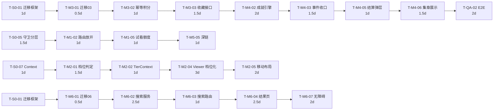

# 华夏古建可视化 · 大众化能力增强 编码任务规划（tasks）

| 项 | 内容 |
|---|---|
| 文档编号 | TASKS-PUBLIC-001 |
| 版本 | v1.0 |
| 状态 | 待评审（等待人工确认后方可进入编码） |
| 上游文档 | `docs/design/general-audience-enhancement-design.md`（DESIGN-PUBLIC-001） `docs/requirements/general-audience-enhancement-spec.md`（REQ-PUBLIC-001） |
| 任务范围 | S0 工程底座 + M1~M6 六个 MVP 能力包 + QA 回归门禁 + S2（P1）/ S3（P2）增量 |
| 关联代码库 | `D:\Ancient-architecture\ac1.1\acvisual 4`（main@7770bd4） |
| 业务代码改动 | 无（本阶段只输出任务规划，不修改任何业务代码） |
| 编码执行方 | 由后续「任务执行」阶段（spec-execute）负责，本文档不授权编码 |

> 本文档回答「按什么顺序、改哪些文件、做到什么程度、如何验收」。
> 前端文件省略前缀 `client/src/`，后端文件省略前缀 `server/src/`，数据库脚本省略前缀 `server/db/`。
> 所有路径均已对当前仓库快照核实，可直接作为编码起点。

---

## 0. 阅读指引与全局约定

### 0.1 任务编号规则

| 前缀 | 含义 | 数量 |
|---|---|---|
| `T-S0-xx` | S0 工程底座（无业务行为变化，只建骨架） | 9 |
| `T-M1-xx` | M1 游客可用（REQ-01/02/04） | 5 |
| `T-M3-xx` | M3 收藏闭环（REQ-17） | 6 |
| `T-M4-xx` | M4 成长闭环（REQ-18/20） | 7 |
| `T-M5-xx` | M5 传播（REQ-16） | 5 |
| `T-M2-xx` | M2 移动与降级（REQ-05/06/07） | 5 |
| `T-M6-xx` | M6 搜索/朗读/无障碍（REQ-11/09/08） | 7 |
| `T-QA-xx` | 回归、契约、迁移与性能门禁（REQ-30） | 4 |
| `T-S2-xx` | S2 P1 增量 | 12 |
| `T-S3-xx` | S3 P2 增量 | 5 |
| **合计** | | **65** |

> 编号说明：M2 章节排在 M5 之后，是因为里程碑顺序（M1 → M3 → M4 → M5 → M2 → M6）按依赖与价值排序；编号本身仍用 `M2`，不重排，避免与设计文档的 M1~M6 命名错位。

### 0.2 任务卡字段定义

每个任务卡固定 11 个字段：

| 字段 | 含义 | 判定标准 |
|---|---|---|
| 目标 | 该任务要达成的业务/技术结果 | 一句话，可观察 |
| 前置依赖 | 必须在它之前完成的任务编号或外部条件 | 未满足不得开工 |
| 新增文件 | 需要创建的文件（精确路径） | 路径真实可创建 |
| 修改文件 | 需要编辑的现有文件 | 路径必须在仓库中存在 |
| 实现要点 | 关键实现约束（不含完整代码） | 编码时可逐条对照 |
| 完成定义（DoD） | 可勾选、可判定的完成标准 | 每条都能用命令或操作验证 |
| 需求 / 验收 | `REQ-xx` 与 `AC-xx` 追溯 | 无 AC 时标「前置」 |
| 预估 | 人日（含单测与自测） | 0.5 的倍数 |
| 并行性 | 能否与其他任务同时进行，阻塞谁 | 明确「可并行 / 不可并行」 |
| 验证方式 | 可执行命令或手工步骤 | 必须可复制执行 |
| 边界（不做） | 该任务不允许越界的范围 | 防止顺手重构 |

### 0.3 通用完成定义（每条任务默认叠加）

1. `npm run lint`（client，oxlint）无新增告警。
2. 新增/修改的服务层函数有对应单测；新增公开接口有契约测试。
3. 不修改 `static-version/`；不修改既有 URL；不删既有数据库列/表。
4. 新增响应字段只增不改；缺失值返回 `null` 或 `[]`，不出现 `undefined`。
5. 公开接口响应不得含 `email` / `password_hash` / `user_id` / 积分明细。
6. 所有新组件在 `smooth` 档与 `prefers-reduced-motion` 下不崩溃、不自动播放。

### 0.4 全局 Out of Scope（任一任务均不得越界）

| 编号 | 不做项 |
|---|---|
| OOS-01 | 实时多人同游、语音房、弹幕 |
| OOS-02 | 会员订阅、付费课程、电商 |
| OOS-03 | 用户公开上传 3D 模型/视频 |
| OOS-04 | 原生 App / 小程序 |
| OOS-05 | 专业 GIS、测绘级数据、学术考据版本管理 |
| OOS-06 | 线下硬件对接、室内定位、AR 实景 |
| OOS-07 | 账号体系重构（第三方登录、手机号、JWT 载荷变更） |
| OOS-08 | 全站 100% 英文化（只做分级覆盖） |
| OOS-09 | 视频批量生产（只做「有则播、无则隐」） |
| OOS-10 | 社区化运营（关注、评论、私信） |
| OOS-11 | 3D 模型美术重制与高精度重建 |
| OOS-12 | 既有 URL 结构与账号数据模型重构 |
| OOS-13 | 整站 SSR / 预渲染框架（只做 `/share/:type/:id` 单页模板） |
| OOS-14 | 引入状态库（Redux/Zustand）、i18n 库（i18next）、ORM |
| OOS-15 | 修改 `static-version/`（ADR-13 冻结） |
| OOS-16 | 音视频/低模/海报资源的实际生产（属内容侧外部依赖） |

---

## 1. 任务总览

### 1.1 统计

| 阶段 | 任务数 | 人日 | 占总量 |
|---|---|---|---|
| S0 工程底座 | 9 | 8 | 7% |
| S1-M1 游客可用 | 5 | 6 | 5% |
| S1-M3 收藏闭环 | 6 | 6 | 5% |
| S1-M4 成长闭环 | 7 | 11.5 | 10% |
| S1-M5 传播 | 5 | 6 | 5% |
| S1-M2 移动与降级 | 5 | 9 | 8% |
| S1-M6 搜索/朗读/无障碍 | 7 | 12 | 11% |
| QA 门禁 | 4 | 6 | 5% |
| S2 P1 增量 | 12 | 36 | 31% |
| S3 P2 增量 | 5 | 14 | 12% |
| **合计** | **65** | **114.5** | 100% |

- S1（M1+M3+M4+M5+M2+M6+QA）合计 **56.5 人日**，比设计基线「38~50」高约 13%。差额来源已逐项分解：单测/契约测试约 +5 人日（设计 S1-11 只列 4 人日）、游客态与皮肤降级的联调约 +3 人日、既有缺陷修正（C11/C12）不在设计 S1 清单内约 +1 人日。若必须压回 50 人日，可削减顺序为：T-M4-07 的 sepia 分支 → T-M2-05 的抽屉拖拽 → T-M6-07 的 axe 全量扫描（改为发布前一次）。
- 54 条 AC 全部有承接任务，映射见[第 12 章](#12-ac-覆盖矩阵54-条)。
- REQ-27（UGC 笔记公开）**不排期**：它依赖内容审核、举报入口与合规评审，且不在 54 条 AC 内；本期仅保证「笔记默认私有、公开需显式同意」的现状不被破坏（见 T-M3-03 校验与 §15.3）。

### 1.2 任务清单总表

| 编号 | 任务名称 | 包 | 人日 | 前置依赖 | 可并行 | 需求 / AC |
|---|---|---|---|---|---|---|
| T-S0-01 | 数据库迁移执行器与基线校验 | S0 | 1 | — | 是 | DFX-R3/R-10（前置） |
| T-S0-02 | 测试脚手架与 npm scripts | S0 | 1 | — | 是 | REQ-30 前置 |
| T-S0-03 | 前端契约类型与运行时守卫 | S0 | 0.5 | — | 是 | DFX-C5 |
| T-S0-04 | 公开字段白名单序列化 | S0 | 1 | T-S0-03（建议先行） | 是 | REQ-01 / AC-01 支撑、DFX-S1 |
| T-S0-05 | 路由守卫分层与路由表 | S0 | 1.5 | — | 是 | REQ-01 / AC-01、AC-02 |
| T-S0-06 | 存量缺陷：`/filter` 顺序与时间轴 N+1 | S0 | 1 | — | 是 | REQ-11 前置、C11/C12 |
| T-S0-07 | 五个 Context 空壳与装配 | S0 | 1 | T-S0-05 | 是 | REQ-05/17/20/22 前置 |
| T-S0-08 | 特性开关与埋点占位 | S0 | 0.5 | — | 是 | DFX-M2 前置 |
| T-S0-09 | 静态服务与 SPA fallback | S0 | 0.5 | — | 是 | C1 / AC-23 支撑 |
| T-M1-01 | GuestSession 模块与额度算法 | M1 | 1.5 | T-S0-03 | 是 | REQ-02 / AC-03 |
| T-M1-02 | 公开路由放开与守卫矩阵回归 | M1 | 1 | T-S0-05 | 否 | REQ-01 / AC-01、AC-02 |
| T-M1-03 | 答题路由可选鉴权与游客分支 | M1 | 1.5 | T-S0-01、T-S0-02 | 是 | REQ-02/04 / AC-04 |
| T-M1-04 | QuizPage 游客分支 | M1 | 1 | T-M1-03 | 否 | REQ-04 / AC-04 |
| T-M1-05 | 试看额度接入与舞台引导 | M1 | 1 | T-M1-01、T-M1-02 | 否 | REQ-02 / AC-03 |
| T-M3-01 | 迁移 03：收藏时间戳与积分流水 | M3 | 0.5 | T-S0-01 | 否 | REQ-17 / AC-28 前置 |
| T-M3-02 | pointsService 幂等积分 | M3 | 1 | T-M3-01 | 否 | REQ-17 / AC-28 |
| T-M3-03 | 收藏接口契约扩展与校验加固 | M3 | 1.5 | T-M3-02、T-S0-04 | 否 | REQ-17 / AC-26、AC-27、AC-28 |
| T-M3-04 | CollectionsContext 全局收藏态 | M3 | 1 | T-S0-07、T-M3-03 契约 | 是 | REQ-17 / AC-26 |
| T-M3-05 | 收藏入口组件与四处接入 | M3 | 1.5 | T-M3-04 | 否 | REQ-17 / AC-26 |
| T-M3-06 | 珍宝阁分类筛选与笔记编辑 | M3 | 0.5 | T-M3-05 | 是 | REQ-17 / AC-27 |
| T-M4-01 | 迁移 04：集章表、徽章阈值、回填 | M4 | 1.5 | T-S0-01 | 否 | REQ-18 / AC-29、AC-31 |
| T-M4-02 | 统一成就引擎 | M4 | 2 | T-M4-01 | 否 | REQ-18 / AC-31 |
| T-M4-03 | 事件上报收口（登录/浏览/答题/签到） | M4 | 1.5 | T-M4-02、T-M3-02 | 否 | REQ-18 / AC-30、AC-32 |
| T-M4-04 | 成就查询接口 | M4 | 1 | T-M4-02 | 是 | REQ-18 / AC-29 |
| T-M4-05 | 成就结算弹层与合并反馈 | M4 | 1 | T-M4-03、T-M4-04 | 否 | REQ-18 / AC-30、AC-32 |
| T-M4-06 | 个人中心集章 20 座与徽章进度 | M4 | 1.5 | T-M4-04、T-M4-05 | 否 | REQ-18 / AC-29、AC-31 |
| T-M4-07 | 皮肤生效与档位降级 | M4 | 3 | T-S0-07、T-M2-02（降级细节） | 是 | REQ-20 / AC-33、AC-34、AC-35 |
| T-M5-01 | 迁移 05：分享统计表与限流器 | M5 | 1 | T-S0-01 | 是 | REQ-16 / AC-25、DFX-S5 |
| T-M5-02 | 服务端分享卡片页 | M5 | 1.5 | T-M5-01、T-S0-09 | 否 | REQ-16 / AC-24 |
| T-M5-03 | 分享回流统计接口 | M5 | 1 | T-M5-01 | 是 | REQ-16 / AC-25 |
| T-M5-04 | 前端分享能力与入口 | M5 | 1.5 | T-M5-02 | 是 | REQ-16 / AC-24 |
| T-M5-05 | 深链落地与免登录验证 | M5 | 1 | T-M1-02、T-M5-04 | 否 | REQ-16 / AC-23 |
| T-M2-01 | 设备档位判定库 | M2 | 1.5 | T-S0-07 | 否 | REQ-05 / AC-07、AC-08 |
| T-M2-02 | TierContext 实装与档位提示 | M2 | 1 | T-M2-01 | 是 | REQ-05 / AC-08 |
| T-M2-03 | 档位资源清单接口 | M2 | 1.5 | T-S0-09、T-S0-02 | 是 | REQ-05 / AC-07 |
| T-M2-04 | 三个 Viewer 档位化与降级视图 | M2 | 3 | T-M2-02、T-M2-03 | 否 | REQ-05/07 / AC-07、AC-09、AC-10 |
| T-M2-05 | 移动布局与触控手势 | M2 | 2 | T-M2-04 | 否 | REQ-06 / AC-11、AC-12 |
| T-M6-01 | 迁移 06：热门搜索词 | M6 | 0.5 | T-S0-01 | 是 | REQ-11 / AC-16 前置 |
| T-M6-02 | 跨类型搜索服务 | M6 | 2.5 | T-M6-01 | 否 | REQ-11 / AC-14、AC-16 |
| T-M6-03 | 搜索与建议路由 | M6 | 1 | T-M6-02、T-S0-08、T-M5-01 | 否 | REQ-11 / AC-14、AC-16 |
| T-M6-04 | 搜索结果页与全站入口 | M6 | 2.5 | T-M6-03 | 否 | REQ-11 / AC-14、AC-15、AC-17 |
| T-M6-05 | 朗读能力封装 | M6 | 1.5 | — | 是 | REQ-09 / AC-39、AC-41 |
| T-M6-06 | 朗读播放器与页面接入 | M6 | 2 | T-M6-05 | 否 | REQ-09 / AC-39、AC-40、AC-41 |
| T-M6-07 | 无障碍基线加固 | M6 | 2 | T-S0-05、T-M6-04、T-M6-06 | 否 | REQ-08 / AC-36~AC-38、AC-42 |
| T-QA-01 | 契约与隐私快照门禁 | QA | 1 | T-S0-04、T-M1-03、T-M6-03 | 是 | DFX-S1 / AC-54 支撑 |
| T-QA-02 | E2E 六条主链路 | QA | 2 | M1~M6 全部 | 否 | REQ-30 / AC-54 |
| T-QA-03 | 性能与资源体积审计 | QA | 1.5 | T-M2-03 | 是 | DFX-P5/P10 / AC-07 |
| T-QA-04 | 迁移幂等与结构一致性门禁 | QA | 1.5 | T-S0-01、全部迁移 | 是 | DFX-R3 / DFX-R-10 |
| T-S2-01 | 游客数据合并（merge-guest） | S2 | 3 | T-M1-05、T-M3-03 | 否 | REQ-03 / AC-05 |
| T-S2-02 | 轻测评完整化与转化引导 | S2 | 2 | T-M1-04 | 是 | REQ-04/19 / AC-04、AC-06 |
| T-S2-03 | 弱网与加载体验 | S2 | 2 | T-M2-04 | 是 | REQ-07 / AC-13 |
| T-S2-04 | 统一分类与朝代导航 | S2 | 1.5 | T-M6-03 | 是 | REQ-12 / AC-14 延伸 |
| T-S2-05 | 主题导览路线 | S2 | 4.5 | T-S0-01、T-S2-04 | 否 | REQ-13 / AC-18 |
| T-S2-06 | 推荐与相关推荐增强 | S2 | 4.5 | T-M3-03、T-M4-04 | 否 | REQ-14/15 / AC-19~AC-22 |
| T-S2-07 | 中英双语分级覆盖 | S2 | 7 | T-S0-07、T-M6-03 | 否 | REQ-22 / AC-43、AC-44、AC-45 |
| T-S2-08 | 热点闭环 | S2 | 2.5 | T-M3-05、T-M4-04 | 是 | REQ-25 / AC-49 |
| T-S2-09 | 导览音频接入 | S2 | 2.5 | T-M6-06 | 是 | REQ-23 / AC-46、AC-47 |
| T-S2-10 | 内容发布门槛与草稿隔离 | S2 | 2 | T-M4-01、T-M6-02 | 是 | REQ-26 / AC-50、AC-51 |
| T-S2-11 | 匿名埋点与转化漏斗 | S2 | 2.5 | T-S0-08、T-M1-05 | 是 | REQ-29 / AC-52、AC-53 |
| T-S2-12 | 自动化回归完善 | S2 | 2 | T-QA-02 | 是 | REQ-30 / AC-54 |
| T-S3-01 | 液态玻璃视觉规范落地 | S3 | 3 | T-M6-04、T-M5-02 | 是 | REQ-10 |
| T-S3-02 | 视频呈现规则 | S3 | 1.5 | T-S2-10 | 是 | REQ-24 / AC-48 |
| T-S3-03 | 排行榜防刷与轻社交 | S3 | 4 | T-M4-03 | 是 | REQ-21 |
| T-S3-04 | 教师课堂模式 | S3 | 2.5 | T-S2-05、T-S2-07 | 是 | REQ-28 |
| T-S3-05 | SEO 与分享收录 | S3 | 3 | T-M5-02、T-S2-07 | 是 | REQ-31 |

### 1.3 阶段与里程碑

| 里程碑 | 判定条件 | 预计序位 | 可对外说明的能力 |
|---|---|---|---|
| **M0 底座就绪** | T-S0-01 ~ T-S0-09 全部 DoD 通过 | 第 1~2 周 | 「功能不变但可回归、可迁移、可测试」 |
| **M1 游客可用** | T-M1-01 ~ T-M1-05 完成，AC-01~AC-04 通过 | 第 2~3 周 | 未登录可看全部公开内容、3 座 3D、1 轮轻测评 |
| **M3 收藏闭环** | T-M3-01 ~ T-M3-06 完成，AC-26~AC-28 通过 | 第 3~4 周 | 收藏/笔记/分类全入口，积分不重复 |
| **M4 成长闭环** | T-M4-01 ~ T-M4-07 完成，AC-29~AC-35 通过 | 第 5~6 周 | 集章 20 座、12 徽章可得、皮肤生效 |
| **M5 传播** | T-M5-01 ~ T-M5-05 完成，AC-23~AC-25 通过 | 第 6~7 周 | 分享卡片 + 免登录深链 + 回流统计 |
| **M2 移动/降级** | T-M2-01 ~ T-M2-05 完成，AC-07~AC-12 通过 | 第 7~8 周 | 三档画质、海报兜底、320px 可用 |
| **M6 搜索/朗读/无障碍** | T-M6-01 ~ T-M6-07 完成，AC-14~AC-17、AC-36~AC-42 通过 | 第 8~10 周 | 跨类型搜索、朗读、键盘全流程 |
| **M-QA MVP 可发布** | T-QA-01 ~ T-QA-04 完成，AC-54 通过 | 第 10 周 | 6 条主链路回归 + 门禁 |
| **S2/S3 增量** | T-S2-xx / T-S3-xx 完成 | 第 11 周起 | 双语、路线、推荐、埋点、SEO |

> M2 可与 M4/M5 并行推进（不同代码面：渲染层 vs 数据/组件层），里程碑评审顺序按上表执行。

### 1.4 关键路径

**关键路径（最长链，决定 MVP 工期）**

`T-S0-01 → T-M3-01 → T-M3-02 → T-M3-03 → T-M4-02 → T-M4-03 → T-M4-05 → T-M4-06 → T-QA-02`
= 1 + 0.5 + 1 + 1.5 + 2 + 1.5 + 1 + 1.5 + 2 = **12 人日**（不含并行团队折算，需 2 名后端 + 1 名前端串行配合）。

**次级关键路径**
- 渲染链：`T-S0-07 → T-M2-01 → T-M2-02 → T-M2-04 → T-M2-05` = 8.5 人日（前端单人独占）。
- 搜索链：`T-M6-01 → T-M6-02 → T-M6-03 → T-M6-04 → T-M6-07` = 8.5 人日。
- 传播链：`T-S0-05 → T-M1-02 → T-M1-05 → T-M5-04 → T-M5-05` = 5.5 人日。

> 结论：**后端资源（T-M3-02/T-M3-03/T-M4-02/T-M4-03）是 MVP 的唯一硬瓶颈**；前端三链（渲染/搜索/传播）可并行。建议排 2 后端 + 2 前端 + 0.5 测试。

### 1.5 可并行工作流

| 工作流 | 任务序列 | 独占文件面 |
|---|---|---|
| 数据流（后端） | T-S0-01 → T-M3-01 → T-M3-02 → T-M3-03 → T-M4-01 → T-M4-02 → T-M4-03 → T-M4-04 | `db/migration_*`、`services/*`、`routes/auth|quiz|signin|achievements` |
| 门票流（前端路由/游客） | T-S0-05 → T-M1-01 → T-M1-02 → T-M1-05 → T-S2-01/S2-02 | `App.jsx`、`components/guards/*`、`lib/guestSession.js` |
| 渲染流（前端 3D） | T-S0-07 → T-M2-01 → T-M2-02 → T-M2-03(后端) → T-M2-04 → T-M2-05 → T-M4-07 | `lib/deviceTier.js`、`context/Tier*`、`ModelViewer/ExhibitionViewer/EighteenDouViewer`、`styles/*` |
| 发现流 | T-S0-06 → T-M6-01 → T-M6-02 → T-M6-03 → T-M6-04 | `services/searchService.js`、`routes/search.js|timeline.js`、`pages/SearchPage.jsx`、`OverviewHeader.jsx` |
| 传播流 | T-S0-09 → T-M5-01 → T-M5-02/T-M5-03 → T-M5-04 → T-M5-05 | `routes/share*.js`、`services/shareCard.js`、`lib/share.js`、`app.js` |
| 体验流 | T-M6-05 → T-M6-06 → T-M6-07 | `lib/speech.js`、`components/AudioGuidePlayer/SkipLink/ModalShell` |

---

## 2. S0 工程底座（T-S0-01 ~ T-S0-09）

> 目标：在不改变任何业务行为的前提下，建成「可迁移、可测试、可守卫、可开关」的骨架。S0 未完成时，M1~M6 的 DoD 无法自动化验证。

### T-S0-01 数据库迁移执行器与基线校验

| 项 | 内容 |
|---|---|
| 目标 | 建立幂等、可断点续跑、可 dry-run 的迁移机制，作为后续 8 个迁移脚本的唯一入口 |
| 前置依赖 | —（MySQL 已初始化 `ac4_db`） |
| 新增文件 | `server/db/migration_public_00_baseline_check.sql`、`scripts/migrate.mjs` |
| 修改文件 | `server/package.json`（`"db:migrate": "node ../scripts/migrate.mjs"`）、根 `package.json`（`db:migrate`、`db:test:init`） |
| 实现要点 | ① 建 `schema_version(version VARCHAR(64) PRIMARY KEY, applied_at TIMESTAMP, checksum CHAR(64))`；② `migrate.mjs` 读取 `server/db/migration_public_*.sql` 按文件名序号排序，逐个在事务内执行，已在 `schema_version` 中的跳过；③ 支持 `--to=<序号>` / `--dry-run` / `--status` / `--db=<name>`；④ `00_baseline_check.sql` 只读校验 16 张基础表（`users`/`palaces`/`palace_timeline`/`palace_images`/`palace_fun_facts`/`encyclopedia_terms`/`quiz_questions`/`quiz_records`/`user_history`/`user_collections`/`user_badges`/`badges`/`user_skins`/`user_tags`/`user_recommendations`/`signin_records`）存在性并写入基线记录；⑤ 脚本禁止拼接 SQL 参数，只执行文件原文；⑥ 失败即停，不自动重试 |
| 完成定义（DoD） | 空库执行成功并写入 1 条基线记录；再执行输出「0 applied」；`--dry-run` 后 `schema_version` 行数不变；任一文件执行失败时后续文件未执行且事务回滚 |
| 需求 / 验收 | REQ-17/18/16/11 迁移前置；DFX-R3、风险 R-10 |
| 预估 | 1 人日 |
| 并行性 | 可并行（与 T-S0-02/03/04/05/06/08/09）；**是 T-M3-01/T-M4-01/T-M5-01/T-M6-01 的硬前置** |
| 验证方式 | `npm run db:migrate -- --status`；`npm run db:migrate -- --dry-run`；连续两次 `npm run db:migrate` 观察第二次为 0 applied |
| 边界（不做） | 不修改既有表定义；不做数据回填；不引入 knex/sequelize 等迁移库 |

### T-S0-02 测试脚手架与 npm scripts

| 项 | 内容 |
|---|---|
| 目标 | 让 `npm test` 可跑前端单测与后端集成测试，为后续 60 个任务的 DoD 提供自动化底座 |
| 前置依赖 | —（需本地/CI 有 MySQL 8 与 `ac4_test` 库权限） |
| 新增文件 | `client/src/test/setup.js`、`client/src/test/renderWithProviders.jsx`、`server/test/helpers/db.js`、`server/test/helpers/app.js`、`server/test/smoke.test.js`、`client/src/test/smoke.test.jsx`、`server/test/fixtures/{palaces,terms,questions,badges}.json`、`test/e2e/playwright.config.js` |
| 修改文件 | `client/vite.config.js`（增加 `test` 段：`environment:'jsdom'`、`setupFiles`）、根 `package.json`（`test`/`test:client`/`test:server`/`test:e2e`/`test:all`/`lint`）、`client/package.json`（devDeps：`vitest`、`@testing-library/react`、`@testing-library/jest-dom`、`jsdom`）、`server/package.json`（devDeps：`vitest`、`supertest`） |
| 实现要点 | ① 后端测试用 `NODE_ENV=test`、`DB_NAME=ac4_test`，`helpers/db.js` 提供 `truncateAll()` 与 `withTransaction()`；② `app.js` 导出 `app` 且**不**在测试时 `listen`（需拆 `app.js` 与 `server.js` 或在 `require.main === module` 时 listen）；③ Playwright 复用根已有 `playwright` 依赖，`webServer` 配置起 `server` + `client preview`；④ 固定随机种子数据的 `TRUNCATE ... AUTO_INCREMENT=1` 顺序（先子表后主表）；⑤ 版本兼容：Vite 8 需 `vitest ≥ 4.1`，若冲突则独立 `client/vitest.config.js` 并锁定 vite 版本 |
| 完成定义（DoD） | `npm run test:client` 与 `npm run test:server` 各跑通 1 个 smoke 用例；`npm run test` 串联两者成功；`npm run db:test:init` 能在 `ac4_test` 重建并跑完全部迁移；`npm run test:e2e -- --list` 不报错 |
| 需求 / 验收 | REQ-30 前置；AC-54 自动化前提 |
| 预估 | 1 人日 |
| 并行性 | 可并行（与 T-S0-01 同时做收益最高，二者共同解锁后续全部自动化） |
| 验证方式 | `npm run test`；`npm run db:test:init`；`npm run test:e2e -- --list` |
| 边界（不做） | 不引入 Jest / Mocha；不配置具体 CI 平台 YAML（由 T-QA-04 决定）；不写业务测试（由各任务自带） |

### T-S0-03 前端契约类型与运行时守卫

| 项 | 内容 |
|---|---|
| 目标 | 用 JSDoc + 运行时守卫锁定新增数据契约，避免 `undefined` 渲染（DFX-C5） |
| 前置依赖 | — |
| 新增文件 | `client/src/types.js`、`client/src/test/types.test.js` |
| 修改文件 | — |
| 实现要点 | ① `@typedef`：`Palace`、`PalaceDetail`、`SearchGroup`、`SearchItem`、`AchievementResult`、`DeviceTier`、`GuestSession`、`SkinState`、`CollectionItem`、`AssetManifest`；② 守卫：`isPalace(x)`、`isCollectionItem(x)`、`isSearchGroup(x)`、`asArray(x)`、`clampNumber(x, def)`、`toISO(x)`；③ 不使用 TypeScript 编译链；④ 所有守卫对 `null`/缺失字段返回安全默认值并打印一次 `console.warn`（开发态） |
| 完成定义（DoD） | `types.js` 零运行时依赖（除 warn）；3 组单测（正常对象 / 缺字段 / 类型错）通过；被 T-S0-04 与后续前端任务引用 |
| 需求 / 验收 | 设计 §1.4-1、DFX-C5 |
| 预估 | 0.5 人日 |
| 并行性 | 可并行；建议早于 T-S0-04 与 T-M1-01 |
| 验证方式 | `npm run test:client -- types` |
| 边界（不做） | 不引入 zod/io-ts；不做表单校验（另属各接口） |

### T-S0-04 公开字段白名单序列化

| 项 | 内容 |
|---|---|
| 目标 | 让所有公开读接口只输出白名单字段，兑现「拆登录墙不拆数据边界」 |
| 前置依赖 | T-S0-03（建议先行，使用 `isPalace`） |
| 新增文件 | `server/src/services/publicSerializer.js`、`server/test/public-fields.test.js` |
| 修改文件 | `server/src/routes/palaces.js`（`GET /`、`/search`、`/filter`、`/:id` 的响应经序列化） |
| 实现要点 | ① `toPublicPalace(row, { detail=false })`：白名单 = `id,name,name_en,category,region,city,dynasty,tagline,quote,description,poster_path,model_path,tags,stats,views,camera,order_num,created_at`；`detail=true` 追加 `images,timeline,funFacts,audio,coverage`；② 显式剔除 `email,password_hash,user_id,points,interest_tag`；③ `toPublicCollection`、`toPublicTerm` 同规则；④ 响应形状为「白名单对象」，不 `...row` 透传；⑤ 列表接口保持返回数组（不改既有结构） |
| 完成定义（DoD） | `server/test/public-fields.test.js` 对 4 个接口断言 `JSON.stringify(res.body)` 不含 `email`/`password_hash`/`user_id`/`points`；`GET /api/palaces` 字段集合与快照一致（新增字段需显式加白名单） |
| 需求 / 验收 | REQ-01（公开读边界）、DFX-S1；AC-01 支撑、AC-54 契约门禁前置 |
| 预估 | 1 人日 |
| 并行性 | 可并行（与 T-S0-01/02/05/06/09） |
| 验证方式 | `npm run test:server -- public-fields`；`curl -s localhost:3001/api/palaces?limit=1 | node -e "..."` 检查禁用字段 |
| 边界（不做） | 不改写接口语义、不加鉴权、不改 SQL 查询字段（只改出口） |

### T-S0-05 路由守卫分层与路由表

| 项 | 内容 |
|---|---|
| 目标 | 把「除首页外全部登录墙」改为表驱动的 Public/Auth/Admin 三类守卫，并提供能力级登录引导弹层 |
| 前置依赖 | — |
| 新增文件 | `client/src/components/guards/PublicRoute.jsx`、`guards/AuthRoute.jsx`、`guards/AdminRoute.jsx`、`guards/RouteGuard.jsx`、`client/src/components/LoginPrompt.jsx`、`client/src/components/RequireCapability.jsx`、`client/src/components/ModalShell.jsx`、`client/src/test/guards.test.jsx` |
| 修改文件 | `client/src/App.jsx`（`ROUTES` 表 + `map` 渲染，删除逐条 `ProtectedRoute`）、`client/src/components/LoginPage.jsx`（`state.from` 回跳）、`client/src/components/LoginModal.jsx`（同回跳逻辑） |
| 实现要点 | ① `ROUTES = [{ path, element, guard:'public'|'auth'|'admin', meta:{ publicReadonly:true } }]`；② `PublicRoute` 仅透传 children（作为可审计标记）；③ `AuthRoute` 保留原行为并附 `state.from = location.pathname + location.search`；④ `AdminRoute` 迁移现有 `CuratorGate` 逻辑（原 `App.jsx:31-36`）；⑤ `RequireCapability` 接受 `capability`、`onGuestFallback`（如本机暂存），未登录渲染 `LoginPrompt` 弹层而非跳转；⑥ `ModalShell` 提供基础 focus trap 骨架（ESC 关闭、记录 `activeElement`、关闭回归）——T-M6-07 再补完整无障碍；⑦ `/search`、`/routes/:id` 先以注释占位行写入表，由 T-M6-04/T-S2-05 启用；⑧ `/login` 保持「已登录跳首页」 |
| 完成定义（DoD） | `guards.test.jsx` 断言公开清单 = `['/','/gallery','/map','/timeline','/encyclopedia','/exhibition/:id','/douba-eighteen','/quiz','/login']`（新增 `/search`、`/routes/:id` 时同步更新）；未登录访问 `/profile` → `/login` 且 `location.state.from='/profile'`；`/curator` → `CuratorGate`；页面内 `RequireCapability` 未登录时渲染弹层且不改变 URL |
| 需求 / 验收 | REQ-01、REQ-02-3、REQ-19 前置；AC-01、AC-02（页面级在 T-M1-02 收口） |
| 预估 | 1.5 人日 |
| 并行性 | 可并行；**是 T-S0-07、T-M1-02、T-M3-05、T-M6-07 的前置** |
| 验证方式 | `npm run test:client -- guards`；`npm run dev` 手工：未登录点侧栏「个人中心」观察 `state.from`，登录后回跳 |
| 边界（不做） | 不实现登录逻辑本身；不做权限矩阵后台化；不改 JWT 载荷；不新增页面 |

### T-S0-06 存量缺陷修正：`/filter` 路由顺序与时间轴 N+1

| 项 | 内容 |
|---|---|
| 目标 | 修复「`GET /api/palaces/filter` 被 `/:id` 捕获」与「时间轴页 N+1 请求」两个存量缺陷 |
| 前置依赖 | — |
| 新增文件 | `server/src/routes/timeline.js`、`server/test/palaces-routes.test.js`、`server/test/timeline.test.js` |
| 修改文件 | `server/src/routes/palaces.js`（把 `/filter` 定义移到 `/:id` 之前，**保留原实现体**）、`server/src/app.js`（注册 `app.use('/api/timeline', timelineRoutes)`）、`client/src/api.js`（新增 `getTimeline()`）、`client/src/pages/TimelinePage.jsx`（由逐座详情请求改为单次聚合） |
| 实现要点 | ① `/filter` 顺序调整，并在 `/:id` 前加显式保留字数组判断（`FILTER_RESERVED = ['filter','search']`）作为双保险；② 新增 `GET /api/timeline?category=&dynasty=`，一条 `SELECT t.palace_id, p.name AS palace_name, t.year, t.event FROM palace_timeline t JOIN palaces p ON p.id=t.palace_id ORDER BY t.year ASC`，返回 `{ events: [...] }`；③ 保留 `GET /api/palaces/:id` 的 `timeline` 字段不变（不破坏编修台）；④ 前端 `TimelinePage` 首屏请求数从 1+N 降为 1，并保留 loading/error 态；⑤ `/filter` 响应加 `meta:{ source:'filter' }` 便于测试断言不是 `/:id` 分支 |
| 完成定义（DoD） | `GET /api/palaces/filter?category=宫殿` 返回 `200` 且 `meta.source='filter'`（修复前为 `404 宫殿不存在`）；`palaces-routes.test.js` 覆盖顺序回归；`TimelinePage` 打开时 Network 仅 1 条 timeline 请求；时间轴事件数与改前一致（对比 SQL） |
| 需求 / 验收 | REQ-11/12 前置；设计约束 C11、C12；AC-14 前置 |
| 预估 | 1 人日 |
| 并行性 | 可并行（与 T-S0-01/02/04/05/09） |
| 验证方式 | `curl -i "localhost:3001/api/palaces/filter?category=宫殿"`；`curl -s "localhost:3001/api/timeline" | node -e "..."` 计数；`npm run test:server -- palaces-routes timeline` |
| 边界（不做） | 不做搜索接口重构（归 T-M6）；不改时间轴 UI 视觉；不改 `palace_timeline` 表结构 |

### T-S0-07 五个 Context 空壳与装配

| 项 | 内容 |
|---|---|
| 目标 | 建好跨页共享状态的骨架与 Provider 顺序，后续各包只填充实现，不再改装配 |
| 前置依赖 | T-S0-05（守卫与 App 结构已定型） |
| 新增文件 | `client/src/context/TierContext.jsx`、`SkinContext.jsx`、`CollectionsContext.jsx`、`I18nContext.jsx`、`UiPrefsContext.jsx`、`client/src/test/contexts.test.jsx` |
| 修改文件 | `client/src/App.jsx`（Provider 嵌套：`AuthProvider → I18nProvider → UiPrefsProvider → TierProvider → SkinProvider → CollectionsProvider → BrowserRouter`）、`client/src/context/AuthContext.jsx`（暴露 `isLoggedIn`、`user`、`pendingGuestMerge` 标记与 `setPendingGuestMerge`，不改登录请求） |
| 实现要点 | ① 每个 Context 暴露 `useXxx()` hook 与细粒度选择器；② `useMemo` 稳定 value，避免整树重渲染；③ 默认值：`tier='standard'`、`detectedTier='standard'`、`supports3D=true`、`skin='default'`、`lang='zh-CN'`、`collections=new Set()`、`uiPrefs={reducedMotion:'auto', classroomMode:false, personalizationEnabled:true}`；④ localStorage key 抬头注释（`ac4_tier_override`、`ac4_lang`、`ac4_analytics_off`、`palace_auth`）；⑤ 空壳方法返回 Promise.resolve，供后续任务替换实现；⑥ 不做 SSR 保护以外的兼容分支 |
| 完成定义（DoD） | 应用启动无控制台错误；`contexts.test.jsx` 断言 5 个 hook 在 Provider 外抛清晰错误、在内返回默认值；Provider 顺序在单测中通过嵌套断言；切换 Context 值不导致整个 App 重挂载 |
| 需求 / 验收 | REQ-05/17/20/22 前置；ADR-12 |
| 预估 | 1 人日 |
| 并行性 | 否（依赖 T-S0-05；但完成后 T-M2/T-M3/T-M4-07/T-S2-07 可并行） |
| 验证方式 | `npm run test:client -- contexts`；`npm run dev` 观察 Console 无 error；React DevTools 检查 Provider 嵌套 |
| 边界（不做） | 不引入状态库；不在此任务实现档位判定/收藏请求（归各自包） |

### T-S0-08 特性开关与埋点占位

| 项 | 内容 |
|---|---|
| 目标 | 为新能力提供「可一键关闭」的服务端开关与前端埋点空实现，满足灰度与回滚要求 |
| 前置依赖 | — |
| 新增文件 | `server/src/config/features.js`、`client/src/lib/analytics.js`、`client/src/test/analytics.test.js` |
| 修改文件 | `server/src/app.js`（挂载 `featureGuard`）、`client/src/main.jsx`（初始化 analytics 不上报） |
| 实现要点 | ① `features.js` 读取 `process.env.FEATURE_*`，默认全开；暴露 `isEnabled(name)` 与 `featureGuard(name)` 中间件（关闭时返回 `503 { code:'FEATURE_DISABLED' }`）；② 开关名：`SKIN_RENDER_ENABLED`、`SEARCH_ENABLED`、`SHARE_CARD_ENABLED`、`RECOMMEND_ENABLED`、`METRICS_ENABLED`；③ `analytics.js` 提供 `track(name, props)`、`flush()`、`setEnabled(bool)`，默认入内存队列且**不发请求**（T-S2-11 接 sendBeacon）；④ 尊重 `localStorage.ac4_analytics_off==='1'`；⑤ 事件名白名单常量导出，供后端复用 |
| 完成定义（DoD） | `SEARCH_ENABLED=false` 启动后 `/api/search` 返回 503 且 `code='FEATURE_DISABLED'`；`analytics.track` 在关闭态不产生任何网络请求（单测断言 fetch 未被调用）；事件名常量包含设计 §4.7.9 的 14 个事件 |
| 需求 / 验收 | DFX-M2 前置、设计 §6.5 开关清单 |
| 预估 | 0.5 人日 |
| 并行性 | 可并行（与 T-S0-01/02/03/04/06/09） |
| 验证方式 | `npm run test:client -- analytics`；`FEATURE_SEARCH_ENABLED=false npm run server` 后 `curl /api/search` |
| 边界（不做） | 不实现埋点上报与表（归 T-S2-11）；不做前端 UI 开关面板 |

### T-S0-09 静态服务与 SPA fallback

| 项 | 内容 |
|---|---|
| 目标 | 补上深链刷新 404 的修复与静态资源缓存头，为分享深链与档位资源提供分发基础 |
| 前置依赖 | — |
| 新增文件 | — |
| 修改文件 | `server/src/app.js`（`express.static` 加 `setHeaders`；新增 `/audio`、`models/lite` 静态；生产 SPA fallback；`/share` 挂载占位注释） |
| 实现要点 | ① `/images`、`/models` 设 `Cache-Control: public, max-age=86400, immutable`（文件名不含 hash 时降为 `max-age=3600`）；② 新增 `app.use('/audio', express.static(path.join(projectRoot,'audio'), {...}))`；`models/lite` 由 `/models` 子目录自然覆盖（无需额外挂载，需在注释中说明）；③ 生产 fallback：`app.get(/^\/(?!api|share|models|images|videos|audio|maps|draco|quiz-cats).*/, sendIndexHtml)`，仅在 `NODE_ENV==='production'` 且 `fs.existsSync(path.join(clientDist,'index.html'))` 时挂载；④ 保留 `express.static(clientDist)` 原顺序；⑤ 不改变 `/api/*` 行为 |
| 完成定义（DoD） | 生产模式下 `curl -i localhost:3001/exhibition/taihedian` 返回 `200` 且 `content-type: text/html`；`curl -i localhost:3001/api/palaces` 仍为 JSON；开发模式（`NODE_ENV!=='production'`）请求 `/exhibition/x` 返回 404（不会误吞 API）；静态资源响应头含 `Cache-Control` |
| 需求 / 验收 | 设计约束 C1、DFX-C4；AC-23 支撑 |
| 预估 | 0.5 人日 |
| 并行性 | 可并行；**是 T-M5-02、T-M2-03 的前置** |
| 验证方式 | `npm run build && NODE_ENV=production npm run server` 后 `curl -i` 三个路径 |
| 边界（不做） | 不做 SSR、不做 gzip/br 协商（部署侧）、不改 `client/dist` 构建配置 |

---

## 3. M1 游客可用（T-M1-01 ~ T-M1-05）

> 里程碑判定：AC-01 ~ AC-04 通过，且游客不产生任何服务端账号数据。

### T-M1-01 GuestSession 模块与额度算法

| 项 | 内容 |
|---|---|
| 目标 | 实现游客本机会话（匿名标识、试看额度、暂存、草稿、偏好），具备损坏容错与 30 天 TTL |
| 前置依赖 | T-S0-03（类型守卫） |
| 新增文件 | `client/src/lib/guestSession.js`、`client/src/lib/__tests__/guestSession.test.js` |
| 修改文件 | — |
| 实现要点 | ① localStorage key `ac4_guest_v1`，结构含 `v/gid/createdAt/updatedAt/preview/quizQuota/quiz/stagedCollections/noteDrafts/lastVisited/dismissed/prefs`（字段见设计 §3.2.1）；② API：`read/update/reset/tryEnter3D/tryStartQuiz/stageCollection/draftNote/snapshotForMerge/markDismissed`；③ `tryEnter3D(id)` 四步算法：跨日重置 → 已含该建筑放行 → 集合 <3 加入并放行 → 否则 `allowed:false`；**同建筑当日重复不消耗额度**；④ `localStorage` 不可用或 JSON 损坏 → 降级内存 Map，接口不变、不抛错；⑤ 30 天未更新 → 清理重建；⑥ 上限：收藏暂存 ≤20、草稿 ≤5 且每条 ≤500 字、最近浏览 ≤10；超限返回 `{ ok:false, reason:'limit' }`；⑦ `gid` 用 `crypto.randomUUID()`，不含任何 PII |
| 完成定义（DoD） | 单测 ≥11 条全通过：跨日重置、同建筑 3 次仍 allowed、第 4 座 blocked、第 3 座后第 1 座仍 allowed、存储不可用降级、损坏数据重建、31 天过期、暂存上限、草稿超长、`snapshotForMerge` 形状、`markDismissed` 幂等；`read()` 永不为 null |
| 需求 / 验收 | REQ-02、11.1；AC-03（模块级） |
| 预估 | 1.5 人日 |
| 并行性 | 可并行（不依赖页面）；是 T-M1-05、T-S2-01、T-S2-02 的前置 |
| 验证方式 | `npm run test:client -- guestSession`；浏览器 Console 执行 `read()` 检查结构 |
| 边界（不做） | 不上传服务端、不建匿名账号、不做跨设备同步、不做风控 |

### T-M1-02 公开路由放开与守卫矩阵回归

| 项 | 内容 |
|---|---|
| 目标 | 让 6 条公开路由（`/gallery`、`/map`、`/timeline`、`/encyclopedia`、`/exhibition/:id`、`/douba-eighteen`）+ `/quiz` 真正对外开放，同时保留个人与编修页受保护 |
| 前置依赖 | T-S0-05 |
| 新增文件 | `test/e2e/public-routes.spec.js` |
| 修改文件 | `client/src/App.jsx`（按 `ROUTE_GUARD` 表应用 `PublicRoute`）、`client/src/components/OverviewHeader.jsx`（未登录隐藏「编修」分组、显示「登录」入口，保留「浏览」组）、`client/src/pages/HomePage.jsx`（去掉 `user` 存在性假设，`user?.points` 已有容错需复核） |
| 实现要点 | ① 逐条把 `ProtectedRoute` 替换为 `PublicRoute`（`/gallery`、`/map`、`/timeline`、`/encyclopedia`、`/quiz`、`/exhibition/:id`、`/douba-eighteen`）；② `/profile` → `AuthRoute`；`/curator` → `AdminRoute`；③ `OverviewHeader` 的 `requiresAuth` 过滤逻辑保留（现状已按角色过滤）；④ 未登录时头部展示「登录 / 注册」按钮（不强制弹窗）；⑤ 页面内不出现「登录后查看」遮罩 |
| 完成定义（DoD） | E2E 遍历 6 条路径，均不出现 URL 含 `/login`；`/profile` 重定向且带 `from`；`/curator` 显示权限说明；页面正文与登录用户一致（抽样对比 3 个区块文案） |
| 需求 / 验收 | REQ-01；**AC-01**、**AC-02** |
| 预估 | 1 人日 |
| 并行性 | 否（M1 关键路径；完成后 T-M1-05/T-M5-05 才能继续） |
| 验证方式 | `npm run test:e2e -- public-routes`；手工用无痕窗口打开 6 条路径 |
| 边界（不做） | 不实现试看额度（T-M1-05）；不实现游客答题（T-M1-03/04）；不改页面视觉 |

### T-M1-03 答题路由可选鉴权与游客分支

| 项 | 内容 |
|---|---|
| 目标 | 把 `/api/quiz` 从全局强制鉴权改为「读可选、写分支」，游客可做 5 题且不落库 |
| 前置依赖 | T-S0-01（测试库）、T-S0-02（测试脚手架） |
| 新增文件 | `server/test/quiz-guest.test.js` |
| 修改文件 | `server/src/routes/quiz.js`（删除 `router.use(authMiddleware)`，逐路由声明）、`server/src/middleware/auth.js`（新增 `requireLogin` 导出） |
| 实现要点 | ① 读接口 `/categories`、`/questions`、`/questions/:id` 挂 `optionalAuth`；所有 `req.user.id` 改 `req.user?.id` 并在无 token 时跳过个人进度查询（`answered/correct/accuracy` 返回 `null`）；② `count` 参数上限 20（现状 `parseInt` 无上限）；③ `POST /answer` 挂 `optionalAuth` 后分支：无 token → 只判定，返回 `{ is_correct, correct_answer(错时给), explanation, points_earned:0, new_badge:null, achievements:{stamps:[],badges:[]}, scope:'guest', leaderboard_hint:true }`，**不写 `quiz_records`、不加积分、不发徽章**；④ 有 token → 沿用现状逻辑（含 `scope:'user'`、`leaderboard_hint:false`）；⑤ `records`/`stats`/`achievements`/`leaderboard` 保持 `authMiddleware`；⑥ 题目正确答案不由前端获取；⑦ `requireLogin` 仅供「可选鉴权后的写分支」表达意图，不改变 `authMiddleware` 语义 |
| 完成定义（DoD） | `quiz-guest.test.js`：无 token 三读接口 200 且 `scope='guest'`、进度字段为 `null`；无 token `POST /answer` 200 且 `quiz_records` 行数不变、`users.points` 不变；有 token 的 4 个接口响应与改造前快照一致；`count=999` 返回 ≤20 题 |
| 需求 / 验收 | REQ-02-7、REQ-04；**AC-04**（接口级） |
| 预估 | 1.5 人日 |
| 并行性 | 可并行（与 T-M1-01）；是 T-M1-04、T-S2-02 的前置 |
| 验证方式 | `npm run test:server -- quiz-guest`；`curl -s -X POST localhost:3001/api/quiz/answer -H 'Content-Type: application/json' -d '{"question_id":1,"answer":"A"}'` |
| 边界（不做） | 不改题库数据、不做排行榜防刷（T-S3-03）、不改答题前端 |

### T-M1-04 QuizPage 游客分支

| 项 | 内容 |
|---|---|
| 目标 | 游客可完成一轮 5 题并看到得分与解析，结果只存本机，榜单区替换为登录引导 |
| 前置依赖 | T-M1-03 |
| 新增文件 | `client/src/test/QuizPage.guest.test.jsx`（或并入现有测试目录） |
| 修改文件 | `client/src/pages/QuizPage.jsx`、`client/src/context/AuthContext.jsx`（暴露 `isLoggedIn` 供分支，不改请求） |
| 实现要点 | ① `isLoggedIn===false` 时不请求 `/stats`、`/records`、`/leaderboard`、`/achievements`；② 只请求 `/categories` 与 `/questions?count=5`（`scope==='guest'`）；③ 结果页展示得分、逐题解析、`points_earned` 不展示；④ 成绩写入 `GuestSession.quiz`（`{date, answers:[{qid,correct}], score}`）；⑤ 榜单区渲染「登录后可参与排行」占位卡（点击 → `LoginPrompt`）；⑥ `tryStartQuiz()` 额度用尽时按钮置灰并提示「今日体验已用完」 |
| 完成定义（DoD） | 单测/E2E：游客完成 5 题后显示得分与 5 条解析；Network 无 `records/stats/leaderboard` 请求；`mode==='guest'` 时榜单为登录提示；刷新后本机仍保留最近成绩 |
| 需求 / 验收 | REQ-04；**AC-04**（前端侧） |
| 预估 | 1 人日 |
| 并行性 | 否（依赖 T-M1-03） |
| 验证方式 | `npm run dev` 无痕窗口完成一轮；`npm run test:e2e -- quiz-guest`（若建 E2E） |
| 边界（不做） | 不改题目难度与题库；不做排行展示改版；不实现完整轻测评（T-S2-02） |

### T-M1-05 试看额度接入与舞台引导

| 项 | 内容 |
|---|---|
| 目标 | 游客每日前 3 座建筑可进 3D，第 4 座起舞台显示可关闭引导，图文详情不受限 |
| 前置依赖 | T-M1-01、T-M1-02 |
| 新增文件 | `client/src/test/quota.test.jsx` |
| 修改文件 | `client/src/pages/HomePage.jsx`（`handleSelectPalace` 前置 `tryEnter3D`；舞台区条件渲染内联引导块）、`client/src/pages/ExhibitionPage.jsx`（挂载时判定 + `?from=share` 记录 `GuestSession.lastVisited`） |
| 实现要点 | ① `HomePage` 选建筑时先 `tryEnter3D(id)`，`allowed=false` 时舞台区渲染内联引导块（标题「继续体验需注册」+「查看图文详情」+「注册 / 登录」+「暂不」），左侧 `DetailPanel` 照常渲染；② `ExhibitionPage` 挂载判定，`allowed=false` 时 3D 区域显示同类引导，图文区块完整；③ 引导块**不在首屏遮罩**，可滚动、可关闭；④ 关闭时 `markDismissed('registerPrompt')`，本会话不再出现；⑤ 模板方法：引导块先内联在页面内，T-M2-04 再抽取为 `PosterFallback` 的 `reason='quota'` 分支（避免在 M1 阶段新增组件）；⑥ 登录用户跳过额度判定 |
| 完成定义（DoD） | 连续进入 4 座不同建筑：前 3 座正常渲染 3D、第 4 座出现引导且 `DetailPanel` 文本可见（E2E 断言 3 个区块）；刷新后第 1 座仍可看；关闭引导后同一会话不再出现 |
| 需求 / 验收 | REQ-02-4、REQ-02-5；**AC-03** |
| 预估 | 1 人日 |
| 并行性 | 否（M1 收尾） |
| 验证方式 | `npm run test:e2e -- quota`；手工：无痕窗口连续点 4 座建筑 |
| 边界（不做） | 不拦截图文、不做风控、不新增独立页面或组件文件 |

---

## 4. M3 收藏闭环（T-M3-01 ~ T-M3-06）

### T-M3-01 迁移 03：收藏时间戳与积分流水

| 项 | 内容 |
|---|---|
| 目标 | 为收藏增加更新时间，并建立幂等积分流水表 |
| 前置依赖 | T-S0-01 |
| 新增文件 | `server/db/migration_public_03_collections.sql` |
| 修改文件 | `server/db/init_full.sql`（**追加**同结构段落，不改既有表定义与种子顺序） |
| 实现要点 | ① `ALTER TABLE user_collections ADD COLUMN updated_at TIMESTAMP DEFAULT CURRENT_TIMESTAMP ON UPDATE CURRENT_TIMESTAMP`（用 information_schema 判存的存储过程保证幂等）；② `MODIFY COLUMN category VARCHAR(20) NOT NULL DEFAULT '默认'`；③ `CREATE TABLE IF NOT EXISTS user_points_log(id BIGINT AUTO_INCREMENT PRIMARY KEY, user_id INT NOT NULL, source_type VARCHAR(32) NOT NULL, source_key VARCHAR(64) NOT NULL, points INT NOT NULL DEFAULT 0, created_at TIMESTAMP DEFAULT CURRENT_TIMESTAMP, UNIQUE KEY uk_user_source(user_id,source_type,source_key), INDEX idx_user_time(user_id,created_at), FOREIGN KEY(user_id) REFERENCES users(id) ON DELETE CASCADE)`；④ 文件末尾附回滚段注释（`-- rollback: ALTER TABLE user_collections DROP COLUMN updated_at; DROP TABLE user_points_log;`）；⑤ 不新增多余索引（现有 `uk_user_palace_collection` 已覆盖） |
| 完成定义（DoD） | 空库与存量库各执行一次成功；连续执行第二次无报错；`SHOW CREATE TABLE` 与 `init_full.sql` 新建结果一致（由 T-QA-04 校验）；存量收藏行 `updated_at` 自动填充 |
| 需求 / 验收 | REQ-17、DFX-R3；AC-28 前置 |
| 预估 | 0.5 人日 |
| 并行性 | 否（T-M3-02/T-M4-01 的硬前置） |
| 验证方式 | `npm run db:migrate`；`mysql -e "SHOW CREATE TABLE user_points_log\G"`；`SELECT COUNT(*) FROM user_collections WHERE updated_at IS NULL`（应为 0） |
| 边界（不做） | 不删列、不改 `user_collections` 其余字段、不回填积分历史 |

### T-M3-02 pointsService 幂等积分

| 项 | 内容 |
|---|---|
| 目标 | 所有积分发放收口到一个幂等函数，保证「取消再收藏不重复加分」 |
| 前置依赖 | T-M3-01 |
| 新增文件 | `server/src/services/pointsService.js`、`server/test/points-service.test.js` |
| 修改文件 | — |
| 实现要点 | ① `awardPoints(userId, sourceType, sourceKey, points)`：同一连接内 `INSERT INTO user_points_log ... ON DUPLICATE KEY UPDATE id=id`，据 `affectedRows` 判定首次；首次才 `UPDATE users SET points=points+?`；② 重复键视为正常分支（不抛 500）；③ `sourceType ∈ {collection, visit, quiz, signin, merge, skin}`；④ `getPointsHistory(userId, limit=20)` 供明细展示；⑤ 事务包裹两步，失败回滚；⑥ 单连接复用（`pool.getConnection()` + `release()`）；⑦ 记录 `console.warn` 仅在首次发放失败时 |
| 完成定义（DoD） | 并发 10 次同 `(user, collection, palaceA)` → `user_points_log` 仅 1 行、`users.points` 只 +5；不同 `sourceKey` 各自 +5；`points=0` 时不写流水；异常时 `users.points` 未被修改 |
| 需求 / 验收 | REQ-17-8、DFX-R3；**AC-28**（服务级） |
| 预估 | 1 人日 |
| 并行性 | 否 |
| 验证方式 | `npm run test:server -- points-service`；SQL 对账 `SELECT SUM(points) FROM user_points_log WHERE user_id=?` 与 `users.points` 差值 |
| 边界（不做） | 不改签到/答题现有积分值；不做积分扣减；不回填历史（`users.points` 保持既有值） |

### T-M3-03 收藏接口契约扩展与校验加固

| 项 | 内容 |
|---|---|
| 目标 | 收藏接口具备分类白名单、笔记长度与转义校验、幂等积分、`updated_at`/`poster_path` 输出与独立笔记更新 |
| 前置依赖 | T-M3-02、T-S0-04 |
| 新增文件 | `server/test/collections.test.js` |
| 修改文件 | `server/src/routes/auth.js`（`GET/POST/DELETE /collections`、新增 `PUT /collections/:palaceId/note`） |
| 实现要点 | 契约详见[第 13 章](#13-接口契约索引)：① `GET /collections?category=` 支持筛选，返回 `id/palace_id/palace_name/category/dynasty/collection_category/note/created_at/updated_at/poster_path`；② `POST /collections`：`palace_id` 必填且存在；`category` 白名单 `['默认','想去','已研究','教学素材']`，非法回退 `默认` 并返回 `normalized:true`；`note` trim 后 ≤500，`sanitizeText` 处理 `` + `<noscript><a>`；⑧ `Cache-Control: public, max-age=300`；⑨ 输出后异步记 `share_visits`（`count+1`），失败不影响响应；⑩ 爬虫 UA 与普通 UA 同模板 |
| 完成定义（DoD） | `curl -A "Twitterbot" /share/palace/taihedian` 含三条 `og:*` 与 `twitter:card`（AC-24）；非法 type 302；不存在 id 返回 200 且含「内容已调整」；浏览器打开 1 秒内跳转到 `/exhibition/taihedian?from=share&ch=copy`；HTML 无外链资源 |
| 需求 / 验收 | REQ-16-2、16-3、DFX-R5、DFX-S4；**AC-24** |
| 预估 | 1.5 人日 |
| 并行性 | 否（T-M5-04 的链接规范前置） |
| 验证方式 | `curl -i -A "Twitterbot" localhost:3001/share/palace/taihedian`；`curl -i localhost:3001/share/bogus/x` |
| 边界（不做） | 不做整站 SSR、不做前端 Canvas 合成分享图、不生成二维码（P1 可选） |

### T-M5-03 分享回流统计接口

| 项 | 内容 |
|---|---|
| 目标 | 记录匿名分享回流并可查询，用于评估传播效果 |
| 前置依赖 | T-M5-01 |
| 新增文件 | `server/src/routes/share.js`、`server/test/share-visit.test.js` |
| 修改文件 | `server/src/app.js`（`app.use('/api/share', shareRoutes)`） |
| 实现要点 | ① `POST /api/share/visit`（公开 + `rateLimit`）：`entity_type`/`entity_id`/`channel`；`channel` 非法归 `unknown`；`entity_id` 存在性校验失败**静默成功**（防枚举）；`referer_class` 由服务端按 `Referer` 归类（search/social/direct/internal），忽略客户端传值；写入 `INSERT ... ON DUPLICATE KEY UPDATE count=count+1`；② `GET /api/share/stats?from=&to=&entity_type=`（`authMiddleware + requireAdmin`）→ `{ rows:[{entity_type,entity_id,channel,visit_date,count}] }`；③ 响应 `{ success, data }` 统一包装 |
| 完成定义（DoD） | 打开分享链接一次后，`stats` 中对应行 `count` +1（AC-25）；同日同渠道重复打开只累加 `count` 不新增行；非法 `entity_id` 返回 200 但不写库；非管理员 403 |
| 需求 / 验收 | REQ-16-4、DFX-S4、DFX-S2；**AC-25** |
| 预估 | 1 人日 |
| 并行性 | 可并行（与 T-M5-02 并行） |
| 验证方式 | `npm run test:server -- share-visit`；`curl -X POST .../api/share/visit -d '{"entity_type":"palace","entity_id":"taihedian","channel":"copy"}'` 后查 stats |
| 边界（不做） | 不做实时看板 UI；不做用户级追踪；不记 IP |

### T-M5-04 前端分享能力与入口

| 项 | 内容 |
|---|---|
| 目标 | 提供「系统分享 → 复制链接 → 手动复制」三级降级，并在 4 个内容面提供入口 |
| 前置依赖 | T-M5-02（链接规则） |
| 新增文件 | `client/src/lib/share.js`、`client/src/components/ShareButton.jsx`、`client/src/test/share.test.js` |
| 修改文件 | `client/src/api.js`（`shareVisit`、`getShareStats`）、`client/src/components/DetailPanel.jsx`（头部「分享」）、`client/src/pages/ExhibitionPage.jsx`（顶栏）、`client/src/pages/EncyclopediaPage.jsx`（术语详情）、`client/src/pages/SearchPage.jsx`（T-M6-04 建成后接入「分享此搜索」） |
| 实现要点 | ① `buildShareUrl({type,id,channel})` → `/share/palace|term/{id}?ch=`；搜索结果分享用 `/search?q=&type=all`（`URLSearchParams` 编码）；② 降级链：`navigator.share`（需用户手势内）→ `navigator.clipboard.writeText` → 弹出手动复制输入框（内容已选中）；③ 成功后 Toast「链接已复制」并调用 `shareVisit`（`ch` 对应渠道）；④ URL 中**禁止**携带 token / user_id；⑤ 二维码按钮 MVP 隐藏；⑥ `aria-label="分享此建筑"` |
| 完成定义（DoD） | 详情页分享 → 至少一种方式成功且可被他人打开；禁剪贴板权限时出现手动复制框；生成 URL 不含 `token`/`user_id`；复制后 `share_visits` 有记录 |
| 需求 / 验收 | REQ-16-1、16-3、DFX-S4；**AC-24** |
| 预估 | 1.5 人日 |
| 并行性 | 可并行（与 T-M5-03 并行） |
| 验证方式 | `npm run test:client -- share`；手工在 Chrome（支持 clipboard）与 Firefox 私密（可能拒绝）各测一次 |
| 边界（不做） | 不做分享图合成；不做二维码；不改各页面布局 |

### T-M5-05 深链落地与免登录验证

| 项 | 内容 |
|---|---|
| 目标 | 分享链接指向的公开内容游客可直接查看，内容下线时展示替代页 |
| 前置依赖 | T-M1-02、T-M5-04 |
| 新增文件 | `test/e2e/share-deeplink.spec.js` |
| 修改文件 | `client/src/pages/ExhibitionPage.jsx`（`?from=share`/`ch` 记录、内容不存在时「内容已调整」页 + 相邻推荐） |
| 实现要点 | ① 未登录打开 `/exhibition/:id?from=share&ch=copy` 正常渲染，不跳 `/login`；② 收藏点击 → `LoginPrompt`（不跳转）；③ `id` 不存在 → 展示「内容已调整」+ 相邻 3 座推荐 + 首页入口（DFX-R5）；④ `from=share` 上报 `shareVisit`（去重由服务端 `count` 聚合处理）；⑤ 深链在 SPA fallback 生效时可直接刷新（依赖 T-S0-09） |
| 完成定义（DoD） | AC-23 通过（无痕窗口打开不跳登录，收藏时提示）；下线 id 展示替代页而非 404 空白；刷新深链不 404 |
| 需求 / 验收 | REQ-16-3、DFX-R5；**AC-23** |
| 预估 | 1 人日 |
| 并行性 | 否（M5 收尾） |
| 验证方式 | `npm run test:e2e -- share-deeplink`；`npm run build && NODE_ENV=production npm run server` 后用无痕窗口打开 |
| 边界（不做） | 不做 SEO 结构化数据（T-S3-05）；不改展览页视觉 |

---

## 7. M2 移动与降级（T-M2-01 ~ T-M2-05）

### T-M2-01 设备档位判定库

| 项 | 内容 |
|---|---|
| 目标 | 依据视口、触控、内存/核数、WebGL2、网络与省流量模式判定 `smooth/standard/high`，并支持用户覆盖记忆 |
| 前置依赖 | T-S0-07 |
| 新增文件 | `client/src/lib/deviceTier.js`、`client/src/lib/__tests__/deviceTier.test.js` |
| 修改文件 | `client/src/context/TierContext.jsx`（调用判定，空壳已存在） |
| 实现要点 | ① `detectTier(env)`：判定优先级 = 用户覆盖 > `saveData` > WebGL2 不可用 > `deviceMemory ≤4` / `hardwareConcurrency ≤4` > `effectiveType ∈ {slow-2g,2g,3g}` > 视口 <768；`high` 仅当宽 ≥1024 且 `deviceMemory ≥8` 且 WebGL2 且 `4g`；② `resolveTier(override, detected)`；③ WebGL2 探测 `canvas.getContext('webgl2')` 一次并缓存；④ `onNetworkChange(cb)` 监听 `connection.addEventListener('change')`（不支持时降级为 no-op）；⑤ 覆盖值存 `ac4_tier_override`；⑥ `typeof window==='undefined'` 时返回 `standard`（SSR/测试安全）；⑦ 所有输入可注入（便于单测） |
| 完成定义（DoD） | 判定矩阵单测 ≥8 组（低端安卓→smooth、桌面高分→high、saveData→smooth、无 WebGL2→smooth、override 优先于一切）；WebGL 只探测一次；`ac4_tier_override` 读写正确 |
| 需求 / 验收 | REQ-05-1、11.9；**AC-07**、**AC-08**（判定层） |
| 预估 | 1.5 人日 |
| 并行性 | 否（M2 关键路径） |
| 验证方式 | `npm run test:client -- deviceTier`；DevTools 设备模拟下 Console 打印 `detectTier()` |
| 边界（不做） | 不做性能实测（帧率采样由 T-QA-03）；不改 Canvas（T-M2-04） |

### T-M2-02 TierContext 实装与档位提示

| 项 | 内容 |
|---|---|
| 目标 | 把档位与用户覆盖暴露为全局状态，并提供「当前档位 / 切换画质」入口 |
| 前置依赖 | T-M2-01 |
| 新增文件 | `client/src/components/TierBadge.jsx`、`client/src/test/TierBadge.test.jsx` |
| 修改文件 | `client/src/context/TierContext.jsx`（value：`{tier, detected, override, setOverride, supports3D, reason}`）、`client/src/context/UiPrefsContext.jsx`（`reducedMotion`、`reducedData` 联动）、`client/src/components/OverviewHeader.jsx`（档位入口，可选） |
| 实现要点 | ① `setOverride(tier|null)` 写 localStorage 并立即生效；② `supports3D=false` 时 `TierBadge` 文案「当前设备以图文模式浏览」；③ `smooth` 时提示「已简化」并说明原因（`reason`）；④ 菜单项：高清 / 标准 / 流畅 / 自动；⑤ `aria-label` 与键盘可达 |
| 完成定义（DoD） | 手动切「高清」后刷新仍为高清（AC-08）；`smooth` 显示「已简化」；`supports3D=false` 显示图文模式文案；切换即时生效（无需刷新） |
| 需求 / 验收 | REQ-05-1、DFX-C2；**AC-08** |
| 预估 | 1 人日 |
| 并行性 | 可并行（与 T-M2-03 并行） |
| 验证方式 | `npm run test:client -- TierBadge`；手工切档并刷新 |
| 边界（不做） | 不渲染模型（T-M2-04）；不做设置页整合（T-S3-04 可选） |

### T-M2-03 档位资源清单接口

| 项 | 内容 |
|---|---|
| 目标 | 让「放文件即生效」，无需改表改码即可提供三档模型与海报地址 |
| 前置依赖 | T-S0-09（静态目录）、T-S0-02（测试） |
| 新增文件 | `server/src/routes/assets.js`、`server/test/assets-manifest.test.js` |
| 修改文件 | `server/src/app.js`（`app.use('/api/assets', assetsRoutes)`，公开无鉴权） |
| 实现要点 | 契约见[第 13 章](#13-接口契约索引)：① `GET /api/assets/manifest` 返回 `{generated_at, ttl_seconds:300, palaces:{ [id]: { high, standard, smooth, poster, bytes } }}`；② 递归扫描 `models/`（含 `forbidden-city`、`national`、`procedural`）、`models/lite/`、`images/posters/`，按 `palace_id` 聚合；③ `smooth` 只认 `models/lite/{id}.glb`，缺失返回 `null`；`standard` 优先 lite 其次 high；④ `bytes` 用 `fs.statSync` 体积；⑤ 5 分钟内存缓存；⑥ 扫描异常返回上次成功结果，无则返回 `{palaces:{}}`（前端全量走海报），**不 500**；⑦ 约定命名写进接口注释与 README 片段 |
| 完成定义（DoD） | 清单含全部 20 座（存在模型的）；无 lite 的建筑 `smooth=null`；扫描目录设为不可读时返回空对象而非 500；5 分钟内二次请求不重复扫描（时间戳一致）；`bytes` 与文件实际大小一致 |
| 需求 / 验收 | REQ-05-3、DFX-M1、DFX-P5；**AC-07**（资源侧断言） |
| 预估 | 1.5 人日 |
| 并行性 | 可并行（与 T-M2-01/02 并行） |
| 验证方式 | `npm run test:server -- assets-manifest`；`curl -s localhost:3001/api/assets/manifest | node -e "..."` 统计 `smooth` 非空数 |
| 边界（不做） | 不给 `palaces` 加模型路径列；不做上传；不压缩模型 |

### T-M2-04 三个 Viewer 档位化与降级视图

| 项 | 内容 |
|---|---|
| 目标 | 让 Canvas 参数、dpr、阴影、资源选择与失败兜底全部按档位变化，杜绝空白舞台 |
| 前置依赖 | T-M2-02、T-M2-03 |
| 新增文件 | `client/src/components/PosterFallback.jsx`、`client/src/test/PosterFallback.test.jsx` |
| 修改文件 | `client/src/components/ModelViewer.jsx`、`ExhibitionViewer.jsx`、`EighteenDouViewer.jsx`、`client/src/lib/modelLoader.js`（`resolveModelUrl(palace, tier, manifest)` + `onModelError`）、`client/src/pages/HomePage.jsx`/`ExhibitionPage.jsx`（把 M1 内联引导块替换为 `PosterFallback` 调用） |
| 实现要点 | ① Canvas 参数：`high` → `dpr=[1,2]`/`antialias:true`/`shadows:true`/`powerPreference:'high-performance'`；`standard` → `dpr=[1,1.5]`/默认；`smooth` → `dpr=1`/`antialias:false`/`shadows:false`/`low-power`；② `supports3D=false` 直接渲染 `PosterFallback`，不创建 Canvas；③ `PosterFallback` 支持 `reason: 'quota'|'no-webgl'|'load-timeout'|'missing-lite'|'context-lost'`，含海报 + 关键数据 + 图文 + 「尝试 3D」；④ 加载：复用 `useProgress`，新增 8s 计时器 → 显示「切换图文模式」；`onError`/`onModelError` 兜底；⑤ 单模型：切换建筑时 `dispose()` 旧几何/材质/纹理，监听 `webglcontextlost` 降档；⑥ 拆解页与展厅同档位（11.9.3）；⑦ 不预取其他建筑模型 |
| 完成定义（DoD） | AC-07：模拟 `deviceMemory=2`、`hardwareConcurrency=4`、390×844 → 请求 lite 或海报，不请求高清；AC-09：禁用 WebGL2 → 出现 `PosterFallback` 与图文，舞台无空白；AC-10：连续切 5 座 → 网络只含当前模型、内存不持续增长（采样断言）；8s 超时按钮出现 |
| 需求 / 验收 | REQ-05-2/3、REQ-07 部分、DFX-R4、DFX-C2；**AC-07**、**AC-09**、**AC-10** |
| 预估 | 3 人日 |
| 并行性 | 否（M2 关键路径） |
| 验证方式 | `npm run test:e2e -- tier`（Playwright 注入 `deviceMemory` 与 `getContext` 覆写）；`npm run test:client -- PosterFallback` |
| 边界（不做） | 不改模型文件；不做移动布局（T-M2-05）；不做皮肤（T-M4-07，需与 `useSkinMaterials` 签名冻结协调） |

### T-M2-05 移动布局与触控手势

| 项 | 内容 |
|---|---|
| 目标 | 320px 宽可完成主任务；3D 手势不与页面滚动死锁；提供复位按钮 |
| 前置依赖 | T-M2-04 |
| 新增文件 | — |
| 修改文件 | `client/src/styles/hall.css`、`overview.css`、`global.css`（≤900px 三栏改「舞台优先 + 底部抽屉」，≤480px 单列，`overscroll-behavior: contain`）、`client/src/components/ModelViewer.jsx`（`onDoubleClick` 复位、`touchAction:'none'` 仅作用于 canvas）、`client/src/components/OverviewHeader.jsx`（抽屉导航） |
| 实现要点 | ① 断点：900px / 480px 两级，三栏 → 舞台 + 可拖拽底部抽屉 → 单列；② `touchAction='none'` 只加在 canvas 元素，不加在容器；③ 保留 `ONE:ROTATE, TWO:DOLLY_PAN` 配置；双击调用现有 `resetToken` 逻辑；④ 显式「复位视角」按钮（工具栏）；⑤ 弹层最大高度 `80dvh` + 内部滚动；⑥ 不出现横向滚动（`overflow-x:hidden` 需谨慎，优先修布局） |
| 完成定义（DoD） | 320×568 完成「筛选 → 打开详情 → 收藏 → 朗读 → 分享」无横向滚动、弹层不出界（AC-11）；3D 区单指旋转、双指缩放、双击复位生效，页面可正常滚动（AC-12） |
| 需求 / 验收 | REQ-06-4/5、DFX-C3；**AC-11**、**AC-12** |
| 预估 | 2 人日 |
| 并行性 | 否（渲染流收尾） |
| 验证方式 | `npm run test:e2e -- mobile`；DevTools 320×568 与真机各测一次；Lighthouse 移动模拟 |
| 边界（不做） | 不重新设计视觉语言（T-S3-01）；不改桌面布局结构 |

---

## 8. M6 搜索 / 朗读 / 无障碍（T-M6-01 ~ T-M6-07）

### T-M6-01 迁移 06：热门搜索词

| 项 | 内容 |
|---|---|
| 目标 | 为零结果兜底提供可维护的热门词表 |
| 前置依赖 | T-S0-01 |
| 新增文件 | `server/db/migration_public_06_search.sql` |
| 修改文件 | `server/db/init_full.sql`（追加段落） |
| 实现要点 | ① `search_hot_terms(id INT AI PK, term VARCHAR(64) NOT NULL, locale VARCHAR(10) NOT NULL DEFAULT 'zh-CN', weight INT DEFAULT 0, is_active TINYINT(1) DEFAULT 1, UNIQUE KEY uk_term_locale(term,locale))`；② 种子 5 词：斗拱、太和殿、庑殿顶、彩画、中轴线；③ 附回滚注释 |
| 完成定义（DoD） | 迁移幂等；`SELECT COUNT(*) FROM search_hot_terms WHERE is_active=1` = 5；重复执行不重复插入 |
| 需求 / 验收 | REQ-11-4；AC-16 前置 |
| 预估 | 0.5 人日 |
| 并行性 | 可并行 |
| 验证方式 | `npm run db:migrate`；`mysql -e "SELECT term FROM search_hot_terms"` |
| 边界（不做） | 不做同义词表（P1 可选）；不做全文索引 |

### T-M6-02 跨类型搜索服务

| 项 | 内容 |
|---|---|
| 目标 | 一次请求聚合建筑/术语/题目/时间轴四类结果，含相关性权重与高亮区间 |
| 前置依赖 | T-M6-01 |
| 新增文件 | `server/src/services/searchService.js`、`server/test/search-service.test.js` |
| 修改文件 | — |
| 实现要点 | ① 数据源与权重：建筑（`name`4、`name_en`3、`tagline/quote`2、其余 1）、术语（`term`4、`synopsis`2、其余 1）、题目（`question`3、`explanation/tags`1）、时间轴（`year`3、`event`2）；② 4 条查询 `Promise.all`，单条 `LIKE '%kw%'`；③ 每类 `limit`（默认 8，1~20）；④ 返回 `groups[]`：`{type,label,total,items[{id,title,snippet(≤120),matched:[[s,e]],href,meta}]}`；⑤ `matched` 基于「title + snippet」拼接文本定位，做大小写不敏感与全角半角归一，**禁止返回 HTML**；⑥ `suggest(q)`：`hot`（表）、`corrections`（编辑距离 ≤2，仅建筑名/术语名，词表 ≤50）、`categories`、`recommended`（3 座建筑）；⑦ `lang=en` 时把 `name_en` 与 `content_translations`（T-S2-07 提供，先留接口）纳入匹配；⑧ 零结果不抛错，返回空 groups + 非空 suggest；⑨ `took_ms` 由调用方计时 |
| 完成定义（DoD） | 搜「斗拱」返回 4 组（建筑/术语/题目/时间轴）且 group 内 `total` 与实际一致；`matched` 区间切片可还原原词（单测验证）；搜「xyz123」`corrections`/`hot` 非空；本地 `took_ms ≤200ms`；全角「斗栱」可命中「斗拱」 |
| 需求 / 验收 | REQ-11-1/3/4；**AC-14**、**AC-16**（服务级） |
| 预估 | 2.5 人日 |
| 并行性 | 否（发现流关键路径） |
| 验证方式 | `npm run test:server -- search-service`；`node -e` 直接调用 service 打印 groups |
| 边界（不做） | 不做全文索引/倒排；不做搜索日志落库（T-S2-11）；不做同义词扩展（P1 可选） |

### T-M6-03 搜索与建议路由

| 项 | 内容 |
|---|---|
| 目标 | 暴露 `/api/search` 与 `/api/search/suggest`，带参数校验、开关与限流 |
| 前置依赖 | T-M6-02、T-S0-08（开关）、T-M5-01（限流器） |
| 新增文件 | `server/src/routes/search.js`、`server/test/search-api.test.js` |
| 修改文件 | `server/src/app.js`（`app.use('/api/search', searchRoutes)`） |
| 实现要点 | 契约见[第 13 章](#13-接口契约索引)：① `GET /api/search`：`q` 必填 1~50 字、trim、拒绝纯通配（`%`/`_` 单独出现）；`type ∈ {all,palace,term,question,timeline}`；`limit` 1~20；`lang` 默认 `zh-CN`；`optionalAuth` + `rateLimit` + `featureGuard('SEARCH_ENABLED')`；响应 `{ q, total, took_ms, groups }`；② `GET /api/search/suggest` 同鉴权与限流，返回 `{hot,corrections,categories,recommended}`；③ 参数非法返回 `400 { code:'VALIDATION_FAILED' }`；④ 超限 `429 { code:'RATE_LIMITED' }`；⑤ 不返回内部字段与 SQL 错误 |
| 完成定义（DoD） | 无 token 搜索 200；`q=%` 返回 400；`limit=0`/`limit=99` 归一化到 1/20；第 61 次/分钟 429；`FEATURE_SEARCH_ENABLED=false` 时 503；`took_ms` 存在且 ≤500 |
| 需求 / 验收 | REQ-11-2、DFX-S5、DFX-P6；**AC-14**、**AC-16**（接口级） |
| 预估 | 1 人日 |
| 并行性 | 否 |
| 验证方式 | `npm run test:server -- search-api`；`curl "localhost:3001/api/search?q=斗拱"` |
| 边界（不做） | 不做前端；不做搜索历史；不做个性化加权（T-S2-06） |

### T-M6-04 搜索结果页与全站入口

| 项 | 内容 |
|---|---|
| 目标 | 提供可分享的结果页（分组/高亮/总数/零结果兜底），并把搜索入口从首页升级为全站可达 |
| 前置依赖 | T-M6-03 |
| 新增文件 | `client/src/pages/SearchPage.jsx`、`client/src/components/HighlightText.jsx`、`client/src/components/GlobalSearchDialog.jsx`、`client/src/test/HighlightText.test.jsx` |
| 修改文件 | `client/src/App.jsx`（启用 `/search` 路由，`guard:'public'`）、`client/src/components/OverviewHeader.jsx`（提交跳 `/search?q=`、`Ctrl/⌘+K` 打开 `GlobalSearchDialog`）、`client/src/pages/OverviewPage.jsx`（`searchKeyword` 从 URL `q` 同步，保留页内筛选）、`client/src/api.js`（`search`、`searchSuggest`） |
| 实现要点 | ① 页面以 URL 为唯一数据源（`q`、`type`），挂载与 `q` 变化时请求；② 分组渲染 + 每组 `total` + 「查看更多」切换 `type`；③ `HighlightText` 按 `matched` 区间切片渲染 `<mark>`，**禁止 `dangerouslySetInnerHTML`**；④ 零结果固定展示「热门搜索 + 按类型浏览 + 推荐建筑」，禁止只显示「无结果」；⑤ 顶部「分享此搜索」（T-M5-04 的 `buildShareUrl` 复用）；⑥ `Ctrl/⌘+K` 打开弹层，回车跳结果页；⑦ 输入框 `aria-label`、结果数 `role="status"`；⑧ 结果项右侧收藏快捷操作（`CollectionButton` 复用） |
| 完成定义（DoD） | 搜「斗拱」分组 + 高亮 + 条数正确（AC-14）；任意页 `Ctrl+K` 输入回车进 `/search`（AC-15）；复制 URL 新标签打开结果一致（AC-17）；搜「xyz123」展示热门词与分类入口（AC-16）；XSS 用例（搜 ``）不执行脚本 |
| 需求 / 验收 | REQ-11-2/3/4/5；**AC-14**、**AC-15**、**AC-16**、**AC-17** |
| 预估 | 2.5 人日 |
| 并行性 | 否 |
| 验证方式 | `npm run test:client -- HighlightText`；`npm run test:e2e -- search`；手工复制 URL 到新标签 |
| 边界（不做） | 不改首页卡片筛选逻辑（仅同步 URL）；不做搜索历史；不做筛选器 UI（T-S2-04） |

### T-M6-05 朗读能力封装

| 项 | 内容 |
|---|---|
| 目标 | 把 TTS 封装为可分段、可调速、可续播、单例的安全能力 |
| 前置依赖 | —（浏览器 Web Speech API） |
| 新增文件 | `client/src/lib/speech.js`、`client/src/lib/__tests__/speech.test.js` |
| 修改文件 | — |
| 实现要点 | ① 可用性：`'speechSynthesis' in window && 'SpeechSynthesisUtterance' in window`；② 分段：按 `。！？\n` 切句，单段 ≤120 字，长段按 `，、` 二次切；③ 逐段 `speak` + `onend` 推进（避免长文本 15s 截断）；④ `rate ∈ [0.75,1.5]` 默认 1.0；⑤ `play/pause/resume/stop/setRate/seek(index)`，Safari `pause` 失效时降级为「停止并记住当前段」；⑥ 单例：新播放先 `stop()` 旧实例；⑦ 事件 `onSegmentStart(index)`/`onEnd()`/`onError(reason)`；⑧ 音色过滤 `lang.startsWith('zh')`，无则默认 |
| 完成定义（DoD） | mock `speechSynthesis` 单测：分段数正确、`rate` 生效、`seek(3)` 从第 4 段开始（不重头）、两次 `play` 只保留最后一个实例、无 API 时 `supported=false` 且所有方法安全 no-op |
| 需求 / 验收 | REQ-09-8、DFX-P8；**AC-39**、**AC-41**（能力层） |
| 预估 | 1.5 人日 |
| 并行性 | 可并行（与 M6 搜索流并行） |
| 验证方式 | `npm run test:client -- speech`；Chrome 与 Safari 各手测一次分段与暂停 |
| 边界（不做） | 不接入外部 TTS 服务；不做字幕对齐；不做真实音频播放（T-S2-09） |

### T-M6-06 朗读播放器与页面接入

| 项 | 内容 |
|---|---|
| 目标 | 详情页「语音讲解」从展开文字变为可播放、可高亮、可复制的播放器 |
| 前置依赖 | T-M6-05 |
| 新增文件 | `client/src/components/AudioGuidePlayer.jsx`、`client/src/test/AudioGuidePlayer.test.jsx` |
| 修改文件 | `client/src/components/DetailPanel.jsx`（替换「语音讲解」展开区）、`client/src/pages/EncyclopediaPage.jsx`（术语正文复用） |
| 实现要点 | ① 控件：播放/暂停、停止、语速（0.75/1/1.25/1.5）、段落进度 `3/12`；② 段落高亮：正文段落加 `data-seg-index`，当前段 `aria-current="true"` + 背景高亮，滚动跟随（reduce-motion 用 `auto`）；③ `aria-live="polite"` 播报「正在朗读第 N 段」；④ **不自动播放**；⑤ 不支持 TTS：按钮 `disabled` + 文案「当前浏览器不支持朗读，可复制讲解词」+ 复制按钮；⑥ 切换建筑时先 `stop()`，不出现两段音频叠加；⑦ 有真实音频时优先 `<audio controls>`（T-S2-09 接入，本任务留 props 位）；⑧ 按钮有可读名称 |
| 完成定义（DoD） | AC-39：点击朗读开始播报、调速生效、段落高亮跟随、暂停后续播不重头；AC-40：打开详情页无任何自动发声（断言 `speak` 未被调用）；AC-41：无 TTS 环境按钮禁用 + 复制可用；切换建筑不叠加音频 |
| 需求 / 验收 | REQ-09-8/9；**AC-39**、**AC-40**、**AC-41** |
| 预估 | 2 人日 |
| 并行性 | 否 |
| 验证方式 | `npm run test:client -- AudioGuidePlayer`；Chrome/Safari 手测 |
| 边界（不做） | 不做真实音频资源；不做整页朗读；不做音色市场 |

### T-M6-07 无障碍基线加固

| 项 | 内容 |
|---|---|
| 目标 | 达到 WCAG 2.1 AA 基线：键盘全流程、焦点管理、对比度、替代文本、减少动效 |
| 前置依赖 | T-S0-05（`ModalShell`）、T-M6-04、T-M6-06 |
| 新增文件 | `client/src/components/SkipLink.jsx`、`client/src/lib/motion.js`（`useReducedMotion`）、`test/a11y/axe.spec.js` |
| 修改文件 | `client/src/App.jsx`（`SkipLink` + 各页 `<main id="main">`）、`client/src/components/ModalShell.jsx`（完整焦点锁定/ESC/焦点回归）、`client/src/components/DetailPanel.jsx`（折叠头 `div onClick` → `button`）、`client/src/components/HotspotInfoCard.jsx`（关闭按钮名称）、`client/src/pages/OverviewPage.jsx`（筛选 chip `aria-pressed`）、`client/src/pages/SearchPage.jsx`（`aria-label`/`role="alert"`）、`client/src/styles/global.css`（`.skip-link` 样式，复用 `--focus-ring`） |
| 实现要点 | ① `SkipLink` 聚焦时可见、跳到 `#main`；② 所有可点击 `div` 改 `button` 或补 `role/tabIndex/onKeyDown`；③ 禁止 `outline:none` 无替代（复用 `global.css:109` 的 `--focus-ring`）；④ 弹层：打开记录 `activeElement` → 焦点移入首个可聚焦元素 → `Tab` 循环 → `Esc` 关闭 → 关闭后焦点回归；⑤ 3D 容器 `aria-label`（建筑名 + 「可用键盘/按钮操作」）+ 等价图文（`PosterFallback` 文本块）；⑥ 状态播报用 `role="status"`/`aria-live`；⑦ 新增动画统一走 `useReducedMotion`；⑧ 表单/筛选控件标签与错误 `role="alert"` |
| 完成定义（DoD） | AC-36：仅 Tab+Enter 完成首页→详情→收藏→朗读；AC-37：axe 扫描 0 serious/critical；AC-38：Lighthouse 无障碍 ≥90；AC-42：模拟 reduce-motion 后自转/粒子/转场关闭且 3D 仍可交互 |
| 需求 / 验收 | REQ-08-7、DFX-A1~A8；**AC-36**、**AC-37**、**AC-38**、**AC-42** |
| 预估 | 2 人日 |
| 并行性 | 否（M6 收尾；与 T-M2-05 有 `global.css` 冲突，需串行） |
| 验证方式 | `npm run test:e2e -- axe`；Lighthouse CI（`npx lighthouse http://localhost:4173 --only-categories=accessibility`） |
| 边界（不做） | 不做读屏专项适配定制；不重做视觉设计；不改颜色 token 语义 |

---

## 9. QA 回归与门禁（T-QA-01 ~ T-QA-04）

### T-QA-01 契约与隐私快照门禁

| 项 | 内容 |
|---|---|
| 目标 | 用快照锁定公开接口字段与响应形状，防止隐私字段回归 |
| 前置依赖 | T-S0-04、T-M1-03、T-M6-03 |
| 新增文件 | `server/test/contract/*.snapshot.json`、`server/test/contract.test.js`、`scripts/snapshot-api.mjs` |
| 修改文件 | 根 `package.json`（`test:contract`） |
| 实现要点 | ① 对 12 个公开/半公开接口录制响应形状（只存字段树与类型，不存业务值）；② 断言不含 `email/password_hash/user_id/points`；③ 新增字段需显式更新快照（`--update`）；④ 覆盖：`/api/palaces`、`/api/palaces/:id`、`/api/palaces/filter`、`/api/timeline`、`/api/encyclopedia`、`/api/quiz/categories`、`/api/quiz/questions`、`/api/quiz/answer`（游客）、`/api/search`、`/api/search/suggest`、`/api/assets/manifest`、`/share/palace/:id` |
| 完成定义（DoD） | `npm run test:contract` 全绿；人为在响应加 `user_id` 时测试失败；快照变更需 diff 审阅 |
| 需求 / 验收 | DFX-S1、DFX-C5；AC-54 支撑 |
| 预估 | 1 人日 |
| 并行性 | 可并行（各接口就绪后增量补录制） |
| 验证方式 | `npm run test:contract`；`npm run test:contract -- --update` 观察快照变化 |
| 边界（不做） | 不做业务值断言（由各任务单测负责）；不做 UI 快照 |

### T-QA-02 E2E 六条主链路

| 项 | 内容 |
|---|---|
| 目标 | 用 6 条端到端链路守住「登录/收藏/答题/集章/搜索/分享」不回归 |
| 前置依赖 | M1~M6 全部完成 |
| 新增文件 | `test/e2e/{login,collection,quiz,stamps,search,share}.spec.js`、`test/e2e/helpers/{auth,seed,guest}.js` |
| 修改文件 | `test/e2e/playwright.config.js`（projects：desktop / mobile-320 / no-webgl） |
| 实现要点 | ① 每条链路独立种子数据（`ac4_test`），用 API 预置而非 UI 点击；② `login`：注册 → 登录 → 刷新保持 → 登出；③ `collection`：详情收藏 → 写 200 字笔记 → 珍宝阁可见 → 取消再收藏不加分；④ `quiz`：游客 5 题（不落库）+ 登录答题计分；⑤ `stamps`：停留 6s → 盖章 → 进度 +1；⑥ `search`：斗拱命中有结果 → xyz123 兜底 → URL 直达；⑦ `share`：生成链接 → 无痕打开不跳登录 → stats +1；⑧ 失败保存 trace + 截图 |
| 完成定义（DoD） | `npm run test:e2e` 六链路全绿（AC-54）；任一链路失败可据 trace 定位；移动 project 至少跑 `search` 与 `collection` |
| 需求 / 验收 | REQ-30-3；**AC-54** |
| 预估 | 2 人日 |
| 并行性 | 否（依赖全部 MVP 任务） |
| 验证方式 | `npm run test:e2e`；`npm run test:e2e -- --project=mobile-320` |
| 边界（不做） | 不做视觉回归（可选后续）；不测 P1/P2 功能（T-S2-12 扩展） |

### T-QA-03 性能与资源体积审计

| 项 | 内容 |
|---|---|
| 目标 | 量化 DFX-P5/P10 与首屏性能，输出可执行的资源缺失清单 |
| 前置依赖 | T-M2-03 |
| 新增文件 | `scripts/audit-assets.mjs`、`test/perf/lighthouse.mjs` |
| 修改文件 | 根 `package.json`（`audit:assets`） |
| 实现要点 | ① `audit-assets.mjs` 扫描 `models/`、`models/lite/`、`images/posters/`、`videos/`、`audio/`，输出：缺失海报的建筑、缺失 lite 的建筑、单文件体积、海报是否 ≤300KB；② 退出码非 0 当存在「海报缺失」或「smooth 达标但 >1.5MB」；③ Lighthouse 脚本对 `/`、`/exhibition/:id`、`/search` 跑移动模拟；④ 结果落 `reports/`（gitignore） |
| 完成定义（DoD） | `npm run audit:assets` 输出清单并可判断缺口；Lighthouse LCP/CLS 有数值记录；海报超限列出具体文件 |
| 需求 / 验收 | DFX-P1/P2/P3/P5/P10、DFX-P6；AC-07 支撑 |
| 预估 | 1.5 人日 |
| 并行性 | 可并行 |
| 验证方式 | `npm run audit:assets`；`node test/perf/lighthouse.mjs` |
| 边界（不做） | 不压缩/转换图片（内容侧）；不引入付费监控 |

### T-QA-04 迁移幂等与结构一致性门禁

| 项 | 内容 |
|---|---|
| 目标 | 保证「增量迁移」与「全量初始化」结构永远一致，且迁移可重复执行 |
| 前置依赖 | T-S0-01 与全部迁移脚本（03~13） |
| 新增文件 | `scripts/schema-diff.mjs`、`server/test/migration-idempotent.test.js` |
| 修改文件 | 根 `package.json`（`ci:gate`） |
| 实现要点 | ① `schema-diff.mjs`：分别用 `init_full.sql` 与「空库 + 全部迁移」建两个临时库，比较 `information_schema` 的列/索引/外键差异；② 幂等测试：连续执行全部迁移两次无报错；③ `ci:gate` 串联 `lint` + `test` + `test:contract` + `schema-diff`；④ 差异输出可读（表.列/索引）；⑤ 禁止在比对中忽略字符集/排序规则 |
| 完成定义（DoD） | `npm run schema:diff` 返回 0 差异；两次迁移无报错；`npm run ci:gate` 全绿；人为删一条索引可被检出 |
| 需求 / 验收 | DFX-R3、风险 R-10；AC-54 支撑 |
| 预估 | 1.5 人日 |
| 并行性 | 可并行（需等最后一个迁移脚本落地） |
| 验证方式 | `npm run schema:diff`；`npm run ci:gate` |
| 边界（不做） | 不自动修复差异（只报告）；不动生产库 |

---

## 10. S2 P1 增量（T-S2-01 ~ T-S2-12）

> 本章任务粒度按「一个业务闭环一个任务」切割，字段同前（简化展示，但每项均含依赖、文件、DoD、AC 与人日）。

### T-S2-01 游客数据合并（merge-guest）

| 项 | 内容 |
|---|---|
| 目标 | 登录后把本机收藏暂存与笔记草稿合并到账号，冲突以账号为准且不重复计分 |
| 前置依赖 | T-M1-05、T-M3-03 |
| 新增/修改文件 | 新增 `server/test/merge-guest.test.js`；修改 `server/src/routes/auth.js`（`POST /merge-guest`）、`client/src/context/AuthContext.jsx`（`pendingGuestMerge`）、`client/src/components/LoginPage.jsx`（合并询问）、`client/src/components/LoginPrompt.jsx`、`client/src/lib/guestSession.js`（`snapshotForMerge` 已具备） |
| 实现要点 | ① 请求 `collections[] ≤20`、`notes[] ≤5`、`source='guest_local'`；② 逐条 upsert，已存在且内容一致 → `skipped`；建筑不存在/超长/非法分类 → `rejected`；③ 响应 `merged/skipped/rejected/points_earned/achievements/items[]`；④ 幂等依赖 `user_points_log` 唯一键；⑤ 前端弹层「发现 N 条本机收藏」→ 合并 / 暂不合并（保留 30 天）；⑥ 合并后清空非 `rejected` 暂存 |
| DoD | 暂存 2 条后注册并确认合并 → 个人中心出现 2 条、积分只 +10（AC-05）；重复提交同 `palace_id` 返回 `skipped`；建筑下线条目 `rejected` 仍留本机 |
| 需求 / 验收 | REQ-03；**AC-05** |
| 预估 / 并行 | 3 人日 / 否 |

### T-S2-02 轻测评完整化与转化引导

| 项 | 内容 |
|---|---|
| 目标 | 补全游客「再来一轮」额度、成绩本机留存，并在试看/收藏/测评后出现一次可关闭注册引导 |
| 前置依赖 | T-M1-04 |
| 新增/修改文件 | 修改 `client/src/pages/QuizPage.jsx`、`client/src/pages/HomePage.jsx`、`client/src/pages/ExhibitionPage.jsx`、`client/src/lib/guestSession.js`（`dismissed.registerPromptAt` 复用） |
| 实现要点 | ① 结果页「再来一轮」按 `tryStartQuiz()` 额度判定；② 引导触发点：完成 5 题 / 第 4 座被限 / 点击收藏（三处共用同一弹层组件 `LoginPrompt` 的 `variant='register'`）；③ 关闭后写 `markDismissed('registerPrompt')`，本会话不再出现；④ 禁止全屏遮罩阻断首屏 |
| DoD | 完成 5 题出现一次可关闭引导，关闭后刷新不再出现（AC-06）；额度用尽后「再来一轮」置灰 |
| 需求 / 验收 | REQ-04、REQ-19；**AC-04**、**AC-06** |
| 预估 / 并行 | 2 人日 / 是 |

### T-S2-03 弱网与加载体验

| 项 | 内容 |
|---|---|
| 目标 | 模型加载有进度、8s 可切图文、失败可局部重试 |
| 前置依赖 | T-M2-04 |
| 新增/修改文件 | 修改 `client/src/components/ModelViewer.jsx`（进度文案、预计等待、重试）、`client/src/components/PosterFallback.jsx`（`reason='load-timeout'` 文案 + 重试）、`client/src/pages/ExhibitionPage.jsx` |
| 实现要点 | ① 进度百分比与「约 Ns」估算（按 `bytes` 与 `effectiveType`）；② 8s 未完成展示「切换图文模式」；③ 失败保留已加载内容 + 局部重试；④ `smooth` 档不展示高清重试入口（避免诱导） |
| DoD | 3G 限速 8s 出现切换按钮且切换后内容完整（AC-13）；重试 2 次仍失败不整页报错 |
| 需求 / 验收 | REQ-07；**AC-13** |
| 预估 / 并行 | 2 人日 / 是 |

### T-S2-04 统一分类与朝代导航

| 项 | 内容 |
|---|---|
| 目标 | 由数据库聚合出 categories/regions/dynasties，供侧栏二级导航与结果页筛选复用 |
| 前置依赖 | T-M6-03 |
| 新增/修改文件 | 新增 `server/src/routes/taxonomy.js`、`client/src/context/TaxonomyContext.jsx`（或并入 UiPrefs）；修改 `server/src/app.js`、`client/src/components/OverviewHeader.jsx`、`client/src/pages/SearchPage.jsx`（`?category=`/`?dynasty=`） |
| 实现要点 | ① `GET /api/taxonomy` 返回 `{categories[],regions[],dynasties[],terms[],routes[]}`，10 分钟缓存；② 全部来自 `SELECT DISTINCT`，新增建筑自动出现（DFX-M1）；③ 前端侧栏「浏览」组下二级导航；④ 结果页筛选复用同一参数 |
| DoD | 新增第 21 座建筑后 `/api/taxonomy` 出现其分类/朝代，无需改前端（AC-50 支撑） |
| 需求 / 验收 | REQ-12 |
| 预估 / 并行 | 1.5 人日 / 是 |

### T-S2-05 主题导览路线

| 项 | 内容 |
|---|---|
| 目标 | 交付「中轴线一日」等可顺序游览、带进度记忆的主题路线 |
| 前置依赖 | T-S0-01、T-S2-04 |
| 新增/修改文件 | 新增 `server/db/migration_public_07_routes.sql`（`curated_routes`/`route_stops`/`user_route_progress` + 1 条示例路线）、`server/src/routes/routes.js`、`client/src/pages/RoutePage.jsx`、`client/src/components/RecommendationRail.jsx`（复用）；修改 `server/src/app.js`、`client/src/App.jsx`（`/routes/:id`）、`client/src/api.js` |
| 实现要点 | ① 路线表字段见设计 §4.7.3；② `GET /api/routes`、`/api/routes/:id`（含 `stops[]`、建筑下线进 `skipped[]`）；③ `PUT /api/routes/:id/progress`（auth）；游客进度存 `GuestSession`；④ 页面：顶部 `3/8` 进度、逐站卡片、上一站/下一站、完成度；⑤ 站点 3~12 站、顺序唯一（11.8） |
| DoD | 打开「中轴线」显示预计时长/顺序/每站看点，浏览后进度更新（AC-18）；下线站被跳过并提示 |
| 需求 / 验收 | REQ-13；**AC-18** |
| 预估 / 并行 | 4.5 人日 / 否 |

### T-S2-06 推荐与相关推荐增强

| 项 | 内容 |
|---|---|
| 目标 | 让推荐数据层真正出结果：个性化 + 理由 + 兜底 + 可关闭，并覆盖全部 20 座 |
| 前置依赖 | T-M3-03、T-M4-04 |
| 新增/修改文件 | 新增 `server/db/migration_public_11_recommend.sql`（`users.personalization_enabled`、`user_recommendations` 扩展列）、`server/src/services/recommendService.js`、`server/src/routes/recommend.js`、`client/src/components/RecommendationRail.jsx`；修改 `server/src/services/tagEngine.js`（`palaces.tags` 优先 + 静态兜底）、`client/src/pages/OverviewPage.jsx`、`client/src/components/DetailPanel.jsx`（`getRelatedPalaces` 改请求接口）、`client/src/pages/ProfilePage.jsx`（个性化开关）、`client/src/api.js` |
| 实现要点 | ① 候选池全量建筑（`status='published'`）；② 打分 `Σ(权重×命中) + 收藏相似×2 + 同地区×0.5 - 已浏览惩罚`，阈值沿用 5.0；③ 兜底：热门（近 7 天浏览 Top）/ 新上 / 路线；④ `reason_code` + 本地化 `reason_text`；⑤ 关闭个性化 → `strategy='popular'`；⑥ 关系类型扩展「下一站/同主题/同结构/同朝代」；⑦ 引擎失败回退兜底不报错 |
| DoD | 浏览太和殿 10s 后首页出现相关建筑与「因为你看过…」（AC-19）；新用户推荐位非空（AC-20）；关闭后为通用热门（AC-21）；详情相关含至少一类新关系（AC-22） |
| 需求 / 验收 | REQ-14、REQ-15；**AC-19**~**AC-22** |
| 预估 / 并行 | 4.5 人日 / 否 |

### T-S2-07 中英双语分级覆盖

| 项 | 内容 |
|---|---|
| 目标 | 交付可切换、可记忆、带覆盖度标注的中英双语（导航/标题/简介优先） |
| 前置依赖 | T-S0-07、T-M6-03 |
| 新增/修改文件 | 新增 `server/db/migration_public_09_i18n.sql`（`content_translations`、`users.locale`）、`server/src/services/contentI18n.js`、`server/src/routes/content.js`（`/api/content/coverage`）、`client/src/i18n/{zh-CN,en}.json`、`client/src/components/LanguageSwitch.jsx`、`client/src/test/i18n.test.jsx`；修改 `client/src/context/I18nContext.jsx`（实装）、`client/src/index.html`（`lang` 动态）、`client/src/components/OverviewHeader.jsx`、`client/src/components/DetailPanel.jsx`、`client/src/pages/{OverviewPage,QuizPage,ProfilePage,EncyclopediaPage,SearchPage}.jsx`（文案抽取） |
| 实现要点 | ① `t(key, vars)` 支持插值与缺失回退中文；② 语言优先级 `?lang=` > `users.locale` > localStorage > `navigator.language`；**不改 URL 路径**；③ 就地切换 ≤300ms，`documentElement.lang` 同步，页面位置不丢；④ 字段回退：`name_en` → `content_translations(name)` → `name`；⑤ `status ∈ {full,title,none}`，`none` 标注「English coming soon」；⑥ 单位/数字格式化 `formatUnit`；⑦ 英文搜索纳入 `name_en` 与翻译字段；⑧ `/api/content/coverage` 返回三类覆盖统计 |
| DoD | en-US 首访英文、切中文刷新保持（AC-43）；未覆盖段落明确标注不空白（AC-44）；搜 "Temple of Heaven" 命中天坛（AC-45） |
| 需求 / 验收 | REQ-22；**AC-43**、**AC-44**、**AC-45** |
| 预估 / 并行 | 7 人日 / 否（文案量易低估，需与内容侧并行校对） |

### T-S2-08 热点闭环

| 项 | 内容 |
|---|---|
| 目标 | 热点支持「讲解 → 术语 → 题目 → 收藏/已读」，并沉淀学习记录 |
| 前置依赖 | T-M3-05、T-M4-04 |
| 新增/修改文件 | 新增 `server/db/migration_public_13_hotspots.sql`（`hotspot_reads`）、`server/src/routes/hotspots.js`（或并入 achievements）；修改 `client/src/components/HotspotInfoCard.jsx`（四动作）、`client/src/components/HotspotSystem.jsx`（默认展示热点）、`client/src/components/ModelViewer.jsx`（`showHotspots`）、`client/src/pages/ProfilePage.jsx`（学习记录区） |
| 实现要点 | ① `hotspot_reads` 唯一键 `(user_id,palace_id,hotspot_id)`；游客存本机；② 四动作：关联术语（已有 `termId`）、关联题目（`/api/quiz/questions?palace_id=&tags=构件`）、收藏该建筑、标记已读；③ 个人中心「学习记录」最近 20 条；④ reduce-motion 下降低热点动画 |
| DoD | 点击热点→术语→题目→返回，热点显示已读且个人中心可见记录（AC-49） |
| 需求 / 验收 | REQ-25；**AC-49** |
| 预估 / 并行 | 2.5 人日 / 是 |

### T-S2-09 导览音频接入

| 项 | 内容 |
|---|---|
| 目标 | 有真人音频优先播放，无资源回退朗读，杜绝「加载失败」死状态 |
| 前置依赖 | T-M6-06 |
| 新增/修改文件 | 新增 `server/db/migration_public_08_audio.sql`（`audio_guides`）；修改 `server/src/routes/palaces.js`（详情联查 `audio`）、`client/src/components/AudioGuidePlayer.jsx`（`<audio>` 分支 + 拖进度）、`client/src/pages/ExhibitionPage.jsx` |
| 实现要点 | ① 详情返回 `audio:{url,duration,is_current}`；② `is_current` 由 `transcript_hash` 与 `palaces.audio_guide` 比对，不一致提示「音频为历史版本，以文字为准」；③ 无音频/非 published → 回退 TTS；④ 段落对齐缺失时按时间比例估算高亮 |
| DoD | 有音频可播放/暂停/拖进度且与文字对应（AC-46）；无音频回退朗读（AC-47） |
| 需求 / 验收 | REQ-23；**AC-46**、**AC-47** |
| 预估 / 并行 | 2.5 人日 / 是（音频资源属外部依赖） |

### T-S2-10 内容发布门槛与草稿隔离

| 项 | 内容 |
|---|---|
| 目标 | 新增建筑缺必填项保存为草稿且不出现在任何公开接口；发布即自动进入搜索/集章/推荐 |
| 前置依赖 | T-M4-01、T-M6-02 |
| 新增/修改文件 | 新增 `server/db/migration_public_12_content_status.sql`（`palaces.status`）；修改 `server/src/routes/palaces.js`（写接口校验 + 公开查询过滤 `status='published'`）、`server/src/services/searchService.js`、`server/src/services/achievementEngine.js`（总数）、`client/src/pages/CuratorPage.jsx`（缺项提示与草稿状态） |
| 实现要点 | ① 必填：`name`、`description`、`poster_path`、≥1 条 timeline 或 hotspot；缺项 → `status='draft'`；② 公开列表/搜索/推荐/集章总数/分类导航全部过滤 `published`；③ 存量默认 `published`；④ 编修台提示「缺少必填项，未发布」 |
| DoD | 新增并发布 → 搜索命中、集章总数 +1、可推荐（AC-50）；缺海报/简介 → 草稿且不出现在列表（AC-51） |
| 需求 / 验收 | REQ-26；**AC-50**、**AC-51** |
| 预估 / 并行 | 2 人日 / 是 |

### T-S2-11 匿名埋点与转化漏斗

| 项 | 内容 |
|---|---|
| 目标 | 采集 8 项大众化指标且不含任何 PII |
| 前置依赖 | T-S0-08、T-M1-05 |
| 新增/修改文件 | 新增 `server/db/migration_public_10_metrics.sql`（`metrics_events`、`users.analytics_enabled`）、`server/src/services/analyticsService.js`、`server/src/routes/metrics.js`；修改 `client/src/lib/analytics.js`（sendBeacon 批量）、`client/src/context/UiPrefsContext.jsx`（开关）、`client/src/pages/ProfilePage.jsx`（统计开关与说明） |
| 实现要点 | ① 事件白名单 14 个（设计 §4.7.9）；② 批量 `sendBeacon('/api/metrics/events')`（页面隐藏或 5 条触发）；③ `anon_hash = SHA256(gid + 日盐)` 每日轮换；④ 搜索只记 `q` 的哈希与长度，不记原文；⑤ 不记用户名/邮箱/token/IP/位置；⑥ `GET /api/metrics/funnel`（admin）返回 8 项；⑦ 关闭开关后前端零上报 |
| DoD | 上报内容审计无 PII（AC-53）；一周后 8 项指标均有数据（AC-52，人工）；关闭开关后 Network 无上报 |
| 需求 / 验收 | REQ-29；**AC-52**、**AC-53** |
| 预估 / 并行 | 2.5 人日 / 是 |

### T-S2-12 自动化回归完善

| 项 | 内容 |
|---|---|
| 目标 | 把回归扩展到 P1 能力并接入发布前门禁 |
| 前置依赖 | T-QA-02 |
| 新增/修改文件 | 新增 `test/e2e/{merge,i18n,route,recommend,hotspot,metrics}.spec.js`；修改 `test/e2e/playwright.config.js`、根 `package.json`（`test:all`） |
| 实现要点 | ① 6 条 P1 链路；② 与 `ci:gate` 串联；③ 失败重试 1 次并保留 trace |
| DoD | `npm run test:all` 全绿；AC-05/18/19~22/43~49 自动化覆盖 |
| 需求 / 验收 | REQ-30 |
| 预估 / 并行 | 2 人日 / 是 |

---

## 11. S3 P2 增量（T-S3-01 ~ T-S3-05）

### T-S3-01 液态玻璃视觉规范落地

| 项 | 内容 |
|---|---|
| 目标 | 统一新增页面的玻璃拟态质感，同时保证正文对比度 |
| 前置依赖 | T-M6-04、T-M5-02 |
| 新增/修改文件 | 修改 `client/src/styles/global.css`（`.glass-panel`）、`client/src/pages/SearchPage.jsx`、`client/src/components/{GlobalSearchDialog,CollectionDialog,ShareButton,AchievementToast,RecommendationRail}.jsx` |
| 实现要点 | ① `.glass-panel`：`backdrop-filter: blur(12px)`、`var(--surface-glass-heavy)`、`1px solid var(--border-warm)`、`var(--shadow-sm)`；② `@supports not (backdrop-filter)` 回退不透明底色；③ `smooth` 档禁用 `backdrop-filter`；④ **禁止**用于正文长文本/表格/输入框背景；⑤ 只用现有 token，不新增低对比灰色 |
| DoD | 搜索结果页/分享页与首页视觉同源；正文对比度复测 ≥4.5:1（AC 支撑 DFX-A4） |
| 需求 / 验收 | REQ-10、DFX-A4 |
| 预估 / 并行 | 3 人日 / 是 |

### T-S3-02 视频呈现规则

| 项 | 内容 |
|---|---|
| 目标 | 有视频可播，无视频不渲染区块 |
| 前置依赖 | T-S2-10 |
| 新增/修改文件 | 修改 `client/src/pages/ExhibitionPage.jsx`、`client/src/api.js`（可选 HEAD 校验） |
| 实现要点 | ① 仅当 `has_video===1 && video_url` 且 HEAD 200 时渲染 `<video controls preload="none" poster>`；② 非 200/加载 error → 隐藏 + `console.warn`；③ 不留空播放器 |
| DoD | 无视频页面不出现视频区块；有资源可播放（AC-48） |
| 需求 / 验收 | REQ-24；**AC-48** |
| 预估 / 并行 | 1.5 人日 / 是 |

### T-S3-03 排行榜防刷与轻社交

| 项 | 内容 |
|---|---|
| 目标 | 排行榜具备去重与速率限制，并符合未成年人保护要求 |
| 前置依赖 | T-M4-03 |
| 新增/修改文件 | 修改 `server/src/routes/quiz.js`（`/leaderboard`）、新增 `server/test/leaderboard.test.js`、`client/src/pages/QuizPage.jsx`（展示规则） |
| 实现要点 | ① 同题重复作答不计入排行；② 速率限制；③ 隐藏精确排名与头像（可配置）；④ 不展示社交登录 |
| DoD | 刷 100 次同题排行不增长；未成年人模式下不展示精确名次 |
| 需求 / 验收 | REQ-21、DFX-S6 |
| 预估 / 并行 | 4 人日 / 是 |

### T-S3-04 教师课堂模式

| 项 | 内容 |
|---|---|
| 目标 | 一键进入课堂模式：隐藏个性化/社交、放大字号、提供路线与题目快捷入口 |
| 前置依赖 | T-S2-05、T-S2-07 |
| 新增/修改文件 | 修改 `client/src/context/UiPrefsContext.jsx`（`classroomMode`）、`client/src/pages/ProfilePage.jsx`（开关）、`client/src/styles/global.css`（`--font-scale`）、`server/src/routes/auth.js`（`PUT /preferences`） |
| 实现要点 | ① 不新增独立页面（复用现有页面 + 开关）；② 隐藏推荐/分享/社交入口；③ 字号通过 `--font-scale` 覆盖；④ 固定展示路线与题目入口 |
| DoD | 开启后个人化推荐与分享入口消失、字号增大；关闭后恢复 |
| 需求 / 验收 | REQ-28 |
| 预估 / 并行 | 2.5 人日 / 是 |

### T-S3-05 SEO 与分享收录

| 项 | 内容 |
|---|---|
| 目标 | 让公开分享页与主要页面可被搜索/社交平台收录 |
| 前置依赖 | T-M5-02、T-S2-07 |
| 新增/修改文件 | 新增 `server/src/routes/seo.js`（`/robots.txt`、`/sitemap.xml`）；修改 `server/src/services/shareCard.js`（JSON-LD）、`server/src/app.js` |
| 实现要点 | ① `robots.txt` 允许 `/share/`、`/`、`/exhibition/`，禁止 `/api/`、`/profile`、`/curator`；② `sitemap.xml` 动态生成 20 建筑 + 25 术语 + 路线 + 分享页；③ 分享页输出 `Article`/`TouristAttraction` JSON-LD（仅公开字段）；④ `hreflang` 依赖 i18n 上线 |
| DoD | 抓取诊断无「已屏蔽/重复 canonical」；分享页 meta 与 JSON-LD 完整 |
| 需求 / 验收 | REQ-31 |
| 预估 / 并行 | 3 人日 / 是 |

---

## 12. AC 覆盖矩阵（54 条）

| AC | 需求 | 承接任务 | 验证形式 |
|---|---|---|---|
| AC-01 | REQ-01 | T-M1-02（+T-S0-05 单测） | Playwright 遍历 6 路由 |
| AC-02 | REQ-01 | T-M1-02（+T-S0-05） | 断言 `/profile` 重定向、`/curator` 权限页 |
| AC-03 | REQ-02 | T-M1-01、T-M1-05 | 单测 + E2E 连续 4 座 |
| AC-04 | REQ-02/04 | T-M1-03、T-M1-04、T-S2-02 | 接口 + E2E 游客答题 |
| AC-05 | REQ-03 | T-S2-01 | 集成测试（2 条收藏 → 合并） |
| AC-06 | REQ-19 | T-S2-02 | E2E 关闭引导后不再出现 |
| AC-07 | REQ-05 | T-M2-01、T-M2-03、T-M2-04（+T-QA-03） | 注入低配 → 仅 lite/海报 |
| AC-08 | REQ-05 | T-M2-01、T-M2-02 | 切档 + 刷新断言记忆 |
| AC-09 | REQ-05 | T-M2-04 | 禁用 WebGL2 → `PosterFallback` |
| AC-10 | REQ-05 | T-M2-04 | 切 5 座 → 单模型 + 内存采样 |
| AC-11 | REQ-06 | T-M2-05 | 320×568 主流程 |
| AC-12 | REQ-06 | T-M2-05 | touch 旋转/缩放/复位 |
| AC-13 | REQ-07 | T-S2-03 | 3G 限速 8s 断言按钮 |
| AC-14 | REQ-11 | T-M6-02、T-M6-03、T-M6-04 | 搜「斗拱」4 组 + 高亮 |
| AC-15 | REQ-11 | T-M6-04 | Ctrl+K → `/search` |
| AC-16 | REQ-11 | T-M6-02、T-M6-03、T-M6-04 | xyz123 → 兜底非空 |
| AC-17 | REQ-11 | T-M6-04 | URL 直达结果一致 |
| AC-18 | REQ-13 | T-S2-05 | 路线顺序 + 进度 |
| AC-19 | REQ-14 | T-S2-06 | 浏览 10s → 推荐理由 |
| AC-20 | REQ-14 | T-S2-06 | 新用户兜底非空 |
| AC-21 | REQ-14 | T-S2-06 | 关闭个性化 → popular |
| AC-22 | REQ-15 | T-S2-06 | 相关含新关系类型 |
| AC-23 | REQ-16 | T-M5-05（+T-M1-02） | 未登录深链不跳登录 |
| AC-24 | REQ-16 | T-M5-02、T-M5-04 | `curl` 抓 `og:*` |
| AC-25 | REQ-16 | T-M5-01、T-M5-03 | `share_visits` 计数 +1 |
| AC-26 | REQ-17 | T-M3-03、T-M3-04、T-M3-05 | 收藏 + 200 字笔记 E2E |
| AC-27 | REQ-17 | T-M3-03、T-M3-06 | 分类筛选断言 |
| AC-28 | REQ-17 | T-M3-01、T-M3-02、T-M3-03 | 收藏/取消 3 次 + SQL 对账 |
| AC-29 | REQ-18 | T-M4-01、T-M4-04、T-M4-06 | `total=20` + 浏览 20 座 |
| AC-30 | REQ-18 | T-M4-03、T-M4-05 | 停留 5s → `new_stamp` |
| AC-31 | REQ-18 | T-M4-01、T-M4-02、T-M4-06 | 12 枚穷举 + 阈值 |
| AC-32 | REQ-18 | T-M4-03、T-M4-05 | 第 10 题 → 童生 |
| AC-33 | REQ-20 | T-M4-07 | 线稿可见 + 刷新保持 |
| AC-34 | REQ-20 | T-M4-07 | smooth + 雪景提示 |
| AC-35 | REQ-20 | T-M4-07 | 程序化回退提示 |
| AC-36 | REQ-08 | T-M6-07 | 键盘全流程 |
| AC-37 | REQ-08 | T-M6-07 | axe 扫描 + 读屏手测 |
| AC-38 | REQ-08 | T-M6-07 | Lighthouse ≥90 |
| AC-39 | REQ-09 | T-M6-05、T-M6-06 | 分段/语速/续播 |
| AC-40 | REQ-09 | T-M6-06 | 无自动播放 |
| AC-41 | REQ-09 | T-M6-05、T-M6-06 | 无 TTS → 禁用 + 复制 |
| AC-42 | REQ-08 | T-M6-07 | reduce-motion 断言 |
| AC-43 | REQ-22 | T-S2-07 | en-US 首访 + 切中文保持 |
| AC-44 | REQ-22 | T-S2-07 | 未覆盖标注 |
| AC-45 | REQ-22 | T-S2-07 | 英文搜天坛 |
| AC-46 | REQ-23 | T-S2-09 | 音频播放/暂停/拖进度 |
| AC-47 | REQ-23 | T-S2-09 | 无音频回退朗读 |
| AC-48 | REQ-24 | T-S3-02 | 无视频不渲染区块 |
| AC-49 | REQ-25 | T-S2-08 | 热点 → 术语 → 题 → 已读 |
| AC-50 | REQ-26 | T-S2-10（+T-S2-04） | 发布 → 搜索/集章/推荐 |
| AC-51 | REQ-26 | T-S2-10 | 缺项 → 草稿不可见 |
| AC-52 | REQ-29 | T-S2-11 | 一周后 8 指标（人工） |
| AC-53 | REQ-29 | T-S2-11 | 上报内容审计无 PII |
| AC-54 | REQ-30 | T-QA-01、T-QA-02、T-QA-04、T-S2-12 | 6 条主链路全通过 |

**覆盖结论**：54 条 AC 全部有 ≥1 个承接任务，无遗漏；AC-52 为人工看板验收（需上线后一周）。

---

## 13. 接口契约索引

> 编码时以本表字段为准；响应统一 `{ success, data?, message?, error?, code? }`，缺失值 `null`/`[]`。

| 方法 | 路径 | 任务 | 鉴权 | 关键请求字段 | 关键响应字段 |
|---|---|---|---|---|---|
| GET | `/api/palaces` | T-S0-04 | 公开 | `category,dynasty` | 白名单宫殿数组 |
| GET | `/api/palaces/filter` | T-S0-06 | 公开 | `category,dynasty` | 数组 + `meta.source='filter'` |
| GET | `/api/palaces/:id` | T-S0-04/T-S2-09 | 公开 | — | 白名单 + `images,timeline,funFacts,audio,coverage` |
| GET | `/api/timeline` | T-S0-06 | 公开 | `category,dynasty` | `events[]{palace_id,palace_name,year,event}` |
| GET | `/api/quiz/categories` | T-M1-03 | optionalAuth | — | `data[]{category,question_total,answered,correct,accuracy}`、`scope` |
| GET | `/api/quiz/questions` | T-M1-03 | optionalAuth | `count(≤20),category,difficulty,tags,palace_id` | 题目数组、`scope` |
| POST | `/api/quiz/answer` | T-M1-03 | optionalAuth | `question_id,answer,client_session?` | `is_correct,correct_answer,explanation,points_earned,new_badge,achievements,scope,leaderboard_hint` |
| GET | `/api/auth/collections` | T-M3-03 | auth | `category?` | `id,palace_id,palace_name,category,dynasty,collection_category,note,created_at,updated_at,poster_path` |
| POST | `/api/auth/collections` | T-M3-03 | auth | `palace_id,category?,note?` | `collection,points_earned,created,normalized,achievements` |
| DELETE | `/api/auth/collections/:palaceId` | T-M3-03 | auth | — | `points_revoked:0` |
| PUT | `/api/auth/collections/:palaceId/note` | T-M3-03 | auth | `note(≤500)` | `note,updated_at` |
| POST | `/api/auth/history` | T-M4-03 | auth | `palace_id,duration_seconds?,dwell_seconds?,interacted?,source?` | `points_earned,new_stamp,achievements,visited_total,palaces_total` |
| POST | `/api/auth/login`、`/register` | T-M4-03 | 公开 | 原字段不变 | 新增 `achievements,pending_merge_hint` |
| GET | `/api/achievements` | T-M4-04 | auth | — | `stamps{total,earned,items[]},badges[],next_targets[3],points` |
| GET | `/api/achievements/stamps` | T-M4-04 | auth | — | `total,earned,items[]{palace_id,name,chinese_seal_text,earned_at,design_key}` |
| GET | `/api/achievements/learning` | T-M4-04/S2-08 | auth | — | `items[]` |
| GET | `/api/assets/manifest` | T-M2-03 | 公开 | `v?` | `generated_at,ttl_seconds,palaces{id:{high,standard,smooth,poster,bytes}}` |
| POST | `/api/share/visit` | T-M5-03 | 公开+限流 | `entity_type,entity_id,channel` | `recorded` |
| GET | `/api/share/stats` | T-M5-03 | admin | `from,to,entity_type` | `rows[]{entity_type,entity_id,channel,visit_date,count}` |
| GET | `/share/:type/:id` | T-M5-02 | 公开 | `type∈{palace,term,route},ch` | HTML（og/twitter/canonical） |
| GET | `/api/search` | T-M6-03 | optionalAuth+限流 | `q(1~50),type,limit(1~20),lang` | `q,total,took_ms,groups[]{type,label,total,items[]{id,title,snippet,matched,href,meta}}` |
| GET | `/api/search/suggest` | T-M6-03 | optionalAuth+限流 | `q,lang` | `hot,corrections,categories,recommended` |
| POST | `/api/auth/merge-guest` | T-S2-01 | auth | `collections[]≤20,notes[]≤5,source` | `merged,skipped,rejected,points_earned,achievements,items[]` |
| GET | `/api/taxonomy` | T-S2-04 | 公开 | — | `categories,regions,dynasties,terms,routes` |
| GET | `/api/routes`、`/api/routes/:id` | T-S2-05 | 公开 | — | `id,name,description,duration_minutes,stops_count,cover` / `stops[],skipped[]` |
| PUT | `/api/routes/:id/progress` | T-S2-05 | auth | `stop_order` | `stop_order,updated_at` |
| GET | `/api/recommend` | T-S2-06 | optionalAuth | `scene,palace_id,limit` | `strategy,personalization_enabled,items[]{palace_id,name,poster_path,reason_code,reason_text,score},excluded` |
| PUT | `/api/auth/preferences` | T-S2-06/07/11/28 | auth | `personalization_enabled,locale,analytics_enabled,classroom_mode` | 设置快照 |
| GET | `/api/content/coverage` | T-S2-07 | 公开 | `lang` | `palaces,terms,questions` 各类 `{full,title,none,total}` |
| POST | `/api/metrics/events` | T-S2-11 | 公开+限流 | `events[]{name,props,path}` | `accepted` |
| GET | `/api/metrics/funnel` | T-S2-11 | admin | `from,to` | 8 项指标 |
| GET | `/robots.txt`、`/sitemap.xml` | T-S3-05 | 公开 | — | 文本 / XML |

---

## 14. 首批建议执行的任务集合

### 14.1 首批 7 个任务（第 1~2 周）

| 顺序 | 任务 | 承担角色 | 理由 |
|---|---|---|---|
| 1 | **T-S0-01** 迁移执行器与基线校验 | 后端 A | 后续 8 个迁移脚本的一票否决前置；越早失败越早暴露（R-10） |
| 2 | **T-S0-02** 测试脚手架与 npm scripts | 测试/后端 B | 全仓无测试框架，若不先建，后续 60 个任务的 DoD 无法自动化 |
| 3 | **T-S0-05** 路由守卫分层与路由表 | 前端 A | M1/M3/M5/M6 的公共前置；改动集中在一个文件，冲突面最小 |
| 4 | **T-S0-06** 存量缺陷修正（`/filter` + 时间轴聚合） | 后端 B | 独立于其他改造，先修可立刻消除「筛选接口 404」与 N+1，为搜索打底 |
| 5 | **T-S0-04** 公开字段白名单序列化 | 后端 B | 与 T-S0-06 同文件面（`palaces.js`），合并成一个工作块效率最高；是「不拆数据边界」的唯一技术保障 |
| 6 | **T-S0-07** 五个 Context 空壳与装配 | 前端 B | M2/M3/M4-07 的共同前置，先定装配顺序避免后期返工 |
| 7 | **T-M1-01** GuestSession 模块 | 前端 A | 纯前端、零外部依赖、可并行；完成后 T-M1-05 与 T-S2-01 即可开工 |

### 14.2 选择理由（为什么从这些开始）

1. **全部位于依赖图的根节点或近根节点**：`T-S0-01/02/05/06/07` 被 30+ 个后续任务引用，先做它们能让后续任务「一开工就能写测试、能跑迁移、能被守卫放行」。
2. **互不阻塞、可立即三线并行**：后端（01→06→04）、前端（05→07→M1-01）、测试（02）三条线文件面几乎不重叠，适合 3~4 人小队同时启动。
3. **第 2 周即可产出可验收结果**：`T-S0-05 + T-M1-01` 完成后即可演示「未登录能打开 `/gallery`」的雏形；`T-S0-06` 完成后「筛选接口从 404 变可用」可立即回归，给团队正反馈。
4. **刻意推迟 T-S0-03/08/09**：`T-S0-03` 可被 `T-S0-04` 顺带完成（同一人做更省切换成本）；`T-S0-08/09` 各 0.5 人日，插空即可，不占首批关键工时。
5. **不在首批做任何「功能感」强的任务**：M1-02 之后的页面改造依赖守卫就绪；M3/M4 依赖迁移与积分服务。先把地基做对，避免「边做功能边改地基」的返工。

### 14.3 首批结束后的检查点（第 2 周末）

- [ ] `npm run db:migrate` 与 `npm run db:migrate -- --status` 可用
- [ ] `npm run test` / `npm run test:server` 可跑
- [ ] `GUARD` 单测断言公开清单通过
- [ ] `curl /api/palaces/filter` 返回 200
- [ ] `TimelinePage` 网络请求 = 1
- [ ] 公开接口响应无隐私字段
- [ ] 5 个 Context 可挂载、有默认值
- [ ] `guestSession` 11 条单测通过
- [ ] 未登录可打开 `/gallery`（T-M1-02 完成后的验证点）

---

## 15. 依赖与风险

### 15.1 任务依赖风险

| 编号 | 风险 | 影响 | 概率 | 缓解 |
|---|---|---|---|---|
| TR-01 | T-S0-01 迁移框架延期 | M3/M4/M5/M6 全部迁移与积分/成就任务阻塞（关键路径） | 中 | 第 1 天先做；先在副本库演练；不依赖第三方迁移库 |
| TR-02 | T-S0-02 测试脚手架延期 | 后续 60 任务只能手工验收，回归成本指数上升 | 中 | 与 T-S0-01 同人同日开工；先只做 smoke |
| TR-03 | **外部资源缺失**（`models/lite/`、20 张海报、`audio/`、`videos/`） | AC-07/AC-47/AC-48 只能验证「回退路径」，无法验证「正向路径」 | 高 | 代码侧一律实现「缺失即回退」；验收时以回退路径为准；内容侧并行排期（OOS-16） |
| TR-04 | `badges` 阈值改 20 与 `palaces.status`（T-S2-10）耦合 | 草稿建筑会使集章总数 ≠20，AC-29 断言漂移 | 中 | 测试数据固定 20 座全 `published`；T-S2-10 后用 `published` 过滤并同步调整测试 |
| TR-05 | 分享页依赖生产模式 SPA fallback | 本地 dev 下 AC-23 误判为失败 | 中 | E2E 固定用 `npm run build` + `NODE_ENV=production` 启动；配置文件写明 |
| TR-06 | 皮肤（T-M4-07）与档位（T-M2-02/04）交叉 | 两流并行时 `useSkinMaterials(skin,tier)` 签名反复变更导致返工 | 中 | 在 T-M2-02 落地前冻结签名 `(skin, tier) → {materials, fallbackReason, simplified}` |
| TR-07 | `DetailPanel.jsx` 被 T-M3-05/T-M5-04/T-M6-06/T-S2-06 四次修改 | 同文件多任务并行冲突 | 高 | 四个任务串行安排在同一前端；采用「按钮组插槽」一次性预留三个位置 |
| TR-08 | `ProfilePage.jsx` 被 T-M3-06/T-M4-06/T-S2-06/T-S2-11 四次修改 | 同文件冲突 | 高 | 串行；先做集章（T-M4-06），再做设置类（T-S2-06/11） |
| TR-09 | `global.css` 被 T-M2-05/T-M6-07/T-S3-01 修改 | 样式冲突 | 中 | 三任务串行；新增样式一律新起 class，不改既有选择器 |
| TR-10 | Vite 8 与 Vitest 版本兼容 | T-S0-02 无法落地 | 中 | 优先用独立 `vitest.config.js`；必要时锁 vitest 版本，不改 Vite |
| TR-11 | TTS 在 CI 无 `speechSynthesis` | AC-39 只能自动化一半 | 高 | mock 单测覆盖逻辑；真机手测补 AC-39 的「听感」部分 |
| TR-12 | i18n 文案量被低估（T-S2-07 = 7 人日） | 英文覆盖达不到 60%，AC-43/44 打折 | 高 | 严格按「导航 + 建筑标题/简介 + 术语名/摘要」分级；未覆盖显式标注即视为合规 |
| TR-13 | `init_full.sql` 与增量迁移双写漂移 | 新环境初始化与生产结构不一致 | 中 | T-QA-04 的 `schema-diff` 作为阻塞门禁 |
| TR-14 | 新增依赖未获批准 | 违反「零新依赖」原则 | 低 | 仅允许测试依赖（vitest/supertest/testing-library/jsdom）；其余一律自研 |

### 15.2 范围外但影响验收的事项（需产品/内容侧确认）

| 事项 | 影响 AC | 建议 |
|---|---|---|
| 低模资源生产（`models/lite/*.glb`） | AC-07 正向路径 | 至少为 5 座主力建筑提供 ≤1.5MB 低模 |
| 20 座海报补齐 | AC-07/AC-09/AC-24 封面 | 缺失者用品牌兜底图，但 AC-24 封面会退化为通用图 |
| 真人音频 | AC-46 | 无资源则 AC-46 只能以 TTS 兜底验证，AC-47 正常 |
| 视频资源 | AC-48 | 无资源时仅验证「不渲染区块」 |
| 英文文案 | AC-43/44/45 | 至少覆盖导航 + 20 座建筑名与一句话简介 |
| Q-02 集章阈值（5s/10s） | AC-30 | 本规划按设计取 5s（`dwell_seconds>=5`），如需改 10s 只改常量 |
| Q-06 游客匿名统计合规 | AC-52/53 | T-S2-11 上线前需合规评审 |

### 15.3 不越界声明

- 本阶段不写任何业务代码、不创建源码文件、不改配置；所有任务仅作为后续「任务执行」阶段的输入。
- 若编码阶段出现「设计未覆盖的问题」，应回到设计文档补齐 ADR，而不是在本任务清单里临时加范围。
- 任何任务若发现需要修改 `static-version/`、JWT 载荷、既有 URL 或既有表列，**必须停止并上报**（违反 OOS-07/12/15）。

---

## 16. 变更记录

| 版本 | 日期 | 变更 | 作者 |
|---|---|---|---|
| v1.0 | 2026-11-22 | 依据 DESIGN-PUBLIC-001 v1.0 与 REQ-PUBLIC-001 v1.0 生成首版任务规划：65 个任务 / 114.5 人日 / 54 条 AC 全覆盖 | spec-task 阶段 |

---

**文档结束。**

> 下游说明：本文件为编码任务规划产出。经人工确认后，由「任务执行」阶段按第 14 章首批任务开始编码；本阶段不修改任何业务代码。