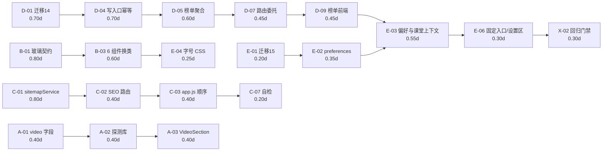

# 华夏古建可视化 · S3 P2 编码任务规划（tasks）

| 项 | 内容 |
|---|---|
| 文档编号 | TASKS-PUBLIC-S3P2-001 |
| 版本 | v1.0 |
| 状态 | 待评审（等待人工确认后方可进入编码；P2-5 为阻断验收，不含任何实现任务） |
| 上游文档 | `docs/design/s3-p2-design.md`（DESIGN-PUBLIC-S3P2-001）<br/>`docs/requirements/s3-p2-requirements.md`（REQ-PUBLIC-S3P2-001）<br/>`docs/tasks/general-audience-enhancement-tasks.md`（TASKS-PUBLIC-001，§11 T-S3-01~05） |
| 任务范围 | S3P2-A 视频（P2-2）、S3P2-B 液态玻璃（P2-1）、S3P2-C SEO（P2-6）、S3P2-D 排行榜（P2-3）、S3P2-E 课堂模式（P2-4）、S3P2-F UGC 阻断验收（P2-5）、X 横向门禁 |
| 关联代码库 | `D:\Ancient-architecture\ac1.1\acvisual 4`（S0~S2 已完成的当前快照） |
| 业务代码改动 | **无**（本阶段只输出任务规划） |
| 编码执行方 | 后续「任务执行」阶段；本文件不授权编码 |
| 编号兼容 | 不与既有 `T-S3-01~05` 冲突：本文件统一使用 `T-S3P2-*` 前缀 |

> 本文档回答「按什么顺序改、改哪些文件、做到什么程度、如何验收」。
> 前端文件省略前缀 `client/src/`，后端文件省略前缀 `server/src/`，数据库脚本省略前缀 `server/db/`，脚本省略前缀 `scripts/`。
> 所有路径均已对当前仓库快照核实（核对项见 0.5）。
> **P2-5（UGC 笔记公开）在 CG-01~CG-08 与 MG-01~MG-06 全部满足并完成书面评审前，本期零实现**：不建迁移、不建路由、不建 UI、不开特性开关、不留隐藏/灰度后门。本文件对该能力只排「阻断验收任务」。

---

## 0. 阅读指引与全局约定

### 0.1 任务编号规则

| 前缀 | 含义 | 任务数 | 人日 |
|---|---|---|---|
| `T-S3P2-A-xx` | P2-2 视频呈现 | 5 | 1.5 |
| `T-S3P2-B-xx` | P2-1 液态玻璃 | 6 | 3.0 |
| `T-S3P2-C-xx` | P2-6 SEO 与收录 | 8 | 3.0 |
| `T-S3P2-D-xx` | P2-3 排行榜与轻社交 | 10 | 4.0 |
| `T-S3P2-E-xx` | P2-4 教师/研学模式 | 8 | 2.5 |
| `T-S3P2-F-xx` | P2-5 UGC **阻断验收** | 3 | 0（走查 ≤0.2，不计入） |
| `T-S3P2-X-xx` | 横向：合并审查、回归门禁、发布说明、人工验收 | 4 | 0.8 |
| **合计** | | **44** | **14.8** |

> 与设计 §2.5 的「14 人日」差异为 +0.8：新增了横向门禁（X-01~X-04，0.8 人日），原因是设计已列 R-1~R-6 门禁但没有承接任务。

### 0.2 任务卡字段定义

每个任务卡固定 10 个字段：

| 字段 | 含义 |
|---|---|
| 目标 | 一句话可观察结果 |
| 前置依赖 | 未满足不得开工（任务编号或外部条件） |
| 涉及文件 | 新增（标「新增」）/ 修改（标「修改」），精确到现有路径 |
| 实现要点 | 实现级约束（不含完整代码；必要 SQL 见专章） |
| 完成定义（DoD） | 可判定的完成标准，每条可用命令或操作验证 |
| 需求 / 验收 | `P2-x`、`REQ-*`、`AC-S3-xx` 追溯 |
| 预估 | 人日（0.05 步进；含单测） |
| 并行性 | 可并行 / 不可并行，阻塞谁 |
| 验证方式 | 可复制执行的命令或手工步骤 |
| 边界（不做） | 防止顺手重构 |

### 0.3 通用完成定义（每条任务默认叠加）

1. `npm run lint` 无新增告警；不引入新运行时依赖（根 `liquid-glass-react` 已存在但**本批不使用、不扩展**）。
2. 新增后端服务函数有单测；新增/变更接口有契约断言；新增公开响应字段只增不改，缺失值为 `null`/`[]`，不出现 `undefined`。
3. 新增 `server/test/*.test.js` **必须登记到 `server/package.json` 的 `test` 脚本文件列表**（该脚本为显式枚举，未登记不会被 `npm run test:server` 执行）。
4. 不修改 `static-version/`；不改既有 URL；不删除既有列/表/字段；`personalization_enabled`、`analytics_enabled` 语义不变。
5. 公开响应（榜单、偏好、详情、分享页）不得含 `email`/`password_hash`/`user_id`/`avatar_url`/积分明细。
6. 所有新增前端组件在 `smooth` 档与 `prefers-reduced-motion: reduce` 下不崩溃、不自动播放、无入场动画。
7. 所有新增样式写在 `global.css` 或新文件**末尾**，**新起选择器**，不改写既有选择器（TR-09 延续）。

### 0.4 全局红线（任一违反即任务失败）

| 编号 | 红线 | 来源 |
|---|---|---|
| RED-01 | 不得创建 `server/db/migration_public_16_ugc_public.sql` | ADR-S3-09 / AC-S3-29 |
| RED-02 | 不得在 `server/src/routes/` 新建 `ugc*.js`，不得在 `server/src/config/` 注册任何 `UGC*` 键 | ADR-S3-09 |
| RED-03 | 不得给 `quiz_records` 加唯一键或改结构；不得删除历史答题行 | CS-02 / ADR-S3-03 |
| RED-04 | 不得让 `users.points` 清零或回滚已发徽章 | 设计 §2.3.4 |
| RED-05 | 不得用 `display:none` 实现课堂隐藏；一律渲染前返回 `null` | ADR-S3-08 |
| RED-06 | 不得用 `filter: blur()` 模拟玻璃；不得新增低对比灰色正文变量 | 需求 §4.1.3-8 |
| RED-07 | 不得让 SEO 路由注册在 `app.get('*')` 之后 | ADR-S3-10 |
| RED-08 | 只读课堂链接不得含 token、`user_id`、`utm_*`、`score` 等个人数据 | DFX-S3-S3 |
| RED-09 | 不得把 `personalization_enabled` 复用为课堂/未成年开关 | 设计 §1.2.5 |
| RED-10 | 不得使用 `images/brand/og-default.webp`（该文件当前不存在，见 R-S3-19） | R-S3-19 |

### 0.5 本次任务规划对代码基线的核对结论（编码起点事实）

| 事实 | 证据 |
|---|---|
| `app.get('*')` 仅排除 `/api`、`/share`，且**无条件挂载** | `server/src/app.js:68-76` |
| `server/src/config/` 目录**不存在**（故当前无任何特性开关文件） | 目录核对 |
| `rateLimit.keyBy` 仅支持字符串属性名或 `'ip'` | `server/src/middleware/rateLimit.js:11-14` |
| `achievementEngine` 的答题指标仍读 `quiz_records` | `server/src/services/achievementEngine.js:31-35` |
| `sharePage` canonical = `origin + req.originalUrl`（含 `?ch=`） | `server/src/routes/sharePage.js:25` |
| `shareCard.DEFAULT_OG_IMAGE = '/images/brand/og-default.webp'`，`images/brand/` **不存在** | `server/src/services/shareCard.js:5`；目录核对 |
| `videos/forbidden-city/` 为空目录（无正式视频资源） | 目录核对 |
| `videos` 静态服务已挂载（Range 行为待回归） | `server/src/app.js:34` |
| `palaces` 详情用 `SELECT *` 且有 `has_video/video_url/poster_path` | `server/src/routes/palaces.js:146-152`；`publicSerializer.js:23-33` |
| 发布门槛：`palaces.status` 存在且有索引 | `server/db/migration_public_12_content_status.sql` |
| `encyclopedia_terms` 有 `created_at`、无 `updated_at` | `server/db/init_full.sql:178-193` |
| `curated_routes` 有 `is_published`、`created_at`、无 `updated_at` | `server/db/migration_public_07_routes.sql:7-17` |
| `content_translations` 有 `status`，当前仅 taihedian/tiantan/wumen 的 name/description（wumen 仅 name） | `server/db/migration_public_09_i18n.sql` |
| `users` 无课堂/未成年相关列 | `server/db/init_full.sql:80-97` |
| `quiz_records` 有 `question_id` 外键级联、无唯一键 | `server/db/init_full.sql:215-227` |
| 前端测试自动发现 `client/src/**/*.{test,spec}.{js,jsx}` | `client/vite.config.js` |
| 后端测试显式枚举文件列表 | `server/package.json` 的 `test` 脚本 |
| 已存在 `client/src/lib/achievementBus.js`（成就事件总线） | 用于课堂静默 |
| `RecommendationRail` 使用点为 `OverviewPage.jsx`、`RoutePage.jsx`（首页无） | grep 核对 |
| `HomePage` 注册引导在 `guestSession.markDismissed('registerPrompt')` 附近 | `HomePage.jsx:412-423` |

---

## 1. 任务总览

### 1.1 任务清单总表

| 编号 | 任务名称 | 前置依赖 | 人日 | 可并行 | 需求 / AC-S3 |
|---|---|---|---|---|---|
| T-S3P2-A-01 | 详情接口 `video` 组合字段与序列化 | — | 0.40 | 是 | P2-2 / AC-S3-07 |
| T-S3P2-A-02 | `videoProbe` 探测库与单测 | A-01（字段契约可先冻结） | 0.40 | 是 | P2-2 / AC-S3-08、09 |
| T-S3P2-A-03 | 展览页 `VideoSection` 与失败收敛 | A-02 | 0.40 | 否 | P2-2 / AC-S3-07~11 |
| T-S3P2-A-04 | `/videos` Range 回归与 `video_unavailable` 埋点 | A-03 | 0.15 | 是 | P2-2 / AC-S3-08 |
| T-S3P2-A-05 | 视频 E2E 与验收（样例视频不入正式目录） | A-04 | 0.15 | 否 | P2-2 / AC-S3-07~11 |
| T-S3P2-B-01 | `.glass-panel` 契约与三层回退（`global.css` 末尾） | — | 0.80 | 是（不与 E-04 并行） | P2-1 / AC-S3-01、02 |
| T-S3P2-B-02 | `TierContext` 写 `data-tier` 根属性 | B-01（选择器依赖） | 0.30 | 是 | P2-1 / AC-S3-03 |
| T-S3P2-B-03 | 6 个白名单组件换类并移除内联模糊 | B-01、B-02 | 0.60 | 否 | P2-1 / AC-S3-01、05 |
| T-S3P2-B-04 | 对比度基线与最差背景样本文档 | B-03 | 0.50 | 是 | P2-1 / AC-S3-04 |
| T-S3P2-B-05 | 减少透明度/动效的 JS 接线（`lib/glassPref.js`） | B-02 | 0.20 | 是 | P2-1 / AC-S3-06 |
| T-S3P2-B-06 | 玻璃 E2E、白名单扫描与 CLS 采样 | B-03、B-05 | 0.60 | 否 | P2-1 / AC-S3-02、03、05、06 |
| T-S3P2-C-01 | `sitemapService` 数据驱动生成与缓存 | — | 0.80 | 是 | P2-6 / AC-S3-38、39 |
| T-S3P2-C-02 | `routes/seo.js`：robots/sitemap/分片 | C-01 | 0.40 | 是 | P2-6 / AC-S3-37、38 |
| T-S3P2-C-03 | `app.js` 注册顺序、fallback 排除与 noindex 头 | C-02、A-04 | 0.40 | 否（`app.js` 独占） | P2-6 / AC-S3-44、R-S3-11 |
| T-S3P2-C-04 | 分享页 JSON-LD / canonical / hreflang | C-01 | 0.70 | 是 | P2-6 / AC-S3-40~42 |
| T-S3P2-C-05 | 分享页 canonical 去参与下线 `noindex` | C-04 | 0.20 | 否 | P2-6 / AC-S3-41、43 |
| T-S3P2-C-06 | 兜底图片处置（R-S3-19） | C-04 | 0.20 | 是 | P2-6 / AC-S3-40 |
| T-S3P2-C-07 | `scripts/seo-check.mjs` 抓取自检 | C-03、C-05、C-06 | 0.20 | 否 | P2-6 / AC-S3-37~44 |
| T-S3P2-C-08 | SEO 单测与 E2E | C-07 | 0.10 | 否 | P2-6 / AC-S3-37~44 |
| T-S3P2-D-01 | 迁移 14：事实表、标记表、用户两列、历史回填 | — | 0.70 | 是 | P2-3 / AC-S3-12、13 |
| T-S3P2-D-02 | 回填对账与样本单测 | D-01 | 0.25 | 是 | P2-3 / AC-S3-12、15 |
| T-S3P2-D-03 | `rateLimit` 支持函数 `keyBy` | — | 0.15 | 是 | P2-3 / AC-S3-14 |
| T-S3P2-D-04 | `quizAnswerService` 幂等写入与可疑打标 | D-01、D-03 | 0.70 | 否 | P2-3 / AC-S3-12~14、19 |
| T-S3P2-D-05 | `leaderboardService` 去重聚合与脱敏 | D-01 | 0.60 | 可并行（与 D-04 不同文件） | P2-3 / AC-S3-15~18 |
| T-S3P2-D-06 | `minorGuard` 隐私模式解析 | D-01 | 0.25 | 是 | P2-3 / AC-S3-16 |
| T-S3P2-D-07 | `quiz.js` 委托、`distinct_correct` 与限流 | D-04、D-05、D-06 | 0.45 | 否 | P2-3 / AC-S3-12~18 |
| T-S3P2-D-08 | 成就引擎口径切换到事实表 | D-01 | 0.20 | 是 | P2-3 / AC-S3-12（延伸） |
| T-S3P2-D-09 | `QuizPage` 榜单脱敏、隐私与空态 | D-07 | 0.45 | 否（与 E-07 串行） | P2-3 / AC-S3-15~18 |
| T-S3P2-D-10 | 排行榜单测与 E2E | D-09 | 0.25 | 否 | P2-3 / AC-S3-12~19 |
| T-S3P2-E-01 | 迁移 15：课堂偏好两列 | D-01 | 0.20 | 是 | P2-4 / AC-S3-21 |
| T-S3P2-E-02 | `preferences` 4 字段一次性扩展 | D-01、E-01 | 0.35 | 否（`auth.js` 独占） | P2-3/P2-4 / AC-S3-16、21 |
| T-S3P2-E-03 | 偏好持久化 + `ClassroomViewContext` + 只读链接 | E-02、B-05、D-09 | 0.55 | 否（`UiPrefsContext` 独占） | P2-4 / AC-S3-21、26 |
| T-S3P2-E-04 | 课堂字号三段与投屏约束（`global.css` 新选择器） | B-01、E-03 | 0.25 | 否（`global.css` 串行） | P2-4 / AC-S3-23、28 |
| T-S3P2-E-05 | 隐藏矩阵接入 6 处 | E-03 | 0.45 | 可并行（与 E-04 不同文件） | P2-4 / AC-S3-22 |
| T-S3P2-E-06 | 固定入口条 + `ProfilePage` 设置区一次性改造 | E-03、E-05 | 0.30 | 否（`ProfilePage` 独占） | P2-4 / AC-S3-24、27 |
| T-S3P2-E-07 | `/practice/answer` + `QuizPage` 只读练习模式 | D-07、E-03 | 0.25 | 否（`QuizPage` 串行） | P2-4 / AC-S3-25 |
| T-S3P2-E-08 | 课堂单测与 E2E | E-06、E-07 | 0.15 | 否 | P2-4 / AC-S3-21~27 |
| T-S3P2-F-01 | UGC 静态阻断扫描（文件/路由/接口/UI/开关） | —（可随时执行） | 0 | 是 | P2-5 / AC-S3-29 |
| T-S3P2-F-02 | UGC 运行时探测与搜索/sitemap 排除 | C-07、F-01 | 0 | 是 | P2-5 / AC-S3-29 |
| T-S3P2-F-03 | 阻断验收报告与发布门禁登记 | F-02 | 0 | 否 | P2-5 / AC-S3-29 |
| T-S3P2-X-01 | 5 个冲突文件的合并审查 | D-09、E-06 | 0.20 | 否 | R-S3-14 |
| T-S3P2-X-02 | 回归与性能门禁（R-1~R-6） | 全部 A~E | 0.30 | 否 | AC-01~54 回归、DFX-S3-P4/P6 |
| T-S3P2-X-03 | 发布说明、口径公告与边界声明 | C-08、D-10、X-02 | 0.10 | 是 | Q1、R-S3-04、R-S3-12 |
| T-S3P2-X-04 | 人工验收清单（对比度/键盘/投屏/视频） | X-02 | 0.20 | 否 | AC-S3-04、11、23、28 |

### 1.2 里程碑

| 里程碑 | 判定条件 | 可对外说明 |
|---|---|---|
| **M-A 视频可用** | A-01~A-05 DoD 通过（CP-1） | 有视频可播、无视频无痕；失败不出黑框 |
| **M-B 玻璃规范** | B-01~B-06 DoD 通过（CP-2） | 6 处面板视觉同源；三条回退与 CLS=0 达标 |
| **M-C SEO 可收录** | C-01~C-08 DoD 通过（CP-3） | robots/sitemap 可直达；分享页结构化数据与规范地址正确 |
| **M-D 排行榜可信** | D-01~D-10 DoD 通过（CP-4） | 去重口径、限流、脱敏、未成年展示、空态全部达标 |
| **M-E 课堂可用** | E-01~E-08 DoD 通过（CP-5） | 开关持久化、三档字号、隐藏无残留、只读链接与随堂练习零写入 |
| **M-F UGC 阻断验收** | F-01~F-03 通过（CP-6） | 全站无任何可达公开笔记入口（含隐藏/灰度/管理员入口） |
| **M-Release 可发布** | X-01~X-04 通过 | 门禁全绿 + 发布说明就位 |

### 1.3 关键路径



**关键路径（最长链）**

**支流 1（榜单）**：`D-01 → D-04 → D-05 → D-07 → D-09` = 0.70 + 0.70 + 0.60 + 0.45 + 0.45 = **2.90 人日**
**支流 2（偏好字段）**：`D-01 → E-01 → E-02` = 0.70 + 0.20 + 0.35 = **1.25 人日**
**汇合段**：`E-03（需 D-09 与 E-02 都完成）→ E-06 → X-02` = 0.55 + 0.30 + 0.30 = **1.15 人日**

- 若 D-09 与 E-02 并行（不同文件，可两名前端/一名前端+一名后端配合）：关键路径 = max(2.90, 1.25) + 1.15 = **4.05 人日**。
- 若单人串行：**4.40 人日**。
- 注：`D-04` 与 `D-05` 可并行（不同文件），此时支流 1 为 0.70 + 0.70 + 0.45 + 0.45 = 2.30 人日，但瓶颈仍为 D-01 之后的串行汇合。

**次级路径**
- 玻璃链：`B-01 → B-03 → E-04` = 1.65 人日。
- SEO 链：`C-01 → C-02 → C-03 → C-07 → C-08` = 1.90 人日。
- 视频链：`A-01 → A-02 → A-03 → A-05` = 1.35 人日。

> 结论：**D→E 是唯一硬瓶颈**（共享 `QuizPage`、`UiPrefsContext`、`ProfilePage`、`auth.js`）；A/C/B-01 三条线可同时起跑。

### 1.4 可并行工作流

| 工作流 | 任务序列 | 独占文件面 |
|---|---|---|
| 视频流 | A-01 → A-02 → A-03 → A-04 → A-05 | `routes/palaces.js`、`services/publicSerializer.js`、`lib/videoProbe.js`、`pages/ExhibitionPage.jsx` |
| 视觉流 | B-01 → B-02 → B-03 → B-04 → B-05 → B-06 →（E-04） | `styles/global.css`、`context/TierContext.jsx`、`lib/glassPref.js`、6 个白名单组件 |
| 抓取流 | C-01 → C-02 → C-04 → C-05 → C-06 →（C-03）→ C-07 → C-08 | `routes/seo.js`、`services/sitemapService.js`、`services/shareCard.js`、`routes/sharePage.js`、`app.js`、`seo-check.mjs` |
| 排行流 | D-01 → D-02 / D-03 / D-06 / D-08 并行 → D-04 / D-05 并行 → D-07 → D-09 → D-10 | `db/migration_public_14_*`、`services/quizAnswerService.js`、`services/leaderboardService.js`、`middleware/minorGuard.js`、`routes/quiz.js`、`services/achievementEngine.js`、`pages/QuizPage.jsx` |
| 课堂流 | E-01 → E-02 → E-03 → E-04 / E-05 并行 → E-06 → E-07 → E-08 | `db/migration_public_15_*`、`routes/auth.js`、`context/UiPrefsContext.jsx`、`context/ClassroomViewContext.jsx`、`pages/ProfilePage.jsx`、`pages/QuizPage.jsx` |

### 1.5 必须串行的文件冲突矩阵

| 文件 | 涉及任务 | 串行规则 |
|---|---|---|
| `client/src/styles/global.css` | B-01、E-04 | B-01 先追加 `.glass-panel` 段；E-04 再追加 `html[data-classroom]` 字号段；两段物理相邻但互不改写 |
| `client/src/pages/QuizPage.jsx` | D-09、E-07 | D-09 先做榜单脱敏/空态/限流；E-07 再追加 `mode='practice'` 分支与不请求统计 |
| `client/src/context/UiPrefsContext.jsx` | E-03（承载 D 的 `minorMode`/`leaderboardOptOut` 与 B-05 的 `data-glass` 接线） | **只允许 E-03 改一次**；D 阶段不得动该文件 |
| `server/src/routes/auth.js` | E-02（4 字段） | **只允许 E-02 改一次**；D 阶段不得动该文件 |
| `client/src/pages/ProfilePage.jsx` | E-06（4 个开关） | **只允许 E-06 改一次**；D 阶段不得动该文件 |
| `server/src/app.js` | C-03（顺序）、A-04（只验不改） | A-04 只跑 Range 回归；C-03 一次性改注册顺序并重跑 Range |
| `server/src/routes/quiz.js` | D-07、E-07 | D-07 改 `/answer`、`/leaderboard`、`/stats`、`/categories`；E-07 仅追加独立 `/practice/answer` handler，不改 D 的 handler |
| `server/src/services/shareCard.js` | C-04、C-06 | 同一人串行，或合并为一次提交；`DEFAULT_OG_IMAGE` 只在 C-06 改 |
| `server/package.json` | A-01、D-10、E-08、C-08 | 新增测试文件时按批次登记，避免多人同时改 `test` 脚本 |

---

## 2. S3P2-A 视频呈现（P2-2）

**阶段小结**

| 维度 | 内容 |
|---|---|
| 数据迁移 | 无（复用 `palaces.has_video/video_url/poster_path`） |
| 接口契约 | `GET /api/palaces/:id` 新增 `data.video:{declared,url,poster}`；既有 `has_video`/`video_url` 保留 |
| 前端组件/状态 | 新增 `lib/videoProbe.js`；`ExhibitionPage` 内新增 `VideoSection`（同文件，不新增页面/文件） |
| 测试 | 单测：探测库 + 详情字段；E2E：`test/e2e/video.spec.js`；人工：键盘与文字稿 |
| 验证命令 | `node --test server/test/palaces-video.test.js`；`npm run test:client -- videoProbe`；`npm run test:e2e -- video.spec.js` |

### T-S3P2-A-01 详情接口 `video` 组合字段与序列化

| 项 | 内容 |
|---|---|
| 目标 | 建筑详情返回可直接驱动"呈现门"的 `video` 组合字段，且不新增任何查询 |
| 前置依赖 | — |
| 涉及文件 | 修改 `server/src/services/publicSerializer.js`（新增 `toVideoInfo(row)` 并导出）<br/>修改 `server/src/routes/palaces.js`（`GET /:id` 的 `serialized` 后挂 `serialized.video`）<br/>新增 `server/test/palaces-video.test.js` |
| 实现要点 | ① `declared = has_video === 1 \|\| has_video === '1' \|\| has_video === true`；② `url`：空串/`null` → `null`；已是绝对 URL 原样；相对路径补 `/videos/` 前缀（若已以 `/videos/` 开头不重复补）；③ `poster`：`poster_path` 为空 → `null`（前端兜底），非空原样（相对路径补 `/images/` 前缀，与 `resolveOgImage` 口径一致）；④ 仅**详情**接口加，列表接口不加（控体积）；⑤ 不触发任何外部 HEAD/GET（服务端不探测）；⑥ 既有 `has_video`、`video_url` 字段原样保留，不删不改语义 |
| 完成定义（DoD） | 测试覆盖 4 种组合：`has_video=0` → `{declared:false,url:null,poster:...}`；`has_video=1 + video_url=''` → `declared:true,url:null`；相对 URL → `/videos/x.mp4`；绝对 URL → 原样。列表接口响应不含 `video` 键。缺字段时响应无 `undefined` |
| 需求 / 验收 | P2-2；REQ-24；**AC-S3-07**（门条件①②） |
| 预估 | 0.40 人日 |
| 并行性 | 可并行（与 B-01、C-01、D-01 文件面独立）；**阻塞 A-02/A-03** |
| 验证方式 | `node --test --test-force-exit server/test/palaces-video.test.js`；`curl -s localhost:3001/api/palaces/taihedian \| node -e "const d=JSON.parse(require('fs').readFileSync(0)).data;console.log(d.video)"` |
| 边界（不做） | 不改 SQL 查询字段；不做服务端视频探测；不给列表接口加 `video`；不改 `publicSerializer` 既有白名单顺序 |

### T-S3P2-A-02 `videoProbe` 探测库与单测

| 项 | 内容 |
|---|---|
| 目标 | 用 HEAD→Range GET 两级探测判定视频是否真的可用，失败即"永久隐藏"，不阻塞首屏 |
| 前置依赖 | A-01（字段契约冻结即可先写） |
| 涉及文件 | 新增 `client/src/lib/videoProbe.js`<br/>新增 `client/src/lib/__tests__/videoProbe.test.js` |
| 实现要点 | ① 签名 `probeVideo(url,{timeoutMs=2500})` → `Promise<{ok,contentType,reason}>`，`reason ∈ {ok,probe_failed,wrong_type,timeout,invalid_url}`；② 先 `HEAD`；`405/501/网络错误` 回退 `GET` + `Range: bytes=0-1`；③ `AbortController` + `setTimeout` 清理，超时**不回退重试**（避免二次长等待），`reason='timeout'`；④ 仅当响应 `2xx` 且 `content-type` 以 `video/` 开头 → `ok:true`；⑤ 模块级 `Map` 缓存（key=url），命中直接返回；⑥ 提供 `_clearProbeCache()` 供测试；⑦ 不引入新依赖，用原生 `fetch`；⑧ 测试用 `vi.stubGlobal('fetch')` 模拟 4 类响应，不访问真实网络 |
| 完成定义（DoD） | 5 条用例通过：HEAD 200+video → ok；HEAD 405 + GET 206+video → ok；HEAD 404 → `probe_failed`；HEAD 200 但 `text/html` → `wrong_type`；超时（mock 永不 resolve + fake timers）→ `timeout` 且不发起第二次请求。同 URL 第二次调用不触发 fetch（缓存生效） |
| 需求 / 验收 | P2-2；REQ-24；**AC-S3-08、AC-S3-09** |
| 预估 | 0.40 人日 |
| 并行性 | 可并行（与 A-01 后半段）；**阻塞 A-03** |
| 验证方式 | `npm run test:client -- videoProbe`（client 侧 vitest 自动发现 `src/lib/__tests__/`） |
| 边界（不做） | 不做播放器；不做码率/格式能力检测（浏览器原生 `error` 事件兜底）；不请求本服务端新增端点 |

### T-S3P2-A-03 展览页 `VideoSection` 与失败收敛

| 项 | 内容 |
|---|---|
| 目标 | 展览页在"声明+可访问+类型正确"三条件成立时出现 16:9 视频区，任一失败即完全无痕 |
| 前置依赖 | A-02 |
| 涉及文件 | 修改 `client/src/pages/ExhibitionPage.jsx`（同文件新增内联 `VideoSection` 子组件）<br/>修改 `client/src/lib/analytics.js`（白名单新增 `video_unavailable`） |
| 实现要点 | ① 挂载位置：`infoExpanded` 展开区内、`AudioGuidePlayer` **之前**（视频优先于朗读）；② 条件：`palace.video?.declared === true && palace.video.url` 才触发探测，否则**不渲染、不请求**；③ 探测 `ok:false` → `return null`（无骨架、无占位、无"即将上线"文案）；④ `<video controls preload="none" playsInline poster={poster} aria-label={\`${palace.name} · 视频讲解\`}>`，**禁止 `autoplay`**；⑤ 容器 `aspect-ratio:16/9; width:100%`，出现前后不改变舞台层高度（页面本身 `100vh; overflow:hidden`，展开区内部滚动）；⑥ `poster` 优先 `palace.video.poster`（走 `resolveOgImage`），缺失用 `images/posters/gugong.webp`（**禁用 `og-default`**）；⑦ 标题 `<h3>{palace.name} · 视频讲解</h3>` + 一句 `palace.tagline || '观看建筑空间与工艺'`；⑧ 播放 `onError` → 移除视频节点 + 一行 muted 文案"视频暂不可用，已保留图文讲解" + `console.warn` + `track('video_unavailable',{reason:'play_error'})`；⑨ 无字幕 → 提供"查看文字稿"折叠按钮，内容取 `palace.audio_guide`（存在时）或展开 `palace.description`；⑩ `useEffect` 依赖 `[palace.id, palace.video?.url]`，切建筑 `abort` 上一次探测 |
| 完成定义（DoD） | ① 无视频建筑（当前全站）：DOM 中无 `<video>`、无视频容器、无相关文案；② mock 有效探测：渲染 16:9 容器、无 `autoplay` 属性、poster 为 `gugong.webp`；③ mock 探测失败：仍无任何视频节点；④ 触发 `error` 事件：节点移除并出现 muted 文案；⑤ 键盘可 Tab 到原生控件；⑥ 文字稿入口可展开 |
| 需求 / 验收 | P2-2；REQ-24；**AC-S3-07、AC-S3-08、AC-S3-09、AC-S3-10、AC-S3-11** |
| 预估 | 0.40 人日 |
| 并行性 | 否（依赖 A-02） |
| 验证方式 | `npm run dev` 打开任一建筑展开详情（应无视频区）；临时在测试库把某建筑设为 `has_video=1,video_url='nonexistent.mp4'` 复核无黑框；`npm run test:client -- ExhibitionPage`（新增组件单测，可并入 A-05） |
| 边界（不做） | 不新增独立文件/页面；不把视频放进 3D 舞台层；不做字幕生产、倍速、播放列表；不改 `AudioGuidePlayer` |

### T-S3P2-A-04 `/videos` Range 回归与 `video_unavailable` 埋点

| 项 | 内容 |
|---|---|
| 目标 | 证明拖动进度依赖的分段请求可用，且探测/播放失败有白名单内埋点 |
| 前置依赖 | A-03 |
| 涉及文件 | 修改 `client/src/lib/analytics.js`（`EVENT_NAMES` 增加 `video_unavailable`，`ALLOWED_PROP_KEYS` 已含 `reason`）<br/>新增（测试夹具）`test/fixtures/video/sample.mp4`（≤1MB，仅测试用）<br/>修改 `scripts/audit-assets.mjs`（可选：把 `videos/` 空目录纳入报告，不阻断） |
| 实现要点 | ① 用测试夹具临时挂到 `videos/` 之外（如 `test/fixtures/video/`），通过 `curl` 直接请求静态目录外的文件不可行 → 改用启动临时静态服务或把夹具复制到 `videos/` 后在验收结束**删除**（脚本化，两行命令，写入任务卡验证步骤）；② 断言响应头含 `Accept-Ranges: bytes`、`Range: bytes=0-1` 返回 `206` + `Content-Range`；③ 埋点只在失败时上报一次/会话（模块级 `Set` 去重），不逐帧；④ 埋点不含 URL 原文，仅 `reason` |
| 完成定义（DoD） | `curl -s -D - -o N \ -H "Range: bytes=0-1" http://localhost:3001/videos/sample.mp4` 返回 `206` 且含 `Content-Range`；删除夹具后请求返回 `404`（不返回 index.html）；`track('video_unavailable',{reason:'probe_failed'})` 在 analytics 单测中进入队列，非白名单 reason 被丢弃 |
| 需求 / 验收 | P2-2；REQ-24；**AC-S3-08**（分段）、DFX-S3-R1 |
| 预估 | 0.15 人日 |
| 并行性 | 可并行；**不修改 `app.js`**（只验） |
| 验证方式 | 见 DoD 的 `curl`；`npm run test:client -- analytics` |
| 边界（不做） | 不把样例视频提交进正式 `videos/` 内容；不改静态服务配置；不做视频转码 |

### T-S3P2-A-05 视频 E2E 与验收

| 项 | 内容 |
|---|---|
| 目标 | 把 AC-S3-07~11 固化为可重复 E2E，并明确"无资源常态"下的验收口径 |
| 前置依赖 | A-04 |
| 涉及文件 | 新增 `test/e2e/video.spec.js`<br/>修改 `server/package.json`（登记 `test/palaces-video.test.js`） |
| 实现要点 | ① 用例 1：无视频建筑 → `video` 元素数量 0、无 `data-testid=video-section`；② 用例 2：用 `page.route` 拦截详情响应注入 `video:{declared:true,url:'/videos/sample.mp4'}` 并 mock HEAD 200+video → 断言容器出现、无 `autoplay`、`aspect-ratio` 生效；③ 用例 3：mock 404 → 断言仍无视频节点；④ 用例 4：记录容器出现前后下方元素 `boundingBox().y`，差值 ≤1px；⑤ 用例 5：键盘 Tab 可聚焦 `<video>`；⑥ 断言 `poster` URL 不以 `og-default` 结尾 |
| 完成定义（DoD） | `npm run test:e2e -- video.spec.js` 5 条通过；失败截图可定位；不依赖真实视频资源（全部 mock 或夹具） |
| 需求 / 验收 | P2-2；REQ-24；**AC-S3-07~AC-S3-11** |
| 预估 | 0.15 人日 |
| 并行性 | 否（阶段收尾） |
| 验证方式 | `npm run test:e2e -- video.spec.js` |
| 边界（不做） | 不测播放音质/编码兼容全矩阵（仅 `error` 兜底）；不引入真实视频文件到仓库正式目录 |

---

## 3. S3P2-B 液态玻璃（P2-1）

**阶段小结**

| 维度 | 内容 |
|---|---|
| 数据迁移 | 无 |
| 接口契约 | 无（纯前端视觉）；埋点新增 `glass_fallback` |
| 前端组件/状态 | `global.css` 新增 `.glass-panel` 契约与三层回退；`TierContext` 写 `data-tier`；`lib/glassPref.js` 写 `data-glass`；6 个白名单组件换类 |
| 测试 | 单测：`glassPref`、`TierContext` 根属性；E2E：`test/e2e/glass-fallback.spec.js`；基线：截图 + 对比度文档 |
| 验证命令 | `npm run test:client -- glassPref`；`npm run test:e2e -- glass-fallback.spec.js`；`node scripts/audit-assets.mjs`（不相关项不改） |

### T-S3P2-B-01 `.glass-panel` 契约与三层回退

| 项 | 内容 |
|---|---|
| 目标 | 全站玻璃质感只有一个定义来源，并在不支持/平滑档/减少透明度/打印时回退实底 |
| 前置依赖 | —（`global.css` 末尾追加，不触既有选择器） |
| 涉及文件 | 修改 `client/src/styles/global.css`（**文件末尾**新起段落） |
| 实现要点 | ① 新增变量（仅本段使用）：`--glass-blur: 12px`、`--glass-surface: var(--surface-glass-heavy)`、`--glass-border: var(--border-warm)`、`--glass-shadow: var(--shadow-sm)`；② `.glass-panel { background: var(--glass-surface); backdrop-filter: blur(var(--glass-blur)) saturate(1.1); -webkit-backdrop-filter: ...; box-shadow: inset 0 0 0 1px var(--glass-border), var(--glass-shadow); transition: background-color .18s ease }`；③ **描边用 `box-shadow: inset`**，不新增 1px `border`（避免 CLS）；④ 回退层①：`@supports not ((backdrop-filter: blur(1px)) or (-webkit-backdrop-filter: blur(1px)))` → `background: var(--paper-white); backdrop-filter:none`；⑤ 回退层②：`html[data-tier="smooth"] .glass-panel` → `backdrop-filter:none; background: var(--paper-white)`；⑥ 回退层③：`html[data-glass="off"] .glass-panel` → 实底；`@media (prefers-reduced-transparency: reduce)` 同规则（浏览器不支持该媒体查询时整段被忽略，无害）；⑦ `@media print .glass-panel` → 实底、无阴影、无过渡；⑧ `@media (prefers-reduced-motion: reduce) .glass-panel` → `transition:none; animation:none`；⑨ 面板内正文约束写入注释：只用 `--ink`/`--ink-light`，禁用 `--ink-muted` |
| 完成定义（DoD） | ① `global.css` 既有选择器行号区段无改动（diff 仅新增末尾段）；② DevTools 中 `.glass-panel` 计算样式含 `backdrop-filter: blur(12px)`；③ 手动设 `document.documentElement.dataset.tier='smooth'` → 计算值 `none` 且背景不透明；④ `dataset.glass='off'` → 同上；⑤ 打印预览无灰糊块；⑥ 面板前后 `getBoundingClientRect()` 尺寸差为 0 |
| 需求 / 验收 | P2-1；REQ-10；**AC-S3-01、AC-S3-02**；DFX-S3-R2、DFX-S3-M1、DFX-S3-P2 |
| 预估 | 0.80 人日 |
| 并行性 | 可并行（与 A/C/D-01 不同文件）；**不可与 E-04 并行**（同文件） |
| 验证方式 | `npm run dev` 手工按 DoD ③④；`git diff client/src/styles/global.css` 确认仅追加 |
| 边界（不做） | 不改既有选择器；不新增低对比色；不做暗色主题；不收敛既有内联模糊（标 legacy） |

### T-S3P2-B-02 `TierContext` 写 `data-tier` 根属性

| 项 | 内容 |
|---|---|
| 目标 | 让 CSS 能按档位降级，且卸载/切档即时更新，避免"档位已平滑但仍模糊" |
| 前置依赖 | B-01（选择器已存在，便于测试断言） |
| 涉及文件 | 修改 `client/src/context/TierContext.jsx`<br/>新增/修改 `client/src/context/__tests__/TierContext.test.jsx` |
| 实现要点 | ① `useEffect(() => { document.documentElement.dataset.tier = tier; return () => { delete document.documentElement.dataset.tier; }; }, [tier])`；② 不读写 localStorage 新键；③ 不改 `resolveTier` 逻辑；④ 测试用 `renderHook` + Provider，断言初始值为 `detected`/`standard`，调用 `setTier('smooth')` 后根属性变 `smooth`，卸载后属性被移除 |
| 完成定义（DoD） | 单测 3 条通过；浏览器中切换画质后 `<html data-tier>` 即时变化；卸载 Provider（单测）无残留属性 |
| 需求 / 验收 | P2-1；REQ-10；**AC-S3-03**；R-S3-16 |
| 预估 | 0.30 人日 |
| 并行性 | 可并行；**阻塞 B-03/B-06** |
| 验证方式 | `npm run test:client -- TierContext` |
| 边界（不做） | 不改档位判定算法；不改 `deviceTier.js`；不新增用户可见开关 |

### T-S3P2-B-03 6 个白名单组件换类并移除内联模糊

| 项 | 内容 |
|---|---|
| 目标 | 首批 6 处应用点视觉同源，且组件内不再各自声明模糊强度 |
| 前置依赖 | B-01、B-02 |
| 涉及文件 | 修改 `client/src/pages/SearchPage.jsx`（结果分组容器/筛选条）<br/>修改 `client/src/components/GlobalSearchDialog.jsx`（弹层）<br/>修改 `client/src/components/CollectionDialog.jsx`（容器）<br/>修改 `client/src/components/ShareButton.jsx`（手动复制浮层）<br/>修改 `client/src/components/AchievementToast.jsx`（结算层）<br/>修改 `client/src/components/RecommendationRail.jsx`（外框） |
| 实现要点 | ① 仅加 `glass-panel` 类名，删除这些组件内联 style 中的 `backdropFilter`/`backdrop-filter`（若存在）；② **不改 padding/border-width/圆角/布局属性**；③ 面板内正文改 `var(--ink)`/`var(--ink-light)`，若原为 `--ink-muted` 的正文（非说明性小字）需替换；④ 同一界面玻璃层叠 ≤2 层（`GlobalSearchDialog` 内不得再套 `glass-panel`）；⑤ `RecommendationRail` 仅在**外框**加类，内部卡片不加；⑥ 不改 `DetailPanel` 正文区、榜单表格、输入框、错误提示（黑名单位置） |
| 完成定义（DoD） | ① 6 个文件各出现 1 处 `glass-panel`（`SearchPage` 可按分组/筛选 1~2 处）；② 6 个文件内 `backdropFilter` 字符串计数为 0；③ 页面布局截图与改造前对比无位移（抽 3 处）；④ 面板内无 `--ink-muted` 正文 |
| 需求 / 验收 | P2-1；REQ-10；**AC-S3-01、AC-S3-05**；DFX-S3-M1 |
| 预估 | 0.60 人日 |
| 并行性 | 否（依赖 B-01/B-02）；完成后 B-04/B-06 可启动 |
| 验证方式 | `grep -rn "backdropFilter\|backdrop-filter" client/src/pages/SearchPage.jsx client/src/components/{GlobalSearchDialog,CollectionDialog,ShareButton,AchievementToast,RecommendationRail}.jsx`（应为空）；`npm run dev` 逐组件目视 |
| 边界（不做） | 不改造 `ExhibitionPage`/`EighteenDouPage`/`ModelViewer` 内联模糊（legacy）；不加新组件；不改布局 |

### T-S3P2-B-04 对比度基线与最差背景样本文档

| 项 | 内容 |
|---|---|
| 目标 | 用可重复的采样与计算式证明面板正文对比度达标，避免事后返工 |
| 前置依赖 | B-03（真实渲染色可采样） |
| 涉及文件 | 新增 `docs/design/baselines/s3p2-glass-contrast.md` |
| 实现要点 | ① 固定两个最差背景样本：S1=`/` 首页海报轮播；S2=`/exhibition/:id` 深色舞台边缘；② 记录采样时间、浏览器、缩放、取色工具；③ 取"面板最终等效色"（0.95 纸白叠加后的渲染色）与 `--ink`/`--ink-light` 实际渲染色；④ 用 WCAG 2.x 相对亮度公式计算正文与大字号对比度；⑤ 结论表：正文 ≥4.5:1、大字号 ≥3:1；⑥ 记录"不得用 `--ink-muted` 作正文"的判定依据；⑦ 不引入运行时检测脚本 |
| 完成定义（DoD） | 文档含 2 个样本 × 2 种文字色 = 4 组计算式与结论；所有正文 ≥4.5:1；评审可复现（取色值写入文档） |
| 需求 / 验收 | P2-1；DFX-S3-A1；**AC-S3-04**；R-S3-02 |
| 预估 | 0.50 人日 |
| 并行性 | 可并行（与 B-05） |
| 验证方式 | 按文档步骤在 DevTools 取色并复算；评审归档 |
| 边界（不做） | 不做自动对比度扫描服务；不因此调整全站配色；不改品牌色 |

### T-S3P2-B-05 减少透明度/动效的 JS 接线（`lib/glassPref.js`）

| 项 | 内容 |
|---|---|
| 目标 | 用户显式"减少透明度"时写 `data-glass="off"`；无 JS API 时安静降级 |
| 前置依赖 | B-02 |
| 涉及文件 | 新增 `client/src/lib/glassPref.js`<br/>新增 `client/src/lib/__tests__/glassPref.test.js` |
| 实现要点 | ① 导出 `readGlassOff()`（本机键 `ac4_glass_off`，缺省 `false`）与 `applyGlassPref()`（写/删 `documentElement.dataset.glass`）；② `matchMedia('(prefers-reduced-transparency: reduce)')` 存在时监听变化并合并；不存在时跳过（不报错）；③ 提供 `subscribeGlassPref(cb)` 返回取消函数；④ **不在本任务修改 `UiPrefsContext`**；接线点留给 E-03（一行调用），避免同文件多次改造；⑤ 单测覆盖：默认 false、键为 `1` 时写 `off`、`matchMedia` 缺失不抛、取消订阅后不再触发 |
| 完成定义（DoD） | 单测 4 条通过；手动 `localStorage.setItem('ac4_glass_off','1')` + 调用 `applyGlassPref()` → `<html data-glass="off">`，`.glass-panel` 变实底 |
| 需求 / 验收 | P2-1；**AC-S3-06**；DFX-S3-A4 |
| 预估 | 0.20 人日 |
| 并行性 | 可并行；**阻塞 E-03 的一行接线** |
| 验证方式 | `npm run test:client -- glassPref` |
| 边界（不做） | 不新增设置 UI（设置项归 E-06 评估）；不改 `analytics`；不做系统偏好轮询 |

### T-S3P2-B-06 玻璃 E2E、白名单扫描与 CLS 采样

| 项 | 内容 |
|---|---|
| 目标 | 把三条回退、禁止位置与 CLS=0 变成可执行门禁 |
| 前置依赖 | B-03、B-05 |
| 涉及文件 | 新增 `test/e2e/glass-fallback.spec.js`<br/>新增 `scripts/check-glass-allowlist.mjs`（轻量扫描，退出码 0/1） |
| 实现要点 | ① E2E 用例 A：`page.addStyleTag` 覆盖 `backdrop-filter: none !important` 模拟不支持（或注入使 `@supports` 不成立的方式不可靠时，直接断言 `data-tier=smooth` 分支）；用例 B：`localStorage` 置 `ac4_tier_override=smooth` 后刷新，断言面板计算 `backdrop-filter === 'none'`；用例 C：`data-glass=off` + `emulateMedia({reducedMotion:'reduce'})`，断言无 `animation`/`transition`；用例 D：记录面板出现前后下方元素 `boundingBox().y` 差 ≤1px；② 扫描脚本：`glass-panel` 只允许出现在 6 个白名单文件（`pages/SearchPage.jsx`、`components/GlobalSearchDialog.jsx`、`components/CollectionDialog.jsx`、`components/ShareButton.jsx`、`components/AchievementToast.jsx`、`components/RecommendationRail.jsx`）+ `styles/global.css`，其他出现即退出码 1；③ 扫描同时断言禁止位置文件（`DetailPanel.jsx`、`QuizPage.jsx`、`EncyclopediaPage.jsx`、`ExhibitionPage.jsx`）不含 `glass-panel`；④ 不引入 axe 依赖（S1 已有基线，本轮不重复） |
| 完成定义（DoD） | `npm run test:e2e -- glass-fallback.spec.js` 4 条通过；`node scripts/check-glass-allowlist.mjs` 退出码 0；故意在白名单外加一个 `glass-panel` 后脚本退出码 1（负向自测，测完回退） |
| 需求 / 验收 | P2-1；**AC-S3-02、AC-S3-03、AC-S3-05、AC-S3-06**；DFX-S3-P1/P2 |
| 预估 | 0.60 人日 |
| 并行性 | 否（阶段收尾） |
| 验证方式 | 见 DoD；真机帧率采样（标准档 ≤1.5ms、平滑档 0）记入 X-04 人工清单 |
| 边界（不做） | 不把扫描做成 CI 服务；不改既有 E2E；不测试 P1 既有页面 |

---

## 4. S3P2-C SEO 与收录（P2-6）

**阶段小结**

| 维度 | 内容 |
|---|---|
| 数据迁移 | 无（复用 `palaces.status`、`encyclopedia_terms.created_at`、`curated_routes.is_published/created_at`） |
| 接口契约 | 新增 `GET /robots.txt`、`GET /sitemap.xml`、`GET /sitemap-index.xml`、`GET /sitemap-:page.xml`；`GET /share/:type/:id` 元信息增强（canonical/JSON-LD/hreflang/noindex） |
| 前端组件/状态 | 无新增；仅 `/search`、`/profile`、`/curator` 由 fallback 加响应头 |
| 测试 | 单测：`seo-routes.test.js`、`share-jsonld.test.js`；自检：`scripts/seo-check.mjs`；E2E：`test/e2e/seo.spec.js` |
| 验证命令 | `node --test --test-force-exit server/test/seo-routes.test.js server/test/share-jsonld.test.js`；`node scripts/seo-check.mjs --base=http://localhost:3001` |

### T-S3P2-C-01 `sitemapService` 数据驱动生成与缓存

| 项 | 内容 |
|---|---|
| 目标 | 站点地图由数据库生成，只含已发布内容，`lastmod` 真实，失败显式报错 |
| 前置依赖 | — |
| 涉及文件 | 新增 `server/src/services/sitemapService.js`<br/>新增 `server/test/sitemap-service.test.js` |
| 实现要点 | ① `buildSitemap({origin, page=1})` 内部查询：`SELECT id, updated_at FROM palaces WHERE status='published'`、`SELECT id, created_at FROM encyclopedia_terms`、`SELECT id, created_at FROM curated_routes WHERE is_published=1`；② URL 形态：`/exhibition/{id}`、`/encyclopedia?term={id}`（XML 中 `&` 转义为 `&amp;`）、`/routes/{id}`；`id` 经 `encodeURIComponent`；③ `lastmod`：palace `updated_at`、term/route `created_at`（**禁止 `NOW()`**）；④ XML 合法性：`<?xml version="1.0" encoding="UTF-8"?>` + `<urlset xmlns="http://www.sitemaps.org/schemas/sitemap/0.9">`，所有动态值 XML 转义；⑤ `MAX_URLS_PER_SITEMAP=45000`，超限时按页均分，并由 `buildSitemapIndex()` 生成索引；⑥ 进程内缓存 5 分钟（`entries` + `expiresAt`），提供 `clearSitemapCache()` 供测试；⑦ 查询异常向上抛（由路由转 503），**禁止返回空 `<urlset>`**；⑧ `origin` 由调用方传入，不自读 `req` |
| 完成定义（DoD） | 单测：仅 published 建筑进入、draft 不进入；term 用 `created_at`（不得为当前时间）；XML 可被正则解析且含 `<urlset`；401 条数据时分片为 1 页；强制抛错时 `buildSitemap` reject；缓存生效（第二次不查库，可注入 spy） |
| 需求 / 验收 | P2-6；REQ-31；**AC-S3-38、AC-S3-39**；DFX-S3-M2、DFX-S3-R3 |
| 预估 | 0.80 人日 |
| 并行性 | 可并行；**阻塞 C-02/C-07** |
| 验证方式 | `node --test --test-force-exit server/test/sitemap-service.test.js`；`npm run db:test:init` 后可复跑 |
| 边界（不做） | 不列 `/share/*`（Q1 默认口径，见 §14）；不列搜索/个人/答题页；不加 `updated_at` 列；不做定时物化 |

### T-S3P2-C-02 `routes/seo.js`：robots/sitemap/分片

| 项 | 内容 |
|---|---|
| 目标 | 抓取规则与站点地图可直达、纯文本/XML 类型正确、失败 503 |
| 前置依赖 | C-01 |
| 涉及文件 | 新增 `server/src/routes/seo.js` |
| 实现要点 | ① `GET /robots.txt`：`text/plain; charset=utf-8`；内容 `User-agent: *`、`Allow: /`、`/exhibition/`、`/encyclopedia`、`/routes`、`/share/`；`Disallow: /api/`、`/profile`、`/curator`、`/search`、`/quiz`（Q7 默认）；`Sitemap: {origin}/sitemap.xml`；`Cache-Control: public, max-age=3600`；② `GET /sitemap.xml`：`application/xml; charset=utf-8`；正常 `200`；异常 `503 { success:false, code:'SITEMAP_UNAVAILABLE' }` + `Retry-After: 300`；`Cache-Control: public, max-age=3600`；③ `GET /sitemap-index.xml` 与 `GET /sitemap-:page.xml` 仅在超限时启用，否则 `404`；④ `origin` 解析：优先 `X-Forwarded-Host` + `X-Forwarded-Proto`，否则 `req.protocol`/`req.get('host')`；**不开启 `trust proxy`**（避免改变 `req.ip` 限流语义，R-S3-17）；⑤ 路由前缀直接挂在 app 根（`seoRoutes` 内部定义 `/robots.txt`、`/sitemap...`） |
| 完成定义（DoD） | `curl -D - /robots.txt` → 200 + `text/plain` 且 body 首行 `User-agent`；`curl -D - /sitemap.xml` → 200 + `application/xml` 且以 `<?xml` 开头；注入异常 → 503 + code；`/sitemap-index.xml` 未超限时 404；响应头含 `Cache-Control` |
| 需求 / 验收 | P2-6；REQ-31；**AC-S3-37、AC-S3-38** |
| 预估 | 0.40 人日 |
| 并行性 | 可并行（与 C-04）；**阻塞 C-03** |
| 验证方式 | 见 DoD 的 3 条 `curl` |
| 边界（不做） | 不在路由内写 SQL；不改 `express.static`；不做 gzip 协商 |

### T-S3P2-C-03 `app.js` 注册顺序、fallback 排除与 noindex 头

| 项 | 内容 |
|---|---|
| 目标 | 让 SEO 路由先于 SPA fallback 命中，并给私有页加 `X-Robots-Tag` |
| 前置依赖 | C-02；A-04（先验 `/videos` Range） |
| 涉及文件 | 修改 `server/src/app.js`<br/>新增 `server/test/seo-routing.test.js`（可用 supertest 断言顺序） |
| 实现要点 | ① `const seoRoutes = require('./routes/seo')`；② 挂载顺序：静态 → API → **`app.use(seoRoutes)`** → `/share` → fallback；③ fallback 排除扩展：`req.path.startsWith('/api') \|\| startsWith('/share') \|\| req.path === '/robots.txt' \|\| startsWith('/sitemap')`；④ fallback 内按路径设头：`/search`、`/profile`、`/curator` → `res.set('X-Robots-Tag','noindex, follow')`；⑤ 不改 `express.static(clientDist)` 位置；⑥ 构建时不得在 `client/public` 生成 `robots.txt`/`sitemap.xml`（当前无，保持）；⑦ 本任务完成后**重跑 A-04 的 Range 回归** |
| 完成定义（DoD） | 生产模式（`NODE_ENV=production` + `client/dist/index.html` 存在）下：`/robots.txt` 非 HTML；`/exhibition/taihedian` 为 `index.html` 且无 noindex；`/search` 为 `index.html` 且含 `X-Robots-Tag: noindex, follow`；`/profile`、`/curator` 同；`/api/palaces` 仍 JSON；`/videos/sample.mp4` 的 206 回归仍通过（验完删除夹具） |
| 需求 / 验收 | P2-6；**AC-S3-44**；R-S3-11、CS-05 |
| 预估 | 0.40 人日 |
| 并行性 | **否（`app.js` 独占）** |
| 验证方式 | `npm run build && NODE_ENV=production npm run server` 后按 DoD `curl`；`node --test --test-force-exit server/test/seo-routing.test.js` |
| 边界（不做） | 不做 SSR/预渲染；不删 fallback；不改 API 路由顺序 |

### T-S3P2-C-04 分享页 JSON-LD / canonical / hreflang

| 项 | 内容 |
|---|---|
| 目标 | 分享页输出与内容类型匹配的结构化数据、去参规范地址与正确的语言互指 |
| 前置依赖 | C-01（origin/内容判定口径） |
| 涉及文件 | 修改 `server/src/services/shareCard.js`<br/>新增 `server/test/share-jsonld.test.js` |
| 实现要点 | ① 新增 `buildCanonical(origin, type, id)`：palace → `${origin}/exhibition/${id}`；term → `${origin}/encyclopedia?term=${id}`；route → `${origin}/routes/${id}`；② 新增 `buildJsonLd({type, content, canonical, imageUrl})`：palace → `TouristAttraction`（`name`/`description` 截 160/`image`/`url`；`address` 仅在 `city/region` 存在时输出城市级 `PostalAddress`）；term → `Article`（`headline`/`description`/`image`/`url`/`author`+`publisher` 为 `Organization` 站点名）；**禁止** `aggregateRating`/`review`/个人 `author`；③ 新增 `buildAlternates({coverage})`：仅当 `content_translations` 同时存在 en 的 `name` 与 `description` 且 `status='full'` → `zh-CN`/`en`/`x-default` 三组；否则仅 `x-default`；④ `renderShareHtml` 新增参数 `{canonicalUrl, jsonLd, alternates, isOffline}` 并在 `<head>` 内联；⑤ JSON-LD 安全：`JSON.stringify(...).replace(/</g,'\\u003c')`（等价 `</` 转义），禁止字符串拼接；⑥ `isOffline=true` → `<meta name="robots" content="noindex,follow">` 且不输出 JSON-LD；⑦ 保持既有 `og:*`/`twitter:*`/`<title>` 不变 |
| 完成定义（DoD） | 单测：palace 分享页含 `application/ld+json` 且 `JSON.parse` 成功；JSON 内无 `aggregateRating`/`review`/`author.email`；term 为 `Article`；双语建筑（taihedian）含 3 组 `hreflang`；单语建筑（wumen 只有 name）不含 `hreflang="en"`；`isOffline` 含 `noindex` 且无 `ld+json` |
| 需求 / 验收 | P2-6；REQ-31；**AC-S3-40、AC-S3-41、AC-S3-42、AC-S3-43**；DFX-S3-S6、DFX-S3-P7 |
| 预估 | 0.70 人日 |
| 并行性 | 可并行（与 C-02/C-03）；**阻塞 C-05/C-06** |
| 验证方式 | `node --test --test-force-exit server/test/share-jsonld.test.js`；`curl -s "localhost:3001/share/palace/taihedian?ch=copy" \| grep -E "canonical\|ld\+json\|hreflang"` |
| 边界（不做） | 不引入模板引擎；不加 FAQ/视频结构化数据；不输出个人作者；不改 OG 基础字段名 |

### T-S3P2-C-05 分享页 canonical 去参与下线 `noindex`

| 项 | 内容 |
|---|---|
| 目标 | canonical 指向内容页且不含 `ch/from/utm_*`；下线内容 200 友好页 + 不索引 |
| 前置依赖 | C-04 |
| 涉及文件 | 修改 `server/src/routes/sharePage.js` |
| 实现要点 | ① `canonicalUrl = buildCanonical(origin, type, id)`（去掉 `${origin}${req.originalUrl}`）；② 传 `jsonLd`/`alternates`/`isOffline = content === null`；③ 异常分支同样传 `isOffline=true`；④ 保留 `Cache-Control: public, max-age=300`、`/share` 仍可带 `ch` 访问（不破坏既有链接）；⑤ 保留异步 `recordShareVisit`（仅内容存在时） |
| 完成定义（DoD） | `curl -s "/share/palace/taihedian?ch=copy&from=share"` 的 canonical 为 `…/exhibition/taihedian`（不含 `ch=`/`from=`）；`/share/palace/not-exists` → 200、含 `noindex,follow`、无 `ld+json`、含推荐位；`/share/palace/taihedian?ch=copy` 仍 200（回归） |
| 需求 / 验收 | P2-6；**AC-S3-41、AC-S3-43**；DFX-S3-R5 |
| 预估 | 0.20 人日 |
| 并行性 | 否（依赖 C-04） |
| 验证方式 | 见 DoD 的 2 条 `curl`；`node --test --test-force-exit server/test/share-page.test.js server/test/share-jsonld.test.js` |
| 边界（不做） | 不改分享跳转逻辑；不改 `share_visits` 统计；不改 `type` 非法 302 |

### T-S3P2-C-06 兜底图片处置（R-S3-19）

| 项 | 内容 |
|---|---|
| 目标 | 分享卡片与 JSON-LD 的 `image` 全部指向可访问（200）资源 |
| 前置依赖 | C-04 |
| 涉及文件 | 修改 `server/src/services/shareCard.js`（`DEFAULT_OG_IMAGE` 的使用改为回退链）<br/>新增（内容侧，若无）`images/brand/og-default.webp`（首选，由内容/设计提供，编码侧不伪造图片）<br/>修改 `client/src/pages/ExhibitionPage.jsx`（确认视频封面用 `gugong.webp`，A-03 已约束） |
| 实现要点 | ① 定义 `FALLBACK_OG_IMAGE = '/images/posters/gugong.webp'`（已核实存在）；② `resolveOgFallback()`：若 `fs.existsSync(projectRoot/images/brand/og-default.webp)` 则优先用之，否则用 `FALLBACK_OG_IMAGE`；③ `DEFAULT_OG_IMAGE` 常量**保留导出**（兼容），但内部渲染改用 `resolveOgFallback()`；④ 不改 `og:image` 字段名与绝对 URL 规则；⑤ 若内容侧补齐图片，本任务不改代码即生效（自检通过） |
| 完成定义（DoD） | `curl -s -o N -w "%{http_code}" /share/palace/<无封面建筑>` 中 `og:image` 与 JSON-LD `image` 的绝对 URL 均返回 200；`grep -r "og-default" client server` 仅剩 `shareCard.js` 的存在性判断与常量导出；视频 poster 不含 `og-default` |
| 需求 / 验收 | P2-6；**AC-S3-40**；R-S3-19、Q11 |
| 预估 | 0.20 人日 |
| 并行性 | 可并行（与 C-05 同文件需串行；建议 C-05 后执行） |
| 验证方式 | `curl -s "localhost:3001/share/palace/<id>" \| grep -o 'og:image" content="[^"]*"'` 后对 URL 执行 `curl -o N -w "%{http_code}"` |
| 边界（不做） | 不伪造/生成图片文件；不把无关海报当作品牌图；不改 `images/posters` 既有资源 |

### T-S3P2-C-07 `scripts/seo-check.mjs` 抓取自检

| 项 | 内容 |
|---|---|
| 目标 | 用一条命令验证 robots/sitemap/分享页/搜索页头/图片可访问，失败可定位 |
| 前置依赖 | C-03、C-05、C-06 |
| 涉及文件 | 新增 `scripts/seo-check.mjs`<br/>修改根 `package.json`（新增 `"seo:check": "node scripts/seo-check.mjs"`） |
| 实现要点 | ① 参数 `--base=http://localhost:3001`（默认同）；② 断言清单：robots 200+`text/plain`+首行 `User-agent`+含 5 条 Disallow+Sitemap；sitemap 200+`application/xml`+`<?xml`+`<urlset`+含 `/exhibition/`+不含 `/profile`/`/search`/`/api/`；分享页 200+canonical 无 `ch=`+`ld+json` 可 `JSON.parse`；hreflang 双语 3 组/单语无 en；`/search` 含 `X-Robots-Tag: noindex`；下线页 200+noindex+无 ld+json；图片 URL（og:image 与 ld+json image）200 且 `content-type` 为图片；③ 每项输出 `PASS/FAIL` + 失败原因，退出码 0/1；④ 不依赖浏览器，用 Node 原生 `fetch`；⑤ 只读，不写库 |
| 完成定义（DoD） | 全绿时退出码 0；人为把 `seoRoutes` 注册移到 fallback 之后 → robots 项 FAIL 且退出码 1（负向自测后恢复）；输出可逐项定位 |
| 需求 / 验收 | P2-6；**AC-S3-37~44**；R-S3-11、R-S3-17 |
| 预估 | 0.20 人日 |
| 并行性 | 否（依赖 C-03/05/06） |
| 验证方式 | `npm run seo:check`；`npm run seo:check -- --base=http://localhost:3001` |
| 边界（不做） | 不做抓取速度/并发压测；不做 Lighthouse；不写报告文件 |

### T-S3P2-C-08 SEO 单测与 E2E

| 项 | 内容 |
|---|---|
| 目标 | 让 SEO 契约进入常规测试门禁，避免只靠自检脚本 |
| 前置依赖 | C-07 |
| 涉及文件 | 新增 `server/test/seo-routes.test.js`、`server/test/share-jsonld.test.js`（若 C-04 已建则合并）<br/>新增 `test/e2e/seo.spec.js`<br/>修改 `server/package.json`（登记测试文件） |
| 实现要点 | ① 单测：robots 内容清单、sitemap 仅公开内容、503 分支（mock service 抛错）、分片分支、canonical 去参、hreflang 双/单语、下线 noindex；② E2E：`/robots.txt` 非 HTML；`/sitemap.xml` 非 HTML；`/search` 响应头含 `noindex`；③ 断言不依赖生产构建（supertest 直接打 app），E2E 需 `client/dist` 存在（X-02 说明） |
| 完成定义（DoD） | `node --test --test-force-exit server/test/seo-routes.test.js` 全通过；`npm run test:e2e -- seo.spec.js` 3 条通过；`npm run seo:check` 全绿 |
| 需求 / 验收 | P2-6；**AC-S3-37、AC-S3-38、AC-S3-41、AC-S3-44** |
| 预估 | 0.10 人日 |
| 并行性 | 否（阶段收尾） |
| 验证方式 | 见 DoD |
| 边界（不做） | 不做搜索引擎真机抓取模拟；不测第三方富结果预览 |

---

## 5. S3P2-D 排行榜与轻社交（P2-3）

**阶段小结**

| 维度 | 内容 |
|---|---|
| 数据迁移 | 新增 `migration_public_14_quiz_facts.sql`：`quiz_answer_facts`、`quiz_abuse_flags`、`users.minor_mode/leaderboard_opt_out`、历史回填（`MIN(id)` 首次结果）；`init_full.sql` 末尾追加等价段；附回滚注释 |
| 接口契约 | `POST /api/quiz/answer` 行为变更（幂等 + 限流 + `duplicated`/`distinct_correct`）；`GET /api/quiz/leaderboard` 语义变更（去重 + 脱敏 + `privacy_mode`/`empty_reason`）；`GET /api/quiz/stats`、`/categories` 增 `distinct_correct` |
| 前端组件/状态 | `QuizPage` 榜单脱敏渲染、隐私分支、空态、限流提示；`QuizPage` 的"我的答对题数"改读 `distinct_correct` |
| 测试 | 单测：幂等/并发/限流/排序/隐私/空态/可疑/回填对账；E2E：`test/e2e/leaderboard.spec.js` |
| 验证命令 | `npm run db:migrate`；`node --test --test-force-exit server/test/quiz-answer-idempotent.test.js server/test/leaderboard.test.js`；`npm run test:e2e -- leaderboard.spec.js` |
| 外部前置（硬阻断） | **MG-01~MG-03 书面规则说明**（产品 + 合规）：未声明默认按"已脱敏公开榜"；声明 `minor` 后收紧；退出公开榜入口。未满足则 D 阶段不得上线（需求 §6.2） |

### T-S3P2-D-01 迁移 14：事实表、标记表、用户两列、历史回填

| 项 | 内容 |
|---|---|
| 目标 | 建立"同题只计一次首次结果"的事实基础，并把历史数据按首次结果回填 |
| 前置依赖 | —（`scripts/migrate.mjs` 已支持自动发现 `migration_public_14_*`） |
| 涉及文件 | 新增 `server/db/migration_public_14_quiz_facts.sql`<br/>修改 `server/db/init_full.sql`（**末尾追加**等价段落） |
| 实现要点 | ① `quiz_answer_facts`：`user_id INT NOT NULL`、`question_id INT NOT NULL`、`is_correct TINYINT(1) NOT NULL DEFAULT 0`、`first_answered_at TIMESTAMP NOT NULL DEFAULT CURRENT_TIMESTAMP`、`first_correct_at TIMESTAMP NULL`、`counted TINYINT(1) NOT NULL DEFAULT 1`、`last_answered_at TIMESTAMP NOT NULL DEFAULT CURRENT_TIMESTAMP`、`UNIQUE KEY uk_user_question(user_id,question_id)`、`INDEX idx_rank(is_correct,counted,user_id)`；**不建 `question_id` 外键**（题目删除不塌陷）；② `quiz_abuse_flags`：`id BIGINT AI PK`、`user_id`、`window_start`、`reason VARCHAR(32)`、`evidence_json JSON`、`created_at`、`INDEX idx_user_time(user_id,created_at)`；③ `users` 增 `minor_mode VARCHAR(8) DEFAULT 'unset'`、`leaderboard_opt_out TINYINT(1) DEFAULT 0`（`information_schema` 判存的存储过程，沿用迁移 12 风格）；④ 历史回填：按 `MIN(id)` 取首次结果（完整 SQL 见 §9.1），`first_correct_at` 取该题首次答对时间，`counted=1`，使用 `INSERT IGNORE ... SELECT` 保证幂等重跑；⑤ 文件末尾附对账 SQL 注释与回滚注释（`-- rollback: DROP TABLE quiz_abuse_flags; DROP TABLE quiz_answer_facts; ALTER TABLE users DROP COLUMN minor_mode; ...`）；⑥ `init_full.sql` 追加段落与迁移内容一致（由 `npm run schema:diff` 校验） |
| 完成定义（DoD） | 空库与存量库各执行一次成功；连续第二次 `npm run db:migrate` 输出 0 applied 或幂等无错；`schema:diff` 无差异；`SELECT COUNT(*) FROM quiz_answer_facts` = 去重 `(user_id,question_id)` 组合数（对账 SQL 见 §9.2） |
| 需求 / 验收 | P2-3；REQ-21；**AC-S3-12、AC-S3-13**（数据基础）；R-S3-05、R-S3-15、CS-02 |
| 预估 | 0.70 人日 |
| 并行性 | 可并行（与 A/B/C 文件面独立）；**阻塞 D-02/D-04/D-05/D-06/D-08/E-01** |
| 验证方式 | `npm run db:migrate -- --status`；`npm run db:migrate -- --dry-run`；`mysql -e "SHOW CREATE TABLE quiz_answer_facts\G"`；`npm run schema:diff` |
| 边界（不做） | 不改 `quiz_records` 结构；不删历史行；不清零 `users.points`；不回滚已发徽章；不加 `question_id` 外键 |

### T-S3P2-D-02 回填对账与样本单测

| 项 | 内容 |
|---|---|
| 目标 | 证明回填口径是"首次结果"而非"最后一次"，并给出可复跑对账 |
| 前置依赖 | D-01 |
| 涉及文件 | 新增 `server/test/quiz-facts-migration.test.js`<br/>新增 `server/test/fixtures/quiz-facts-cases.json`（可选）<br/>修改 `server/package.json`（登记测试） |
| 实现要点 | ① 在 `ac4_test` 构造 4 类样本：`(a)` 先错后对；`(b)` 对→错→对；`(c)` 同秒并发两条（不同 id）；`(d)` 只答错一次；② 手工执行回填 SQL 后断言：`(a)` `is_correct=0`、`first_correct_at` 非空、`counted=1`、该用户去重正确数=0；`(b)` `is_correct=1`、`first_correct_at` = 首次答对时间；`(c)` 以 `MIN(id)` 行为准且仅 1 行；`(d)` `is_correct=0`；③ 断言重跑回填不改变已有行（`first_answered_at` 不变）；④ 测试用独立临时库（沿用 `migration-idempotent.test.js` 的建库/删库模式），不污染 `ac4_test`；⑤ 对账 SQL 以注释形式写入测试文件，便于人工复跑 |
| 完成定义（DoD） | 4 类样本断言全通过；重跑回填后 facts 行数与内容不变；测试不修改 `ac4_db` |
| 需求 / 验收 | P2-3；**AC-S3-12、AC-S3-15**；R-S3-15、Q5 |
| 预估 | 0.25 人日 |
| 并行性 | 可并行（与 D-03/D-06/D-08） |
| 验证方式 | `node --test --test-force-exit server/test/quiz-facts-migration.test.js` |
| 边界（不做） | 不级联删除 facts；不改 `achievementEngine`（D-08）；不做数据清洗 |

### T-S3P2-D-03 `rateLimit` 支持函数 `keyBy`

| 项 | 内容 |
|---|---|
| 目标 | 限流可按 `userId` 分桶、IP 兜底，避免校园 NAT 整班误伤 |
| 前置依赖 | — |
| 涉及文件 | 修改 `server/src/middleware/rateLimit.js`<br/>修改 `server/test/rate-limit.test.js` |
| 实现要点 | ① `keyBy` 支持 `'ip'`、字符串属性名、函数 `(req)=>string`；② 提取 `resolveKey(req)`；③ 函数返回空值 → 回退 `ip:...`；④ 行为保持：窗口固定、第 `max+1` 次 429 + `Retry-After`、默认 `ip`；⑤ 新增用例：函数 key 两用户各自计数、同一用户跨 IP 仍同桶、函数抛错时回退 IP 不崩 |
| 完成定义（DoD） | 原 3 条用例仍通过；新增 3 条通过；`keyBy:'ip'` 与字符串属性名行为与改造前一致 |
| 需求 / 验收 | P2-3；**AC-S3-14**；CS-04、R-S3-06 |
| 预估 | 0.15 人日 |
| 并行性 | 可并行；**阻塞 D-04** |
| 验证方式 | `node --test --test-force-exit server/test/rate-limit.test.js` |
| 边界（不做） | 不引入 Redis；不做分布式限流；不改错误码 |

### T-S3P2-D-04 `quizAnswerService` 幂等写入与可疑打标

| 项 | 内容 |
|---|---|
| 目标 | 同题重复提交不增事实、不重复加分/发徽章；可疑节奏不计入排行但可正常浏览 |
| 前置依赖 | D-01、D-03 |
| 涉及文件 | 新增 `server/src/services/quizAnswerService.js`<br/>新增 `server/test/quiz-answer-idempotent.test.js`<br/>修改 `server/package.json`（登记） |
| 实现要点 | ① `recordAnswer({userId, questionId, answer, isCorrect, points=20})` 在单连接事务内：`INSERT IGNORE INTO quiz_answer_facts (user_id,question_id,is_correct,first_answered_at,first_correct_at,counted,last_answered_at) VALUES (?,?,?,NOW(),IF(?,NOW(),NULL),1,NOW())` → `affectedRows===1` 判首次；**随后**单独 `UPDATE quiz_answer_facts SET last_answered_at=NOW()`（避免 `ON DUPLICATE KEY` 的 affectedRows 语义歧义导致首判失败）；② 首次且答对 → `pointsService.awardPoints(userId,'quiz',questionId,20)`（既有幂等，返回 `firstTime`）；③ 首次 → `achievementEngine.evaluate(userId,{trigger:'answer'})`；重复 → 不调用；④ 无论首次/重复都 `INSERT quiz_records`（行为流水，保留"我的记录"）；⑤ 可疑判定：读取该用户上一条 `last_answered_at`，若 `间隔<800ms` 且本次为连续第 ≥10 次答对 → 本批次 `UPDATE facts SET counted=0` + `INSERT quiz_abuse_flags(reason='non_human_cadence', evidence_json 仅含 interval_ms 与题号)`；不封禁、不阻断；⑥ 相对导入 `pointsService`/`achievementEngine`，不感知 `req/res`；⑦ 事务提交后返回 `{duplicated, points_earned, distinct_correct, achievements, suspicious}` |
| 完成定义（DoD） | ① 同题 100 次：facts 1 行、`users.points` 仅首次 +20、`quiz_records` 100 行；② 并发 10 次 `Promise.all`：facts 1 行、`awardPoints` 只成功 1 次、徽章最多 1 次；③ 首次答错后再答对：facts 不变、不再加分（严格首次结果）；④ 注入 DB 异常：事务回滚，`quiz_records`/facts/points 均无变化；⑤ 可疑脚本：`counted=0` + 1 条 flag，账号仍可调用浏览类接口 |
| 需求 / 验收 | P2-3；**AC-S3-12、AC-S3-13、AC-S3-19**；ADR-S3-03、ADR-S3-06 |
| 预估 | 0.70 人日 |
| 并行性 | 否（关键路径）；可与 D-05 并行（不同文件） |
| 验证方式 | `node --test --test-force-exit server/test/quiz-answer-idempotent.test.js`；SQL 对账：`SELECT COUNT(*), SUM(points_earned) FROM quiz_records WHERE user_id=? AND question_id=?` 与 facts/points |
| 边界（不做） | 不改题库；不做答案校验规则变更；不做风控封禁；不改积分值（20） |

### T-S3P2-D-05 `leaderboardService` 去重聚合与脱敏

| 项 | 内容 |
|---|---|
| 目标 | 榜单按"去重答对题数降序、首次达成升序"稳定排序，并只输出脱敏字段 |
| 前置依赖 | D-01 |
| 涉及文件 | 新增 `server/src/services/leaderboardService.js`<br/>新增 `server/test/leaderboard.test.js`<br/>修改 `server/package.json`（登记） |
| 实现要点 | ① 单条 CTE：`agg`（按 user 聚合 `COUNT(*) FILTER` 等价写法：`SUM(is_correct=1 AND counted=1)`、`MIN(CASE WHEN is_correct=1 AND counted=1 THEN first_correct_at END)`）→ `ranked`（`ROW_NUMBER() OVER (ORDER BY distinct_correct DESC, first_correct_at ASC, user_id ASC)`）→ `top`（`WHERE distinct_correct>0 LIMIT ?`）+ `me`；② 分类榜 `JOIN quiz_questions ON question_id AND category=?`；③ `badge_count` 子查询 `COUNT(*) FROM user_badges`；④ 脱敏 `toLeaderboardRow(row,{privacyMode})`：`display_name` 规则（≤2 原样；3~4 首字+`**`；≥5 首末+`*`；含 `@` → `营造学徒`）；**不输出** `username/avatar_url/points/interest_tag/user_id/email/total_answers/last_login_at`；⑤ 隐私：`privacy_mode='minor'` 或 `'opted_out'` → `rank_no:null`、`display_name:'营造学徒'`、`me.in_public_board=false`（默认仍出现在 list 但无名次，切换开关见 §14-QMG）；⑥ 失败降级：捕获异常返回 `{list:[],me:null,empty_reason:'query_failed',privacy_mode}`；无数据 `empty_reason:'no_data'`；⑦ `limit` 上限 100 |
| 完成定义（DoD） | ① 同分双用户按首次达成时间排序且多次调用顺序一致；② 响应 `JSON.stringify` 不含 7 个禁用键；③ 含 `@` 的用户名为 `营造学徒`；④ 空库 `empty_reason='no_data'` 且 `list=[]`；⑤ 注入查询异常 → `query_failed` 且不抛；⑥ 正确数 0 的用户不进 list；⑦ P95 采样 ≤500ms（10 万行夹具下） |
| 需求 / 验收 | P2-3；**AC-S3-15、AC-S3-16、AC-S3-17、AC-S3-18**；DFX-S3-S1/S2、DFX-S3-P4 |
| 预估 | 0.60 人日 |
| 并行性 | 可并行（与 D-04 不同文件）；**阻塞 D-07** |
| 验证方式 | `node --test --test-force-exit server/test/leaderboard.test.js` |
| 边界（不做） | 不做赛季/段位/战队/好友榜；不做物化快照；不按地理/学校排名；不输出"最后活跃时间" |

### T-S3P2-D-06 `minorGuard` 隐私模式解析

| 项 | 内容 |
|---|---|
| 目标 | 一次性解析用户 `minor_mode`/`leaderboard_opt_out`，供榜单与（未来）UGC 路由统一使用 |
| 前置依赖 | D-01 |
| 涉及文件 | 新增 `server/src/middleware/minorGuard.js`<br/>新增 `server/test/minor-guard.test.js` |
| 实现要点 | ① 导出 `loadPrivacyMode(userId)` → `'normal'\|'minor'\|'opted_out'`（`minor` 优先于 `opted_out`）；② 同一请求内缓存（挂在 `req.privacyMode` 上，避免重复查询）；③ 中间件 `minorGuard`：无 `req.user` → `privacyMode='normal'`（游客）；查询失败 → `'normal'` + `console.warn`（不阻断主流程）；④ 不返回用户原始字段给前端；⑤ 单测覆盖 4 种组合与查询失败 |
| 完成定义（DoD） | 4 种组合映射正确；同请求第二次读取不再查库（spy 计数）；查询异常时 `normal` 且不抛 |
| 需求 / 验收 | P2-3；**AC-S3-16**；ADR-S3-05、ADR-S3-06、MG-02 |
| 预估 | 0.25 人日 |
| 并行性 | 可并行；**阻塞 D-07** |
| 验证方式 | `node --test --test-force-exit server/test/minor-guard.test.js` |
| 边界（不做） | 不采集年龄/生日；不做实名核验；不做家长账号 |

### T-S3P2-D-07 `quiz.js` 委托、`distinct_correct` 与限流

| 项 | 内容 |
|---|---|
| 目标 | 路由层只做参数校验/鉴权/限流/响应包装，统一委托服务；统计口径与榜单一致 |
| 前置依赖 | D-04、D-05、D-06 |
| 涉及文件 | 修改 `server/src/routes/quiz.js`<br/>新增 `server/test/quiz-answer-api.test.js`（或并入 D-04 测试）<br/>修改 `client/src/api.js`（如响应字段扩展需要类型注释，可选） |
| 实现要点 | ① `POST /answer`：`optionalAuth` → 游客分支保持现状（判定不落库）→ 登录分支调 `quizAnswerService.recordAnswer`；在**写入之前**挂 `rateLimit({windowMs:60000,max:QUIZ_ANSWER_RATE_MAX||30,keyBy:(req)=>req.user?.id?'u:'+req.user.id:'ip:'+(req.ip||'unknown')})`；② 响应新增 `duplicated`、`distinct_correct`、`scope`；`points_earned` 重复时为 0；③ `GET /leaderboard`：`authMiddleware` → `minorGuard` → `leaderboardService.getLeaderboard({userId,limit,category,privacyMode})`，异常不返 500 而返回 `empty_reason:'query_failed'`；④ `GET /stats`、`/categories` 增 `distinct_correct`（`/stats` 及 `category_stats[]`），既有 `correct_answers/accuracy/answered/total_answers` 语义不变；⑤ 删除路由内旧 SQL 聚合与 `normalizeRankRow` 的对外泄露字段；⑥ 不改 `records`/`achievements` 口径（连续答对天数仍走 `quiz_records`）；⑦ **不改 `auth.js`**、**不改 `QuizPage`** |
| 完成定义（DoD） | ① 超限第 31 次返回 429 且三表零变化；② 重复提交响应 `duplicated:true`、`points_earned:0`；③ 榜单响应无禁用字段；④ `stats.distinct_correct` 与榜单 `me.correct_answers` 数值一致；⑤ 旧字段仍存在且语义不变；⑥ 查询异常返回 200 + `empty_reason` |
| 需求 / 验收 | P2-3；**AC-S3-12~AC-S3-18**；ADR-S3-04/05 |
| 预估 | 0.45 人日 |
| 并行性 | 否（关键路径）；完成后 D-09 可开工 |
| 验证方式 | `node --test --test-force-exit server/test/quiz-answer-idempotent.test.js server/test/leaderboard.test.js`；`curl` 连发 31 次观察 429 |
| 边界（不做） | 不在路由写 SQL；不新增 `/v2`；不改 JWT；不做分类榜之外的榜种 |

### T-S3P2-D-08 成就引擎口径切换到事实表

| 项 | 内容 |
|---|---|
| 目标 | 消除"刷同题拿徽章"，成就与榜单使用同一去重口径 |
| 前置依赖 | D-01 |
| 涉及文件 | 修改 `server/src/services/achievementEngine.js`<br/>修改 `server/test/achievement-engine.test.js`（补充样例） |
| 实现要点 | ① `correct_answers` 子查询改 `SELECT COUNT(*) FROM quiz_answer_facts WHERE user_id=u.id AND is_correct=1 AND counted=1`；② `quiz_categories_correct` 改 `SELECT COUNT(DISTINCT qq.category) FROM quiz_answer_facts f JOIN quiz_questions qq ON f.question_id=qq.id WHERE f.user_id=u.id AND f.is_correct=1 AND f.counted=1`；③ 其余指标（登录/集章/收藏/积分/徽章数/签到）不变；④ `targetFor` 的 `quiz_all_categories=4` 逻辑不变；⑤ `getMetrics` 仍一次查询完成，不新增往返 |
| 完成定义（DoD） | 同题答对 100 次 → `correct_answers=1`、不触发 `quiz_correct` 第 10 题徽章；正常答对 10 道不同题 → 徽章正常授予；既有 12 枚徽章穷举测试仍通过 |
| 需求 / 验收 | P2-3；**AC-S3-12**（延伸）；CS-03 |
| 预估 | 0.20 人日 |
| 并行性 | 可并行（与 D-04/D-05 不同文件） |
| 验证方式 | `node --test --test-force-exit server/test/achievement-engine.test.js` |
| 边界（不做） | 不回滚已发徽章；不改徽章阈值；不改 `badges` 表 |

### T-S3P2-D-09 `QuizPage` 榜单脱敏、隐私与空态

| 项 | 内容 |
|---|---|
| 目标 | 页面只渲染脱敏昵称、无头像图、无身份字段；隐私模式与空态/限流提示正确 |
| 前置依赖 | D-07 |
| 涉及文件 | 修改 `client/src/pages/QuizPage.jsx`<br/>修改 `client/src/pages/__tests__/QuizBoard.privacy.test.jsx`（新增目录/文件） |
| 实现要点 | ① 榜单行改为 `row.display_name`，头像位用固定字形（不请求图片）；② 名次：`privacy_mode='normal'` → 数字/皇冠；`minor` → "名次已隐藏"；`opted_out` → "未参与公开榜"；`rank_no:null` 不得渲染 `#null`/`0`；③ 移除 `row.username`/`row.accuracy`/`row.points` 的渲染依赖；④ 副标题改"按去重答对题数排名"；⑤ "我的答对题数"改读 `stats.distinct_correct ?? leaderboard.me.correct_answers`；⑥ 空态：`list=[]` → "暂无成绩 + 去答题"（`empty_reason='query_failed'` 用同一空态，不显示报错原文）；⑦ 限流：提交返回 429 → toast"操作过快，稍后可继续"，作答进度不清空；⑧ 埋点：`leaderboard_view`、`leaderboard_rate_limited`（需先加入 analytics 白名单） |
| 完成定义（DoD） | 单测：`minor` 模式页面无 `#数字` 名次、无头像 ``、无真实昵称；空态文案正确；`rank_no:null` 不出现 `#null`；E2E 抓包/页面无 `username`/`avatar_url` 显示 |
| 需求 / 验收 | P2-3；**AC-S3-15、AC-S3-16、AC-S3-18**；DFX-S3-S1/S2、DFX-S3-R4 |
| 预估 | 0.45 人日 |
| 并行性 | 否（与 E-07 串行；本任务先做，E-07 后排） |
| 验证方式 | `npm run test:client -- QuizBoard`；`npm run dev` 登录后切未成年模式手工核对 |
| 边界（不做） | 不加课堂分支（E-07）；不做成绩只读分享（AC-S3-20 属 P2-B）；不改答题流程 UI |

### T-S3P2-D-10 排行榜单测与 E2E

| 项 | 内容 |
|---|---|
| 目标 | 把 AC-S3-12~19 固化为可执行门禁 |
| 前置依赖 | D-09 |
| 涉及文件 | 新增 `test/e2e/leaderboard.spec.js`<br/>修改 `server/package.json`（登记 D 阶段测试） |
| 实现要点 | ① E2E 用例：登录 → 同一题提交 3 次 → 榜单正确数不变；② 未成年模式下页面无精确名次/头像/真实昵称；③ 空库环境（`ac4_test` 清库）→ 空态 + 去答题入口；④ 限流：脚本连发 31 次 → 第 31 次提示可读、进度不丢；⑤ 断言页面无 `#0`/`#null` |
| 完成定义（DoD） | `npm run test:e2e -- leaderboard.spec.js` 4 条通过；与单测合计覆盖 AC-S3-12~19（AC-S3-20 不覆盖，属 P2-B） |
| 需求 / 验收 | P2-3；**AC-S3-12~AC-S3-19** |
| 预估 | 0.25 人日 |
| 并行性 | 否（阶段收尾） |
| 验证方式 | `npm run test:e2e -- leaderboard.spec.js` |
| 边界（不做） | 不做真实压测（P95 归 X-02）；不测赛季/好友榜 |

---

## 6. S3P2-E 教师/研学模式（P2-4）

**阶段小结**

| 维度 | 内容 |
|---|---|
| 数据迁移 | 新增 `migration_public_15_classroom.sql`：`users.classroom_mode`、`users.classroom_font_scale`；`init_full.sql` 末尾追加；回滚注释 |
| 接口契约 | `GET/PUT /api/auth/preferences` 扩展 4 字段（含 D 的 `minor_mode`/`leaderboard_opt_out`）；新增 `POST /api/quiz/practice/answer`（零写入） |
| 前端组件/状态 | `UiPrefsContext`（4 字段 + 持久化 + 失败回滚 + readOnly）；新增 `ClassroomViewContext`；`lib/share.js` 增 `buildClassroomLink`；`global.css` 字号三段；6 处隐藏点 + 固定入口条 |
| 测试 | 单测：`ClassroomViewContext`、偏好回滚、`preferences-classroom`、`quiz-practice`；E2E：`classroom.spec.js`；人工：投屏 1920×1080 |
| 验证命令 | `npm run db:migrate`；`node --test --test-force-exit server/test/preferences-classroom.test.js server/test/quiz-practice.test.js`；`npm run test:client -- ClassroomView`；`npm run test:e2e -- classroom.spec.js` |

### T-S3P2-E-01 迁移 15：课堂偏好两列

| 项 | 内容 |
|---|---|
| 目标 | 登录用户的课堂开关与字号档可跨设备一致，且枚举值合法 |
| 前置依赖 | D-01（同文件 `users` 增列，避免两次 DDL 冲突；若 D-01 未完成则本任务等待） |
| 涉及文件 | 新增 `server/db/migration_public_15_classroom.sql`<br/>修改 `server/db/init_full.sql`（末尾追加） |
| 实现要点 | ① `classroom_mode TINYINT(1) NOT NULL DEFAULT 0`、`classroom_font_scale VARCHAR(8) NOT NULL DEFAULT 'large'`（`information_schema` 判存存储过程）；② 数据校验 `UPDATE users SET classroom_font_scale='large' WHERE classroom_font_scale NOT IN ('standard','large','xlarge') OR classroom_font_scale IS NULL`；③ 回滚注释；④ `init_full.sql` 追加等价段 |
| 完成定义（DoD） | 空库/存量库各执行成功；连续第二次幂等；存量用户 `classroom_font_scale='large'`；`schema:diff` 无差异 |
| 需求 / 验收 | P2-4；REQ-28；**AC-S3-21**；DFX-S3-C1 |
| 预估 | 0.20 人日 |
| 并行性 | 可并行（在 D-01 之后）；**阻塞 E-02** |
| 验证方式 | `npm run db:migrate`；`mysql -e "SELECT classroom_mode, classroom_font_scale FROM users LIMIT 3"` |
| 边界（不做） | 不新增"当前路线/题目"字段（Q4 默认）；不存学生数据；不改既有列 |

### T-S3P2-E-02 `preferences` 4 字段一次性扩展

| 项 | 内容 |
|---|---|
| 目标 | 一次改造完成 `classroom_mode`/`classroom_font_scale`/`minor_mode`/`leaderboard_opt_out` 读写，避免两次改同一函数 |
| 前置依赖 | D-01、E-01 |
| 涉及文件 | 修改 `server/src/routes/auth.js`（`GET/PUT /preferences`）<br/>新增 `server/test/preferences-classroom.test.js`<br/>修改 `server/package.json`（登记） |
| 实现要点 | ① `GET` 的 `SELECT` 增加 4 列并回显（`minor_mode` 字符串、其余按类型归一）；② `PUT` 白名单校验：`classroom_mode`/`leaderboard_opt_out ∈ {true,false,1,0}`；`classroom_font_scale ∈ {standard,large,xlarge}`；`minor_mode ∈ {unset,minor}`；非法 → 400 `VALIDATION_FAILED`；③ `minor_mode='minor'` 时同一条 `UPDATE` 自动置 `leaderboard_opt_out=1` 并在响应回显；反向不联动；④ 允许部分更新；无字段 → 400（沿用）；⑤ 既有 2 字段的语义、默认值、错误文案**完全不变**；⑥ **本任务之后 D 阶段不得再改 `auth.js`** |
| 完成定义（DoD） | 单测：4 字段各自读写正确；非法枚举 400；`minor` 自动置 opt_out；只传 `personalization_enabled` 时响应结构与改造前快照一致；`GET` 无 `undefined` |
| 需求 / 验收 | P2-4/P2-3；**AC-S3-21、AC-S3-16**；DFX-S3-C1 |
| 预估 | 0.35 人日 |
| 并行性 | 否（`auth.js` 独占）；**阻塞 E-03** |
| 验证方式 | `node --test --test-force-exit server/test/preferences-classroom.test.js`；`curl -X PUT .../api/auth/preferences -d '{"classroom_mode":true,"classroom_font_scale":"large"}'` |
| 边界（不做） | 不新增接口；不把偏好放进 JWT；不采集年龄；不复用 `personalization_enabled` |

### T-S3P2-E-03 偏好持久化 + `ClassroomViewContext` + 只读链接

| 项 | 内容 |
|---|---|
| 目标 | 课堂模式"登录跨设备、游客本机、只读链接只影响当前会话"，并一次接入 4 个偏好字段 |
| 前置依赖 | E-02、B-05（`glassPref`）、D-09（`QuizPage` 已改造完） |
| 涉及文件 | 修改 `client/src/context/UiPrefsContext.jsx`（**本批唯一一次**）<br/>新增 `client/src/context/ClassroomViewContext.jsx`<br/>修改 `client/src/context/AppProviders.jsx`（在 `UiPrefsProvider` 内层挂 `ClassroomViewProvider`）<br/>修改 `client/src/lib/share.js`（`buildClassroomLink`）<br/>新增 `client/src/context/__tests__/ClassroomViewContext.test.jsx`（`api.js` 不在本任务改动；`practiceAnswer` 归 E-07） |
| 实现要点 | ① `UiPrefsContext` 的 `DEFAULT_PREFS` 增 `classroomMode:false`、`classroomFontScale:'large'`、`minorMode:'unset'`、`leaderboardOptOut:false`；② 游客本机键 `ac4_classroom_v1`（`{v,enabled,fontScale,updatedAt}`，损坏/不可用降级内存）；登录后 `GET /preferences` 以服务端为准，服务端为默认且本机 `enabled=true` 时**一次性**同步并 `PUT`；③ `updatePrefs` 改为乐观更新 + 失败回滚（返回 `{success:false}` 时回滚并抛可捕获错误）；④ `readOnly` 会话（来自 `ClassroomViewContext`）下 `updatePrefs` 只改内存不写存储/不发请求；⑤ `ClassroomViewContext`：解析 `?view=classroom&font=&readonly=1`，优先级「只读链接 > 服务端/本机偏好 > 默认」；输出 `{enabled,fontScale,readOnly,hidden:{recommendation,share,social,registerPrompt,achievementToast,personalizationHint}}`；⑥ 写根属性 `documentElement.dataset.classroom='on'|'off'`、`dataset.font=fontScale`，卸载清理；⑦ `buildClassroomLink(path,{font='large'})` → `${path}?view=classroom&font=${font}&readonly=1`，**不含** token/user_id/utm/score；⑧ 仅允许 `font ∈ {standard,large,xlarge}`，非法回退 `large`；⑨ 调用 `applyGlassPref()`（B-05）一次 |
| 完成定义（DoD） | 单测：只读链接不写 localStorage、不发 PUT；游客刷新后恢复；登录用户服务端值优先；`updatePrefs` 失败回滚；非法 font 回退；卸载移除根属性；`buildClassroomLink` 输出不含敏感参数（正则断言） |
| 需求 / 验收 | P2-4；REQ-28；**AC-S3-21、AC-S3-26**；DFX-S3-S3、ADR-S3-07、CS-09 |
| 预估 | 0.55 人日 |
| 并行性 | 否（`UiPrefsContext` 独占；关键路径） |
| 验证方式 | `npm run test:client -- ClassroomView`；手工复制只读链接到无痕窗口后比对 `localStorage` 与 `GET /preferences` |
| 边界（不做） | 不新增 `/classroom` 路由；不用 cookie 传课堂态；不写 URL hash；不改 `AuthContext` |

### T-S3P2-E-04 课堂字号三段与投屏约束

| 项 | 内容 |
|---|---|
| 目标 | 课堂模式正文 ≥18px、三档可选、320/1920 无横向滚动，且不改 `:root` 默认值 |
| 前置依赖 | B-01、E-03 |
| 涉及文件 | 修改 `client/src/styles/global.css`（B-01 段落之后新起课堂段） |
| 实现要点 | ① `html[data-classroom="on"] { --font-scale: 1.25 }`；`html[data-classroom="on"][data-font="standard"] { --font-scale:1.125 }`；`[data-font="large"] {1.25}`；`[data-font="xlarge"] {1.4}`；② 消费方式仅限课堂涉及容器：正文段落、榜单行、按钮文字用 `calc(var(--font-base) * var(--font-scale))`（若既有已用 `--font-size-*` 变量则改这些变量在课堂段的取值，不做全站重构）；③ 投屏容器 `max-width:1600px; margin-inline:auto`；`overflow-x` 优先用换行/纵向滚动解决，不以 `overflow-x:hidden` 掩盖截断；④ 窄屏保护：`@media (max-width:480px) html[data-classroom="on"][data-font="xlarge"] { --font-scale:1.25 }`；⑤ **不改 `:root` 的 `--font-scale`**；⑥ 不新增动效 |
| 完成定义（DoD） | 320px 与 1920px 下三档：正文计算字号分别为 18/20/22.4px（`standard/large/xlarge`）；无横向滚动条；无文本截断；标准模式下页面字号与改造前一致 |
| 需求 / 验收 | P2-4；**AC-S3-23、AC-S3-28**；DFX-S3-A3、DFX-S3-P5 |
| 预估 | 0.25 人日 |
| 并行性 | 否（`global.css` 串行）；可与 E-05 并行（不同文件） |
| 验证方式 | DevTools 设备模拟 320/1920 切换三档；`document.documentElement.dataset.font` 与计算字号对照 |
| 边界（不做） | 不做全站字号重构；不做暗色/主题；不改既有排版基线 |

### T-S3P2-E-05 隐藏矩阵接入 6 处

| 项 | 内容 |
|---|---|
| 目标 | 课堂模式下 6 类元素"渲染前返回 null"，无空位、无焦点陷阱 |
| 前置依赖 | E-03 |
| 涉及文件 | 修改 `client/src/components/RecommendationRail.jsx`（`hidden.recommendation` → `return null`）<br/>修改 `client/src/components/ShareButton.jsx`（`hidden.share` → `return null`）<br/>修改 `client/src/pages/HomePage.jsx`（注册引导块按 `hidden.registerPrompt` 不渲染）<br/>修改 `client/src/components/DetailPanel.jsx`（分享类入口不渲染；收藏本身保留）<br/>修改 `client/src/components/AchievementToast.jsx`（`hidden.achievementToast` → 不弹层，仍记录）<br/>修改 `client/src/pages/OverviewPage.jsx`（推荐位/分享按钮）<br/>修改 `client/src/pages/RoutePage.jsx`（推荐位外框）<br/>修改 `client/src/pages/ExhibitionPage.jsx`（分享按钮/成就弹层入口）<br/>新增 `client/src/components/__tests__/classroomHidden.test.jsx` |
| 实现要点 | ① 统一 `const { hidden } = useClassroomView()`；`if (hidden.x) return null;`（**禁止 `display:none`/`visibility:hidden`**）；② `AchievementToast` 在课堂模式下不注册展示监听或丢弃事件（复用 `achievementBus`，不改服务端）；③ `DetailPanel` 仅隐藏分享/社交提示，**收藏按钮保留可用**；④ 隐藏后布局由 flex/grid 自动回流，不得留固定占位高度；⑤ 组件在 Provider 外使用时回退 `hidden={}` 全 false（避免单测/独立渲染崩溃） |
| 完成定义（DoD） | 单测：课堂模式开启时 6 类组件渲染结果为空（`container.querySelector` 为 null）；布局无残留空白块（抽 3 处 `boundingBox` 断言）；键盘 Tab 不经过隐藏元素（`document.activeElement` 断言） |
| 需求 / 验收 | P2-4；**AC-S3-22**；ADR-S3-08、DFX-S3-A3、R-S3-08 |
| 预估 | 0.45 人日 |
| 并行性 | 可并行（与 E-04 不同文件）；**阻塞 E-06** |
| 验证方式 | `npm run test:client -- classroomHidden`；`npm run dev` 开启课堂模式逐页走查（首页/总览/展厅/路线） |
| 边界（不做） | 不改这些组件的既有业务逻辑；不做 CSS 隐藏；不新增独立课堂页面 |

### T-S3P2-E-06 固定入口条 + `ProfilePage` 设置区一次性改造

| 项 | 内容 |
|---|---|
| 目标 | 课堂模式常驻"主题路线/随堂练习"入口；设置区一次加完 4 个开关并支持只读提示 |
| 前置依赖 | E-03、E-05 |
| 涉及文件 | 修改 `client/src/pages/ProfilePage.jsx`（**本批唯一一次**设置区改造）<br/>修改 `client/src/pages/HomePage.jsx`（或 `OverviewPage.jsx`，二选一定义固定入口条宿主，建议 `OverviewPage.jsx` 顶部）<br/>修改 `client/src/pages/QuizPage.jsx`（仅入口跳转参数，不加入练习分支——分支归 E-07） |
| 实现要点 | ① 设置区新增 4 行（复用既有 `profile-pref-row` 结构与 `role="switch"`）：课堂模式、字号档（三档按钮组，非 switch）、未成年人模式、退出公开榜；② 课堂开关调用 `updatePrefs({classroomMode})`；字号调用 `updatePrefs({classroomFontScale})`；未成年调用 `updatePrefs({minorMode:'minor'|'unset'})`（开启时服务端自动置 opt_out，响应回显后同步本地）；退出榜调用 `updatePrefs({leaderboardOptOut})`；③ 保存失败回滚 + toast"设置未保存，请重试"；④ `readOnly` 会话下 4 个开关 `disabled` 并显示"课堂视图不支持修改设置"；⑤ 固定入口条：`position:sticky` 顶部，含"主题路线"→`/routes/:firstId`（取 `getRoutes()` 第一条）与"随堂练习"→`/quiz?mode=practice&view=classroom`，一次点击可达；⑥ 课堂模式关闭时不渲染入口条 |
| 完成定义（DoD） | 4 个开关读写与刷新保持；只读会话下禁用并提示；固定入口在滚动 500px 后仍可见（`boundingBox` 断言）；一次点击到达路线/练习；退出课堂后字号与入口恢复 |
| 需求 / 验收 | P2-4；**AC-S3-21、AC-S3-24、AC-S3-27**；DFX-S3-R5 |
| 预估 | 0.30 人日 |
| 并行性 | 否（`ProfilePage` 独占）；**阻塞 E-07** |
| 验证方式 | `npm run dev` 手工：开关→刷新→换设备（登录）；无痕窗口打开只读链接检查禁用态 |
| 边界（不做） | 不新增设置页面；不做教师端/班级；不做固定入口条的自定义配置 |

### T-S3P2-E-07 `/practice/answer` + `QuizPage` 只读练习模式

| 项 | 内容 |
|---|---|
| 目标 | 随堂练习只判定与解析，零写入；前端不请求统计/记录/榜单/成就 |
| 前置依赖 | D-07、E-03（E-06 已改 `QuizPage` 入口参数） |
| 涉及文件 | 修改 `server/src/routes/quiz.js`（**仅追加** `POST /practice/answer`，不改 D-07 的 handler）<br/>修改 `client/src/pages/QuizPage.jsx`（`mode='practice'` 分支）<br/>修改 `client/src/api.js`（新增 `practiceAnswer`）<br/>新增 `server/test/quiz-practice.test.js`<br/>修改 `server/package.json`（登记） |
| 实现要点 | ① 接口 `optionalAuth`；Body `{question_id, answer}`；只查题判定，返回 `{is_correct, correct_answer(答错时), explanation, category, palace_id, related_term_id, mode:'practice'}`；**不写** `quiz_records`/`quiz_answer_facts`、不加积分、不触发成就；② 可选宽松 IP 限流 120/60s，**不进入**答题限流桶、不返回 429 给正常课堂；③ 前端：URL `?mode=practice` 时 `guestMode` 无关、不请求 `stats/records/leaderboard/achievements`；结果页只显示判定/解析，页头"随堂练习 · 不计分"；④ 完成一轮不发 `emitAchievements`；⑤ 不改变正常答题模式的任何行为 |
| 完成定义（DoD） | 单测：调用 20 次后 `quiz_records`、`quiz_answer_facts`、`user_points_log`、`user_badges` 行数均不变；前端 practice 模式 Network 无 4 个统计接口；页头文案正确；正常模式回归通过 |
| 需求 / 验收 | P2-4；**AC-S3-25**；R-S3-06 |
| 预估 | 0.25 人日 |
| 并行性 | 否（`QuizPage`/`quiz.js` 串行） |
| 验证方式 | `node --test --test-force-exit server/test/quiz-practice.test.js`；`npm run dev` 打开 `/quiz?mode=practice&view=classroom` 完成一轮后 SQL 对账 |
| 边界（不做） | 不做课堂实时答题统计；不做学生身份；不改题库；不做班级作业 |

### T-S3P2-E-08 课堂单测与 E2E

| 项 | 内容 |
|---|---|
| 目标 | 把 AC-S3-21~27 固化为门禁；投屏走查留给 X-04 |
| 前置依赖 | E-06、E-07 |
| 涉及文件 | 新增 `test/e2e/classroom.spec.js`<br/>修改 `client/src/context/__tests__/ClassroomViewContext.test.jsx`（补 E2E 前置） |
| 实现要点 | ① E2E：开启课堂模式 → 6 类元素不可见且无空位；滚动后固定入口仍在；刷新保持；退出恢复；② 只读链接：新上下文（`browser.newContext()`）打开链接 → 课堂视图 + 接收者 `localStorage` 未被修改（读取比对）+ 服务端 `GET /preferences` 未变（用独立账号 token 调用）；③ 随堂练习：完成一轮后 API 查询四表不变；④ 三档字号 + 320/1920 无横向滚动 |
| 完成定义（DoD） | `npm run test:e2e -- classroom.spec.js` 5 条通过；与 E-07 单测合计覆盖 AC-S3-21~27 |
| 需求 / 验收 | P2-4；**AC-S3-21~AC-S3-27** |
| 预估 | 0.15 人日 |
| 并行性 | 否（阶段收尾） |
| 验证方式 | `npm run test:e2e -- classroom.spec.js` |
| 边界（不做） | 不测投屏真机（X-04）；不测班级/作业 |

---

## 7. S3P2-F UGC 笔记公开（P2-5）— 仅阻断验收

> **本阶段零实现**：不产生迁移、路由、接口、UI、开关。仅以静态检查 + 运行时探测证明"物理不存在"。任何"先做隐藏入口/灰度/管理员可见"的做法均违反 ADR-S3-09 与 AC-S3-29。

**阶段小结**

| 维度 | 内容 |
|---|---|
| 数据迁移 | **无**（`migration_public_16_ugc_public.sql` 不得存在） |
| 接口契约 | **无**（`/api/ugc/*` 必须 404） |
| 前端组件/状态 | **无**（无"公开/发布/审核/举报"入口） |
| 测试 | 静态扫描脚本 + `test/e2e/ugc-blocked.spec.js`；人工代码审查 |
| 验证命令 | `node scripts/check-ugc-blocked.mjs`；`npm run test:e2e -- ugc-blocked.spec.js`；`npm run seo:check` |

### T-S3P2-F-01 UGC 静态阻断扫描（文件/路由/接口/UI/开关）

| 项 | 内容 |
|---|---|
| 目标 | 用一条命令证明仓库中不存在任何 UGC 公开的实现痕迹与可达入口 |
| 前置依赖 | —（可在任意时点执行；建议首批即跑一次基线） |
| 涉及文件 | 新增 `scripts/check-ugc-blocked.mjs`<br/>修改根 `package.json`（新增 `"ugc:check": "node scripts/check-ugc-blocked.mjs"`） |
| 实现要点 | ① 断言 `server/db/` 无 `migration_public_16_ugc*`；② `server/src/routes/` 无 `ugc*`；`app.js` 无 `/api/ugc`；③ `server/src/config/` 若存在，不得含 `UGC` 键（当前目录不存在 → 断言"不存在或无 UGC 键"两种合法状态）；④ 前端扫描：`client/src/**` 不含 `data-testid*="public"`、不含"公开笔记/发布笔记/审核队列/举报"等可达文案（允许"笔记仅本人可见"的隐私说明）；⑤ `searchService.js` 查询不含 `user_collections`；⑥ `sitemapService.js` 不含 `user_collections`/`note`；⑦ 输出 `PASS/FAIL` 与文件行号，退出码 0/1 |
| 完成定义（DoD） | 当前仓库运行退出码 0；人为新建 `server/db/migration_public_16_ugc_public.sql`（空文件）后退出码 1 且报告路径（负向自测后删除文件，**不得提交**） |
| 需求 / 验收 | P2-5；**AC-S3-29**；CG-01~08、MG-01~06、ADR-S3-09 |
| 预估 | 0（走查 ≤0.1 人日） |
| 并行性 | 可并行（任意时点） |
| 验证方式 | `npm run ugc:check` |
| 边界（不做） | 不创建任何 UGC 代码；不改 `user_collections` 既有私有语义；不写审核文档进代码库 |

### T-S3P2-F-02 UGC 运行时探测与搜索/sitemap 排除

| 项 | 内容 |
|---|---|
| 目标 | 证明服务端不存在 UGC 接口（且不暴露存在性），搜索与站点地图无笔记条目 |
| 前置依赖 | C-07（`seo-check` 可用）、F-01 |
| 涉及文件 | 新增 `test/e2e/ugc-blocked.spec.js`<br/>修改 `scripts/check-ugc-blocked.mjs`（可选：增加 HTTP 探测模式 `--base`） |
| 实现要点 | ① `GET /api/ugc/public`、`POST /api/ugc/reports`、`GET /api/ugc/moderation/queue` 均返回 **404**（不是 401/403，避免暴露存在性）；② `/sitemap.xml` 不含 `user_collections`/`note`/`ugc` 字样；③ 站内搜索（`GET /api/search?q=笔记`）不返回笔记类型分组；④ 前端 E2E：个人中心、收藏弹层、详情面板无"公开/发布/审核/举报"可达按钮（`[data-testid*=public]` 为空）；⑤ 若 UGC 解禁（未来），本任务必须失效并被新任务替换——在脚本注释中写明 |
| 完成定义（DoD） | 3 条接口均 404；sitemap 与 search 无笔记痕迹；E2E 查询为空；`npm run ugc:check` 与 `npm run seo:check` 同时为绿 |
| 需求 / 验收 | P2-5；**AC-S3-29**；DFX-S3-S4 |
| 预估 | 0（走查 ≤0.1 人日） |
| 并行性 | 可并行（依赖 C-07） |
| 验证方式 | `curl -s -o N -w "%{http_code}" /api/ugc/public`（期望 404）；`npm run test:e2e -- ugc-blocked.spec.js` |
| 边界（不做） | 不实现接口占位（占位也算实现）；不返回 403/401；不新增开关 |

### T-S3P2-F-03 阻断验收报告与发布门禁登记

| 项 | 内容 |
|---|---|
| 目标 | 把"UGC 阻断"固化为发布前检查项，并留下可审计结论 |
| 前置依赖 | F-02 |
| 涉及文件 | 新增 `docs/tasks/s3-p2-ugc-blocked-report.md`<br/>修改 `docs/tasks/s3-p2-tasks.md`（本文件变更记录登记）<br/>修改发布检查清单（若仓库存在 `docs/` 发布清单则追加；否则在本报告内列清单） |
| 实现要点 | ① 报告记录执行时间、执行人、命令输出摘要、通过/失败项；② 明确"解禁条件"：CG-01~08 全部满足 + MG-01~06 继承 + 审核人力判断 + 书面评审；③ 明确"解禁后另立项，不沿用本期编号"；④ 发布门禁增加两条：`npm run ugc:check` 与 `npm run seo:check` 必须为 0 |
| 完成定义（DoD） | 报告存在且含两条门禁命令的实际输出；评审可据此签字"本期不做 UGC" |
| 需求 / 验收 | P2-5；**AC-S3-29**；需求 §6.1、§6.3 |
| 预估 | 0（走查 ≤0.1 人日） |
| 并行性 | 否（阶段收尾） |
| 验证方式 | 人工评审 + `npm run ugc:check` |
| 边界（不做） | 不因"验收通过"而推导可以开灰度；不写任何 UGC 设计实现细节到报告（引用设计文档即可） |

---

## 8. 横向门禁（T-S3P2-X-01 ~ X-04）

### T-S3P2-X-01 5 个冲突文件的合并审查

| 项 | 内容 |
|---|---|
| 目标 | 确保串行文件只有一次有效改造，无重复实现、无覆盖丢失 |
| 前置依赖 | D-09、E-06 |
| 涉及文件 | 审查（不新增）：`client/src/context/UiPrefsContext.jsx`、`server/src/routes/auth.js`、`client/src/pages/ProfilePage.jsx`、`client/src/pages/QuizPage.jsx`、`client/src/styles/global.css`、`server/src/app.js` |
| 实现要点 | ① 逐文件核对：`UiPrefsContext` 4 字段齐全且 `updatePrefs` 回滚/只读逻辑存在；`auth.js` 4 字段校验与 `minor→opt_out` 联动；`ProfilePage` 4 开关；`QuizPage` 同时含 D 的脱敏分支与 E 的 practice 分支且互不覆盖；`global.css` 两段新选择器互不改写；`app.js` SEO 顺序与 fallback 排除；② 用 `git diff --stat` 与 `git log -p` 确认无"回退式覆盖"；③ 记录审查结论 |
| 完成定义（DoD） | 6 个文件全部通过核对；`npm run lint` 与相关单测通过；审查结论写入 X-03 发布说明或独立记录 |
| 需求 / 验收 | R-S3-14；DFX-S3-M1 |
| 预估 | 0.20 人日 |
| 并行性 | 否 |
| 验证方式 | `git diff --stat`；逐文件走查；相关测试复跑 |
| 边界（不做） | 不做重构；不改业务语义；不合并无关提交 |

### T-S3P2-X-02 回归与性能门禁（R-1~R-6）

| 项 | 内容 |
|---|---|
| 目标 | 证明 S0~S2 未被破坏，且新增性能指标达标 |
| 前置依赖 | 全部 A~E |
| 涉及文件 | 新增 `docs/tasks/s3-p2-gate-report.md`（记录实测）<br/>修改 `server/package.json`（汇总新增测试登记，若前序遗漏） |
| 实现要点 | ① R-1：`npm run test:all`（client+server+contract+e2e）+ 抽样 AC-01~54（公开路由、游客答题、收藏积分、分享深链、搜索、朗读、档位降级）；② R-2：`npm run test:contract`（隐私快照）；③ R-3：`npm run test:server` 中 `migration-idempotent` 与 `schema:diff`；④ R-4：榜单 P95 ≤500ms（10 万行夹具或用 `EXPLAIN` + 采样 20 次），robots/sitemap ≤300ms（命中缓存）；⑤ R-5：真机帧率（标准档 ≤1.5ms、平滑档 0，人工采样记入报告）；⑥ R-6：课堂模式 Tab 顺序、无不可见可聚焦元素；视频键盘可操作 |
| 完成定义（DoD） | `npm run test:all` 全绿；`npm run seo:check` 与 `npm run ugc:check` 为 0；R-4 数值写入报告且达标；R-5/R-6 人工结论记录 |
| 需求 / 验收 | AC-01~54 回归；DFX-S3-P4/P6；R-1~R-6 |
| 预估 | 0.30 人日 |
| 并行性 | 否（发布前收尾） |
| 验证方式 | 见 DoD；`npm run test:all`、`npm run seo:check`、`npm run ugc:check` |
| 边界（不做） | 不替代 CI 平台配置；不做长稳压测；不引入新压测工具 |

### T-S3P2-X-03 发布说明、口径公告与边界声明

| 项 | 内容 |
|---|---|
| 目标 | 对外口径与实现一致，避免"承诺全站收录/榜单口径误解/图片缺失"三类投诉 |
| 前置依赖 | C-08、D-10、X-02 |
| 涉及文件 | 新增 `docs/tasks/s3-p2-release-notes.md` |
| 实现要点 | ① 排行榜口径公告："正确数=去重答对题数；积分不参与排序；历史名次可能变化（保留原始记录）"；② SEO 边界："仅保证分享页元信息、robots、sitemap、规范化地址正确；不承诺首页/列表页正文收录；不提供 SSR"；③ sitemap 口径（Q1）："只收录规范地址（/exhibition、/encyclopedia?term=、/routes），分享页为别名不重复收录"；④ 兜底图说明（R-S3-19）：当前使用 `gugong.webp`，内容侧补齐后自动切换；⑤ 视频说明："有则显、无则隐；当前可能全站无视频，属正常"；⑥ UGC："本期不交付，无任何入口" |
| 完成定义（DoD） | 6 条口径齐全、与代码/自检结果一致；产品/运营可据此对外答复 |
| 需求 / 验收 | Q1、R-S3-04、R-S3-12、R-S3-19；AC-S3-38 口径说明 |
| 预估 | 0.10 人日 |
| 并行性 | 可并行（与 X-04） |
| 验证方式 | 评审走查；对照 `seo-check` 输出 |
| 边界（不做） | 不做营销文案；不承诺未来排期 |

### T-S3P2-X-04 人工验收清单（对比度/键盘/投屏/视频）

| 项 | 内容 |
|---|---|
| 目标 | 覆盖自动化难以判定的 4 类验收：对比度、键盘、投屏、视频文字稿 |
| 前置依赖 | X-02 |
| 涉及文件 | 新增 `docs/tasks/s3-p2-manual-checklist.md` |
| 实现要点 | ① 对比度：按 B-04 文档在 S1/S2 样本复测；② 键盘：仅用 Tab/Enter 完成"打开搜索弹层→播放视频→开始随堂练习→退出课堂模式"；③ 投屏：1920×1080 三档字号、内容居中、无横向滚动、关键操作一次可达；④ 视频：无字幕场景可见"查看文字稿"，可展开；⑤ 每条记录执行人/日期/结论 |
| 完成定义（DoD） | 4 类共 ≥8 条记录，全部通过或有明确跟进项与责任人 |
| 需求 / 验收 | **AC-S3-04、AC-S3-11、AC-S3-23、AC-S3-28**；DFX-S3-A1/A2/A3 |
| 预估 | 0.20 人日 |
| 并行性 | 否（发布前） |
| 验证方式 | 按清单逐条执行并签字 |
| 边界（不做） | 不做 axe 全量扫描（S1 已建）；不做真机机型矩阵 |

---

## 9. 数据迁移、回填与对账专章（D-01 / D-02）

### 9.1 历史回填 SQL（首次结果口径，`MIN(id)`）

> 原则：只 `INSERT`，不 `UPDATE`/`DELETE` 既有表；重跑幂等；`first_correct_at` 取该题**首次答对**时间；`is_correct` 取该题**首次作答**结果。

```sql
-- 迁移 14 · 历史回填（首次结果口径）
-- 说明：MIN(id) 取首次作答行；同秒并发时比 MIN(answered_at) 更稳定
INSERT IGNORE INTO quiz_answer_facts
  (user_id, question_id, is_correct, first_answered_at, first_correct_at, counted, last_answered_at)
SELECT
  f.user_id,
  f.question_id,
  f.is_correct,
  f.answered_at AS first_answered_at,
  (
    SELECT MIN(r2.answered_at)
    FROM quiz_records r2
    WHERE r2.user_id = f.user_id
      AND r2.question_id = f.question_id
      AND r2.is_correct = 1
  ) AS first_correct_at,
  1 AS counted,
  (
    SELECT MAX(r3.answered_at)
    FROM quiz_records r3
    WHERE r3.user_id = f.user_id
      AND r3.question_id = f.question_id
  ) AS last_answered_at
FROM quiz_records f
JOIN (
  SELECT user_id, question_id, MIN(id) AS first_id
  FROM quiz_records
  GROUP BY user_id, question_id
) m ON m.first_id = f.id;
```

### 9.2 对账 SQL（迁移后人工/QA 执行）

```sql
-- A. 行数对账：facts 行数应等于去重组合数
SELECT
  (SELECT COUNT(*) FROM quiz_answer_facts) AS facts_rows,
  (SELECT COUNT(*) FROM (SELECT DISTINCT user_id, question_id FROM quiz_records) t) AS expected_rows;

-- B. 口径对账：facts 与"首次作答行"应完全一致（不一致数应为 0）
SELECT COUNT(*) AS mismatch_rows
FROM quiz_answer_facts f
JOIN (
  SELECT user_id, question_id, MIN(id) AS first_id
  FROM quiz_records
  GROUP BY user_id, question_id
) m ON m.user_id = f.user_id AND m.question_id = f.question_id
JOIN quiz_records r ON r.id = m.first_id
WHERE f.is_correct <> r.is_correct
   OR f.first_answered_at <> r.answered_at;

-- C. 正确数对账：榜单口径（去重答对）不应超过题库总量
SELECT user_id, COUNT(*) AS distinct_correct
FROM quiz_answer_facts
WHERE is_correct = 1 AND counted = 1
GROUP BY user_id
HAVING COUNT(*) > (SELECT COUNT(*) FROM quiz_questions);
-- 期望：0 行

-- D. 可疑标记对账：counted=0 的 facts 必须有对应 flag（用于审计）
SELECT COUNT(*) AS unmarked
FROM quiz_answer_facts f
LEFT JOIN quiz_abuse_flags a ON a.user_id = f.user_id
WHERE f.counted = 0 AND a.id IS NULL;
-- 期望：0（回填阶段 counted 全为 1，此查询为上线后巡检用）
```

### 9.3 样本测试（D-02 必测 4 类）

| 样本 | 构造 | 期望 facts | 期望去重正确数 |
|---|---|---|---|
| S-a 先错后对 | q1 答错（id=1）→ 答对（id=2） | `is_correct=0`、`first_correct_at` = id2 时间、`counted=1`、`first_answered_at` = id1 时间 | 0（严格首次结果，Q5 默认） |
| S-b 对→错→对 | q2 对（id=3）→ 错（id=4）→ 对（id=5） | `is_correct=1`、`first_correct_at` = id3 时间 | 1 |
| S-c 同秒并发 | q3 同一秒两条（id=6 错、id=7 对） | 取 `MIN(id)`=id6 → `is_correct=0` | 0（可复现，不依赖时间精度） |
| S-d 只答错一次 | q4 错（id=8） | `is_correct=0`、`first_correct_at=NULL` | 0 |

> S-a/S-c 是 R-S3-15 的核心风险样本：若误取"最后一次"或 `MAX(is_correct)`，这两类会变成"计入正确"，必须在测试中显式拦截。

### 9.4 回滚与兼容策略

| 场景 | 策略 |
|---|---|
| 迁移 14 回滚 | `DROP TABLE quiz_abuse_flags; DROP TABLE quiz_answer_facts; ALTER TABLE users DROP COLUMN minor_mode; ALTER TABLE users DROP COLUMN leaderboard_opt_out;`（写入文件末尾注释） |
| 迁移 15 回滚 | `ALTER TABLE users DROP COLUMN classroom_mode; ALTER TABLE users DROP COLUMN classroom_font_scale;` |
| 上线后发现口径错误 | 不回滚表，只回滚**代码读取口径**（服务层改回 `quiz_records`），facts 保留可审计；修正后重跑回填（`INSERT IGNORE` 不会覆盖已错行 → 需先 `TRUNCATE quiz_answer_facts` 再回填，属于受控操作，写入 X-03 变更记录） |
| `users.points` 历史虚高 | 不回填、不清零；公告说明"积分不参与排名" |
| 已发徽章 | 不回滚；引擎按新口径只判定"新增" |
| 题目删除 | facts 无外键，排行不塌陷；分类榜 JOIN 不到则该题不计入分类榜（与现状一致） |
| 回填期间写入 | 迁移应在低峰执行；`INSERT IGNORE` 幂等；上线后新作答由服务层维护 facts，不受回填影响 |

---

## 10. SEO 验证专章（C-01 ~ C-08）

### 10.1 `app.js` 目标注册顺序与 fallback 验证

| 序号 | 挂载/行为 | 验证方式 | 失败表现 |
|---|---|---|---|
| 1 | `cors`、`express.json` | `/api/health` 200 | 健康检查失败 |
| 2 | `/images`、`/models`、`/videos` 静态 | `/images/posters/gugong.webp` 200；`/videos` Range 206（A-04） | 静态资源 404 |
| 3 | `express.static(clientDist)` | `/assets/*` 命中构建产物 | 构建资源 404 |
| 4 | `/api/*` | `/api/palaces` JSON | API 被 fallback 吞掉 |
| 5 | **`seoRoutes`** | `/robots.txt` 纯文本、`/sitemap.xml` XML | 返回 `<!DOCTYPE html>` → C-07 FAIL |
| 6 | `/share` | 分享页 HTML | 分享页 404 |
| 7 | `app.get('*')` | `/exhibition/x` → index.html；`/search` 带 `X-Robots-Tag` | 深链 404 或私有页无 noindex |

**fallback 验证矩阵（必须逐条实测）**

| 请求 | 期望响应 | 期望头 |
|---|---|---|
| `GET /robots.txt` | 纯文本规则 | `Content-Type: text/plain; charset=utf-8`；`Cache-Control: public, max-age=3600` |
| `GET /sitemap.xml` | XML | `Content-Type: application/xml; charset=utf-8`；`Cache-Control: public, max-age=3600` |
| `GET /sitemap-index.xml`（未超限） | 404 | — |
| `GET /exhibition/taihedian` | `index.html` | 无 `X-Robots-Tag` |
| `GET /search` | `index.html` | `X-Robots-Tag: noindex, follow` |
| `GET /profile`、`/curator` | `index.html` | `X-Robots-Tag: noindex, follow` |
| `GET /api/ugc/public` | 404 JSON | —（UGC 阻断） |

### 10.2 robots / sitemap / JSON-LD / canonical / hreflang 断言清单

| 资产 | 断言 | 工具 |
|---|---|---|
| robots | 200、`text/plain`、首行 `User-agent`、含 5 条 `Disallow`、含 `Sitemap:` | C-07 |
| sitemap | 200、`application/xml`、`<?xml`、`<urlset`、URL 数 ≤45000、含 ≥1 条 `/exhibition/`、不含 `/profile`/`/search`/`/api/`/笔记 | C-07 + C-08 |
| sitemap lastmod | palace=`updated_at`、term/route=`created_at`（不等于执行时刻） | C-01 单测 |
| JSON-LD（palace） | `@type=TouristAttraction`、`name`/`description`/`image`/`url`、`address` 仅城市级、无 `aggregateRating`/`review`/个人 `author` | C-04 单测 + C-07 |
| JSON-LD（term） | `@type=Article`、`headline`/`description`/`image`/`url`、`author`/`publisher` 为 `Organization` | C-04 单测 |
| JSON-LD 安全 | `<` 被转义，`JSON.parse` 成功，无字符串拼接用户内容 | C-04 单测 |
| canonical | 三类页面各唯一；palace→`/exhibition/:id`；term→`/encyclopedia?term=:id`；route→`/routes/:id`；**无** `ch/from/utm_*` | C-05 单测 + C-07 |
| hreflang 双语 | taihedian（name+description 均 full）→ `zh-CN`/`en`/`x-default` 三组互指 | C-04 + C-07 |
| hreflang 单语 | wumen（仅 name）与其余无翻译内容 → 仅 `x-default`，不含 `hreflang="en"` | C-04 + C-07 |
| 下线页 | 200、`noindex,follow`、无 JSON-LD、含推荐位 | C-05 + C-07 |
| 搜索页 | `X-Robots-Tag: noindex, follow`；不进 sitemap | C-03 + C-07 |
| 图片可访问 | `og:image` 与 `ld+json.image` 均 200 且 `content-type` 为图片 | C-06 + C-07 |

### 10.3 自检执行方式与发布门禁

```bash
npm run build
NODE_ENV=production npm run server        # 另开终端
npm run seo:check                          # 退出码 0 才可发布
npm run ugc:check                          # UGC 阻断门禁
```

> 反向验证（R-S3-11）：把 `app.use(seoRoutes)` 临时移到 `app.get('*')` 之后，`seo:check` 必须在 robots/sitemap 两项 FAIL 且退出码 1；验证后立即恢复（该负向自测步骤写入 C-07 DoD）。

---

## 11. 接口契约索引（本轮新增/变更）

> 响应统一 `{ success, data?, error?, code? }`；缺失值 `null`/`[]`；只增字段、不改既有语义。

| 方法 | 路径 | 任务 | 鉴权 | 变更 | 关键字段 |
|---|---|---|---|---|---|
| GET | `/api/palaces/:id` | A-01 | 公开 | 新增 `video` | `video{declared,url,poster}`；既有 `has_video`/`video_url` 保留 |
| POST | `/api/quiz/answer` | D-04/D-07 | optionalAuth | 行为变更 + 新字段 | `duplicated`、`distinct_correct`、`scope`；429 在写入前 |
| GET | `/api/quiz/leaderboard` | D-05/D-07 | auth + minorGuard | 语义变更 | `rank_no`(nullable)、`display_name`、`correct_answers`、`badge_count`、`privacy_mode`、`empty_reason`、`me.in_public_board` |
| GET | `/api/quiz/stats` | D-07 | auth | 新增 `distinct_correct` | `distinct_correct`、`category_stats[].distinct_correct` |
| GET | `/api/quiz/categories` | D-07 | optionalAuth | 新增 `distinct_correct` | 游客为 `null` |
| POST | `/api/quiz/practice/answer` | E-07 | optionalAuth | **新增** | `mode:'practice'`；零写入；不返回 429 |
| GET | `/api/auth/preferences` | E-02 | auth | 新增 4 字段 | `classroom_mode`、`classroom_font_scale`、`minor_mode`、`leaderboard_opt_out` |
| PUT | `/api/auth/preferences` | E-02 | auth | 新增 4 字段 | `minor_mode='minor'` 自动置 `leaderboard_opt_out=1` |
| GET | `/robots.txt` | C-02 | 公开 | **新增** | `text/plain` |
| GET | `/sitemap.xml`、`/sitemap-index.xml`、`/sitemap-:page.xml` | C-02 | 公开 | **新增** | `application/xml`；失败 503 `SITEMAP_UNAVAILABLE` |
| GET | `/share/:type/:id` | C-04/C-05 | 公开 | 元信息增强 | canonical 去参、`ld+json`、`hreflang`、下线 `noindex` |
| GET | `/api/ugc/*` | F-02 | — | **必须不存在** | 404（阻断验收） |

---

## 12. 测试与验证命令索引

| 层级 | 命令 | 覆盖 |
|---|---|---|
| 迁移 | `npm run db:migrate -- --status` / `--dry-run` | D-01、E-01 幂等 |
| 结构一致性 | `npm run schema:diff` | `init_full.sql` 与迁移一致 |
| 后端单测（按文件） | `node --test --test-force-exit server/test/<file>.test.js` | 各服务/路由契约 |
| 后端全量 | `npm run test:server` | 已登记文件列表（新增测试须登记） |
| 前端单测 | `npm run test:client -- <filter>` | `videoProbe`、`TierContext`、`glassPref`、`ClassroomView`、`QuizBoard`、`classroomHidden` |
| 契约/隐私 | `npm run test:contract` | R-2 隐私快照 |
| E2E | `npm run test:e2e -- <spec>` | `video`、`glass-fallback`、`seo`、`leaderboard`、`classroom`、`ugc-blocked` |
| 全量 | `npm run test:all` | X-02 R-1 |
| 抓取自检 | `npm run seo:check` | AC-S3-37~44 |
| UGC 阻断 | `npm run ugc:check` | AC-S3-29 |
| 白名单扫描 | `node scripts/check-glass-allowlist.mjs` | AC-S3-05 |
| 人工 | 见 `docs/tasks/s3-p2-manual-checklist.md` | 对比度/键盘/投屏/视频 |

> 注意：根 `test:e2e` 需要 `client/dist` 存在（`playwright.config.js` 以 `NODE_ENV=production` 启动 server）；E2E 前置执行 `npm run build`。后端测试需 `ac4_test` 库，前置 `npm run db:test:init`。

---

## 13. AC-S3 覆盖矩阵（44 条）

| AC | 能力 | 承接任务 | 验证形式 |
|---|---|---|---|
| AC-S3-01 | P2-1 | B-01、B-03 | 基线截图 + 组件走查 |
| AC-S3-02 | P2-1 | B-01、B-06 | E2E（glass-fallback） |
| AC-S3-03 | P2-1 | B-01、B-02、B-06 | E2E + CLS 采样 |
| AC-S3-04 | P2-1 | B-04、X-04 | 人工 + 计算式（基线文档） |
| AC-S3-05 | P2-1 | B-03、B-06 | 代码扫描 + 人工 |
| AC-S3-06 | P2-1 | B-01、B-05、B-06 | E2E（data-glass / reduced-motion） |
| AC-S3-07 | P2-2 | A-01、A-03、A-05 | E2E（无资源不渲染） |
| AC-S3-08 | P2-2 | A-02、A-03、A-04、A-05 | E2E + Range 206 |
| AC-S3-09 | P2-2 | A-02、A-03、A-05 | 单测 + E2E（mock 404/类型错误） |
| AC-S3-10 | P2-2 | A-03、A-05 | E2E（16:9 + 无 autoplay + 无跳动） |
| AC-S3-11 | P2-2 | A-03、X-04 | 人工（键盘 + 文字稿） |
| AC-S3-12 | P2-3 | D-01、D-02、D-04、D-07、D-08、D-10 | 单测 + SQL 对账 |
| AC-S3-13 | P2-3 | D-04、D-07 | 单测（并发 10 次） |
| AC-S3-14 | P2-3 | D-03、D-04、D-07、D-10 | 单测 + E2E |
| AC-S3-15 | P2-3 | D-05、D-07、D-09、D-10 | 单测（禁用键）+ E2E |
| AC-S3-16 | P2-3 | D-05、D-06、D-07、D-09、E-02 | E2E |
| AC-S3-17 | P2-3 | D-05、D-07 | 单测（同分稳定排序） |
| AC-S3-18 | P2-3 | D-05、D-07、D-09、D-10 | E2E（空态） |
| AC-S3-19 | P2-3 | D-04、D-07 | 单测 + 人工 |
| AC-S3-20 | P2-3（P2-B） | **本期不排期** | 可选增强，见 §16 |
| AC-S3-21 | P2-4 | E-01、E-02、E-03、E-06、E-08 | E2E + 人工（换设备） |
| AC-S3-22 | P2-4 | E-05、E-08 | E2E（无残留空位） |
| AC-S3-23 | P2-4 | E-04、E-08、X-04 | E2E + 人工（320/1920） |
| AC-S3-24 | P2-4 | E-06、E-08 | E2E（滚动后仍可见） |
| AC-S3-25 | P2-4 | E-07、E-08 | 单测 + E2E（四表零增长） |
| AC-S3-26 | P2-4 | E-03、E-08 | E2E（无痕窗口比对） |
| AC-S3-27 | P2-4 | E-06、E-08 | E2E |
| AC-S3-28 | P2-4 | E-04、X-04 | 人工（1920×1080） |
| AC-S3-29 | P2-5 | F-01、F-02、F-03 | 静态扫描 + 运行时探测 + 代码审查 |
| AC-S3-30~36 | P2-5 | **不适用**（门禁后另立项） | — |
| AC-S3-37 | P2-6 | C-02、C-03、C-07、C-08 | 自检 + 单测 + E2E |
| AC-S3-38 | P2-6 | C-01、C-02、C-07、C-08 | 自检 + 单测（Q1 口径见 §14） |
| AC-S3-39 | P2-6 | C-01 | 单测（新增 published 后出现） |
| AC-S3-40 | P2-6 | C-04、C-06、C-07 | 自检 + 单测 |
| AC-S3-41 | P2-6 | C-04、C-05、C-07 | 自检（canonical 去参） |
| AC-S3-42 | P2-6 | C-04、C-07 | 自检 + 单测（双/单语） |
| AC-S3-43 | P2-6 | C-05、C-07 | 自检（200 + noindex） |
| AC-S3-44 | P2-6 | C-03、C-07、C-08 | 自检（响应头） |

**覆盖结论**：AC-S3-01~29、37~44 共 37 条全部有 ≥1 个承接任务；AC-S3-30~36（UGC 功能验收）在门禁未通过时**不适用**，本期不排期；AC-S3-20（成绩只读链接）归 P2-B 可选增强，本期不排期。

---

## 14. 待确认项的处理方式（默认选择与切换条件）

| 编号 | 问题 | 本任务规划默认 | 切换条件与影响 |
|---|---|---|---|
| **Q1** | sitemap 是否列 `/share/*`（AC-S3-38 字面 vs AC-S3-41 canonical） | **只列规范地址**（`/exhibition/:id`、`/encyclopedia?term=:id`、`/routes/:id`），分享页作为别名不重复收录 | 若产品书面要求"分享页单独收录"：在 `sitemapService` 增加 `/share/*` 条目，同时放宽 C-07 的"重复 URL"断言；需同步修改 C-08 单测与 X-03 口径。默认不改，避免同一内容两个规范地址 |
| Q5 | 历史"首次答错、后答对"是否计入正确数 | **不计入**（严格首次结果，回填 `is_correct` 取 `MIN(id)` 行） | 若产品要求"曾经答对即计入"：回填改为 `MAX(is_correct)`（或 `EXISTS` 子查询），D-02 的 S-a/S-c 期望改为 1，并重跑 AC-S3-12 文案 |
| Q11 / R-S3-19 | 兜底图片 `images/brand/og-default.webp` 缺失 | **代码回退 `images/posters/gugong.webp`**；内容侧补齐后自动优先使用 `og-default`（存在性判断） | 文件存在即切换，无需改代码；C-07 的图片 200 断言始终生效 |
| Q7 | `/quiz` 是否 Disallow | **Disallow**（含个人数据与动态内容） | 产品要求可收录：移除 `Disallow: /quiz` 并在 SPA 侧补 meta；需评估个人数据暴露，默认不切 |
| Q2 | 答题限流阈值 | **30 次/60s**，环境变量 `QUIZ_ANSWER_RATE_MAX` / `QUIZ_ANSWER_RATE_WINDOW_MS` 可覆盖 | 课堂练习走 `/practice/answer` 完全豁免；阈值调整只改环境变量 |
| Q3 / MG-01 | 未成年默认展示 | **未声明 = `unset`**：进公开榜但名次可见、昵称脱敏、无头像；声明 `minor` = 名次隐藏、不进榜语义（`in_public_board=false`） | MG-01 书面规则若改为"默认不进榜"：把默认 `minor_mode='unset'` 映射为 `privacy_mode='minor'` 即可（单一映射点：`minorGuard`） |
| MG-02 | `minor` 用户是否从 `list` 完全剔除 | **默认保留在 list、`rank_no=null`、`display_name='营造学徒'`**（跟随设计 ADR-S3-05） | 若合规要求完全剔除：`leaderboardService` 增加 `WHERE minor_mode<>'minor'`（常量开关），`me` 仍返回本人成绩；需重跑 AC-S3-16 |
| Q4 | 课堂跨设备范围 | **仅偏好两列**（开关 + 字号），路线/题目不进服务端 | 若需"当前路线"跨设备：新增列属范围外，需回到设计阶段补 ADR |
| Q6 | term/route 的 `lastmod` | **用 `created_at`**，不伪造 `NOW()` | 若内容侧后续补 `updated_at` 列：`sitemapService` 改优先读取，需迁移与 C-01 单测同步 |
| Q9 | 只读链接是否允许 `font` 参数 | **允许**，仅当前视图生效、不写存储 | 若产品要求不可改字号：`buildClassroomLink` 不输出 `font`，E-03 断言调整 |
| Q10 | UGC 门禁评审时点 | **本期不排期**，由产品发起书面评审 | 通过后重新立项，不沿用本期编号 |

---

## 15. 首批建议执行任务集合（第 1 批）

### 15.1 首批 6 个任务

| 顺序 | 任务 | 角色 | 理由 |
|---|---|---|---|
| 1 | **T-S3P2-D-01** 迁移 14 | 后端 A | 最长关键路径起点；文件面独立（`server/db/`），越早跑越早暴露回填口径问题（R-S3-15） |
| 2 | **T-S3P2-A-01** 详情 `video` 字段 | 后端 B | 改动小、可立即验证；为 A-02/A-03 冻结契约 |
| 3 | **T-S3P2-C-01** `sitemapService` | 后端 B | 与 A-01 同人可串行（不同文件）；是 C 链起点，早做可尽早验证抓取 |
| 4 | **T-S3P2-B-01** `.glass-panel` 契约 | 前端 A | 是 E-04 的硬前置；`global.css` 独占，先做可避免后续返工 |
| 5 | **T-S3P2-A-02** `videoProbe` | 前端 B | 纯前端、零后端依赖；与 D-01/B-01 并行，完成后 A-03 可开工 |
| 6 | **T-S3P2-D-03** `rateLimit.keyBy` 函数 | 后端 A | 0.15 人日、独立小任务；D-04 的硬前置，插空即可完成 |

### 15.2 选择理由

1. **全部位于依赖图的根节点或近根节点**：D-01、B-01、C-01、A-01 分别解锁 D/E、E、C、A 四条链；先做根节点可避免"边做功能边改地基"。
2. **文件面互不重叠，可三线并行**：后端 A（D-01→D-03）、后端 B（A-01→C-01）、前端 A（B-01）、前端 B（A-02）四人不冲突。
3. **第 1 批即可产出可验收结果**：B-01 可立即演示 `smooth` 档无模糊；A-01 可用 `curl` 看到 `video` 字段；D-01 可立即跑对账 SQL 并发现历史数据问题。
4. **刻意不做"高冲突文件"**：`UiPrefsContext`（E-03）、`auth.js`（E-02）、`ProfilePage`（E-06）、`QuizPage`（D-09）均不在首批，避免在依赖未就绪时反复返工。
5. **不在首批做 Z-阶段收尾**：B-06/C-07 等验收任务依赖前置完成，提前做会空转。

### 15.3 首批结束检查点（约第 2 个工作日）

- [ ] `npm run db:migrate` 与 `--status` 可用，迁移 14 幂等
- [ ] 对账 SQL A/B 的 `facts_rows = expected_rows`、`mismatch_rows = 0`
- [ ] `curl /api/palaces/:id` 可见 `video{declared,url,poster}`
- [ ] `curl /sitemap.xml` 未注册前返回 HTML（预期失败，作为 C 阶段基线）；`sitemapService` 单测通过
- [ ] `.glass-panel` 在 Demo 页可见；`data-tier=smooth` 时无模糊
- [ ] `npm run test:client -- videoProbe` 5 条通过
- [ ] `node --test server/test/rate-limit.test.js` 通过

---

## 16. 本轮 MVP 范围与 Out of Scope

### 16.1 MVP 范围（本轮必交付）

| 能力 | MVP 交付定义 | 承接阶段 |
|---|---|---|
| P2-2 视频 | 四条件呈现门、异步探测、失败收敛、16:9、文字稿入口 | A-01~A-05 |
| P2-1 玻璃 | 面板契约 + 白名单 6 处 + 三条回退 + 对比度基线 | B-01~B-06 |
| P2-6 SEO | robots + 动态 sitemap + JSON-LD + canonical + hreflang + 自检 | C-01~C-08 |
| P2-3 排行榜 | 去重口径 + 幂等 + 限流 + 隐私脱敏 + 未成年展示 + 空态 + 可疑标记 | D-01~D-10 |
| P2-4 课堂（基础） | 开关/持久化 + 三档字号 + 隐藏矩阵 + 固定入口 + 只读链接 + 随堂练习 | E-01~E-08 |
| P2-5 UGC | **不交付**，仅阻断验收 | F-01~F-03 |

**MVP 明确不含**

1. UGC 公开（P2-5）——门禁前一律不做。
2. 排行榜"我的成绩"只读分享（AC-S3-20，P2-B）。
3. 玻璃面板在 P1 既有页面的全面推广（`ExhibitionPage`/`EighteenDouPage` 内联模糊标 legacy）。
4. 教师端/班级/作业/学情分析/课堂实时互动。
5. 视频上传/转码/字幕生产/倍速/播放列表。
6. 整站 SSR/预渲染/AMP/动态渲染。
7. 分类榜之外的榜种（单建筑榜、赛季、段位、战队、好友榜）。

### 16.2 全局 Out of Scope（任一任务不得越界）

| 编号 | 不做项 |
|---|---|
| OOS-S3-01 | 整站 SSR / 预渲染 / 动态渲染服务 |
| OOS-S3-02 | 视频批量生产、转码、上传、播放列表、弹幕、DRM |
| OOS-S3-03 | 关注、评论、私信、点赞、用户主页 |
| OOS-S3-04 | 独立教师端、班级管理、作业批改、学生账号体系 |
| OOS-S3-05 | 面向未成年人的个性化广告、社交登录、外部导流 |
| OOS-S3-06 | UGC 图片/视频上传、匿名发布、跨建筑用户主页 |
| OOS-S3-07 | 暗色主题、全站视觉重设计、既有内联模糊全站返工 |
| OOS-S3-08 | 账号体系与 JWT 载荷变更、既有 URL 变更 |

---

## 17. 依赖与风险

### 17.1 任务依赖风险

| 编号 | 风险 | 影响 | 概率 | 缓解 |
|---|---|---|---|---|
| TR-S3P2-01 | D 阶段被 MG-01~03 书面规则阻塞（P2-3 硬门禁） | D 无法上线、E-02/E-03 依赖 `minor_mode` 字段 | 中 | 先完成 D-01 数据层与 D-02 对账（不依赖签字）；规则说明与开发并行推进；未签字前不发布 D |
| TR-S3P2-02 | 回填口径错误（误取最后一次/`MAX(is_correct)`） | 榜单名次系统性偏差 | 中 | D-01 用 `MIN(id)`；D-02 强制 S-a/S-c 样本；对账 SQL B `mismatch_rows=0` 为门禁 |
| TR-S3P2-03 | `app.js` 顺序改动被遗漏到 A-04 回归之后 | SEO 路由被 fallback 吞掉 | 中 | C-03 一次性改并重跑 A-04 Range；C-07 负向自测 |
| TR-S3P2-04 | 5 个冲突文件被多人并发修改 | 覆盖丢失、重复实现 | 高 | 严格执行 §1.5 串行矩阵；X-01 合并审查 |
| TR-S3P2-05 | `images/brand/og-default.webp` 未补齐 | 分享卡片/JSON-LD 图片 404 | 高（已确认） | C-06 回退 `gugong.webp`；C-07 图片 200 断言阻断发布 |
| TR-S3P2-06 | 无正式视频资源，正向路径无法验收 | AC-S3-08 只能靠 mock | 高 | A-05 用 `page.route` mock + 测试夹具；验收以回退路径为主（R-S3-03） |
| TR-S3P2-07 | 限流误伤课堂批量练习 | 教学中断 | 中 | E-07 独立接口、不进答题桶；阈值可配（R-S3-06） |
| TR-S3P2-08 | 未成年覆盖率低（依赖自报） | 保护不足 | 高 | 默认无条件脱敏（D-05）；教师/家长入口显眼（E-06）；MG-01 规则说明（R-S3-07） |
| TR-S3P2-09 | `addInitScript` 写死 `user.id=1` 的 E2E helper 与真实登录不符 | 榜单"我"判定异常 | 低 | D-10 用 `registerUser` + 真实 token；不修改既有 helper 语义 |
| TR-S3P2-10 | `server/package.json` 测试文件清单被遗漏登记 | 新增测试不进入 `npm run test:server` | 中 | 通用 DoD 第 3 条；X-02 复核清单 |
| TR-S3P2-11 | 代理未透传 `X-Forwarded-*` 导致 canonical/sitemap 域名错误 | 收录指向错误域名 | 中 | C-02 解析优先 XFH；X-03 发布清单登记（R-S3-17） |
| TR-S3P2-12 | 课堂 `data-*` 根属性未清理 | 退出后字号/隐藏残留 | 中 | E-03 单测断言卸载清理；E-08 刷新/退出 E2E（R-S3-18） |

### 17.2 合规阻断风险（不可用"先上线后补"缓解）

| 风险 | 结论 |
|---|---|
| UGC 公开（P2-5） | **硬阻断**：CG-01~08 + MG-01~06 未满足 → 零实现；F-01~F-03 只做反向验收 |
| 未成年人保护（P2-3） | **P2-3 上线硬前置**：MG-01~03 书面规则未满足 → D 阶段不得上线（可先完成 D-01/D-02 数据层） |
| 排行榜隐私 | 无条件脱敏（不依赖签字）；昵称脱敏、无头像、无身份字段 |
| 课堂模式 | 不得展示任何排行名次或学生身份；不采集学生数据 |

---

## 18. 变更记录

| 版本 | 日期 | 变更 | 作者 |
|---|---|---|---|
| v1.0 | 2026-11-22 | 依据 DESIGN-PUBLIC-S3P2-001 v1.0、REQ-PUBLIC-S3P2-001 v1.0 与当前代码基线，生成 S3 P2 编码任务规划：44 个任务 / 14.8 人日 / A~F 六阶段 + 横向门禁；含回填对账 SQL、SEO 断言清单、文件冲突矩阵、Q1/Q5/Q11 默认与切换条件、首批 6 任务 | 任务规划阶段（spec-task） |

---

**文档结束。**

> 下游说明：本文件为编码任务规划产出。经人工确认后，由「任务执行」阶段按第 15 章首批任务开始编码。
> 本阶段不修改任何业务代码；P2-5（UGC 公开）在合规门禁通过前不得进入编码，亦不得以隐藏路由/灰度开关/仅管理员入口替代。